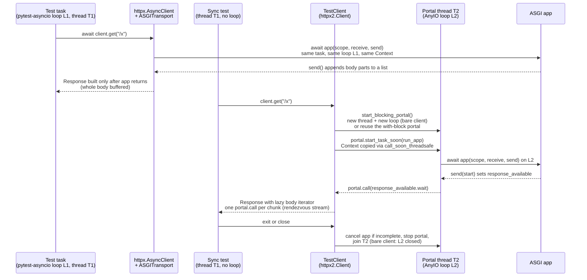

# Testing ASGI Applications Without Sockets: httpx.ASGITransport (0.28.1) vs Starlette TestClient (AnyIO Portal Thread Bridging)

> [!summary] Claim
> `httpx.ASGITransport` (`0.28.1`) awaits your app inline, in the test's own task, event loop, and `contextvars` context, and buffers the whole response before returning it, while Starlette `TestClient` (`1.10.0`) runs the app on an AnyIO blocking-portal event loop in a second thread (a brand-new loop and thread per request unless you enter `with TestClient(app)`), so loop-bound objects, context variables, lifespan state, and streaming all behave differently under the two clients, and differently again under a real server.

Part of [ASGI and Starlette Internals](README.md) in [API Engineering](../README.md).

## TL;DR

- Mechanism: `ASGITransport.handle_async_request` builds an `http` scope from the `httpx.Request` and runs `await self.app(scope, receive, send)` directly, with no task, thread, or socket in between (httpx 0.28.1 `httpx/_transports/asgi.py`, `ASGITransport.handle_async_request`); `TestClient` is a sync `httpx2.Client` whose transport enters `anyio.from_thread.start_blocking_portal()` and drives the app through `portal.call` and `portal.start_task_soon` (starlette 1.10.0 `starlette/testclient.py`, `_TestClientTransport.handle_request`).
- Contract rule: whatever is bound to an event loop (an `asyncio.Event`, `Lock`, `Queue`, a database pool, an `httpx.AsyncClient`) must be created on the loop that will use it; with `ASGITransport` that is the test's loop, with `with TestClient(app)` it is the portal loop created in `__enter__`, and with a bare `TestClient(app)` there is no stable loop at all.
- Trap: the lab measures that a bare `TestClient(app)` gives two consecutive requests two different, already-closed event loops, so an app-level `asyncio.Event` works on request one and raises `RuntimeError: ... is bound to a different event loop` on request two; and `ASGITransport` lets an app's `ContextVar.set()` leak back into the test, which no production server allows.
- Portability fact: both clients hard-code `http_version` `"1.1"`, neither advertises an ASGI `spec_version`, `ASGITransport` sends no `state` and no `extensions`, and `TestClient` sends no `asgi` key at all, so code that branches on those keys runs a different path in tests than under uvicorn `0.54.0` (`spec_version` `"2.3"`) or Hypercorn `0.18.0` (HTTP `spec_version` `"2.1"`).
- When not to use it: neither client tests framing, keep-alive, HTTP/2, backpressure, real disconnects, timeouts, or worker signals; use a socket test against a real server for those, and do not use `TestClient` inside `async def` tests at all (it blocks the test loop while the app runs on another).

## Mental model



The upper half is `ASGITransport`: the test's coroutine awaits the transport, which awaits the application in the same task, so the app sees the test's loop, thread, and `contextvars.Context` object itself, and the transport returns a `Response` only after the app has returned and every body part has been collected into a list.
The lower half is `TestClient`: a synchronous test calls a synchronous `httpx2.Client`, whose transport asks an AnyIO blocking portal (a second thread running its own event loop) to start the app as a task; the context the app sees is a copy of the calling thread's context taken by `loop.call_soon_threadsafe`.
The sync thread blocks in `portal.call(response_available.wait)` until the app sends `http.response.start`, and then pulls each body chunk across the thread boundary on demand, so `TestClient` streams while `ASGITransport` buffers.
When the response is closed, the transport cancels an unfinished app, and for a bare client the portal context manager exits, which stops the loop and joins the thread, leaving any object bound to that loop permanently unusable.

## How it works

### `httpx.ASGITransport`: one coroutine call, one task

The whole transport is one 187-line file (httpx 0.28.1 `httpx/_transports/asgi.py`), and every behavior below is visible in `ASGITransport.handle_async_request`.

The constructor takes four arguments: `app`, `raise_app_exceptions=True`, `root_path=""`, and `client=("127.0.0.1", 123)` (httpx 0.28.1 `httpx/_transports/asgi.py`, `ASGITransport.__init__`).
The scope it builds is a fixed literal:

| Scope key | Value `ASGITransport` sends | Consequence |
|---|---|---|
| `type` | `"http"` | Never `"lifespan"` and never `"websocket"`; the transport cannot drive either protocol |
| `asgi` | `{"version": "3.0"}` | No `spec_version`, so per the ASGI spec the app must assume `"2.0"` |
| `http_version` | `"1.1"` | Hard-coded; nothing about HTTP/2 or HTTP/3 is emulated |
| `method` | `request.method` | Verbatim |
| `headers` | `[(k.lower(), v) for (k, v) in request.headers.raw]` | Includes httpx defaults such as `user-agent: python-httpx/0.28.1`, `host`, `accept`, `accept-encoding`, `connection` |
| `scheme` | `request.url.scheme` | `"https"` only if `base_url` says so, which matters for `Secure` cookies (below) |
| `path` | `request.url.path` | Already percent-decoded by `httpx.URL` |
| `raw_path` | `request.url.raw_path.split(b"?")[0]` | Query stripped |
| `query_string` | `request.url.query` | Bytes, still encoded |
| `server` | `(request.url.host, request.url.port)` | `port` is `None` for the scheme's default port, so `base_url="http://test"` gives `("test", None)` |
| `client` | `self.client` | Default `("127.0.0.1", 123)` |
| `root_path` | `self.root_path` | Default `""` |
| `state` | absent | Lifespan state never reaches the app without help |
| `extensions` | absent | No trailers, no debug, no early hints, no path send |

`receive()` walks the request's `AsyncByteStream`: each chunk becomes `{"type": "http.request", "body": chunk, "more_body": True}`, exhaustion becomes `{"type": "http.request", "body": b"", "more_body": False}`, and any later call waits on `response_complete` and then returns `{"type": "http.disconnect"}`.
That last rule means an `ASGITransport` app can never observe a client disconnect while it is still producing a response; the disconnect arrives only after the app itself has sent the final body.
Because httpx encodes an empty body as `ByteStream(b"")`, whose `__aiter__` yields one `b""` chunk (httpx 0.28.1 `httpx/_content.py`, `ByteStream` and `encode_request`), even a `GET` produces two events, `(b"", True)` then `(b"", False)`, which the lab asserts.

`send()` is a minimal state machine: `http.response.start` is guarded by `assert not response_started` and records `status` and `headers`; `http.response.body` is guarded by `assert not response_complete.is_set()`, appends non-empty bodies to `body_parts` unless the method is `HEAD`, and sets `response_complete` when `more_body` is false.
Any other message type, including `http.response.trailers` and `http.response.debug`, is silently ignored, and a body before a start is not rejected at `send()` time; only the final `assert status_code is not None` catches an app that never sends a start at all, and a start sent after the final body is accepted.

The response stream is `ASGIResponseStream(body_parts)`, whose `__aiter__` yields `b"".join(self._body)` exactly once.
So `client.stream(...)` returns only after the app has finished, `aiter_raw()` yields one chunk however many the app sent, and an endless stream such as Server-Sent Events never returns at all.

Error handling is three lines: if the app raises an `Exception` and `raise_app_exceptions` is true it propagates out of `await client.get(...)`; otherwise the transport sets `response_complete`, and fills in `status_code = 500` and empty headers if the app had not started a response.
After the app returns, three bare `assert` statements check `response_complete`, `status_code`, and `response_headers`, so an app that returns without responding surfaces as an `AssertionError` with no message.

The transport is backend-neutral: `create_event()` asks `sniffio.current_async_library()` and returns a `trio.Event` under Trio, otherwise an `asyncio.Event` (httpx 0.28.1 `httpx/_transports/asgi.py`, `is_running_trio` and `create_event`).

What the transport does not do is as important as what it does:

- It never applies `timeout`.
  `AsyncClient._set_timeout` stores the timeout in `request.extensions["timeout"]` (httpx 0.28.1 `httpx/_client.py`, `BaseClient._set_timeout`), only the network transports read it, and the lab proves a `client.get("/slow", timeout=0.001)` against a handler that sleeps `0.05` s returns `b"late"` without `httpx.ReadTimeout`.
- It never runs lifespan; the httpx documentation says this "is not in the scope of HTTPX" and points to `asgi-lifespan` (httpx 0.28.1 `docs/advanced/transports.md`, ASGI startup and shutdown).
- It never creates a task, so the app runs in the caller's `contextvars.Context` object and on the caller's loop.
- It refuses sync request bodies: `AsyncClient._send_single_request` raises `RuntimeError("Attempted to send an sync request with an AsyncClient instance.")` when `request.stream` is not an `AsyncByteStream` (httpx 0.28.1 `httpx/_client.py`, `AsyncClient._send_single_request`), so `content=iter([...])` needs an async generator instead.

### The context-sharing consequence

A real server runs each request in its own task: uvicorn `0.54.0` calls `self.loop.create_task(cycle.run_asgi(app))`, and with the opt-in `reset_contextvars=True` passes `context=contextvars.Context()` instead, a workaround its source comment ties to CPython issue 140947 (uvicorn 0.54.0 `uvicorn/protocols/http/httptools_impl.py`, `HttpToolsProtocol._start_asgi_task`).
`asyncio.create_task` copies the current context, so an app's `ContextVar.set()` dies with the request task.
Under `ASGITransport` there is no task boundary, so the write lands in the test's own context: the lab sets `REQUEST_TAG` to `"set-by-test"`, the app reads it and sets `"written-by-app"`, and after the request the test reads `"written-by-app"`.
The leak applies only to code that runs inline; when `spec_version` is below `2.4` (as under both test clients), a Starlette `StreamingResponse` produces its body in a child task of an AnyIO task group (starlette 1.10.0 `starlette/responses.py`, `StreamingResponse.__call__`), and that child task gets a copy.
The consequences for request-scoped state are the subject of [[ASGI-State-Isolation-and-ContextVars-Across-Request-Lifecycle]].

### Starlette `TestClient`: a sync facade over an AnyIO blocking portal

`TestClient` subclasses `httpx2.Client`, not `httpx.Client`: the module imports `httpx2 as httpx` and falls back to plain `httpx` only if `httpx2` is missing, emitting `StarletteDeprecationWarning("Using \`httpx\` with \`starlette.testclient\` is deprecated; install \`httpx2\` instead.")` (starlette 1.10.0 `starlette/testclient.py`, module import block).
Support for `httpx2` arrived in Starlette `1.2.0` (2026-05-28, #3291) (starlette 1.10.0 `docs/release-notes.md`).
In this workspace `httpx2 2.16.0` is installed as a transitive dependency of `mcp 2.3.0` (`labs/uv.lock`), so `TestClient` responses are `httpx2.Response` objects, which the lab asserts; `isinstance(response, httpx.Response)` is false, and anything that patches or type-checks against `httpx` (for example `respx`, which mocks `httpx`) does not see `TestClient` traffic.
Its defaults: `base_url="http://testserver"`, `raise_server_exceptions=True`, `root_path=""`, `backend="asyncio"`, `follow_redirects=True` (plain `httpx` defaults to `False`), `client=("testclient", 50000)`, and a `user-agent: testclient` header (starlette 1.10.0 `starlette/testclient.py`, `TestClient.__init__`).
Passing `timeout=` to a request emits a `StarletteDeprecationWarning` that links Starlette issue 1108, because the transport cannot enforce it (starlette 1.10.0 `starlette/testclient.py`, `TestClient.request`; warning added in 0.46.0, #2840).
ASGI 2 double-callable apps are detected with `_is_asgi3` and wrapped in `_WrapASGI2`.

#### The portal

`anyio.from_thread.start_blocking_portal(backend, backend_options)` creates a `concurrent.futures.Future`, starts a daemon `threading.Thread` whose target runs a fresh event loop (`run_eventloop(run_portal, ...)`), renames it `f"{backend}-portal-{id(portal_):x}"` when no `name` is passed, waits for the portal object, yields it, and on exit calls `portal.call(portal.stop, cancel_remaining_tasks)` and `thread.join()` (anyio 4.16.0 `src/anyio/from_thread.py`, `start_blocking_portal`).
On CPython `>= 3.14` it passes `context=Context()` to the thread explicitly, which matters on free-threaded builds where `sys.flags.thread_inherit_context` defaults to true and a thread would otherwise start with a copy of the caller's context (CPython 3.14 `Doc/library/threading.rst`, `Thread`).
`BlockingPortal.call(func, *args)` schedules `func` into the portal's task group from the foreign thread and blocks on a `concurrent.futures.Future` for the result; it raises `RuntimeError("This method cannot be called from the event loop thread")` if called from the portal's own thread (anyio 4.16.0 `src/anyio/from_thread.py`, `BlockingPortal._check_running`).
The cross-thread hop on asyncio is `loop.call_soon_threadsafe(wrapper)` (anyio 4.16.0 `src/anyio/_backends/_asyncio.py`, `AsyncIOBackend.run_sync_from_thread`), and asyncio documents `call_soon_threadsafe` as a thread-safe variant of `call_soon`, whose entry says "Callbacks use the current context when no *context* is provided" (CPython 3.14 `Doc/library/asyncio-eventloop.rst`, `loop.call_soon` and `loop.call_soon_threadsafe`); in source, `Handle.__init__` calls `contextvars.copy_context()` when `context` is `None` (CPython 3.14.6 `Lib/asyncio/events.py`, `Handle.__init__`), so the scheduled callback, and the task it starts, run in a copy of the test thread's context.
That is why the lab sees the test's `ContextVar` value inside the app under `TestClient`, and why the app's write does not come back: copy in, nothing out.

#### Which portal: per request, or per `with` block

`TestClient._portal_factory` yields `self.portal` if it is set, and otherwise enters a new `start_blocking_portal()` (starlette 1.10.0 `starlette/testclient.py`, `TestClient._portal_factory`).
`self.portal` is set only by `TestClient.__enter__`, which starts the portal, runs the lifespan task in it, waits for startup, and registers shutdown, transport close, and portal reset callbacks.
So:

| Usage | Event loops | Threads | Lifespan |
|---|---|---|---|
| `client = TestClient(app)` | One new loop per request, closed when the response is closed | One new thread per request, joined afterwards | Never runs |
| `with TestClient(app) as client:` | One loop for lifespan and every request in the block | One portal thread for the block | `startup` in `__enter__`, `shutdown` in `__exit__` |
| `client.websocket_connect(...)` on a bare client | One new loop per WebSocket session | One per session | Never runs |

The lab measures every row-one claim: two sequential requests on a bare client run on two threads that are not the test thread, on two distinct loop objects, and both loops report `is_closed()` afterwards; inside a `with` block the two requests and the lifespan share one loop object, which is open inside the block and closed after it.

#### The request path

`_TestClientTransport.handle_request` builds the scope differently from `ASGITransport` (starlette 1.10.0 `starlette/testclient.py`, `_TestClientTransport.handle_request`):

- `path` is `unquote(request.url.path)`; `raw_path` strips the query (since 0.41.3, #2716); `server` is `[host, port]` with the scheme's default port filled in (`80` or `443`), never `None`.
- `extensions` is `{"http.response.debug": {}, "http.response.trailers": {}}`, and `state` is `self.app_state.copy()`, a fresh shallow copy of the lifespan state per request.
- There is no `asgi` key at all.

`receive()` calls `request.read()` and returns the whole body as one `{"type": "http.request", "body": body_bytes}` message with no `more_body` key; the `GeneratorType` branch that would stream chunks is marked `# pragma: no cover`, and in the lab an iterator of two chunks arrives as one event `(b"abcd", False)`.
After that, `receive()` waits on `response_complete` and returns `http.disconnect`, the same rule as `ASGITransport`.

`send()` validates ordering with messages a test can read: `'Received multiple "http.response.start" messages.'`, `'Received "http.response.body" without "http.response.start".'`, `'Received "http.response.body" after response completed.'`, and three trailer rules.
It collects `http.response.trailers` into `response.extensions["http.response.trailers"]` (since 1.7.0, #3563) and `http.response.debug` `info` into `response.extensions["http.response.debug"]`, which is how `TemplateResponse` exposes `.template` and `.context` to tests (starlette 1.10.0 `docs/testclient.md`, HTTP trailers and Debug information).

The transport starts the app with `portal.start_task_soon(run_app)` inside a cancel scope, blocks on `portal.call(response_available.wait)`, and if the app finished without `http.response.start` raises `AssertionError("TestClient did not receive any response.")` (or returns an empty `500` when `raise_server_exceptions=False`).
Body chunks travel through `anyio.create_memory_object_stream[tuple[bytes, bool]](0)`, a zero-capacity rendezvous: the app's `send()` blocks until the sync side's `iter_body()` calls `portal.call(receive_body)`, so the app can run at most one chunk ahead of the reader.
That is the streaming behavior added in 1.9.0 (2026-10-18, #3491): "`client.stream()` returns before the application finishes. Closing an unfinished streamed response now cancels the application" (starlette 1.10.0 `docs/release-notes.md`).
The cancel path is `close_app` -> `cancel_if_incomplete` -> `cancel_scope.cancel()`, then `wait_futures([app_task])`, then re-raising the app's exception if `raise_server_exceptions` is set and no other exception is already propagating.
The lab proves it: after reading `b"first"` from a stream whose generator then sleeps for an hour, leaving the `with client.stream(...)` block delivers `CancelledError` into the generator, which records `"cancelled"`.

#### Lifespan under `TestClient`

`TestClient.lifespan` calls the app with `{"type": "lifespan", "state": self.app_state}` and the receive and send ends of two unbounded (`math.inf`) memory object streams that `__enter__` created; `wait_startup` sends `lifespan.startup` and asserts the reply is `lifespan.startup.complete` or `lifespan.startup.failed`, and a `None` sentinel from a crashed lifespan task re-raises its exception via `self.task.result()` (starlette 1.10.0 `starlette/testclient.py`, `TestClient.lifespan`, `wait_startup`, `wait_shutdown`).
Because the shutdown wait is a callback on the `with` block's exit stack, shutdown runs on the portal loop after the last request.

### Lifespan for `ASGITransport`: `asgi-lifespan`

`LifespanManager(app, startup_timeout=5, shutdown_timeout=5)` runs the lifespan protocol on the caller's loop: it puts `lifespan.startup` in a capacity-2 queue, runs the app in the background, waits up to the timeout for `lifespan.startup.complete`, and raises `LifespanNotSupported` if the app calls `send()` before `receive()` or crashes before its first `receive()` (asgi-lifespan 2.1.0 `src/asgi_lifespan/_manager.py`, `LifespanManager`).
It handles state by wrapping the app: `self.app = state_middleware(app, self._state)`, where `state_middleware` does `scope["state"] = state` for every scope, the same dict object every time.
Two consequences follow, both measured in the lab:

- The state reaches requests only if the transport wraps `manager.app`; `ASGITransport(app=app)` with the original `app` sees no `state` even though startup ran, and the lab's `/state` route answers `503`.
- The ASGI lifespan specification says "the server will ensure that a *shallow copy* of the namespace is passed into each subsequent request/response call" (asgiref 3.13.0 `specs/lifespan.rst`, Lifespan State), and `TestClient` does exactly that with `self.app_state.copy()`; `asgi-lifespan` does not, so a request that rebinds a key (`request.state.counter += 1`) changes it for every later request: the lab counts `[1, 2]` under `LifespanManager` and `[1, 1]` under `with TestClient(app)`.

Starlette itself refuses stateful lifespans without server support: when the lifespan context yields a mapping and `"state" not in scope`, `Router.lifespan` raises `RuntimeError('The server does not support "state" in the lifespan scope.')` (starlette 1.10.0 `starlette/routing.py`, `Router.lifespan`); the startup and shutdown protocol itself is in [[ASGI-Lifespan-Protocol-Startup-Shutdown-and-Scope-State]].

### Why loop affinity breaks: `_LoopBoundMixin`

`asyncio.Lock`, `Event`, `Condition`, `Semaphore`, `Queue`, and `Barrier` inherit `_LoopBoundMixin` (checked with `issubclass` on CPython `3.14.6`), whose `_get_loop()` stores the running loop on first use and raises `RuntimeError(f'{self!r} is bound to a different event loop')` on any later use from another loop (CPython 3.14.0 `Lib/asyncio/mixins.py`, `_LoopBoundMixin._get_loop`; the same message is in the 3.12.0 and 3.13.0 files).
Binding is lazy: `Event.wait()` calls `self._get_loop().create_future()` only when the flag is not set, so an `Event` created at import time is harmless until something blocks on it.
The lab's `/poll` route long-polls an `asyncio.Event` created at app construction with `asyncio.wait_for(..., timeout=0.001)`; on a bare `TestClient` the first request binds it to portal loop 1 and returns `204`, and the second request runs on portal loop 2 and raises `RuntimeError: <asyncio.locks.Event object at 0x... [unset]> is bound to a different event loop`.
The mirror image is just as real: an `Event` first awaited on the pytest-asyncio loop (as an async fixture would) works through `ASGITransport` and fails through `TestClient` on the very first request.
Real libraries fail the same way with different messages: FastAPI's own documentation tells readers who hit `RuntimeError: Task attached to a different loop` to create loop-needing objects inside async startup code (fastapi 0.162.0 `docs/en/docs/advanced/async-tests.md`), and Starlette's documentation warns that "Defining an `event_loop` fixture does not make `TestClient` use that loop" (starlette 1.10.0 `docs/testclient.md`, Asynchronous tests).
The same class of bug also exists without `TestClient`: this workspace sets `asyncio_default_fixture_loop_scope = "function"` (`labs/pyproject.toml`), and pytest-asyncio `1.4.1.post1` defaults `asyncio_default_test_loop_scope` to `"function"` (pytest-asyncio 1.4.1.post1 `pytest_asyncio/plugin.py`, `pytest_addoption`), so a session-scoped async fixture and a function-scoped test run on different loops unless their `loop_scope` values agree.

### `TestClient` inside an `async def` test

Calling `TestClient` from a coroutine is legal, because the portal thread is not the caller's thread, but every `portal.call` blocks the calling thread with `Future.result()`, so the test's own event loop is frozen while the request runs.
Anything the app needs from the test loop (a fixture-owned connection, a task the test started, an `Event` the test will set) cannot make progress: depending on the primitive it either raises a cross-loop `RuntimeError` or deadlocks.
That reading is from source (anyio 4.16.0 `BlockingPortal.call`, starlette 1.10.0 `_TestClientTransport.handle_request`); the lab does not run a deadlock, because a test that hangs is not a deterministic test.
FastAPI's documentation states the conclusion directly: once tests are asynchronous, "we can no longer use the `TestClient` inside our test functions" (fastapi 0.162.0 `docs/en/docs/advanced/async-tests.md`, HTTPX).

## Numbers and limits

| Quantity | Value | Source |
|---|---|---|
| `ASGITransport` default `client` | `("127.0.0.1", 123)` | httpx 0.28.1 `ASGITransport.__init__`; asserted in lab |
| `TestClient` default `client`, `base_url`, `user-agent` | `("testclient", 50000)`, `http://testserver`, `testclient` | starlette 1.10.0 `TestClient.__init__`; asserted in lab |
| `TestClient` `follow_redirects` default | `True` (httpx and httpx2 default `False`) | starlette 1.10.0 `TestClient.__init__` |
| `ASGITransport` response chunks delivered | always 1 (`b"".join(body_parts)`) | httpx 0.28.1 `ASGIResponseStream.__aiter__`; lab: two app chunks -> `[b"firstsecond"]` |
| `TestClient` body stream capacity | `0` items (rendezvous; app at most one chunk ahead) | starlette 1.10.0 `handle_request`, `create_memory_object_stream[...](0)` |
| `TestClient` lifespan and WebSocket stream capacity | `math.inf` | starlette 1.10.0 `TestClient.__enter__`, `WebSocketTestSession._run` |
| `asgi-lifespan` startup and shutdown timeouts | `5` s each; receive queue capacity `2` | asgi-lifespan 2.1.0 `LifespanManager.__init__` |
| Request events for a `GET` via `ASGITransport` | 2: `(b"", True)`, `(b"", False)` | lab |
| Request events for a 2-chunk body via `TestClient` | 1: `(b"abcd", False)`, no `more_body` key | lab |
| Starlette `StreamingResponse` disconnect-listener cutoff | used when `spec_version < (2, 4)`; both test clients imply `"2.0"` | starlette 1.10.0 `StreamingResponse.__call__` |
| Per-request cost, `GET /where`, `ASGITransport` | 219 to 496 us | measured 2026-11-14 by the verifier: 3 runs x 500 requests after 50 warm-up per mode, `uv run --frozen python bench.py` from `labs/` (a throwaway script, deleted after the run), CPython `3.14.6`, macOS `27.3` (`uname -r` `27.3.0`) arm64, Apple M3 Pro |
| Per-request cost, `with TestClient(app)` | 2095 to 2982 us | same run |
| Per-request cost, bare `TestClient(app)` (new thread and loop each) | 2781 to 3840 us | same run |
| Lab wall time | `23 passed in 1.22s` | lab run below |

The timing spread is wide because the machine was not isolated (the drafter's earlier run on the same machine gave 117 to 147, 1877 to 5639, and 4506 to 5991 us); treat the ratios (roughly 4x to 18x between `ASGITransport` and `TestClient` in the verifier's run, from the extremes of the three runs, and 5x to 17x within any single run) as the finding, not the microseconds.
The likely cost centers in `TestClient`, read from source and not profiled, are two thread hops per `portal.call` (`call_soon_threadsafe` plus a `concurrent.futures.Future` wait) and one `portal.call` per body chunk; the bare client adds thread creation, loop creation, and `thread.join()` per request.

Version timeline of the `TestClient` behaviors above (starlette 1.10.0 `docs/release-notes.md`): `client=` parameter 0.44.0 (2024-12-28, #2810); `timeout=` deprecation warning 0.46.0 (2025-02-22, #2840); `httpx2` support 1.2.0 (2026-05-28, #3291); trailer capture 1.7.0 (2026-09-23, #3563); streamed bodies and cancel-on-close 1.9.0 (2026-10-18, #3491).
Before 1.9.0, `TestClient` collected the whole body before returning, as `ASGITransport` still does (as of 2026-11).

## Portability

One leg ran: the lab module under the workspace interpreter, CPython `3.14.6` on macOS `27.3` arm64, `23 passed`.
The other CPython legs were not run, because lab checks were paused for this batch (2026-11-11); their cells cite source instead.

| Runtime or component | Behavior | Verification |
|---|---|---|
| CPython `3.14.6` | Every lab claim: thread and loop identity, per-request portal loops, cross-loop `RuntimeError`, context copy vs share, buffering vs streaming, lifespan state copy vs share, scope defaults, error paths | Ran: `uv run --frozen pytest tests/f10_asgi_and_starlette_internals/test_in_process_testing_of_asgi_apps_with_httpx_asgitransport.py -q`, `23 passed` |
| CPython `3.12.16`, `3.13.18` | `threading.Thread` has no `context` parameter, so anyio takes the `sys.version_info < (3, 14)` branch and starts the portal thread without one; requests still run in a context copied by `call_soon_threadsafe`; `_LoopBoundMixin` raises the same message | Not run (paused); anyio 4.16.0 `start_blocking_portal`; CPython 3.12.0 and 3.13.0 `Lib/asyncio/mixins.py` fetched |
| CPython `3.14.10` | Same code paths as `3.14.6` | Not run (paused) |
| CPython `3.15.2` | No change found in the paths above | Not run (paused); `requires-python = ">=3.12,<3.16"` |
| CPython `3.15.2t` free-threaded | `sys.flags.thread_inherit_context` defaults true on free-threaded builds, but anyio passes `context=Context()` explicitly on `>= 3.14`, so the portal thread's base context stays empty; per-request context still comes from `call_soon_threadsafe` | Not run (paused); CPython 3.14 `Doc/library/threading.rst`, anyio 4.16.0 source |
| httpx `0.28.1` vs httpx2 `2.16.0` | `httpx2/_transports/asgi.py` differs from httpx 0.28.1 only in typing syntax, comments, and docstrings; the scope, `receive`, `send`, and buffering logic are line-for-line identical | `diff` of the two installed files |
| Starlette `< 1.9.0` | `TestClient` buffered the full body; closing an unfinished stream did not cancel the app | starlette 1.10.0 `docs/release-notes.md`, 1.9.0 entry |
| Trio | `ASGITransport` creates `trio.Event` via `sniffio`; `TestClient(backend="trio")` runs the portal on Trio | Not run: `trio` is not installed in the workspace |
| uvicorn `0.54.0` | Per-request task with a copied context (or an empty one with `reset_contextvars=True`); scope carries `spec_version` `"2.3"` | uvicorn 0.54.0 `httptools_impl.py`, `_start_asgi_task` and scope construction |
| Hypercorn `0.18.0` | HTTP scope carries `spec_version` `"2.1"` (its WebSocket scope says `"2.3"`, `hypercorn/protocol/ws_stream.py`) | hypercorn 0.18.0 `hypercorn/protocol/http_stream.py`, `HTTPStream.handle` |
| Granian `2.8.7` | Not examined for this note | - |
| HTTP/1.1, HTTP/2, HTTP/3 | Both clients hard-code `http_version` `"1.1"` and emulate no framing; Starlette says its test transport "does not emulate HTTP/2 framing or concurrent request and response streaming" | httpx 0.28.1 and starlette 1.10.0 source; starlette 1.10.0 `docs/testclient.md` |

## Worked example

The [implementation](../labs/src/api_labs/f10_asgi_and_starlette_internals/in_process_test_clients.py) is one Starlette app whose routes record where they ran (`Sighting(thread_id, loop, tag_seen)`), a long-poll on an `asyncio.Event` created at construction time, a two-chunk stream that can hold forever, a lifespan that yields `{"counter": 0}`, and raw ASGI apps that record `receive()` events, crash before `http.response.start`, or return without responding.
The [test](../labs/tests/f10_asgi_and_starlette_internals/test_in_process_testing_of_asgi_apps_with_httpx_asgitransport.py) drives the same app through both clients.

The loop-bound route and the probe field it uses (simplified excerpt of `in_process_test_clients.py`):

```python
@dataclass
class Probe:
    # Created outside any loop, exactly like a module-level or app-construction-time
    # primitive; asyncio binds it to the first loop that blocks on it.
    changed: asyncio.Event = field(default_factory=asyncio.Event)


def build_app(probe: Probe) -> Starlette:
    async def poll(_request: Request) -> Response:
        try:
            await asyncio.wait_for(probe.changed.wait(), timeout=POLL_WAIT_SECONDS)
        except TimeoutError:
            return Response(status_code=204)
        return Response(status_code=200)
```

The cross-loop tests, verbatim from the test module:

```python
@pytest.mark.unit
def test_loop_bound_primitive_breaks_on_the_second_testclient_request() -> None:
    client = TestClient(build_app(Probe()))
    assert client.get("/poll").status_code == 204
    with pytest.raises(RuntimeError, match="is bound to a different event loop"):
        client.get("/poll")


@pytest.mark.unit
def test_loop_bound_primitive_survives_inside_one_testclient_with_block() -> None:
    with TestClient(build_app(Probe())) as client:
        statuses = [client.get("/poll").status_code for _ in range(3)]
    assert statuses == [204, 204, 204]


@pytest.mark.unit
@pytest.mark.asyncio
async def test_event_bound_to_the_test_loop_fails_via_testclient_not_asgitransport() -> None:
    probe = Probe()
    with pytest.raises(TimeoutError):
        await asyncio.wait_for(probe.changed.wait(), timeout=0.001)  # binds to the test loop
    app = build_app(probe)
    async with make_client(httpx.ASGITransport(app=app)) as client:
        assert (await client.get("/poll")).status_code == 204
    with pytest.raises(RuntimeError, match="is bound to a different event loop"):
        TestClient(app).get("/poll")
```

The context tests, verbatim:

```python
@pytest.mark.unit
@pytest.mark.asyncio
async def test_asgitransport_shares_the_callers_context_so_app_writes_leak_back() -> None:
    token = REQUEST_TAG.set("set-by-test")
    try:
        async with make_client(httpx.ASGITransport(app=build_app(Probe()))) as client:
            response = await client.get("/where")
        assert response.json() == {"tag_seen": "set-by-test"}
        assert REQUEST_TAG.get() == "written-by-app"
    finally:
        REQUEST_TAG.reset(token)


@pytest.mark.unit
def test_testclient_copies_the_callers_context_so_app_writes_stay_in_the_portal() -> None:
    token = REQUEST_TAG.set("set-by-test")
    try:
        response = TestClient(build_app(Probe())).get("/where")
        assert response.json() == {"tag_seen": "set-by-test"}
        assert REQUEST_TAG.get() == "set-by-test"
    finally:
        REQUEST_TAG.reset(token)
```

The streaming contrast, verbatim:

```python
@pytest.mark.unit
@pytest.mark.asyncio
async def test_asgitransport_buffers_the_whole_body_before_returning_the_response() -> None:
    probe = Probe()
    async with (
        make_client(httpx.ASGITransport(app=build_app(probe))) as client,
        client.stream("GET", "/stream") as response,
    ):
        assert probe.stream_events == ["start", "resumed", "finished"]
        chunks = [chunk async for chunk in response.aiter_raw()]
    assert chunks == [b"firstsecond"]
```

```python
@pytest.mark.unit
def test_testclient_streams_and_closing_early_cancels_the_app() -> None:
    probe = Probe()
    client = TestClient(build_app(probe))
    with client.stream("GET", "/stream?hold=1") as response:
        first = next(response.iter_raw())
        assert probe.stream_resumed.wait(timeout=5)
        assert "finished" not in probe.stream_events
    assert first == b"first"
    assert probe.stream_events == ["start", "resumed", "cancelled"]
```

The other tests in the module cover: the app running on the test's thread and loop under `ASGITransport`; new, closed portal loops per bare-client request; one shared loop for lifespan and requests inside `with TestClient`; an unbounded stream that never returns through `ASGITransport` (bounded by `asyncio.timeout(0.2)`); the ignored httpx `timeout`; lifespan not running under `ASGITransport`; `LifespanManager` state reaching requests only through `manager.app` and being shared rather than copied; `TestClient` copying state per request; both scope dictionaries; `httpx2` response types; request event chunking under both clients; app exceptions and the synthesized empty `500`; apps that never respond; and a `Secure` cookie that round-trips only with an `https` `base_url`.

Captured run, CPython `3.14.6`, macOS `27.3` arm64, from `labs/`:

```text
$ uv run --frozen pytest tests/f10_asgi_and_starlette_internals/test_in_process_testing_of_asgi_apps_with_httpx_asgitransport.py -q
.......................                                                  [100%]
23 passed in 1.22s
```

## Pitfalls

> [!warning] A bare `TestClient(app)` gives every request a new, short-lived event loop
> Trigger: an app (or a module it imports) creates an `asyncio.Lock`, `Event`, `Queue`, connection pool, or `httpx.AsyncClient` once, and tests use `client = TestClient(app)` without `with`.
> Symptom: the first test that touches it passes and a later one fails with `RuntimeError: ... is bound to a different event loop`, `Task ... got Future ... attached to a different loop`, or a driver-specific error; reordering tests changes which one fails.
> Fix: create loop-bound resources in the lifespan and use `with TestClient(app) as client:` (one loop for the block), or switch the suite to `httpx.AsyncClient` plus `ASGITransport` plus `LifespanManager` so everything shares the test loop.

> [!warning] An async fixture's resources are on a different loop from `TestClient`
> Trigger: an `async def` fixture opens a database connection or creates a queue on the pytest-asyncio loop, and a sync test uses `TestClient` with an app that uses that object.
> Symptom: cross-loop `RuntimeError` on the first request, or a hang if the object waits on I/O that only the frozen test loop can drive.
> Fix: never mix the two models in one test; Starlette's documentation says "For synchronous tests, create and close resources in lifespan" (starlette 1.10.0 `docs/testclient.md`), and for async tests use `ASGITransport`.

> [!warning] `ASGITransport` lets the app write into the test's `contextvars`
> Trigger: middleware or an endpoint sets a `ContextVar` (a request ID, a tenant, an OpenTelemetry context) and never resets it, which is harmless under a server because the request task dies.
> Symptom: the value is still set in the test after the request, so the next request in the same test inherits the previous tenant, or an assertion about "no context outside a request" passes in production and fails in tests (or the reverse).
> Fix: reset with the token in a `finally` in the app (correct anyway), or isolate each test request with `await asyncio.create_task(client.get(...))`, which copies the context.

> [!warning] Streaming and SSE endpoints hang under `ASGITransport`
> Trigger: `await client.get("/events")` or `client.stream(...)` against an endless `StreamingResponse` or `sse-starlette` endpoint.
> Symptom: the test never finishes, and `timeout=` does nothing because the transport ignores it.
> Fix: bound the test with `asyncio.timeout(...)`, make the endpoint finite under a test flag, use Starlette `TestClient` `>= 1.9.0` (which streams and cancels on close), or run a real server on `127.0.0.1:0`; SSE framing itself is in [[Server-Sent-Events-SSE-Protocol-Last-Event-ID-and-SSE-Starlette]].

> [!warning] `LifespanManager(app)` runs startup, but requests see no state
> Trigger: `async with LifespanManager(app): transport = ASGITransport(app=app)`.
> Symptom: startup logs appear, yet `request.state.db` raises `AttributeError` (Starlette's `State`) or a FastAPI dependency fails, because only `manager.app` injects `scope["state"]`.
> Fix: `async with LifespanManager(app) as manager: transport = ASGITransport(app=manager.app)`; and remember that `asgi-lifespan` shares one dict across requests, unlike the shallow copy the spec requires.

> [!warning] `Secure` cookies vanish with `base_url="http://test"`
> Trigger: a login endpoint sets `Set-Cookie: sid=...; Secure` and the next request expects the session.
> Symptom: the second request has no cookie; the lab sees `None` for `http://test` and `"abc"` for `https://test`.
> Fix: use an `https://` `base_url` for any suite that exercises secure cookies; the transport only copies the URL scheme into `scope["scheme"]`, so no TLS is involved.

> [!warning] `raise_app_exceptions=False` does not mean "behave like a server"
> Trigger: a test sets `raise_app_exceptions=False` (or `raise_server_exceptions=False`) to assert on a `500`.
> Symptom: when the app crashes before `http.response.start` the transport invents a `500` with an empty body and no headers, which is not what uvicorn or Starlette's `ServerErrorMiddleware` would send; the lab asserts `(500, b"", {})`.
> Fix: assert on the error response your middleware actually produces (Starlette and FastAPI apps send their own `500` before re-raising, see [[Starlette-Exception-Hierarchy-ServerErrorMiddleware-vs-ExceptionMiddleware]]), and keep a socket test for the server's own error path.

## Security and robustness

- Auth tests run against a fake network identity: `scope["client"]` is `("127.0.0.1", 123)` or `("testclient", 50000)`, so IP allow-lists, rate limits keyed on client address, and `ProxyHeadersMiddleware` trust decisions are exercised against values no real peer sends; set `client=` explicitly for every security test and add cases for untrusted addresses.
- `TrustedHostMiddleware` checks the `host` header, which both clients derive from `base_url` (`test` or `testserver`); a suite that adds those names to `allowed_hosts` for convenience can ship them to production configuration, see [[Starlette-AuthenticationMiddleware-SessionMiddleware-and-TrustedHost]].
- `scope["scheme"]` comes from the URL, not from TLS, so `HTTPSRedirectMiddleware`, `Secure` cookies, and HSTS logic are only exercised if the `base_url` is `https://`.
- Neither client enforces body-size limits, header limits, slow-client timeouts, or HTTP parser rules; tests that prove "a 1 GiB upload is rejected" or "request smuggling is impossible" must run against a real server, see [[HTTP-Request-Smuggling-CL-TE-and-Desync-Mechanics]].
- Silent acceptance is a robustness risk: `ASGITransport` ignores unknown message types, does not reject `http.response.body` before `http.response.start` at `send()` time, and accepts a start sent after the final body, so a broken pure-ASGI middleware can pass the suite; `TestClient` asserts ordering, so run middleware tests through `TestClient` or a contract-checking `send` wrapper (see [[Pure-ASGI-Middleware-Onion-Architecture-and-Send-Receive-Wrapping]]).
- Disconnect handling is untestable in-process with `ASGITransport` because `http.disconnect` arrives only after the response completes; `TestClient` cancels on close instead of sending `http.disconnect`, so cleanup tests there exercise cancellation, not the disconnect branch (see [[ASGI-HTTP-and-Disconnect-Event-Lifecycle]]).

## The principal's view

The decision is not "which client is better" but "which execution model does this test suite claim to reproduce", and the answer should be one model per suite, written down.
For async services (FastAPI or Starlette with async drivers), standardize on `httpx.AsyncClient` plus `ASGITransport` plus `LifespanManager(app)` with `manager.app`, all on one pytest-asyncio loop scope, because every loop-bound object then lives on one loop and the suite is roughly 4x to 18x faster per request than `TestClient` in the measurement above.
Accept its known gaps explicitly: no streaming, no timeout, shared context, shared lifespan state; wrap the transport in a small team fixture that bounds every request with `asyncio.timeout`, sets an `https` `base_url`, and runs each request in a fresh task, so the gaps are closed once rather than rediscovered by every team.
Keep `TestClient` for sync codebases, WebSocket tests (the only one of the two with a WebSocket session API), trailer and debug-extension assertions, and streaming cancellation tests, and always inside `with TestClient(app)`.
Neither replaces a thin layer of socket tests against the production server and configuration on `127.0.0.1:0`, which is where framing, keep-alive, disconnects, limits, and graceful shutdown live; budget that layer at a handful of tests per service, not per endpoint.
The organizational trade-off is that a uniform fixture hides the mechanism; the platform team that owns it must also own the documentation of what it cannot prove.
If most of the suite needs server behavior anyway, choose a framework whose test client runs a real server, or test at the HTTP boundary with contract and property tests (see [[Property-Based-API-Testing-with-Schemathesis-and-Hypothesis]]).

## Interview questions

> [!question] L5: Why does `await client.get("/")` through `httpx.ASGITransport` not need a running server or a socket?
>
> > [!success]- Answer
> > The transport converts the `httpx.Request` into an ASGI `http` scope and awaits `app(scope, receive, send)` directly in the caller's task.
> > `receive()` feeds request body chunks from the request stream, and `send()` records the status, headers, and body parts into local variables.
> > After the app returns, the transport builds an `httpx.Response` from those variables, so nothing is serialized to HTTP bytes at all.
> >
> > Follow-up: Which HTTP behaviors can such a test therefore never catch?

> [!question] L5: What is different between `client = TestClient(app)` and `with TestClient(app) as client:`?
>
> > [!success]- Answer
> > Without `with`, each request enters its own `anyio.from_thread.start_blocking_portal()`, so it gets a new thread and a new event loop that is closed when the response is closed, and lifespan never runs.
> > With `with`, `__enter__` starts one portal, runs `lifespan.startup` on it, and every request in the block reuses that loop; `__exit__` runs shutdown and stops the portal.
> > Loop-bound objects created in lifespan therefore work only in the `with` form.
> >
> > Follow-up: What does `client.websocket_connect()` do on a bare client?

> [!question] L5 (predict the output): An app sets `REQUEST_TAG.set("written-by-app")` in an endpoint; the test set it to `"set-by-test"` before calling `await client.get(...)` through `ASGITransport`, then prints `REQUEST_TAG.get()`; what prints, and what prints if the same test uses a sync `TestClient`?
>
> > [!success]- Answer
> > `ASGITransport` prints `written-by-app`, because the endpoint ran inline in the test's own task and context, so the write is visible after the request.
> > `TestClient` prints `set-by-test`, because the request ran in a copy of the test thread's context taken by `loop.call_soon_threadsafe` on the portal loop, so the app saw `set-by-test` but its write stayed in the copy.
> > Under uvicorn the write would die with the per-request task.
> > The lab asserts both outcomes.
> >
> > Follow-up: How would you make the `ASGITransport` case behave like the server without changing the app?

> [!question] L6 (debug this API test): A FastAPI suite passes when each test file runs alone, but the full run fails intermittently with `RuntimeError: <asyncio.locks.Event object at 0x...> is bound to a different event loop` in a long-poll endpoint; the tests use `client = TestClient(app)` at module level; what is wrong, and how do you fix it?
>
> > [!success]- Answer
> > The `Event` is created once with the app, and `asyncio` binds it to the first loop that blocks on it.
> > A bare `TestClient` starts a new portal loop per request, so the second request that waits on the event runs on a different loop and `_LoopBoundMixin._get_loop` raises.
> > Which test hits it first depends on ordering, hence "passes alone".
> > Fix by creating the event in lifespan and using `with TestClient(app)` in a fixture, or move the suite to `ASGITransport` with `LifespanManager` on one loop.
> >
> > Follow-up: Why does binding happen only when the event is not yet set?

> [!question] L6: Why does `client.stream("GET", "/events")` against an SSE endpoint hang through `ASGITransport`, and why does `timeout=1` not help?
>
> > [!success]- Answer
> > `ASGITransport` collects body parts in a list and builds the `Response` only after the app returns, so an endless stream never produces a response object.
> > The httpx timeout lives in `request.extensions["timeout"]`, which only the network transports read; the ASGI transport never looks at it.
> > Bound the await with `asyncio.timeout`, use `TestClient` `>= 1.9.0`, or test SSE against a real server.
> >
> > Follow-up: What happens to the app when `asyncio.timeout` fires?

> [!question] L6: `LifespanManager(app)` runs startup successfully, but `request.state.pool` raises `AttributeError` in every test request; why?
>
> > [!success]- Answer
> > `asgi-lifespan` injects state through a wrapper, `manager.app = state_middleware(app, state)`, which sets `scope["state"]` for each call.
> > The test built `ASGITransport(app=app)` with the unwrapped app, so requests have no `state` key and Starlette's `State` has no `pool`.
> > Use `ASGITransport(app=manager.app)`.
> >
> > Follow-up: The spec requires a shallow copy of state per request; does `asgi-lifespan` 2.1.0 provide one, and how would you detect the difference in a test?

> [!question] L6: A streaming endpoint has cleanup in a `finally` block; how do the two clients exercise that cleanup when a test stops reading early?
>
> > [!success]- Answer
> > Under `ASGITransport` the test cannot stop early, because the whole body is produced before the response exists, so cleanup runs on normal completion only.
> > Under `TestClient` `>= 1.9.0` the body flows through a zero-capacity memory stream, and closing an unfinished response calls `cancel_scope.cancel()`, so the generator receives `CancelledError` at its current `await`.
> > Neither delivers `http.disconnect` mid-stream, which is what a real server sends when the client goes away.
> >
> > Follow-up: Where must the generator be suspended for the `finally` block to run deterministically?

> [!question] L7+: Your organization has 300 services with mixed sync and async tests, frequent cross-loop flakes, and a 40-minute CI suite; what testing architecture do you standardize, and what do you refuse to standardize?
>
> > [!success]- Answer
> > Standardize one execution model per service: async services use a shared fixture of `AsyncClient` plus `ASGITransport` plus `LifespanManager(app).app` on a single pytest-asyncio loop scope, with a bounded timeout, an `https` `base_url`, and one task per request.
> > Sync services use `with TestClient(app)` in a fixture, never a bare client, and never inside `async def` tests.
> > Add a small socket-tier suite per service against the real server for framing, disconnects, limits, and shutdown.
> > Enforce with lint rules (no module-level `TestClient`, no `TestClient` in coroutines) rather than documentation.
> > Refuse to standardize a fake that pretends to emulate the server, because each in-process client diverges from the server in different, documented ways.
> >
> > Follow-up: How would you measure whether the socket tier is catching defects the in-process tier misses?

> [!question] L7+: Why might a team decide that `ASGITransport` sharing the caller's `Context` is a feature, and what is the counter-argument?
>
> > [!success]- Answer
> > Sharing lets a test set a `ContextVar` (a tenant, a fake clock, a trace context) and have the app see it with zero plumbing, and lets the test inspect values the app set.
> > The counter-argument is fidelity: no server exposes the app's context writes to anything outside the request task, so tests can pass on leaked state that production never has, and a missing `reset()` in middleware goes unnoticed.
> > A principled middle ground is to inject test inputs explicitly (headers, dependency overrides) and run each request in a copied context.
> >
> > Follow-up: Which observability libraries depend on context propagation that this would mask?

## Related

Prerequisites: [[Starlette-AuthenticationMiddleware-SessionMiddleware-and-TrustedHost]]

Next: [[ASGI-State-Isolation-and-ContextVars-Across-Request-Lifecycle]]

See also: [[02-Programming-Languages/Python/Python-Backend-Interview-Prep/04-FastAPI]], [[02-Programming-Languages/Python/Python-Backend-Interview-Prep/16-Asyncio-Deep-Dive]], [[02-Programming-Languages/Python/Python-Backend-Interview-Prep/10-Testing-Debugging-Production]], [[ASGI-3-0-Callable-Contract-Scope-Receive-and-Send]], [[ASGI-HTTP-and-Disconnect-Event-Lifecycle]], [[ASGI-Lifespan-Protocol-Startup-Shutdown-and-Scope-State]], [[ASGI-WebSockets-Lifecycle-Subprotocols-and-Backpressure]], [[Starlette-Responses-StreamingResponse-FileResponse-and-Background-Execution]], [[Starlette-Exception-Hierarchy-ServerErrorMiddleware-vs-ExceptionMiddleware]], [[Server-Sent-Events-SSE-Protocol-Last-Event-ID-and-SSE-Starlette]], [[Pure-ASGI-Middleware-Onion-Architecture-and-Send-Receive-Wrapping]], [[Testing-FastAPI-Applications-AsyncClient-Lifespan-and-Dependency-Overrides]], [[AnyIO-Structured-Concurrency-TaskGroups-CancelScopes-and-ExceptionGroups]], [[Async-Synchronization-Primitives-Locks-Semaphores-and-Reentrant-Deadlocks]], [[Cancellation-Semantics-CancelledError-Swallowing-and-Shielded-Cleanup]], [[Uvicorn-Internals-Server-Lifecycle-Protocols-and-Flow-Control]], [[Property-Based-API-Testing-with-Schemathesis-and-Hypothesis]], [[Response-Schema-Conformance-Enforcement-in-Test-Suites]], [[HTTP-Request-Smuggling-CL-TE-and-Desync-Mechanics]]

- Lab: `labs/tests/f10_asgi_and_starlette_internals/test_in_process_testing_of_asgi_apps_with_httpx_asgitransport.py`

## Further reading

- [httpx 0.28.1 `httpx/_transports/asgi.py`](https://raw.githubusercontent.com/encode/httpx/0.28.1/httpx/_transports/asgi.py): the entire in-process transport; every claim about scope, buffering, and errors is in this one file.
- [httpx 0.28.1 transports documentation](https://raw.githubusercontent.com/encode/httpx/0.28.1/docs/advanced/transports.md): the maintainers' statement that lifespan is out of scope and the `raise_app_exceptions`, `root_path`, and `client` options.
- [Starlette 1.10.0 `starlette/testclient.py`](https://raw.githubusercontent.com/Kludex/starlette/1.10.0/starlette/testclient.py): the portal factory, scope construction, rendezvous body stream, lifespan driver, and WebSocket session.
- [Starlette 1.10.0 TestClient documentation](https://raw.githubusercontent.com/Kludex/starlette/1.10.0/docs/testclient.md): trailers, debug info, backends, and the warning about event-loop fixtures.
- [Starlette 1.10.0 release notes](https://raw.githubusercontent.com/Kludex/starlette/1.10.0/docs/release-notes.md): when `TestClient` gained `httpx2`, trailers, and streaming.
- [AnyIO 4.16.0 `src/anyio/from_thread.py`](https://raw.githubusercontent.com/agronholm/anyio/4.16.0/src/anyio/from_thread.py): `start_blocking_portal` and `BlockingPortal`, the thread bridge under `TestClient`.
- [asgi-lifespan 2.1.0 `_manager.py`](https://raw.githubusercontent.com/florimondmanca/asgi-lifespan/2.1.0/src/asgi_lifespan/_manager.py): how lifespan and state are driven for `ASGITransport`.
- [ASGI Lifespan specification 2.0 (asgiref 3.13.0)](https://raw.githubusercontent.com/django/asgiref/3.13.0/specs/lifespan.rst): the shallow-copy rule for `scope["state"]` and why it exists.
- [CPython 3.14 `asyncio/mixins.py`](https://raw.githubusercontent.com/python/cpython/v3.14.0/Lib/asyncio/mixins.py): the twenty lines that produce "is bound to a different event loop".
- [CPython 3.14 `threading` documentation](https://raw.githubusercontent.com/python/cpython/v3.14.0/Doc/library/threading.rst): the `context` parameter and `sys.flags.thread_inherit_context` on free-threaded builds.
- [FastAPI 0.162.0 async tests documentation](https://raw.githubusercontent.com/fastapi/fastapi/0.162.0/docs/en/docs/advanced/async-tests.md): the maintainers' guidance to switch to `AsyncClient` for async tests and to use `LifespanManager`.
