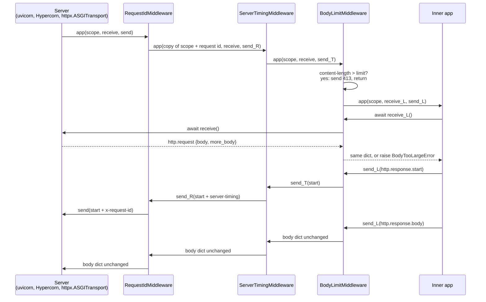

# Writing Pure ASGI Middleware: Wrapping scope, receive, and send to Inspect Headers, Mutate Status, and Enforce Limits Zero-Copy

> [!summary] Claim
> A pure ASGI middleware is an ASGI app that calls another ASGI app with a copied `scope` and wrapped `receive` and `send` closures, so it can read headers, rewrite `http.response.start`, and cut off an oversized body in flight while forwarding every body chunk by reference; the hard parts are not the wrapping but the ownership rules: copy what you mutate, keep state per call, forward events you do not understand, and decide what happens once the response has started.

Part of [ASGI and Starlette Internals](README.md) in [API Engineering](../README.md).

## TL;DR

- Mechanism: `Middleware(cls, ...)` entries become nested objects `cls(app, ...)` built inside-out, and each layer runs `await self.app(child_scope, my_receive, my_send)`, so the request travels down through every `receive` wrapper and the response travels up through every `send` wrapper (starlette 1.10.0 `starlette/applications.py`, `Starlette.build_middleware_stack`).
- Contract rule: copy `scope` before adding keys, never mutate it after the child returns, and keep per-request state in `__call__` locals, never on `self` (asgiref 3.13.0 `specs/asgi.rst`, Middleware; starlette 1.10.0 `docs/middleware.md`, "ASGI middleware should be stateless").
- Trap: once `http.response.start` has passed your `send` wrapper the status line is committed, so a limit or error discovered later can only abort the connection, never become a `413` or `500`; and appending to `message["headers"]` in place mutates the inner app's own list, which a reused `Response` object then carries into every later request (measured in the lab).
- Portability fact: the copy rule and Starlette's own design disagree: Starlette's `Router` writes `scope["route"]` into the scope object it was handed and its `OpenTelemetryMiddleware` reads it back after the call, so one scope-copying layer between them makes the route invisible to the outer layer (measured in the lab on starlette `1.10.0`).
- When not to use it: if all you need is a request object and a response object with no streaming, the cost of writing a correct state machine is not worth it for a one-off; but never reach for `BaseHTTPMiddleware` on streaming or `contextvars`-sensitive paths (see [[Why-BaseHTTPMiddleware-Hurts-Performance-Streaming-and-ContextVars]]), and push coarse body limits to the proxy or server when a per-route answer is not needed.

## Mental model



The server calls only the outermost layer; every layer calls the next one with whatever `scope`, `receive`, and `send` it chooses to hand down, so the stack is a chain of closures, not a framework feature.
The request direction is a pull: when the inner app awaits `receive_L()`, the call travels outward to the server's `receive` and the event dict travels back inward, and the limit layer counts `len(body)` on the way without copying the bytes.
The response direction is a push: each `send_X` wrapper sees the message after every inner layer has already transformed it, so the outermost wrapper edits last and its header lands last in the list.
The early-return arrow on the limit layer is the only place a layer answers without calling inward; outer layers still see that answer as an ordinary `http.response.start`, which is why the `413` in the lab still carries `x-request-id` and `server-timing`.

## How it works

### The contract a middleware sits inside

ASGI defines middleware as "code that plays the role of both server and application, taking in a `scope` and the `send`/`receive` awaitable callables, potentially modifying them, and then calling an inner application" (asgiref 3.13.0 `specs/asgi.rst`, Middleware).
The same section sets the only normative rules: copy the `scope` before mutating it "as changes may leak upstream otherwise", do not keep a reference to the copy you passed down because "there may be other middleware in the way", and "your one and only chance to add to it is before you hand control to the child application".
The callable contract the layer must honour in both roles (a single `async` callable, the `http.response.start` -> `http.response.body`* state machine, server-chosen request chunking) is the subject of [[ASGI-3-0-Callable-Contract-Scope-Receive-and-Send]]; this note assumes it.

Three facts from the HTTP sub-specification decide how a `send` wrapper may edit a response (asgiref 3.13.0 `specs/www.rst`, Response Start):

1. `headers` is an iterable of two-element `[name, value]` pairs of byte strings, "Optional; if missing defaults to an empty list", so a wrapper cannot assume `message["headers"]` exists or is a `list`; a tuple has no `.append` and a generator can be consumed only once.
2. "Header names must be lowercased" in responses, while request `scope["headers"]` names "should be lowercased, but it is not required", so a byte-equality lookup for `b"x-request-id"` relies on the server lowercasing (uvicorn's httptools protocol does `name = name.lower()` in `HttpToolsProtocol.on_header`; the lab's `header_values` and Starlette's `Headers.__getitem__` make the same assumption).
3. Servers "need not flush" the start event until the first body event, which "may give them more leeway to replace the response with an error response", but nothing obliges them to, so a middleware must treat a forwarded start as committed.

### How Starlette builds the onion

`Starlette.build_middleware_stack` assembles the list `[ServerErrorMiddleware]`, then `RequestBodyLimitMiddleware` if `max_body_size` is set, then the user list, then `ExceptionMiddleware`, and wraps from the inside out with `for cls, args, kwargs in reversed(middleware): app = cls(app, *args, **kwargs)` around `self.router` (starlette 1.10.0 `starlette/applications.py`, `Starlette.build_middleware_stack`).
The first entry of the user list is therefore the outermost user layer, which the Starlette docs state as "Middleware is evaluated from top-to-bottom" (starlette 1.10.0 `docs/middleware.md`, Using middleware).
`add_middleware` does `self.user_middleware.insert(0, ...)`, so each call puts the new layer outside all earlier ones, and it raises `RuntimeError("Cannot add middleware after an application has started")` once `middleware_stack` exists (starlette 1.10.0 `starlette/applications.py`, `Starlette.add_middleware`).
The stack is built lazily on the first `__call__`, which also writes `scope["app"] = self` into the server's scope object before any user layer runs (starlette 1.10.0 `starlette/applications.py`, `Starlette.__call__`).
The lab proves the order: `middleware=[a, b]` followed by `add_middleware(c)` produces `c:in, a:in, b:in, endpoint, b:out, a:out, c:out`.

FastAPI overrides the method: its list is `ServerErrorMiddleware`, `ExceptionTelemetryMiddleware`, the user list, `ExceptionMiddleware`, and `AsyncExitStackMiddleware`, with the same `reversed` loop (fastapi 0.162.0 `fastapi/applications.py`, `FastAPI.build_middleware_stack`).
That override never inserts `RequestBodyLimitMiddleware`, and `FastAPI.__init__` has no `max_body_size` parameter at all, which the lab checks with `inspect.signature`; a FastAPI app gets a Starlette body limit only by adding the middleware explicitly.

Route-scoped onions exist too: `Route`, `Mount`, and `Router` accept `middleware=` and wrap their own app with the same reversed loop, then wrap the result in `RequestBodyLimitMiddleware` when `max_body_size` is given, so a route-level limit sits outside that route's own middleware (starlette 1.10.0 `starlette/routing.py`, `Route.__init__`, `Mount.__init__`, `Router.__init__`).
Route-level layers run only after routing has matched, so they cannot change the routing decision, and they run inside `ExceptionMiddleware`, so an `HTTPException` they raise still reaches the app's handlers.

Where a layer sits relative to the two built-in layers decides what it can observe.
`ServerErrorMiddleware` is outside everything: it tracks `response_started` in its own `send` wrapper, renders a `500` only if nothing has started, and always re-raises so the server can log (starlette 1.10.0 `starlette/middleware/errors.py`, `ServerErrorMiddleware.__call__`).
`ExceptionMiddleware` is inside every user layer, and its wrapper raises `RuntimeError("Caught handled exception, but response already started.")` if a handled exception arrives after the start (starlette 1.10.0 `starlette/_exception_handler.py`, `wrap_app_handling_exceptions`).
A user layer therefore sees handled exceptions such as `HTTPException(404)` already converted into ordinary responses, and sees unhandled exceptions as they propagate outward; the full exception onion is in [[Starlette-Exception-Hierarchy-ServerErrorMiddleware-vs-ExceptionMiddleware]].

### Reading the request: `scope` and the wrapped `receive`

Header inspection needs no `receive` at all: `scope["headers"]` holds the request header block as raw byte pairs, in order, with duplicates preserved.
Starlette's `Headers(scope=scope)` is the convenient view, but its constructor executes `self._list = scope["headers"] = list(scope["headers"])`, so merely reading headers through it rewrites the scope's `headers` value into a new `list` in place (starlette 1.10.0 `starlette/datastructures.py`, `Headers.__init__`); the lab shows a tuple turning into a list after a read.
That is harmless for correctness but it is a write to a shared object, and it is why "inspecting" code in Starlette is not automatically side-effect free.

Duplicate request headers need a policy.
RFC 9110 lets a recipient combine same-name field lines with commas only when the field allows a list, and says a sender "MUST NOT generate multiple field lines with the same name" otherwise (RFC 9110 Section 5.3).
The lab's `RequestIdMiddleware` accepts an inbound `x-request-id` only if exactly one value is present and it fully matches `[A-Za-z0-9._-]{1,64}`, and otherwise mints `uuid4().hex`, because a correlation id is echoed into logs and response headers and is therefore an injection vector.

Wrapping `receive` is how a layer sees the body without owning it.
The wrapper awaits the server's `receive`, inspects the event, and returns the same dict, so the inner app gets the server's `bytes` object itself; the lab asserts `is` identity for every inbound chunk across four stacked layers.
The wrapper may also refuse: raising from `receive` delivers an exception at the inner app's `await receive()`, which is exactly how both the lab and Starlette enforce body limits.
What a wrapper must never do is drain the body and then hand the original `receive` down, because the inner app then waits for events the server has already delivered; that failure, and Starlette's `_body` caching, are covered in [[Starlette-Request-Internals-Stream-Consumption-and-Body-Caching]].

### Passing data down: copy, or write in place

The specification says copy, and the lab's `RequestIdMiddleware` does: `child_scope = {**scope, REQUEST_ID_SCOPE_KEY: ...}`, and the test proves the outer scope never gains the key.
A shallow copy shares every value, including `scope["state"]` and the `headers` list, so the copy isolates only top-level keys.

Starlette, however, relies on in-place writes flowing outward.
`Router.app` sets `scope["route"] = route` and calls `scope.update(child_scope)` on the scope object it received (starlette 1.10.0 `starlette/routing.py`, `Router.app`), and `BaseRoute.__call__` also calls `scope.update(child_scope)` on the scope it received (starlette 1.10.0 `starlette/routing.py`, `BaseRoute.__call__`).
Starlette's experimental `OpenTelemetryMiddleware` (added in `1.7.0`) reads `scope.get("route")` in a `finally` block after the inner app returns, to rename the span to `"{method} {route_path}"` and set `http.route` (starlette 1.10.0 `starlette/middleware/opentelemetry.py`, `OpenTelemetryMiddleware.__call__`).
The lab measures the conflict: an outer probe that reads `scope.get("route")` after the call sees the matched `Route` when it is the only user layer, and sees `None` once `RequestIdMiddleware` (which copies) sits between it and the router.
So the copy rule protects outer layers from surprises and also blinds them to router results; the practical rule is to place layers that read router output (tracing, route-labelled metrics) innermost among scope-copying layers, or to pass data down through namespaced keys in place with the explicit knowledge that the key leaks upstream.
Starlette's docs show the in-place style themselves (`scope["asgi_transaction_id"] = uuid.uuid4()`) and call scope keys "a convention ... not part of the ASGI specification" (starlette 1.10.0 `docs/middleware.md`, Passing information to endpoints).

### Rewriting the response: the wrapped `send`

A `send` wrapper reacts to `http.response.start` (status and headers) and `http.response.body` (bytes), and must forward every other type unchanged: the trailers, path send, and zero copy send extensions all add new `send` event types (`http.response.trailers`, `http.response.pathsend`, `http.response.zerocopysend`) that a layer which only forwards the two types it knows would silently drop (asgiref 3.13.0 `docs/extensions.rst`, HTTP Trailers, Path Send, Zero Copy Send).
The lab forwards a `trailers=True` start, a body, and an `http.response.trailers` event through all four layers and asserts all three arrive.

The header edit is where the copying question is sharpest.
Starlette's `Response.__call__` sends `{"type": "http.response.start", "status": self.status_code, "headers": self.raw_headers}`, handing out the response object's own list (starlette 1.10.0 `starlette/responses.py`, `Response.__call__`).
The pattern in Starlette's own docs, `MutableHeaders(scope=message).append(key, value)`, does not touch that list, because `Headers.__init__` first executes `scope["headers"] = list(scope["headers"])` on the message, so the append lands in a fresh list owned by the message dict (starlette 1.10.0 `docs/middleware.md`, Inspecting or modifying the response; `starlette/datastructures.py`, `Headers.__init__`, `MutableHeaders.append`); a throwaway script with three requests to one shared `PlainTextResponse` showed one `x-docs` header each time and `raw_headers` unchanged.
A raw `message["headers"].append(...)` and `MutableHeaders(raw=message["headers"])` both write into the response object's own list: opentelemetry-instrumentation-asgi's response propagator does the former with `headers.append(...)` (opentelemetry-instrumentation-asgi 0.66b2 `opentelemetry/instrumentation/asgi/__init__.py`, `ASGISetter.set`), and Starlette's own `GZipMiddleware` does the latter with `MutableHeaders(raw=self.initial_message["headers"])` (starlette 1.10.0 `starlette/middleware/gzip.py`, `IdentityResponder.send_with_compression`).
Per-request `Response` objects make this safe; a `Response` reused across requests (a module-level `NOT_FOUND`, a cached health response) makes the header accumulate: the lab's in-place layer returns `1`, `2`, then `3` copies of `x-leak` on three requests to one shared `PlainTextResponse`.
With `GZipMiddleware` it corrupts the response: a throwaway script (CPython 3.14.6, starlette 1.10.0, `accept-encoding: gzip`, one shared 1000-byte `PlainTextResponse`) got a 29-byte gzip body on the first call and, on the second, the 1000 raw bytes under `content-encoding: gzip` and `content-length: 29`, because the first call left both headers in the shared list and the second therefore took the "already encoded" pass-through branch.
The lab's layers instead build `{**message, "headers": [*message.get("headers", ()), (name, value)]}`: one new dict and one new list of existing tuple references per response, with the body untouched, and the shared response's `raw_headers` stays byte-identical across three requests.

Header values a layer writes are spliced straight into the wire.
uvicorn validates each name and value against `HEADER_RE` and `HEADER_VALUE_RE` and raises `RuntimeError("Invalid HTTP header value.")` from `send` (uvicorn 0.54.0 `uvicorn/protocols/http/httptools_impl.py`, `RequestResponseCycle.send`).
It sets `self.response_started = True` before that loop, so `run_asgi` takes its "response started" branch and closes the transport: the client gets no status line at all, not a `500` (uvicorn 0.54.0 `httptools_impl.py`, `RequestResponseCycle.run_asgi`).
RFC 9110 says a recipient of CR, LF, or NUL in a field value "MUST either reject the message or replace each of those characters with SP" (RFC 9110 Section 5.5); validating an echoed id up front turns a server error into a correct response.

Status mutation is one key: the lab's `StatusRewriteMiddleware` replaces `message["status"]` in a copied dict, for example `404 -> 410` for a retired API prefix, and the body passes through unchanged (`410` with body `Not Found` in the lab).
It refuses targets below `200`, `204`, `304`, and above `599` at construction, because the inner app's body and `content-length` would then violate "A server MUST NOT send a Content-Length header field in any response with a status code of 1xx (Informational) or 204 (No Content)" (RFC 9110 Section 8.6) and the no-body rule for `204` and `304` (RFC 9112 Section 6.3, rule 1).
uvicorn builds the status line with `STATUS_LINE[status_code]`, a lookup table, so the `100..599` range is also a server constraint (uvicorn 0.54.0 `httptools_impl.py`, `RequestResponseCycle.send`).

Body mutation means deferring the start.
`GZipMiddleware` stores `http.response.start` as `initial_message`, waits for the first body event, decides whether to compress, rewrites `Content-Encoding`, `Vary`, and `Content-Length` (deleting it for streamed bodies), and only then sends the start (starlette 1.10.0 `starlette/middleware/gzip.py`, `IdentityResponder.send_with_compression`).
It sends the start immediately and passes bodies through when the response already has `Content-Encoding`, is a `206`, or has an excluded content type such as `text/event-stream` (behavior changed in `1.8.0`), compresses streamed chunks with `Z_SYNC_FLUSH` so each chunk is decodable on arrival, and offloads chunks of at least `thread_minimum_size` (`128 * 1024` bytes) to a worker thread under its own `anyio.CapacityLimiter(40)` (starlette 1.10.0 `starlette/middleware/gzip.py`, `GZipResponder.apply_compression`, `GZipResponder._compress_body`, `_get_gzip_capacity_limiter`).
It also allocates a fresh responder object per request, which is how a class-based middleware keeps state per call without closures.
Any body-changing layer inherits the `Content-Length` obligation: uvicorn raises `RuntimeError("Response content longer than Content-Length")` or `"... shorter than Content-Length"` when the bytes and the header disagree (uvicorn 0.54.0 `httptools_impl.py`, `RequestResponseCycle.send`), and RFC 9110 forbids forwarding a `Content-Length` "known to be incorrect" (RFC 9110 Section 8.6).

### Timing: what `Server-Timing` measures

`Server-Timing` is defined by the W3C Server Timing draft (Working Draft dated 2 November 2026, as of 2026-11) as `#server-timing-metric` with `metric-name *( OWS ";" OWS server-timing-param )`, where `dur` and `desc` are the two defined parameters, a response "MAY have multiple server-timing-metric entries with the same metric-name", and order is not significant (W3C Server Timing, Section 2 The Server-Timing Header Field).
`dur` is parsed as a floating-point number and representing it in milliseconds is the specification's recommendation, which is why the lab formats `(t_start - t_entry) / 1_000_000` with three decimals.
Because the header rides on `http.response.start`, the number is time-to-headers measured from when this layer was entered: it excludes everything outside the layer (server parsing, outer layers) and all body streaming after the start.
A total-duration metric needs a trailer, which the W3C example shows as `Trailer: Server-Timing` plus a trailing `Server-Timing: total;dur=123.4` (W3C Server Timing, Section 6 Examples), and that needs the `http.response.trailers` extension, which a server only offers when it lists it in `scope["extensions"]` (asgiref 3.13.0 `docs/extensions.rst`, HTTP Trailers); see [[HTTP-Trailers-Streaming-Checksums-and-gRPC-Status]].
The lab appends rather than replaces, so an inner `db;dur=3` survives next to `app;dur=12.500`.
The W3C draft warns that metrics "expose potentially sensitive application and infrastructure information" and suggests returning them only to authenticated callers (W3C Server Timing, Section 4 Privacy and Security).

### Enforcing a body limit in flight

HTTP gives the server the status: `413 (Content Too Large)` means the server refuses because "the request content is larger than the server is willing or able to process", and "The server MAY terminate the request, if the protocol version in use allows it; otherwise, the server MAY close the connection" (RFC 9110 Section 15.5.14).
There are two moments to decide, and a correct layer uses both:

1. Before reading, from `Content-Length`.
   The lab parses it as `1*DIGIT` (RFC 9110 Section 8.6), accepts a repeated identical list such as `7, 7` and rejects anything else with `400` (RFC 9112 Section 6.3, rule 5), and ignores it when `transfer-encoding` is present because "the Transfer-Encoding overrides the Content-Length" (RFC 9112 Section 6.3, rule 3).
   An oversized declaration gets `413` without calling the app and without calling `receive`; with uvicorn this matters because `HTTP/1.1 100 Continue` is written lazily on the first `receive()` (uvicorn 0.54.0 `httptools_impl.py`, `RequestResponseCycle.receive`), so an `Expect: 100-continue` client is never invited to upload (see [[100-Continue-Expect-Header-and-Large-Upload-Admission]]); Hypercorn's HTTP/1.1 protocol does not offer that: `H11Protocol._handle_events` sends `100 Continue` as soon as h11 reports `they_are_waiting_for_100_continue`, before the app runs (hypercorn 0.18.0 `hypercorn/protocol/h11.py`), so there the early `413` only saves the rest of the upload, not the invitation.
2. While reading, by counting.
   `receive_with_limit` adds `len(message["body"])` and raises `BodyTooLargeError` before returning the chunk that crosses the limit, so the inner app never sees an over-limit byte; the lab delivers `aaaa`, `bbbb` and withholds `cccc` at a limit of `10`.
   Counting is mandatory even when `Content-Length` was acceptable, because the header can understate the body; the lab's `content-length: 4` with `12` bytes still yields `413`.

Two edge cases decide whether the limit is real.
If the inner app catches the exception (a broad `except Exception` around `await request.body()`), it may go on to answer with a truncated body; the lab's `send` wrapper raises again on any send after the limit was crossed, so the only response is the middleware's `413`.
If the response already started (a streaming endpoint that sends headers before reading), no `413` is possible; the lab re-raises, and the server then behaves as for any mid-response failure: uvicorn logs and calls `transport.close()` when `response_started` is set (uvicorn 0.54.0 `httptools_impl.py`, `RequestResponseCycle.run_asgi`).

The `413` the lab sends carries `connection: close` on HTTP/1.x only.
uvicorn sets `keep_alive = False` when the app's `connection` header contains `close` and closes the transport after the response completes (uvicorn 0.54.0 `httptools_impl.py`, `RequestResponseCycle.send`); without it, uvicorn keeps the connection, resumes reading, and its parser callbacks discard the unread body because `on_body` returns early once `response_complete` is set (`HttpToolsProtocol.on_body`), so the client keeps uploading into a connection that is only draining.
HTTP/2 and HTTP/3 forbid `Connection` (RFC 9113 Section 8.2.2; RFC 9114 Section 4.2), so the lab omits it when `scope["http_version"]` is `"2"`; the h2 library would strip it anyway in `normalize_outbound_headers` (h2 4.4.1 `h2/utilities.py`, `_strip_connection_headers`), but a layer should not rely on that.

### Starlette's built-in limit, for comparison

Starlette `1.6.0` added `max_body_size` to `Starlette`, `Route`, `Mount`, and `Router` (starlette 1.10.0 `docs/release-notes.md`, 1.6.0), implemented by `RequestBodyLimitMiddleware` (starlette 1.10.0 `starlette/middleware/body_limit.py`).
Its design differs from the lab's in four measured or source-visible ways:

- It is lazy: the `Content-Length` check runs at the first `receive_with_limit()` call or at `http.response.start` in `send_with_limit`, where it replaces the app's response with `413` and raises the private `_RequestBodyLimitResponseSent` to unwind the app (`RequestBodyLimitResponder.send_with_limit`).
- Nested limits override instead of stacking: the outer responder registers itself under `scope["starlette._body_limit_responder"]`, an inner `RequestBodyLimitMiddleware` sets `active_responder.max_body_size = self.max_body_size`, and every layer writes the publicly readable `scope["starlette.max_body_size"]`, which only the outermost responder restores in its `finally` (`RequestBodyLimitResponder.__call__`); the lab confirms that `Starlette(max_body_size=8)` with `Route(..., max_body_size=64)` accepts a `32` byte body on that route and returns `413` on a route without an override.
  The laziness is what makes per-route loosening possible: an eager check like the lab's would already have answered before routing.
  It also means this middleware mutates `scope` in place, deliberately, against the ASGI copy rule, because the inner layer must find the outer one.
- Its exception subclasses `HTTPException(413)`, so an app's own `413` handler can format the error when the limit is hit inside the endpoint.
- It parses `Content-Length` with `int(...)` (`_get_content_length`), which accepts `1_0` and `+5`; the lab shows Starlette answering `413` for `content-length: 1_0` at a limit of `5`, while the lab's strict parser answers `400`.
  h11 rejects such framing before any app runs, because it validates `Content-Length` against `[0-9]+` (h11 0.16.0 `h11/_headers.py`, `normalize_and_validate`); the httptools path rejects them too: feeding `Content-Length` values to `httptools.HttpRequestParser` (httptools 0.9.0, CPython 3.14.6, macOS 27.3 arm64, run once with `.venv/bin/python -I -c`) accepted `10` and ` 7 ` and raised `HttpParserError: Invalid character in Content-Length` for `1_0`, `+5`, `5, 5`, and `5, 6`, so under uvicorn's default parser the divergence matters for in-process transports such as `httpx.ASGITransport` and for layers that trust a `scope` built by another layer, and the lab's acceptance of an identical list such as `5, 5` is reachable only through those (the same run shows the parser refusing even the identical list).

## Numbers and limits

| Quantity | Value | Source |
|---|---|---|
| Overhead of one bare inner app, raw ASGI call | `306` ns per request | Re-measured 2026-11-14 with a throwaway script run by `uv run --frozen python` from `labs/`, CPython 3.14.6, macOS 27.3 (`uname -r` `27.3.0`) arm64, Apple M3 Pro, 50,000 calls per round, best of 5 rounds |
| `StatusRewriteMiddleware` + bare app | `746` ns | Same run |
| `ServerTimingMiddleware` + bare app | `4988` ns | Same run |
| `BodyLimitMiddleware` (1 KiB body, `content-length` parse) + bare app | `6133` ns | Same run |
| `RequestIdMiddleware` minting `uuid4().hex` + bare app | `5830` ns | Same run; dominated by `uuid4`, which the run did not isolate |
| All four layers + bare app | `12442` ns | Same run |
| uvicorn read pause threshold | `HIGH_WATER_LIMIT = 65536` bytes | uvicorn 0.54.0 `uvicorn/protocols/http/flow_control.py` |
| uvicorn default `500` body | `Internal Server Error`, `content-length: 21`, `connection: close` | uvicorn 0.54.0 `httptools_impl.py`, `RequestResponseCycle.send_500_response` |
| `GZipMiddleware` defaults | `minimum_size=500`, `compresslevel=9`, `thread_minimum_size=131072` | starlette 1.10.0 `starlette/middleware/gzip.py`, `GZipMiddleware.__init__` |
| `GZipMiddleware` thread cap | `anyio.CapacityLimiter(40)` per event loop | starlette 1.10.0 `starlette/middleware/gzip.py`, `_get_gzip_capacity_limiter` |
| Starlette default request body limit | none (`max_body_size=None`) | starlette 1.10.0 `starlette/applications.py`, `Starlette.__init__` docstring |
| HTTP limit on `Content-Length` digits | none; "a recipient MUST anticipate potentially large decimal numerals" | RFC 9110 Section 8.6 |
| Lab `Content-Length` digit cap | `19` digits, a parse-cost bound (Python `int` cannot overflow) | lab `_CONTENT_LENGTH_RE` |
| h11 `Content-Length` rule | `[0-9]+`, at most `CONTENT_LENGTH_MAX_DIGITS = 20`, comma list must collapse to one value | h11 0.16.0 `h11/_headers.py`, `normalize_and_validate` |
| Lab request id shape | `[A-Za-z0-9._-]{1,64}`, exactly one inbound value | lab `_REQUEST_ID_RE` |

The script (not kept in the lab) awaited each stack in a loop with a 1 KiB `POST` scope carrying `content-length: 1024`, a `receive` returning one prebuilt complete `http.request` event, a no-op `send`, and an inner app that awaits `receive()` once and then sends a freshly built start dict and one body dict; it drives the raw callables, so the numbers are Python call and allocation costs only, with no parsing, sockets, or framework; treat them as relative costs on one machine, not as server throughput.
The numbers are noisy: an earlier run in the same session, whose inner app skipped `receive()` and sent prebuilt dicts, gave `154`, `726`, `2918`, `3257`, `5281`, and `12359` ns for the same six rows, so the single-layer rows moved by up to 2x between runs while the four-layer total stayed near `12.4` microseconds; the draft's earlier figures (`506` to `12981` ns) were not reproduced and were replaced.
Each `async def` closure, copied dict, and copied header list is a per-request allocation, which is why the cost scales with the number of layers and why the body size does not appear in it.

## Portability

| Dimension | Behavior | Evidence |
|---|---|---|
| CPython 3.14.6 | All 39 lab tests pass | Ran once: `uv run --frozen pytest ...` (Worked example) |
| CPython 3.12, 3.13, 3.15, 3.15t | Not run (lab matrix paused 2026-11-11); the lab module uses the `type` statement, which needs 3.12 or later (PEP 695), and starlette `1.10.0` requires 3.11 or later | starlette 1.10.0 `docs/release-notes.md`, 1.8.0 |
| starlette `< 1.6.0` | No `max_body_size` and no `RequestBodyLimitMiddleware`; a limit must be a custom layer like the lab's | starlette 1.10.0 `docs/release-notes.md`, 1.6.0 |
| starlette `< 1.7.0` | No `scope["route"]`, no `OpenTelemetryMiddleware` | starlette 1.10.0 `docs/release-notes.md`, 1.7.0 |
| starlette `< 1.10.0` | `GZipMiddleware`, `SessionMiddleware`, `BaseHTTPMiddleware` raise `KeyError` on a start event without `headers` | starlette 1.10.0 `docs/release-notes.md`, 1.10.0 Fixed |
| FastAPI `0.162.0` | No `max_body_size`; own `build_middleware_stack` adds `ExceptionTelemetryMiddleware` and `AsyncExitStackMiddleware` | lab test; fastapi 0.162.0 `fastapi/applications.py` |
| uvicorn `0.54.0` | Header validation and `Content-Length` accounting raise `RuntimeError` from `send`; `connection: close` honoured; lazy `100 Continue` | source, `httptools_impl.py`; not exercised over a socket in this lab |
| Hypercorn `0.18.0` | Advertises `http.response.trailers`, `http.response.push`, and `http.response.early_hint` in `scope["extensions"]` on HTTP/2 and HTTP/3 only, and never `http.response.pathsend`; a `send` message of any other type, or in the wrong state, raises `UnexpectedMessageError`; `http.response.start` headers are only stripped and checked for pseudo-headers by Hypercorn, and the h11 library then rejects an illegal name or value with an error from `send`; on HTTP/1.1 it writes `100 Continue` as soon as h11 reports the client is waiting, before the app calls `receive` | Source only, not exercised over a socket: hypercorn 0.18.0 `hypercorn/protocol/http_stream.py` (`HTTPStream.handle`, `HTTPStream.app_send`), `hypercorn/protocol/h11.py` (`H11Protocol._handle_events`), `hypercorn/utils.py` (`build_and_validate_headers`); h11 0.16.0 `h11/_headers.py` (`normalize_and_validate`) |
| Granian `2.8.7` | Advertises `http.response.pathsend` and `websocket.http.response` in `scope["extensions"]`, and no trailers extension; `adapt_message_type` accepts `http.response.start`, `http.response.body`, and `http.response.pathsend` for HTTP and fails any other type with `UnsupportedASGIMessage`; a start event without a `headers` key is also an error there (`adapt_headers`), although the specification makes `headers` optional | Source only, not exercised over a socket: granian 2.8.7 `src/asgi/utils.rs` (extensions and `http_version` mapping), `src/asgi/io.rs` (`adapt_message_type`, `adapt_headers`), read at the release tag on GitHub; `granian/asgi.py` in the pinned wheel only carries the lifespan protocol |
| HTTP/1.1 | `connection: close` on the `413` closes the connection in uvicorn | uvicorn 0.54.0 source |
| HTTP/2, HTTP/3 | `Connection` forbidden, lab omits it when `http_version` is `"2"`; the lab adds `connection: close` only when `http_version` is in `_HTTP1_VERSIONS = {"1.0", "1.1"}`, so `"3"` takes the omit path like `"2"`, but only `"2"` is tested; servers do emit `"3"`: Hypercorn sets `http_version="3"` in its HTTP/3 protocol, and Granian maps `hyper::Version::HTTP_3` to `"3"`; Granian reports HTTP/1.0 as `"1"`, which is not in the lab's set, so a lab layer would omit `connection: close` there (read from source, not tested) | RFC 9113 Section 8.2.2; RFC 9114 Section 4.2; lab test for `"2"`; hypercorn 0.18.0 `hypercorn/protocol/h3.py`; granian 2.8.7 `src/asgi/utils.rs` |
| `httpx.ASGITransport` `0.28.1` | Sends `http_version` `"1.1"`; violations are `assert` failures; exceptions re-raised unless `raise_app_exceptions=False` | httpx 0.28.1 `httpx/_transports/asgi.py`, `ASGITransport.handle_async_request` |

## Worked example

The [implementation](../labs/src/api_labs/f10_asgi_and_starlette_internals/pure_asgi_middleware.py) holds four production-shaped layers plus one deliberate anti-pattern, and the [test](../labs/tests/f10_asgi_and_starlette_internals/test_pure_asgi_middleware_onion_architecture_and_send_receive_wrapping.py) drives them both as raw ASGI callables (to assert object identity and exact events) and inside Starlette through `httpx.ASGITransport`.

The header helper and the request id layer (simplified excerpt, docstrings removed):

```python
def with_appended_header(message: Message, name: bytes, value: bytes) -> Message:
    headers = [*message.get("headers", ()), (name, value)]
    return {**message, "headers": headers}


class RequestIdMiddleware:
    def __init__(
        self, app: ASGIApp, *, id_factory: Callable[[], str] = generate_request_id
    ) -> None:
        self.app = app
        self.id_factory = id_factory

    async def __call__(self, scope: Scope, receive: Receive, send: Send) -> None:
        if scope["type"] != "http":
            await self.app(scope, receive, send)
            return

        inbound = header_values(scope["headers"], b"x-request-id")
        if len(inbound) == 1 and _REQUEST_ID_RE.fullmatch(inbound[0]):
            request_id = inbound[0]
        else:
            request_id = self.id_factory().encode("ascii")

        # ASGI spec, Middleware: copy the scope before adding keys.
        child_scope = {**scope, REQUEST_ID_SCOPE_KEY: request_id.decode("ascii")}

        async def send_with_request_id(message: Message) -> None:
            if message["type"] == "http.response.start":
                message = with_appended_header(message, b"x-request-id", request_id)
            await send(message)

        await self.app(child_scope, receive, send_with_request_id)
```

The body limit (simplified excerpt, docstrings and comments removed):

```python
class BodyLimitMiddleware:
    async def __call__(self, scope: Scope, receive: Receive, send: Send) -> None:
        if scope["type"] != "http":
            await self.app(scope, receive, send)
            return

        declared = declared_content_length(scope)
        if isinstance(declared, _InvalidContentLength):
            await send_plain_error(scope, send, 400, b"Invalid Content-Length")
            return
        if declared is not None and declared > self.max_body_size:
            await send_plain_error(scope, send, 413, b"Content Too Large")
            return

        received = 0
        exceeded = False
        response_started = False

        async def receive_with_limit() -> Message:
            nonlocal received, exceeded
            if exceeded:
                raise BodyTooLargeError
            message = await receive()
            if message["type"] == "http.request":
                received += len(message.get("body", b""))
                if received > self.max_body_size:
                    exceeded = True
                    raise BodyTooLargeError
            return message

        async def send_tracking_start(message: Message) -> None:
            nonlocal response_started
            if exceeded:
                raise BodyTooLargeError
            if message["type"] == "http.response.start":
                response_started = True
            await send(message)

        try:
            await self.app(scope, receive_with_limit, send_tracking_start)
        except BodyTooLargeError:
            if response_started:
                raise
            await send_plain_error(scope, send, 413, b"Content Too Large")
            return
        if exceeded and not response_started:
            await send_plain_error(scope, send, 413, b"Content Too Large")
```

The tests that pin each mechanism (names from the test module):

- `test_starlette_middleware_list_is_outermost_first_and_add_middleware_prepends`: the onion order.
- `test_body_chunks_pass_through_every_layer_by_identity`: inbound and outbound `bytes` objects are the same objects (`is`) after four layers.
- `test_header_edits_do_not_mutate_a_reused_response_object` and `test_in_place_header_append_leaks_across_requests_on_a_reused_response`: copy versus in-place, `[1, 1, 1]` versus `[1, 2, 3]`.
- `test_scope_copy_hides_router_writes_from_outer_middleware`: `[route, None]`.
- `test_declared_oversize_is_rejected_before_the_app_or_receive_runs`: `receive_calls == 0`.
- `test_streamed_body_is_cut_off_before_the_app_sees_the_excess`, `test_understated_content_length_is_still_counted`, `test_app_that_swallows_the_limit_error_cannot_answer`, `test_limit_hit_after_response_start_propagates_instead_of_a_second_start`.
- `test_content_length_is_parsed_as_1_digit_not_as_python_int` and `test_starlette_body_limit_trusts_python_int_for_content_length`.
- `test_starlette_route_max_body_size_overrides_the_app_limit_both_ways` and `test_fastapi_constructor_has_no_max_body_size_parameter`.
- `test_full_stack_through_httpx_tags_even_the_413_with_a_request_id`: a declared and a streamed oversize both return `413` with `connection: close`, a 32-character `x-request-id`, and `server-timing`, because the limit layer is inner.

Captured run (verification rerun 2026-11-14), CPython 3.14.6 (workspace venv), macOS 27.3 arm64, from `labs/`:

```text
$ uv run --frozen pytest tests/f10_asgi_and_starlette_internals/test_pure_asgi_middleware_onion_architecture_and_send_receive_wrapping.py -q
.......................................                                  [100%]
39 passed in 1.69s
```

## Pitfalls

> [!warning] Instance state shared across concurrent requests
> Trigger: a flag or counter stored on `self` inside a `send` or `receive` wrapper.
> Symptom: under concurrency one request's decision leaks into another's response; the Starlette docs show exactly this with a `self.should_mock` flag (starlette 1.10.0 `docs/middleware.md`, ASGI middleware should be stateless).
> A shipped example: opentelemetry-instrumentation-asgi 0.66b2 stores the response `content-length` in `self.content_length_header` inside `otel_send` and reads it after the app returns to record the response-size histogram (`opentelemetry/instrumentation/asgi/__init__.py`, `OpenTelemetryMiddleware._get_otel_send` and `__call__`), so from reading the source a response without `content-length` can record the previous request's size (not exercised in this lab).
> Fix: keep state in `__call__` locals and `nonlocal` closures, or build a per-request responder object as `GZipMiddleware` does; the lab's 50 concurrent requests each get their own id back.

> [!warning] In-place header append on a reused response
> Trigger: `message["headers"].append(...)` or `MutableHeaders(raw=message["headers"])` (including inside `GZipMiddleware` and the OpenTelemetry ASGI response propagator) with an endpoint that returns a module-level `Response`; `MutableHeaders(scope=message)` is safe because it copies the list into the message first.
> Symptom: the header repeats once more on every request (`1, 2, 3` in the lab), and the process leaks memory slowly; under `GZipMiddleware` the second response carries `content-encoding: gzip` and the first response's `content-length` over an uncompressed body (throwaway script, starlette 1.10.0); a `tuple` header iterable raises `AttributeError` instead.
> Fix: build a new list and a new message dict; the cost is a few small allocations per response, not a body copy.

> [!warning] Dropping events you do not recognize
> Trigger: a `send` wrapper with `if type == "http.response.start": ... elif type == "http.response.body": ...` and no final `else: await send(message)`.
> Symptom: trailers never arrive (a gRPC-style status is lost), and a dropped final body event leaves a started response incomplete, which uvicorn reports as `ASGI callable returned without completing response.` before closing the transport (uvicorn 0.54.0 `httptools_impl.py`, `RequestResponseCycle.run_asgi`); a dropped `http.response.pathsend` has the same effect on a server that advertises that extension, which Granian 2.8.7 does (`src/asgi/utils.rs`) and uvicorn 0.54.0's HTTP protocols do not, so Starlette's `FileResponse` sends ordinary body events on uvicorn and a `pathsend` event on Granian (starlette 1.10.0 `starlette/responses.py`, `FileResponse.__call__`); a wrapper that forwards only start and body events therefore works under uvicorn and breaks under Granian, and Granian fails any event type it does not know (`UnsupportedASGIMessage`).
> Fix: forward every unrecognized message unchanged; `GZipMiddleware` explicitly passes `http.response.early_hint`, `http.response.trailers`, and `http.response.pathsend` (starlette 1.10.0 `starlette/middleware/gzip.py`).

> [!warning] Deciding after the start
> Trigger: a layer discovers a limit, an auth failure, or an exception after `http.response.start` was forwarded.
> Symptom: the client sees a `200` with a truncated body and a reset connection; Starlette's exception wrapper raises `RuntimeError("Caught handled exception, but response already started.")`.
> Fix: decide from headers before calling inward where possible, and treat a mid-stream failure as connection abort, not as a status change; see [[ASGI-HTTP-and-Disconnect-Event-Lifecycle]].

> [!warning] Unbounded buffering behind a "limit"
> Trigger: a total-size limit that is enforced only at a proxy, or a body cap that does not cover per-field buffering.
> Symptom: CVE-2024-47874 (published 2024-10-15): before Starlette `0.40.0`, `multipart/form-data` parts without a `filename` were buffered "with no size limit", and the advisory notes the DoS works "even if reasonable request size limits are enforced by a reverse proxy in front of Starlette"; CVE-2023-30798 (published 2023-04-21): before `0.25.0`, an attacker could send "any number of form fields or files" (NVD records).
> Fix: enforce the byte limit in-process at the ASGI boundary as the lab does, and keep parser-level caps (`max_fields`, `max_part_size`, enforced in `FormParser` since Starlette `1.3.1` per the release notes) as a second layer.

> [!warning] Lenient `Content-Length` parsing
> Trigger: `int(header_value)` in a layer that trusts `scope["headers"]`.
> Symptom: `1_0`, `+5`, and full-width or superscript digits mean different things to Python and to the HTTP grammar; the lab shows Starlette's limit accepting `1_0` as `10`.
> Fix: match `[0-9]+` on bytes, handle the identical-list case, and answer `400` otherwise (RFC 9112 Section 6.3, rule 5).

## Security and robustness

- Threat: resource exhaustion through bodies, OWASP API4:2023 Unrestricted Resource Consumption; the middleware is the first in-process place where a per-app or per-route byte budget can be enforced without buffering, and it composes with proxy limits rather than replacing them (see [[Unrestricted-Resource-Consumption-API4-2023-Payload-Depth-and-Limit-Guards]]).
- Threat: header injection through echoed correlation ids; validate shape and multiplicity before echoing, because RFC 9110 Section 5.5 calls CR, LF, and NUL "invalid and dangerous", and the server's own validation turns a bad echo into a `500`.
- Threat: request smuggling through inconsistent framing; never forward or rewrite `Content-Length` to a value "known to be incorrect" (RFC 9110 Section 8.6), and leave `Transfer-Encoding` to the server, which "must ignore" it in the start event (asgiref 3.13.0 `specs/www.rst`, Response Start); background is in [[HTTP-Request-Smuggling-CL-TE-and-Desync-Mechanics]].
- Threat: information disclosure through `Server-Timing`; gate detailed metrics on authentication and remember browsers expose them cross-origin only with `Timing-Allow-Origin` (W3C Server Timing, Section 4).
- Robustness: an oversized upload should end the connection on HTTP/1.x (`connection: close`), otherwise the server keeps reading and discarding the rest of the body.
- Robustness: order layers so that rejections still carry observability (request id and timing outside the limit) and so that the limit runs before any layer that buffers or parses the body (compression of requests, decryption, form parsing).
- Defense in depth: proxy byte limit, server parser limits, this middleware, and parser field caps each catch a different failure, and only the in-process layer knows the route.

## The principal's view

The decision is not "pure ASGI or `BaseHTTPMiddleware`"; it is where each cross-cutting concern lives in the onion and who owns the state machine.
Pure ASGI layers are the right default for anything that touches every request on a streaming-capable service: they add microseconds, never buffer, never change the task or `contextvars` context of the endpoint, and work identically under Starlette, FastAPI, and any other ASGI app.
The cost is that every author must understand the event protocol, so the organizational move is a small, reviewed internal library of layers (request id, timing, limits, status policy) with tests like this lab's, rather than each team writing its own `send` wrapper.
Decide the scope-mutation policy once: copy by default for isolation, but name the few keys that intentionally flow outward (router results, tracing state), because Starlette itself relies on in-place writes and a copying layer silently disables route-labelled telemetry.
Decide also which limits are global and which are per route; per-route loosening requires the lazy, scope-coupled design Starlette chose, while an eager layer is simpler and stops uploads earlier.
Choose a different tool when the concern is protocol-level and the same for every route (TLS, coarse body caps, header size limits, connection limits): the proxy or the server enforces those more cheaply and before Python allocates anything, and in a service where per-request Python overhead itself dominates, a Rust server's native features or a gateway are the better place for policy.

## Interview questions

> [!question] L5: Given `Starlette(middleware=[Middleware(A), Middleware(B)])` and then `app.add_middleware(C)`, in which order do the three layers see the request, and which one sees the response last?
>
> > [!success]- Answer
> > The request order is `C`, `A`, `B`, then the router, because `add_middleware` inserts at index `0` and the stack is built by wrapping in reverse list order.
> > The response passes through the `send` wrappers in the opposite order, `B`, `A`, `C`, so `C` sees the response last and its header edits land last.
> > All three run inside `ServerErrorMiddleware` and outside `ExceptionMiddleware`.
> >
> > Follow-up: What happens if you call `add_middleware` after the first request?

> [!question] L5: Why must a pure ASGI middleware keep per-request state in `__call__` locals instead of `self`?
>
> > [!success]- Answer
> > One middleware instance serves every concurrent request, because the stack is built once and reused.
> > Any attribute written during one request can be read by another request interleaved at an `await`.
> > Closures over locals, or a per-request responder object, give each call its own state.
> >
> > Follow-up: Find the instance attribute in opentelemetry-instrumentation-asgi's `OpenTelemetryMiddleware` that breaks this rule and describe the wrong metric it can record.

> [!question] L6: Predict the output: an endpoint returns one module-level `PlainTextResponse("ok")` for every request, and a middleware does `message["headers"].append((b"x-leak", b"1"))` on `http.response.start`; what does `len(response.headers.get_list("x-leak"))` give on the first three requests?
>
> > [!success]- Answer
> > `1`, `2`, `3`.
> > `Response.__call__` sends its own `self.raw_headers` list as `message["headers"]`, so each append mutates the shared response object permanently.
> > Building a new list and a new message dict fixes it without copying the body.
> >
> > Follow-up: Why does the same middleware crash instead of leaking when the inner app sends `headers` as a tuple?

> [!question] L6: Debug this API: a service lists Starlette's `OpenTelemetryMiddleware` first in `middleware=` and a custom middleware second that does `scope = {**scope, "tenant": t}` before calling inward, and the team notices their OpenTelemetry spans are all named `POST` instead of `POST /orders`; why?
>
> > [!success]- Answer
> > Starlette's `OpenTelemetryMiddleware` renames the span from `scope.get("route")` after the app returns, and `Router.app` writes `scope["route"]` into the scope object it receives.
> > If the copying middleware sits between the telemetry layer and the router, the router writes into the copy, and the telemetry layer still holds the original, so it sees no route.
> > Move the telemetry layer inside the copying layer, or write the tenant key in place under a namespaced name.
> >
> > Follow-up: Which part of the ASGI specification recommends the copy, and what does it say about mutating the scope after the child returns?

> [!question] L6: How do you enforce a request body limit without buffering the body, and why must you count bytes even when `Content-Length` is within the limit?
>
> > [!success]- Answer
> > Check a strictly parsed `Content-Length` first and answer `413` without calling `receive`, then wrap `receive` and add `len(body)` of each `http.request` event, raising before returning the chunk that crosses the limit.
> > Counting is required because chunked requests have no `Content-Length` and because an in-process transport or a misbehaving layer can present a header that understates the body.
> > The chunks are forwarded by reference, so memory is bounded by the server's own buffering, not the middleware.
> >
> > Follow-up: What does your layer do if the endpoint catches the limit exception and tries to return `200`?

> [!question] L6: Why does the lab's `413` include `connection: close` on HTTP/1.1 but not on HTTP/2?
>
> > [!success]- Answer
> > On HTTP/1.1 the unread remainder of the body is still on the socket, and uvicorn keeps the connection alive and discards those bytes unless the response says `connection: close`, in which case it closes after the response.
> > HTTP/2 and HTTP/3 forbid connection-specific header fields (RFC 9113 Section 8.2.2, RFC 9114 Section 4.2), and connection lifetime is not the request's to decide there, because one connection carries many streams.
> > The layer branches on `scope["http_version"]`.
> >
> > Follow-up: RFC 9110 Section 15.5.14 says the server "MAY terminate the request" or "MAY close the connection"; how does each HTTP version realize that?

> [!question] L7+: Starlette's `RequestBodyLimitMiddleware` mutates `scope` in place and checks `Content-Length` lazily, while the lab's layer copies nothing into scope and rejects eagerly; defend each design.
>
> > [!success]- Answer
> > Starlette's lazy, scope-coupled design lets a route-level limit find the active outer responder through `scope["starlette._body_limit_responder"]` and replace its limit, so routes can tighten or loosen the app default; the lab confirms a `64` byte route limit overriding an `8` byte app limit.
> > The cost is an in-place scope protocol that violates the ASGI copy rule and a check that runs only when the app reads or responds.
> > The eager layer rejects before the app or `receive` runs, which keeps `100 Continue` from being sent and stops uploads earliest, but it cannot know the route, so it can only implement a global ceiling.
> > A large organization often wants both: an eager global ceiling outside and lazy per-route budgets inside.
> >
> > Follow-up: How would you prevent a route from loosening the limit above the global ceiling?

> [!question] L7+: A team wants to compress responses, add `Server-Timing` with total duration, and keep `Content-Length` correct, all as pure ASGI middleware: what ordering and which protocol features do they need?
>
> > [!success]- Answer
> > Compression must defer `http.response.start` until it sees the first body, and it must delete or rewrite `Content-Length`, as `GZipMiddleware` does.
> > A timing layer outside compression measures compression too, and a header on the start event can only carry time-to-headers; a total needs `trailers: True` on the start, a `Trailer: Server-Timing` header, and an `http.response.trailers` event, which requires the server to advertise `http.response.trailers` in `scope["extensions"]`.
> > Every layer between them must forward the trailers event unchanged.
> >
> > Follow-up: Which servers in your fleet advertise the trailers extension, and what happens to the trailer over HTTP/1.1 without chunked encoding?

> [!question] L5: What is the difference between returning early from a middleware and raising from it?
>
> > [!success]- Answer
> > Returning early after sending a complete response is a normal response that every outer layer sees through its `send` wrapper, so outer headers such as a request id are still added.
> > Raising propagates outward until something handles it; in Starlette `ServerErrorMiddleware` turns it into a `500` if no response started, and always re-raises to the server.
> > Raising after the start leaves the server to abort the connection.
> >
> > Follow-up: Which built-in layer converts an `HTTPException` raised by your middleware, and does it if your middleware is a user layer?

## Related

Prerequisites: [[Starlette-Responses-StreamingResponse-FileResponse-and-Background-Execution]]

Next: [[Why-BaseHTTPMiddleware-Hurts-Performance-Streaming-and-ContextVars]]

See also: [[02-Programming-Languages/Python/Python-Backend-Interview-Prep/04-FastAPI]]

- Contract: [[ASGI-3-0-Callable-Contract-Scope-Receive-and-Send]], [[ASGI-HTTP-and-Disconnect-Event-Lifecycle]]
- Starlette internals: [[Starlette-Request-Internals-Stream-Consumption-and-Body-Caching]], [[Starlette-Exception-Hierarchy-ServerErrorMiddleware-vs-ExceptionMiddleware]], [[Starlette-Routing-Internals-Regex-Compilation-and-Mount-Dispatch]], [[Starlette-AuthenticationMiddleware-SessionMiddleware-and-TrustedHost]]
- State and testing: [[ASGI-State-Isolation-and-ContextVars-Across-Request-Lifecycle]], [[In-Process-Testing-of-ASGI-Apps-with-HTTPX-ASGITransport]]
- HTTP: [[100-Continue-Expect-Header-and-Large-Upload-Admission]], [[HTTP-Trailers-Streaming-Checksums-and-gRPC-Status]], [[HTTP-Request-Smuggling-CL-TE-and-Desync-Mechanics]], [[HTTP-Compression-Gzip-Brotli-Zstandard-and-BREACH]]
- Operations: [[Idempotent-Request-Identification-and-Request-ID-Correlation-AIP-155]], [[Distributed-Tracing-W3C-Trace-Context-and-Baggage-Propagation]], [[RED-and-USE-Metrics-and-OpenTelemetry-HTTP-Semantic-Conventions]], [[Unrestricted-Resource-Consumption-API4-2023-Payload-Depth-and-Limit-Guards]], [[Uvicorn-Internals-Server-Lifecycle-Protocols-and-Flow-Control]]
- Lab: `labs/tests/f10_asgi_and_starlette_internals/test_pure_asgi_middleware_onion_architecture_and_send_receive_wrapping.py`

## Further reading

- asgiref 3.13.0 `specs/asgi.rst`, Middleware: the only normative text on scope copying and when a middleware may add to the scope.
- asgiref 3.13.0 `specs/www.rst`, Response Start and Response Body: the event fields a `send` wrapper edits and the flush leeway servers may use.
- asgiref 3.13.0 `docs/extensions.rst`: the extra `send` event types (trailers, path send, zero copy send, early hints) a wrapper must forward.
- starlette 1.10.0 `docs/middleware.md`, Pure ASGI Middleware: the maintainers' patterns and the statelessness gotcha.
- starlette 1.10.0 `starlette/middleware/body_limit.py` and `starlette/middleware/gzip.py`: two production send/receive wrappers with opposite buffering needs.
- RFC 9110 Sections 5.3, 5.5, 8.6, and 15.5.14: field ordering, field value safety, `Content-Length`, and `413`.
- RFC 9112 Section 6.3: how HTTP/1.1 decides body length, including invalid and duplicate `Content-Length`.
- RFC 9113 Section 8.2.2 and RFC 9114 Section 4.2: why `Connection` must not appear in HTTP/2 and HTTP/3 responses.
- W3C Server Timing (Working Draft, 2 November 2026): the `Server-Timing` grammar, `dur`, and the privacy note.
- hypercorn 0.18.0 `src/hypercorn/protocol/http_stream.py` and granian 2.8.7 `src/asgi/io.rs`: the two other servers' send-event handling, which differs from uvicorn on extensions and unknown event types.
- NVD CVE-2024-47874 and CVE-2023-30798: real Starlette DoS cases where size limits at the wrong layer did not help.
