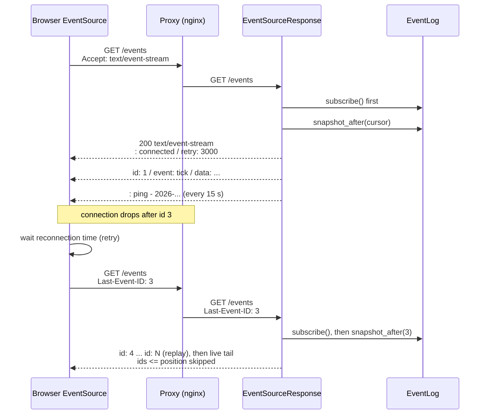

# Server-Sent Events (WHATWG SSE) Internals: text/event-stream Framing, retry:, Last-Event-ID Resumption, Ping Keep-Alives, and sse-starlette (3.6.0)

> [!summary] Claim
> SSE is a UTF-8 line protocol on one long `GET` in which the browser, not the server, owns the resume cursor: every `id:` the client parses becomes the `Last-Event-ID` it sends on the automatic reconnect, so gapless delivery is a server-side contract (subscribe to the live tail before reading the backlog, drop overlap by id, answer an unusable cursor with `200` and a reset event, never `400`), and `sse-starlette 3.6.0` supplies the framing, the 15-second comment pings, disconnect detection, and `HEAD` handling but none of the replay.

Part of [ASGI and Starlette Internals](README.md) in [API Engineering](../README.md).

## TL;DR

Mechanism: the server streams `text/event-stream` blocks of `field: value` lines ended by a blank line; `data` lines join with LF, `id` sets the last event ID even when nothing is dispatched, and `retry` sets the reconnection delay in milliseconds (HTML 9.2.6).
Contract rule: after any end of body or network error the `EventSource` waits the reconnection time and re-sends the same `GET` with `Last-Event-ID` if its last event ID string is non-empty (HTML 9.2.3), and anything other than `200` plus `text/event-stream`, including `204`, closes it for good.
Trap: a replay that reads the backlog and then subscribes loses every event published in between, and a `400` for a stale or malformed cursor permanently kills the client; the lab proves the first with a racing log (naive order delivers ids `1, 4`, correct order `1, 2, 3`).
Portability: the wire format is identical on HTTP/1.1 (one chunk per event, 6 bytes of framing for an 18-byte event), HTTP/2, and HTTP/3, but `sse-starlette` always sets `Connection: keep-alive`, which HTTP/2 forbids and which `h2 4.4.1` and Uvicorn's HTTP/2 path strip; browsers differ on the default delay (Chromium and WebKit `3000` ms, Firefox `5000` ms with a `500` ms floor).
When not to use it: SSE is one-way text with no client-to-server channel, no binary frames, no custom request headers from `EventSource`, and six connections per host in Chromium over HTTP/1.1; pick WebSockets for bidirectional or binary traffic and a message broker with consumer offsets when delivery must survive more than your retention window.

## Mental model



The browser opens an ordinary `GET` and keeps reading the body line by line; each event it parses moves its last event ID string, which lives in the client and survives the connection.
The server registers a live subscription before it reads the backlog, so an event published during the read lands in the queue even if it missed the snapshot, and anything in both is skipped by id.
Comment lines (`:` prefix) cross the proxy as traffic, which keeps an idle-read timer such as nginx `proxy_read_timeout` (default `60s`) from closing the stream, and the browser ignores them.
When the connection drops, the browser waits the reconnection time it last received in `retry:` and sends the same request with `Last-Event-ID: 3`; the server resumes after `3`, and events `4` and `5` that it had already written into the dead socket are sent again.

## How it works

### The wire grammar (HTML 9.2.5)

The format is the `stream` production of an ABNF over Unicode scalar values: `stream = [ bom ] *event`, `event = *( comment / field ) end-of-line`, `comment = colon *any-char end-of-line`, `field = 1*name-char [ colon [ space ] *any-char ] end-of-line`, and `end-of-line = ( cr lf / cr / lf )` (HTML Living Standard, 9.2.5 Parsing an event stream, read 2026-11-14).
`name-char` is any scalar value except LF, CR, and `:`, and `any-char` is any except LF and CR, so a field value can contain `:` and NUL but never a line break.
Event streams "must always be encoded as UTF-8", and the introduction says "there is no way to specify another character encoding" (HTML 9.2.1 and 9.2.5); a `charset` parameter on `Content-Type` is ignored by a conforming client.
All three line endings are legal and may be mixed in one stream, and the specification warns that "block buffering or line buffering with different expected line endings can cause delays in event dispatch" (HTML 9.2.5).
Decoding uses the UTF-8 decode algorithm, which "strips one leading UTF-8 Byte Order Mark" (HTML 9.2.6); a second BOM becomes part of the first field name, and the lab test `test_one_leading_bom_is_stripped_and_a_second_one_is_not` shows that the field `\ufeffdata` is then ignored.

### Field processing and dispatch (HTML 9.2.6)

The parser keeps three buffers per stream: data, event type, and last event ID, all initialized to the empty string (HTML 9.2.6).
A blank line dispatches; a line starting with `:` is ignored; otherwise the field name is everything before the first `:`, the value is everything after it with one leading space removed, and a line with no `:` is a field whose value is empty.
Field names are compared "literally, with no case folding", so `Data:` is an unknown field.
`event` sets the type buffer; `data` appends the value and then one LF; `id` sets the last event ID buffer only "if the field value does not contain U+0000 NULL"; `retry` sets the reconnection time only "if the field value consists of only ASCII digits"; any other name is ignored (HTML 9.2.6).
Dispatch first copies the last event ID buffer into the event source's last event ID string, which "does not get reset", then returns without an event if the data buffer is empty, then removes one trailing LF and fires a `MessageEvent` of type `message` or the event type buffer (HTML 9.2.6).
Three consequences follow, each pinned by a lab test.
A block with only `id: 5` dispatches nothing but still moves `lastEventId` to `5`, which is how a server primes a cursor without waking any listener.
A bare `id` line resets the last event ID to the empty string, after which the browser sends no `Last-Event-ID` at all on reconnect (the specification's own four-block example, `test_spec_four_block_stream_sets_then_resets_last_event_id`).
"Once the end of the file is reached, any pending data must be discarded", so the last event of a body that lacks its blank line is lost, even though the server wrote every byte of it (HTML 9.2.6).

The lab's `EventStreamParser` is a line-by-line transcription of those rules with two additions the specification leaves to implementers: an incremental UTF-8 decoder, so a multi-byte character split across TCP segments decodes once, and a `skip_lf` flag, so a CR at the end of one chunk and an LF at the start of the next count as one line end.
`test_parse_result_is_identical_for_every_chunk_split` feeds a stream with a BOM, CRLF, a bare CR, LF, `\u00e9`, and `\u20ac` split at every byte offset and one byte at a time, and requires identical events each time.
Chromium's parser does the same on bytes, with `is_recognizing_crlf_` and a three-byte BOM check (Chromium `third_party/blink/renderer/modules/eventsource/event_source_parser.cc`, `EventSourceParser::AddBytes`, main at 2026-11-14).

### The EventSource connection lifecycle (HTML 9.2.2 to 9.2.4)

The constructor takes a URL and one option, `withCredentials`, and nothing else, so a browser `EventSource` cannot set `Authorization` or any custom request header (HTML 9.2.2 IDL).
It builds a potential-CORS request, "may set (`Accept`, `text/event-stream`)", and sets the cache mode to `no-store` (HTML 9.2.2); Chromium sends that `Accept`, uses CORS mode with `CorsPreflightPolicy::kPreventPreflight`, and attaches the cursor through `SetEventSourceLastEventId` (Chromium `event_source.cc`, `EventSource::Connect`).
`Last-Event-ID` is not in the Fetch standard's CORS-safelisted request-header list (`Accept`, `Accept-Language`, `Content-Language`, `Content-Type`, and `Range`), which is why Chromium suppresses the preflight explicitly rather than relying on the safelist (Fetch Living Standard, CORS-safelisted request-header, read 2026-11-14).
On the response, an aborted network error fails the connection; another network error reestablishes it "unless the user agent knows that to be futile"; a status other than `200` or a `Content-Type` other than `text/event-stream` fails it; and when a `200` body ends normally the user agent reestablishes (HTML 9.2.2).
Failing sets `readyState` to `CLOSED` and fires `error`, and "once the user agent has failed the connection, it does not attempt to reconnect" (HTML 9.2.3), which is why the introduction says a server stops reconnection with `204 No Content` and why the same is true of `400`, `401`, `404`, and `500`.
Reestablishing sets `readyState` to `CONNECTING`, fires `error`, waits the reconnection time, optionally waits more ("an exponential backoff delay" is suggested, not required), and then sets `Last-Event-ID` to the last event ID string encoded as UTF-8 only if that string is not empty (HTML 9.2.3).
The initial reconnection time is "implementation-defined ... probably in the region of a few seconds" (HTML 9.2.2), and the engines disagree:

| Engine | Default delay | `retry:` handling | Backoff | Source (main, 2026-11-14) |
|---|---|---|---|---|
| Chromium | `3000` ms (`kDefaultReconnectDelay`) | any digit string that fits `uint64` (an overflowing one is ignored); an empty `retry:` resets to `3000`; no clamp | none: `ScheduleReconnect` uses `reconnect_delay_` as is | `event_source.cc`, `event_source_parser.cc` |
| Firefox | `5000` ms (`DEFAULT_RECONNECTION_TIME_VALUE`, pref `dom.serverEvents.defaultReconnectionTime`) | digits only, clamped to `MIN_RECONNECTION_TIME_VALUE` `500` and `MAX_RECONNECTION_TIME_VALUE`, which is `PR_IntervalToMilliseconds(DELAY_INTERVAL_LIMIT)` with `DELAY_INTERVAL_LIMIT` `PR_BIT(8 * sizeof(PRIntervalTime) - 1)`, half the 32-bit NSPR tick range (`xpcom/threads/nsITimer.idl`; its value in ms depends on the NSPR tick rate and is not computed here); an empty `retry:` counts as `0` and becomes `500`, not the default | none: `SetReconnectionTimeout` arms a one-shot timer with `mReconnectionTime` as is | `dom/base/EventSource.cpp` |
| WebKit | `3000` ms (`defaultReconnectDelay`) | an empty `retry:` resets to `3000`; otherwise `parseInteger<uint64_t>`, which also accepts surrounding ASCII whitespace and a leading `+`; no clamp | none: `scheduleTask(1_ms * m_reconnectDelay, ...)` | `Source/WebCore/page/EventSource.cpp` |

None of the three engines adds backoff of its own, so when a deploy closes every stream at once, every tab reconnects after the same `retry:` value; the server, not the browser, has to spread that herd.
The `Last-Event-ID` value space is "essentially any UTF-8 encoded string, that does not contain U+0000 NULL, U+000A LF, or U+000D CR", and the exact definition is open as whatwg/html issue 7363 (HTML 9.2.4).

One interop subtlety: the specification initializes the last event ID buffer to the empty string for each parsed stream, and dispatch copies it into the event source's string, which literally means the first id-less event after a reconnect would clear the cursor.
Chromium instead seeds the new parser with the previous ID (`EventSourceParser::EventSourceParser(last_event_id, client)` sets both `id_` and `last_event_id_`), and Firefox only overwrites `mLastEventID` when a message carries an id (`dom/base/EventSource.cpp`, `EventSourceImpl::DispatchAllMessageEvents`); the lab's parser takes a `last_event_id` seed like Chromium.
The robust server rule is to put an `id:` on every event so that no client reading of this corner matters.

### Last-Event-ID resumption is a server contract

Nothing in the specification says what a server does with `Last-Event-ID`; it is an opaque cursor that only your server can interpret.
The lab's `event_stream` implements one complete answer over an append-only log with integer ids.
Subscribe first: it registers a bounded `anyio` memory stream with the log before it awaits the backlog read, so any event published while the read is in flight is queued.
Snapshot second: `snapshot_after(cursor)` returns the retained events with id greater than the cursor, or `complete=False` when the cursor is older than the oldest retained event or newer than the head.
Deduplicate by position: after the replay it reads the queue and skips any id at or below the last id it sent, which removes the events that were in both the snapshot and the queue.
Never `400`: a cursor that is not a decimal integer of at most 19 digits and at most `2**63 - 1`, or that is outside the window, gets `200` and an `event: reset` with `id:` set to the head, so the client re-fetches state and resumes from the head instead of being closed for good by HTML 9.2.3.
Prime fresh clients: with no header the first block is `id: <head>` with no data, which moves the browser's cursor without dispatching, so the first reconnect already resumes; MCP's Streamable HTTP transport asks for the same thing, "an SSE event consisting of an event ID and an empty data field in order to prime the client to reconnect" (MCP specification 2025-11-25, Transports).
Evict slow consumers: when a subscriber's queue is full, `publish` closes it rather than buffering without bound, the response ends, and the client catches up from the log on its reconnect (`test_slow_subscriber_is_evicted_and_recovers_by_replay`); see [[End-to-End-Backpressure-TCP-Windows-ASGI-Send-Await-and-Bounded-Queues]].
The MCP transport adds two rules worth copying: event IDs "MUST be globally unique across all streams within that session" and the server "MUST NOT replay messages that would have been delivered on a different stream" (MCP specification 2025-11-25, Resumability and Redelivery).
The MCP Python SDK pinned here implements that contract as an `EventStore` abstract class with `store_event` and `replay_events_after`, and reads the header as `LAST_EVENT_ID_HEADER = "last-event-id"` `(mcp 2.3.0 mcp/server/streamable_http.py, EventStore)`.

### Keep-alive pings

The specification's only timing guidance is an authoring note: legacy proxies drop idle connections, so "authors can include a comment line (one starting with a ':' character) every 15 seconds or so" (HTML 9.2.7).
`sse-starlette` follows it: `DEFAULT_PING_INTERVAL = 15`, and `_ping` sleeps, builds `ServerSentEvent(comment=f"ping - {datetime.now(timezone.utc)}", sep=self.sep)` unless a `ping_message_factory` is given, and sends it under `_send_lock` only if the response is still `active` `(sse-starlette 3.6.0 sse_starlette/sse.py, EventSourceResponse._ping)`.
The lock exists because a ping that raced the final `more_body: False` message used to raise; the fix is upstream pull request 55, "Fix race condition between ping and stream_response" (sysid/sse-starlette PR 55, merged 2023-05-03), which the `_send_lock` comment in `__init__` links.
`ping=0` now disables pings by not starting the task at all, because `anyio.sleep(0)` is a bare checkpoint and the loop "would busy-spin, flooding the client with pings" (docstring of `_ping`, issue 206 "`ping=0` setting leads to a bad loop instead of disabling ping", closed 2026-09-03).
A ping comment is 45 bytes for a timestamp with microseconds and 51 bytes once HTTP/1.1 chunk framing is added (measured in the lab environment, see Numbers), and the lab test `test_idle_stream_gets_a_ping_comment` waits for one on a 10 ms interval and checks that the parser dispatches nothing for it.
Pings do not detect a dead client by themselves: a write into a half-open TCP connection succeeds into the kernel send buffer, so the server learns about the loss only when the buffer fills or the kernel gives up, which is why `send_timeout` exists.

### sse-starlette 3.6.0 internals

The package is four source files (`__init__.py`, `_utils.py`, `event.py`, `sse.py`); at the GitHub tag `v3.6.0`, `sse.py`, `event.py`, and `_utils.py` are byte-identical to the wheel installed in the lab (compared with `diff`).
`EventSourceResponse.__init__` validates `sep` against `\r\n`, `\r`, `\n`, wraps a sync iterator with `iterate_in_threadpool`, and builds headers with `setdefault("Cache-Control", "no-store")` plus unconditional `Connection: keep-alive` and `X-Accel-Buffering: no` `(sse-starlette 3.6.0 sse_starlette/sse.py, EventSourceResponse.__init__)`.
Starlette's `Response.init_headers` appends `; charset=utf-8` to any `text/` media type without a charset, so the wire header is `content-type: text/event-stream; charset=utf-8` `(starlette 1.10.0 starlette/responses.py, Response.init_headers)`, and no `Content-Length` is set because the body attribute is never assigned.
`no-store` tells every cache that it "MUST NOT store any part of either the immediate request or the response" `(RFC 9111 Section 5.2.2.5)`; `X-Accel-Buffering: no` is nginx's per-response switch for `proxy_buffering`, which is `on` by default (nginx `ngx_http_proxy_module`, `proxy_buffering`).
`enable_compression` raises `NotImplementedError`, and Starlette's `GZipMiddleware` skips `text/event-stream` because it is in `DEFAULT_EXCLUDED_CONTENT_TYPES` `(starlette 1.10.0 starlette/middleware/gzip.py, IdentityResponder.send_with_compression)`; `test_gzip_middleware_skips_event_streams_by_default` shows that passing `exclude_content_types=()` makes the same stream come back `gzip`-encoded, where a compressor would hold events until it flushes.

`__call__` first answers `HEAD` with headers and an empty body and never touches the iterator, because Starlette adds `HEAD` to every `GET` route and a streamed `HEAD` "never completes", wedging keep-alive connections (issue 218, closed 2026-10-25, and divergence 4 in the module docstring); `test_head_returns_headers_without_starting_the_stream` checks that the generator never subscribed.
For `GET` it runs an `anyio` task group with `_stream_response`, `_ping` (if the interval is positive), `_listen_for_exit_signal_with_grace`, an optional `data_sender_callable`, and `_listen_for_disconnect`, each but the data sender wrapped in `cancel_on_finish`, which cancels the whole group when any of them returns `(sse-starlette 3.6.0 sse_starlette/sse.py, EventSourceResponse.__call__)`.
`_listen_for_disconnect` loops on `receive()` until `http.disconnect`, sets `active = False`, and awaits `client_close_handler_callable`; the module docstring calls keeping it "Divergence 1" from Starlette, whose `StreamingResponse` skips the listener when the scope's `spec_version` is at least `2.4` and turns `OSError` into `ClientDisconnect` instead `(starlette 1.10.0 starlette/responses.py, StreamingResponse.__call__)`.
Uvicorn 0.54.0 advertises `spec_version` `2.3` on its `h11`, `httptools`, and `zttp` HTTP paths `(uvicorn 0.54.0 uvicorn/protocols/http/h11_impl.py, H11Protocol.handle_events)`, so both response classes use the listener there.
When the group is cancelled the generator is suspended at a `yield` or an `await`, cancellation is thrown into it, and its `finally` runs; `test_disconnect_cancels_the_generator_and_unsubscribes` checks that the subscription is gone, which is the failure CVE-2025-27421 describes in another stack.
`_send_with_timeout` wraps each `send` in `anyio.move_on_after(send_timeout)` and raises `SendTimeoutError` on expiry; `_stream_response` catches any exception from a send, closes the body iterator under a shielded scope, and re-raises, and `collapse_excgroups` unwraps the single-exception group so callers see the bare `SendTimeoutError` `(sse-starlette 3.6.0 sse_starlette/sse.py, EventSourceResponse._stream_response; sse_starlette/_utils.py, collapse_excgroups)`.
`send_timeout` defaults to `None`, meaning no timeout; the lab's `create_app` defaults to `30.0`, and `test_send_timeout_tears_down_a_stalled_client` sets `0.05`, stalls the second body message and sees `SendTimeoutError` with the subscription released.

`ServerSentEvent.encode` writes fields in a fixed order, comment lines, `id`, `event`, `data` lines, `retry`, then the blank line, with `sep` defaulting to `\r\n` `(sse-starlette 3.6.0 sse_starlette/event.py, ServerSentEvent.encode)`.
It splits `comment` and `data` on `\r\n|\r|\n` into one line each, which makes data injection impossible, and it deletes CR and LF from `id` and `event` with `_LINE_SEP_EXPR.sub("", ...)`, which prevents injection but silently changes the value: `id="7\n8"` goes out as `id: 78`.
It does not remove NUL from `id`, so `id="a\x00b"` reaches the browser, which ignores the field and keeps its previous cursor (`test_encode_strips_newlines_from_id_silently_but_passes_nul`).
`retry` must pass `isinstance(retry, int)`, which `True` does, so `retry=True` is written as `retry: True` and then ignored by every parser that checks for ASCII digits (`test_retry_bool_is_serialized_and_then_ignored_by_the_parser`).
`ensure_bytes` passes `bytes` through, encodes a `ServerSentEvent` with its own separator, stringifies anything else, and for a `dict` executes `data["sep"] = sep` before `ServerSentEvent(**data)`, mutating the caller's object `(sse-starlette 3.6.0 sse_starlette/event.py, ensure_bytes)`; the lab shows a stored dict gaining a `sep` key and a response with `sep="\n"` emitting `\r\n` for yielded `ServerSentEvent` objects.
Because `data` lines are split on CR too, a bare CR inside data comes back as LF, so text with arbitrary control characters must be JSON-encoded before it becomes `data` (`test_bare_cr_in_data_does_not_survive_the_round_trip`).

### Graceful shutdown

An SSE response never ends on its own, and Uvicorn's shutdown waits for open connections with `asyncio.wait_for(self._wait_tasks_to_complete(), timeout=self.config.timeout_graceful_shutdown)`, whose default is `None`, so without help a deploy waits until something kills the process `(uvicorn 0.54.0 uvicorn/server.py, Server.shutdown)`.
At import time `sse-starlette` saves `uvicorn.main.Server.handle_exit` as `AppStatus.original_handler` and replaces it with `AppStatus.handle_exit`, which sets `AppStatus.should_exit` and calls the original `(sse-starlette 3.6.0 sse_starlette/sse.py, module level)`; `test_importing_sse_starlette_patches_uvicorn_handle_exit` checks the patch.
The patch is not enough on its own: Uvicorn registers its signal handlers before the application module is imported, so the bound method it registered is the original one (issue 132, "Exit handler patch no longer works with uvicorn", open as of 2026-11).
The fallback is `_shutdown_watcher`, one task per thread that polls every `0.5` s and also reads `should_exit` from the Uvicorn `Server` found through `signal.getsignal(signal.SIGTERM).__self__` `(sse-starlette 3.6.0 sse_starlette/sse.py, _shutdown_watcher and _get_uvicorn_server)`.
Two regressions shaped it: one watcher per connection leaked until CPU exhaustion in 3.1.1 (issue 152), and copying Uvicorn's flag into the process-global `AppStatus.should_exit` cancelled every later response in the process (issue 211, closed 2026-09-28).
With `shutdown_event` and `shutdown_grace_period`, the library sets the event and waits up to the grace period while the generator is still `active`, so the generator can send a farewell before it is cancelled (issue 167); `test_shutdown_event_lets_the_generator_send_a_farewell` sends `event: bye` with `retry: 7000`.
A farewell `retry:` is the one place a server can desynchronize a reconnect herd, by giving each connection a different delay; see [[Graceful-Shutdown-SIGTERM-Drain-Windows-and-Kubernetes-PreStop-Hooks]].

### Under the stream: HTTP/1.1, HTTP/2, HTTP/3

On HTTP/1.1 there is no `Content-Length`, so the server uses the chunked transfer coding `(RFC 9112 Section 7.1)`; `h11 0.16.0` adds `Transfer-Encoding: chunked` itself and frames each `http.response.body` message as one chunk, so an 18-byte event costs `12\r\n` plus a trailing CRLF, 6 bytes (`test_http11_chunked_framing_adds_hex_length_and_two_crlfs_per_event`).
The specification cautions that "HTTP chunking can have unexpected negative effects on the reliability of this protocol, in particular if the chunking is done by a different layer unaware of the timing requirements" (HTML 9.2.7), which in practice means a proxy that re-buffers chunks.
`Connection: keep-alive` is meaningful only to HTTP/1.0 peers, because HTTP/1.1 connections persist by default `(RFC 9112 Section 9.3)`.
HTTP/2 forbids it: "An endpoint MUST NOT generate an HTTP/2 message containing connection-specific header fields", and such a message "MUST be treated as malformed" `(RFC 9113 Section 8.2.2)`; HTTP/3 has the same rule `(RFC 9114 Section 4.2)`.
`h2 4.4.1` normalizes outbound headers before validating them and the normalizer drops `connection`, `keep-alive`, `proxy-connection`, `transfer-encoding`, and `upgrade` `(h2 4.4.1 h2/utilities.py, _strip_connection_headers)`, so Hypercorn, which builds `H2Configuration(client_side=False, header_encoding=None)` and keeps the default normalization `(hypercorn 0.18.0 hypercorn/protocol/h2.py, H2Protocol.__init__)`, sends the stream without it, and `test_http2_drops_the_connection_header_and_frames_each_event` confirms the header is gone and that each event is one `DATA` frame with a 9-byte header.
Uvicorn 0.54.0 serves HTTP/2 only with `http2=True` and `http="zttp"`, and its HTTP/2 protocol strips the same five names as `FORBIDDEN_HEADERS` `(uvicorn 0.54.0 uvicorn/protocols/http/zttp_h2_impl.py, FORBIDDEN_HEADERS)`; the lab did not run it because `zttp` is not in the lock.
The bigger HTTP/2 effect is multiplexing: Chromium allows `6` sockets per host group for normal HTTP/1.1 connections (`g_max_sockets_per_group`, `net/socket/client_socket_pool_manager.cc`), which is the "per-server connection limitation" the specification warns about when several tabs each open an `EventSource` (HTML 9.2.7); over HTTP/2 every stream shares one connection.

### Testing SSE in process

`httpx.ASGITransport` in `httpx 0.28.1` appends every body chunk to a list and returns the response only after the app returns, and its `receive` sends `http.disconnect` only after the response is complete `(httpx 0.28.1 httpx/_transports/asgi.py, ASGITransport.handle_async_request)`.
An endless SSE endpoint therefore hangs `client.get()` and `client.stream()` alike, and its scope carries `asgi.version` `3.0` with no `spec_version`, so Starlette treats it as ASGI `2.0`.
The lab handles this in two ways: a `max_events_per_connection` setting makes the server end each response after N events, which models server-initiated connection recycling and lets `ResumingClient` run over `ASGITransport`, and a `ScriptedPeer` raw ASGI driver feeds each body message to the parser as it is sent and returns `http.disconnect` on demand; see [[In-Process-Testing-of-ASGI-Apps-with-HTTPX-ASGITransport]].

### Another Python client: httpx2 2.16.0

`httpx2 2.16.0` is in the lock as a dependency of `mcp`, and its `EventSource` parser is derived from `httpx-sse` (module docstring of `httpx2/_sse.py`).
On the same bytes it differs from HTML 9.2.6 in four ways that `test_httpx2_eventsource_diverges_from_whatwg_on_four_inputs` pins: it does not strip a BOM, so the first event is lost; it dispatches an event for a block with only `event:` or `id:`; it accepts `retry: -5` because it uses `int(value)`; and it decodes with the response's declared charset, so `charset=latin-1` turns `\u00e9` into mojibake `(httpx2 2.16.0 httpx2/_sse.py, _SSEEventDecoder.decode and EventSource.__iter__)`.
Because it calls `int()`, it also accepts `1_000` (the probe parsed it as `1000`) and non-ASCII decimal digits such as `\u0663`, both of which HTML 9.2.6 excludes.
It bounds an event at `DEFAULT_MAX_EVENT_SIZE_BYTES = 1024 * 1024` and does not reconnect or send `Last-Event-ID` itself; `Client.sse` only adds `Accept: text/event-stream` and `Cache-Control: no-store` `(httpx2 2.16.0 httpx2/_client.py, Client.sse)`.

## Numbers and limits

| Parameter | Value | Source or measurement context |
|---|---|---|
| Ping comment suggested by the spec | every "15 seconds or so" | HTML 9.2.7 |
| `sse-starlette` ping interval | `15` s default; `0` disables | `(sse-starlette 3.6.0 sse_starlette/sse.py, DEFAULT_PING_INTERVAL)` |
| Default ping comment size | `45` bytes; `51` with HTTP/1.1 chunk framing | `uv run --frozen python -c ...` encoding one default ping and sending it through `h11`, CPython `3.14.6`, macOS `27.3` arm64 |
| Event `id: 1`, `event: tick`, `data: {"n":1}` | `37` bytes | same run |
| `: connected` plus `retry: 3000` block | `28` bytes | same run |
| HTTP/1.1 framing per event | hex length + 4 bytes (`6` for an 18-byte event) | lab test with `h11 0.16.0`; `(RFC 9112 Section 7.1)` |
| HTTP/2 framing per event | `9`-byte `DATA` frame header | lab test with `h2 4.4.1`; `(RFC 9113 Section 4.1)` |
| Shutdown watcher poll | `0.5` s | `(sse-starlette 3.6.0 sse_starlette/sse.py, _shutdown_watcher)` |
| Uvicorn graceful shutdown timeout | `None` (wait forever) | `(uvicorn 0.54.0 uvicorn/config.py, Config.__init__)` |
| nginx `proxy_read_timeout` | `60s` default, between two reads | nginx `ngx_http_proxy_module` (as of 2026-11) |
| nginx `proxy_buffering` | `on` by default; `X-Accel-Buffering: no` disables per response | nginx `ngx_http_proxy_module` (as of 2026-11) |
| Reconnection delay | Chromium `3000` ms, WebKit `3000` ms, Firefox `5000` ms (floor `500` ms) | engine sources on main (as of 2026-11) |
| Chromium connections per host, HTTP/1.1 | `6` | `net/socket/client_socket_pool_manager.cc` (as of 2026-11) |
| `httpx2` max event size | `1,048,576` bytes | `(httpx2 2.16.0 httpx2/_config.py, DEFAULT_MAX_EVENT_SIZE_BYTES)` |
| Lab parser bounds | `65,536` chars per line, `1,048,576` chars per event (defaults) | lab `EventStreamParser.__init__` |
| Lab cursor | at most `19` ASCII digits and at most `2**63 - 1` (fits a signed 64-bit integer) | lab `MAX_ID_DIGITS` and `MAX_ID` |
| Lab module | `47 passed in 0.76s` | `uv run --frozen pytest <module> -q`, CPython `3.14.6`, macOS `27.3` arm64, one run (2026-11-14) |

Byte counts are deterministic for these inputs except the ping, whose timestamp drops the fractional part when the microsecond is zero; none of them is a throughput claim.

## Portability

| Runtime, library, server, or protocol | Behavior | Evidence |
|---|---|---|
| CPython `3.12.13`, `3.13.18`, `3.14.10`, `3.15.2` on macOS `27.3` arm64 | All 46 tests passed on each in the drafter's run; not re-run after the verifier added a 47th case (lab checks paused) | `UV_PROJECT_ENVIRONMENT=<tmp> uv run --frozen --python <v> pytest <module> -q -p no:cacheprovider`, one run each |
| CPython `3.14.6` (workspace) on macOS `27.3` arm64 | 47 pass | the run shown in Worked example |
| CPython `3.12.16` and `3.15.2t` | Not run | `uv python list` offers neither on this machine; the only free-threaded builds are `3.14.6t` and `3.15.0b3t`, and they were not run |
| Debian Trixie and Alpine containers | Not run | lab checks paused for this note (2026-11-11 instruction) |
| `sse-starlette 3.6.0` | Pings, `HEAD`, disconnect, `send_timeout`, shutdown event, encoding rules as described | lab tests; tag `v3.6.0` source identical to the wheel |
| `sse-starlette` before `3.6.0` | `HEAD` streams forever (fixed by issue 218); `ping=0` busy-loops before the issue 206 fix; global shutdown latch in `3.1.1` and later until issue 211 | upstream issues, not run here |
| `starlette 1.10.0` | `text/event-stream; charset=utf-8`; `GZipMiddleware` skips the media type | lab tests |
| Uvicorn `0.54.0` (`h11`, `httptools`, `zttp`) | `spec_version` `2.3`, so the disconnect listener runs; shutdown waits forever by default; HTTP/2 strips `Connection` | source citations above; no socket test in this lab |
| Hypercorn `0.18.0` over HTTP/2 | `h2` default configuration strips `Connection: keep-alive` | lab test drives `h2 4.4.1` in memory with the same defaults; Hypercorn itself not run |
| Granian `2.8.7` (ASGI, HTTP/1.1) | `EventSourceResponse` streams with `transfer-encoding: chunked`, one chunk per event (`1C` for the 28-byte connected block, `1F` for each 31-byte event), the headers `sse-starlette` sets pass through, `HEAD` returns headers and ends, and the final `0` chunk closes the body; Granian HTTP/2 not run | one run: `granian --interface asgi --port 18765 --workers 1` serving a 3-event `EventSourceResponse` app with `ping=1`, driven by `curl -N -i --raw` and `curl -I`, CPython `3.14.6`, macOS `27.3` arm64 (2026-11-14); the lock pins `granian==2.8.7` |
| HTTP/1.1 | One chunk per `send`; framing overhead as measured | lab `h11` test; `(RFC 9112 Section 7.1)` |
| HTTP/2 | One `DATA` frame per event, `Connection` forbidden | lab `h2` test; `(RFC 9113 Section 8.2.2)` |
| HTTP/3 | Same wire format on a request stream; connection-specific fields forbidden | `(RFC 9114 Section 4.2)`; not exercised |
| Browsers | Default delay and `retry:` handling differ | engine source table in How it works |
| `httpx2 2.16.0` `EventSource` | Diverges from HTML 9.2.6 on BOM, empty-data dispatch, negative `retry`, and charset | lab test |

## Worked example

The [implementation](../labs/src/api_labs/f10_asgi_and_starlette_internals/sse_resumption.py) has three layers: `EventStreamParser`, an incremental HTML 9.2.6 parser with line and event bounds; `EventLog` plus `event_stream`, the replay source and the subscribe-first generator served by `EventSourceResponse` from `create_app`; and `ResumingClient`, which reconnects like `EventSource` with `Last-Event-ID`.
The [test](../labs/tests/f10_asgi_and_starlette_internals/test_server_sent_events_sse_protocol_last_event_id_and_sse_starlette.py) checks the parser against the specification's own examples, pins `sse-starlette`'s encoding and lifecycle behavior, drops a stream mid-flight with a raw ASGI peer and resumes it over `httpx.ASGITransport`, races a slow backlog read against publishers, and drives `h11`, `h2`, and `httpx2` in memory.

The generator, verbatim from `sse_resumption.py`:

```python
async def event_stream(
    log: EventLog,
    last_event_id: str | None,
    *,
    retry_ms: int,
    max_events: int | None = None,
    subscribe_first: bool = True,
) -> AsyncIterator[ServerSentEvent]:
    """Replay what the client missed, then follow the live tail, without gaps or repeats.

    `subscribe_first=False` is the race this lab exists to show: an event published while
    the backlog read is in flight is in neither the snapshot nor the subscription.
    """
    yield ServerSentEvent(comment="connected", retry=retry_ms)  # sets reconnection time only
    try:
        cursor = parse_last_event_id(last_event_id)
        usable = cursor is not None
    except ValueError:
        cursor, usable = None, False
    early = log.subscribe() if subscribe_first else None
    subscription = early
    try:
        replay = await log.snapshot_after(cursor) if cursor is not None else None
        subscription = early if early is not None else log.subscribe()
        sent = 0
        if replay is not None and replay.complete:
            position = cursor if cursor is not None else 0
            for item in replay.events:
                yield _to_sse(item)
                position = item.id
                sent += 1
                if max_events is not None and sent >= max_events:
                    return
        else:
            position = replay.head if replay is not None else log.head
            if last_event_id is None:
                yield ServerSentEvent(id=str(position))  # priming: sets lastEventId, no event
            else:
                reset = {"head": position, "reason": "gap" if usable else "invalid-id"}
                yield ServerSentEvent(data=json.dumps(reset), event="reset", id=str(position))
        async for item in subscription.receive:
            if item.id <= position:
                continue  # already delivered by the replay
            yield _to_sse(item)
            position = item.id
            sent += 1
            if max_events is not None and sent >= max_events:
                return
    finally:
        if subscription is not None:
            log.unsubscribe(subscription)
```

The dispatch step of the parser, verbatim:

```python
    def _dispatch(self) -> MessageEvent | None:
        self.last_event_id = self._id_buffer  # set even when nothing is dispatched
        if not self._data:  # the data buffer is the empty string
            self._event_type = ""
            return None
        # Appending LF after every data line and removing the last LF is a join.
        event = MessageEvent(
            type=self._event_type or "message",
            data="\n".join(self._data),
            last_event_id=self.last_event_id,
        )
        self._data.clear()
        self._data_len = 0
        self._event_type = ""
        return event
```

The seed's lab plan, a dropped connection followed by gapless replay, verbatim from the test module:

```python
async def test_mid_stream_drop_then_resume_is_gapless() -> None:
    log = EventLog()
    for n in range(1, 6):
        log.publish("tick", str(n))
    parser = EventStreamParser()
    seen: list[MessageEvent] = []

    def on_body(body: bytes) -> None:
        seen.extend(parser.feed(body))
        if parser.last_event_id == "3":
            peer.disconnected.set()  # bytes the server writes after this are lost

    peer = ScriptedPeer(headers={"Last-Event-ID": "0"})
    peer.on_body = on_body
    await peer.run(create_app(log))
    assert b"id: 5" in peer.body()  # the server wrote 4 and 5 into a dead connection
    assert log.subscriber_count == 0
    for n in range(6, 9):
        log.publish("tick", str(n))
    async with client_for(create_app(log, max_events_per_connection=5)) as client:
        browser = ResumingClient(client, last_event_id=parser.last_event_id)
        await browser.connect_once()
    delivered = [e.data for e in seen + browser.received]
    assert browser.sent_ids == ["3"]
    assert delivered == [str(n) for n in range(1, 9)]
```

The server writes events `4` and `5` before the cancellation reaches it, because a replay from memory never yields to the event loop; the client never parsed them, and the cursor it owns brings them back.
The race, verbatim: `RacingLog` publishes events `2` and `3` after taking the snapshot and before returning it, and one late event is published once the stream is live.

```python
@pytest.mark.unit
@pytest.mark.asyncio
async def test_events_published_during_the_backlog_read_are_not_lost() -> None:
    correct = await _resume_from_zero(_racing_log(after=2), max_events=3, subscribe_first=True)
    naive = await _resume_from_zero(_racing_log(after=2), max_events=2, subscribe_first=False)
    assert correct == ["1", "2", "3"]
    assert naive == ["1", "4"]  # 2 and 3 were published after the snapshot, before subscribe
```

Run from `labs/` on CPython `3.14.6`, macOS `27.3` arm64:

```text
$ uv run --frozen pytest tests/f10_asgi_and_starlette_internals/test_server_sent_events_sse_protocol_last_event_id_and_sse_starlette.py -q
...............................................                          [100%]
47 passed in 0.76s
```

## Pitfalls

> [!warning] Reading the backlog before subscribing
> Trigger: the handler queries "events after the cursor", then subscribes to the live feed.
> Symptom: events published during the query never reach that client, silently; the lab's naive mode delivers ids `1, 4` instead of `1, 2, 3, 4`.
> Fix: subscribe first, snapshot second, skip ids at or below the last one sent.

> [!warning] Rejecting a bad cursor with 4xx
> Trigger: `Last-Event-ID` is malformed, from an older deploy's id space, or older than retention, and the server answers `400`, `404`, or `410`.
> Symptom: the browser fires `error`, sets `readyState` to `CLOSED`, and never reconnects (HTML 9.2.3); users see a frozen page until reload.
> Fix: answer `200` with a reset event whose `id:` is the current head, and let the client re-fetch state; reserve `204` for "stop reconnecting on purpose".

> [!warning] Injecting line breaks into fields
> Trigger: an encoder interpolates `id`, `event`, or `data` without handling CR and LF.
> Symptom: forged events and corrupted reconnection state: H3 before `1.15.6` and `2.0.0` through `2.0.1-rc.14` (CVE-2026-33128), NestJS before `11.1.18` (CVE-2026-35515, which names "corrupt reconnection state"), and `eventsource-encoder` before `1.0.2` (CVE-2026-44214), all NVD records.
> Fix: split `data` on every line break and reject, not strip, CR, LF, and NUL in `id` and `event`; `sse-starlette 3.6.0` strips CR and LF, which is safe but renames ids, and passes NUL.

> [!warning] Leaking subscriptions on disconnect
> Trigger: the generator registers a queue and never removes it when the client goes away.
> Symptom: every published event is still copied into dead queues until memory runs out; Abacus before `1.4.0` leaked a goroutine per disconnected `/stream` client and "eventually stops accepting new SSE connections" (CVE-2025-27421, NVD, CVSS 3.1 `7.5`).
> Fix: unsubscribe in `finally`, which runs because `sse-starlette` cancels the task group on `http.disconnect`; the lab asserts `subscriber_count == 0` after a disconnect and after a send timeout.

> [!warning] Unbounded client buffers
> Trigger: an SSE client appends bytes until it sees a blank line.
> Symptom: a hostile or broken server exhausts client memory or CPU: the MCP PHP SDK `0.5.0` to `0.7.0` (CVE-2026-53965), `undici` `EventSource` (CVE-2026-109924, where byte limits did not bound per-field state), and `httpx2` `2.5.0` to before `2.10.0`, whose line decoder rescanned buffered text quadratically (CVE-2026-84378).
> Fix: bound line and event size and join a split line once at its end, as the lab parser does; `test_line_bound_stops_a_line_that_never_ends` fails on the chunk that crosses the limit.

> [!warning] Buffering intermediaries and compression
> Trigger: nginx with default `proxy_buffering on`, a CDN, or `GZipMiddleware` configured to compress everything.
> Symptom: events arrive in bursts or only when the buffer fills; pings never reach the client, so idle timers fire.
> Fix: keep `X-Accel-Buffering: no` (set by `sse-starlette`), keep `text/event-stream` in the compression exclusions, and make pings shorter than every idle timeout on the path (nginx `proxy_read_timeout` default `60s`).

> [!warning] A retry: of zero in Chromium
> Trigger: the server sends `retry: 0`, or a small value, and then fails fast, for example during an outage.
> Symptom: Chromium reconnects with that delay and adds no backoff of its own (`ScheduleReconnect` in `event_source.cc`), turning every tab into a tight retry loop; WebKit does the same, and Firefox clamps to `500` ms but also adds no backoff.
> Fix: never send a `retry:` below a few seconds, add per-connection jitter, and shed load at the edge; see [[Retry-Budgets-and-Preventing-Cascading-Retry-Amplification-Storms]].

> [!warning] Testing an endless stream through ASGITransport
> Trigger: `await client.get("/events")` against a live SSE endpoint in `httpx 0.28.1`.
> Symptom: the test hangs, because the transport returns only after the app finishes.
> Fix: end responses after N events in tests, or drive the app with a raw ASGI peer that disconnects on demand.

> [!warning] Shutdown that never finishes
> Trigger: Uvicorn with `timeout_graceful_shutdown` unset and open SSE streams, or an `sse-starlette` release with the issue 211 latch.
> Symptom: deploys hang until `SIGKILL`, or, with the latch, every new stream in the process is cancelled before its first event.
> Fix: run `sse-starlette 3.6.0`, set `timeout_graceful_shutdown`, and use `shutdown_event` with a grace period shorter than it to send a farewell `retry:`.

## Security and robustness

Authentication: an `EventSource` sends cookies (with `withCredentials` for cross-origin) and no custom headers, so browser SSE is cookie-authenticated unless the token is in the URL, and a token in the URL lands in proxy and server logs; use short-lived, single-purpose stream tokens if you must.
Authorization runs on every connect and every reconnect, because a reconnect is a new request; Dagu before `2.2.4` left all SSE endpoints open under Basic auth while its REST API was protected (CVE-2026-31882, NVD, CVSS 3.1 `7.5`).
The cursor is untrusted input: parse it strictly (the lab accepts at most 19 ASCII digits and nothing above `2**63 - 1`), scope it to the authenticated principal and stream, and never let it select another tenant's events, which is `API1:2023 Broken Object Level Authorization` in the OWASP API Security Top 10; OpenHuman before `0.56.0` let a caller-supplied `client_id` select another client's stream and allowed cross-origin reads (CVE-2026-49405, NVD).
MCP states the stream-scoping rule as "The server MUST NOT replay messages that would have been delivered on a different stream" (MCP specification 2025-11-25).
Cross-origin streams need `Access-Control-Allow-Origin` on the response, and with `withCredentials` also `Access-Control-Allow-Credentials`; reflecting `Origin` blindly turns a private stream into a public one, see [[CORS-Protocol-Internals-Preflight-Caching-and-Origin-Reflection-Exploits]].
Each open stream holds a socket, a task, and a queue for minutes or hours, so this is `API4:2023 Unrestricted Resource Consumption`: cap streams per principal and per process, bound per-subscriber queues and evict slow consumers, set `send_timeout`, and cap stream lifetime so reconnects rebalance load; see [[Unrestricted-Resource-Consumption-API4-2023-Payload-Depth-and-Limit-Guards]].
Replay is a read amplifier: a client that reconnects in a loop with an old cursor makes the server re-read the backlog each time, so bound the replay size and rate-limit reconnects per principal.
Data that originates from users must be encoded, not concatenated: JSON-encode payloads, refuse CR, LF, and NUL in `id` and `event`, and treat a parser bound violation on the client as a reason to drop the connection.

## The principal's view

The decision is not "SSE or WebSockets" but where the delivery guarantee lives.
SSE gives you an at-least-once, ordered, client-cursor protocol for free in every browser, and its whole correctness budget is in one server function: map a cursor to "everything after it", atomically with respect to new events, for as long as your retention promises.
That makes the event log, not the HTTP handler, the architectural component: an in-memory deque gives you resumption within one process and one deploy, a Redis stream or Postgres table keyed by a monotonic id gives you resumption across pods and restarts, and a broker with consumer offsets is the answer once clients must survive hours offline.
Encode the epoch in the id (for example `<log-generation>-<offset>`) if the log can be reset, so a cursor from a previous generation is recognizably foreign and gets a reset event instead of a wrong replay.
Organizationally, write the cursor contract down like any other API: id format, retention window, what a reset event means, the `retry:` policy, the maximum stream lifetime, and the shutdown behavior, because front-end, edge, and platform teams each own one of the layers that can break it.
Pick SSE for server-to-browser fan-out of text events (notifications, progress, LLM token streams; see [[Streaming-LLM-Token-APIs-SSE-Framing-Heartbeats-and-Mid-Stream-Errors]]), WebSockets when the client talks back at high rate or sends binary, long polling when intermediaries cannot be configured to stream, and gRPC server streaming between services where you control both ends and want typed messages and deadlines; [[Real-Time-Push-Protocols-Compared-WebSockets-vs-SSE-vs-HTTP-2-3-Streaming-vs-Long-Polling]] compares them.
Over HTTP/1.1 the six-connection limit is a product constraint, not a tuning knob: either serve SSE over HTTP/2 end to end or multiplex every feed a page needs into one stream.

## Interview questions

> [!question] L5: What does a browser do when an SSE response body ends normally, and how do you stop it?
>
> > [!success]- Answer
> > It reestablishes the connection: it fires `error`, waits the reconnection time, and sends the same `GET`, adding `Last-Event-ID` if its last event ID string is not empty (HTML 9.2.3).
> > To stop it, answer the next request with a status other than `200`, conventionally `204`, or a non-`text/event-stream` type, which fails the connection permanently; the client can also call `close()`.
> >
> > Follow-up: Why is returning `401` on a reconnect with an expired cookie a poor user experience?

> [!question] L5: Why does `sse-starlette` send `: ping - <timestamp>` every 15 seconds, and why does the page never see it?
>
> > [!success]- Answer
> > Proxies and load balancers close connections that are idle between reads, nginx after `proxy_read_timeout` (`60s` by default), and the specification suggests a comment line "every 15 seconds or so" (HTML 9.2.7).
> > A line starting with `:` is ignored by the parser, so it dispatches nothing (HTML 9.2.6).
> >
> > Follow-up: Does a successful ping prove the client is still there?

> [!question] L6: Predict the output: a browser parses `id: 5\n\nid: 6\x007\ndata: x\n\nid\ndata: y\n\n`; what are the dispatched events and their `lastEventId`, and what header does it send on reconnect?
>
> > [!success]- Answer
> > The first block has no data, so nothing is dispatched, but the last event ID becomes `5`.
> > The second block's `id` contains NUL and is ignored, so it dispatches `x` with `lastEventId` `5`.
> > The third block's bare `id` resets the ID to the empty string and dispatches `y` with `lastEventId` empty.
> > On reconnect it sends no `Last-Event-ID` header at all, because the string is empty (HTML 9.2.3).
> >
> > Follow-up: What does `sse-starlette` emit for `ServerSentEvent(id="6\x007")`?

> [!question] L6: Debug this API: after a deploy, some users miss notifications, but logs show every event was sent; the handler runs `SELECT ... WHERE id > :cursor`, streams the rows, and then subscribes to Redis pub/sub.
>
> > [!success]- Answer
> > Events published between the `SELECT` snapshot and the `SUBSCRIBE` are in neither source, and a deploy makes every client reconnect at once, so the window is hit far more often.
> > "Sent" in logs is publisher-side and does not cover that window.
> > Subscribe first, buffer, run the query, stream the rows, then drain the buffer skipping ids at or below the last row sent; the lab's naive mode reproduces the loss and its correct mode does not.
> >
> > Follow-up: How would you prove the fix in a test without timing races?

> [!question] L6: A client sends `Last-Event-ID: 12` but your retention only goes back to `40`; what do you return?
>
> > [!success]- Answer
> > `200` with `text/event-stream`, then a reset event that carries the current head as its `id:`, so the client re-fetches state out of band and resumes from the head.
> > A `4xx` would fail the `EventSource` permanently (HTML 9.2.3), and silently streaming from `41` would hide a gap the client must know about.
> >
> > Follow-up: How do you distinguish "too old" from "from a previous log generation"?

> [!question] L6: Why does an SSE endpoint under Hypercorn over HTTP/2 not break even though `sse-starlette` sets `Connection: keep-alive`, which RFC 9113 forbids?
>
> > [!success]- Answer
> > RFC 9113 Section 8.2.2 forbids connection-specific fields and makes such messages malformed, but `h2` normalizes outbound headers before validating them, and the normalizer drops `connection` and the other hop-by-hop names.
> > Uvicorn's HTTP/2 path drops the same names explicitly.
> > A server that validated without normalizing would refuse the response, so the header is a latent HTTP/2 hazard that is harmless only because of those libraries.
> >
> > Follow-up: What does `Connection: keep-alive` actually do on HTTP/1.1?

> [!question] L7+: Design SSE notifications for 2 million browser tabs across 200 pods with zero lost events within 24 hours.
>
> > [!success]- Answer
> > Put the durable log outside the pods: a partitioned stream with monotonic offsets per user or tenant, retained 24 hours, and make the SSE id `<partition>-<generation>-<offset>`.
> > Each pod subscribes to the partitions of its connected users, replays from the log on connect after subscribing, and deduplicates by offset; slow consumers are evicted to replay rather than buffered.
> > Spread reconnect storms with jittered `retry:` on shutdown farewells and a maximum stream lifetime, terminate on HTTP/2 at the edge to escape the six-connection limit, and cap streams per principal.
> > Measure gaps end to end with a synthetic client that checks offset continuity.
> >
> > Follow-up: What breaks if two pods both serve the same user's tabs?

> [!question] L7+: Your team proposes replacing SSE with WebSockets "because SSE drops events"; how do you respond?
>
> > [!success]- Answer
> > SSE does not drop events; servers do, when they mishandle the cursor, and WebSockets have no cursor or automatic reconnection at all, so the same server bug becomes a client library you must write.
> > Choose WebSockets if you need client-to-server messages at high rate, binary frames, or custom headers at connect time; otherwise fix the replay contract and keep the built-in reconnection.
> >
> > Follow-up: Which parts of the SSE resumption contract would you have to rebuild on WebSockets?

> [!question] L7+: Where can the 15-second ping, the browser's 3-second retry, and the proxy's 60-second idle timeout interact badly?
>
> > [!success]- Answer
> > If any hop's idle timeout is shorter than the ping interval, the stream is cut on every idle period and every client reconnects on the same schedule, multiplying replay reads.
> > If a hop buffers, pings are held and the downstream idle timer fires even though the server sent them.
> > If the server restarts, Chromium clients come back after exactly the last `retry:` without backoff, so the pings, retries, and timeouts must be chosen together and documented as one budget.
> >
> > Follow-up: How would you detect from server metrics that a proxy is cutting streams?

## Related

Prerequisites: [[ASGI-WebSockets-Lifecycle-Subprotocols-and-Backpressure]]

Next: [[Starlette-AuthenticationMiddleware-SessionMiddleware-and-TrustedHost]]

See also: [[02-Programming-Languages/Python/Python-Backend-Interview-Prep/04-FastAPI]], [[Starlette-Responses-StreamingResponse-FileResponse-and-Background-Execution]], [[ASGI-HTTP-and-Disconnect-Event-Lifecycle]], [[In-Process-Testing-of-ASGI-Apps-with-HTTPX-ASGITransport]], [[Real-Time-Push-Protocols-Compared-WebSockets-vs-SSE-vs-HTTP-2-3-Streaming-vs-Long-Polling]], [[Streaming-LLM-Token-APIs-SSE-Framing-Heartbeats-and-Mid-Stream-Errors]], [[Model-Context-Protocol-MCP-Architecture-JSON-RPC-Transports-and-Tool-Contracts]], [[Propagating-Client-Disconnects-to-Cancel-Upstream-GPU-Inference]], [[Graceful-Shutdown-SIGTERM-Drain-Windows-and-Kubernetes-PreStop-Hooks]], [[End-to-End-Backpressure-TCP-Windows-ASGI-Send-Await-and-Bounded-Queues]], [[HTTP-1-1-Framing-Keep-Alive-and-Chunked-Encoding]], [[HTTP-2-Binary-Framing-and-Stream-State-Machine]], [[HTTP-Compression-Gzip-Brotli-Zstandard-and-BREACH]], [[CORS-Protocol-Internals-Preflight-Caching-and-Origin-Reflection-Exploits]], [[Unrestricted-Resource-Consumption-API4-2023-Payload-Depth-and-Limit-Guards]], [[Retry-Budgets-and-Preventing-Cascading-Retry-Amplification-Storms]], [[Proxy-and-Application-Timeout-and-Retry-Interaction-Hazards]]

- Lab: `labs/tests/f10_asgi_and_starlette_internals/test_server_sent_events_sse_protocol_last_event_id_and_sse_starlette.py`

## Further reading

- HTML Living Standard, section 9.2 Server-sent events, https://html.spec.whatwg.org/multipage/server-sent-events.html - the grammar, the parser, the reconnection algorithm, and `Last-Event-ID`.
- Fetch Living Standard, https://fetch.spec.whatwg.org/ - the CORS-safelisted request-header list that `Last-Event-ID` is not on.
- RFC 9112, HTTP/1.1 - Section 7.1 on chunked transfer coding and Section 9.3 on persistence.
- RFC 9113, HTTP/2 - Section 8.2.2 on connection-specific header fields.
- RFC 9114, HTTP/3 - Section 4.2 on the same rule for HTTP/3.
- RFC 9111, HTTP Caching - Section 5.2.2.5 on `no-store`.
- sse-starlette `v3.6.0` `sse_starlette/sse.py` and `sse_starlette/event.py` - the response, its five tasks, its documented divergences from Starlette, and the encoder.
- sse-starlette issues 218, 206, 211, 167, 152, and 132 - the `HEAD`, `ping=0`, shutdown-latch, farewell, watcher-leak, and Uvicorn-patch histories.
- Chromium `event_source.cc` and `event_source_parser.cc` - a production parser and its constant reconnect delay.
- Firefox `dom/base/EventSource.cpp` - the `5000` ms default, the `500` ms floor, and the absence of backoff.
- WebKit `Source/WebCore/page/EventSource.cpp` - the `3000` ms default and a `retry:` parser looser than the specification.
- MCP specification 2025-11-25, Transports - a modern protocol that builds its resumability on `Last-Event-ID`, priming events, and `retry:`.
- nginx `ngx_http_proxy_module` - `proxy_buffering`, `X-Accel-Buffering`, and `proxy_read_timeout`.
