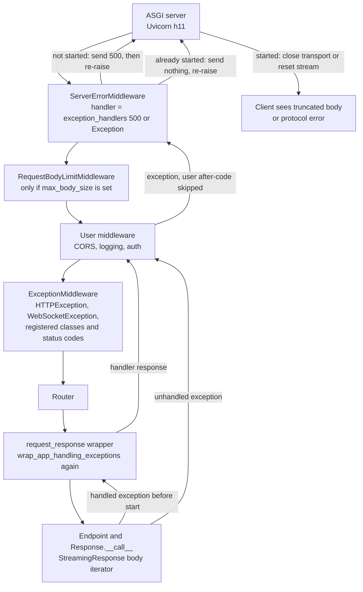

# Starlette Exception Handling Onion: Why ServerErrorMiddleware Wraps the Outermost Layer and Why Mid-Stream Exceptions Cannot Return 500

> [!summary] Claim
> Starlette converts exceptions into responses in exactly two places, `ExceptionMiddleware` just outside the router for handled exceptions and `ServerErrorMiddleware` outside everything for the rest, and both are powerless once `http.response.start` has gone out, because a status line already on the wire cannot be retracted: the only remaining signal is a truncated body and a closed connection or reset stream.

Part of [ASGI and Starlette Internals](README.md) in [API Engineering](../README.md).

## TL;DR

- Mechanism: `Starlette.build_middleware_stack` wraps the router as `ServerErrorMiddleware -> [RequestBodyLimitMiddleware] -> user middleware -> ExceptionMiddleware -> Router`, and each route is wrapped once more by `wrap_app_handling_exceptions`, so handled exceptions become responses inside user middleware while unhandled ones cross every user middleware as raised exceptions.
- Contract rule: handlers keyed by `500` or `Exception` are lifted out of `ExceptionMiddleware` into `ServerErrorMiddleware`, which always re-raises after it sends (or skips) the `500`, so the server still logs the traceback.
- Trap: once a layer has seen `http.response.start`, a handled exception becomes `RuntimeError("Caught handled exception, but response already started.")`, an unhandled one produces no response at all, and the client receives `200 OK` with a truncated body (HTTP/1.1 chunked stream without the `0\r\n\r\n` terminator, captured below).
- Portability: the layering is pure Python and identical on CPython 3.12.13, 3.13.18, and 3.14.6 (17 of 17 lab tests passed on each in the drafter's runs; the verifier re-ran 3.14.6 only); what the client sees after a mid-stream failure is decided by the server and the HTTP version, not by Starlette.
- When not to rely on it: never use the exception onion as the error channel for streaming responses, background tasks, or anything that must add headers such as CORS to a `500`; validate before the first byte, and carry in-stream errors in the payload protocol itself.

## Mental model



Requests flow down the onion and responses flow back up through each layer's wrapped `send`.
A handled exception (an `HTTPException`, or any class with a registered handler) is caught by the innermost `wrap_app_handling_exceptions` frame, which lives inside `request_response`, and is turned into an ordinary response, so user middleware sees nothing but `http.response.start` with the handler's status.
An unhandled exception is re-raised by both handler wrappers and climbs through every user middleware as a Python exception, so their post-call code never runs and their `send` wrappers never see the `500`.
`ServerErrorMiddleware` is the last Python frame before the server: if no `http.response.start` has passed through it, it sends a `500` directly to the server's raw `send` and re-raises; if one has, it sends nothing and re-raises.
The server then logs the exception and, if the response had started, has no HTTP-level way to say "error" except to stop the message early.

## How it works

### Assembly: who sits where and why

`Starlette.__init__` stores user middleware, handlers, and the router but builds nothing; `Starlette.__call__` builds `middleware_stack` lazily on the first call and caches it (starlette 1.10.0 starlette/applications.py, Starlette.__call__).
`build_middleware_stack` partitions `self.exception_handlers`: any key that compares equal to `500` or `Exception` becomes `error_handler` for `ServerErrorMiddleware`, every other key goes to `ExceptionMiddleware` (starlette 1.10.0 starlette/applications.py, Starlette.build_middleware_stack).
It then builds the list `[ServerErrorMiddleware(handler=error_handler, debug=debug)]`, appends `RequestBodyLimitMiddleware` only when `max_body_size` is set, appends `self.user_middleware`, appends `ExceptionMiddleware(handlers=..., debug=debug)`, and wraps the router in `reversed(...)` order so the first list entry is the outermost layer.
`add_middleware` does `self.user_middleware.insert(0, ...)`, so a later call lands outermost among user middleware, directly inside `ServerErrorMiddleware`, and it raises `RuntimeError("Cannot add middleware after an application has started")` once the stack is cached (starlette 1.10.0 starlette/applications.py, Starlette.add_middleware).
The lab walks the built stack and asserts the exact order `ServerErrorMiddleware, Recorder(outer), Recorder(inner), ExceptionMiddleware, Router`, and that `add_middleware` inserts just inside `ServerErrorMiddleware`.

The asymmetric placement is the design.
`ExceptionMiddleware` is innermost so that handled exceptions turn into responses before any user middleware sees them, which means CORS, compression, session, and logging middleware all process a `404` or a `409` like any other response.
`ServerErrorMiddleware` is outermost so that a bug in a user middleware (CORS, auth, a broken `BaseHTTPMiddleware`) is still caught and still yields a `500`; if it sat inside user middleware, an exception raised by that middleware would reach the server with no Starlette response at all.
The docstring states the intent: it "should generally be used to wrap *everything* else up, so that unhandled exceptions anywhere in the stack always result in an appropriate 500 response" (starlette 1.10.0 starlette/middleware/errors.py, ServerErrorMiddleware).
The price is that the `500` is produced outside user middleware, so it carries none of their headers, which the lab proves for `CORSMiddleware`.

FastAPI 0.162.0 keeps the same split and adds two layers: `ExceptionTelemetryMiddleware` directly inside `ServerErrorMiddleware`, which records the exception and re-raises, and `AsyncExitStackMiddleware` directly inside `ExceptionMiddleware` (fastapi 0.162.0 fastapi/applications.py, FastAPI.build_middleware_stack; fastapi 0.162.0 fastapi/telemetry/_asgi.py, ExceptionTelemetryMiddleware).
FastAPI also `setdefault`s handlers for `HTTPException`, `RequestValidationError`, and `WebSocketRequestValidationError`, so its `HTTPException` responses are JSON `{"detail": ...}` instead of Starlette's plain text (fastapi 0.162.0 fastapi/applications.py, FastAPI.__init__; fastapi 0.162.0 fastapi/exception_handlers.py, http_exception_handler).

### Handler lookup: two wrappers, one algorithm

`ExceptionMiddleware.__init__` seeds `_exception_handlers` with `HTTPException -> http_exception` and `WebSocketException -> websocket_exception`, then routes integer keys to `_status_handlers` and exception classes to `_exception_handlers` (starlette 1.10.0 starlette/middleware/exceptions.py, ExceptionMiddleware.__init__; starlette 1.10.0 starlette/middleware/exceptions.py, ExceptionMiddleware.add_exception_handler).
On each `http` or `websocket` scope it stores the pair in `scope["starlette.exception_handlers"]` and runs the router inside `wrap_app_handling_exceptions` (starlette 1.10.0 starlette/middleware/exceptions.py, ExceptionMiddleware.__call__); `lifespan` scopes bypass it.
`request_response` and `websocket_session` in the router wrap every endpoint call in a second `wrap_app_handling_exceptions`, which reads that scope key from `conn.scope` and falls back to empty handler maps when it is absent (starlette 1.10.0 starlette/routing.py, request_response; starlette 1.10.0 starlette/_exception_handler.py, wrap_app_handling_exceptions).
The per-route wrapper is the one that normally fires, because it has the `Request` object the endpoint used; the outer wrapper catches what the router itself raises, such as `HTTPException(404)` from `Router.not_found` and `HTTPException(405)` from `Route.handle`.
`Router.not_found` only raises when `"app" in scope`, that is inside a `Starlette` app; a bare `Router` sends a plain `404` itself (starlette 1.10.0 starlette/routing.py, Router.not_found).

The lookup inside `wrap_app_handling_exceptions` is (starlette 1.10.0 starlette/_exception_handler.py, wrap_app_handling_exceptions):

1. If the exception is an `HTTPException`, try `status_handlers[exc.status_code]`.
2. Otherwise, or if that missed, walk `type(exc).__mro__` and take the first class present in `exception_handlers` (`_lookup_exception_handler`).
3. No handler: `raise exc`, unchanged.
4. Handler found but `response_started` is true: `raise RuntimeError("Caught handled exception, but response already started.") from exc`.
5. Otherwise call the handler (sync handlers go through `run_in_threadpool`), send its response through the same wrapped `sender`, and set `exc.__traceback__ = None`, because "Reused exception instances accumulate tracebacks across requests".

`response_started` is a closure flag flipped by the wrapper's own `sender` when an `http.response.start` passes through it, so each wrapper knows only about messages sent from inside it.
Because the MRO walk prefers the most derived class, a handler for `LookupError` catches `KeyError`, and the built-in `HTTPException` entry means a subclass of `HTTPException` is always handled unless a more specific class handler exists.

A subtle consequence of the partition: a `500` key is removed from `ExceptionMiddleware`, so `raise HTTPException(status_code=500)` misses `status_handlers`, falls back to the built-in `HTTPException` handler, and returns the plain-text `Internal Server Error` from `ExceptionMiddleware.http_exception`, never the custom `500` handler; this follows from `build_middleware_stack` and `wrap_app_handling_exceptions`, and a one-off verification probe (not a lab test) confirmed it on starlette 1.10.0: `{500: handler}` returned `text/plain` `Internal Server Error` for `HTTPException(500)` and the handler's JSON for a `ValueError`.
If both `500` and `Exception` are registered, the loop assigns `error_handler` once per key, so whichever was inserted into the dict last wins; the same probe with `{500: a, Exception: b}` got `b`'s body.

### ServerErrorMiddleware: the last Python frame

`ServerErrorMiddleware.__call__` passes non-`http` scopes straight through, so a WebSocket or lifespan exception is never converted by it (starlette 1.10.0 starlette/middleware/errors.py, ServerErrorMiddleware.__call__).
For HTTP it wraps `send` in `_send`, which sets `response_started = True` on `http.response.start`, then runs `await self.app(scope, receive, _send)` inside `except Exception`.
On an exception it builds a response from one of three sources: `debug_response` in a thread pool when `debug=True`, the installed handler (awaited or run in a thread pool), or `error_response`, which is `PlainTextResponse("Internal Server Error", status_code=500)`.
It sends that response with the original `send` only `if not response_started`, and then executes `raise exc` unconditionally; the comment says the re-raise "allows servers to log the error, or allows test clients to optionally raise the error within the test case".
The handler is therefore called even when its response will be discarded, which the Starlette docs state directly: "the response created by `handle_error` will be discarded" (starlette 1.10.0 docs/exceptions.md).
It catches `Exception`, not `BaseException`, so `asyncio.CancelledError`, `KeyboardInterrupt`, and `SystemExit` pass through to the server untouched.

`debug_response` returns `HTMLResponse` if `text/html` appears in `Accept`, otherwise `PlainTextResponse` of `traceback.format_exception`, both with status `500`; the HTML path builds `TracebackException.from_exception(exc, capture_locals=True)` and renders every frame from `inspect.getinnerframes(exc_traceback, limit)` innermost first (starlette 1.10.0 starlette/middleware/errors.py, ServerErrorMiddleware.generate_html).
Despite its name, `limit=7` is passed as the second positional argument of `inspect.getinnerframes(tb, context=1)`, so it sets 7 lines of source context per frame, not a cap on the number of frames (Python `inspect.getinnerframes` documentation).

### Why "already started" is final: the wire

`Response.__call__` sends `http.response.start` and then one `http.response.body`; `StreamingResponse.stream_response` sends `http.response.start`, then one `http.response.body` with `more_body: True` per iterator chunk, then an empty final body (starlette 1.10.0 starlette/responses.py, StreamingResponse.stream_response).
An exception raised by the iterator after the first chunk happens after every wrapper has flipped `response_started`.
The ASGI HTTP spec lets a server delay flushing `http.response.start` until the first body message precisely so it can "replace the response with an error response in case internal errors occur", but once a body has been sent that leeway is gone (ASGI HTTP spec, Response Start).
For HTTP/1.1, once Uvicorn has written `HTTP/1.1 200 OK` and the chunked framing, the status code is history; RFC 9112 gives no in-band way to retract it.
The receiver's only evidence is framing: a chunked body "is incomplete if the zero-sized chunk that terminates the encoding has not been received", and a `Content-Length` body is incomplete if fewer octets arrive (RFC 9112 Section 8), and a client "MUST record the message as incomplete" (RFC 9112 Section 8).
A close-delimited body without either framing cannot even be distinguished from success: its length is whatever arrived before the close (RFC 9112 Section 6.3), and it "is considered complete unless an error was indicated by the underlying connection" (RFC 9112 Section 8).
Trailers (RFC 9110 Section 6.5) could carry an error status in theory, but a client signals willingness to receive them with `TE: trailers`, HTTP/1.1 needs chunked coding for them, intermediaries commonly discard them so "a server SHOULD NOT generate trailer fields that it believes are necessary for the user agent to receive" (RFC 9110 Section 6.5.1), and ASGI only emits them when `http.response.start` set `trailers: True` (ASGI HTTP spec, Response Start); the accepted answer in Starlette discussion #1739 makes this argument and concludes the server should cut the connection so the client sees an interrupted download.

The server side is mechanical; Uvicorn 0.54.0 `RequestResponseCycle.run_asgi` does (uvicorn 0.54.0 uvicorn/protocols/http/h11_impl.py, RequestResponseCycle.run_asgi):

```text
except BaseException as exc:
    log "Exception in ASGI application"
    if not self.response_started: await self.send_500_response()
    else:                          self.transport.close()
```

`send_500_response` writes `500` with `content-type: text/plain; charset=utf-8`, `connection: close`, and the body `Internal Server Error`.
The same branch exists in `httptools_impl.py`, and in the optional HTTP/2 implementation `zttp_h2_impl.py` the started case calls `abort_stream`, which resets only the failing stream "so sibling streams on the connection survive" (uvicorn 0.54.0 uvicorn/protocols/http/zttp_h2_impl.py, abort_stream).
In HTTP/2 a stream error is signalled with `RST_STREAM` (RFC 9113 Section 5.4.2, Section 6.4), whose error codes include `INTERNAL_ERROR` (`0x2`) and `CANCEL` (`0x8`) (RFC 9113 Section 7), and a response is complete only after a frame with `END_STREAM` (RFC 9113 Section 8.1).
Uvicorn calls `self.stream.reset()` with no argument, and in zttp 0.0.35 (the latest tag as of 2026-11; Uvicorn 0.54.0 does not pin it and the lab workspace does not install it) that default is `CANCEL`, documented as "Send RST_STREAM to cancel this stream: reset(error_code=CANCEL)." (zttp 0.0.35 src/python/connection_obj.zig, stream_reset); this is read from source, not captured on the wire.
Hypercorn 0.18.0 and Granian 2.8.7 differ from Uvicorn in two source-visible ways, summarized in the Portability table: Hypercorn's HTTP/2 and HTTP/3 `StreamClosed` handlers only drop the stream from their maps and write no `RST_STREAM` or HTTP/3 reset, and Granian dispatches the status line with the first body message, so only a failure after that point is unrecoverable.
The ASGI core spec requires this teardown: servers "must terminate the application instance and its associated connection" when an error bubbles out (ASGI spec, Error Handling).

### StreamingResponse and the ExceptionGroup question

For servers advertising ASGI `spec_version` below `2.4`, `StreamingResponse.__call__` runs `stream_response` and `listen_for_disconnect` in a task group from `create_collapsing_task_group`, which re-raises a lone child exception unwrapped instead of as a `BaseExceptionGroup` (starlette 1.10.0 starlette/_utils.py, create_collapsing_task_group).
At `2.4` and above it calls `stream_response` directly and maps `OSError` from `send` to `ClientDisconnect` (starlette 1.10.0 starlette/responses.py, StreamingResponse.__call__).
Uvicorn 0.54.0 advertises `"spec_version": "2.3"` for HTTP in `h11_impl.py`, `httptools_impl.py`, `zttp_impl.py`, and `zttp_h2_impl.py`, and `"2.4"` only for WebSockets; Hypercorn 0.18.0 advertises `"2.1"`; `httpx.ASGITransport` 0.28.1 sends no `spec_version`, which Starlette reads as `"2.0"`.
So on all three the task-group path runs, and the lab asserts that the generator's own `StreamBoom` reaches the test, not an `ExceptionGroup`.
The `BaseHTTPMiddleware` wrapping behavior is a different mechanism and lives in [[Why-BaseHTTPMiddleware-Hurts-Performance-Streaming-and-ContextVars]].

### Background tasks: after "complete"

`Response.__call__` awaits `self.background()` after the final body message, inside every wrapper (starlette 1.10.0 starlette/responses.py, Response.__call__).
A background exception therefore arrives with `response_started` true everywhere: with a registered handler it becomes the `RuntimeError`, without one it crosses user middleware and `ServerErrorMiddleware` sends nothing.
The lab captured that Uvicorn still delivered the complete `200 OK` with `content-length: 8` and body `accepted`, then logged `LateFailure`, because the response was already complete when the exception arrived.
This is FastAPI issue #3589 (2021-07-23, FastAPI 0.67.0): a handler-registered exception raised in a `BackgroundTasks` function surfaced as `RuntimeError: Caught handled exception, but response already started.`, and the maintainer's answer was that background tasks run after the response is sent, so handlers cannot change it.

## Numbers and limits

| Quantity | Value | Source |
|---|---|---|
| Built-in Starlette layers around user middleware | 2 (`ServerErrorMiddleware`, `ExceptionMiddleware`), 3 with `max_body_size` | starlette 1.10.0 starlette/applications.py, Starlette.build_middleware_stack |
| Built-in FastAPI layers | 4 (`ServerErrorMiddleware`, `ExceptionTelemetryMiddleware`, `ExceptionMiddleware`, `AsyncExitStackMiddleware`) | fastapi 0.162.0 fastapi/applications.py, FastAPI.build_middleware_stack |
| Exception-to-response wrappers an endpoint exception crosses | 2 `wrap_app_handling_exceptions` frames, then `ServerErrorMiddleware` | starlette 1.10.0 starlette/routing.py, request_response |
| Starlette default `500` body | `Internal Server Error`, `content-length: 21` | measured, lab socket test and verification probe, Uvicorn 0.54.0 h11, CPython 3.14.6, macOS 27.3 arm64 (as of 2026-11) |
| Uvicorn fallback `500` (no `ServerErrorMiddleware`) | chunked, `15\r\nInternal Server Error\r\n0\r\n\r\n` | measured, same run |
| Bytes after a mid-stream failure | `8\r\nchunk-1\n\r\n` and EOF, no `0\r\n\r\n`, on both Uvicorn 0.54.0 h11 and Hypercorn 0.18.0 h11 | measured, same run |
| Source context lines per frame in the debug HTML traceback | 7 (`limit=7` passed as `inspect.getinnerframes` `context`); frame count is not capped | starlette 1.10.0 starlette/middleware/errors.py, generate_html |
| ASGI `spec_version` that switches `StreamingResponse` off the task group | `>= 2.4` | starlette 1.10.0 starlette/responses.py, StreamingResponse.__call__ |
| HTTP/2 error codes relevant to an aborted stream | `INTERNAL_ERROR` `0x2`, `CANCEL` `0x8` | RFC 9113 Section 7 |
| Lab runtime, 17 tests (13 unit, 4 socket) | 1.43 s (pytest-reported, one verification run) | measured, `uv run --frozen pytest ... -q -p no:cacheprovider`, CPython 3.14.6, macOS 27.3 arm64 (as of 2026-11) |

## Portability

| Dimension | Behavior | Evidence |
|---|---|---|
| CPython 3.12.13 | 17 passed | drafter's run via `uv run --frozen --python 3.12`; not re-executed in verification (matrix runs paused) |
| CPython 3.13.18 | 17 passed | drafter's run via `uv run --frozen --python 3.13`; not re-executed in verification (matrix runs paused) |
| CPython 3.14.6 | 17 passed | lab run here, workspace interpreter, drafter and verifier |
| CPython 3.15 (uv provided 3.15.0b3) | not run: pytest failed at import, `ModuleNotFoundError: No module named 'hypothesis._native'` | recorded in report; the matrix pin `3.15.2` was not available here |
| CPython 3.15t free-threaded | not run: `psycopg-binary==3.3.8` has no wheel for the platform, env could not be created | recorded in report |
| CPython 3.12 vs 3.13+ debug HTML | `exc_type_str` on 3.13+, `exc_type.__name__` on 3.12 | starlette 1.10.0 starlette/middleware/errors.py, generate_html |
| Starlette 1.10.0 vs FastAPI 0.162.0 | same `500`/`Exception` partition; FastAPI adds telemetry and exit-stack layers and JSON `HTTPException` bodies | source read, both pinned releases |
| Uvicorn 0.54.0 HTTP/1.1 (h11, httptools) | started: `transport.close()`; not started: own `500` | lab (h11) and source (httptools_impl.py, run_asgi) |
| Uvicorn 0.54.0 HTTP/2 (optional `zttp`) | started: `abort_stream` resets only that stream, with `RST_STREAM` `CANCEL` by zttp 0.0.35's default | source (uvicorn zttp_h2_impl.py, abort_stream; zttp 0.0.35 src/python/connection_obj.zig, stream_reset); not run, `zttp` not installed in the lab |
| Hypercorn 0.18.0 | `_handle` catches `Exception`, logs "Error in ASGI Framework", then always `send(None)`; `app_send(None)` sends its own `500` only in state `REQUEST`, then emits `StreamClosed` in either case; HTTP/1.1 `_maybe_recycle` starts the next keep-alive cycle only when both h11 sides are `DONE` | source (hypercorn/asyncio/task_group.py, _handle; hypercorn/protocol/http_stream.py, HTTPStream.app_send; hypercorn/protocol/h11.py, H11Protocol._maybe_recycle) |
| Hypercorn 0.18.0 HTTP/1.1 on the wire | before start: Starlette's `500` with `content-length: 21`; mid-stream: `HTTP/1.1 200 ` (no reason phrase), then `8\r\nchunk-1\n\r\n` and EOF, no terminating chunk | verification probe with `Connection: close` requests, CPython 3.14.6, macOS 27.3 arm64; not a lab test |
| Hypercorn 0.18.0 HTTP/2 | the only `reset_stream` call in the package refuses new requests during shutdown; the `StreamClosed` path pops the stream in `_close_stream` and sends no `RST_STREAM` and no `END_STREAM`, and the stream's `StreamBuffer` is never completed, so the failed response is never finished by Hypercorn | source read: every `reset_stream` occurrence in `hypercorn/` is `protocol/h2.py` line 248, inside the `RequestReceived` branch of `_handle_events` when `context.terminated` is set; `H2Protocol.stream_send` `StreamClosed` branch and `H2Protocol._close_stream`; `_send_data` is the only place a buffer is removed; not captured on the wire |
| Granian 2.8.7 HTTP | on an app exception `callback_impl_done_http` calls `ASGIHTTPProtocol.tx()`, which errors an open body stream with "Closed with outstanding data" and returns the response oneshot only if no response was dispatched; then a `500` with body `Internal server error` is sent; the exception is logged by `log_application_callable_exception`; Granian holds `http.response.start` as an intent and dispatches it with the first body message (immediately for `text/event-stream`), so a failure between start and first body still gets a `500` | source read: granian 2.8.7 src/asgi/callbacks.rs (`callback_impl_done_http`, `callback_impl_done_err`), src/asgi/io.rs (`ASGIHTTPProtocol.tx`, `send`), src/http.rs (`response_500`); what the client sees on the wire after the errored body stream is hyper behavior and was not captured here |
| Granian 2.8.7 `spec_version` | lifespan scope advertises `2.3` | granian 2.8.7 granian/asgi.py (lifespan scope); the HTTP scope is built in the compiled extension and its value was not located in source |
| HTTP/3 over QUIC | Hypercorn 0.18.0 is the only one of the three with an HTTP/3 path (`hypercorn/protocol/h3.py`, QUIC via `quic_bind`); its `StreamClosed` branch only drops the stream from its map and writes no reset, where RFC 9114 reserves `H3_INTERNAL_ERROR` (`0x0102`) for aborting a stream; Uvicorn 0.54.0 contains no QUIC or HTTP/3 code and Granian 2.8.7 documents HTTP/1 and HTTP/2 only | source read: hypercorn/protocol/h3.py, H3Protocol.stream_send; RFC 9114 Section 8.1; uvicorn package grep for `quic`, `http3`, and `h3` found nothing; granian-2.8.7 METADATA feature list; no HTTP/3 request was sent |
| `httpx.ASGITransport` 0.28.1 | `raise_app_exceptions=True` re-raises; `False` returns the started status (or `500` if none) with the partial body | source (httpx/_transports/asgi.py, ASGITransport.handle_async_request) and lab |

## Worked example

The [implementation](../labs/src/api_labs/f10_asgi_and_starlette_internals/exception_onion.py) builds a Starlette app with two recording pure ASGI middlewares and eight routes, and serves it on a real Uvicorn socket; the [test](../labs/tests/f10_asgi_and_starlette_internals/test_starlette_exception_hierarchy_servererrormiddleware_vs_exceptionmiddleware.py) asserts which layer saw a response, which saw an exception, and the raw bytes on the wire.

The recorder is the instrument: it logs `start:<status>` from its `send` wrapper, `raised:<type>` from its `except`, and `exit` only on a normal return.

```python
class Recorder:
    """Pure ASGI middleware that logs what it saw: entry, response status, raise, or exit."""

    def __init__(self, app: ASGIApp, name: str, log: list[str]) -> None:
        self.app = app
        self.name = name
        self.log = log

    async def __call__(self, scope: Scope, receive: Receive, send: Send) -> None:
        if scope["type"] != "http":
            await self.app(scope, receive, send)
            return
        self.log.append(f"{self.name}:enter")

        async def recording_send(message: Message) -> None:
            if message["type"] == "http.response.start":
                self.log.append(f"{self.name}:start:{message['status']}")
            await send(message)

        try:
            await self.app(scope, receive, recording_send)
        except Exception as exc:
            self.log.append(f"{self.name}:raised:{type(exc).__name__}")
            raise
        self.log.append(f"{self.name}:exit")
```

The streaming route yields one chunk and then raises an exception with no handler (simplified excerpt):

```python
async def _chunk_then_raise(exc: Exception) -> AsyncIterator[bytes]:
    yield b"chunk-1\n"
    raise exc


async def stream_unhandled(request: Request) -> Response:
    return StreamingResponse(_chunk_then_raise(StreamBoom("generator failed")))
```

In process, the recorders show the `200` passing up and then the exception passing up behind it:

```python
async def test_mid_stream_unhandled_exception_keeps_status_200_and_partial_body() -> None:
    log: list[str] = []
    async with client(build_app(log), raise_app_exceptions=False) as c:
        response = await c.get("/stream-unhandled")
    assert (response.status_code, response.content) == (200, b"chunk-1\n")
    assert log[-2:] == ["inner:raised:StreamBoom", "outer:raised:StreamBoom"]
    assert "outer:start:200" in log
```

On a real socket, the bytes prove the chunked body never terminates:

```python
async def test_uvicorn_wire_mid_stream_exception_truncates_chunked_body() -> None:
    async with serve_uvicorn(build_app([])) as (host, port):
        raw = await raw_http11_exchange(host, port, "/stream-unhandled")
    head, _, body = raw.partition(b"\r\n\r\n")
    assert head.startswith(b"HTTP/1.1 200 OK\r\n")
    assert b"Transfer-Encoding: chunked" in head
    assert body == b"8\r\nchunk-1\n\r\n"
    assert not body.endswith(b"0\r\n\r\n")
```

The CORS test shows the price of the outermost `500`:

```python
async def test_500_bypasses_cors_but_handled_errors_keep_cors_headers() -> None:
    app = build_app([], cors=True)
    headers = {"Origin": "https://app.example"}
    async with client(app, raise_app_exceptions=False) as c:
        handled_response = await c.get("/http-exception", headers=headers)
        crashed_response = await c.get("/unhandled", headers=headers)
    assert handled_response.headers["access-control-allow-origin"] == "https://app.example"
    assert crashed_response.status_code == 500
    assert "access-control-allow-origin" not in crashed_response.headers
```

Raw bytes captured during the verification probe, which drives the same module's `build_app`, `serve_uvicorn`, and `raw_http11_exchange` (each request sends `Connection: close`), condensed: header lines are joined with ` | `, the `date` and `server` lines are dropped, and the body follows ` || `:

```text
uvicorn   /unhandled         HTTP/1.1 500 Internal Server Error | content-length: 21 | content-type: text/plain; charset=utf-8 | Connection: close || Internal Server Error
uvicorn   /stream-unhandled  HTTP/1.1 200 OK | Transfer-Encoding: chunked | Connection: close || 8\r\nchunk-1\n\r\n  (EOF)
uvicorn   /background-fails  HTTP/1.1 200 OK | content-length: 8 | content-type: text/plain; charset=utf-8 | Connection: close || accepted
uvicorn   bare Router        HTTP/1.1 500 Internal Server Error | content-type: text/plain; charset=utf-8 | Transfer-Encoding: chunked | Connection: close || 15\r\nInternal Server Error\r\n0\r\n\r\n
hypercorn /unhandled         HTTP/1.1 500  | content-length: 21 | content-type: text/plain; charset=utf-8 | Connection: close || Internal Server Error
hypercorn /stream-unhandled  HTTP/1.1 200  | Transfer-Encoding: chunked | Connection: close || 8\r\nchunk-1\n\r\n  (EOF)
```

Test run, from `labs/`, CPython 3.14.6 on macOS 27.3 arm64:

```text
$ uv run --frozen pytest tests/f10_asgi_and_starlette_internals/test_starlette_exception_hierarchy_servererrormiddleware_vs_exceptionmiddleware.py -q -p no:cacheprovider
.................                                                        [100%]
17 passed in 1.43s
```

## Pitfalls

> [!warning] Handled exception after the response started
> Trigger: a `StreamingResponse` iterator or a `BackgroundTask` raises an exception class that has a registered handler (an `HTTPException`, a domain error, FastAPI's `RequestValidationError`).
> Symptom: the log shows `RuntimeError: Caught handled exception, but response already started.` chained from the real error, and the client gets a truncated body or a complete `200` (FastAPI issue #3589, 2021-07-23).
> Fix: do everything that can raise a handled error before returning the response; in background tasks catch and log explicitly; look at `__cause__` of the `RuntimeError` for the real error.

> [!warning] Streaming error reported as success
> Trigger: a generator behind `StreamingResponse` fails after the first chunk.
> Symptom: the access log and metrics record `200`, the client sees `httpx.RemoteProtocolError: ... incomplete chunked read` or a short file, and an error-reporting middleware that swallows exceptions can hide the log line entirely, as the reporter found with Sentry in Starlette discussion #1739.
> Fix: alert on `Exception in ASGI application` and on incomplete-response counters, not on status codes; for SSE or NDJSON put an explicit terminal event or error record in the payload so clients can tell truncation from completion.

> [!warning] CORS headers missing on 500
> Trigger: `CORSMiddleware` is user middleware and an endpoint raises an unhandled exception.
> Symptom: the browser reports a CORS failure instead of the `500`, because `ServerErrorMiddleware` sends the `500` with the raw server `send` outside CORS (proven by the lab).
> Fix: convert expected failures into handled exceptions inside `ExceptionMiddleware`, or wrap the whole `Starlette` app in CORS as an outer ASGI app, accepting that the CORS layer then also sees every crash.

> [!warning] `HTTPException(500)` ignores the custom 500 handler
> Trigger: `exception_handlers={500: handler}` plus `raise HTTPException(status_code=500)`.
> Symptom: the response is Starlette's plain-text `Internal Server Error` from `ExceptionMiddleware.http_exception`, because the `500` key was moved to `ServerErrorMiddleware` and an `HTTPException` is handled, not an error (starlette 1.10.0 source, confirmed by a one-off verification probe, not a lab test).
> Fix: register the branded body on `HTTPException` itself, or raise a domain exception that reaches `ServerErrorMiddleware`.

> [!warning] User middleware cleanup skipped on errors
> Trigger: a pure ASGI middleware does timing, span closing, or semaphore release after `await self.app(...)` without `try`/`finally`.
> Symptom: on every unhandled exception the code after the call never runs (the lab's recorder logs `raised:` and never `exit`), so spans leak and metrics undercount errors.
> Fix: put cleanup in `finally`, and record the status from the wrapped `send`, defaulting to `500` when an exception escapes with no `http.response.start` seen.

> [!warning] Assuming a 500 means the request failed atomically
> Trigger: a client retries on network errors after a partial body, or a proxy caches a truncated close-delimited body.
> Symptom: duplicate side effects, or a corrupted cached object, because the server may have committed work before it crashed mid-stream.
> Fix: idempotency keys on unsafe methods, explicit framing (`Content-Length` or chunked) so truncation is detectable per RFC 9112 Section 8, and no caching of responses that did not complete.

## Security and robustness

- `debug=True` is information disclosure: `debug_response` returns the full traceback, including the exception message; the lab proves that a DSN with a password embedded in an exception message is returned to the client in debug mode and replaced by `Internal Server Error` in production mode, and the HTML path also captures locals and source context; this is OWASP API8:2023 Security Misconfiguration, "Error messages include stack traces, or expose other sensitive information".
- Custom `500` handlers must be total: an exception raised inside the handler escapes `ServerErrorMiddleware` with no response sent, and the server's own fallback (`send_500_response` in Uvicorn) answers instead, with a different body and framing (the lab captured Uvicorn's chunked fallback for a bare `Router`).
- Never echo `str(exc)` in a production error body; SQL fragments, file paths, and upstream URLs leak through it, and log correlation IDs instead.
- The `500` path runs outside every user middleware, so security headers added by middleware (`Strict-Transport-Security`, `Content-Security-Policy`, CORS) are absent from it; set them at the proxy or in an outer ASGI wrapper if every response must carry them.
- `ServerErrorMiddleware` catches `Exception`, not `BaseException`; cancellation and `KeyboardInterrupt` reach the server, which is correct for shutdown but means a cancelled request produces no Starlette `500`.
- Defense in depth for streams: validate input, authorize, and open upstream resources before the first `yield`, set a total stream timeout, and treat a mid-stream abort as a security-relevant event if the stream carries authorization-dependent data.
- A truncated chunked or `Content-Length` response is detectable by any conforming client (RFC 9112 Section 8); close-delimited bodies are not (RFC 9112 Section 6.3), so never emit them for data where truncation matters.

## The principal's view

The decision is where errors become protocol, and the onion answers it only for the window before the first response byte.
Before `http.response.start`, Starlette's split is sound: expected failures are handled inside user middleware so they look like normal responses to every cross-cutting concern, and unexpected ones are caught as late as possible so nothing escapes without a `500`.
After it, HTTP has no error channel except framing, so a platform team should standardize three things rather than hope handlers help: a pre-stream validation phase for every streaming endpoint, an in-band terminal record in each streaming format (an SSE `event: error`, an NDJSON `{"error": ...}` line, a gRPC status in trailers), and observability that counts incomplete responses separately from status codes.
The organizational trade-off is that pushing errors into the payload makes every client parse an error protocol, which costs SDK work, but the alternative is a fleet whose dashboards report `200` for failed exports.
When a product truly needs a status after streaming (long exports, model token streams with billing outcomes), choose a protocol with trailers or a terminal status, such as gRPC over HTTP/2, or switch to an asynchronous job API: `202 Accepted`, then a status resource, then a completed artifact with a known length and digest.

## Interview questions

> [!question] L5: In what order does Starlette 1.10.0 wrap the router, and which layer handles `HTTPException`?
>
> > [!success]- Answer
> > The order is `ServerErrorMiddleware`, then `RequestBodyLimitMiddleware` if `max_body_size` is set, then user middleware in list order, then `ExceptionMiddleware`, then the `Router`.
> > `HTTPException` is handled by `wrap_app_handling_exceptions`, installed both by `ExceptionMiddleware` and again per route by `request_response`.
> > Because that is inside user middleware, they see the resulting `404` or `418` as an ordinary response.
> >
> > Follow-up: Where does a middleware added with `add_middleware` land relative to the `middleware=` list?

> [!question] L5: Why does `ServerErrorMiddleware` re-raise after sending the 500?
>
> > [!success]- Answer
> > So the server logs the traceback and test clients can surface it; the comment in the source says exactly that.
> > Swallowing it would make the `500` the only evidence of the bug.
> > `httpx.ASGITransport(raise_app_exceptions=False)` is how a test opts out of the re-raise.
> >
> > Follow-up: What does Uvicorn do with that re-raised exception if no response had started, and if one had?

> [!question] L6: Predict the output: with recording middlewares `outer` and `inner`, a `StreamingResponse` that yields one chunk then raises an unhandled `StreamBoom`, and a client with `raise_app_exceptions=False`, what status, body, and last two log entries do you get?
>
> > [!success]- Answer
> > Status `200`, body `b"chunk-1\n"`, and the log ends with `inner:raised:StreamBoom`, `outer:raised:StreamBoom`.
> > Both recorders also logged `start:200` earlier, because the start message passed up before the iterator failed.
> > Neither logs `exit`, and `ServerErrorMiddleware` sends nothing because its `response_started` flag is set.
> >
> > Follow-up: What changes if `StreamBoom` has a registered handler?

> [!question] L6: Debug this API: browser clients report "CORS error" on some calls, server logs show `Exception in ASGI application`, and `CORSMiddleware` is configured in `middleware=`, so what is happening?
>
> > [!success]- Answer
> > The endpoint raises an unhandled exception, which crosses `CORSMiddleware` as an exception, so its `send` wrapper never runs.
> > `ServerErrorMiddleware` then sends the `500` with the raw server `send`, without `Access-Control-Allow-Origin`, and the browser hides the response behind a CORS failure.
> > Fix the bug, convert expected failures to handled exceptions so the response passes through CORS, or wrap the app in CORS outside Starlette.
> >
> > Follow-up: Why does an `HTTPException(404)` on the same route keep its CORS headers?

> [!question] L6: Why does registering `{500: handler}` not affect `raise HTTPException(status_code=500)`?
>
> > [!success]- Answer
> > `build_middleware_stack` moves the `500` and `Exception` keys to `ServerErrorMiddleware`, so `ExceptionMiddleware` has no `500` status handler.
> > The `HTTPException` then falls back through its MRO to the built-in `HTTPException` handler, which returns plain text.
> > The custom handler only runs for exceptions that escape `ExceptionMiddleware` unhandled.
> >
> > Follow-up: If both `500` and `Exception` keys are registered, which one wins?

> [!question] L6: Where does `RuntimeError: Caught handled exception, but response already started.` come from, and how do you find the real error?
>
> > [!success]- Answer
> > It is raised by `wrap_app_handling_exceptions` when it finds a handler for the exception but its wrapped `send` already saw `http.response.start`.
> > It is raised `from exc`, so the original exception is in `__cause__` and appears above "The above exception was the direct cause" in the traceback.
> > Typical sources are streaming iterators and background tasks.
> >
> > Follow-up: Why is raising better than silently dropping the handler's response?

> [!question] L7+: A product team wants a streaming export endpoint to "return 500 if anything fails". Explain why that is impossible over HTTP/1.1 once bytes flow, and design the alternative.
>
> > [!success]- Answer
> > The status line is written before the body, and RFC 9112 offers only framing to signal failure: a missing zero-length chunk or a short `Content-Length` makes the message incomplete (RFC 9112 Section 8).
> > Trailers could carry status, but they need client opt-in, chunked coding, and ASGI `trailers: True`, so they are not a general solution.
> > The design is either pre-validate and then stream with a terminal record in the payload, or a `202 Accepted` job with a status resource and a finished artifact with a digest.
> > Observability counts incomplete responses explicitly so dashboards do not show success.
> >
> > Follow-up: How does the answer change for HTTP/2 with `RST_STREAM`, and for gRPC?

> [!question] L7+: Why place the catch-all outermost instead of innermost, and what does that cost the platform?
>
> > [!success]- Answer
> > Outermost catches failures in user middleware itself, so no exception reaches the server without a Starlette response unless the response already started.
> > The cost is that the `500` bypasses every user middleware: no CORS, no security headers, no response-side logging, and user cleanup after `await app(...)` is skipped unless it uses `finally`.
> > Platforms compensate with proxy-level headers, `finally`-based instrumentation, and exception-observing middleware like FastAPI's `ExceptionTelemetryMiddleware` placed just inside the catch-all.
> >
> > Follow-up: What would break if `ExceptionMiddleware` moved outside user middleware?

> [!question] L7+: Under HTTP/2, what does a mid-stream application failure do to other requests on the same connection, compared with HTTP/1.1?
>
> > [!success]- Answer
> > On HTTP/1.1 Uvicorn closes the transport, which ends the only in-flight exchange and the keep-alive connection.
> > On HTTP/2 a stream error is signalled per stream with `RST_STREAM` (RFC 9113 Section 5.4.2), and Uvicorn's optional `zttp` HTTP/2 path resets only that stream so siblings survive.
> > Clients must treat a reset before `END_STREAM` as an incomplete response (RFC 9113 Section 8.1) and decide retry safety by method and idempotency key.
> >
> > Follow-up: Which `RST_STREAM` error code would you expect, and how would you verify it on the wire?

## Related

Prerequisites: [[Why-BaseHTTPMiddleware-Hurts-Performance-Streaming-and-ContextVars]]

Next: [[ASGI-WebSockets-Lifecycle-Subprotocols-and-Backpressure]]

See also: [[02-Programming-Languages/Python/Python-Backend-Interview-Prep/04-FastAPI]], [[Pure-ASGI-Middleware-Onion-Architecture-and-Send-Receive-Wrapping]], [[Starlette-Responses-StreamingResponse-FileResponse-and-Background-Execution]], [[ASGI-HTTP-and-Disconnect-Event-Lifecycle]], [[In-Process-Testing-of-ASGI-Apps-with-HTTPX-ASGITransport]], [[Starlette-Routing-Internals-Regex-Compilation-and-Mount-Dispatch]], [[Server-Sent-Events-SSE-Protocol-Last-Event-ID-and-SSE-Starlette]]

- Lab: `labs/tests/f10_asgi_and_starlette_internals/test_starlette_exception_hierarchy_servererrormiddleware_vs_exceptionmiddleware.py`

## Further reading

- [starlette 1.10.0 _exception_handler.py](https://raw.githubusercontent.com/Kludex/starlette/1.10.0/starlette/_exception_handler.py): the handler lookup and the "response already started" `RuntimeError`.
- [Starlette 1.10.0 exceptions documentation](https://raw.githubusercontent.com/Kludex/starlette/1.10.0/docs/exceptions.md): the maintainers' distinction between handled exceptions and errors.
- [uvicorn 0.54.0 h11_impl.py](https://raw.githubusercontent.com/Kludex/uvicorn/0.54.0/uvicorn/protocols/http/h11_impl.py): `run_asgi`, the server half of the contract.
- [ASGI specification, Error Handling](https://asgi.readthedocs.io/en/latest/specs/main.html): servers must terminate the connection when an application raises.
- [ASGI HTTP and WebSocket specification](https://asgi.readthedocs.io/en/latest/specs/www.html): response start buffering leeway, trailers, and `spec_version` 2.4.
- [RFC 9112](https://www.rfc-editor.org/rfc/rfc9112.html): Section 6.3 and Section 8 define when an HTTP/1.1 response is incomplete.
- [RFC 9113](https://www.rfc-editor.org/rfc/rfc9113.html): Sections 5.4.2, 6.4, 7, and 8.1 define stream errors, `RST_STREAM`, and response completion for HTTP/2.
- [RFC 9110](https://www.rfc-editor.org/rfc/rfc9110.html): Section 15.6.1 defines `500 Internal Server Error` and Section 6.5 defines trailer fields.
- [Starlette discussion #1739](https://github.com/encode/starlette/discussions/1739): why a started stream cannot become a 500 and why trailers do not fix it.
- [FastAPI issue #3589](https://github.com/fastapi/fastapi/issues/3589): the background-task variant of the same failure in production code.
