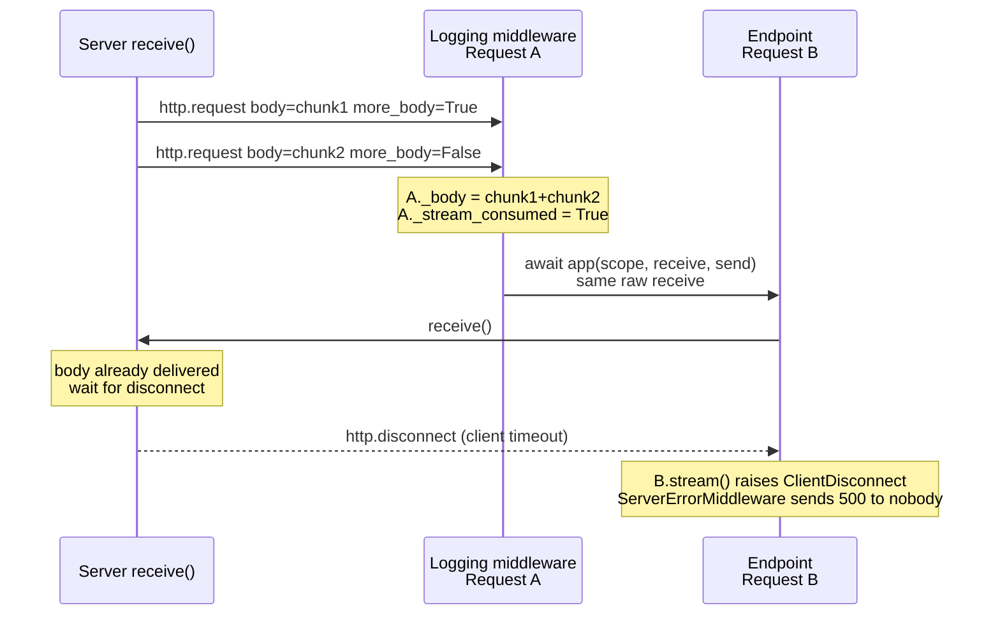

# Starlette Request Internals: request.stream() vs request.body(), _body Caching, and Why Reading the Stream in Middleware Starves Downstream Handlers

> [!summary] Claim
> The request body is a one-shot ASGI channel, and Starlette caches it only on the `Request` instance that read it, so a middleware that drains `receive` through its own `Request` leaves every downstream `Request` waiting on a channel that will only ever yield `http.disconnect`; the fix is to buffer the `http.request` events once, cap them, and replay them through a wrapped `receive`.

Part of [ASGI and Starlette Internals](README.md) in [API Engineering](../README.md).

## TL;DR

- Mechanism: `Request.body()` drains `Request.stream()`, which pulls `http.request` events from `receive()` until `more_body` is `False`, then stores the joined bytes in the instance attribute `_body`; nothing is written back to `scope` or to the server.
- Contract rule: `stream()` after `body()` replays `_body` as one chunk, `body()` after a completed `stream()` raises `RuntimeError("Stream consumed")`, and a second `Request(scope, receive)` object starts from whatever is left on the channel.
- The trap: a pure ASGI middleware that reads the body and then forwards the original `receive` makes the handler block until the client disconnects (Uvicorn, Hypercorn) or forever (`httpx.ASGITransport`); inside `BaseHTTPMiddleware`, iterating `request.stream()` instead hands the endpoint an empty body with no error at all.
- Portability: the behavior is pure Python in `starlette 1.10.0`, whose `requests.py` has one CPython version branch (a `TypeVar` import) that does not touch body handling, and the starvation follows from the ASGI spec defining no event after the final `http.request` except `http.disconnect`, which is sent only after the response or a closed connection; Uvicorn, Hypercorn, and Granian all implement it that way.
- When not to use it: do not buffer bodies in middleware at all for uploads, proxies, or streaming ingest; enforce limits with `max_body_size` or a counting `receive` wrapper and let the endpoint stream.

## Mental model



The server delivers each body chunk exactly once, as an `http.request` event, to whichever coroutine calls `receive()` first.
The middleware's `Request A` takes both events and caches the result in `A._body`, but that attribute lives on an object the endpoint never sees.
The endpoint's route wrapper builds a fresh `Request B` from the same `scope` and the same raw `receive`, so `B` has no `_body` and calls `receive()` again.
The server has nothing left to deliver, and the only event the ASGI HTTP spec defines for that case is `http.disconnect`, sent after a response or a closed connection, so the server waits until one of those happens and then returns it.
The response cannot be sent because the endpoint is the thing waiting, so the request ends only when the client gives up, and `B.stream()` turns that disconnect into `ClientDisconnect`.

## How it works

### The ASGI channel is single-consumer and has no rewind

The ASGI HTTP spec (version 2.5, dated 2024-06-05, fetched 2026-11) defines the request receive event as `{"type": "http.request", "body": bytes, "more_body": bool}`, where the app concatenates chunks until it sees `more_body` set to `False`, and the `http.disconnect` event as what is "Sent to the application if receive is called after a response has been sent or after the HTTP connection has been closed."
There is no event for "the body again", and no server keeps a copy: Uvicorn hands over `bytes(self.body)` and then resets its buffer to a fresh `bytearray()` (uvicorn 0.54.0 uvicorn/protocols/http/h11_impl.py, RequestResponseCycle.receive).
After the last chunk, the same function only proceeds once `message_event` fires again, which happens on disconnect (`H11Protocol.connection_lost`) or when the response completes (`RequestResponseCycle.send`), and then returns `{"type": "http.disconnect"}`.
Hypercorn's `receive` is `asyncio.Queue.get` on a per-request queue; it enqueues one `http.request` event per `Body` event, a final `{"type": "http.request", "body": b"", "more_body": False}` on `EndBody`, and `{"type": "http.disconnect"}` only on `StreamClosed` (hypercorn 0.18.0 hypercorn/protocol/http_stream.py, HTTPStream.handle; hypercorn/asyncio/task_group.py, TaskGroup.spawn_app).
`httpx.ASGITransport`, the in-process test transport, is stricter still: once the request stream is exhausted, `receive()` awaits `response_complete.wait()` before returning `http.disconnect`, so a handler waiting for more body deadlocks the test (httpx 0.28.1 httpx/_transports/asgi.py, ASGITransport.handle_async_request).
On the wire the body boundary was already decided by `Content-Length` or the chunked transfer coding (RFC 9112 Section 6.3, Section 7.1); the ASGI server has parsed it and only exposes the ordered byte chunks, so the app cannot ask the client to resend.

### Request.stream(): a three-state generator

`Request.__init__` sets `_stream_consumed = False`, `_is_disconnected = False`, and `_form = None`, and stores `receive` as `_receive` (starlette 1.10.0 starlette/requests.py, Request.__init__).
`Request.stream()` is an async generator with three branches, read verbatim from the pinned release:

```python
    async def stream(self) -> AsyncGenerator[bytes, None]:
        if hasattr(self, "_body"):
            yield self._body
            yield b""
            return
        if self._stream_consumed:
            raise RuntimeError("Stream consumed")
        while not self._stream_consumed:
            message = await self._receive()
            if message["type"] == "http.request":
                body = message.get("body", b"")
                if not message.get("more_body", False):
                    self._stream_consumed = True
                if body:
                    yield body
            elif message["type"] == "http.disconnect":  # pragma: no branch
                self._is_disconnected = True
                raise ClientDisconnect()
        yield b""
```

The cached branch yields `_body` and then an empty terminator, so a consumer that streams after `body()` sees exactly two items, which the lab asserts as `[b"abcdef", b""]`.
The live branch skips empty chunks but always ends with `b""`, so `[chunk async for chunk in request.stream()]` over two chunks yields three items.
`_stream_consumed` flips only when the event with `more_body=False` is received, not when the consumer stops iterating.
That is why an `async for` that `break`s early leaves the flag `False`: the next `stream()` or `body()` call does not raise but resumes from the next event on the channel and silently returns a truncated body (lab: `b"cdef"` from `b"ab" b"cd" b"ef"`).
A missing `body` key defaults to `b""`, which the ASGI spec allows and Starlette has treated as optional since 0.13.5 (starlette release notes, 0.13.5).

### Request.body(): join, then cache on the instance

```python
    async def body(self) -> bytes:
        if not hasattr(self, "_body"):
            chunks: list[bytes] = []
            async with aclosing(self.stream()) as stream:
                async for chunk in stream:
                    chunks.append(chunk)
            self._body = b"".join(chunks)
        return self._body
```

The cache key is the attribute's existence, not its value, so an empty body is cached as `b""` and never re-read.
`aclosing` closes the generator deterministically even when `ClientDisconnect` or cancellation interrupts the loop; it was added to every internal `stream()` call in starlette 1.8.0 after abandoned generators were being finalized by the event loop's asyncgen hook, which printed `Exception ignored in: <async_generator object Request.stream ...>` with stacked `BaseHTTPMiddleware` (Kludex/starlette PR 3628, merged 2026-10-05).
`Request.json()` caches the parsed value separately in `_json` on top of `body()`, so JSON is parsed once per instance (starlette 1.10.0 starlette/requests.py, Request.json).
Peak memory during `body()` is the retained chunk list plus the joined copy: the lab feeds 4 MiB in 64 KiB chunks and asserts the `tracemalloc` peak is at least 2x and below 3x the body size.

### form() consumes the stream but never sets _body

`Request._get_form()` parses `multipart/form-data` or `application/x-www-form-urlencoded` by passing the `self.stream()` generator, wrapped in `aclosing`, straight into `MultiPartParser` or `FormParser`, and caches only the resulting `FormData` in `_form` (starlette 1.10.0 starlette/requests.py, Request._get_form).
So `await request.form()` followed by `await request.body()` raises `RuntimeError("Stream consumed")`, while `body()` followed by `form()` works because `stream()` replays `_body` into the parser.
Any other content type yields an empty `FormData()` without touching the channel.
The Starlette documentation states the general rule: after `.stream()`, "Any subsequent calls to `.body()`, `.form()`, or `.json()` will raise an error" (starlette docs/requests.md, Body).

### The cache is per instance, and every layer builds its own instance

`HTTPConnection.__init__` stores only `scope`; properties such as `headers`, `url`, and `cookies` cache into instance attributes like `_headers` (starlette 1.10.0 starlette/requests.py, HTTPConnection).
`Request` adds `_receive`, `_send`, and the body state, so two `Request(scope, receive)` objects share headers by recomputation but share no body state at all.
`starlette.routing.request_response` constructs `request = Request(scope, receive, send)` for every call of a function endpoint (starlette 1.10.0 starlette/routing.py, request_response), and FastAPI's copy of that function does the same before opening its `AsyncExitStack` scopes (fastapi 0.162.0 fastapi/routing.py, request_response).
Therefore any middleware that wants the body and constructs `Request(scope, receive)` has created a second consumer of a single-consumer channel.
The middleware's own symptom depends on what it forwards: forwarding the raw `receive` starves the endpoint; forwarding nothing is impossible; forwarding a `receive` that replays what was read is the only correct option.

### BaseHTTPMiddleware: _CachedRequest and wrapped_receive

`BaseHTTPMiddleware.__call__` builds a `_CachedRequest(scope, receive, send)` and gives the downstream app `receive_or_disconnect`, which calls `request.wrapped_receive` instead of the raw `receive` and answers `http.disconnect` once the response has been sent (starlette 1.10.0 starlette/middleware/base.py, BaseHTTPMiddleware.__call__).
`_CachedRequest.wrapped_receive` is a small state machine (starlette 1.10.0 starlette/middleware/base.py, _CachedRequest.wrapped_receive):

| State | Condition | What downstream receives |
| --- | --- | --- |
| Disconnected | `_wrapped_rcv_disconnected` | `{"type": "http.disconnect"}` immediately |
| Consumed | `_wrapped_rcv_consumed` | waits for the real `http.disconnect`, or returns it at once if the dispatch already saw one |
| Body cached | `getattr(self, "_body", None) is not None` | one event with the whole `_body` and `more_body: False` |
| Stream drained | `_stream_consumed` without `_body` | `{"type": "http.request", "body": b"", "more_body": False}` |
| Untouched | neither | one chunk pulled through a fresh `stream()` generator, passed through |

The "body cached" row is the fix from starlette 0.28.0, "Reuse `Request`'s body buffer for call_next in `BaseHTTPMiddleware`" (Kludex/starlette PR 1692, merged 2023-06-01, released 2023-06-07), which closed the long-standing reports that reading the body in `dispatch` made the endpoint hang, among them issue 495 "Consume request body in middleware is problematic" (2019) and issue 847 "Middleware Request parse Hangs forever" (2020).
The "stream drained" row is the deliberate trade-off of that PR: the middleware did not keep the bytes, so the only non-hanging answer is an empty body, and the endpoint receives `b""` with `200 OK` (lab: `length == 0`).
PR 1692 also states what it does not fix: any case where the body is consumed somewhere and `Request.body()` is called again elsewhere, "e.g. in BaseHTTPMiddleware after `call_next()` or in an exception handler".
The lab reproduces one such case through `httpx`: the dispatch streamed the body, and calling `body()` on the same `_CachedRequest` after `call_next` raises `RuntimeError("Stream consumed")`.
The full cost model of `BaseHTTPMiddleware` (task group per request, response re-streaming, `contextvars` isolation) belongs to [[Why-BaseHTTPMiddleware-Hurts-Performance-Streaming-and-ContextVars]].

### FastAPI shares one Request across dependencies and the body parameter

When the route has a body parameter, FastAPI's `get_request_handler` reads it before resolving dependencies: for a `Form` body it calls `await request.form()`, otherwise it calls `await request.body()` and then `await request.json()` when the `Content-Type` is `application/json` or a `+json` subtype (or is absent and strict content-type checking is off) (fastapi 0.162.0 fastapi/routing.py, get_request_handler).
It then calls `solve_dependencies`, which injects the same `request` object into any dependency that declares a `Request` parameter (fastapi 0.162.0 fastapi/dependencies/utils.py, solve_dependencies, `values[dependant.request_param_name] = request`).
So a dependency that calls `await request.body()` and a Pydantic body parameter coexist: the lab counts exactly two `receive()` calls for one request, both made by the first reader (the handler's own `body()`), and the dependency is served from `_body`.
This is why "read the body in a dependency, not in middleware" is the idiomatic FastAPI answer, and why FastAPI's documented custom `Request` subclass pattern overrides `body()` and stores the transformed bytes in `self._body` (FastAPI docs, Custom Request and APIRoute class, `GzipRequest`).

### is_disconnected() is a non-blocking receive that can eat body events

`Request.is_disconnected()` calls `await self._receive()` inside an `anyio.CancelScope` that is cancelled before the await, so it returns immediately if no message is ready (starlette 1.10.0 starlette/requests.py, Request.is_disconnected).
If a message is ready, the await completes without reaching a checkpoint and the message is returned; when that message is `http.request`, the method keeps only the type check and the body bytes are dropped.
Uvicorn's `receive` does not suspend when `message_event` is already set, and Hypercorn's `Queue.get` does not suspend on a non-empty queue, so on both servers a buffered chunk is exactly the "ready" case.
The lab shows `is_disconnected()` followed by `body()` returning 6 of 11 bytes with a scripted receive, and 0 of 3000 bytes through `httpx.ASGITransport`, whose first event carries the whole payload.
Call `is_disconnected()` only after the body has been fully read, which is the long-polling and streaming-response use case the Starlette docs describe.

### Built-in limits: max_body_size and form limits

Starlette 1.6.0 added `max_body_size` to `Starlette`, `Router`, `Route`, and `Mount` (starlette release notes, 1.6.0, PR 3431); a non-`None` value installs `RequestBodyLimitMiddleware` just inside `ServerErrorMiddleware` (starlette 1.10.0 starlette/applications.py, Starlette.build_middleware_stack).
`RequestBodyLimitResponder.receive_with_limit` raises `_RequestBodyTooLarge`, an `HTTPException(413, "Content Too Large")`, when the declared `Content-Length` exceeds the cap before any read, or when the running total of received `body` bytes exceeds it (starlette 1.10.0 starlette/middleware/body_limit.py, RequestBodyLimitResponder.receive_with_limit).
The check is lazy: a handler that never calls `receive()` never trips it, and if `Content-Length` is too large the responder also intercepts `http.response.start` and substitutes the `413` (RequestBodyLimitResponder.send_with_limit).
The `413` status is "Content Too Large" in RFC 9110 Section 15.5.14, which also allows the server to close the connection instead of reading the rest.
Form parsing has its own caps: `MultiPartParser` takes `max_files=1000`, `max_fields=1000`, and `max_part_size=1024 * 1024` per non-file part, and spools uploaded files to disk past `spool_max_size = 1024 * 1024`; `FormParser` takes only `max_fields=1000` and `max_part_size=1024 * 1024`, enforced there since 1.3.1 (starlette 1.10.0 starlette/formparsers.py, FormParser and MultiPartParser; starlette release notes, 1.3.1, PR 3329).

## Numbers and limits

| Quantity | Value | Source |
| --- | --- | --- |
| Starlette `max_body_size` default | `None` (unlimited) | starlette 1.10.0 starlette/applications.py, Starlette.__init__ |
| Form `max_files` / `max_fields` defaults | 1000 / 1000 (`max_files` applies to multipart only) | starlette 1.10.0 starlette/requests.py, Request._get_form |
| Form `max_part_size` default | 1 MiB per non-file part | starlette 1.10.0 starlette/formparsers.py |
| Multipart file spool threshold | 1 MiB (`spool_max_size`) | starlette 1.10.0 starlette/formparsers.py, MultiPartParser |
| Uvicorn per-request buffer before `pause_reading()` | more than 65536 bytes (`HIGH_WATER_LIMIT`) | uvicorn 0.54.0 uvicorn/protocols/http/flow_control.py, `HIGH_WATER_LIMIT`; h11_impl.py, H11Protocol.handle_events |
| Hypercorn per-request receive queue | 10 events (`max_app_queue_size`) | hypercorn 0.18.0 hypercorn/config.py |
| `receive()` calls for one `bytes` body via `httpx.ASGITransport` | 2 (payload with `more_body: True`, then `b""` with `more_body: False`) | measured, lab, CPython 3.14.6, macOS 27.3 arm64 |
| `body()` peak traced memory, 4 MiB in 64 KiB chunks | 8404471 bytes = 2.004x body size after a warm-up run (16 MiB gives 2.002x); a cold first `anyio.run` adds about 3.9 MB, which pushed one cold run to 2.97x; the lab warms up and asserts >= 2x and < 3x | measured, one-off `tracemalloc.get_traced_memory()` script with the lab venv, CPython 3.14.6, macOS 27.3 arm64 (Darwin 27.3.0), 2026-11-14 |
| `max_body_size=1024` boundary | 1024 bytes -> `200`, 1025 bytes -> `413`, with and without `Content-Length` | measured, lab, CPython 3.14.6 |
| Naive middleware under `httpx.ASGITransport` | no response within the 0.25 s `anyio.fail_after` budget (it never completes) | measured, lab, CPython 3.14.6 |
| Starlette releases that changed this path | 0.13.5 optional `body` key, 0.25.0 multipart field and file caps, 0.28.0 `_CachedRequest` replay, 0.40.0 `max_part_size`, 1.3.1 `FormParser` limits enforced, 1.6.0 `max_body_size`, 1.8.0 `aclosing`, 1.10.0 urlencoded last-field fix | starlette docs/release-notes.md (as of 2026-11) |

## Portability

| Dimension | Behavior | Evidence |
| --- | --- | --- |
| CPython 3.14.6 (workspace interpreter) | all 22 lab tests pass | lab run, macOS 27.3 arm64 |
| CPython 3.12, 3.13, 3.15, 3.15t | not run: lab checks are paused (2026-11-11); `requests.py` has one version branch, the `TypeVar` import at `sys.version_info >= (3, 13)`, which does not touch body handling | starlette 1.10.0 starlette/requests.py |
| Starlette < 0.28.0 | reading `body()` in `BaseHTTPMiddleware.dispatch` could hang the endpoint | Kludex/starlette PR 1692 |
| Starlette < 1.6.0 | no built-in `max_body_size`; body limits need custom middleware or the proxy | starlette release notes, 1.6.0 |
| Starlette < 1.8.0 | abandoned `stream()` generators finalized by the loop hook, noisy warnings with stacked `BaseHTTPMiddleware` | Kludex/starlette PR 3628 |
| FastAPI 0.162.0 | one `Request` per call shared by dependencies and the body parameter | fastapi 0.162.0 fastapi/routing.py, fastapi/dependencies/utils.py; lab |
| Uvicorn 0.54.0 (h11 and httptools) | starved handler waits on `message_event` until disconnect or response completion | uvicorn 0.54.0 uvicorn/protocols/http/h11_impl.py, RequestResponseCycle.receive |
| Hypercorn 0.18.0 (HTTP/1.1, HTTP/2, HTTP/3) | all three protocols feed the same `HTTPStream`, so starvation is identical; `http.disconnect` arrives only on `StreamClosed` | hypercorn 0.18.0 hypercorn/protocol/http_stream.py |
| Granian 2.8.7 | once the body is exhausted, `receive` waits on `flow_tx_waiter` (response sent) or `disconnect_guard` and then returns `http.disconnect`, so starvation is identical | granian 2.8.7 src/asgi/io.rs, ASGIHTTPProtocol::receive |
| HTTP/1.1 vs HTTP/2 vs HTTP/3 | framing differs (RFC 9112 Section 7.1 chunks vs HTTP/2 or HTTP/3 `DATA` frames) but the app sees the same ordered `http.request` events | ASGI HTTP spec 2.5 |
| AnyIO backend | lab ran on asyncio only; the trio backend was not run | lab |

## Worked example

The lab builds one Starlette app whose endpoints differ only in how they consume the body, then wraps it in three middlewares: the naive logger, a replaying fix, and two `BaseHTTPMiddleware` variants.
See the [implementation](../labs/src/api_labs/f10_asgi_and_starlette_internals/request_body_replay.py) and the [test](../labs/tests/f10_asgi_and_starlette_internals/test_starlette_request_internals_stream_consumption_and_body_caching.py).

The bug, exactly as in the lab:

```python
class NaiveBodyLoggerMiddleware:
    """The bug: drains the stream through its own Request, then forwards the drained receive."""

    def __init__(self, app: ASGIApp, log: BodyLog) -> None:
        self.app = app
        self.log = log

    async def __call__(self, scope: Scope, receive: Receive, send: Send) -> None:
        if scope["type"] != "http":
            await self.app(scope, receive, send)
            return
        request = Request(scope, receive)
        size = 0
        chunks = 0
        async for chunk in request.stream():
            size += len(chunk)
            chunks += 1 if chunk else 0
        self.log.sizes.append(size)
        self.log.chunk_counts.append(chunks)
        await self.app(scope, receive, send)  # downstream Request starts from a drained channel
```

The fix buffers the `http.request` events, enforces the cap on both the declared length and the running total, and hands the app a `receive` that replays the buffered events before delegating to the real one for `http.disconnect`:

```python
class BodyReplayMiddleware:
    """The fix: buffer the http.request events once, enforce a cap, replay them downstream."""

    def __init__(self, app: ASGIApp, log: BodyLog, max_body_size: int) -> None:
        self.app = app
        self.log = log
        self.max_body_size = max_body_size

    async def __call__(self, scope: Scope, receive: Receive, send: Send) -> None:
        if scope["type"] != "http":
            await self.app(scope, receive, send)
            return
        declared = Headers(scope=scope).get("content-length")
        if declared is not None and declared.isdigit() and int(declared) > self.max_body_size:
            await PlainTextResponse("Content Too Large", status_code=413)(scope, receive, send)
            return
        buffered: deque[Message] = deque()
        size = 0
        while True:
            message = await receive()
            buffered.append(message)
            if message["type"] != "http.request":
                break  # http.disconnect: replay it so the handler sees ClientDisconnect
            size += len(message.get("body", b""))
            if size > self.max_body_size:
                await PlainTextResponse("Content Too Large", status_code=413)(scope, receive, send)
                return
            if not message.get("more_body", False):
                break
        self.log.sizes.append(size)
        self.log.chunk_counts.append(sum(1 for m in buffered if m.get("body")))

        async def replay() -> Message:
            if buffered:
                return buffered.popleft()
            return await receive()  # after the body: wait for the real http.disconnect

        await self.app(scope, replay, send)
```

Replaying the original events rather than one joined event keeps chunk boundaries, so a streaming endpoint downstream sees `[10, 20, 30]` exactly as the client sent them.
Checking `Content-Length` before the first `receive()` matters on Uvicorn, which writes `100 Continue` only when the app first calls `receive()` before a response has started (uvicorn 0.54.0 uvicorn/protocols/http/h11_impl.py, RequestResponseCycle.receive), so a client that sent `Expect: 100-continue` and waits for it never uploads the rejected body; RFC 9110 Section 10.1.1 still lets a client send the content without waiting.

The starvation test drives the app with a scripted receive that, like Uvicorn after a client timeout, answers `http.disconnect` once the body is gone:

```python
@pytest.mark.unit
@pytest.mark.asyncio
async def test_naive_middleware_starves_handler_until_the_client_gives_up() -> None:
    log = BodyLog()
    app = build_app([Middleware(NaiveBodyLoggerMiddleware, log=log)])
    sent: list[Message] = []

    async def send(message: Message) -> None:
        sent.append(message)

    receive = ScriptedReceive(body_messages(b"ab", b"cd"))
    with pytest.raises(ClientDisconnect):
        await app(http_scope("/echo"), receive, send)

    assert log.sizes == [4]
    assert receive.calls == 3  # two body events for the logger, one disconnect for the handler
    assert sent[0]["status"] == 500  # ServerErrorMiddleware answers a client that already left
```

The `is_disconnected()` trap, from the same module:

```python
@pytest.mark.unit
@pytest.mark.asyncio
async def test_is_disconnected_discards_a_ready_body_message() -> None:
    receive = ScriptedReceive(body_messages(b"first", b"second"))
    sent: list[Message] = []

    async def send(message: Message) -> None:
        sent.append(message)

    await build_app()(http_scope("/peek-then-body"), receive, send)

    assert sent[1]["body"] == b'{"disconnected":false,"length":6}'  # b"first" was eaten
```

Captured output, run once from `labs/` with CPython 3.14.6 (`uv run --frozen python -VV`: `Python 3.14.6 (main, Jun 23 2026, 15:46:31) [Clang 22.1.3 ]`) on macOS 27.3 arm64 (Darwin 27.3.0), rerun by the fact-check on 2026-11-14:

```text
$ uv run --frozen pytest tests/f10_asgi_and_starlette_internals/test_starlette_request_internals_stream_consumption_and_body_caching.py -q
......................                                                   [100%]
22 passed in 0.69s
```

## Pitfalls

> [!warning] Logging or signing middleware that reads the body and forwards the raw receive
> Trigger: a pure ASGI middleware does `body = await Request(scope, receive).body()` for audit logging or HMAC verification, then calls `await self.app(scope, receive, send)`.
> Symptom: every request with a body hangs until the client or proxy times out, then logs `ClientDisconnect` and a `500` that nobody receives; under `httpx.ASGITransport` the test suite simply hangs.
> Fix: replay the buffered events through a wrapped `receive` as `BodyReplayMiddleware` does, or move the read into a FastAPI dependency that shares the endpoint's `Request`.

> [!warning] Streaming the body inside BaseHTTPMiddleware.dispatch
> Trigger: `async for chunk in request.stream()` in `dispatch` to count or hash bytes, then `await call_next(request)`.
> Symptom: the endpoint gets `b""` and validation errors such as missing JSON fields appear with no exception pointing at the middleware; touching the body again after `call_next` raises `RuntimeError("Stream consumed")`.
> Fix: call `await request.body()` instead, which `_CachedRequest` replays (Kludex/starlette PR 1692), or rewrite the middleware as pure ASGI.

> [!warning] Breaking out of request.stream() early
> Trigger: reading only the first chunk to sniff a magic number or a JSON prefix, then breaking out of the loop.
> Symptom: the later `body()` call returns the body without its first chunk, with no error, because `_stream_consumed` was never set; the abandoned generator is also left for the event loop's finalizer hook, which PR 3628 notes its `aclosing` change does not cover for user code.
> Fix: either consume to the end and keep the bytes, or never let a second reader touch the same `Request`; wrap any early-exit loop in `contextlib.aclosing(request.stream())`.

> [!warning] Calling is_disconnected() before reading the body
> Trigger: a guard such as `if await request.is_disconnected(): return` at the top of an upload handler.
> Symptom: the first buffered `http.request` event is consumed and dropped, so the body is truncated or empty (lab: 6 of 11 bytes, and 0 of 3000 under `httpx`).
> Fix: read the body first, or check disconnects only in long-polling or streaming-response loops after the body is complete.

> [!warning] Unbounded form parsing before 0.25.0 and 0.40.0
> Trigger: `await request.form()` on Starlette below 0.25.0 with many parts, or below 0.40.0 with one huge non-file part.
> Symptom: CPU and memory exhaustion, tracked as CVE-2023-30798 (GHSA-74m5-2c7w-9w3x, no limit on the number of multipart fields or files, fixed in 0.25.0) and CVE-2024-47874 (GHSA-f96h-pmfr-66vw, text fields without a `filename` stored in memory with no size cap, fixed in 0.40.0), both rated High with CVSS v4 8.7 on GitHub, where GHSA-74m5-2c7w-9w3x also carries CVSS v3 7.5 (as of 2026-11).
> Fix: run 0.40.0 or later, keep the `max_files`, `max_fields`, and `max_part_size` defaults or lower them, and add `max_body_size` for the whole body.

## Security and robustness

- Body buffering is a memory amplification primitive: every concurrent request a replay middleware holds costs at least the body size, and `body()` transiently doubles it, so an uncapped buffer turns into OWASP API Security Top 10 2023 `API4:2023 Unrestricted Resource Consumption`.
- Enforce the cap on the running total, not only on `Content-Length`: a chunked request (RFC 9112 Section 7.1) has no declared length, and the lab proves both Starlette's `max_body_size` and the replay middleware reject a 1025-byte chunked body.
- Reject by declared length before the first `receive()` so `Expect: 100-continue` clients that wait for the interim response never send the body; RFC 9110 Section 10.1.1 allows a client to send it anyway, so this saves bandwidth but is not a guarantee; see [[100-Continue-Expect-Header-and-Large-Upload-Admission]].
- Treat a `Content-Length` that is not plain digits as malformed rather than as "no limit"; Starlette's `_get_content_length` returns `None` on `ValueError` and then falls back to counting, which is safe only because the running total is also checked.
- Signature verification (webhooks, request signing) must hash the exact received bytes, so it needs the raw body before any JSON parse; doing it in middleware is legitimate only with replay, see [[Webhook-Consumer-Engineering-Signature-Verification-Replay-Windows-and-Idempotency]].
- Never log raw bodies by default: they carry credentials, tokens, and personal data, so log size, content type, and a digest, which is what the lab's `BodyLog` and `echo` endpoint record.
- The framing that decides where the body ends lives in the server, and disagreements between proxy and server about it are request smuggling, see [[HTTP-Request-Smuggling-CL-TE-and-Desync-Mechanics]]; an app-level body reader cannot detect a desync.
- After an early `413`, Uvicorn keeps reading and discarding the remaining `Data` events while its own side is `DONE` (uvicorn 0.54.0 uvicorn/protocols/http/h11_impl.py, H11Protocol.handle_events), so the bytes still cross the network; put the hard limit at the proxy as well.

## The principal's view

The decision is where the request body is allowed to be materialized, and the answer should be "at most once, by the layer that owns the semantics".
Body-dependent cross-cutting concerns (signature checks, audit digests, idempotency fingerprints, decompression) belong either in a dependency or `Request` subclass that shares the endpoint's instance, or in a pure ASGI layer that replays events; organizationally this means a single vetted replay middleware with a mandatory cap, not one per team.
Forbid `BaseHTTPMiddleware` code that touches the body in code review, because its failure mode is silent data loss rather than a crash.
Pay the buffering cost knowingly: replay trades memory (body size per in-flight request) for composability, while streaming endpoints trade composability for constant memory, and upload or proxy services should choose streaming and push body inspection to the edge.
When body inspection must happen on multi-gigabyte or long-lived streams, choose a different layer altogether, such as an Envoy filter or a dedicated ingest service, rather than an in-process Python middleware.

## Interview questions

> [!question] L5: What does `await request.body()` return the second time it is called on the same Starlette `Request`, and how many times does it call `receive()`?
>
> > [!success]- Answer
> > It returns the same bytes object from the instance attribute `_body`.
> > `receive()` is called once per `http.request` event during the first call only, and zero times afterwards.
> > The cache check is `hasattr(self, "_body")`, so even an empty body is cached.
> >
> > Follow-up: What does `request.stream()` yield after `body()` has been called?

> [!question] L5: Predict the output: an endpoint runs `async for _ in request.stream(): pass` and then `return JSONResponse({"n": len(await request.body())})`.
>
> > [!success]- Answer
> > No JSON is returned; `body()` raises `RuntimeError("Stream consumed")`.
> > `stream()` set `_stream_consumed = True` when it saw `more_body: False`, and never set `_body`.
> > Under `httpx.ASGITransport` with default `raise_app_exceptions=True` the test sees the `RuntimeError`; a real server sends `500 Internal Server Error` from `ServerErrorMiddleware`.
> >
> > Follow-up: What changes if the loop breaks after the first chunk instead?

> [!question] L5: Why does a body read in a FastAPI dependency not break the Pydantic body parameter, while the same read in a pure ASGI middleware does?
>
> > [!success]- Answer
> > FastAPI's route handler reads the body with `request.body()` and then injects that same `Request` object into dependencies, so whichever reads second hits `_body`.
> > A middleware builds its own `Request`, and the endpoint's wrapper builds another, so the cache is not shared and the endpoint goes back to an empty channel.
> >
> > Follow-up: How would you prove the sharing with a test?

> [!question] L6: Debug this API: after adding an audit middleware that does `body = await Request(scope, receive).body()` and then `await self.app(scope, receive, send)`, all `POST` requests time out at the load balancer after 60 seconds and the app logs `ClientDisconnect`; explain and fix it.
>
> > [!success]- Answer
> > The middleware consumed every `http.request` event, and the endpoint's new `Request` calls `receive()` on a drained channel.
> > Uvicorn holds that call until disconnect or response completion, and the response cannot complete because the endpoint is the one waiting, so only the load balancer timeout ends it.
> > On disconnect `stream()` raises `ClientDisconnect` and `ServerErrorMiddleware` sends a `500` to a closed connection.
> > Fix it by passing a wrapped `receive` that replays the buffered events, with a size cap, or move the audit into a dependency.
> >
> > Follow-up: Why did the unit tests, which used `httpx.ASGITransport`, hang instead of failing?

> [!question] L6: In `BaseHTTPMiddleware`, what does the endpoint receive if `dispatch` iterates `request.stream()` to completion, and why did Starlette choose that?
>
> > [!success]- Answer
> > It receives a single `{"type": "http.request", "body": b"", "more_body": False}` from `_CachedRequest.wrapped_receive`.
> > The dispatch did not keep the bytes, so the choice is between hanging forever and an empty body; PR 1692 in 0.28.0 chose not to hang.
> > If `dispatch` had called `body()` instead, the cached `_body` would be replayed in full.
> >
> > Follow-up: What happens if `dispatch` reads the body again after `call_next` returns?

> [!question] L6: Why can `await request.is_disconnected()` at the top of a handler truncate the body?
>
> > [!success]- Answer
> > It awaits `receive()` inside an already-cancelled `anyio.CancelScope`, which only aborts if the await reaches a checkpoint.
> > When a body chunk is already buffered, Uvicorn's event wait and Hypercorn's `Queue.get` return without suspending, so the `http.request` event is returned and then dropped because only `http.disconnect` is inspected.
> >
> > Follow-up: Where in a long-polling handler is `is_disconnected()` safe to call?

> [!question] L7+: Design a platform-wide middleware that computes an HMAC over the raw body for every webhook route, without breaking streaming upload routes or exposing a memory DoS.
>
> > [!success]- Answer
> > Make it a pure ASGI middleware scoped by path or route metadata, so upload routes are never buffered.
> > Reject on declared `Content-Length` above the cap before the first `receive()`, count the running total for chunked bodies, and return `413`.
> > Buffer the original events, compute the HMAC incrementally as they arrive, and replay them with a wrapped `receive` that delegates to the real one for `http.disconnect`.
> > Put a lower hard cap at the proxy because the server still reads discarded bytes after an early `413`.
> >
> > Follow-up: How do you keep `Expect: 100-continue` uploads from being sent at all when they are rejected?

> [!question] L7+: If one service uses both Starlette `max_body_size` and a team-written body replay middleware, in which order must they sit, and what breaks if the replay layer is outside the limit layer?
>
> > [!success]- Answer
> > Starlette installs `RequestBodyLimitMiddleware` just inside `ServerErrorMiddleware`, so it is outside all user middleware and counts bytes before any replay layer buffers them.
> > If a replay layer sat outside the limit, it would buffer an unbounded body before the limit ever saw a byte, and the limit would then only cap the replayed copy.
> > The general rule is that the counting layer must be the first consumer of the real `receive`.
> >
> > Follow-up: The limit check in `receive_with_limit` is lazy; which endpoints never trigger it?

> [!question] L7+: When should a team refuse to materialize request bodies in Python at all?
>
> > [!success]- Answer
> > When bodies are large or long-lived (uploads, media, ingest, proxies), because each in-flight request then costs its body size in memory and `body()` doubles it transiently.
> > Those services should stream end to end with a counting `receive` wrapper and push inspection to the edge proxy or a dedicated ingest tier.
> >
> > Follow-up: What observability do you lose, and how do you recover it without buffering?

## Related

Prerequisites: [[Starlette-Routing-Internals-Regex-Compilation-and-Mount-Dispatch]]

Next: [[Starlette-Responses-StreamingResponse-FileResponse-and-Background-Execution]]

See also: [[02-Programming-Languages/Python/Python-Backend-Interview-Prep/04-FastAPI]], [[ASGI-3-0-Callable-Contract-Scope-Receive-and-Send]], [[ASGI-HTTP-and-Disconnect-Event-Lifecycle]], [[Pure-ASGI-Middleware-Onion-Architecture-and-Send-Receive-Wrapping]], [[Why-BaseHTTPMiddleware-Hurts-Performance-Streaming-and-ContextVars]], [[Starlette-Exception-Hierarchy-ServerErrorMiddleware-vs-ExceptionMiddleware]], [[In-Process-Testing-of-ASGI-Apps-with-HTTPX-ASGITransport]], [[HTTP-1-1-Framing-Keep-Alive-and-Chunked-Encoding]], [[HTTP-Request-Smuggling-CL-TE-and-Desync-Mechanics]], [[100-Continue-Expect-Header-and-Large-Upload-Admission]], [[Webhook-Consumer-Engineering-Signature-Verification-Replay-Windows-and-Idempotency]]

- Lab: `labs/tests/f10_asgi_and_starlette_internals/test_starlette_request_internals_stream_consumption_and_body_caching.py`

## Further reading

- [starlette 1.10.0 starlette/requests.py](https://github.com/encode/starlette/blob/1.10.0/starlette/requests.py) - the `stream()`, `body()`, `_get_form()`, and `is_disconnected()` implementations this note dissects.
- [Kludex/starlette PR 1692](https://github.com/Kludex/starlette/pull/1692) - why `BaseHTTPMiddleware` replays `_body` and gives an empty body after `stream()`.
- [Kludex/starlette PR 3628](https://github.com/Kludex/starlette/pull/3628) - deterministic closing of `stream()` generators with `aclosing`.
- [ASGI HTTP and WebSocket specification](https://asgi.readthedocs.io/en/latest/specs/www.html) - the `http.request` and `http.disconnect` event contract that makes the channel one-shot.
- [RFC 9112](https://www.rfc-editor.org/rfc/rfc9112.html) - Sections 6.3 and 7.1 define how the server finds the end of the body it later hands to the app.
- [RFC 9110](https://www.rfc-editor.org/rfc/rfc9110.html) - Section 15.5.14 `413 Content Too Large` and Section 10.1.1 `Expect`.
- [GHSA-74m5-2c7w-9w3x (CVE-2023-30798)](https://github.com/advisories/GHSA-74m5-2c7w-9w3x) - unlimited multipart part count in Starlette below 0.25.0.
- [GHSA-f96h-pmfr-66vw (CVE-2024-47874)](https://github.com/advisories/GHSA-f96h-pmfr-66vw) - unbounded in-memory multipart text fields in Starlette below 0.40.0.
