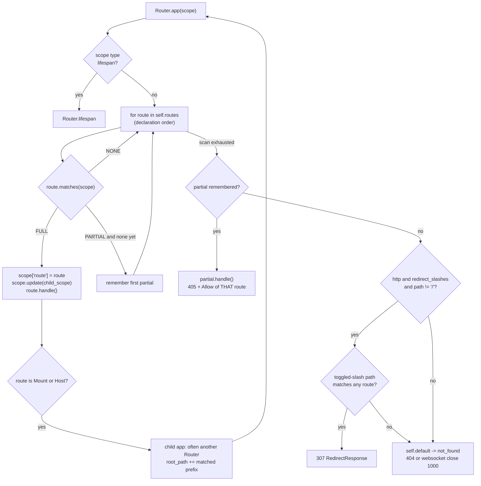

# Starlette (1.10.0) Routing Internals: Route Path Regex Compilation, Convertors, Mount Sub-Apps, Host Routing, and 405 vs 404 Resolution

> [!summary] Claim
> Starlette routing is a first-match linear scan over regexes compiled once at construction, where the first `FULL` match wins, only the first `PARTIAL` (path matched, method did not) can produce a `405`, and everything else falls through to a slash-toggling `307` redirect probe and then `404`, so route order, not specificity, decides behavior.

Part of [ASGI and Starlette Internals](README.md) in [API Engineering](../README.md).

## TL;DR

- Mechanism: `compile_path` turns `"/users/{uid:int}"` into the anchored regex `^/users/(?P<uid>[0-9]+)$` at construction, and `Router.app` calls `route.matches(scope)` on every route in declaration order until one returns `Match.FULL`.
- Contract rule: a `405` carries `Allow` built from the methods of the first route whose path matched, not from every route at that path, so two `Route` objects sharing a path advertise an incomplete `Allow`, which breaks the RFC 9110 Section 15.5.6 rule that `Allow` lists the resource's supported methods.
- Trap: a `Mount` always returns `FULL`, so a later `Mount("/api")` turns an earlier `POST`-only `/api/upload` route's `405` into a `404`, and `$` in the compiled regex matches before a trailing newline, so `/health%0A` is served by `/health`.
- Portability: the routing code is pure Python with no C accelerator, so behavior is the same on every supported CPython, but the `Allow` header's method order changes with `PYTHONHASHSEED` because it is `", ".join()` over a `set`.
- When not to use it: when you have thousands of routes on a hot path (each miss cost about 182 ns in the lab, so the 1000th route took 183 us to reach), or when you need an `Allow` header that lists every method, use a trie router (Litestar) or one `Route` per path that dispatches by method.

## Mental model



A request enters `Router.app`, which first diverts `lifespan` scopes, then walks `self.routes` in declaration order and asks each route whether it matches.
A `FULL` answer stops the scan immediately: the router records the route in `scope["route"]`, merges the route's `child_scope` (path parameters, `endpoint`, and for a `Mount` a new `root_path`) into the scope, and hands over.
A `PARTIAL` answer, which only a `Route` with a method filter can give, is remembered once and the scan continues, because a later route might still be a `FULL` match.
If the scan finishes with a remembered partial, that one route's `handle` emits the `405`, so the `Allow` header reflects only that route.
With no partial, an HTTP request whose path is not `/` gets a second scan with its trailing slash toggled, and any non-`NONE` match there yields a `307` redirect; otherwise the router's `default` app answers `404`, or closes a WebSocket with code 1000.
`Mount` and `Host` are routes whose `handle` calls a child ASGI app, usually another `Router`, so the same loop runs again on the remaining path, which is why the arrow returns to the top.

## How it works

### Compiling a path: `compile_path`

Every `Route`, `WebSocketRoute`, `Mount`, and `Host` calls `compile_path` once in `__init__` and stores the three-tuple it returns (starlette 1.10.0 starlette/routing.py, compile_path).
The template grammar is the module-level regex `PARAM_REGEX = re.compile("{([a-zA-Z_][a-zA-Z0-9_]*)(:[a-zA-Z_][a-zA-Z0-9_]*)?}")`, so a parameter is `{name}` or `{name:type}` with an identifier-shaped name and type.
For each parameter, the literal text before it is passed through `re.escape` and the parameter becomes a named group `(?P<name>CONVERTOR_REGEX)`; the literal tail is escaped too, and the whole pattern is wrapped in `^` and `$`.
The lab confirms the shape: `describe_pattern("/users/{uid:int}/files/{rest:path}")` returns `^/users/(?P<uid>[0-9]+)/files/(?P<rest>.*)$`, the format string `/users/{uid}/files/{rest}`, and the convertors `IntegerConvertor` and `PathConvertor`.
Because literals are escaped, a dot in `/v1.0/{name}` compiles to `\.` and matches only a dot; the release notes record this as "Allow path routes to contain regex meta characters" in 0.13.5.
A text in braces that does not fit `PARAM_REGEX`, such as `{1x}`, is not a parameter; it stays literal and is escaped.
A name used twice raises `ValueError("Duplicated param name id at path /a/{id}/b/{id}")` at construction, which the lab asserts.
An unknown type such as `{x:slug}` fails the `assert convertor_type in CONVERTOR_TYPES` line with `AssertionError: Unknown path convertor 'slug'`; under `python -O` the assert is stripped and the next line's dictionary lookup raises `KeyError: 'slug'` instead (one-off `uv run --frozen python -O -c` probe on CPython 3.14.6, not part of the lab).
The second element, `path_format`, is the template with types removed; `url_path_for` fills it back in through `replace_params` and each convertor's `to_string`.

A string that does not start with `/` is treated as a host pattern (`is_host = not path.startswith("/")`).
For hosts, a trailing `:port` is cut off with `rsplit(":", 1)` unless the pattern ends in `]` (an IPv6 literal), and the regex is compiled with `re.IGNORECASE`, citing in a code comment that host names are case-insensitive, which matches RFC 9110 Section 4.2.3: "The scheme and host are case-insensitive and normally provided in lowercase; all other components are compared in a case-sensitive manner."
The lab checks that `compile_path("{sub}.example.org:8000")` yields `^(?P<sub>[^/]+)\.example\.org$` with the `IGNORECASE` flag, while a path pattern has no such flag: paths are matched case-sensitively, as the same RFC sentence requires.

### Convertors: regex fragment plus a type

A convertor is a `Convertor[T]` subclass with a class attribute `regex` and two methods, `convert(str) -> T` and `to_string(T) -> str` (starlette 1.10.0 starlette/convertors.py, Convertor).
The built-in table `CONVERTOR_TYPES` has five entries:

| Key | Class | `regex` | `convert` | Notes |
| --- | --- | --- | --- | --- |
| `str` (default) | `StringConvertor` | `[^/]+` | identity | one non-empty segment; `to_string` asserts no `/` and not empty |
| `path` | `PathConvertor` | `.*` | `str()` | may be empty, crosses `/`, but `.` does not match `\n` |
| `int` | `IntegerConvertor` | `[0-9]+` | `int()` | no sign, no length bound; `to_string` asserts `>= 0` |
| `float` | `FloatConvertor` | `[0-9]+(\.[0-9]+)?` | `float()` | no sign, no exponent, no `inf`; `to_string` asserts finite and `>= 0` |
| `uuid` | `UUIDConvertor` | 8-4-4-4-12 hex with each `-` optional | `uuid.UUID()` | hyphenless input is normalised to the canonical form |

`register_url_convertor(key, convertor)` writes into that same module-global dictionary, so a custom convertor is process-wide and must be registered before the first `compile_path` that names it; the lab registers `id64` at import time for this reason.
Conversion runs inside `matches`, not after selection: every candidate whose regex matches has its groups converted before the method check.
That ordering is why a conversion exception escapes the router, as the pitfalls section shows.
The lab shows the type contract end to end: `/n/42` produces an `int`, `/f/1.5` a `float`, `/f/1e5` a `404` because the float regex has no exponent, and `/u/12345678123456781234567812345678` the canonical `12345678-1234-5678-1234-567812345678`.

ASGI defines `scope["path"]` as the request target "with percent-encoded sequences and UTF-8 byte sequences decoded into characters" (ASGI HTTP spec, asgiref specs/www.rst, `path`).
Uvicorn does this with `urllib.parse.unquote` (uvicorn 0.54.0 uvicorn/protocols/http/h11_impl.py, H11Protocol.handle_events, and uvicorn/protocols/http/httptools_impl.py, HttpToolsProtocol.on_headers_complete), and so does Hypercorn (hypercorn 0.18.0 hypercorn/protocol/http_stream.py, HTTPStream.handle).
Consequently `%2F` arrives as a real `/`: the lab gets `404` for `/s/a%2Fb` against `{value}` and `{"value": "a/b/c"}` for `/p/a%2Fb/c` against `{value:path}`.
Routing never looks at `raw_path`, so an encoded slash and a real slash are indistinguishable to it.

### `Route.matches`: FULL, PARTIAL, NONE

`Route.matches` returns `Match.NONE` unless `scope["type"] == "http"` and `self.path_regex.match(get_route_path(scope))` succeeds (starlette 1.10.0 starlette/routing.py, Route.matches).
On a regex match it converts the groups, copies the parent's `path_params` and overlays its own, and returns `Match.PARTIAL` if `self.methods` is set and `scope["method"]` is not in it, otherwise `Match.FULL`.
The method set is computed in `Route.__init__`: for a function or bound method endpoint (after unwrapping `functools.partial`), `methods=None` defaults to `["GET"]`; names are upper-cased into a `set`, and `HEAD` is added whenever `GET` is present, matching RFC 9110 Section 9.3.2 ("The HEAD method is identical to GET except that the server MUST NOT send content in the response").
For a class endpoint such as an `HTTPEndpoint` subclass, `methods=None` stays `None`, the route never returns `PARTIAL`, and every method reaches the endpoint, which then does its own method dispatch.
`get_route_path` strips `root_path` from `path` only at a segment boundary: it returns `""` when `path == root_path`, `path[len(root_path):]` when the next character is `/`, and the unmodified `path` otherwise (starlette 1.10.0 starlette/_utils.py, get_route_path).
Starlette 1.10.0 also switched these comparisons to identity (`match is Match.FULL`), recorded in the release notes as "Compare `Match` members by identity during routing" (#3665, #3722).

### `Router.app`: the scan, the partial, the redirect, the default

`Router.app` asserts the scope type is `http`, `websocket`, or `lifespan`, sets `scope["router"]` only if no outer router has set it, and delegates `lifespan` to `Router.lifespan` (starlette 1.10.0 starlette/routing.py, Router.app).
Then it loops over `self.routes`; on `FULL` it writes `scope["route"] = route`, applies `scope.update(child_scope)`, awaits `route.handle`, and returns.
On `PARTIAL` it keeps the route only if `partial is None`, so the first partial wins and later partials are never consulted.
After the loop a remembered partial gets `scope["route"]`, its `child_scope`, and `partial.handle`, whose `405` branch builds `headers = {"Allow": ", ".join(self.methods)}` from that route alone (starlette 1.10.0 starlette/routing.py, Route.handle).
If `"app" in scope`, meaning the router runs inside a `Starlette` application, `Route.handle` raises `HTTPException(status_code=405, headers=headers)` so `ExceptionMiddleware` and any registered `405` handler shape the response; a bare `Router` sends `PlainTextResponse("Method Not Allowed", status_code=405, headers=headers)` itself.
The lab proves both branches: with `exception_handlers={405: problem}` the handler receives an `HTTPException` whose `headers` carry `Allow`, and a bare `Router` returns the plain `Method Not Allowed` body.
`HTTPException` fills `detail` from `http.client.responses` when none is given, which is where the body text `Method Not Allowed` and `Not Found` comes from (starlette 1.10.0 starlette/exceptions.py, HTTPException).

With no match and no partial, the slash redirect runs only when `scope["type"] == "http"`, `self.redirect_slashes` is true (the default), and the route path is not `/`.
It copies the scope, toggles a trailing `/` on `scope["path"]` (the full path, so a mounted app's prefix survives), and rescans every route; any match that is not `NONE`, including `PARTIAL`, triggers `RedirectResponse(url=str(URL(scope=redirect_scope)))`.
`RedirectResponse` defaults to `status_code=307` and quotes the URL into `location` (starlette 1.10.0 starlette/responses.py, RedirectResponse.__init__), and RFC 9110 Section 15.4.8 says a user agent "MUST NOT change the request method" on a `307`, so a `POST /api` is redirected as a `POST` to `/api/` and the client must resend the body.
The lab shows `GET /api` and `POST /api` both answered `307` with `location: http://test/api/`, `GET /items/` answered `307` to `/items`, and the same request answered `404` once `redirect_slashes` is false.
`URL(scope=...)` builds the absolute URL from the `Host` header after `parse_host_header` validates it, falling back to `scope["server"]` (starlette 1.10.0 starlette/datastructures.py, URL.__init__), so the redirect authority comes from the client's `Host` header.
Finally `self.default` runs; the default `not_found` raises `HTTPException(status_code=404)` inside an app, sends `PlainTextResponse("Not Found", status_code=404)` outside one, and closes a WebSocket with `WebSocketClose()`, which the lab observes as `{"type": "websocket.close", "code": 1000, "reason": ""}` for a WebSocket to the HTTP-only `/health`.

### `WebSocketRoute`, route-level middleware, and body limits

`WebSocketRoute.matches` answers only for `scope["type"] == "websocket"` and only ever returns `FULL` or `NONE`, so it has no method filter and can never cause a `405` (starlette 1.10.0 starlette/routing.py, WebSocketRoute.matches).
The two route kinds therefore share a path namespace without interfering: an HTTP request skips a `WebSocketRoute` and a WebSocket handshake skips a `Route`, which is why the unmatched WebSocket in the lab closes with `1000` rather than reaching the HTTP-only `/health`.
`Route` and `WebSocketRoute` both accept `middleware=`, which wraps the route's own `self.app` once at construction with `for cls, args, kwargs in reversed(middleware)`, so the first entry is outermost (starlette 1.10.0 starlette/routing.py, Route.__init__ and WebSocketRoute.__init__).
Route middleware runs only after `matches` has returned `FULL` (or after the partial was chosen), so it never sees a request that routed to another route and cannot influence which route wins.
`Route(..., max_body_size=N)`, and the same argument on `Router`, wraps the app in `RequestBodyLimitMiddleware` in the same way (starlette 1.10.0 starlette/routing.py, Route.__init__ and Router.__init__).
`Router.__init__` wraps `self.app` the same way into `self.middleware_stack`, and `Router.__call__` enters through that stack, so router-level middleware also runs before the scan and therefore sees `404` and redirect traffic that route-level middleware never sees.

### `Mount`: prefix consumption via `root_path`

`Mount.__init__` strips trailing slashes from its path, wraps `routes=` in a new `Router` (or uses `app=`), optionally wraps middleware and `RequestBodyLimitMiddleware`, and compiles `self.path + "/{path:path}"` (starlette 1.10.0 starlette/routing.py, Mount).
So `Mount("/api")` compiles to `^/api/(?P<path>.*)$`, which matches `/api/` and `/api/anything` but not `/api`; the bare prefix is reached only through the redirect probe, which is the `307` in the lab.
`Mount.matches` answers for both `http` and `websocket`, never returns `PARTIAL`, and computes `remaining_path = "/" + matched_params.pop("path")` and `matched_path = route_path[: -len(remaining_path)]`.
Its `child_scope` sets `root_path` to the parent `root_path` plus `matched_path`, sets `app_root_path` once to the outermost `root_path` (used by `url_for`), merges path parameters, and sets `endpoint` to the mounted app.
It never rewrites `scope["path"]`; the child router recovers its relative path through `get_route_path`, which subtracts the new `root_path`.
The lab request `/org/acme/users/3` through `Mount("/org/{org}", app=Router(...))` sees `root_path == "/org/acme"`, `path == "/org/acme/users/3"`, and merged `path_params == {"org": "acme", "uid": "3"}` with `uid` already an `int`.
`scope["route"]` is overwritten at each level, so the endpoint sees the innermost template `/users/{uid:int}`, not `/org/{org}/users/{uid:int}`; anything that uses `scope["route"].path` as a metric label or span name (exposed since 1.7.0, #3438) must prefix the mount templates itself.
`Mount("")` is allowed and compiles to `^/(?P<path>.*)$`, a catch-all that shadows every later route.

### `Host`: routing on the `Host` header

`Host.matches` parses the `host` header with `parse_host_header`, returns `NONE` if it is missing or malformed, lower-cases the host part, and matches it against the host regex (starlette 1.10.0 starlette/routing.py, Host.matches).
`parse_host_header` accepts only a `fullmatch` of `_HOST_RE`, a reg-name character class or a bracketed IP literal, with an optional numeric port, and validates IPv6 literals with `ipaddress.IPv6Address` (starlette 1.10.0 starlette/_utils.py, parse_host_header).
The port is dropped on both sides: the pattern's port is removed at compile time, and only `parsed_host.host` is matched; release notes record "`Host` now ignores `port` on routing" (#1322, in 0.18.0) and, in 1.9.0, case-insensitive matching (#3542).
In HTTP/2 and HTTP/3 the ASGI spec requires the server to remove pseudo-headers and to add `:authority` "to the start of the iterable with `host` as the header name or replace any existing host header already present" (asgiref specs/www.rst, `headers`), so `Host` routing works the same across HTTP versions on a compliant server.
The default `str` convertor `[^/]+` matches dots, so `{sub}.example.org` captures `sub == "a.b"` for `A.B.Example.ORG:8443`, which the lab asserts; a `Host` header with a space fails `parse_host_header` and the request falls through to `404`.

### Reverse routing: `url_path_for`

`Router.url_path_for` asks each route in order and returns the first success (starlette 1.10.0 starlette/routing.py, Router.url_path_for).
`Route.url_path_for` requires the name to match and the set of supplied parameter names to equal the template's set exactly, else `NoMatchFound`.
`Mount.url_path_for` resolves `"<mount_name>:<child_name>"` by stripping the prefix and recursing into its routes, and `"<mount_name>"` with a `path=` argument for static-style mounts; an unnamed mount is transparent.
The lab gets `/api/users/3` for `url_path_for("api:user", uid=3)`, `/org/acme/users/3` for `("org:user", org="acme", uid=3)`, and `NoMatchFound` when an extra parameter is passed.
Validation of reverse-routed values lives in `assert` statements inside `to_string`, which matters under `-O` (see pitfalls).

### How FastAPI and Litestar differ

FastAPI reuses this machinery: `APIRoute` subclasses Starlette's `Route` and calls `super().matches(scope)` (or, for a route reached through an included router, `_EffectiveRouteContext.matches`, which repeats the same `FULL`/`PARTIAL`/`NONE` logic on the prefixed regex), then sets `child_scope["route"] = self` on any non-`NONE` result (fastapi 0.162.0 fastapi/routing.py, APIRoute.matches).
`APIRouter.app` overrides `Router.app` but keeps the same first-`FULL`, first-`PARTIAL`, slash-probe sequence, and only after those consults a low-priority tier of frontend static routes ranked by path length (fastapi 0.162.0 fastapi/routing.py, APIRouter.app and APIRouter._match_low_priority), so the first-match, first-partial, and `Mount` behavior here applies to FastAPI API routes; see [[APIRoute-Compilation-Signature-Inspection-and-Dependant-Construction]].
Litestar does not scan: it builds a routing trie (litestar 2.25.0 litestar/_asgi/routing_trie/mapping.py, add_route_to_trie) and, when the method is missing at the matched node, raises `MethodNotAllowedException(headers={"allow": ", ".join(node.asgi_handlers.keys())})` (litestar 2.25.0 litestar/_asgi/routing_trie/traversal.py, parse_node_handlers), so its `Allow` covers every handler registered on that path node.

## Numbers and limits

| Quantity | Value | Source |
| --- | --- | --- |
| `Router` dispatch, 1 route, match at index 0 | 1,293 ns mean over 2,000 calls | measured by the verifier: `measure_dispatch_ns(1, 0, 2000)`, CPython 3.14.6, macOS 27.3 arm64 (`uname -r` 27.3.0), 2026-11-14 |
| `Router` dispatch, 1,000 routes, match at index 0 | 1,192 ns | measured, same run |
| `Router` dispatch, 1,000 routes, match at index 499 | 93,061 ns | measured, same run |
| `Router` dispatch, 1,000 routes, match at index 999 | 183,463 ns, about 182 ns per non-matching route | measured, same run; (183,463 - 1,192) / 999 |
| Built-in convertors | 5 (`str`, `path`, `int`, `float`, `uuid`) | starlette 1.10.0 starlette/convertors.py, CONVERTOR_TYPES |
| `Match` states | 3 (`NONE = 0`, `PARTIAL = 1`, `FULL = 2`) | starlette 1.10.0 starlette/routing.py, Match |
| Partial routes consulted for `Allow` | 1, the first | starlette 1.10.0 starlette/routing.py, Router.app; lab `test_405_allow_lists_only_the_first_partial_route_not_every_handler` |
| CPython default limit for `int()` on a decimal string | 4,300 digits; lowest configurable 640; added in 3.11 | Python docs, Built-in Types, "Integer string conversion length limitation" |
| Digits accepted by the lab's `id64` convertor | 1 to 18 (`10**18 - 1 < 2**63 - 1`) | lab `BoundedIntConvertor` |
| Redirect status from `redirect_slashes` | `307` | starlette 1.10.0 starlette/responses.py, RedirectResponse.__init__; lab |
| WebSocket close code for an unmatched WebSocket | `1000` | lab `test_websocket_scope_skips_http_routes_and_closes_with_1000` |
| Distinct `Allow` orderings for a 5-method route over `PYTHONHASHSEED` 0 to 5 | 6 of 6 seeds gave distinct orders in a one-off probe; the default `{GET, HEAD}` route gave both orders over the same seeds; the lab asserts more than 1 | verifier probe, CPython 3.14.6, 2026-11-14; lab `test_allow_header_order_follows_string_hash_randomisation` |

The dispatch figures time `await router(scope, receive, send)` against a no-op class endpoint, so they cover the scan, the regex calls, one `int` conversion, the scope update, and two `send` calls, but no HTTP parsing or server overhead.
The run was single-shot with no CPU pinning; treat the per-route figure as an order of magnitude on this machine, not a benchmark.

## Portability

| Dimension | Behavior | Evidence |
| --- | --- | --- |
| CPython 3.14.6 (workspace) | all 17 lab tests pass | ran `uv run --frozen pytest ... -q` here |
| CPython 3.12, 3.13, 3.15, 3.15t | not run; Starlette 1.8.0 requires Python 3.11 or later (#3592) and 1.7.0 added Python 3.15 support (#3508) | Starlette 1.10.0 release notes; matrix legs not run because lab checks are paused (see report) |
| `$` before a trailing newline | same on every CPython in the matrix: "Matches the end of the string or just before the newline at the end of the string" | Python docs, `re`, `$` |
| `\z` as a strict end anchor | added in 3.14; `\Z` is "The same as `\z`" and works on 3.12 and 3.13 too | Python docs, `re`, `\z` and `\Z` |
| 4,300-digit `int()` limit | present on 3.11 and later, so on every matrix leg; configurable with `PYTHONINTMAXSTRDIGITS`, `-X int_max_str_digits`, or `sys.set_int_max_str_digits()` | Python docs, Built-in Types, "Integer string conversion length limitation" |
| `Allow` header order | varies with `PYTHONHASHSEED` because `str` hashing is randomised per process | lab test on 3.14.6 |
| Free-threaded 3.15t | leg not run; no behavior claim is made. The only module-global mutable routing state is `CONVERTOR_TYPES`, a plain `dict[str, Convertor[Any]]` written by `register_url_convertor`, so the lab registers at import time, before any request | starlette 1.10.0 starlette/convertors.py, `CONVERTOR_TYPES` and `register_url_convertor` (read in the installed 1.10.0 copy) |
| Starlette 1.9.0 -> 1.10.0 | `Match` compared by identity (#3665, #3722); `url_path_for` keeps values that look like placeholders (#3725); `FloatConvertor.to_string` reports NaN and infinity correctly (#3716) | Starlette 1.10.0 release notes |
| Starlette before 1.9.0 | `Host` routing matched case-sensitively until #3542 | Starlette 1.10.0 release notes, 1.9.0 section |
| Starlette before 1.0.1 and before 1.3.0 | before 1.0.1 a malformed `Host` made `request.url.path` disagree with the routed path (GHSA-86qp-5c8j-p5mr); before 1.3.0 a target without a leading `/` made `request.url.hostname` attacker-chosen (GHSA-jp82-jpqv-5vv3) | GitHub advisories |
| Uvicorn 0.54.0, Hypercorn 0.18.0 | both percent-decode the target into `scope["path"]` with `unquote`, so `%0A` and `%2F` reach the router decoded | source files cited in How it works |
| Granian 2.8.7 | also percent-decodes into `scope["path"]`: `GET /a%2Fb/c%0A` arrived as `path == "/a/b/c\n"` with `raw_path == b"/a%2Fb/c%0A"`, and `/caf%C3%A9` as `/caf\u00e9` (one decoded code point), so both pitfalls apply | verifier probe: `granian --interface asgi` on 127.0.0.1 with a scope-echo app, CPython 3.14.6, macOS 27.3 arm64, 2026-11-14 (Rust source not read) |
| HTTP/1.1 vs HTTP/2 and HTTP/3 | `Host` routing reads `host`; ASGI requires servers to map `:authority` to `host` | asgiref specs/www.rst, `headers` |

## Worked example

The [implementation](../labs/src/api_labs/f10_asgi_and_starlette_internals/starlette_routing_internals.py) builds one deliberately ordered route table (`build_demo_app`) holding every shape above, plus three fixes: a bounded `id64` convertor, a `MethodTableRoute` that owns every method of a path, and a middleware that rejects control characters in the decoded path.
The [test](../labs/tests/f10_asgi_and_starlette_internals/test_starlette_routing_internals_regex_compilation_and_mount_dispatch.py) drives it through `httpx.ASGITransport` with no sockets.

The fix for the incomplete `Allow` header is one `Route` per path that dispatches internally, so the router's first partial is also the only one, and the header is sorted:

```python
class MethodTableRoute(Route):
    """One `Route` per path that dispatches by method, so a 405 advertises every method."""

    def __init__(self, path: str, handlers: Mapping[str, Endpoint], *, name: str) -> None:
        table = {method.upper(): handler for method, handler in handlers.items()}
        if "GET" in table and "HEAD" not in table:
            table["HEAD"] = table["GET"]
        self.table: dict[str, Endpoint] = table

        async def dispatch(request: Request) -> Response:
            return await table[request.method](request)

        super().__init__(path, dispatch, methods=list(table), name=name)

    async def handle(self, scope: Scope, receive: Receive, send: Send) -> None:
        if scope["method"] in self.table:
            await super().handle(scope, receive, send)
            return
        headers = {"Allow": ", ".join(sorted(self.table))}  # sorted: stable across hash seeds
        if "app" in scope:
            raise HTTPException(status_code=405, headers=headers)
        await PlainTextResponse("Method Not Allowed", 405, headers=headers)(scope, receive, send)
```

The defect it fixes, shown against two `Route` objects at `/items` (`GET`-only, then `POST`-only):

```python
@pytest.mark.unit
@pytest.mark.asyncio
async def test_405_allow_lists_only_the_first_partial_route_not_every_handler() -> None:
    async with client(build_demo_app()) as c:
        reply = await c.delete("/items")
        assert reply.status_code == 405
        assert set(reply.headers["allow"].split(", ")) == {"GET", "HEAD"}  # POST is missing
        assert (await c.post("/items")).status_code == 201  # yet POST is served
```

The `$` anchor test and its fix:

```python
@pytest.mark.unit
@pytest.mark.asyncio
async def test_dollar_anchor_matches_before_a_trailing_newline() -> None:
    async with client(build_demo_app()) as c:
        assert (await c.get("/health%0A")).status_code == 200
        newline = (await c.get("/n/5%0A")).json()
        assert (newline["path"], newline["path_params"]) == ("/n/5\n", {"value": "5"})
    async with client(RejectControlCharactersMiddleware(build_demo_app())) as c:
        assert (await c.get("/health%0A")).status_code == 400
        assert (await c.get("/health")).status_code == 200
```

Captured run, CPython 3.14.6 on macOS 27.3 arm64, from `labs/`:

```text
$ uv run --frozen pytest tests/f10_asgi_and_starlette_internals/test_starlette_routing_internals_regex_compilation_and_mount_dispatch.py -q
.................                                                        [100%]
17 passed in 0.76s
```

The dispatch cost figures in Numbers and limits came from one run of the lab's `measure_dispatch_ns`, same interpreter and machine:

```text
$ uv run --frozen python -c "
import asyncio
from api_labs.f10_asgi_and_starlette_internals.starlette_routing_internals import measure_dispatch_ns
for n,t in [(1,0),(1000,0),(1000,499),(1000,999)]:
    print(f'n_routes={n} target_index={t} mean_ns={asyncio.run(measure_dispatch_ns(n,t,2000)):.0f}')
"
n_routes=1 target_index=0 mean_ns=1293
n_routes=1000 target_index=0 mean_ns=1192
n_routes=1000 target_index=499 mean_ns=93061
n_routes=1000 target_index=999 mean_ns=183463
```

## Pitfalls

> [!warning] Split handlers advertise an incomplete `Allow`
> Trigger: `Route("/items", list_items, methods=["GET"])` followed by `Route("/items", create_item, methods=["POST"])`.
> Symptom: `DELETE /items` returns `405` with `Allow` holding only `GET` and `HEAD`, although `POST /items` returns `201`; clients and API gateways that read `Allow` to discover capabilities never learn about `POST`, which contradicts RFC 9110 Section 15.5.6 ("a list of the target resource's currently supported methods").
> Fix: register one route per path with every method (`Route(path, endpoint, methods=[...])` with internal dispatch, an `HTTPEndpoint` registered with explicit `methods=`, or the lab's `MethodTableRoute`); the lab shows `Allow: GET, HEAD, POST` after the fix.

> [!warning] A later `Mount` turns `405` into `404`
> Trigger: `Route("/api/upload", upload, methods=["POST"])` declared before `Mount("/api", routes=[...])`.
> Symptom: `GET /api/upload` returns `404`, not `405`, because the route's `PARTIAL` is remembered but the `Mount` returns `FULL` and wins; the inner router knows nothing about `/upload` and answers `404`.
> Fix: put every route of a prefix inside that prefix's `Mount`, so the inner router sees both the path and the partial.

> [!warning] Declaration order shadows literal routes
> Trigger: `Route("/users/{name}", ...)` before `Route("/users/me", ...)`.
> Symptom: `/users/me` is served by the parameterised route with `name == "me"`; the literal route is dead code and nothing warns.
> Fix: declare literal routes before parameterised ones, or narrow the parameter with a convertor (`{uid:int}` cannot match `me`).

> [!warning] `$` matches before a trailing newline
> Trigger: `GET /health%0A`; the server decodes it to `/health\n`, and `^/health$` matches because Python's `$` "Matches the end of the string or just before the newline at the end of the string" (Python docs, `re`).
> Symptom: `/health` serves the request, and `/n/5%0A` reaches the `{value:int}` route with `value == 5` while `scope["path"]` ends in `\n`; any exact-string allow-list or deny-list that compares `scope["path"]` with `==` disagrees with the router.
> Fix: reject control characters in `scope["path"]` before routing, as the lab's `RejectControlCharactersMiddleware` does (`400`), and make security checks use the router's own decision (`scope["route"]`) rather than re-parsing the path.

> [!warning] An unbounded `{id:int}` turns a long id into a `500`
> Trigger: `GET /n/` followed by 5,000 digits.
> Symptom: `IntegerConvertor.convert` calls `int()` inside `Route.matches`, CPython raises `ValueError: Exceeds the limit (4300 digits) for integer string conversion`, the exception escapes `Router.app` mid-scan, and `ServerErrorMiddleware` answers `500`; the lab asserts both the `500` and the `ValueError`, which a client can trigger on demand to spam error logs and alerts.
> Fix: bound the digit count in the convertor's regex (the lab's `id64`, `[0-9]{1,18}`, returns `404`), or validate in the endpoint with a typed model.

> [!warning] `to_string` validation disappears under `python -O`
> Trigger: `url_path_for("echo", name="a/b")` for a `{name}` route.
> Symptom: normally `AssertionError: May not contain path separators`; under `python -O` the assert is stripped and the lab's subprocess prints `/u/a/b`, a URL that routes to a different resource.
> Fix: never pass untrusted values to `url_path_for` without validating them yourself, and do not rely on `assert` for invariants in code that may run optimised.

> [!warning] Non-deterministic `Allow` order
> Trigger: any route with two or more methods, including every default function route, whose set is `{"GET", "HEAD"}`; `", ".join(self.methods)` iterates a `set` of strings.
> Symptom: each worker process emits a different order (the lab finds more than one order across `PYTHONHASHSEED` 0 to 5), which breaks golden-file and snapshot tests and makes byte-identical `405` responses differ between replicas.
> Fix: compare `Allow` as a set in tests; sort it in your own `405` path as `MethodTableRoute` does.

> [!warning] `POST` to a bare mount prefix is redirected, not served
> Trigger: `POST /api` against `Mount("/api", ...)`.
> Symptom: `307` to `/api/`; a client that does not follow redirects sees a failure, and one that does follows with the body resent, which doubles upload bandwidth.
> Fix: publish canonical URLs with the trailing slash for mounts, or add an explicit `Route("/api", ...)`; set `redirect_slashes=False` on routers that serve machine clients so mistakes surface as `404`.

## Security and robustness

Threat model: the attacker controls the request target, the `Host` header, and the method token, and wants to reach a handler the access policy did not intend, make the router disagree with a security check, or burn server resources.

- Router and policy must see the same path.
  GHSA-86qp-5c8j-p5mr (CVE-2026-48710, fixed in 1.0.1) showed `Host: example.com/abc?bar=` making `request.url.path` read `/abc` while the router dispatched the real `/foo`, so middleware gating on `request.url.path` was bypassed; GHSA-jp82-jpqv-5vv3 (CVE-2026-54282, fixed in 1.3.0) showed a target of `@google.com` moving the authority so `request.url.hostname` became attacker-chosen.
  Routing reads `scope["path"]` and the `host` header through `parse_host_header`; base authorization on `scope["route"]` and `scope["path_params"]`, never on a URL reconstructed from headers.
- Method gating is an authorization boundary (OWASP API Security 2023 API5, Broken Function Level Authorization).
  GHSA-x746-7m8f-x49c (CVE-2026-48817, fixed in 1.1.0) dispatched arbitrary method tokens to `HTTPEndpoint` attributes via `getattr`; its stated mitigation is an explicit `methods=` on the `Route`, which makes `Route.matches` return `PARTIAL` and `Route.handle` answer `405` before the endpoint runs.
  See [[Defeating-BFLA-API5-2023-Function-Level-Guards-and-Deny-By-Default-Routers]].
- Normalization gaps: the router decodes `%2F` to `/`, treats `/a` and `/a/` as distinct until the redirect probe, matches before a trailing `\n`, and is case-sensitive on paths but case-insensitive on hosts.
  A proxy, WAF, or gateway that normalizes differently forwards requests the application routes somewhere else; see [[HTTP-Desync-and-Header-Normalization-Across-Multi-Tier-Proxies]].
- Resource consumption (OWASP API4): the scan is linear, so a `404` on an app with N routes costs N regex misses plus a second N-route scan for the slash probe; at the measured 182 ns per miss, 1,000 routes cost about 0.36 ms of CPU per unmatched request on this machine, a cheap amplification if 404s are not rate-limited.
  Unbounded convertors are a second lever, shown by the `500` above.
- Redirect authority: the `307` `location` is absolute and built from the validated `Host` header, so without `TrustedHostMiddleware` a forged `Host` yields a redirect to the forged authority; see [[Starlette-AuthenticationMiddleware-SessionMiddleware-and-TrustedHost]].
- Unknown methods: an unrecognized token such as `BREW` on a known path gets `405` (the route is `PARTIAL`), and on an unknown path `404`; RFC 9110 Section 15.6.2 calls `501` "the appropriate response when the server does not recognize the request method", which Starlette never sends from routing.
  `OPTIONS` is not auto-answered either: on a `GET` route it is a `405` unless CORS middleware intercepts preflights.
- Information disclosure: RFC 9110 Section 15.5.5 lets a server answer `404` when it is "not willing to disclose that one exists"; Starlette's `405` with `Allow` confirms a path exists, so for resources hidden behind authorization, return `404` from the handler or deny before routing.

## The principal's view

The decision is how much of routing policy you leave implicit in declaration order.
Starlette chose a linear list of small, independent route objects with a three-state match result, which makes `Mount`, `Host`, per-route middleware, and arbitrary custom `BaseRoute` subclasses compose trivially, and keeps the router about 190 lines.
The price is that precedence is positional, `405` semantics are local to one route object, and lookup cost grows with the route count.
For a typical service with tens of routes, the cost is noise next to JSON encoding and I/O, and the positional model is easy to reason about if you enforce two rules in review: one route object per path, and every route of a prefix inside that prefix's `Mount`.
Encode those rules as a startup check (walk `app.routes`, fail if two `Route` objects share a `path` or if a top-level route path starts with a `Mount` prefix) rather than as tribal knowledge; this is cheap and catches both pitfalls that change status codes.
At hundreds to thousands of routes, a generated API surface, a multi-tenant gateway, or many `Host` entries, the linear scan becomes a visible fraction of p99 for unmatched traffic, and the organizational move is to route by a trie or exact-path dictionary (Litestar's trie, or an edge proxy such as Envoy routing by prefix to separate services) instead of tuning route order.
Choose a different stack when routing itself must be a contract, for example a gateway that must return correct `Allow` and `501` semantics for every resource: there, generate the route table from the OpenAPI document and test the generated router against it, rather than trusting each team's declaration order.

## Interview questions

> [!question] L5: What does `compile_path("/users/{uid:int}")` return, and when does it run?
>
> > [!success]- Answer
> > It returns the compiled regex `^/users/(?P<uid>[0-9]+)$`, the format string `/users/{uid}`, and `{"uid": IntegerConvertor()}`.
> > It runs once, in the route's `__init__`, so requests only pay for `regex.match` plus conversion.
> > The literal parts are passed through `re.escape`, so regex metacharacters in the template are literal.
> >
> > Follow-up: what does the same function do differently for `"{sub}.example.org:8000"`?

> [!question] L5: Why does `GET /api` return `307` when you only declared `Mount("/api", routes=[...])`?
>
> > [!success]- Answer
> > `Mount` compiles `"/api" + "/{path:path}"`, which is `^/api/(?P<path>.*)$`, and that does not match `/api`.
> > With no match and no partial, `Router.app` runs the `redirect_slashes` probe, adds a trailing slash, finds the `Mount` matches `/api/`, and returns `RedirectResponse`, whose default status is `307`.
> > A `307` preserves the method, so a `POST` is redirected as a `POST` and the body is resent (RFC 9110 Section 15.4.8).
> >
> > Follow-up: how would you make this fail fast for machine clients?

> [!question] L5 predict-the-output: routes are `[Route("/users/{name}", a), Route("/users/me", b)]`; what does `GET /users/me` return, and what does `PUT /users/me` return?
>
> > [!success]- Answer
> > `GET /users/me` is served by `a` with `name == "me"`, because the first `FULL` match wins and `b` is never reached.
> > `PUT /users/me` returns `405` with `Allow` containing `GET` and `HEAD`, because `a` is the first `PARTIAL` (default methods are `GET` plus the automatic `HEAD`).
> > The order of the two names in `Allow` depends on `PYTHONHASHSEED`.
> >
> > Follow-up: which change to the first route's template makes `b` reachable while keeping numeric ids on `a`?

> [!question] L6: Two routes share `/items`, one `GET`-only and one `POST`-only; what does `DELETE /items` return, and is it RFC-compliant?
>
> > [!success]- Answer
> > It returns `405` with `Allow: GET, HEAD` (in some order), because `Router.app` remembers only the first `PARTIAL` and `Route.handle` builds `Allow` from that route's `methods`.
> > RFC 9110 Section 15.5.6 requires `Allow` to list the resource's currently supported methods, and `POST` is supported, so the header is incomplete.
> > The fix is one route per path that owns every method, which also lets you sort `Allow` for determinism.
> >
> > Follow-up: how does Litestar's router avoid this structurally?

> [!question] L6 debug-this-API: a service returns `500` for `GET /orders/<very long number>` and the logs show `ValueError: Exceeds the limit (4300 digits)`; where is the bug, and why does it not become a `404` or `422`?
>
> > [!success]- Answer
> > The route uses `{order_id:int}`, whose regex `[0-9]+` has no length bound, so the path matches and `IntegerConvertor.convert` calls `int()` inside `Route.matches`.
> > CPython 3.11 and later refuse decimal strings over 4,300 digits by default and raise `ValueError`.
> > The exception happens during the router's scan, before any endpoint or validation layer runs, so it escapes `Router.app` and `ServerErrorMiddleware` turns it into `500`.
> > Bound the regex in a custom convertor (for example `[0-9]{1,18}`), so overlong ids are a regex miss and a clean `404`.
> >
> > Follow-up: why is raising `sys.set_int_max_str_digits` the wrong fix?

> [!question] L6: inside a mounted app, `request.scope["route"].path` is `/users/{uid:int}` but your dashboards want `/org/{org}/users/{uid:int}`; why, and how do you fix it?
>
> > [!success]- Answer
> > Each `Router.app` level overwrites `scope["route"]`, so after the inner router runs it holds the inner route, whose template is relative to the mount.
> > `Mount` records the consumed prefix only as a concrete `root_path` (`/org/acme`), not as a template, so the template prefix is not in the scope.
> > Build the label by walking the route tree at startup (each `Mount.path` plus each child `Route.path`) into a map keyed by route object, then look up `scope["route"]` in that map.
> >
> > Follow-up: why must the label be a template and never `scope["path"]`?

> [!question] L7+: a security middleware denies `scope["path"] == "/admin/export"`, yet an attacker reaches the export handler; give two ways this can happen with Starlette 1.10.0 routing.
>
> > [!success]- Answer
> > First, `GET /admin/export%0A` decodes to `/admin/export\n`; the exact comparison fails, but the route regex `^/admin/export$` still matches because Python's `$` matches before a trailing newline.
> > Second, with `redirect_slashes` on, `/admin/export/` fails the comparison and gets a `307` to `/admin/export`, so that one is safe, but any mount-relative alias, such as a second `Mount` of the same router under another prefix, reaches the same route under a different `scope["path"]`.
> > The robust design authorizes on the router's decision, the matched `scope["route"]` object or endpoint, inside or after routing, not on a string comparison before it.
> > Reject control characters before routing as defense in depth.
> >
> > Follow-up: how did GHSA-86qp-5c8j-p5mr make `request.url.path` diverge from the routed path?

> [!question] L7+: you own a platform with 3,000 Starlette routes generated from specs, and p99 for unmatched requests regressed; quantify and redesign.
>
> > [!success]- Answer
> > In the lab each non-matching route costs about 182 ns, so a miss scans 3,000 routes (about 0.55 ms) and then, with `redirect_slashes`, scans them all again for the toggled path, so roughly 1.1 ms of CPU per `404` on that machine.
> > That is also an amplification vector, since `404` traffic is attacker-controlled.
> > Redesign: partition by first path segment into `Mount` objects so each request scans one small inner list, disable `redirect_slashes` on generated routers, or move to a trie router or edge routing by prefix.
> > Keep a startup check that rejects duplicate paths and routes shadowed by an earlier mount, so the partitioning does not reintroduce the `405`-to-`404` bug.
> >
> > Follow-up: what does partitioning by `Mount` change about `scope["route"]` and `url_path_for` names?

> [!question] L7+: should a public API return `404` or `405` for a method the caller is not authorized to use on an existing resource?
>
> > [!success]- Answer
> > A `405` with `Allow` confirms the resource exists and lists what it supports, which RFC 9110 Section 10.2.1 says is the purpose of `Allow`.
> > RFC 9110 Section 15.5.5 explicitly allows `404` when the server is "not willing to disclose that one exists", so for resources whose existence is sensitive, deny with `404` before routing reveals the method table.
> > For ordinary public resources, a correct and complete `405` is better for client tooling, so make it complete with one route per path.
> >
> > Follow-up: how would you make this decision consistent across fifty teams?

## Related

Prerequisites: [[ASGI-Lifespan-Protocol-Startup-Shutdown-and-Scope-State]]

Next: [[Starlette-Request-Internals-Stream-Consumption-and-Body-Caching]]

See also: [[02-Programming-Languages/Python/Python-Backend-Interview-Prep/04-FastAPI]]

- [[ASGI-3-0-Callable-Contract-Scope-Receive-and-Send]] for the `scope` keys routing reads and writes.
- [[ASGI-HTTP-and-Disconnect-Event-Lifecycle]] for how `path`, `raw_path`, and `root_path` arrive from the server.
- [[Starlette-Exception-Hierarchy-ServerErrorMiddleware-vs-ExceptionMiddleware]] for how the raised `404` and `405` become responses.
- [[Pure-ASGI-Middleware-Onion-Architecture-and-Send-Receive-Wrapping]] for the pattern behind `RejectControlCharactersMiddleware`.
- [[Starlette-AuthenticationMiddleware-SessionMiddleware-and-TrustedHost]] for `Host` validation before redirects.
- [[ASGI-WebSockets-Lifecycle-Subprotocols-and-Backpressure]] for `WebSocketRoute` and the close codes.
- [[In-Process-Testing-of-ASGI-Apps-with-HTTPX-ASGITransport]] for the test harness used here.
- [[APIRoute-Compilation-Signature-Inspection-and-Dependant-Construction]] for FastAPI's `APIRoute` on top of `Route`.
- [[Structuring-Large-FastAPI-Applications-APIRouter-Lifespan-and-Domain-Modules]] for route-table organization at scale.
- [[FastAPI-Architectural-Limits-and-Comparison-with-Litestar-and-Raw-Starlette]] for the trie-router comparison.
- [[URI-Syntax-Resolution-and-Templates-RFC-6570]] for URI templates versus Starlette path templates.
- [[HTTP-Desync-and-Header-Normalization-Across-Multi-Tier-Proxies]] for normalization mismatches between tiers.
- [[Defeating-BFLA-API5-2023-Function-Level-Guards-and-Deny-By-Default-Routers]] for method gating as authorization.
- [[RED-and-USE-Metrics-and-OpenTelemetry-HTTP-Semantic-Conventions]] for route templates as low-cardinality labels.
- Lab: `labs/tests/f10_asgi_and_starlette_internals/test_starlette_routing_internals_regex_compilation_and_mount_dispatch.py`

## Further reading

- [starlette 1.10.0 starlette/routing.py](https://github.com/Kludex/starlette/blob/1.10.0/starlette/routing.py): the whole router, about 770 lines; read `compile_path`, `Route.matches`, `Mount.matches`, and `Router.app`.
- [starlette 1.10.0 starlette/convertors.py](https://github.com/Kludex/starlette/blob/1.10.0/starlette/convertors.py): the five convertors and `register_url_convertor`.
- [Starlette release notes at 1.10.0](https://github.com/Kludex/starlette/blob/1.10.0/docs/release-notes.md): dated record of every routing behavior change cited here.
- [RFC 9110](https://www.rfc-editor.org/rfc/rfc9110.html): Sections 4.2.3 (case rules), 7.2 (`Host`), 9.3.2 (`HEAD`), 10.2.1 (`Allow`), 15.4.8 (`307`), 15.5.5 (`404`), 15.5.6 (`405`), and 15.6.2 (`501`).
- [ASGI HTTP and WebSocket specification](https://github.com/django/asgiref/blob/main/specs/www.rst): defines decoded `path`, `root_path`, and the `:authority` to `host` mapping.
- [GHSA-86qp-5c8j-p5mr](https://github.com/Kludex/starlette/security/advisories/GHSA-86qp-5c8j-p5mr): `Host` header poisoning of `request.url.path` versus the routed path.
- [GHSA-jp82-jpqv-5vv3](https://github.com/Kludex/starlette/security/advisories/GHSA-jp82-jpqv-5vv3): a path without a leading `/` moving the URL authority.
- [GHSA-x746-7m8f-x49c](https://github.com/Kludex/starlette/security/advisories/GHSA-x746-7m8f-x49c): method tokens dispatched to `HTTPEndpoint` attributes, mitigated by route-level `methods=`.
- [Python `re` documentation](https://docs.python.org/3/library/re.html): the `$`, `\z`, and `\Z` anchor semantics behind the trailing-newline match.
- [Python integer string conversion length limitation](https://docs.python.org/3/library/stdtypes.html): the 4,300-digit default that turns an unbounded `int` convertor into a `500`.
- [OWASP API Security Top 10 2023](https://owasp.org/API-Security/editions/2023/en/0x11-t10/): API4 (Unrestricted Resource Consumption) and API5 (Broken Function Level Authorization) as they apply to routing.
