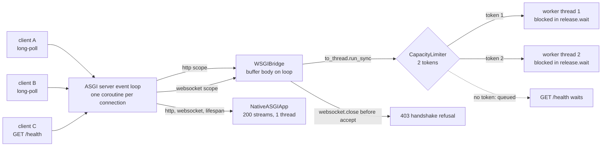

# From WSGI (PEP 3333) to ASGI 3.0: Why Synchronous Single-Callable Interfaces Cannot Express Multiplexing, WebSockets, or Lifespan

> [!summary] Claim
> A WSGI application is one blocking call per request that returns an iterable, so the only way to run it concurrently is one thread per in-flight request, it can learn about a vanished client only when its next write fails, and it has no scope for a WebSocket or for process startup and shutdown; ASGI 3.0 replaces the call with `app(scope, receive, send)` coroutines whose lifetime is the connection, which is what lets one event loop hold thousands of streams, hear `http.disconnect` while idle, and serve `http`, `websocket`, and `lifespan` from the same callable.

Part of [ASGI and Starlette Internals](README.md) in [API Engineering](../README.md).

## TL;DR

Mechanism: WSGI is `result = application(environ, start_response)` with a CGI-style `environ` dict, a blocking `wsgi.input` file, and an iterable of bytestrings that the server drains `(PEP 3333 Specification Details)`; ASGI is `await application(scope, receive, send)`, called once per connection and alive for its whole lifetime `(ASGI 3.0 asgi.rst, Applications)`.
Contract rule: a WSGI gateway MUST delay headers until the first non-empty bytestring, MUST call `close()` on the returned iterable, and MUST pass only native `str` CGI variables; the lab proves Starlette `1.10.0`, Uvicorn `0.54.0`, and asgiref `3.13.0` bridges skip `close()`, and that Starlette's integer `SERVER_PORT` fails `wsgiref.validate`.
Trap: putting a WSGI app behind an ASGI server does not make it async; every streaming or long-poll response pins a worker thread for its whole duration, so two held streams on a two-token limiter queue a health check (lab), and `asgiref.wsgi.WsgiToAsgi` serialises every request onto one thread (lab).
Portability: the bridge semantics are interpreter-independent and the lab ran on CPython `3.14.6` only; the thread budget is not, because each server picks its own pool (Uvicorn 10 threads, AnyIO 40 tokens, `ThreadPoolExecutor` `min(32, cpus + 4)`, Granian 512 blocking threads for WSGI at defaults).
When not to use it: do not bridge WSGI for WebSockets, SSE, long-polling, or anything that waits; serve those endpoints from a native ASGI app and keep the WSGI app for short, CPU-light request-response routes until it is migrated.

## Mental model



Every connection becomes a coroutine on the server's event loop, so accepting connections is cheap on both paths.
On the WSGI path the bridge first buffers the request body on the loop, which costs no thread, then asks the limiter for a worker thread because `application(environ, start_response)` is a blocking call.
Clients A and B are long-polls: their generators block inside the worker thread between chunks, so they hold both tokens for as long as the poll lasts.
Client C's `GET /health` needs one millisecond of work, but there is no token left, so it waits in the limiter queue; the lab asserts `limiter.statistics().tasks_waiting == 1` and an empty response at that moment.
On the native path the same three clients are three coroutines that suspend on `await`, so the lab holds 200 streams open and still answers `/health`, all on the test's own thread.
A `websocket` scope has nothing to map to in `environ`, so the bridge refuses the handshake, and a `lifespan` scope makes it raise, which tells the server to run without startup and shutdown events.

## How it works

### WSGI: one blocking call, one iterable

PEP 3333 (WSGI `1.0.1`, created 2010-09-26) is the Python 3 update of PEP 333 (created 2003-12-07) and changes no semantics for compliant Python 2 code `(PEP 3333 Preface for Readers of PEP 333)`.
The server calls the application positionally with two arguments, `environ` and `start_response`, and the application returns an iterable of zero or more bytestrings `(PEP 3333 Specification Details)`.
`environ` MUST be a builtin `dict`, holds the CGI meta-variables of RFC 3875 Section 4.1 (`REQUEST_METHOD`, `SCRIPT_NAME`, `PATH_INFO`, `QUERY_STRING`, `CONTENT_TYPE`, `CONTENT_LENGTH`, `SERVER_NAME`, `SERVER_PORT`, `SERVER_PROTOCOL`, and `HTTP_*` request headers), and adds `wsgi.version`, `wsgi.url_scheme`, `wsgi.input`, `wsgi.errors`, `wsgi.multithread`, `wsgi.multiprocess`, and `wsgi.run_once` `(PEP 3333 environ Variables)`.
Every CGI variable MUST be a native `str`: "It is a violation of this specification for *any* CGI variable's value to be of any type other than ``str``", and `SERVER_NAME` and `SERVER_PORT` "are required strings and must never be empty" `(PEP 3333 environ Variables)`.
Strings carry only code points `U+0000` through `U+00FF`, which is why every gateway does `path.encode("utf-8").decode("latin-1")` before writing `PATH_INFO` `(PEP 3333 Unicode Issues)`.

`wsgi.input` is a file-like object with `read(size)`, `readline()`, `readlines(hint)`, and `__iter__()`; the server should simulate end-of-file at `CONTENT_LENGTH` `(PEP 3333 Input and Error Streams)`.
`read()` is a blocking call by construction: the specification has no way for the application to say "wake me when bytes arrive", so a streaming `wsgi.input` must park a thread on the socket.
The PEP's own "Proposed/Under Discussion" list still asks whether `wsgi.input` should be an iterator, which "would help for asynchronous applications and chunked-encoding input streams", and asks for "a section about synchronous vs. asynchronous apps and servers"; neither was ever added `(PEP 3333 Proposed/Under Discussion)`.

### `start_response`, delayed headers, and `exc_info`

`start_response(status, response_headers, exc_info=None)` takes a status string such as `"200 OK"` and a list of `(name, value)` tuples, and returns a `write(body_data)` callable `(PEP 3333 The start_response() Callable)`.
It MUST NOT transmit anything: the server sends the headers only after the iterable yields its first non-empty bytestring, or after the first `write()`, or when the iterable is exhausted `(PEP 3333 The start_response() Callable)`.
That delay exists "to ensure that buffered and asynchronous applications can replace their originally intended output with error output, up until the last possible moment", so an application can call `start_response` again with `exc_info=sys.exc_info()` and switch `200 OK` to `500` `(PEP 3333 The start_response() Callable)`.
If headers already went out, `start_response` MUST raise, and should re-raise `exc_info[1].with_traceback(exc_info[2])`, because "It is not safe for the application to attempt error output to the browser once the HTTP headers have already been sent" `(PEP 3333 The start_response() Callable)`.
A second call without `exc_info` is a fatal error, and an implementation should drop its reference to `exc_info` in a `finally` block to avoid a traceback reference cycle `(PEP 3333 The start_response() Callable)`.
Header values MUST NOT contain "*any* control characters, including carriage returns or linefeeds", and applications and middleware are forbidden to use HTTP/1.1 hop-by-hop features or headers (the PEP puts "hop-by-hop" in quotes); a server should consider an attempt a fatal error and raise if such headers are supplied to `start_response()` `(PEP 3333 The start_response() Callable)`.
The hop-by-hop list PEP 3333 points to is `Connection`, `Keep-Alive`, `Proxy-Authenticate`, `Proxy-Authorization`, `TE`, `Trailers`, `Transfer-Encoding`, and `Upgrade` `(RFC 2616 Section 13.5.1)`.
`Upgrade` being on that list is the specification-level reason WSGI cannot speak WebSocket: the opening handshake is an `Upgrade: websocket` request answered by `101 Switching Protocols` `(RFC 6455 Section 4.2.2)` `(RFC 9110 Section 7.8)`, and a WSGI application may neither send `Upgrade` nor take over the socket.

### Streaming, `write()`, and `close()`

A server MUST NOT delay a yielded block: it either sends the whole block to the OS before asking for the next one, or uses another thread to keep transmitting `(PEP 3333 Buffering and Streaming)`.
Middleware MUST yield at least one value (possibly `b""`) for every value its child yields, which "ensures that asynchronous applications and servers can conspire to reduce the number of threads" `(PEP 3333 Middleware Handling of Block Boundaries)`.
`write()` is "strictly a hack to support imperative streaming APIs"; output passed to `write()` goes out before anything the returned iterable yields `(PEP 3333 The write() Callable)`.
If the iterable has a `close()` method, the server MUST call it "whether the request was completed normally, or terminated early due to an application error during iteration or an early disconnect of the browser" `(PEP 3333 Specification Details)`.
`close()` is the only cleanup hook a WSGI application gets for an iterable response: the PEP's Q and A says resources "will not be released until the iterable is garbage collected" otherwise `(PEP 3333 Questions and Answers, item 3)`.
On CPython a dropped generator is finalized by reference counting, which hides the bug for generators; a class-based iterable or a framework response object (Werkzeug `3.1.9` responses define `close()`, `werkzeug/wrappers/response.py`) loses its cleanup.

### What a single call cannot express

The ASGI rationale says WSGI's "design is irrevocably tied to the HTTP-style request/response cycle" and that ASGI exists to let data "be sent and received at any time" `(ASGI 3.0 asgi.rst, Rationale)`.
Concretely, the WSGI signature fails in four places.

1. Concurrency costs a thread.
   The call blocks until the response is produced, so `N` in-flight requests need `N` threads or processes; PEP 3333 leaves this to the server and only asks that servers offer a single-threaded mode for unsafe applications `(PEP 3333 Thread Support)`.
2. Disconnects are invisible while idle.
   There is no inbound channel after `environ` is built, so the application learns that the client left only when the server fails to write a yielded block and then calls `close()`, which raises `GeneratorExit` at the paused `yield`.
3. No bidirectional, long-lived exchange.
   One `environ` in and one iterable out cannot carry a WebSocket's interleaved frames in both directions `(RFC 6455 Section 5)`, and `Upgrade` is forbidden to the application.
4. No process lifecycle.
   Nothing in PEP 3333 runs when a worker starts or stops, so WSGI applications open pools at import time or rely on server hooks such as Gunicorn `post_fork` and `worker_exit` `(gunicorn 26.2.0 gunicorn/config.py, Postfork and WorkerExit settings)`, which ties portable code to one server.

HTTP/2 multiplexing does not by itself break WSGI, because each stream is a separate request that a server can hand to a separate thread `(RFC 9113 Section 5)`; it breaks the economics, because one HTTP/2 connection may carry at least 100 concurrent streams by the recommended `SETTINGS_MAX_CONCURRENT_STREAMS` floor `(RFC 9113 Section 6.5.2)`, and each of them needs its own thread on the WSGI side.
WebSocket over HTTP/2 is worse still: HTTP/2 "does not support the 101 (Switching Protocols)" status `(RFC 9113 Section 8.6)`, and WebSockets ride an extended `CONNECT` stream with `:protocol` instead `(RFC 8441 Sections 4 and 5)`, which has no WSGI representation at all.

### ASGI 3.0: a coroutine per connection

ASGI `3.0` (header date 2019-03-20; its own version history lists 2019-03-04) changed the application from the legacy two-callable `application(scope)` returning `coroutine application_instance(receive, send)` to a single `coroutine application(scope, receive, send)` `(ASGI 3.0 asgi.rst, Applications and Legacy Applications and Version History)`.
Each call of the application callable maps to a single incoming socket or connection (the spec writes "socket" in quotes) "and is expected to last the lifetime of that connection plus a little longer if there is cleanup to do" `(ASGI 3.0 asgi.rst, Overview)`.
For HTTP the connection scope is one request; for WebSocket it lasts as long as the socket is connected; `scope["type"]` names the protocol and `scope["asgi"]["version"]` defaults to `"2.0"` if missing `(ASGI 3.0 asgi.rst, Connection Scope and Applications)`.
Events are dicts with a `type` key and only serializable values (bytes, str, signed 64-bit integers, finite floats, lists, dicts, booleans, `None`) `(ASGI 3.0 asgi.rst, Events)`.
Applications "should actively reject any protocol that they do not understand with an `Exception` (of any type)", otherwise a lifespan-aware server may think the app supports a protocol it does not `(ASGI 3.0 asgi.rst, Protocol Specifications)`.

The HTTP and WebSocket message format (`www.rst`, version `2.5`, 2024-06-05) is "deliberately intended and designed to be a superset of the WSGI format" and covers HTTP/1.0, HTTP/1.1, HTTP/2, and HTTP/3; a server "should give different scopes to different requests on the same HTTP/2 or HTTP/3 connection, and correctly multiplex the responses back" `(ASGI www.rst, HTTP)`.
`receive()` yields `http.request` chunks with `more_body`, and then `http.disconnect` "if receive is called after a response has been sent or after the HTTP connection has been closed", which is what lets a long-poll clean up without writing `(ASGI www.rst, Disconnect - receive event)`.
Since spec version `2.4`, `send()` on a closed connection should raise a server-specific `OSError` subclass `(ASGI www.rst, Spec Versions and Disconnected Client - send exception)`.
A WebSocket app that sends `websocket.close` before accepting makes the server "close the connection with a HTTP 403 error code" `(ASGI www.rst, Close - send event)`.
The lifespan protocol (version `2.0`) runs `lifespan.startup` and `lifespan.shutdown` once per event loop, and "If an exception is raised when calling the application callable with a `lifespan.startup` message or a `scope` with type `lifespan`, the server must continue but not send any lifespan events" `(ASGI lifespan.rst, Scope)`.

### The bridge: what the ASGI spec says and what real adapters do

The spec's mapping is short: WSGI apps "being synchronous, must be run in a threadpool", `REQUEST_METHOD` is `method`, `SCRIPT_NAME` is `root_path`, `PATH_INFO` is `path` minus `root_path`, `SERVER_NAME` and `SERVER_PORT` come from `server`, and yielded content becomes `http.response.body` messages `(ASGI www.rst, WSGI Compatibility)`.
Every real adapter read for this note except a2wsgi buffers the whole request body before calling the WSGI app (a2wsgi serves `wsgi.input` from `receive()` on demand), and each deviates from PEP 3333 somewhere:

| Adapter | Thread pool | Calls iterable `close()` | `SERVER_PORT` type | Duplicate `cookie` join | Source |
|---|---|---|---|---|---|
| Starlette `1.10.0` `WSGIMiddleware` (deprecated at import, points to `a2wsgi`) | AnyIO default limiter (40) | No (lab) | `int` (lab: fails `wsgiref.validate`) | `,` (lab) | `(starlette 1.10.0 starlette/middleware/wsgi.py, WSGIResponder.wsgi and build_environ)` |
| Uvicorn `0.54.0` `_WSGIMiddleware` (used by `--interface wsgi` when `a2wsgi` is absent) | Own `ThreadPoolExecutor(max_workers=10)` | No (lab) | `int` | `,` | `(uvicorn 0.54.0 uvicorn/middleware/wsgi.py, _WSGIMiddleware and WSGIResponder.wsgi)` |
| asgiref `3.13.0` `WsgiToAsgi` | `sync_to_async` with `thread_sensitive=True`: one shared thread (lab) | No (lab) | `str` | `,` | `(asgiref 3.13.0 asgiref/wsgi.py, WsgiToAsgiInstance.run_wsgi_app)` `(asgiref 3.13.0 asgiref/sync.py, SyncToAsync.__call__)` |
| Hypercorn `0.18.0` `WSGIWrapper` | asyncio worker: loop default executor (`run_in_executor(None, ...)`); trio worker: `trio.to_thread.run_sync` (`hypercorn/asyncio/task_group.py`, `hypercorn/trio/task_group.py`, `TaskGroup.spawn_app`) | Yes, in `finally` | `int` | `,` | `(hypercorn 0.18.0 hypercorn/app_wrappers.py, WSGIWrapper.run_app and _build_environ)` |
| a2wsgi `1.10.10` `WSGIMiddleware` (what Uvicorn imports first) | Own `ThreadPoolExecutor(max_workers=10)` via `run_in_executor`; response queue bounded at 10 | Yes, in `finally` | `str` | `,` | `(a2wsgi 1.10.10 a2wsgi/wsgi.py, WSGIMiddleware and WSGIResponder.wsgi and build_environ)` |
| Lab `WSGIBridge` | Caller's `anyio.CapacityLimiter` | Yes (lab) | `str` (lab: passes `wsgiref.validate`) | `; ` (lab) | `wsgi_asgi_bridge.py` |

a2wsgi `1.10.10` (read at the `v1.10.10` tag, the latest on PyPI as of 2026-11, not run here) calls `close()` in a `finally`, bounds its send queue with `asyncio.Queue(10)`, answers `websocket` with `websocket.close`, completes `lifespan` itself, and uses `str(server_port or 0)` for `SERVER_PORT`; like Starlette and Uvicorn its `start_response` sends `http.response.start` on the first call and re-raises a stored `exc_info` only after the WSGI call returns, so it also breaks the delayed-header rule `(a2wsgi 1.10.10 a2wsgi/wsgi.py, WSGIResponder.start_response and WSGIResponder.__call__)`.
Starlette, Uvicorn, and asgiref all iterate `for chunk in self.app(environ, start_response)` (or the equivalent) with no `close()` call anywhere in the module; Hypercorn and Gunicorn's sync worker do call it `(gunicorn 26.2.0 gunicorn/workers/sync.py, SyncWorker.handle_request)`.
Starlette's and Uvicorn's `start_response` both break the delayed-header rule: the first call queues `http.response.start` immediately, a later call (with or without `exc_info`) only overwrites the stored `exc_info`, and neither returns a `write()` callable; the stored `exc_info` is re-raised only after the WSGI call returns, from `WSGIResponder.__call__`, so `start_response` itself never raises, a `200` can never become a `500`, and the PEP's "must raise" rule is not enforced by either `(starlette 1.10.0 starlette/middleware/wsgi.py, WSGIResponder.start_response)` `(uvicorn 0.54.0 uvicorn/middleware/wsgi.py, WSGIResponder.start_response)`.
Starlette's response queue is `anyio.create_memory_object_stream(math.inf)`, and Uvicorn's is an unbounded `deque`, so a WSGI generator that produces faster than the client reads fills memory instead of blocking `(starlette 1.10.0 starlette/middleware/wsgi.py, WSGIResponder.__init__)` `(uvicorn 0.54.0 uvicorn/middleware/wsgi.py, WSGIResponder.__init__)`.
asgiref's `WsgiToAsgi` decorates `run_wsgi_app` with `@sync_to_async`, whose default `thread_sensitive=True` routes the call, when no outer sync thread or `ThreadSensitiveContext` exists, to the class-level `single_thread_executor = ThreadPoolExecutor(max_workers=1)` `(asgiref 3.13.0 asgiref/sync.py, SyncToAsync)`; the lab measures a peak concurrency of 1 across four concurrent requests.
asgiref does honour the `Content-Length` rule (it truncates output past the declared length and stops iterating), spools request bodies over 65536 bytes to disk with `SpooledTemporaryFile(max_size=65536)`, and answers `400` when a header repeats more than `duplicate_header_limit=100` times `(asgiref 3.13.0 asgiref/wsgi.py, WsgiToAsgiInstance)`.
Hypercorn's wrapper answers a `websocket` scope with `websocket.close`, returns silently for `lifespan`, and caps WSGI bodies at `wsgi_max_body_size = 16 * 1024 * 1024` bytes with a `400` `(hypercorn 0.18.0 hypercorn/app_wrappers.py, WSGIWrapper.__call__ and handle_http)` `(hypercorn 0.18.0 hypercorn/config.py, Config)`.
Uvicorn's `--interface wsgi` wraps the app and sets `ws_protocol_class = None`, turning WebSockets off for the whole server `(uvicorn 0.54.0 uvicorn/config.py, Config.load)`; its lifespan task then sees the wrapper's `assert scope["type"] == "http"` fail and, under the default `--lifespan auto`, logs "ASGI 'lifespan' protocol appears unsupported." at info level `(uvicorn 0.54.0 uvicorn/lifespan/on.py, LifespanOn.main)`.

### Native WSGI servers and their thread budgets

Gunicorn `26.2.0` defaults to one `sync` worker process (`WEB_CONCURRENCY` or `1`), `threads = 1`, `timeout = 30` seconds, and `keepalive = 2` seconds `(gunicorn 26.2.0 gunicorn/config.py, Workers, WorkerThreads, Timeout, Keepalive)`.
The sync worker calls `resp.force_close()` on every request with the comment "Force the connection closed until someone shows a buffering proxy that supports Keep-Alive to the backend" `(gunicorn 26.2.0 gunicorn/workers/sync.py, SyncWorker.handle_request)`, and its design page says it "Requires a buffering proxy (nginx, HAProxy) for production" and lists WebSockets, long polling, and streaming bodies as reasons to use async workers `(gunicorn 26.2.0 docs/content/design.md, Worker Types and When to Use Async Workers)`.
Setting `--threads` above 1 with the `sync` class silently switches to `gthread` `(gunicorn 26.2.0 gunicorn/config.py, WorkerThreads)`, and Gunicorn `26.2.0` ships a native `asgi` worker class with WebSocket and lifespan support `(gunicorn 26.2.0 gunicorn/workers/__init__.py, SUPPORTED_WORKERS)` `(gunicorn 26.2.0 gunicorn/workers/gasgi.py, ASGIWorker)`.
Gunicorn's response path strips hop-by-hop headers the application supplies instead of failing, except that it keeps `Upgrade: websocket` for its own upgrade handling `(gunicorn 26.2.0 gunicorn/http/wsgi.py, Response.process_headers)`.
Granian `2.8.7` serves WSGI natively from Rust and sizes its blocking pool as `max(1, backpressure // 2)` for the WSGI interface and `1` otherwise, where `backpressure = backlog // workers`, `backlog` defaults to 1024 (floored at 128), and `workers` defaults to 1, so the WSGI default is 512 blocking threads for the single default worker and `(1024 // workers) // 2` per worker when you add workers `(granian 2.8.7 granian/server/common.py, AbstractServer.__init__)`.
Granian's `start_response` ignores `exc_info` and returns `None`, so an application that uses `write()` fails there `(granian 2.8.7 granian/wsgi.py, Response.__call__)`.

### The lab bridge in one paragraph

The lab's `WSGIBridge` follows the rules above: it rejects `websocket` (close before accept) and other scopes (raise), buffers the body on the event loop with a `max_body` cap that answers `413`, borrows one limiter token per request with `anyio.to_thread.run_sync(..., limiter=...)`, sends each block with `anyio.from_thread.run(send, message)` so the worker thread blocks until the server accepted it, delays `http.response.start` until the first non-empty block, validates status and headers inside `start_response`, re-raises `exc_info` after headers are out, supports `write()`, and calls `close()` in a `finally`.

## Numbers and limits

| Quantity | Value | Source or measurement |
|---|---|---|
| PEP 333 / PEP 3333 created | 2003-12-07 / 2010-09-26 | PEP headers |
| ASGI core version | `3.0`, header date 2019-03-20, history entry 2019-03-04 | `(ASGI 3.0 asgi.rst, Version History)` |
| ASGI HTTP and WebSocket spec | `2.5` (2024-06-05); `2.4` made `send()` raise after close | `(ASGI www.rst, Spec Versions)` |
| ASGI lifespan spec | `2.0` (2019-03-20) | `(ASGI lifespan.rst)` |
| AnyIO default thread limiter | 40 tokens | `(anyio 4.16.0 anyio/_backends/_asyncio.py, AsyncIOBackend.current_default_thread_limiter)` |
| `ThreadPoolExecutor` default `max_workers` | `min(32, (os.cpu_count() or 1) + 4)` on 3.12; `min(32, (os.process_cpu_count() or 1) + 4)` on 3.13+ | local CPython `3.12.13`, `3.13.18`, `3.14.6`, `3.14.10`, `3.15.2` `concurrent/futures/thread.py`, `ThreadPoolExecutor.__init__`; `ThreadPoolExecutor()._max_workers == 16` on each, on this 12-CPU macOS 27.3 arm64 machine (as of 2026-11) |
| Uvicorn `_WSGIMiddleware` pool | 10 threads | `(uvicorn 0.54.0 uvicorn/middleware/wsgi.py, _WSGIMiddleware.__init__)` |
| asgiref `WsgiToAsgi` | 1 thread; body spooled to disk past 65536 bytes; 100 duplicate headers max | `(asgiref 3.13.0 asgiref/wsgi.py)` `(asgiref 3.13.0 asgiref/sync.py)` |
| Hypercorn WSGI body cap | 16 MiB, then `400` | `(hypercorn 0.18.0 hypercorn/config.py, Config.wsgi_max_body_size)` |
| Gunicorn defaults | 1 worker, 1 thread, `timeout` 30 s, `keepalive` 2 s, `worker_connections` 1000 | `(gunicorn 26.2.0 gunicorn/config.py)` |
| Gunicorn sizing advice | `(2 x CPU cores) + 1` workers; typically 4 to 12 workers | `(gunicorn 26.2.0 docs/content/design.md, Scaling)` |
| Granian WSGI blocking threads | 512 at defaults (`backlog` 1024, 1 worker); `(1024 // workers) // 2` per worker otherwise | `(granian 2.8.7 granian/server/common.py, AbstractServer.__init__)` |
| HTTP/2 concurrent streams | Recommended `SETTINGS_MAX_CONCURRENT_STREAMS` >= 100 | `(RFC 9113 Section 6.5.2)` |
| Threads needed by a WSGI bridge | arrival rate x hold time (Little's law); 50 long-polls per second held 30 s need 1500 threads | Arithmetic, not measured |
| Lab: WSGI requests in flight on a 2-token limiter | 2 run, the third waits (`tasks_waiting == 1`) | `test_two_wsgi_long_polls_exhaust_a_two_thread_limiter_and_starve_health` |
| Lab: native ASGI streams held open on one thread | 200, with `/health` answered meanwhile | `test_native_asgi_holds_200_streams_on_one_thread_and_still_answers_health` |
| Lab: `WsgiToAsgi` peak concurrency for 4 parallel requests | 1 | `test_asgiref_wsgitoasgi_serialises_every_request_onto_one_thread` |
| Lab module | 24 passed in 0.31 s (verifier rerun, 2026-11) | `uv run --frozen pytest <module> -q`, CPython `3.14.6`, macOS 27.3 arm64 (`uname -r` `27.3.0`) |

Measurements in the last four rows come from the single machine named; the module checks behavior, not throughput, and no latency or memory benchmark was run for this note.

## Portability

| Dimension | Behavior | Evidence |
|---|---|---|
| CPython `3.14.6` | Lab `24 passed` | Ran `uv run --frozen pytest`, macOS 27.3 arm64 |
| CPython `3.12.16`, `3.13.18`, `3.14.10`, `3.15.2`, `3.15.2t` | Not run for this draft (lab matrix paused); the module needs `>= 3.12` for the PEP 695 `type` statement and uses `wsgiref.types`, present in the local `3.12.13` stdlib | `labs/pyproject.toml` `requires-python = ">=3.12,<3.16"` |
| Free-threaded builds (`3.14t`, `3.15t`) | The bridge's thread-per-request and limiter math is the same; the build removes the GIL, which PEP 703 names as the bottleneck for threads that parallelize across requests; this note makes no scaling claim for bridged WSGI threads because none was measured | PEP 779 (Final, resolved 2025-06-16): free-threaded build officially supported but optional from 3.14 (phase II); PEP 703 Motivation; no `3.14t` or `3.15t` lab run |
| Default executor sizing | `os.cpu_count()` on 3.12, `os.process_cpu_count()` (honours CPU affinity) on 3.13+ | Local stdlib sources of `3.12.13`, `3.13.18`, `3.14.6`, `3.14.10`, `3.15.2` |
| Starlette `1.10.0` | `WSGIMiddleware` deprecated with `StarletteDeprecationWarning` at import; no `close()`; `int` `SERVER_PORT` | Lab, and `(starlette 1.10.0 starlette/middleware/wsgi.py)` |
| Uvicorn `0.54.0` | `--interface wsgi` uses `a2wsgi.WSGIMiddleware` if importable, else the deprecated `_WSGIMiddleware` (10 threads, warns to switch to a2wsgi); WebSockets disabled | Lab for `_WSGIMiddleware`; `(uvicorn 0.54.0 uvicorn/middleware/wsgi.py, module-level try/except ModuleNotFoundError)` `(uvicorn 0.54.0 uvicorn/config.py, Config.load)`; a2wsgi behaviour from `(a2wsgi 1.10.10 a2wsgi/wsgi.py)`, source read, not run |
| Hypercorn `0.18.0` | WSGI via `WSGIWrapper`: calls `close()`, refuses WebSockets, ignores lifespan, 16 MiB cap | Source read, not run |
| Granian `2.8.7` | Native WSGI, 512 blocking threads at defaults (one worker), `write()` unsupported, `exc_info` ignored | Source read, not run |
| Gunicorn `26.2.0` | `sync` closes every connection; `gthread` keeps alive; `asgi` worker native | Source and docs read, not run |
| HTTP/1.1 | WebSocket needs `Upgrade` and `101`, both outside WSGI's reach | `(RFC 6455 Section 4.2.2)` `(RFC 9110 Section 7.8)` |
| HTTP/2 | Streams map to separate scopes; no `101`; WebSocket via extended `CONNECT`; split `cookie` crumbs must rejoin with `; ` | `(RFC 9113 Sections 5, 8.2.3, 8.6)` `(RFC 8441 Section 5)`; `h2 4.4.1` already rejoins inbound crumbs `(h2 4.4.1 h2/utilities.py, _combine_cookie_fields)` |
| HTTP/3 | ASGI `www.rst` covers it with the same per-request scopes; WebSocket uses the same extended `CONNECT` with `:protocol` and `SETTINGS_ENABLE_CONNECT_PROTOCOL` (0x08), and an unsupported `:protocol` should get `501`, so it has no WSGI representation either | `(ASGI www.rst, HTTP)` `(RFC 9220 Section 3)` |
| Containers (Debian Trixie, Alpine musl) | Not run | Lab checks paused |

## Worked example

The lab pairs a PEP 3333 gateway with a native ASGI app and drives both in-process: [implementation](../labs/src/api_labs/f10_asgi_and_starlette_internals/wsgi_asgi_bridge.py), [test](../labs/tests/f10_asgi_and_starlette_internals/test_wsgi_pep_3333_vs_asgi_3_0_architectural_shift.py).
Concurrency and disconnect tests call the ASGI callables directly with recording `receive` and `send` functions, because `httpx.ASGITransport` runs the app to completion and buffers the whole body before returning (`httpx 0.28.1 httpx/_transports/asgi.py, ASGITransport.handle_async_request`), which cannot show a held stream; request-response tests use `httpx.AsyncClient(transport=httpx.ASGITransport(app=app), base_url="http://test")`.

The gateway core, simplified excerpt:

```python
class WSGIBridge:
    async def __call__(self, scope: Scope, receive: Receive, send: Send) -> None:
        if scope["type"] == "websocket":
            # Close before accept: the server answers the handshake with 403.
            await send({"type": "websocket.close", "code": 1000})
            return
        if scope["type"] != "http":
            raise UnsupportedScopeError(scope["type"])
        body = bytearray()
        while True:  # Buffer on the event loop: a slow upload costs no thread.
            message = await receive()
            if message["type"] == "http.disconnect":
                return
            body += message.get("body", b"")
            if len(body) > self.max_body:
                await send({"type": "http.response.start", "status": 413, "headers": []})
                await send({"type": "http.response.body", "body": b""})
                return
            if not message.get("more_body", False):
                break
        environ = build_environ(scope, bytes(body))
        await anyio.to_thread.run_sync(self._run, environ, send, limiter=self.limiter)

    def _run(self, environ: WSGIEnvironment, send: Send) -> None:
        response = _Response(send)
        result = self.app(environ, response.start_response)
        try:
            for chunk in result:
                response.write(chunk)
            response.finish()
        finally:
            close = getattr(result, "close", None)
            if close is not None:
                close()  # PEP 3333: MUST be called, on success, error, or disconnect.
```

`start_response` and the delayed-header write path, simplified excerpt:

```python
    def start_response(self, status, headers, exc_info=None, /):
        if exc_info is not None and exc_info[1] is not None:
            try:
                if self.headers_sent:
                    raise exc_info[1].with_traceback(exc_info[2])
            finally:
                exc_info = None  # PEP 3333: hold no reference to the traceback.
        elif self.status is not None:
            raise RuntimeError("start_response called twice without exc_info")
        ...  # validate status, reject CR/LF and hop-by-hop headers
        return self.write

    def write(self, data: bytes) -> None:
        if not data:
            return  # PEP 3333: headers wait for the first non-empty bytestring.
        if not self.headers_sent:
            self._send_from_thread(
                {"type": "http.response.start", "status": self.status, "headers": self.headers}
            )
            self.headers_sent = True
        self._send_from_thread({"type": "http.response.body", "body": data, "more_body": True})
```

The thread-exhaustion test, simplified excerpt (the long-poll blocks its worker thread exactly as any waiting WSGI code must):

```python
    limiter = anyio.CapacityLimiter(2)
    bridge = WSGIBridge(app, limiter=limiter)
    health = Recorder()
    try:
        async with anyio.create_task_group() as tg:
            for _ in range(2):
                tg.start_soon(bridge, http_scope("/stream"), OneRequest(), Recorder())
            await wait_until(lambda: limiter.borrowed_tokens == 2)
            tg.start_soon(bridge, http_scope("/health"), OneRequest(), health)
            await wait_until(lambda: limiter.statistics().tasks_waiting == 1)
            assert health.messages == []  # Queued for a thread, not served.
            release.set()
    finally:
        release.set()
    assert health.messages[0]["status"] == 200
```

What the 24 tests prove, by group:

- Concurrency: two WSGI long-polls on a two-token limiter queue `/health`; 200 native streams on one thread do not; `WsgiToAsgi` peaks at 1 concurrent request; the lab bridge reaches 3 behind a `threading.Barrier(3)`; a stalled upload borrows no token; a body over `max_body` gets `413` before any thread or app call.
- Disconnects: the WSGI generator renders `b"two"` for a client that is already gone, learns only when that `send` raises `OSError`, and its `finally` runs through `close()`; the native app sees `http.disconnect` while idle and stops without writing.
- Scopes: the bridge refuses a WebSocket with `websocket.close` before accept and makes `asgi_lifespan.LifespanManager` raise `LifespanNotSupported`; the native app echoes a WebSocket and completes startup and shutdown.
- PEP 3333 conformance: the lab environ passes `wsgiref.validate.validator`; Starlette's fails it with `SERVER_PORT is not a string`; only the lab bridge calls `close()` on a class-based iterable (Starlette, Uvicorn, asgiref do not); Starlette turns `cookie` crumbs into `session=s1,csrf=t2`, which `http.cookies.SimpleCookie` parses as one cookie `{"session": "s1,csrf=t2"}`; delayed headers let `exc_info` turn `200` into `500`; `exc_info` after headers re-raises; `write()` output precedes the iterable; CR/LF, `Connection`, and `Transfer-Encoding` are rejected at `start_response`.

Captured run, from `labs/`, CPython `3.14.6` (`uv run --frozen python -VV`: `Python 3.14.6 (main, Jun 23 2026, 15:46:31) [Clang 22.1.3 ]`), macOS 27.3 arm64:

```text
$ uv run --frozen pytest tests/f10_asgi_and_starlette_internals/test_wsgi_pep_3333_vs_asgi_3_0_architectural_shift.py -q
........................                                                 [100%]
24 passed in 0.31s
```

## Pitfalls

> [!warning] Long-polls, SSE, or streaming through a WSGI bridge
> Trigger: a Flask or Django WSGI app gains a "live updates" endpoint and is deployed with `uvicorn --interface wsgi` or behind `starlette.middleware.wsgi.WSGIMiddleware`.
> Symptom: under modest load every other endpoint, including the health check, starts timing out, CPU stays low, and thread dumps show every worker parked in the streaming generator; with Uvicorn's fallback that ceiling is 10 concurrent requests per process, with Starlette's 40 per event loop.
> Fix: serve the streaming endpoint from a native ASGI route (Starlette `StreamingResponse` or `sse-starlette`) mounted beside the WSGI app, and give the bridge its own limiter so it cannot starve sync endpoints elsewhere; the lab test `test_two_wsgi_long_polls_exhaust_a_two_thread_limiter_and_starve_health` reproduces the starvation.

> [!warning] `WsgiToAsgi` serialises the whole site
> Trigger: wrapping a WSGI app with `asgiref.wsgi.WsgiToAsgi` under a pure ASGI server, outside Django's `ThreadSensitiveContext`.
> Symptom: throughput equals one request at a time, latency grows linearly with load, and adding Uvicorn workers is the only thing that helps.
> Fix: use a bridge with a real pool (the lab bridge, `a2wsgi` `1.10.10`, or Hypercorn's wrapper), or run the WSGI app under a WSGI server; the cause is `@sync_to_async` defaulting to `thread_sensitive=True` and falling back to the one-thread `single_thread_executor` `(asgiref 3.13.0 asgiref/sync.py, SyncToAsync.__call__)`.

> [!warning] Cleanup that never runs because `close()` is skipped
> Trigger: a WSGI iterable that is not a plain generator (a framework response object, or a class that releases a database connection or file handle in `close()`) served through Starlette `1.10.0`, Uvicorn `0.54.0` `_WSGIMiddleware`, or asgiref `3.13.0`.
> Symptom: connection-pool exhaustion or leaked file descriptors that appear only after migrating from Gunicorn, which does call `close()`.
> Fix: use a bridge that calls `close()` in a `finally`, or wrap the app in WSGI middleware that consumes and closes the iterable itself; the parametrized lab test shows which bridges comply.

> [!warning] HTTP/2 cookie crumbs joined with a comma
> Trigger: an ASGI server that preserves HTTP/2 headers "exactly as they were provided" (allowed by `www.rst`) forwards several `cookie` fields, and a bridge joins them with `,` as Starlette, Uvicorn, asgiref, Hypercorn, and a2wsgi do for every repeated header.
> Symptom: `SimpleCookie` reads `session=s1,csrf=t2` as a single cookie named `session`, so the CSRF token and every later cookie silently disappear.
> Fix: rejoin `cookie` with `"; "` as RFC 9113 Section 8.2.3 requires "before being passed into a non-HTTP/2 context, such as ... a generic HTTP server application"; Hypercorn is safe today only because `h2 4.4.1` rejoins inbound crumbs with `; ` under its default `normalize_inbound_headers=True` before the bridge sees them `(h2 4.4.1 h2/utilities.py, normalize_inbound_headers)`.

> [!warning] CRLF in a header value
> Trigger: an application copies user input into a response header.
> Symptom: response splitting; CVE-2020-7695 was exactly this in an ASGI server, where NVD (published 2020-07-27) records that in "Uvicorn before 0.11.7" "CRLF sequences are not escaped in the value of HTTP headers".
> Fix: reject control characters at the boundary where headers enter the server, which PEP 3333 already asks of `start_response`; the lab rejects `"a\r\nSet-Cookie: admin=1"` before any byte is sent.

> [!warning] Disconnects in thread-per-connection servers
> Trigger: a client closes early while the server still holds per-connection state in a thread or socket map.
> Symptom: work continues for nobody; in the worst case the server spins, as CVE-2024-49769 describes for the WSGI server Waitress: a client that closed "before waitress has had the opportunity to call getpeername()" left a socket in the processing list and caused "a busy-loop calling the write function", fixed in Waitress 3.0.1 (NVD, published 2024-10-29).
> Fix: in WSGI, make generators cheap to abandon and do cleanup in `finally` so `close()` runs it; in ASGI, watch `receive()` for `http.disconnect` concurrently with long waits, as the native lab app does.

## Security and robustness

Threat model: the scarce resource behind a WSGI bridge is the worker thread, so the attacker's goal is to hold threads, and a slow reader is enough.
A client that reads a streamed response one byte at a time keeps the lab bridge's thread blocked in `anyio.from_thread.run(send, ...)` for as long as the transport refuses data, because the PEP 3333 streaming guarantee becomes backpressure; that is correct for memory, and it means per-connection write timeouts at the server or proxy are mandatory.
Bridges with unbounded queues (Starlette's `math.inf` memory stream, Uvicorn's `deque`) trade that thread pinning for memory growth, which is the other half of OWASP API4:2023 Unrestricted Resource Consumption, whose checklist names execution timeouts, maximum allocable memory, file descriptors, processes, and upload size.
Slow uploads are the classic slowloris shape; the lab bridge buffers the body on the event loop before taking a token and caps it with `max_body`, so a stalled upload costs a coroutine and a bounded buffer, not a thread (lab: `borrowed_tokens == 0` while the upload stalls).
Every bridge read here except a2wsgi (which streams the request body from `receive()` through a blocking `wsgi.input`, holding a thread while a slow upload trickles in) buffers the full body in memory or on disk before the app runs, so the cap must exist somewhere: Hypercorn's is 16 MiB, Starlette and Uvicorn have none in the bridge, and asgiref spools to disk with no cap.
Give WSGI traffic its own `CapacityLimiter` instead of the AnyIO default, because FastAPI and Starlette run sync endpoints and sync dependencies on that same default limiter `(starlette 1.10.0 starlette/concurrency.py, run_in_threadpool)` `(fastapi 0.162.0 fastapi/routing.py, run_endpoint_function)`, so a bridged long-poll can starve unrelated `def` routes.
Validate response headers where they enter the server (status printable, no CR/LF, no hop-by-hop), and do not trust a bridge to do it: Starlette's `start_response` only applies `strip()` and `encode("ascii")`, and Uvicorn's only `encode("ascii")`, and CR and LF are ASCII.
Header-count limits belong at the bridge too: asgiref's `duplicate_header_limit=100` exists because each repeated header is concatenated into one `environ` string.
Defense in depth: a buffering reverse proxy in front of any thread-per-request tier (Gunicorn's own advice), connection and stream limits at the proxy, a per-bridge thread budget, and native ASGI for anything long-lived.

## The principal's view

The decision is not "WSGI or ASGI" for the whole estate but where the waiting happens: a thread-per-request interface is a fine contract for short CPU-light handlers and a terrible one for anything that waits on a client, a timer, or another service.
The cost model is Little's law: threads needed equal arrival rate times hold time, so a tier that is healthy at 200 ms per request needs 150 times more threads the day a 30 s long-poll appears, while an ASGI tier needs 150 times more coroutines, each a heap object on one loop rather than an OS thread with its own stack and scheduler entry.
Migrating a large WSGI codebase is therefore staged: put an ASGI server in front, mount the WSGI app as a fallback route behind a bridge that obeys PEP 3333 (it must call `close()` and have a bounded, dedicated pool), move WebSocket, SSE, and long-poll endpoints to native ASGI routes first, then move hot request-response routes as their dependencies get async drivers.
The organizational trade-off is that ASGI moves concurrency bugs from the server into application code: a single blocking call in an `async def` stalls every connection on that loop, so the migration needs loop-lag monitoring and review rules, not just a server swap.
Stay on WSGI (Gunicorn `sync` or `gthread` behind a buffering proxy) when the service is CPU-bound, has no long-lived connections, and depends on sync-only libraries; free-threaded CPython (supported but optional since 3.14, PEP 779) removes the GIL limit on threads parallelizing across requests that PEP 703 describes, which is worth measuring for that tier before relying on it.
Choose something other than Python for the long-lived tier (a Go or Rust gateway, or a managed WebSocket service) when connection counts reach hundreds of thousands per host and the Python app only needs to see messages, not sockets.

## Interview questions

> [!question] L5: Why does a WSGI application need a thread or process per in-flight request, while an ASGI application does not?
>
> > [!success]- Answer
> > WSGI's contract is a synchronous call, `application(environ, start_response)`, that returns only when it has an iterable, and the server pulls each body block by calling `next()`, which also blocks.
> > Any waiting inside that call (a database query, a sleep, a long-poll) holds the calling thread, so concurrency equals the number of threads or processes.
> > ASGI's `await application(scope, receive, send)` is a coroutine that suspends at every `await`, so one event loop thread interleaves thousands of connections.
> >
> > Follow-up: Which part of PEP 3333 was written to help asynchronous servers reduce threads, and why was it not enough?

> [!question] L5: What does `start_response` actually do, and when do the response headers reach the wire?
>
> > [!success]- Answer
> > It validates and stores the status and headers and returns a `write()` callable; it must not transmit anything.
> > Headers go out on the first non-empty bytestring from the iterable or `write()`, or when the iterable is exhausted.
> > The delay lets an application call `start_response` again with `exc_info` and replace `200 OK` with `500` until real body bytes exist.
> >
> > Follow-up: What must `start_response` do if it is called with `exc_info` after headers were sent?

> [!question] L6: Predict the output: four concurrent `GET /` requests hit `asgiref.wsgi.WsgiToAsgi(app)` under Uvicorn, and `app` records the peak number of simultaneously active calls and the set of thread ids, so what are the two values?
>
> > [!success]- Answer
> > Peak concurrency is 1 and the set has one thread id.
> > `WsgiToAsgi.run_wsgi_app` is wrapped in `@sync_to_async`, whose default `thread_sensitive=True` sends work to the class-level `single_thread_executor` when there is no outer sync thread or `ThreadSensitiveContext`.
> > The lab test `test_asgiref_wsgitoasgi_serialises_every_request_onto_one_thread` asserts exactly this on asgiref `3.13.0`.
> >
> > Follow-up: Why does Django's own ASGI handler not suffer the same serialisation for ordinary views?

> [!question] L6: Debug this API: a Flask app runs under `uvicorn --interface wsgi`, works for months, and after an SSE endpoint ships, `/healthz` times out at about ten concurrent dashboard users while CPU is near idle, so what is happening and what do you change?
>
> > [!success]- Answer
> > Without `a2wsgi` installed, Uvicorn wraps the app in its deprecated `_WSGIMiddleware` with a `ThreadPoolExecutor(max_workers=10)`.
> > Each SSE response is a generator that blocks a pool thread between events, so ten dashboards hold all ten threads and every other request queues.
> > Move the SSE endpoint to a native ASGI route mounted next to the WSGI app, give the remaining bridge its own bounded pool, and alert on pool saturation rather than CPU.
> > Note also that `--interface wsgi` disables WebSockets server-wide.
> >
> > Follow-up: How would you prove the diagnosis from a thread dump or `py-spy dump` in production?

> [!question] L6: Why is the `close()` method on a WSGI iterable mandatory to call, and how can a bridge pass tests while violating it?
>
> > [!success]- Answer
> > PEP 3333 says the server MUST call `close()` on success, application error, or early disconnect, because it is the only cleanup hook for iterable responses.
> > A bridge that iterates a plain generator and drops it still triggers the generator's `finally` on CPython through reference counting, so generator-based tests pass.
> > Class-based iterables and framework response objects only clean up in `close()`, and Starlette `1.10.0`, Uvicorn `0.54.0`, and asgiref `3.13.0` never call it.
> >
> > Follow-up: Write a test that discriminates a compliant bridge from a non-compliant one.

> [!question] L6: How does a WSGI application find out that the client disconnected, and how does an ASGI application?
>
> > [!success]- Answer
> > WSGI has no inbound channel after `environ`, so it learns only when the server fails to send a block it yielded and then calls `close()`, which raises `GeneratorExit` at the paused `yield`.
> > Work done between the disconnect and that failed write is wasted; the lab shows a generator rendering `b"two"` for a client that is already gone.
> > ASGI delivers `http.disconnect` from `receive()` even while the app is idle, so a long-poll can watch `receive()` concurrently and cancel its wait; since spec `2.4`, `send()` on a closed connection should also raise an `OSError` subclass.
> >
> > Follow-up: What does Starlette's `StreamingResponse` do to notice disconnects, and what does it cost?

> [!question] L7+: Your organization has 400 Django and Flask WSGI services and wants WebSockets and SSE. Lay out the migration and the guardrails.
>
> > [!success]- Answer
> > First separate the waiting traffic: route WebSocket, SSE, and long-poll paths at the proxy to a small native ASGI tier, so the WSGI fleet's thread math does not change.
> > Then move services to an ASGI server with the WSGI app mounted behind a PEP 3333-compliant bridge with a dedicated, bounded pool, and verify `close()`, header validation, body caps, and cookie joining in a shared conformance test.
> > Port routes to `async def` only when their I/O has async drivers, add loop-lag monitoring and a lint rule against blocking calls in coroutines, and keep `lifespan` startup for pools that WSGI used to open at import time.
> > Measure per-service hold-time distributions first, because Little's law, not request rate, decides which services need to move.
> >
> > Follow-up: What would make you keep a service on Gunicorn `gthread` indefinitely?

> [!question] L7+: Does HTTP/2, where one connection carries 100 or more concurrent streams, make WSGI impossible, and what does it change for capacity planning?
>
> > [!success]- Answer
> > It does not make WSGI impossible, because each stream is an independent request that a server can map to its own `environ` and thread, and the ASGI HTTP spec gives each stream its own scope.
> > It changes the unit of admission: one TCP connection can now demand 100 threads at once, so per-connection limits stop bounding thread use, and the server needs per-stream limits tied to the thread pool.
> > WebSocket over HTTP/2 is the real break: there is no `101`, the socket is an extended `CONNECT` stream with `:protocol`, and nothing in `environ` or the iterable can represent it.
> >
> > Follow-up: How should `SETTINGS_MAX_CONCURRENT_STREAMS` relate to the bridge's limiter?

> [!question] L7+: Why did ASGI 3.0 drop the two-callable `application(scope)` -> `application_instance(receive, send)` form, and what did that break?
>
> > [!success]- Answer
> > The spec says the two-callable layout "was deemed unnecessary": the synchronous first call only built an instance that the server awaited immediately, so a single `async` callable carries the same information.
> > Existing ASGI 2 applications broke, so servers detect and adapt them with `asgiref.compatibility` (`guarantee_single_callable`), and Uvicorn exposes `--interface asgi2`.
> > The change also made ASGI middleware a plain coroutine wrapper, which is why pure ASGI middleware is a few lines.
> >
> > Follow-up: How does a server detect a legacy double-callable application without calling it?

## Related

Prerequisites: [[Migrating-Large-Codebases-from-Pydantic-v1-to-v2]]

Next: [[ASGI-3-0-Callable-Contract-Scope-Receive-and-Send]]

See also: [[02-Programming-Languages/Python/Python-Backend-Interview-Prep/04-FastAPI]], [[History-of-Python-Web-Interfaces-CGI-Mod-Python-WSGI-PEP-333-3333-and-ASGI]], [[ASGI-HTTP-and-Disconnect-Event-Lifecycle]], [[ASGI-Lifespan-Protocol-Startup-Shutdown-and-Scope-State]], [[ASGI-WebSockets-Lifecycle-Subprotocols-and-Backpressure]], [[Server-Sent-Events-SSE-Protocol-Last-Event-ID-and-SSE-Starlette]], [[Pure-ASGI-Middleware-Onion-Architecture-and-Send-Receive-Wrapping]], [[In-Process-Testing-of-ASGI-Apps-with-HTTPX-ASGITransport]], [[Async-Def-vs-Def-Endpoints-and-AnyIO-Threadpool-Limiter-Semantics]], [[Uvicorn-Internals-Server-Lifecycle-Protocols-and-Flow-Control]], [[Hypercorn-Internals-HTTP-2-HTTP-3-QUIC-and-AnyIO-Trio-Workers]], [[Granian-Internals-Rust-Tokio-Hyper-Engine-and-RSGI-vs-ASGI]], [[Multi-Process-Worker-Topologies-Gunicorn-Uvicorn-Workers-vs-Kubernetes-Replicas]], [[End-to-End-Backpressure-TCP-Windows-ASGI-Send-Await-and-Bounded-Queues]], [[Offloading-CPU-Bound-Work-ProcessPoolExecutor-vs-Free-Threaded-Python-3-15t]], [[HTTP-2-Binary-Framing-and-Stream-State-Machine]], [[HTTP-1-1-Framing-Keep-Alive-and-Chunked-Encoding]], [[Capacity-Planning-with-Littles-Law-and-the-Universal-Scalability-Law]], [[Unrestricted-Resource-Consumption-API4-2023-Payload-Depth-and-Limit-Guards]]

- Lab: `labs/tests/f10_asgi_and_starlette_internals/test_wsgi_pep_3333_vs_asgi_3_0_architectural_shift.py`

## Further reading

- [PEP 3333](https://peps.python.org/pep-3333/): the WSGI `1.0.1` contract; read Buffering and Streaming, the `start_response()` Callable, and Proposed/Under Discussion for the async questions it never answered.
- [PEP 333](https://peps.python.org/pep-0333/): the 2003 original, for the design rationale and what changed for Python 3.
- [ASGI 3.0 core specification](https://github.com/django/asgiref/blob/3.13.0/specs/asgi.rst): the rationale against WSGI, the single-callable change, and the rule to reject unknown scopes.
- [ASGI HTTP and WebSocket message format 2.5](https://github.com/django/asgiref/blob/3.13.0/specs/www.rst): per-stream scopes, `http.disconnect`, the WSGI compatibility mapping, and the HTTP/2 cookie note.
- [ASGI lifespan 2.0](https://github.com/django/asgiref/blob/3.13.0/specs/lifespan.rst): startup and shutdown per event loop, and how servers treat apps that reject the scope.
- [RFC 3875 Section 4.1](https://www.rfc-editor.org/rfc/rfc3875.html#section-4.1): the CGI meta-variables that `environ` inherits.
- [RFC 6455 Section 4](https://www.rfc-editor.org/rfc/rfc6455.html#section-4): the WebSocket opening handshake built on `Upgrade` and `101`.
- [RFC 9113 Sections 5, 8.2.3, and 8.6](https://www.rfc-editor.org/rfc/rfc9113.html#section-5): HTTP/2 streams, cookie crumbs, and the removal of `101`.
- [RFC 8441](https://www.rfc-editor.org/rfc/rfc8441.html): WebSockets over HTTP/2 with extended `CONNECT`.
- [RFC 9220](https://www.rfc-editor.org/rfc/rfc9220.html): the same extended `CONNECT` bootstrap over HTTP/3.
- [asgiref 3.13.0 wsgi.py](https://github.com/django/asgiref/blob/3.13.0/asgiref/wsgi.py) and [sync.py](https://github.com/django/asgiref/blob/3.13.0/asgiref/sync.py): the reference bridge and the `thread_sensitive` executor choice that serialises it.
- [Starlette 1.10.0 middleware/wsgi.py](https://github.com/encode/starlette/blob/1.10.0/starlette/middleware/wsgi.py): the deprecated bridge, with its unbounded queue and missing `close()`.
- [Gunicorn 26.2.0 design](https://github.com/benoitc/gunicorn/blob/26.2.0/docs/content/design.md): the maintainers' own account of when sync workers fail.
- [PEP 703](https://peps.python.org/pep-0703/): why the GIL limits threaded request parallelism and the three-phase plan to make it optional.
- [a2wsgi 1.10.10 wsgi.py](https://github.com/abersheeran/a2wsgi/blob/v1.10.10/a2wsgi/wsgi.py): the bridge Uvicorn prefers, with a bounded queue and `close()` in a `finally`.
- [PEP 779](https://peps.python.org/pep-0779/): the criteria that made free-threaded CPython supported in 3.14, which changes what WSGI threads can do.
