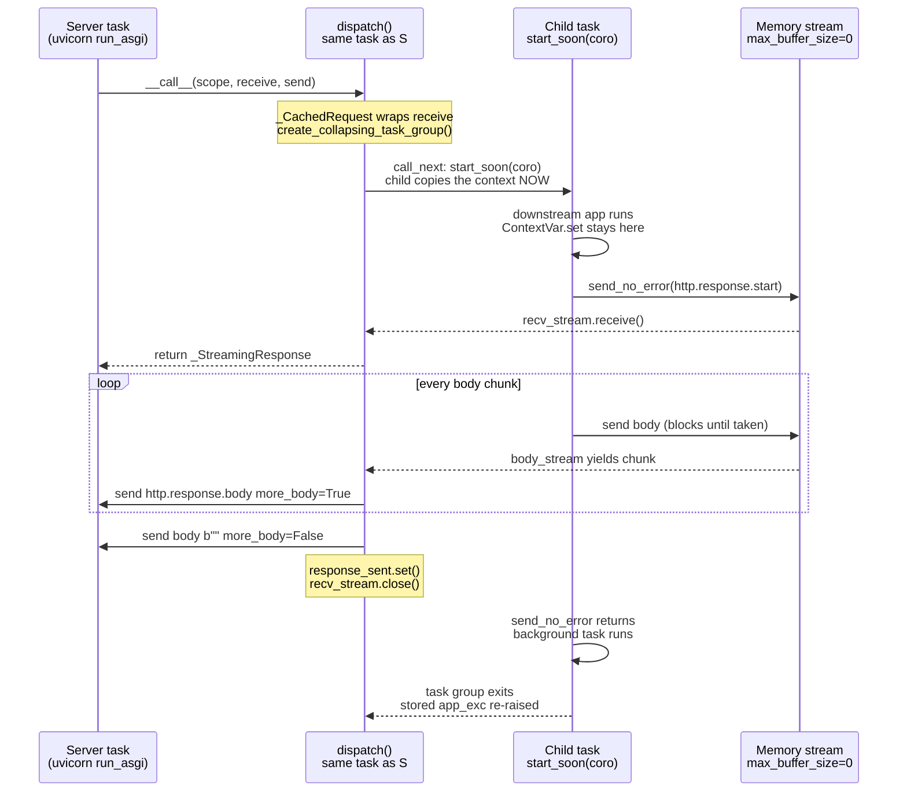

# The BaseHTTPMiddleware Trap: Task Spawning Overhead, Memory Buffering, ExceptionGroup Wrapping, and ContextVar Isolation

> [!summary] Claim
> `BaseHTTPMiddleware` runs everything downstream of `call_next` in a child task that talks to your `dispatch` through a zero-buffer AnyIO memory stream, so every layer costs one task and eight event-loop iterations per request (measured), a `ContextVar` set by the endpoint never reaches `dispatch` or any middleware outside it, a mid-stream exception is delivered to the client as a clean end of body, and HTTP trailers are silently dropped; pure ASGI middleware has none of these costs because it is one `await` in the caller's task.

Part of [ASGI and Starlette Internals](README.md) in [API Engineering](../README.md).

## TL;DR

- Mechanism: `BaseHTTPMiddleware.__call__` opens a task group, `call_next` does `task_group.start_soon(coro)` to run the downstream app in a new task, and each downstream `send` is forwarded through `anyio.create_memory_object_stream()` (default `max_buffer_size=0`, a rendezvous) to a `_StreamingResponse` that `dispatch` returns (starlette 1.10.0 starlette/middleware/base.py, BaseHTTPMiddleware.__call__).
- Contract rule: a new asyncio task runs in a copy of the creating context (PEP 567; Python 3.14 `asyncio.create_task`), so values flow down into the endpoint but `ContextVar.set` in the endpoint is invisible to `dispatch` and to every pure ASGI middleware outside the `BaseHTTPMiddleware`; `request.state` (the shared `scope["state"]` dict) and mutable objects do cross.
- Trap: one passthrough layer adds 1 task and 8 loop iterations per request, five layers add 5 tasks and 36 iterations, pure ASGI adds 0 and 0 (lab, CPython 3.14.6); draining `response.body_iterator` in `dispatch` buffers the whole body before the first byte; an exception after the first chunk is sent as `more_body: False`, which the server turns into a well-formed end of message.
- Portability: the behavior is identical on CPython 3.12.13, 3.13.18, 3.14.6, and 3.15.2 (lab); the memory history is version-specific: starlette 0.14.2 used an unbounded `asyncio.Queue` (issue #1012), 0.15.0 moved to AnyIO streams, and 1.7.0 moved background tasks after the final body (PR #3476).
- When not to use it: never for middleware that streams, carries request-scoped `ContextVar` state upward (tracing, auth, audit), uses ASGI extensions (`http.response.trailers`, `http.response.zerocopysend`), or sits on a hot path; FastAPI's `@app.middleware("http")` is the same class (fastapi 0.162.0 fastapi/applications.py, FastAPI.middleware).

## Mental model



The server calls the middleware in its own task, and `dispatch` runs in that same task.
`call_next` spawns the child task, and that is the instant the child's context is copied: anything `dispatch` set before is visible below, anything the child sets later stays in the child.
Every message the downstream app sends goes into the zero-buffer stream, so the child blocks on each chunk until the outer `_StreamingResponse` takes it, which is why the modern implementation holds at most one chunk in flight instead of the whole body.
The outer response terminates with its own `more_body: False` regardless of how the child ended (the only exception is a child that sent `http.response.pathsend`), and only after `response_sent` is set does the child's final `send` return and its background task run.
When the task group exits, an exception the child stored in `app_exc` is raised from `__call__`, after the client already has a complete-looking response.

## How it works

### Construction and the dispatch contract

`BaseHTTPMiddleware.__init__(app, dispatch=None)` stores `self.dispatch_func = self.dispatch if dispatch is None else dispatch` (starlette 1.10.0 starlette/middleware/base.py, BaseHTTPMiddleware.__init__).
The `dispatch` signature is `DispatchFunction = Callable[[Request, RequestResponseEndpoint], Awaitable[Response]]`, so the middleware author works with `Request` and `Response` objects instead of ASGI messages.
That convenience is the whole reason the class exists, and it is also the cause of every cost below: converting the downstream app's message stream back into a `Response` object requires something to run that app concurrently while `dispatch` holds the object.
Non-HTTP scopes are passed straight through: `if scope["type"] != "http": await self.app(scope, receive, send)`, so WebSocket and lifespan traffic is unaffected.
FastAPI's `@app.middleware("http")` decorator calls `self.add_middleware(BaseHTTPMiddleware, dispatch=func)` (fastapi 0.162.0 fastapi/applications.py, FastAPI.middleware), so every FastAPI tutorial middleware is this class.

### Where the task comes from

`__call__` builds `_CachedRequest(scope, receive, send)`, an `anyio.Event` named `response_sent`, and `send_stream, recv_stream = anyio.create_memory_object_stream[Message]()`.
It then enters `create_collapsing_task_group()` and awaits `self.dispatch_func(request, call_next)`.
`call_next` calls `task_group.start_soon(coro)`, where `coro` runs `await self.app(scope, receive_or_disconnect, send_no_error)` inside `with send_stream:` and stores any `Exception` in the closure variable `app_exc` instead of letting it propagate.
`call_next` then loops on `recv_stream.receive()`, forwarding `http.response.early_hint` messages straight to the real `send`, remembering `http.response.debug` info, and stopping at the first other message, which it asserts is `http.response.start`.
It returns `_StreamingResponse(status_code=message["status"], content=body_stream(), info=info)` with `raw_headers = message.get("headers", [])`.
`body_stream()` yields each non-empty `body` from the stream, yields a `http.response.pathsend` message as a dict, stops when `more_body` is false, and asserts that every other message is `http.response.body`.

In AnyIO 4.16.0, `start_soon` reaches `TaskGroup._spawn`, which calls `loop.create_task(wrapper_coro, name=handle.name)` unless the loop uses `asyncio.eager_task_factory`, in which case it takes the task class out of the factory's closure and calls it as `custom_task_constructor(wrapper_coro, loop=loop, name=handle.name)`, without `eager_start`, so AnyIO deliberately does not start the child eagerly (anyio 4.16.0 anyio/_backends/_asyncio.py, TaskGroup._spawn).
Either way it is a real asyncio task, and the lab counts it with a task factory hook: exactly one task per `BaseHTTPMiddleware` layer for an endpoint that never calls `receive`.

### The per-receive watcher task

The downstream app does not get the server's `receive`.
It gets `receive_or_disconnect`, which returns `{"type": "http.disconnect"}` if `response_sent` is set, and otherwise opens a fresh `anyio.create_task_group()`, starts `response_sent.wait` as a second task, awaits `wrapped_receive`, and cancels the group when either finishes.
So every `receive()` call below a `BaseHTTPMiddleware` spawns one more task: the lab's body-echo endpoint calls `receive` once and the request creates 2 tasks in total, against 0 for the pure ASGI stack.
`wrapped_receive` is `_CachedRequest.wrapped_receive`, a three-state machine: if `dispatch` already called `request.body()` it replays the cached `_body` as a single `http.request` message (PR #1692, starlette 0.28.0), if `dispatch` consumed `request.stream()` it sends an empty body so the endpoint does not hang, and otherwise it pulls the next chunk through `self.stream()`.
Request-body caching and stream starvation are covered in [[Starlette-Request-Internals-Stream-Consumption-and-Body-Caching]]; the point here is that reading the body in `dispatch` holds the whole body in memory before the endpoint runs (lab: `dispatch-read:1000`, then the endpoint echoes the same 1000 bytes).

Starlette's own `StreamingResponse` adds a third source of tasks: when `scope["asgi"]["spec_version"]` is below `2.4` it runs `stream_response` in a child task and `listen_for_disconnect(receive)` in the current one (starlette 1.10.0 starlette/responses.py, StreamingResponse.__call__).
Uvicorn 0.54.0 advertises `"spec_version": "2.3"` in every HTTP protocol implementation (uvicorn 0.54.0 uvicorn/protocols/http/h11_impl.py and httptools_impl.py).
Hypercorn 0.18.0 advertises `"2.1"` for HTTP (hypercorn 0.18.0 hypercorn/protocol/http_stream.py).
Granian 2.8.7 sets `"spec_version": "2.3"` in the scope it builds for HTTP (granian 2.8.7 src/asgi/utils.rs, build_scope_common).
So on all three servers a streaming endpoint takes the task-group path.
Each `listen_for_disconnect` call to `receive` then goes through `receive_or_disconnect`, which is why the lab's 5-chunk stream creates 1 task bare and 4 tasks behind one `BaseHTTPMiddleware`.
The ASGI spec says that from `2.4` a `send` on a closed connection should raise a server-specific `OSError` subclass, which is what lets frameworks stop polling `receive` for disconnects (ASGI HTTP spec, Spec Versions and Disconnected Client - send exception).

### Why the stream is a rendezvous, and when it used to be a balloon

`anyio.create_memory_object_stream` is a class whose `__new__(cls, max_buffer_size: float = 0, item_type: object = None)` defaults to a zero buffer (anyio 4.16.0 anyio/_core/_streams.py, create_memory_object_stream).
`MemoryObjectSendStream.send` first awaits a checkpoint, then `send_nowait` hands the item to a waiting receiver or, with no receiver and a full buffer, raises `WouldBlock` so `send` parks until a receiver arrives (anyio 4.16.0 anyio/streams/memory.py, MemoryObjectSendStream.send).
With a buffer of zero, the producer can never be more than one hand-off ahead of the consumer.
The lab drives a 5-chunk generator that never awaits through a slow client and measures the largest produced-but-undelivered count: 1 with no middleware and 2 behind `BaseHTTPMiddleware`, so the extra memory is one chunk, not the body.

That was not always true.
Starlette 0.14.2 implemented `call_next` with `queue: "asyncio.Queue[typing.Optional[Message]]" = asyncio.Queue()` and `send = queue.put`, an unbounded queue (starlette 0.14.2 starlette/middleware/base.py, BaseHTTPMiddleware.call_next).
Issue #1012 (opened 2020-07-27) reported exactly the failure: "if the client that is receiving the streaming response is on a slow connection, the queue will happily grow without bound and consume all memory, triggering kernel out-of-memory".
The release notes record a `Queue(maxsize=1)` fix in 0.13.7 that was reverted in 0.13.8, and the final fix in 0.15.0 via the AnyIO integration (PR #1157), whose `base.py` calls `anyio.create_memory_object_stream()` with the zero default (starlette 0.15.0 starlette/middleware/base.py).
The lab's `LegacyQueueMiddleware` replicates the 0.14.2 queue and shows the producer finishing all 5 chunks before the first delivery (lead 5 of 5).

### The buffering you add yourself

The modern balloon is user code.
Logging or rewriting the response body in `dispatch` means draining `body_iterator`, which pulls every chunk through the stream into a list before the first byte reaches the client.
The lab's `BodyInspectingMiddleware` turns 5 streamed chunks into one `http.response.body` of `01234`, emitted only after `produce:4`, so time to first byte becomes time to last byte and peak memory becomes the body size.
`Response.init_headers` adds a fresh `content-length` for the joined body only when the copied headers lack one (starlette 1.10.0 starlette/responses.py, Response.init_headers), so if the inner response had a `content-length` and `dispatch` changes the body, the copied header no longer matches (RFC 9110 Section 8.6).
The pure ASGI alternative wraps `send` and observes each chunk as it passes: same byte count, lead 1, no buffering ([[Pure-ASGI-Middleware-Onion-Architecture-and-Send-Receive-Wrapping]]).

### ContextVar isolation, precisely

PEP 567 specifies that `asyncio.Task.__init__` does `self._context = contextvars.copy_context()` and runs every step with `self._loop.call_soon(self._step, context=self._context)`.
Python 3.14's `asyncio.create_task(coro, *, name=None, context=None, eager_start=None, **kwargs)` documents that "The current context copy is created when no context is provided."
A copy is a snapshot: the child sees every variable set before the copy, and its own `set` calls mutate only its copy.
Three consequences follow, all proven in the lab:

1. Downward works: `dispatch` sets `REQUEST_USER` to `from-dispatch` before `call_next`, and the endpoint reports `from-dispatch`.
2. Upward fails: the endpoint sets `REQUEST_USER` to `alice`, and `dispatch` still reads `from-dispatch` after `call_next` returns.
3. It poisons the stack: a pure ASGI middleware placed outside a `BaseHTTPMiddleware` reads `unset`, while one placed inside it (in the child task with the endpoint) reads `alice`.

Starlette's documentation states the same limitation: "Using `BaseHTTPMiddleware` will prevent changes to `contextvars.ContextVar`s from propagating upwards", and "if a `BaseHTTPMiddleware` is positioned earlier in the middleware stack, it will disrupt `contextvars` propagation for any subsequent Pure ASGI Middleware that relies on them" (starlette 1.10.0 docs/middleware.md, Limitations).
What does cross the task boundary is shared mutable state: the lab's `dispatch` puts a `dict` into a `ContextVar` before `call_next`, the endpoint mutates it, and `dispatch` reads `bag=alice`; `request.state` works the same way because `Request.state` wraps `scope.setdefault("state", {})` and both tasks hold the same `scope` dict (starlette 1.10.0 starlette/requests.py, HTTPConnection.state).
Note also that `dispatch` runs in the server's task, so a `ContextVar.set` in `dispatch` without a matching `reset(token)` leaks into whatever else that task runs; a server that runs one task per request (Uvicorn's `run_asgi`) contains it, but an in-process test that sends several requests from one task does not.
Generic request-scoped state design (where to store identity, trace IDs, and DB sessions) is in [[ASGI-State-Isolation-and-ContextVars-Across-Request-Lifecycle]].

### ExceptionGroup wrapping and collapsing

An AnyIO task group that sees a child exception raises `BaseExceptionGroup("unhandled errors in a TaskGroup", self._exceptions)` (anyio 4.16.0 anyio/_backends/_asyncio.py, TaskGroup.__aexit__).
Starlette wraps its group in `create_collapsing_task_group()`, which catches `BaseExceptionGroup`, re-raises it unchanged if it holds more than one exception, and otherwise raises the single inner exception `from exc.__cause__ or context` (starlette 1.10.0 starlette/_utils.py, create_collapsing_task_group).
Only the outer group level is unwrapped, so an `ExceptionGroup` that user code raises survives intact; the release notes record this as "Avoid collapsing exception groups raised from user code" (PR #2830, starlette 1.3.0).
The lab proves all three paths: an endpoint `ValueError` escapes `BaseHTTPMiddleware` as a bare `ValueError`, the same error under a plain `anyio.create_task_group()` escapes as `ExceptionGroup('unhandled errors in a TaskGroup', [ValueError(...)])`, and a user-raised `ExceptionGroup("mine", [KeyError])` from `dispatch` surfaces as itself.
The child's exception is not raised from the task group at all in the common case: `coro` stores it in `app_exc`, the closed stream raises `anyio.EndOfStream` inside `call_next`, and `call_next` does `raise app_exc from app_exc.__cause__ or app_exc.__context__`, so `try: await call_next(request)` in `dispatch` catches the original type (lab: `CatchingMiddleware` returns `500` with `caught ValueError`).
Historically this was not clean: PR #1262 (starlette 0.17.0) was titled "Prevent anyio.ExceptionGroup in error views under a BaseHTTPMiddleware", and PR #1459 (0.19.0) fixed `BaseHTTPMiddleware` "hiding errors of `StreamingResponse` and mounted applications".
How `ServerErrorMiddleware` and `ExceptionMiddleware` sit around user middleware is in [[Starlette-Exception-Hierarchy-ServerErrorMiddleware-vs-ExceptionMiddleware]].

### The mid-stream exception becomes a clean end of body

If the endpoint raises after the response has started, `call_next` has already returned and `dispatch` is no longer in a `try` block that can see it.
The child stores the exception and exits `with send_stream:`, `body_stream` ends because the receive stream is exhausted, and `_StreamingResponse.__call__` sends its own `{"type": "http.response.body", "body": b"", "more_body": False}`, which it skips only when the body iterator yielded a `http.response.pathsend` message (`should_close_body`).
Only after the task group exits does `__call__` execute `if app_exc is not None and not exception_already_raised: raise app_exc`.
The lab shows the server receiving `deliver:0`, `deliver:1`, `deliver:final`, then the `ValueError`; through a pure ASGI middleware the server receives `deliver:0`, `deliver:1` and the exception, with no final body.
Uvicorn 0.54.0 `RequestResponseCycle.run_asgi` logs `Exception in ASGI application` and calls `self.transport.close()` when the response started (uvicorn 0.54.0 uvicorn/protocols/http/h11_impl.py, RequestResponseCycle.run_asgi), so on the pure path the client sees a chunked body without its terminating zero-size chunk, which RFC 9112 Section 8 says the client "MUST record ... as incomplete".
On the `BaseHTTPMiddleware` path the server has already been told the body is complete and writes the last chunk (RFC 9112 Section 7.1), so the client records a truncated response as complete.

### ASGI extensions that do not survive

`_StreamingResponse.__call__` builds `http.response.start` from only `status` and `raw_headers`, so a downstream `"trailers": True` flag is dropped.
The ASGI HTTP Trailers extension requires the framework to set `trailers` to `True` in Response Start and to send `http.response.trailers` after the last body message (asgiref docs/extensions.rst, HTTP Trailers).
Behind `BaseHTTPMiddleware` the trailers message arrives after `body_stream` stopped at `more_body: False`; by then `recv_stream` is closed, `send_stream.send` raises `anyio.BrokenResourceError`, and `send_no_error` swallows it, so the trailers vanish with no error (lab: the server sees start without `trailers`, then two body messages, and never `http.response.trailers`).
`http.response.zerocopysend` fails loudly instead: `body_stream` asserts `message["type"] == "http.response.body"` and raises `AssertionError: Unexpected message: {'type': 'http.response.zerocopysend', ...}` (lab).
`http.response.pathsend` is explicitly supported, and `http.response.early_hint` and `http.response.debug` are forwarded.
Because the check is an `assert`, running under `python -O` removes it and `body_stream` treats the unknown message as an empty final body: the lab's `zerocopy_app` behind `BaseHTTPPassthrough` under `uv run --frozen python -O` sends `http.response.start` and one empty body with `more_body: False`, and the file is never sent (verified 2026-11-14, CPython 3.14.6).

### Background tasks and disconnects

`send_no_error` waits on `response_sent` after forwarding the final `http.response.body` or a `http.response.pathsend`, so the child's `Response.__call__` cannot reach `await self.background()` until the outer response is fully sent (PR #3476, starlette 1.7.0); before that fix the background task could start while the outer response was still streaming.
The lab records `deliver:ok`, `deliver:final`, `background` in that order.
The outer `__call__` still does not return until the child task, including its background task, completes, because the task group waits for it; issue #919 (2020-04-28) described the older symptom, where requests behind a `BaseHTTPMiddleware` were not processed until a 10-second background task had finished.
Once `response_sent` is set, `receive_or_disconnect` returns `http.disconnect` without consulting the server, which is how a downstream `listen_for_disconnect` loop ends after the outer response completes (PR #1715, starlette 0.21.0, replaced task cancellation with `http.disconnect` plus `recv_stream.close`).

### What the loop iterations are

A passthrough request through one layer needs 8 event-loop iterations (lab, measured with a selector that counts `select()` calls, one per `BaseEventLoop._run_once`).
Only the totals are measured: the note does not split the 8 iterations by step.
The source shows where a suspension can occur: the AnyIO checkpoint at the start of every memory-stream `send` (anyio 4.16.0 anyio/streams/memory.py, MemoryObjectSendStream.send), the child task's first scheduling, each hand-off to a waiting receiver, the `response_sent` event, and the task group waiting for the child to finish.
On a real selector each iteration is one poll syscall: on the lab machine under load (load average about 76) a `kqueue` `select(0)` averaged 81.6 microseconds over 20000 calls, and on the default selector loop one `BaseHTTPMiddleware` layer measured 820 microseconds wall time per request against 5.9 for one pure layer (`time.perf_counter`, 2000 requests after 200 warm-up), a figure dominated by those polls and not representative of an idle server.
The bare endpoint and any depth of pure ASGI middleware need 0 iterations, because nothing between the server's `await app(...)` and the endpoint's `send` ever suspends.

## Numbers and limits

Lab machine for every measured row: Apple M3 Pro, macOS 27.3 (arm64), CPython 3.14.6, starlette 1.10.0, anyio 4.16.0; command `uv run --frozen python -c "...benchmark_report()"` from `labs/`, re-run 2026-11-14; the machine had a load average of about 76 to 89 during timing runs, so only the counts are exact.

| Quantity | Value | Source |
| --- | --- | --- |
| Tasks per request, pure ASGI x5 | 0 | lab `test_pure_layers_spawn_no_tasks` |
| Tasks per request, `BaseHTTPMiddleware` x1 / x3 / x5 | 1 / 3 / 5 | lab `test_each_basehttp_layer_spawns_one_task_per_request`, `benchmark_report` |
| Extra tasks per downstream `receive()` call | 1 | lab: echo endpoint 2 tasks vs 0 |
| Tasks for a 5-chunk `StreamingResponse`, bare / behind one layer | 1 / 4 | `count_tasks_created` over `drive(streaming_app(5, ...))`, one-off script, spec_version absent (2.0) |
| Event-loop iterations per request, bare / pure x5 | 0 / 0 | lab `test_basehttp_adds_event_loop_iterations_pure_adds_none` |
| Event-loop iterations per request, `BaseHTTPMiddleware` x1 / x5 | 8 / 36 | same test |
| CPU time per request on a poll-free loop, bare / pure x1 / pure x5 | 3.57 / 4.57 / 4.66 us | `benchmark_report`, best of 3 x 20000, `time.process_time` |
| CPU time per request on a poll-free loop, `BaseHTTPMiddleware` x1 / x5 | 83.52 / 413.05 us | same run |
| `kqueue` `select(0)` cost on the loaded lab machine | 81.6 us mean over 20000 calls | `selectors.KqueueSelector().select(0)` timed with `time.perf_counter`, load average about 76 |
| Memory stream buffer in `call_next` | 0 items (`max_buffer_size=0` default) | anyio 4.16.0 anyio/_core/_streams.py |
| Max chunks produced but undelivered, bare / `BaseHTTPMiddleware` | 1 / 2 | lab `test_basehttp_passthrough_streams_with_a_rendezvous_not_a_buffer` |
| Same, starlette 0.14.2 queue replica / draining `body_iterator` | 5 of 5 / 5 of 5 | lab legacy and inspect tests |
| ASGI `spec_version` advertised for HTTP | Uvicorn 0.54.0 `2.3`, Hypercorn 0.18.0 `2.1`, httpx 0.28.1 `ASGITransport` none (so `2.0`) | installed sources |
| Body limit if `Starlette(max_body_size=...)` is set | `413 Content Too Large` before user middleware | starlette 1.10.0 starlette/middleware/body_limit.py; RFC 9110 Section 15.5.14; added in 1.6.0 |

The CPU numbers move between runs on this loaded machine (the drafter's run measured bare at 4.16 us and five layers at 287.36 us; this run measured 3.57 us and 413.05 us), so treat microsecond differences between bare and pure as noise and the roughly 20x gap per `BaseHTTPMiddleware` layer as the signal.

## Portability

| Dimension | Behavior | Evidence |
| --- | --- | --- |
| CPython 3.12.13 | all 24 lab tests pass, identical counts | drafter's run, `uv run --frozen --python 3.12`; not re-executed by the fact-check |
| CPython 3.13.18 | all 24 pass | drafter's run, `uv run --frozen --python 3.13`; not re-executed |
| CPython 3.14.6 (workspace) | all 24 pass in 0.40s | re-run 2026-11-14, workspace `.venv`, macOS 27.3 arm64 |
| CPython 3.15.2 | all 24 pass | drafter's run, `uv run --frozen --python 3.15.2`; not re-executed |
| CPython 3.15t free-threaded | not run: only 3.15.0b3t is installed and `psycopg-binary`, `aioquic`, and `pylsqpack` would not install | recorded in `report.md` |
| Pinned matrix point releases 3.12.16 and 3.14.10 | not run; nearest available releases used above | recorded in `report.md` |
| starlette 0.14.2 | unbounded `asyncio.Queue`, raw `loop.create_task`, no collapsing | starlette 0.14.2 starlette/middleware/base.py |
| starlette 0.15.0 | AnyIO memory stream and task group | starlette 0.15.0 starlette/middleware/base.py |
| starlette 1.3.0+ | user-raised exception groups no longer collapsed | release notes, PR #2830 |
| starlette 1.7.0+ | background tasks run after the final body; requires `anyio>=4.0.0,<5` | release notes, PR #3476 and PR #3512 |
| FastAPI 0.162.0 | `@app.middleware("http")` is `BaseHTTPMiddleware` | fastapi/applications.py, FastAPI.middleware |
| Uvicorn 0.54.0 | `spec_version` `2.3`, so `StreamingResponse` adds its disconnect-listener task group | uvicorn/protocols/http/h11_impl.py |
| Hypercorn 0.18.0 | `spec_version` `2.1` for HTTP, same task-group path | hypercorn/protocol/http_stream.py |
| Granian 2.8.7 | `spec_version` `2.3` for HTTP, same task-group path | granian 2.8.7 src/asgi/utils.rs, build_scope_common (Rust source at tag `v2.8.7`) |
| Debian Trixie and Alpine (musl) containers | not run: the container legs were skipped under the 2026-11-11 pause on lab checks | no evidence; the behavior is pure Python and asyncio, so no libc-specific path is expected, but that is an inference |
| HTTP/1.1, HTTP/2, HTTP/3 | same ASGI-level behavior: `base.py` never reads `http_version`; trailer loss matters most where trailers are used on HTTP/2 (for example by gRPC) | starlette 1.10.0 starlette/middleware/base.py |

## Worked example

The implementation is [implementation](../labs/src/api_labs/f10_asgi_and_starlette_internals/basehttp_middleware_trap.py) and the test is [test](../labs/tests/f10_asgi_and_starlette_internals/test_why_basehttpmiddleware_hurts_performance_streaming_and_contextvars.py).
The module drives raw ASGI callables with its own minimal server (`drive`) so it can see each message, counts tasks with a loop task factory, and counts loop iterations with `PollCountingSelector`.
`httpx.ASGITransport` 0.28.1 cannot show streaming timing because it collects `body_parts` and returns only after the app finishes, so it is used only for the ContextVar and exception-to-response tests.

The two context probes, byte-identical to the lab:

```python
class BaseHTTPContextProbe(BaseHTTPMiddleware):
    """Record what the dispatch task sees after call_next returns."""

    def __init__(self, app: ASGIApp, seen: list[str]) -> None:
        super().__init__(app)
        self.seen = seen

    async def dispatch(self, request: Request, call_next: RequestResponseEndpoint) -> Response:
        REQUEST_USER.set("from-dispatch")
        bag: dict[str, str] = {}
        token = REQUEST_BAG.set(bag)
        try:
            response = await call_next(request)
        finally:
            REQUEST_BAG.reset(token)
        self.seen.append(f"var={REQUEST_USER.get()}")
        self.seen.append(f"bag={bag.get('user', 'unset')}")
        self.seen.append(f"state={getattr(request.state, 'user', 'unset')}")
        return response


class PureContextProbe:
    """Record REQUEST_USER after the downstream app returns, in the same task."""

    def __init__(self, app: ASGIApp, seen: list[str]) -> None:
        self.app = app
        self.seen = seen

    async def __call__(self, scope: Scope, receive: Receive, send: Send) -> None:
        await self.app(scope, receive, send)
        if scope["type"] == "http":
            self.seen.append(f"var={REQUEST_USER.get()}")
```

The endpoint they wrap, byte-identical:

```python
async def set_user_app(scope: Scope, receive: Receive, send: Send) -> None:
    """Report the inbound REQUEST_USER, then set it and fill the bag and request.state."""
    inbound = REQUEST_USER.get()
    REQUEST_USER.set("alice")
    bag = REQUEST_BAG.get()
    if bag is not None:
        bag["user"] = "alice"
    Request(scope).state.user = "alice"
    await PlainTextResponse(inbound)(scope, receive, send)
```

Two of the tests, byte-identical:

```python
@pytest.mark.unit
@pytest.mark.asyncio
async def test_contextvar_set_in_endpoint_does_not_reach_basehttp_dispatch() -> None:
    seen: list[str] = []
    async with client_for(BaseHTTPContextProbe(set_user_app, seen)) as client:
        response = await client.get("/")
    assert response.text == "from-dispatch"  # downward: the child task copied the context
    assert seen == ["var=from-dispatch", "bag=alice", "state=alice"]  # upward: lost
```

```python
@pytest.mark.unit
def test_basehttp_adds_event_loop_iterations_pure_adds_none() -> None:
    assert loop_iterations(ok_app) == 0
    assert loop_iterations(stack(ok_app, PurePassthrough, 5)) == 0
    assert loop_iterations(stack(ok_app, BaseHTTPPassthrough, 1)) == 8
    assert loop_iterations(stack(ok_app, BaseHTTPPassthrough, 5)) == 36
```

The mid-stream test, byte-identical, is the one to show a reviewer who thinks `try/except` around `call_next` is error handling:

```python
@pytest.mark.unit
@pytest.mark.asyncio
async def test_mid_stream_error_is_sent_as_a_clean_end_of_body() -> None:
    via_base: list[str] = []
    with pytest.raises(ValueError, match="boom mid-stream"):
        await drive(BaseHTTPPassthrough(failing_app(after_chunks=2)), log=via_base)
    via_pure: list[str] = []
    with pytest.raises(ValueError, match="boom mid-stream"):
        await drive(PurePassthrough(failing_app(after_chunks=2)), log=via_pure)
    assert via_base == ["deliver:0", "deliver:1", "deliver:final"]  # looks complete
    assert via_pure == ["deliver:0", "deliver:1"]  # server sees no final body: abort
```

Captured output, run from `labs/` on CPython 3.14.6, macOS 27.3 arm64:

```text
$ uv run --frozen python -VV
Python 3.14.6 (main, Jun 23 2026, 15:46:31) [Clang 22.1.3 ]
$ uv run --frozen pytest tests/f10_asgi_and_starlette_internals/test_why_basehttpmiddleware_hurts_performance_streaming_and_contextvars.py -q
........................                                                 [100%]
24 passed in 0.40s
```

The benchmark, run once on the same machine under load average about 89:

```text
$ uv run --frozen python -c "
import platform, sys
from api_labs.f10_asgi_and_starlette_internals.basehttp_middleware_trap import benchmark_report
print(sys.version.split()[0], platform.platform())
for row in benchmark_report(): print(row)"
3.14.6 macOS-27.3-arm64-arm-64bit-Mach-O
('bare', 0, 0, 3.57)
('pure x1', 0, 0, 4.57)
('basehttp x1', 8, 1, 83.52)
('pure x5', 0, 0, 4.66)
('basehttp x5', 36, 5, 413.05)
```

Columns are stack, loop iterations per request, tasks per request, and best-of-3 CPU microseconds per request on the poll-free loop.

## Pitfalls

> [!warning] Logging the response body in `dispatch`
> Trigger: `body = b"".join([c async for c in response.body_iterator])` to log or hash the response, then returning a new `Response(body, ...)`.
> Symptom: streaming endpoints and SSE stop streaming; time to first byte equals time to last byte; memory per request equals body size; a copied `content-length` can disagree with the rewritten body.
> Fix: a pure ASGI middleware that wraps `send` and observes chunks as they pass ([[Pure-ASGI-Middleware-Onion-Architecture-and-Send-Receive-Wrapping]]); the lab's `PureBodyObserver` sees all 5 bytes with a lead of 1.

> [!warning] Unbounded queue on old Starlette
> Trigger: Starlette before 0.15.0 with any `BaseHTTPMiddleware` and a large streaming response to a slow client.
> Symptom: memory grows with the response size until the kernel OOM killer fires (issue #1012, 2020-07-27: "the queue will happily grow without bound and consume all memory").
> Fix: upgrade; 0.15.0 replaced the queue with a zero-buffer AnyIO stream (PR #1157); the 0.13.7 `Queue(maxsize=1)` attempt was reverted in 0.13.8.

> [!warning] Trace and auth context missing in outer middleware
> Trigger: an endpoint or dependency sets a `ContextVar` (current user, tenant, span), and a logging or tracing middleware outside a `BaseHTTPMiddleware` reads it after the response.
> Symptom: access logs and audit records show the default value; the bug appears only after someone adds an unrelated `@app.middleware("http")`.
> Fix: set the value in the outermost layer and mutate a shared object, write it to `request.state`, or convert every middleware outside the endpoint to pure ASGI (starlette 1.10.0 docs/middleware.md, Limitations).

> [!warning] Truncated stream recorded as complete
> Trigger: a streaming endpoint raises after the first chunk behind a `BaseHTTPMiddleware`.
> Symptom: the client gets a syntactically complete chunked body, so retries, checksums, and caches treat a partial export as finished; the server log shows `Exception in ASGI application` after the response finished.
> Fix: validate the payload before streaming, put an end-of-stream marker in the body format, or remove the `BaseHTTPMiddleware` so the server can abort the connection (RFC 9112 Section 8).

> [!warning] Background work holds the request open
> Trigger: a long `BackgroundTask` behind a `BaseHTTPMiddleware`.
> Symptom: in 2020 requests stalled behind the background task (issue #919); before 1.7.0 the task could start before the final body chunk (PR #3476); today the middleware's `__call__` still does not return until the background task ends.
> Fix: move durable or long work to a task queue ([[BackgroundTasks-vs-Durable-Task-Queues-Celery-and-Dramatiq]]).

> [!warning] Trailers and zero-copy disappear
> Trigger: an app or library sends `http.response.trailers` or `http.response.zerocopysend` below a `BaseHTTPMiddleware`.
> Symptom: trailers silently vanish (lab), or the request dies with `AssertionError: Unexpected message`.
> Fix: keep every layer above such apps pure ASGI and pass unknown message types through untouched.

## Security and robustness

- Resource consumption (OWASP API4:2023 Unrestricted Resource Consumption): `await request.body()` in `dispatch` buffers the full upload before routing, and draining `body_iterator` buffers the full response; set `Starlette(max_body_size=...)` (1.6.0+), which installs `RequestBodyLimitMiddleware` outside user middleware and returns `413 Content Too Large` (RFC 9110 Section 15.5.14).
- Integrity: a truncated response that terminates cleanly defeats the client's only transport-level signal of failure (RFC 9112 Section 8), and dropped trailers remove any trailer-carried checksum or status (RFC 9110 Section 6.5); both are silent, so they need tests, not monitoring.
- Audit and authorization context: an identity stored only in a `ContextVar` set below a `BaseHTTPMiddleware` is invisible to every layer above it, so an audit middleware records the wrong principal; carry identity in `request.state` or set it at the outermost layer ([[Audit-Logging-for-Regulated-APIs-Tamper-Evident-Hash-Chains-and-Who-Did-What]]).
- Leaks across requests: a `ContextVar.set` in `dispatch` without `reset(token)` changes the server task's context; it is contained only because servers run one task per request.
- Failure containment: exceptions from `dispatch` and from the child surface unwrapped (single-exception groups are collapsed), so `except ValueError` works, but code that catches `ExceptionGroup` to handle concurrent failures must not assume Starlette left it wrapped.
- Defense in depth: test middleware stacks with the lab's raw-message driver, not only with `httpx.ASGITransport`, because the transport buffers the body and cannot reveal streaming or termination defects.

## The principal's view

The decision is a platform rule, not a style preference: shared, reusable, or always-on middleware (tracing, logging, auth context, rate limiting, compression, request IDs) must be pure ASGI, and `BaseHTTPMiddleware` is allowed only for app-local, non-streaming, cold-path code where readability wins.
The organizational trade-off is skill: `dispatch(request, call_next)` is something every engineer can write and review, while pure ASGI middleware requires understanding the message protocol, `more_body`, and extension pass-through, so the platform team should own a small library of audited pure middleware rather than asking every team to write their own.
The ecosystem already splits this way: slowapi 0.1.10 ships both `SlowAPIMiddleware(BaseHTTPMiddleware)` and `SlowAPIASGIMiddleware`, and OpenTelemetry's `OpenTelemetryMiddleware` in opentelemetry-instrumentation-asgi 0.66b2 is a plain class with `async def __call__`, so choosing the pure variant is usually a one-line change.
Enforce it mechanically with a lint or import check that flags `BaseHTTPMiddleware` and `@app.middleware("http")` in shared packages, and a test that asserts zero tasks created per request for the platform stack, as the lab does.
Choose something other than in-process middleware when the concern is cross-cutting across languages or services (TLS, authentication at the edge, global rate limits): a gateway or sidecar owns those without touching the event loop ([[Uvicorn-Internals-Server-Lifecycle-Protocols-and-Flow-Control]] shows what the server already does for you).
For per-route concerns, FastAPI dependencies or a route wrapper run in the endpoint's task and avoid the problem entirely.

## Interview questions

> [!question] L5: What does `call_next` actually do in a `BaseHTTPMiddleware`?
>
> > [!success]- Answer
> > It starts the downstream app in a new task in the middleware's task group, with a wrapped `receive` and a `send` that writes into a zero-buffer AnyIO memory stream.
> > It waits for `http.response.start` on that stream and returns a `_StreamingResponse` whose body iterator reads the remaining messages.
> > The `Response` you get is therefore a live pipe to a still-running child task, not a finished response.
> >
> > Follow-up: what happens to an exception the child raises before sending `http.response.start`?

> [!question] L5: Why does a `ContextVar` set in a FastAPI endpoint read as the default in an `@app.middleware("http")` function after `call_next`?
>
> > [!success]- Answer
> > The decorator installs `BaseHTTPMiddleware`, which runs the endpoint in a child task.
> > A new asyncio task runs in a copy of the creator's context (PEP 567), so the endpoint's `set` changes only the child's copy.
> > Use `request.state`, a mutable object set before `call_next`, or a pure ASGI middleware.
> >
> > Follow-up: does a value set in the middleware before `call_next` reach the endpoint?

> [!question] L6: Predict the output: a pure ASGI probe that records `REQUEST_USER` after the inner app returns wraps a `BaseHTTPMiddleware` passthrough, which wraps an endpoint that sets `REQUEST_USER` to `alice`; what does the probe record, and what if you swap the two middleware?
>
> > [!success]- Answer
> > Outside the `BaseHTTPMiddleware`, the probe records `unset`, because it runs in the server's task and the endpoint ran in the child.
> > Inside it, the probe shares the child task with the endpoint and records `alice`.
> > The lab asserts both: `outer == ["var=unset"]` and `inner == ["var=alice"]`.
> >
> > Follow-up: which Starlette documentation sentence describes this, and why does it say "subsequent" middleware?

> [!question] L6: Does `BaseHTTPMiddleware` buffer streaming responses in memory in Starlette 1.10.0?
>
> > [!success]- Answer
> > Not by itself: the memory stream has `max_buffer_size=0`, so the producer blocks on each chunk until the outer response takes it, and the lab measures a maximum lead of 2 chunks against 1 with no middleware.
> > It did buffer before 0.15.0, when an unbounded `asyncio.Queue` let a fast producer outrun a slow client (issue #1012).
> > Today the buffering usually comes from `dispatch` draining `body_iterator`.
> >
> > Follow-up: how would you prove in CI that a middleware does not buffer?

> [!question] L6: Debug this API: a CSV export endpoint behind a request-timing `BaseHTTPMiddleware` sometimes raises halfway, yet clients report success and save truncated files; the middleware wraps `call_next` in `try/except Exception` and returns a `500`, so why does the `500` never appear?
>
> > [!success]- Answer
> > `call_next` returned as soon as `http.response.start` arrived, so the exception happens later inside the child task, outside the `try`.
> > The child stores it, the outer `_StreamingResponse` sends `more_body: False`, the server writes the terminating chunk, and only then does `__call__` re-raise.
> > The client sees a well-formed chunked body (for chunked coding, RFC 9112 Section 8 defines incomplete as a missing terminating zero-size chunk); fix by removing the `BaseHTTPMiddleware` so the server aborts, or adding an end-of-data marker to the format.
> >
> > Follow-up: what does Uvicorn do when an app raises after `http.response.start` with a pure middleware?

> [!question] L6: Why do you get a bare `ValueError` from a `BaseHTTPMiddleware` stack but an `ExceptionGroup` from your own middleware that runs the app in an AnyIO task group?
>
> > [!success]- Answer
> > AnyIO task groups raise `BaseExceptionGroup` for child failures.
> > Starlette's `create_collapsing_task_group` unwraps a group holding exactly one exception and re-raises it with its cause or context, and `call_next` re-raises the stored child exception directly.
> > A plain `anyio.create_task_group()` has no such unwrapping, so callers must use `except*`.
> >
> > Follow-up: what happens to an `ExceptionGroup` that your own `dispatch` raises?

> [!question] L7+: Your platform ships five `BaseHTTPMiddleware` layers to 300 services; how do you quantify the cost and justify a migration?
>
> > [!success]- Answer
> > Measure the deterministic costs first: tasks and loop iterations per request, which the lab shows as 5 and 36 for five layers against 0 and 0 for pure ASGI.
> > Then measure CPU per request on a poll-free loop (about 413 us versus 5 us on the loaded lab machine, a figure that moved by tens of percent between runs) and confirm with p99 latency under production-like concurrency, since each iteration also costs a poll syscall.
> > The non-performance case is stronger: lost `ContextVar` propagation for tracing and audit, clean-looking truncated streams, and dropped trailers are correctness defects.
> >
> > Follow-up: how do you roll out pure replacements without changing the observable middleware order?

> [!question] L7+: When is `BaseHTTPMiddleware` the right choice, and what guardrails would you put around it?
>
> > [!success]- Answer
> > For app-local, cold-path, non-streaming concerns where a junior team must read and own the code, its `Request`/`Response` API is worth one task per request.
> > Guardrails: no `ContextVar` reads after `call_next`, no body draining, no use above streaming or extension-using apps, and a test that runs the stack with a raw ASGI driver.
> > Anything shared across services, always-on, or on the hot path goes in an audited pure ASGI library.
> >
> > Follow-up: which FastAPI feature avoids middleware altogether for per-route concerns?

> [!question] L7+: A team says Python 3.12's eager task factory fixes the ContextVar problem because the child runs immediately; are they right?
>
> > [!success]- Answer
> > No: eager start changes when the first step runs, not which context it runs in; the task still gets a copy of the creator's context.
> > AnyIO 4.16.0 detects `asyncio.eager_task_factory` in `TaskGroup._spawn` and still constructs a separate task, called without `eager_start`, so it is not even started eagerly.
> > Upward propagation needs the endpoint to run in the caller's task, which only pure ASGI middleware provides.
> >
> > Follow-up: what execution-order differences does eager start introduce for middleware that sets state before `call_next`?

## Related

Prerequisites: [[Pure-ASGI-Middleware-Onion-Architecture-and-Send-Receive-Wrapping]]

Next: [[Starlette-Exception-Hierarchy-ServerErrorMiddleware-vs-ExceptionMiddleware]]

See also: [[02-Programming-Languages/Python/Python-Backend-Interview-Prep/04-FastAPI]], [[02-Programming-Languages/Python/Python-Backend-Interview-Prep/16-Asyncio-Deep-Dive]], [[02-Programming-Languages/Python/Python-Backend-Interview-Prep/17-Concurrency-in-Web-Services-and-Coding]], [[ASGI-State-Isolation-and-ContextVars-Across-Request-Lifecycle]], [[Starlette-Request-Internals-Stream-Consumption-and-Body-Caching]], [[Starlette-Responses-StreamingResponse-FileResponse-and-Background-Execution]], [[ASGI-HTTP-and-Disconnect-Event-Lifecycle]], [[In-Process-Testing-of-ASGI-Apps-with-HTTPX-ASGITransport]], [[AnyIO-Structured-Concurrency-TaskGroups-CancelScopes-and-ExceptionGroups]], [[CPython-Asyncio-Event-Loop-Internals-Selectors-Ready-Queue-and-Timers]], [[Eager-Task-Factory-in-Python-3-12-to-3-15-and-Execution-Order-Shifts]], [[BackgroundTasks-vs-Durable-Task-Queues-Celery-and-Dramatiq]], [[Uvicorn-Internals-Server-Lifecycle-Protocols-and-Flow-Control]], [[Distributed-Tracing-W3C-Trace-Context-and-Baggage-Propagation]], [[Audit-Logging-for-Regulated-APIs-Tamper-Evident-Hash-Chains-and-Who-Did-What]]

- Lab: `labs/tests/f10_asgi_and_starlette_internals/test_why_basehttpmiddleware_hurts_performance_streaming_and_contextvars.py`

## Further reading

- [starlette 1.10.0 starlette/middleware/base.py](https://github.com/Kludex/starlette/blob/1.10.0/starlette/middleware/base.py): the whole mechanism in about 250 lines; read `call_next`, `send_no_error`, and `_StreamingResponse`.
- [starlette 1.10.0 docs/middleware.md](https://github.com/Kludex/starlette/blob/1.10.0/docs/middleware.md): the maintainers' statement of the ContextVar limitation and the pure ASGI recommendation.
- [starlette 1.10.0 release notes](https://github.com/Kludex/starlette/blob/1.10.0/docs/release-notes.md): the version-by-version history of `BaseHTTPMiddleware` fixes cited above.
- [Starlette issue #1012](https://github.com/Kludex/starlette/issues/1012): the unbounded-queue memory report that motivated the AnyIO rewrite.
- [Starlette PR #3476](https://github.com/Kludex/starlette/pull/3476): why background tasks now wait for the final body.
- [PEP 567](https://peps.python.org/pep-0567/): the specification of context copying at task creation.
- [Python 3.14 asyncio.create_task](https://docs.python.org/3.14/library/asyncio-task.html): the documented `context` parameter and default copy.
- [ASGI HTTP and WebSocket spec](https://github.com/django/asgiref/blob/main/specs/www.rst): `spec_version` history and the `2.4` send-on-closed-connection rule.
- [ASGI extensions](https://github.com/django/asgiref/blob/main/docs/extensions.rst): the trailers, zero-copy, and path-send messages that a re-framing middleware must preserve.
- [RFC 9112 Section 8](https://www.rfc-editor.org/rfc/rfc9112.html#section-8): when a client must treat a response as incomplete, which is what the mid-stream defect defeats.
