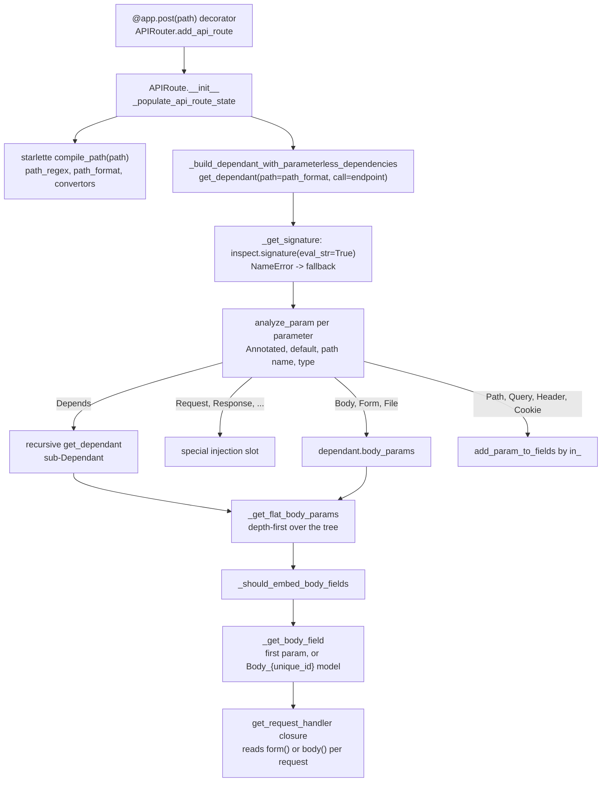

# How APIRoute Compiles a Function Signature: get_dependant(), Parameter Classification, and Body Field Merging

> [!summary] Claim
> At registration time FastAPI turns every endpoint signature into a `Dependant` tree of per-location `ModelField` lists plus one merged request-body field, and every later behavior (where a value is read from, what the JSON body must look like, what OpenAPI says) is decided by that compile step, not by the request.

Part of [FastAPI Internals and Patterns](README.md) in [API Engineering](../README.md).

## TL;DR

- Mechanism: `APIRoute.__init__` calls `get_dependant(path=route.path_format, call=endpoint)`, which runs `inspect.signature(call, eval_str=True)` and sends each parameter through `analyze_param()` into one of six buckets (`path_params`, `query_params`, `header_params`, `cookie_params`, `body_params`, `dependencies`) or into a special-injection slot (`Request`, `Response`, `BackgroundTasks`, and others).
- Contract rule: a name in the path template becomes a path param, an unmarked scalar becomes a query param, and an unmarked non-scalar (a model, `dict`, `list[int]`, dataclass) becomes a body param; the body is embedded under parameter-name keys as soon as the flattened tree has more than one distinct body name or any `Body(embed=True)`.
- Trap: the decision is static and silent, so a forward reference FastAPI cannot resolve, a missing `Query()` on a `list`, or a dependency that adds a body param changes the wire contract without an error at startup.
- Portability: the classification code is pure Python and identical on CPython 3.12 to 3.15 (including free-threaded builds) in FastAPI 0.162.0; only the `NameError` fallback in `_get_signature()` differs, using `annotationlib.Format.FORWARDREF` on 3.14+.
- When not to use it: do not call `get_dependant()` yourself in production code; it is an internal function, its signature changed across releases, and the public contract is the OpenAPI document the same compile step produces.

## Mental model



The decorator constructs an `APIRoute`, and its constructor does all the work before the first request ever arrives.
Starlette's `compile_path()` strips convertors from the template, so `/items/{item_id:int}` becomes the format string `/items/{item_id}` that `get_dependant()` actually receives.
`get_dependant()` reads the signature once and lets `analyze_param()` decide, per parameter, whether it is a sub-dependency (recursion), a framework object to inject, or a field with a location.
After the tree is built, `_get_flat_body_params()` collects body parameters from the endpoint and every sub-dependency, `_should_embed_body_fields()` decides whether the wire body is the bare model or an object keyed by parameter names, and `_get_body_field()` builds the single field that both the request handler and OpenAPI consult.
The handler closure created by `get_request_handler()` captures these objects, so per-request code never looks at the signature again (except in the `dependency_overrides` path described below).

## How it works

### 1. When compilation runs

`APIRouter.add_api_route()` instantiates `route_class(...)`, and `APIRoute.__init__` delegates to `_populate_api_route_state()` (fastapi 0.162.0 fastapi/routing.py, _populate_api_route_state).
That function computes `route.path_regex, route.path_format, route.param_convertors = compile_path(path)`, derives `route.unique_id` from `operation_id` or `generate_unique_id(route)`, then calls `_build_dependant_with_parameterless_dependencies(path=route.path_format, call=route.endpoint, dependencies=route.dependencies)` and `_get_body_field(...)`.
Finally `APIRoute.__init__` sets `self.app = request_response(self.get_route_handler())`, which builds the per-route ASGI closure (fastapi 0.162.0 fastapi/routing.py, APIRoute.__init__).
Every assertion inside the classifier therefore fires at import time, inside the decorator, which is why a bad signature fails `uvicorn app:app` before it binds a socket.

Included routers changed in FastAPI 0.137.0.
The release notes state that before it, `router.include_router(other_router)` would take each path operation from `other_router` and "clone" it, or recreate it from scratch, and that 0.137.0 instead preserves the original `APIRouter` and `APIRoute` objects (fastapi 0.162.0 docs/en/docs/release-notes.md, 0.137.0).
In 0.162.0, `include_router()` appends an `_IncludedRouter(original_router=router, include_context=include_context)` (fastapi 0.162.0 fastapi/routing.py, APIRouter.include_router).
The effective, prefixed version of each route is an `_EffectiveRouteContext` built by `from_api_route()`, which calls `_populate_api_route_state()` again with `include_context.path_for(original_route)`, the concatenated dependency list `[*include_context.dependencies, *route.dependencies]`, and merged tags and responses (fastapi 0.162.0 fastapi/routing.py, _EffectiveRouteContext.from_api_route).
Those contexts are built lazily in `_IncludedRouter.effective_candidates()`, double-checked under a `threading.Lock`, and cached against `original_router._get_routes_version()` (fastapi 0.162.0 fastapi/routing.py, _IncludedRouter.effective_candidates).
Three consequences follow from the source:

- A route on an `APIRouter` is compiled once when it is declared and once more per inclusion context.
- The inclusion compile can produce a different `Dependant`, with prefix path params, router-level dependencies, and a different embed decision.
- Errors that depend on the prefix surface on the first match or the first OpenAPI generation, not at `include_router()` time.

### 2. From path template to path parameter names

Starlette's `PARAM_REGEX` is `{([a-zA-Z_][a-zA-Z0-9_]*)(:[a-zA-Z_][a-zA-Z0-9_]*)?}`, and `compile_path()` emits `path_format += "{%s}" % param_name`, dropping the `:int` convertor suffix and raising `ValueError` on duplicate names (starlette 1.10.0 starlette/routing.py, compile_path).
FastAPI then extracts names with `set(re.findall("{(.*?)}", path))` (fastapi 0.162.0 fastapi/utils.py, get_path_param_names).
That regex is not convertor-aware, so calling `get_dependant(path="/items/{item_id:int}", ...)` directly yields the name `item_id:int`, and `item_id` is classified as a query parameter.
`APIRoute` never hits this because it passes `route.path_format`; the lab proves both halves in `test_get_dependant_needs_path_format_not_the_convertor_template`.
The same `path` string is passed unchanged into every recursive `get_dependant()` call, so a sub-dependency parameter named like a path segment is also a path parameter (fastapi 0.162.0 fastapi/dependencies/utils.py, get_dependant).

### 3. Reading the signature and resolving annotations

`_get_signature()` calls `inspect.signature(call, eval_str=True)`; on `NameError` it falls back to `inspect.signature(call, annotation_format=Format.FORWARDREF)` on Python 3.14+ and to plain `inspect.signature(call)` before 3.14 (fastapi 0.162.0 fastapi/dependencies/utils.py, _get_signature).
The source comment names the purpose: annotations under `if TYPE_CHECKING`, typically dependency return types that FastAPI does not use.
`eval_str` was added to `inspect.signature` in 3.10 and `annotation_format` in 3.14, per the `inspect` documentation.
`Format.FORWARDREF` exists because PEP 649 (Final, Python 3.14) makes annotations lazily evaluated and defines a format that substitutes `ForwardRef` proxies for undefined names; PEP 749 (Final, 3.14) keeps `from __future__ import annotations` (PEP 563) working as string conversion in 3.14 and plans its deprecation only after 3.13 reaches end of life.

`get_typed_signature()` then rebuilds an `inspect.Signature`, resolving each string annotation with `ForwardRef(annotation)` and `evaluate_forwardref(annotation, globalns, globalns)`, where `globalns` is `inspect.unwrap(call).__globals__` (fastapi 0.162.0 fastapi/dependencies/utils.py, get_typed_signature and get_typed_annotation).
`evaluate_forwardref()` calls pydantic's `try_eval_type` (fastapi 0.162.0 fastapi/_compat/v2.py, evaluate_forwardref), which catches `NameError` and returns the unevaluated `ForwardRef` with a `False` success flag that FastAPI discards (pydantic 2.14.3 pydantic/_internal/_typing_extra.py, try_eval_type).
Only module globals are searched, never the enclosing function's locals.
With string annotations, a model defined inside a factory function stays `ForwardRef('LocalItem')`; `ForwardRef` is not a class, so the complexity check below calls it scalar and the parameter becomes a required query parameter.
The lab reproduces this in `test_unresolvable_forward_ref_silently_becomes_a_query_param`: a JSON body request returns `422` with `loc == ["query", "item"]`.
In a scratch run (not in the lab), the same route given `?item=zzz` raised pydantic `PydanticUserError` (`class-not-fully-defined`) from the field's `TypeAdapter`, which surfaces as a server error rather than a validation error.

### 4. `analyze_param()`: the decision procedure

`analyze_param(param_name, annotation, value, path_param_names)` returns `ParamDetails(type_annotation, depends, field)` (fastapi 0.162.0 fastapi/dependencies/utils.py, analyze_param).
Its steps, in source order:

1. If the annotation is a PEP 695 `TypeAliasType` (`type X = ...`), it is replaced by `annotation.__value__`; PEP 695 defines `__value__` as the lazily evaluated alias value.
2. If the annotation is `Annotated[T, ...]` (PEP 593), `type_annotation = T`, and the metadata is filtered to `FieldInfo` and `params.Depends` instances; of those, only `params.Param`, `params.Body`, and `params.Depends` are "FastAPI-specific", and the last one wins.
   A plain pydantic `Field(...)` alone is not FastAPI-specific, so it does not choose a location; it still contributes constraints, because the inferred `FieldInfo` is rebuilt with `copy_field_info(field_info=..., annotation=use_annotation)`, which merges the `Annotated` metadata (fastapi 0.162.0 fastapi/_compat/v2.py, copy_field_info).
3. A `FieldInfo` from `Annotated` is copied before mutation, must not carry its own default (``"`Query` default value cannot be set in `Annotated` for 'q'. Set the default value with `=` instead."``, with the marker class and parameter name filled in), and takes its default from the `=` value; a path parameter with an `Annotated` marker and an `=` default fails with `"Path parameters cannot have default values"`.
   That assertion lives only in the `Annotated` branch: a bare `item_id: int = 3` on a path name compiles without error, the default is dropped, and the path field stays required (checked on fastapi 0.162.0 in a scratch run).
4. A `Depends` default is accepted only if `Annotated` did not already supply `Depends` or a `FieldInfo`; a `FieldInfo` default (the legacy `q: str = Query(None)` style) is accepted only if `Annotated` did not supply one.
5. `Depends()` with `dependency=None` is replaced by `dataclasses.replace(depends, dependency=type_annotation)`, which is how `Annotated[Foo, Depends()]` calls the class `Foo`.
6. Without `Depends`, a `type_annotation` that is a subclass of `Request`, `WebSocket`, `HTTPConnection`, `Response`, Starlette `BackgroundTasks`, or `SecurityScopes` is a special injection, and any `FieldInfo` on it is an error.
7. Otherwise, with no explicit marker, the location is inferred in this order: name in `path_param_names` -> `params.Path`; `UploadFile` or a sequence of it -> `params.File`; not scalar -> `params.Body`; else `params.Query`.
8. A `Param` with no `in_` gets `ParamTypes.query`; an explicit non-`Path` marker on a path name fails with ``"Cannot use `Query` for path param"``.
9. The alias is `field_info.alias`, or `param_name.replace("_", "-")` when the marker has `convert_underscores=True` (the `Header` default), else the parameter name.
10. `create_model_field()` wraps the `FieldInfo` in a FastAPI `ModelField`; path fields must be scalar and query fields must be scalar, a scalar sequence, or a `BaseModel` (a query parameter model), else ``"Query parameter ... must be one of the supported types"``.

"Scalar" is defined negatively.
`field_annotation_is_complex()` is true for subclasses of `BaseModel`, `Mapping`, or `UploadFile`, for sequences in `sequence_annotation_to_type` (`Sequence`, `list`, `tuple`, `set`, `frozenset`, `deque`) except `str` and `bytes`, for dataclasses, and for generic origins exposing `__pydantic_core_schema__` or `__get_pydantic_core_schema__`; a union is complex if any arm is (fastapi 0.162.0 fastapi/_compat/shared.py, field_annotation_is_complex).
`field_annotation_is_scalar()` is its negation, with `Ellipsis` special-cased for `tuple[int, ...]`.
So `tags: list[int]` with no marker is a body parameter, `int | list[int]` is a body parameter, and `Annotated[list[int] | None, Query()]` is a repeated query key; the lab asserts the first and last.

Each `ModelField` builds a pydantic `TypeAdapter` in `__post_init__` from `Annotated[annotation, *metadata, Field(**attributes)]` (fastapi 0.162.0 fastapi/_compat/v2.py, ModelField.__post_init__).
That is where compile time goes: one core-schema build per parameter, measured below.

### 5. `get_dependant()`: filling the buckets

`Dependant` is a `@dataclass(slots=True)` with the five field lists, `dependencies`, six special-slot names (`request_param_name`, `websocket_param_name`, `http_connection_param_name`, `response_param_name`, `background_tasks_param_name`, `security_scopes_param_name`), OAuth scope lists, `name`, `call`, `use_cache`, `path`, and `scope` (fastapi 0.162.0 fastapi/dependencies/models.py, Dependant).
For each parameter `get_dependant()` does exactly one of four things (fastapi 0.162.0 fastapi/dependencies/utils.py, get_dependant):

- `Depends`: first, if the current callable is a generator whose computed scope is `"request"` and the sub-dependency asks for `scope="function"`, it raises `DependencyScopeError`; then it passes a `Security` marker's scopes as the child's `own_oauth_scopes` and the scopes accumulated so far as its `parent_oauth_scopes`, and recurses with `name=param_name`, `use_cache`, and `scope` from the marker.
- Special type: `add_non_field_param_to_dependency()` records the parameter name in the matching slot.
- `params.Body` (including `Form` and `File`, which subclass it): append to `body_params`.
- Anything else: `add_param_to_fields()` appends by `field_info.in_` to `path_params`, `query_params`, `header_params`, or `cookie_params`.

`_build_dependant_with_parameterless_dependencies()` compiles the endpoint with `scope="function"` and inserts route-level `dependencies=[Depends(...)]` at index 0 in their declared order, each compiled by `get_parameterless_sub_dependant()` (fastapi 0.162.0 fastapi/routing.py, _build_dependant_with_parameterless_dependencies).
Their return values are discarded, but their parameters, including body parameters, are part of the route contract.

### 6. Two different flattenings

`_get_flat_body_params()` walks the tree depth-first in declaration order (it pushes `reversed(dependencies)` onto a stack) and concatenates every `body_params` list without deduplication (fastapi 0.162.0 fastapi/dependencies/utils.py, _get_flat_body_params).
`get_flat_params()`, used by OpenAPI in `get_fields_from_routes()` (fastapi 0.162.0 fastapi/openapi/utils.py, get_fields_from_routes), walks the same tree but skips a sub-tree whose cache key `(call, scopes_for_cache, computed_scope)` was already visited, and expands a query, header, or cookie parameter model into its model fields via `_get_flat_fields_from_params()`.
The returned order is all path, then all query, then all header, then all cookie fields; the lab asserts `["item_id", "sizes", "limit", "offset", "verbose", "q", "x_trace_id", "session"]` for its `catalog_endpoint`, where `limit` and `offset` come from `page: Annotated[Page | None, Query()]`.
The `Dependant` itself keeps `page` as one query field; expansion happens only in the flat view.

### 7. The embed decision

`_should_embed_body_fields(fields)` returns `True` when (fastapi 0.162.0 fastapi/dependencies/utils.py, _should_embed_body_fields):

1. the set of body parameter names has more than one element (the source comment: "More than one dependency could have the same field, it would show up as multiple fields but it's the same one, so count them by name");
2. the first field is a form model and another field with that name is not the same form model;
3. the first field has `embed=True`;
4. the first field is a `Form` whose annotation is neither a `BaseModel` nor a union of form models.

The result is stored on the route as `_embed_body_fields` and passed into every `solve_dependencies()` call.
The FastAPI tutorial describes the observable contract: with `item` and `user` body parameters, "it will then use the parameter names as keys (field names) in the body", and `Body(embed=True)` gives the single-parameter case the same shape (FastAPI docs, Body - Multiple Parameters).
Name-based counting has a sharp edge: if the endpoint and a dependency both declare `actor: User`, the route is not embedded, one JSON object is validated twice, and both receive it; the lab's `/same-name` route returns `{"direct": "ada", "from_dependency": "ada"}` from one body.
If the two declarations disagree on type, both validations run against the same value, and the OpenAPI schema shows only the first.

### 8. Body field merging

`_get_body_field(body_params, name=route.unique_id, embed_body_fields)` returns `None` when there are no body params and returns the first body param itself when not embedded (and no nullable form model is involved) (fastapi 0.162.0 fastapi/dependencies/utils.py, _get_body_field).
When embedded it calls `create_body_model(fields=..., model_name="Body_" + name)`, a `pydantic.create_model` over every flattened body param (fastapi 0.162.0 fastapi/_compat/v2.py, create_body_model), and wraps it as a field named `body` with alias `body`.
The wrapper's `FieldInfo` class is `File` if any param is `File`, else `Form` if any is `Form`, else `Body`; it is required if any param is required, else defaults to `None`; for non-file bodies `media_type` becomes `multipart/form-data` if any form param asks for it, or the shared media type if all agree.
Because `generate_unique_id()` is `re.sub(r"\W", "_", f"{route.name}{route.path_format}")` plus `_` and `list(route.methods)[0].lower()`, the first element of the methods set (fastapi 0.162.0 fastapi/utils.py, generate_unique_id), the lab's `/multi` route gets `Body_multi_multi_post`, which becomes the OpenAPI component name; see [[OpenAPI-Generation-Internals-in-FastAPI-Get-OpenAPI-and-Separate-Schemas]].
For form bodies with form models, each field is renamed `field_{index}` and a `json_schema_extra` hook (`_apply_form_body_schema`) rewrites the schema back to request keys.

The docstring is explicit that the merged field "is **not** used to validate/parse the request body, that's done with each individual body parameter".
It has two consumers.
The request handler computes `is_body_form = body_field and isinstance(body_field.field_info, params.Form)` once, then per request calls `await request.form()` for form bodies or `await request.body()` and, only when the `Content-Type` main type is `application` and the subtype is `json` or ends in `+json`, `await request.json()` (fastapi 0.162.0 fastapi/routing.py, get_request_handler).
No body field means the handler never reads the body.
OpenAPI reads it in `get_openapi_operation_request_body()` (fastapi 0.162.0 fastapi/openapi/utils.py, get_openapi_operation_request_body).
Validation then happens in `request_body_to_args()`: a single non-embedded field validates the whole payload with `loc=("body",)`, otherwise each field is looked up by alias in the decoded object with `loc=("body", alias)` (fastapi 0.162.0 fastapi/dependencies/utils.py, request_body_to_args); since 0.151.0 a JSON `null` for an embedded body is an error rather than "omitted" (release notes, 0.151.0).
Per-parameter validation details belong to [[Request-Parameter-Validation-Path-Query-Header-Cookie-and-Body-Models]].

### 9. The one runtime recompile: `dependency_overrides`

`solve_dependencies()` checks `dependency_overrides_provider.dependency_overrides`; if that dict is non-empty, it calls `get_dependant(path=sub_dependant.path, call=overrides.get(original_call, original_call), ...)` for every sub-dependant on every request, whether or not that particular callable is overridden (fastapi 0.162.0 fastapi/dependencies/utils.py, solve_dependencies).
The lab counts it: with an override for an unrelated callable, two requests to a route with two dependencies produce four `get_dependant()` calls, and zero without overrides.
The override's own parameters are classified per request, but the route's `body_field` and `_embed_body_fields` are not recomputed, so an override that introduces a body parameter on a route that had none fails: in a scratch run, `POST /x` with a JSON body returned `422` with `loc: ["body"]`, because the handler never read the body.
Test-time mechanics are in [[Testing-FastAPI-Applications-AsyncClient-Lifespan-and-Dependency-Overrides]]; DAG resolution and caching are in [[Dependency-Injection-Engine-DAG-Resolution-and-Use-Cache-Mechanics]].

## Numbers and limits

| Quantity | Value | Source |
| --- | --- | --- |
| `get_dependant()` on a zero-parameter function | 7.1 us | measured once (2026-11): `time_compilation()` in the lab, best of 5 x 500, CPython 3.14.6, macOS 27.3 arm64 (Darwin 27.3.0), Apple M3 Pro |
| `get_dependant()` on `catalog_endpoint` (11 params, one dependency with 3) | 988.0 us | same run |
| `APIRoute("/", plain)` | 21.4 us | same run |
| `APIRoute(...)` for `catalog_endpoint` | 1554.3 us | same run; includes the response field from the `dict[str, Any]` return annotation |
| `get_dependant()` calls per request with any non-empty `dependency_overrides` | 1 per sub-dependant | lab `test_any_dependency_override_recompiles_every_sub_dependant_per_request` |
| Compiles per `APIRouter` route | 1 + number of inclusion contexts | fastapi 0.162.0 fastapi/routing.py, _EffectiveRouteContext.from_api_route |
| Body-parameter merge threshold | more than 1 distinct name, or `embed=True` | fastapi 0.162.0 fastapi/dependencies/utils.py, _should_embed_body_fields |
| LRU caches for generator, async-generator, and coroutine classification | 3 caches, `maxsize=4096` each | fastapi 0.162.0 fastapi/dependencies/models.py, _CALLABLE_CLASSIFICATION_CACHE_SIZE |
| Sequence origins treated as non-scalar | 6 (`Sequence`, `list`, `tuple`, `set`, `frozenset`, `deque`) | fastapi 0.162.0 fastapi/_compat/shared.py, sequence_annotation_to_type |
| Path parameter and convertor name syntax | `[a-zA-Z_][a-zA-Z0-9_]*` for both; the convertor must also be a key of `CONVERTOR_TYPES` (`str`, `path`, `int`, `float`, `uuid` by default, plus registered ones), else `compile_path()` asserts `Unknown path convertor` | starlette 1.10.0 starlette/routing.py, PARAM_REGEX and compile_path; starlette 1.10.0 starlette/convertors.py, CONVERTOR_TYPES |

The timings come from one run on one machine, so treat them as order-of-magnitude figures; the draft's earlier run on the same machine under load was about 4 to 9 times slower, which shows how sensitive they are to background work.
The scaling mechanism is source-backed: each field builds a `TypeAdapter`, and string annotations (this module uses `from __future__ import annotations`) add an `eval` per parameter.
Extrapolating (not measured), at the measured 1.5 ms per 11-parameter route a 500-route service would spend on the order of 0.8 s compiling at import, plus the per-inclusion recompiles; see [[FastAPI-Architectural-Limits-and-Comparison-with-Litestar-and-Raw-Starlette]] for cold-start trade-offs.

## Portability

| Leg | Result | Proof |
| --- | --- | --- |
| CPython 3.12.13 | 16 passed | lab, locked env via `UV_PROJECT_ENVIRONMENT` (3.12.16 not installed here) |
| CPython 3.13.18 | 16 passed | lab, locked env |
| CPython 3.14.6 (workspace) and 3.14.10 | 16 passed on each | lab, locked env |
| CPython 3.15.2 | 16 passed | lab, locked env |
| CPython 3.15t free-threaded | 16 passed on 3.15.0b3t (GIL disabled) | lab with only fastapi, pydantic, pydantic-core, starlette, httpx, httpcore, anyio, pytest, pytest-asyncio at locked versions; the full lock fails because `psycopg-binary==3.3.8` has no wheel; 3.15.2t not installed |
| CPython 3.14.6t free-threaded | 16 passed (GIL disabled) | same minimal env |
| `NameError` fallback | `Format.FORWARDREF` on 3.14+, plain `inspect.signature` before | fastapi 0.162.0 fastapi/dependencies/utils.py, _get_signature; lab `test_type_checking_only_annotation_falls_back_instead_of_raising` passes on every leg above |
| `iscoroutinefunction` source | `inspect` on 3.13+, `asyncio` on 3.12 | fastapi 0.162.0 fastapi/dependencies/models.py, module header |
| Include-router recompile | 0.137.0+ preserves routes and recompiles per inclusion; earlier releases cloned routes in `include_router()` | release notes 0.137.0 |
| Uvicorn, Hypercorn, Granian | no effect | compilation runs in `APIRoute.__init__` before any server calls the ASGI app (fastapi 0.162.0 fastapi/routing.py, APIRoute.__init__) |
| HTTP/1.1, HTTP/2, HTTP/3 | no effect on classification | the compiled handler sees only the ASGI `scope` and body; the body read path depends on `Content-Type`, not protocol version (fastapi 0.162.0 fastapi/routing.py, get_request_handler) |

Containers (Debian Trixie, Alpine) were not run, per the paused-checks instruction.

## Worked example

The [implementation](../labs/src/api_labs/f11_fastapi_internals_and_patterns/apiroute_compilation.py) defines an endpoint that touches every bucket and a helper that flattens a `Dependant` into comparable tuples; the [test](../labs/tests/f11_fastapi_internals_and_patterns/test_apiroute_compilation_signature_inspection_and_dependant_construction.py) asserts the compiled layout, the body plan, and the wire behavior.

Simplified excerpt of the implementation (docstrings and unrelated helpers removed):

```python
def common_filters(
    q: str | None = None,
    x_trace_id: Annotated[str | None, Header()] = None,
    actor: User | None = None,
) -> str | None:
    return q


def catalog_endpoint(
    item_id: int,
    item: Item,
    request: Request,
    response: Response,
    background: BackgroundTasks,
    tags: list[int],
    sizes: Annotated[list[int] | None, Query()] = None,
    page: Annotated[Page | None, Query()] = None,
    session: Annotated[str | None, Cookie()] = None,
    verbose: bool = False,
    filters: Annotated[str | None, Depends(common_filters)] = None,
) -> dict[str, Any]:
    return {"item_id": item_id}


def compile_layout(path: str, call: Any) -> ParamLayout:
    return describe_dependant(get_dependant(path=path, call=call))
```

Simplified excerpt of the test (two of the sixteen cases):

```python
@pytest.mark.unit
def test_signature_partitions_into_location_buckets() -> None:
    layout = compile_layout("/items/{item_id}", catalog_endpoint)

    assert layout == ParamLayout(
        call="catalog_endpoint",
        path=("item_id",),
        query=("sizes", "page", "verbose"),
        header=(),
        cookie=("session",),
        body=("item", "tags"),
        injected=(
            ("request", "request"),
            ("response", "response"),
            ("background_tasks", "background"),
        ),
        dependencies=(
            ParamLayout(
                call="common_filters",
                path=(),
                query=("q",),
                header=(("x_trace_id", "x-trace-id"),),
                cookie=(),
                body=("actor",),
                injected=(),
                dependencies=(),
            ),
        ),
    )


@pytest.mark.unit
@pytest.mark.asyncio
async def test_wire_shape_follows_the_embed_decision() -> None:
    item = {"name": "pen", "price": 1.5}
    async with _client(build_body_app()) as client:
        single = await client.post("/single/7", json=item)
        single_wrapped = await client.post("/single/7", json={"item": item})
        multi = await client.post("/multi", json={"item": item, "user": {"username": "ada"}})
        multi_flat = await client.post("/multi", json=item)
        embedded = await client.post("/embedded", json={"item": item})
        same = await client.post("/same-name", json={"username": "ada"})

    assert (single.status_code, single.json()) == (200, {"item_id": 7, "name": "pen"})
    assert single_wrapped.status_code == 422
    assert (multi.status_code, multi.json()) == (200, {"name": "pen", "user": "ada"})
    assert multi_flat.status_code == 422
    assert [e["loc"] for e in multi_flat.json()["detail"]] == [["body", "item"], ["body", "user"]]
    assert (embedded.status_code, embedded.json()) == (200, {"name": "pen"})
    assert same.json() == {"direct": "ada", "from_dependency": "ada"}
```

Read the first test as the compiled contract: `tags: list[int]` landed in `body`, `sizes` landed in `query` only because of `Query()`, `x_trace_id` got the wire alias `x-trace-id`, and the dependency's `actor` body param is part of the endpoint's body even though the endpoint never names it.
Because `actor` and `item` and `tags` are three distinct body names after flattening, the real route for `catalog_endpoint` would be embedded.

Captured run on the workspace interpreter (CPython 3.14.6, macOS 27.3 arm64), from `labs/`:

```text
$ uv run --frozen pytest tests/f11_fastapi_internals_and_patterns/test_apiroute_compilation_signature_inspection_and_dependant_construction.py -q
................                                                         [100%]
16 passed in 0.89s
```

Timing output captured once with `uv run --frozen python -c "...time_compilation()..."` on the same interpreter (the `-c` script prints each result with `f"{k}: {v:.1f} us"`, then `platform.python_version()` and `platform.platform()`):

```text
get_dependant(no params): 7.1 us
get_dependant(catalog_endpoint): 988.0 us
APIRoute(no params): 21.4 us
APIRoute(catalog_endpoint): 1554.3 us
3.14.6 macOS-27.3-arm64-arm-64bit-Mach-O
```

## Pitfalls

> [!warning] Unmarked `list` parameters become the request body
> Trigger: `def search(tags: list[str])` intended as `?tags=a&tags=b`.
> Symptom: OpenAPI shows a JSON array request body, and a `GET` with query keys returns `422` with `loc: ["body"]`.
> Fix: `tags: Annotated[list[str], Query()]`; sequences are non-scalar in `field_annotation_is_complex()`, so only an explicit `Query()` makes them query parameters.

> [!warning] Function-local models with string annotations
> Trigger: `from __future__ import annotations` plus a `BaseModel` defined inside an app factory and used as an endpoint parameter type.
> Symptom: the parameter compiles as a required query parameter with annotation `ForwardRef(...)`; JSON requests get `422` with `loc: ["query", "item"]`, and a request that supplies the query key raises `PydanticUserError` (scratch run).
> Fix: define models at module level, or drop the future import in modules that declare endpoints; FastAPI resolves strings only against `__globals__`.
> The lab test `test_unresolvable_forward_ref_silently_becomes_a_query_param` pins the symptom.

> [!warning] A dependency or router-level dependency silently changes the body shape
> Trigger: adding `Depends(audit)` where `audit(audit: Audit)` takes a body model, either on one endpoint or via `include_router(..., dependencies=[Depends(audit)])`.
> Symptom: the endpoint's single model body becomes embedded, so existing clients that send `{"name": ...}` start getting `422`; in a scratch run, a router route had `_embed_body_fields == False` on its own and `True` in the effective included context, with model `Body_create_v1_items_post`.
> Fix: treat body-taking dependencies as API changes; keep cross-cutting dependencies to headers, cookies, and query parameters, and diff OpenAPI in CI ([[OpenAPI-Generation-Internals-in-FastAPI-Get-OpenAPI-and-Separate-Schemas]]).

> [!warning] Calling `get_dependant()` with the raw template
> Trigger: tooling or tests call `get_dependant(path="/items/{item_id:int}", call=f)`.
> Symptom: `item_id` is reported as a query parameter, because `get_path_param_names()` returns `{"item_id:int"}`.
> Fix: pass `compile_path(path)[1]` or read `route.dependant` from a constructed `APIRoute`.

> [!warning] Overrides that add body parameters
> Trigger: `app.dependency_overrides[real] = fake` where `fake` declares a body parameter and the route had none.
> Symptom: `422` with `loc: ["body"]` even when a valid JSON body is sent (scratch run), because `body_field` was compiled from the original tree and the handler never reads the body.
> Fix: overrides must keep the original dependency's parameter surface; any non-empty override dict also re-runs `get_dependant()` per sub-dependant per request, so never ship overrides to production.

> [!warning] Iterating `app.routes` for introspection after 0.137.0
> Trigger: code that walks `app.routes` looking for `APIRoute` instances to read `dependant` or `body_field`.
> Symptom: routes from included routers are missing, or the original (unprefixed) compile is read, whose `user_id` is a query parameter while the served route treats it as a path parameter.
> Fix: use `fastapi.routing.iter_route_contexts(app.router.routes)` and read attributes through the returned `RouteContext`, as the lab's `test_include_prefix_recompiles_query_param_into_path_param` does; the release notes call `router.routes` "an internal implementation detail".

## Security and robustness

- Body reading is gated by the compile step.
  Only routes whose compiled `body_field` is a `Form` or `File` call `request.form()`, which is where the `python-multipart` `Content-Type` regular-expression denial of service (CVE-2024-24762, fixed in `python-multipart` 0.0.7 per NVD, whose configuration list also names Starlette below 0.36.2 and FastAPI below 0.109.1) was reachable; an accidental `Form()` parameter widens that parser surface to a route that should only take JSON.
- `Content-Type` enforcement descends from CVE-2021-32677.
  NVD records that FastAPI below 0.65.2 parsed JSON regardless of `Content-Type`, so a cross-site `text/plain` request (a CORS "simple request" with cookies) could deliver JSON to cookie-authenticated endpoints.
  In 0.162.0 the handler only calls `request.json()` for `application/json` or `application/*+json`, and with `strict_content_type` (default `True`) a body without `Content-Type` is handed to validation as raw bytes instead of parsed JSON; see [[CSRF-in-Cookie-Authenticated-APIs-SameSite-Double-Submit-and-Fetch-Metadata]].
- Mass assignment risk lives in the parameter models, not the merged model (OWASP API3:2023).
  In an embedded body, `request_body_to_args()` looks up only known aliases, so unknown top-level keys are ignored, while each nested model applies its own `extra` policy; strict input models are the defense, as in [[Defeating-BOPLA-and-Mass-Assignment-API3-2023-Strict-Input-Output-Schemas]].
- Same-name body parameters in a dependency and an endpoint are validated from one JSON object, so an authorization dependency that reads `actor` from the body trusts exactly what the client sent for the endpoint too; identity must come from credentials, never from a body field shared by name.
- Startup assertions are a robustness feature: most invalid signatures fail at import, which is safer than a route that compiles and misroutes input, but the forward-reference and missing-`Query()` cases do not assert, so pin them with tests like the lab's and with an OpenAPI snapshot.
- Resource limits (body size, depth) are not set by compilation at all; see [[Unrestricted-Resource-Consumption-API4-2023-Payload-Depth-and-Limit-Guards]].

## The principal's view

The architectural bet in FastAPI is that the Python signature is the API contract, compiled once into data structures that drive parsing, validation, injection, and documentation.
That makes the contract reviewable in code and keeps the request path free of reflection, at the cost of implicit rules: location inference, name-based body merging, and global-namespace annotation resolution are invisible in a diff that "just adds a dependency".
At scale, the staff-level decision is to make the compiled contract, not the source, the reviewed artifact: generate OpenAPI in CI, diff it on every change, and reject body-shape changes that are not versioned ([[Request-Parameter-Validation-Path-Query-Header-Cookie-and-Body-Models]] covers the validation half).
A second decision is explicitness by policy: require `Annotated[..., Query()]`, `Body(embed=True)`, and module-level models, enforced with Ruff's `FAST` rules (`FAST002` flagged the lab's deliberate `Depends` default during this work).
The third is cost awareness: compile time is proportional to parameters times inclusion contexts, and `dependency_overrides` turns a compile-time cost into a per-request one.
Choose raw Starlette when you want no implicit contract and will hand-write parsing, Litestar when you want a similar signature model with different trade-offs ([[FastAPI-Architectural-Limits-and-Comparison-with-Litestar-and-Raw-Starlette]]), and an IDL-first stack such as gRPC when the contract must be language-neutral and owned outside Python.

## Interview questions

> [!question] L5: How does FastAPI decide that `q: int` is a query parameter while `item: Item` is the request body?
>
> > [!success]- Answer
> > `analyze_param()` first checks for an explicit marker in `Annotated` or the default value.
> > With none, a name that appears in the route's `path_format` becomes `Path`, an `UploadFile` becomes `File`, a non-scalar annotation becomes `Body`, and everything else becomes `Query`.
> > `int` is scalar and `Item` is a `BaseModel`, which `field_annotation_is_complex()` treats as complex.
> >
> > Follow-up: What does `tags: list[int]` become, and how do you make it a repeated query key?

> [!question] L5: Predict the output: what status codes do these two requests get?
>
> ```python
> @app.post("/multi")
> def multi(item: Item, user: User): ...
> ```
>
> `POST /multi` with `{"name": "pen", "price": 1.5}`, then with `{"item": {"name": "pen", "price": 1.5}, "user": {"username": "ada"}}`.
>
> > [!success]- Answer
> > The first gets `422` with errors at `["body", "item"]` and `["body", "user"]`, and the second gets `200`.
> > Two distinct body names make `_should_embed_body_fields()` return `True`, so the body must be an object keyed by parameter names.
> > The lab asserts exactly these locations in `test_wire_shape_follows_the_embed_decision`.
> >
> > Follow-up: What changes if `user` is instead declared on a dependency the endpoint uses?

> [!question] L6: Why does `APIRoute` call `get_dependant()` with `path_format` rather than the declared path?
>
> > [!success]- Answer
> > `get_path_param_names()` uses the regex `{(.*?)}`, which would capture `item_id:int` from a convertor template.
> > Starlette's `compile_path()` already normalizes `{item_id:int}` to `{item_id}` in `path_format`.
> > Passing the raw template misclassifies the path parameter as a query parameter.
> >
> > Follow-up: Which other component consumes `path_format`, and how does it influence the synthetic body model name?

> [!question] L6: Debug this API: after a team moved models into their app factory, every `POST` returns `422` with `loc: ["query", "item"]`; why?
>
> > [!success]- Answer
> > The module uses `from __future__ import annotations`, so annotations are strings.
> > FastAPI evaluates them against the function's `__globals__` only, and pydantic's lenient evaluation returns an unresolved `ForwardRef` instead of raising.
> > A `ForwardRef` is not a class, so it is treated as scalar and inferred as a required query parameter.
> > Fix by moving the models to module level or removing the future import, and add a test that asserts the compiled `body_params`.
> >
> > Follow-up: Why does sending `?item=x` produce a server error rather than a `422`?

> [!question] L6: An endpoint and its dependency both declare `actor: User`: is the body embedded, and what does each receive?
>
> > [!success]- Answer
> > No; `_should_embed_body_fields()` counts body parameters by name, and one distinct name means a bare body.
> > `request_body_to_args()` validates the same JSON object for both fields, so both receive the same `User`.
> > OpenAPI documents only the first field, so a type disagreement between the two would be invisible in the schema.
> >
> > Follow-up: What is the security implication if the dependency is an authorization check?

> [!question] L6: Since FastAPI 0.137.0, how many times is a route on an included `APIRouter` compiled, and when?
>
> > [!success]- Answer
> > Once when the route is declared on its router, through `APIRoute.__init__`.
> > Once more per inclusion context, through `_EffectiveRouteContext.from_api_route()`, built lazily in `_IncludedRouter.effective_candidates()` and cached by the router's routes version under a lock.
> > The second compile uses the prefixed path and the include-level dependencies, so its `Dependant` and embed decision can differ.
> >
> > Follow-up: How would you read the effective `dependant` for introspection?

> [!question] L7+: Your service has 800 routes and a 25 s cold start; profiling points at route registration; what do you change?
>
> > [!success]- Answer
> > Compile cost is roughly one `TypeAdapter` build per parameter per compile, multiplied by inclusion contexts.
> > At the lab's measured 1.5 ms for an 11-parameter `APIRoute`, 800 routes compiled once explain only about 1.2 s, so first look for routers included in many contexts, very large or deeply nested parameter models, and response models.
> > Measure with `time_compilation()`-style microbenchmarks, then reduce parameters per route by grouping into parameter models, avoid including the same router in many contexts, and remove string annotations that force an `eval` per parameter.
> > Make sure tests or production do not run with non-empty `dependency_overrides`, which recompiles sub-dependencies per request.
> > If cold start still dominates, split the service or move hot paths to a framework with a cheaper registration model, and record the trade-off.
> >
> > Follow-up: How would you prove which of these changes moved the cold-start number?

> [!question] L7+: Would you allow dependencies that take request body parameters in a shared platform router?
>
> > [!success]- Answer
> > Not by default.
> > Body parameters from dependencies are merged into each endpoint's body, so a router-level dependency can turn every single-model endpoint into an embedded one, breaking clients.
> > Platform dependencies should read headers, cookies, query parameters, or credentials, and body-shape changes should be gated by an OpenAPI diff in CI.
> > The trade-off is that some cross-cutting concerns (audit reasons, idempotency payloads) must then move to headers.
> >
> > Follow-up: How would you detect this change automatically before release?

> [!question] L7+: Why is the merged body field not used for validation, and what does that imply for custom route classes?
>
> > [!success]- Answer
> > `_get_body_field()` exists to decide form versus JSON reading and to generate the OpenAPI request body; validation is done per body parameter in `request_body_to_args()` with locations like `("body", "item")`.
> > Keeping validation per parameter preserves per-parameter aliases, defaults, and error locations.
> > A custom `APIRoute` subclass that replaces `body_field` changes how the body is read and documented, but not how it is validated, so the two can drift.
> >
> > Follow-up: Which flag must stay consistent with `body_field` for validation to look up embedded keys?

## Related

Prerequisites: [[FastAPI-Architecture-What-FastAPI-Adds-Over-Starlette-and-Pydantic]], [[Starlette-Routing-Internals-Regex-Compilation-and-Mount-Dispatch]], [[TypeAdapter-for-Validating-and-Serializing-Arbitrary-Types]]

Next: [[Request-Parameter-Validation-Path-Query-Header-Cookie-and-Body-Models]]

See also: [[02-Programming-Languages/Python/Python-Backend-Interview-Prep/04-FastAPI]], [[Dependency-Injection-Engine-DAG-Resolution-and-Use-Cache-Mechanics]], [[OpenAPI-Generation-Internals-in-FastAPI-Get-OpenAPI-and-Separate-Schemas]], [[Testing-FastAPI-Applications-AsyncClient-Lifespan-and-Dependency-Overrides]], [[Structuring-Large-FastAPI-Applications-APIRouter-Lifespan-and-Domain-Modules]], [[Class-Based-Dependencies-Callable-Objects-and-Parameterized-Guards]], [[FastAPI-Security-Utilities-OAuth2-SecurityScopes-and-OpenAPI-Wiring]], [[Yield-Dependencies-AsyncExitStack-Cleanup-Timing-and-Scope]], [[Recursive-Models-Forward-References-and-Cyclic-Reference-Guard]], [[Annotated-Constraints-Field-Metadata-and-Custom-Types]], [[FastAPI-Architectural-Limits-and-Comparison-with-Litestar-and-Raw-Starlette]]

- Lab: `labs/tests/f11_fastapi_internals_and_patterns/test_apiroute_compilation_signature_inspection_and_dependant_construction.py`

## Further reading

- [fastapi 0.162.0 fastapi/dependencies/utils.py](https://github.com/fastapi/fastapi/blob/0.162.0/fastapi/dependencies/utils.py): `get_dependant`, `analyze_param`, `_should_embed_body_fields`, and `_get_body_field`, the whole classifier in one file.
- [fastapi 0.162.0 fastapi/routing.py](https://github.com/fastapi/fastapi/blob/0.162.0/fastapi/routing.py): `_populate_api_route_state`, `get_request_handler`, and the 0.137.0 `_IncludedRouter` and `_EffectiveRouteContext` inclusion model.
- [fastapi 0.162.0 fastapi/_compat/shared.py](https://github.com/fastapi/fastapi/blob/0.162.0/fastapi/_compat/shared.py): the exact definition of "complex" versus "scalar" annotations.
- [FastAPI release notes at 0.162.0](https://github.com/fastapi/fastapi/blob/0.162.0/docs/en/docs/release-notes.md): 0.137.0 route preservation and 0.151.0 JSON `null` body semantics.
- [starlette 1.10.0 starlette/routing.py](https://github.com/Kludex/starlette/blob/1.10.0/starlette/routing.py): `compile_path` and `PARAM_REGEX`, the source of `path_format`.
- [PEP 649](https://peps.python.org/pep-0649/) and [PEP 749](https://peps.python.org/pep-0749/): deferred annotation evaluation and `Format.FORWARDREF`, which FastAPI uses as its 3.14+ fallback.
- [PEP 563](https://peps.python.org/pep-0563/): string annotations, the root of the forward-reference trap.
- [PEP 593](https://peps.python.org/pep-0593/): `Annotated`, the carrier for `Query()`, `Body()`, and `Depends()` metadata.
- [PEP 695](https://peps.python.org/pep-0695/): `type` aliases and `TypeAliasType.__value__`, which `analyze_param()` unwraps.
- [CVE-2021-32677](https://nvd.nist.gov/vuln/detail/CVE-2021-32677): why the JSON body read path checks `Content-Type`.
- [CVE-2024-24762](https://nvd.nist.gov/vuln/detail/CVE-2024-24762): the multipart parser surface that a `Form` classification exposes.
- [OWASP API3:2023](https://owasp.org/API-Security/editions/2023/en/0xa3-broken-object-property-level-authorization/): Broken Object Property Level Authorization, which names mass assignment as part of the risk.
