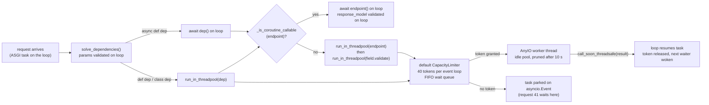

# async def vs def in FastAPI: Event Loop Execution vs anyio.to_thread.run_sync and the 40-Thread CapacityLimiter

> [!summary] Claim
> FastAPI awaits an `async def` endpoint directly on the event loop thread, but ships every `def` endpoint, `def` dependency, class dependency, and `def`-endpoint response validation to `anyio.to_thread.run_sync`, where one per-event-loop `CapacityLimiter` with 40 tokens caps how many of them run at once in each worker process; so a blocking call in `async def` freezes the whole worker, and 41 slow `def` calls queue every sync route behind them.

Part of [FastAPI Internals and Patterns](README.md) in [API Engineering](../README.md).

## TL;DR

- Mechanism: FastAPI picks the path once per route with `_is_coroutine_callable`; coroutine functions are awaited on the loop, and anything else goes through `starlette.concurrency.run_in_threadpool` -> `anyio.to_thread.run_sync`, which takes one token from the default `CapacityLimiter(40)` for each call.
- Contract rule: `async def` code must never block (no `time.sleep`, `requests`, sync DB drivers, or heavy CPU); `def` code may block, but it shares 40 tokens per event loop with every other sync dependency, sync background task, `FileResponse` chunk read, and `WSGIMiddleware` request in the process.
- Trap: once the 40 tokens are held, request 41 waits in a FIFO queue, and so do sync health checks; the loop keeps serving `async def` routes, so the outage looks partial and the metrics look calm.
- Portability: the limiter, its 40-token default, the shield-by-default cancellation, and contextvar copying behave identically on CPython 3.12 through 3.15, including a free-threaded 3.15 beta with the GIL disabled (lab run below); only true CPU parallelism inside the 40 threads changes on free-threaded builds.
- When not to use `def`: trivial non-blocking endpoints (the thread hop costs more than the work) and long or unbounded blocking calls (use a dedicated limiter as a bulkhead, a native async driver, or a process pool instead of draining the shared 40).

## Mental model



A request is always an `asyncio` task on the event loop thread, and parameter validation always happens there.
Each callable on the request path is classified once at route build time: coroutine callables are awaited inline, and every other callable becomes a separate `anyio.to_thread.run_sync` call.
Each such call first enters the default limiter: if a token is free the task becomes a borrower immediately; otherwise it parks on an `asyncio.Event` in an ordered wait queue.
With a token, the task hands the function to an idle `WorkerThread` (or starts a new one) through a two-slot `queue.Queue`, and awaits an `asyncio.Future` inside a shielded cancel scope.
The worker runs the function in a copy of the caller's context, posts the result back with `loop.call_soon_threadsafe`, and returns itself to the idle deque; releasing the token wakes the oldest waiter.
The loop thread is free throughout, which is why `async def` routes keep answering while 40 threads are stuck.

## How it works

### 1. Classification: which callables are coroutines

FastAPI decides the execution path once, when `get_request_handler` builds the route handler: `is_coroutine = _is_coroutine_callable(dependant.call)` (fastapi 0.162.0 fastapi/routing.py, get_request_handler).
`_is_coroutine_callable_cached` returns `True` when the callable with `functools.partial` layers stripped (`_impartial`), or its `inspect.unwrap` target, is a routine (`inspect.isroutine`) for which `iscoroutinefunction` holds, or when `iscoroutinefunction` holds for its `__call__` method under the same two views; a class (as opposed to an instance) is explicitly `False` (fastapi 0.162.0 fastapi/dependencies/models.py, _is_coroutine_callable_cached).
The result is memoized in an `lru_cache` of `_CALLABLE_CLASSIFICATION_CACHE_SIZE = 4096` entries keyed on object identity (`_CallIdentity.__hash__` returns `id(self.call)`), so classification is a startup cost, not a per-request one.
On CPython `>= 3.13` FastAPI uses `inspect.iscoroutinefunction`; on 3.12 it falls back to `asyncio.iscoroutinefunction` (same file, module top); on CPython 3.14.6 calling `asyncio.iscoroutinefunction` emits a `DeprecationWarning` ("slated for removal in Python 3.16"), and on 3.12.13 both functions return `True` for a sync function marked with `inspect.markcoroutinefunction` (3.12+), so the marker classifies a route as async on every supported version (both checked in this job).
Three consequences were checked in this job with a probe app on CPython 3.14.6 (and re-checked by the verifier with a one-off probe):
- A class used as a dependency (`Depends()` on a class annotation) runs its `__init__` in a worker thread, because the class branch returns `False`.
- An instance with `async def __call__` runs on the loop.
- A sync `def wrapper` decorated with `functools.wraps` around an `async def` endpoint runs on the loop: FastAPI follows `__wrapped__`, sees a coroutine function, and awaits whatever the wrapper returns, so blocking work inside such a wrapper blocks the loop.

Starlette's own check is narrower: `is_async_callable` strips `functools.partial` and tests `iscoroutinefunction(obj)` or `iscoroutinefunction(obj.__call__)`, with no `inspect.unwrap` (starlette 1.10.0 starlette/_utils.py, is_async_callable).
It governs plain Starlette routes, exception handlers, and `BackgroundTask`.

### 2. Every place a FastAPI request can hop to a thread

| Call site | Condition | Limiter | Source (fastapi 0.162.0 / starlette 1.10.0) |
| --- | --- | --- | --- |
| Endpoint | not a coroutine callable | default | `fastapi/routing.py`, `run_endpoint_function` -> `run_in_threadpool(_run_sync_endpoint, ...)` |
| `response_model` validation | endpoint is not a coroutine | default | `fastapi/routing.py`, `serialize_response`: `await run_in_threadpool(field.validate, ...)` when `is_coroutine` is false |
| Plain dependency | not a coroutine callable (includes classes) | default | `fastapi/dependencies/utils.py`, `solve_dependencies`: `await run_in_threadpool(call, **solved_result.values)` |
| `yield` dependency `__enter__` | sync generator | default | `fastapi/dependencies/utils.py`, `_solve_generator` -> `fastapi/concurrency.py`, `contextmanager_in_threadpool` |
| `yield` dependency `__exit__` | sync generator | a fresh `CapacityLimiter(1)` per call | `fastapi/concurrency.py`, `contextmanager_in_threadpool` |
| Sync generator streamed through `StreamingResponse` | each `next()` | default | `starlette/responses.py`, `StreamingResponse.__init__` -> `starlette/concurrency.py`, `iterate_in_threadpool` |
| Sync generator for SSE | each item | default | `fastapi/routing.py`, `get_request_handler`: `sse_aiter = iterate_in_threadpool(gen)` |
| Sync `BackgroundTask` | after the response | default | `starlette/background.py`, `BackgroundTask.__call__` |
| Sync exception handler | on error | default | `starlette/_exception_handler.py`, `wrap_app_handling_exceptions` |
| `FileResponse` | `os.stat` plus every 64 KiB read via `anyio.open_file` | default | `starlette/responses.py`, `FileResponse.__call__`; anyio 4.16.0 `_core/_fileio.py`, `AsyncFile.read` |
| `UploadFile.read`, `write`, `seek`, `close` | only once the spooled file is on disk; for `write`, also when this write will roll it over (`_will_roll`, the CVE-2025-54121 fix in Starlette 0.47.2) | default | `starlette/datastructures.py`, `UploadFile` |
| `StaticFiles` path lookup | every request | default | `starlette/staticfiles.py`, `StaticFiles.get_response` |
| `WSGIMiddleware` | whole WSGI call, including streaming | default | `starlette/middleware/wsgi.py`, `WSGIResponder.__call__` |
| `GZipMiddleware` compression | chunks `>= 128 KiB` (`thread_minimum_size`) | its own `CapacityLimiter(40)` RunVar | `starlette/middleware/gzip.py`, `_get_gzip_capacity_limiter` |

Request parameter validation (`request_params_to_args` for path, query, header, and cookie values) and body parsing always run on the loop, for `def` and `async def` endpoints alike (fastapi 0.162.0 fastapi/dependencies/utils.py, solve_dependencies).
A `def` endpoint with one `def` dependency and a `response_model` therefore makes three separate `run_sync` calls, and each one queues independently behind the limiter: under saturation the request pays the queueing delay up to three times.
The lab test `test_def_endpoint_dependency_and_response_validation_all_run_off_the_loop` proves the placement: a `field_validator` on the response model records a worker thread ident for the `def` route and the loop thread ident for both `async def` routes, and a `def` dependency runs in a worker even under an `async def` endpoint.

### 3. `run_in_threadpool` is a thin wrapper

Starlette binds the arguments with `functools.partial` and calls `anyio.to_thread.run_sync(func)` with no `limiter`, so every call uses the default limiter (starlette 1.10.0 starlette/concurrency.py, run_in_threadpool).
`anyio.to_thread.run_sync(func, *args, abandon_on_cancel=False, cancellable=None, limiter=None)` (`cancellable` is a deprecated alias of `abandon_on_cancel`) dispatches to the backend (anyio 4.16.0 src/anyio/to_thread.py, run_sync).
On asyncio, `AsyncIOBackend.run_sync_in_worker_thread` does, in order (anyio 4.16.0 src/anyio/_backends/_asyncio.py, AsyncIOBackend.run_sync_in_worker_thread):
1. `await cls.checkpoint()`, so a call is always a scheduling point.
2. Looks up the per-loop idle deque and worker set (`_threadpool_idle_workers`, `_threadpool_workers`, both `RunVar`s).
3. `async with limiter or cls.current_default_thread_limiter():` acquires one token on behalf of the current task.
4. `with CancelScope(shield=not abandon_on_cancel) as scope:` shields the wait by default.
5. Pops the most recently idled worker (`idle_workers.pop()`, LIFO), or creates `WorkerThread(root_task, workers, idle_workers)`, starts it, and registers `worker.stop` as a done-callback of the root task so threads die with the loop.
6. While popping, prunes from the other end of the deque (`popleft`) the idle workers whose `idle_since` is at least `WorkerThread.MAX_IDLE_TIME = 10` seconds old.
7. `context = copy_context()`, then `context.run(set_current_async_library, None)` so code in the thread is not mistaken for async code.
8. `worker.queue.put_nowait((context, func, args, future, worker_scope))` and `return await future`.

`WorkerThread.run` loops on `self.queue.get()`, runs `context.run(func, *args)` unless the future was already cancelled, and reports through `self.loop.call_soon_threadsafe(self._report_result, ...)`; `_report_result` puts the worker back on the idle deque and resolves the future, converting a leaked `StopIteration` into `RuntimeError` (same file, WorkerThread).
On CPython `>= 3.14` each `WorkerThread` is constructed with `context=Context()` (same file, WorkerThread.__init__), so the thread's own baseline context is empty; per-call context still comes from `copy_context()` in the caller.
Threads are created lazily: the pool grows only when a token is granted and no worker is idle, so a process that never saturates never creates 40 threads.
The lab's headline test observes exactly 40 distinct worker `threading.get_ident()` values after 41 blocking requests: the 41st reused a released worker.

### 4. The `CapacityLimiter` state machine

The asyncio limiter holds `_borrowers: set`, `_wait_queue: OrderedDict[borrower, asyncio.Event]`, and `_total_tokens` (anyio 4.16.0 src/anyio/_backends/_asyncio.py, CapacityLimiter).
`acquire_on_behalf_of_nowait` raises `WouldBlock` if anyone is already waiting or `len(_borrowers) >= _total_tokens`, so a newcomer cannot jump a queue even when a token is momentarily free; `acquire_on_behalf_of` then parks on a fresh `asyncio.Event`.
`release_on_behalf_of` removes the borrower and calls `_notify_next_waiter`, which pops the oldest waiter (`popitem(last=False)`), adds it to `_borrowers`, and sets its event: the token is handed over, not raced for.
The lab test `test_limiter_hands_tokens_to_waiters_in_fifo_order` shows five waiters acquiring in arrival order.
Borrowers are identified by the current task; the same task acquiring the same limiter twice raises `RuntimeError("this borrower is already holding one of this CapacityLimiter's tokens")`.
Cancellation while queued is clean: the `except BaseException` branch removes the waiter, and if the token had already been handed over it gives it to the next waiter.
The `total_tokens` setter accepts only an `int` or `math.inf` (`TypeError` otherwise, `ValueError` below 0), and after storing the value it immediately grants tokens to waiters while `len(_borrowers) < _total_tokens`.
Raising the limit therefore admits queued tasks synchronously, before the next `await`; lowering it never preempts a running thread, and `available_tokens` (`total_tokens - borrowed`) can go negative.
`test_total_tokens_set_in_lifespan_and_resized_at_runtime` asserts both: after `total_tokens = 3` with two running and one waiting, `statistics()` immediately reports `(borrowed=3, waiting=0)`; after `total_tokens = 1`, `borrowed_tokens == 3` and `available_tokens == -2`.

### 5. Where the number 40 lives, and its scope

`AsyncIOBackend.current_default_thread_limiter` returns the `_default_thread_limiter` `RunVar`, creating `CapacityLimiter(40)` on first use (anyio 4.16.0 src/anyio/_backends/_asyncio.py).
The AnyIO documentation states "The default AnyIO worker thread limiter has a value of 40" and shows changing it through `total_tokens` (AnyIO threads documentation).
On the Trio backend, AnyIO wraps `trio.to_thread.current_default_thread_limiter()` (anyio 4.16.0 src/anyio/_backends/_trio.py, current_default_thread_limiter), and Trio defines `DEFAULT_LIMIT = 40` (trio main src/trio/_threads.py, as of 2026-11).
A `RunVar` is scoped to one running event loop, so the scope of "40" is one event loop: each Uvicorn or Gunicorn worker process gets its own 40, and a test framework that creates a loop per test gets a fresh limiter per test.
Calling `anyio.to_thread.current_default_thread_limiter()` with no running loop raises `anyio.NoEventLoopError` (lab test `test_default_limiter_does_not_exist_outside_a_running_loop`), so the limit cannot be set at import time; set it in the lifespan startup, which runs on the serving loop.
The AnyIO docs add that this limiter "does not affect the default thread pool executor on asyncio": `asyncio.to_thread` and `loop.run_in_executor(None, ...)` use a separate `ThreadPoolExecutor` whose default is `min(32, (os.process_cpu_count() or 1) + 4)` workers (read from `ThreadPoolExecutor.__init__` on CPython 3.14.6 in this job), and work submitted there is invisible to the AnyIO limiter.

### 6. Cancellation: shielded by default

Because the wait is inside `CancelScope(shield=True)` when `abandon_on_cancel=False`, cancelling the task (client disconnect, `anyio.fail_after`, server shutdown) does not interrupt the await; the task returns only after the thread finishes, and the cancellation is delivered at its next checkpoint.
The AnyIO docs say: "By default, tasks are shielded from cancellation while they are waiting for a worker thread to finish."
The lab's `test_run_sync_shields_the_caller_until_the_thread_finishes` cancels the scope while the thread is blocked and records `cancel:requested`, then 50 ms of nothing, then `thread:exit`, `caller:returned(done)`, and finally `cancelled_caught=True`.
With `abandon_on_cancel=True` the caller leaves at once and the thread keeps running ("the thread will still continue running - only its outcome will be ignored", AnyIO docs); the lab records `caller:after-scope(cancelled_caught=True)` before `thread:released`.
Starlette and FastAPI never pass `abandon_on_cancel`, so a `def` endpoint whose client has gone away holds its token until the function returns; Python threads cannot be killed, and the only cooperative exit is calling `anyio.from_thread.check_cancelled()` from inside the thread.

### 7. Context variables cross into threads one way

`copy_context()` means a `ContextVar` set on the loop (middleware, an `async def` dependency) is visible inside a `def` endpoint, but a value set inside a `def` dependency lives in the copy and is gone when control returns to the loop.
AnyIO documents this ("any changes made to them will not propagate back to the calling asynchronous task"), and the lab asserts both directions: `/ctx/into-thread` returns `set-in-async-dep`, `/ctx/out-of-thread` returns `unset`.
A lab detail worth knowing: `httpx.ASGITransport` runs the app inside the calling task, so a contextvar set by an `async def` dependency in one request leaks into the next request made from the same test task; the first version of the lab failed exactly this way, and the test now issues each request from its own task, as a server does.
See [[ASGI-State-Isolation-and-ContextVars-Across-Request-Lifecycle]] for the general rule.

### 8. The `yield`-dependency deadlock and the private exit limiter

FastAPI issue #3205 ("Using dependency injection to get SQLAlchemy session can lead to deadlock", opened May 2021) reported a `def` endpoint with a `yield` session dependency, a `QueuePool` of `pool_size=4`, `max_overflow=0`, `pool_timeout=None`, and 100 concurrent Locust users: the app served a handful of requests and froze.
The diagnosis in that thread: all worker threads were blocked waiting for SQLAlchemy connections, while the code that would return connections (the dependency's `finally`, run by `__exit__` in the threadpool) was itself waiting for a free worker.
PR #5122 by adriangb, merged 2022-09-04, gave `__exit__` its own limiter; the maintainer's comment on #3205 says it shipped in FastAPI 0.82.0.
The pinned code still carries it: `exit_limiter = CapacityLimiter(1)` is created per call, so teardown never waits for a shared token (fastapi 0.162.0 fastapi/concurrency.py, contextmanager_in_threadpool).
The lab reproduces both shapes with one token and a one-connection `threading.BoundedSemaphore` pool: with FastAPI's wrapper the log is `a:returned-connection` then `b:checkout(acquired=True)`; with a naive wrapper whose `__exit__` uses `run_in_threadpool`, request B holds the only token while waiting for the pool, A's teardown cannot start, and the log is `b:checkout(acquired=False)` (pool timeout) before `a:returned-connection`.
The fix only covers teardown: `__enter__`, plain sync dependencies, and the endpoint still share the default 40, so a pool smaller than 40 with sync code can still starve under load (see Pitfalls).

### 9. Servers, loops, and HTTP versions

No ASGI server changes this mechanism, because the limiter belongs to the event loop the app runs on.
Uvicorn 0.54.0 runs one loop per worker process; its admission controls are `backlog` (default `2048`) and `limit_concurrency` (default `None`), and when connections or tasks reach `limit_concurrency` the h11 protocol answers with `service_unavailable`, a `503` (uvicorn 0.54.0 uvicorn/config.py, Config.__init__; uvicorn/protocols/http/h11_impl.py; uvicorn/protocols/http/flow_control.py, service_unavailable).
That limit counts connections and tasks, not threads, so it does not prevent a queue at the thread limiter.
Hypercorn 0.18.0 defaults to `worker_class = "asyncio"` (hypercorn 0.18.0 hypercorn/config.py, Config), and a Trio worker routes `run_sync` to Trio's limiter, also 40.
Granian's README describes ASGI apps driven by an asyncio loop per worker, with `--blocking-threads` "irrelevant on asynchronous protocols", and on free-threaded builds a loop per worker thread (Granian README, as of 2026-11); by the `RunVar` scoping above, each such loop has its own 40 tokens.
HTTP/1.1, HTTP/2, and HTTP/3 do not appear in the code path: a token is taken per `run_sync` call, so one HTTP/2 connection multiplexing 100 streams to a `def` route can by itself hold all 40 tokens.

## Numbers and limits

| Quantity | Value | Source |
| --- | --- | --- |
| Default thread tokens per event loop (asyncio backend) | `40` | anyio 4.16.0 src/anyio/_backends/_asyncio.py, current_default_thread_limiter; AnyIO threads docs |
| Default thread tokens (Trio) | `40` (`DEFAULT_LIMIT`) | trio main src/trio/_threads.py (as of 2026-11) |
| Worker idle time before pruning | `10` s (`MAX_IDLE_TIME`), checked only when a worker is popped | anyio 4.16.0, WorkerThread |
| Per-worker job queue | `Queue(2)` | anyio 4.16.0, WorkerThread.__init__ |
| `run_sync` calls for a `def` endpoint + `def` dependency + `response_model` | 3 (each queues separately) | fastapi 0.162.0 routing.py and dependencies/utils.py; placement proven by lab |
| `yield` dependency `__exit__` limiter | fresh `CapacityLimiter(1)` per call | fastapi 0.162.0 fastapi/concurrency.py |
| GZip worker-thread threshold and limiter | `>= 128 KiB` per chunk, separate `CapacityLimiter(40)` | starlette 1.10.0 starlette/middleware/gzip.py |
| `FileResponse` read size, each read a `run_sync` | `64 * 1024` bytes | starlette 1.10.0 starlette/responses.py, FileResponse.chunk_size |
| asyncio default executor size (separate pool) | `min(32, process_cpu_count() + 4)` | CPython 3.14.6 `ThreadPoolExecutor.__init__`, read in this job |
| Callable classification cache | `4096` entries | fastapi 0.162.0 fastapi/dependencies/models.py |
| asyncio debug-mode slow callback threshold | `100` ms | Python docs, "Developing with asyncio", Debug Mode |
| Uvicorn `backlog`, `limit_concurrency` defaults | `2048`, `None` (`503` when exceeded) | uvicorn 0.54.0 uvicorn/config.py |
| FastAPI docs' estimate for the `def` "performance gain" on trivial endpoints | "about 100 nanoseconds", and the docs say the effect in FastAPI is "quite opposite" | fastapi.tiangolo.com/async, "Very Technical Details" (as of 2026-11) |
| Lab: queued requests with 41 blocking `def` calls on the default limiter | `borrowed=40`, `tasks_waiting=1`, peak in-flight `40`, `40` distinct threads | lab headline test, CPython 3.14.6, macOS 27.3 arm64 |
| Measured `await anyio.to_thread.run_sync(noop)`, sequential, 5 rounds of 20000 after 500 warm-up calls | median `95.9` us per call (rounds `78.7` to `134.8`) | one-off script run by the verifier with `uv run --frozen python -I probe.py` from `labs/`, CPython 3.14.6, Apple M3 Pro (12 cores), macOS 27.3 arm64, 1-minute load average 18.2 to 18.6 |
| Measured in-process `GET` via `ASGITransport`, trivial body, 3 rounds of 3000 | `async def` `108.7` to `111.1` us; `def` `287.7` to `391.9` us | same script, same machine and load |
| Free-threaded single-thread overhead target for Phase II | `15%` hard target, `20%` memory (pyperformance geometric mean) | PEP 779 |

The two measured rows were taken on a shared machine at a load average near 18 on 12 cores, so their absolute values are inflated; read them as a ratio (a trivial `def` request roughly 2.6x to 3.6x the cost of the whole `async def` request here), not as an idle-machine latency.
An idle-machine figure was not measured in this job.
Derived capacity bound (arithmetic, not measured): by Little's law a process can complete at most `tokens / S` sync calls per second, where `S` is the mean time a call holds a token, so 40 tokens with `S = 50 ms` caps sync routes at 800 calls per second per worker, and a 2 s upstream timeout cuts that to 20; see [[Capacity-Planning-with-Littles-Law-and-the-Universal-Scalability-Law]].

## Portability

| Leg | Result | Evidence |
| --- | --- | --- |
| CPython 3.12.13 | 13/13 lab tests pass; FastAPI uses `asyncio.iscoroutinefunction` here | `uv run --frozen --python 3.12` in this job (3.12.16 not installed; 3.12.13 ran); fastapi/dependencies/models.py version branch |
| CPython 3.13.18 | 13/13 pass; `inspect.iscoroutinefunction` branch | `uv run --frozen --python 3.13` |
| CPython 3.14.10 | 13/13 pass | `uv run --frozen --python 3.14.10` |
| CPython 3.14.6 (workspace interpreter) | 13/13 pass; `WorkerThread` gets `context=Context()` on `>= 3.14` | `uv run --frozen pytest`; anyio 4.16.0 WorkerThread.__init__ |
| CPython 3.15.2 | 13/13 pass | `uv run --frozen --python /opt/homebrew/bin/python3.15` (plain `--python 3.15` picked a 3.15.0b3 whose `hypothesis` import failed at collection) |
| CPython 3.15.2t free-threaded | not run: not installable here | only `3.15.0b3+freethreaded` was available, and the locked workspace fails on it (`psycopg-binary==3.3.8` has no wheel) |
| CPython 3.15.0b3t, `-X gil=0` (`sys._is_gil_enabled()` returned `False`) | 13/13 pass in a reduced venv holding only the pinned fastapi, starlette, anyio, pydantic, pydantic-core, httpx, httpcore, pytest, pytest-asyncio, asgi-lifespan | run in this job; limiter semantics unchanged, CPU-bound `def` code can now run in parallel across the 40 threads (PEP 779 status: supported but optional since 3.14) |
| fastapi 0.162.0, starlette 1.10.0, anyio 4.16.0 | all claims above | installed pinned packages and the tag URLs in `sources` |
| FastAPI `< 0.82.0` | `yield` dependency `__exit__` used the shared limiter (deadlock-prone) | issue #3205, PR #5122 |
| Uvicorn 0.54.0, Gunicorn with Uvicorn workers | one loop, one 40-token limiter per worker process | `RunVar` scoping; uvicorn/config.py |
| Hypercorn 0.18.0 asyncio or Trio worker | 40 tokens on both backends | hypercorn/config.py `worker_class`; trio `DEFAULT_LIMIT` |
| Granian ASGI | one limiter per worker event loop (per worker thread on free-threaded builds) | Granian README; `RunVar` scoping (inference, not run) |
| HTTP/1.1, HTTP/2, HTTP/3 | no difference: tokens are per `run_sync` call, not per connection or stream | anyio and starlette source above; not run against a live h2 or h3 server |

## Worked example

The [implementation](../labs/src/api_labs/f11_fastapi_internals_and_patterns/async_def_vs_def_threadpool.py) builds one app whose routes record which OS thread ran each piece of code and what the default limiter holds; the [test](../labs/tests/f11_fastapi_internals_and_patterns/test_async_def_vs_def_endpoints_and_anyio_threadpool_limiter_semantics.py) drives it in-process with `httpx.ASGITransport`.

Simplified excerpt of the routes that matter:

```python
@app.get("/blocking", response_model=None)
def blocking() -> dict[str, bool]:
    probe.record("blocking:enter")
    released = probe.blocking_work()  # gate.wait(5.0) in a worker thread
    probe.record("blocking:exit")
    return {"released": released}

@app.get("/async-blocker", response_model=None)
async def async_blocker(hold: float) -> dict[str, bool]:
    probe.record("async-blocker:enter")
    released = probe.gate.wait(hold)  # Blocks the event loop thread: the bug under test.
    probe.record(f"async-blocker:exit(released={released})")
    return {"released": released}

@app.get("/report", response_model=None)
async def report() -> dict[str, bool]:
    released = await anyio.to_thread.run_sync(probe.blocking_work, limiter=bulkhead)
    return {"released": released}
```

The headline test, verbatim: 41 blocking `def` requests, then an `async def` ping that must be served, then a trivial `def` ping that must queue.

```python
@pytest.mark.unit
@pytest.mark.asyncio
async def test_41st_blocking_def_request_queues_while_async_def_keeps_serving() -> None:
    probe = ThreadProbe()
    lab = build_threadpool_app(probe)
    limiter = anyio.to_thread.current_default_thread_limiter()
    assert limiter.total_tokens == 40
    statuses: list[int] = []

    async with client_for(lab.app) as client, anyio.create_task_group() as tg:

        async def fetch(path: str) -> None:
            statuses.append((await client.get(path)).status_code)

        for _ in range(41):
            tg.start_soon(fetch, "/blocking")
        await wait_until(lambda: probe.entered == 40 and limiter.statistics().tasks_waiting == 1)
        assert probe.in_flight == 40
        assert limiter.borrowed_tokens == 40

        ping = (await client.get("/loop-ping")).json()
        assert ping == {"ident": threading.get_ident(), "borrowed": 40, "total": 40, "waiting": 1}

        tg.start_soon(fetch, "/sync-ping")
        await wait_until(lambda: limiter.statistics().tasks_waiting == 2)
        await anyio.sleep(0.05)
        assert "sync-ping" not in probe.events
        assert probe.entered == 40

        probe.gate.set()

    assert statuses == [200] * 42
    assert probe.entered == 41
    assert probe.peak_in_flight == 40
    assert len(probe.worker_idents) == 40
    assert limiter.borrowed_tokens == 0
```

Simplified excerpt of the teardown-deadlock pair (the scenario sets the default limiter to one token and uses a one-connection pool):

```python
log = await pool_teardown_scenario(contextmanager_in_threadpool, pool_timeout=2.0)
assert log == ["a:checked-out", "a:endpoint-done", "a:returned-connection", "b:checkout(acquired=True)"]

log = await pool_teardown_scenario(naive_contextmanager_in_threadpool, pool_timeout=0.3)
assert log == ["a:checked-out", "a:endpoint-done", "b:checkout(acquired=False)", "a:returned-connection"]
```

The full test module covers 13 behaviors: the 40-token queue, loop freeze from blocking in `async def`, loop freedom with `def`, thread placement of dependencies and response validation, contextvar direction, lifespan sizing and runtime resizing, a bulkhead limiter that spends no default tokens, FIFO handoff, shielded versus abandoned cancellation, the teardown deadlock pair, and `NoEventLoopError` outside a loop.
Output captured from `labs/` with CPython 3.14.6 on macOS 27.3 arm64:

```text
$ uv run --frozen pytest tests/f11_fastapi_internals_and_patterns/test_async_def_vs_def_endpoints_and_anyio_threadpool_limiter_semantics.py -v -p no:randomly
platform darwin -- Python 3.14.6, pytest-9.2.0, pluggy-1.7.0 -- labs/.venv/bin/python
collecting ... collected 13 items

...::test_41st_blocking_def_request_queues_while_async_def_keeps_serving PASSED [  7%]
...::test_blocking_call_inside_async_def_freezes_the_loop PASSED [ 15%]
...::test_blocking_call_inside_def_leaves_the_loop_free PASSED [ 23%]
...::test_def_endpoint_dependency_and_response_validation_all_run_off_the_loop PASSED [ 30%]
...::test_contextvars_are_copied_into_threads_but_never_copied_back PASSED [ 38%]
...::test_total_tokens_set_in_lifespan_and_resized_at_runtime PASSED [ 46%]
...::test_dedicated_bulkhead_limiter_does_not_spend_default_tokens PASSED [ 53%]
...::test_limiter_hands_tokens_to_waiters_in_fifo_order PASSED [ 61%]
...::test_run_sync_shields_the_caller_until_the_thread_finishes PASSED [ 69%]
...::test_abandon_on_cancel_returns_immediately_and_orphans_the_thread PASSED [ 76%]
...::test_fastapi_exit_limiter_lets_teardown_return_a_pooled_connection PASSED [ 84%]
...::test_teardown_on_the_shared_limiter_starves_until_the_pool_times_out PASSED [ 92%]
...::test_default_limiter_does_not_exist_outside_a_running_loop PASSED [100%]

============================== 13 passed in 1.85s ==============================
```

The node ids are shortened with `...` (the module path), the interpreter path is shortened to `labs/.venv/bin/python`, and the plugin header lines are omitted; nothing else is edited.

## Pitfalls

> [!warning] Blocking call inside `async def`
> Trigger: `requests.get`, `time.sleep`, a sync DB driver, `threading.Event.wait`, or a CPU loop in an `async def` endpoint or dependency.
> Symptom: every request on that worker stalls for the duration, including `async def` health checks; in the lab, a `/loop-ping` sent while `/async-blocker` held the loop was served only after the blocker's 0.2 s wait expired.
> Fix: use the async client (`httpx.AsyncClient`, `asyncpg`), or wrap the call in `await anyio.to_thread.run_sync(...)`, or declare the endpoint `def`; detect it with asyncio debug mode, which logs callbacks slower than 100 ms, and see [[Detecting-Event-Loop-Blocking-Loop-Lag-Monitors-and-Debug-Callbacks]] and [[Case-Study-Blocking-Call-Inside-Async-Def-Freezing-the-Entire-Worker-Fleet]].

> [!warning] Thread starvation from slow `def` calls
> Trigger: more than 40 concurrent slow `def` endpoints or dependencies per worker, typically an upstream with no timeout or a DB pool smaller than the concurrency.
> Symptom: `async def` routes stay fast while every sync route (including a `def` health check) queues; CPU is low; the lab shows `borrowed=40`, `tasks_waiting=1`, and a trivial `/sync-ping` that does not run until a token frees.
> Fix: bound every blocking call with a timeout, make liveness and readiness probes `async def`, size the limiter to the real downstream capacity, and isolate slow dependencies behind their own limiter ([[Bulkhead-Isolation-and-Per-Dependency-Resource-Partitioning]]).

> [!warning] Sync `yield` dependency deadlock with a connection pool (FastAPI issue #3205)
> Trigger: FastAPI `< 0.82.0`, a `def` generator dependency that checks out a pooled connection, and concurrency above the pool size.
> Symptom: the app freezes after a few requests; all workers wait for connections while teardown waits for a worker.
> Fix: upgrade (0.82.0+ runs `__exit__` on a private `CapacityLimiter(1)`), keep the pool at least as large as the number of threads that can hold a connection, and set a finite pool timeout so starvation turns into an error instead of a hang; the lab reproduces both the deadlock-prone and the fixed shapes.

> [!warning] Raising `total_tokens` to fix latency
> Trigger: setting the default limiter to 200 or 1000 because sync routes queue.
> Symptom: the queue moves from the limiter into the DB pool, the upstream, or the GIL; memory grows with thread stacks; tail latency often gets worse.
> Fix: size tokens from the downstream that the threads wait on (pool size, upstream concurrency), not from request rate; the Starlette thread pool docs warn that more threads affect performance and memory.

> [!warning] Setting the limit at import time, or once per process with several loops
> Trigger: `anyio.to_thread.current_default_thread_limiter().total_tokens = 100` at module level.
> Symptom: `anyio.NoEventLoopError` at import, or a setting that silently applies to only one loop (a test's loop, one Granian worker thread).
> Fix: set it in the lifespan startup, which runs on the serving loop; the lab's `test_total_tokens_set_in_lifespan_and_resized_at_runtime` does exactly this through `LifespanManager`.

> [!warning] Assuming a client disconnect or timeout stops a `def` endpoint
> Trigger: `def` endpoint doing long work; client gives up or a gateway times out.
> Symptom: the work runs to completion and keeps the token, because `run_sync` is shielded by default; under retries each abandoned attempt still costs a full thread.
> Fix: give the blocking call its own deadline, check `anyio.from_thread.check_cancelled()` in long loops, or move the work to a queue ([[BackgroundTasks-vs-Durable-Task-Queues-Celery-and-Dramatiq]]).

> [!warning] Contextvars set in a `def` dependency vanish
> Trigger: a `def` dependency sets a request-id, tenant, or tracing `ContextVar` for later code.
> Symptom: the `async def` endpoint and later middleware see the default value.
> Fix: set contextvars only in `async def` dependencies or middleware, or pass values through the dependency's return value; in tests, issue each request from its own task because `ASGITransport` shares the caller's context.

> [!warning] Hidden thread hops in "async" apps
> Trigger: class-based dependencies, sync exception handlers, sync background tasks, sync generators in `StreamingResponse`, `FileResponse`, or a mounted WSGI app.
> Symptom: an app written as all `async def` still saturates the 40 tokens; a large `FileResponse` performs one `run_sync` per 64 KiB chunk, and a `WSGIMiddleware` request holds a token for its whole response.
> Fix: inventory the call sites in the table in How it works, make hot dependencies `async def` or instances with `async def __call__` ([[Class-Based-Dependencies-Callable-Objects-and-Parameterized-Guards]]), and put the WSGI mount behind its own capacity budget ([[Mounting-Sub-Applications-WSGI-Legacy-Strangler-and-Static-Assets]]).

> [!warning] A sync decorator around an `async def` endpoint
> Trigger: `@functools.wraps` on a `def wrapper` that does blocking work (logging to a file, a sync cache lookup) before returning the wrapped coroutine.
> Symptom: the wrapper runs on the loop, because FastAPI unwraps to the coroutine function and classifies the route as async.
> Fix: write decorators for async endpoints as `async def` wrappers and push blocking work through `anyio.to_thread.run_sync`.

No CVE is recorded against the limiter itself (OSV query for the `anyio`, `starlette`, and `fastapi` PyPI packages, as of 2026-11), but the thread-hop boundary has one: CVE-2025-54121 (GHSA-2c2j-9gv5-cj73, fixed in Starlette 0.47.2) was an `UploadFile.write` that rolled a large multipart upload from memory to disk on the event loop thread, because it checked only whether the file was already on disk; the fix added the `_will_roll` check that the pinned 1.10.0 code carries.
The other incident record is FastAPI issue #3205 and its duplicates.

## Security and robustness

Thread-limiter exhaustion is a cheap denial of service: OWASP API Security Top 10 2023 `API4:2023 Unrestricted Resource Consumption` covers it.
An attacker needs only 40 concurrent requests per worker to a `def` route that is slow to answer (a large search, an export, an endpoint that calls a slow third party) to queue every sync route on that worker; under HTTP/2 that can be a single connection.
Defenses, in depth:
- Admission at the edge: per-client concurrency and rate limits at the gateway, plus Uvicorn `limit_concurrency` to fail fast with `503` instead of building an invisible queue ([[Adaptive-Concurrency-Limits-Littles-Law-Vegas-and-Gradient2]]).
- Timeouts on every blocking call, shorter than the gateway timeout, so a token is never held for longer than the client will wait.
- Bulkheads: run each risky blocking dependency with `anyio.to_thread.run_sync(fn, limiter=its_own_limiter)`; the lab proves a saturated two-token bulkhead leaves the default limiter at `borrowed=0` and `def` routes responsive.
- Fail fast when a bulkhead is full: check `limiter.available_tokens` (or try `acquire_nowait()` and catch `anyio.WouldBlock`) and return `503` with `Retry-After` instead of queueing without bound; the AnyIO wait queue has no maximum length.
- Probes: liveness and readiness as `async def` with no thread hop, so orchestration sees the loop, not the queue; export `limiter.statistics()` (`borrowed_tokens`, `tasks_waiting`) as gauges.
- Validation stays on the loop: body and parameter validation run there for both kinds of endpoint, so an attacker-supplied large JSON body costs loop time; cap body size before validation (see [[Request-Parameter-Validation-Path-Query-Header-Cookie-and-Body-Models]]).
- Free-threaded builds remove the GIL as an accidental serializer: shared mutable state touched from `def` endpoints that was "safe enough" under the GIL needs real locks once threads truly run in parallel ([[Offloading-CPU-Bound-Work-ProcessPoolExecutor-vs-Free-Threaded-Python-3-15t]]).

## The principal's view

The decision is not "`async def` is faster"; it is which resource bounds concurrency in each worker and whether that bound is explicit.
An `async def` service has effectively unbounded in-loop concurrency and fails as a loop stall; a `def` service has a hard 40-per-loop bound and fails as a queue; most real services are both, and the 40 is shared by code that nobody thinks of as threaded.
A staff-plus engineer sets one policy and makes it reviewable:
- Async-first for I/O: native async drivers and clients, `async def` everywhere on the hot path, and every unavoidable blocking library called through a named limiter sized to the downstream it protects (DB pool size, vendor concurrency quota).
- Sync-first is legitimate for teams on sync ORMs: then the default limiter is the request concurrency limit, so size it equal to or below the DB pool per worker, keep `yield`-dependency teardown on FastAPI `>= 0.82.0`, and treat `tasks_waiting > 0` as a paging signal.
- Ban mixed accidents: lint for blocking calls in `async def` (ruff `ASYNC` rules), forbid class dependencies on hot paths unless they are instances with `async def __call__`, and require timeouts on all outbound calls.
The organizational trade-off is cognitive load: async-first demands discipline from every contributor, because one bad call freezes a worker; sync-first is forgiving but caps throughput per process and pushes capacity planning onto replica counts ([[Multi-Process-Worker-Topologies-Gunicorn-Uvicorn-Workers-vs-Kubernetes-Replicas]]).
Litestar 2.25.0 makes the choice explicit by warning when a sync handler leaves `sync_to_thread` unset (litestar/utils/warnings.py, warn_implicit_sync_to_thread), which is the review discipline FastAPI leaves to you ([[FastAPI-Architectural-Limits-and-Comparison-with-Litestar-and-Raw-Starlette]]).
Choose a different runtime when the work is CPU-bound (a process pool, a free-threaded build after its ecosystem is ready, or a compiled service) or when you need tens of thousands of concurrent blocking calls (a language with cheap blocking threads, such as Go or Java virtual threads, avoids the two-world split entirely).

## Interview questions

> [!question] L5: What exactly happens when FastAPI receives a request for a `def` endpoint versus an `async def` endpoint?
>
> > [!success]- Answer
> > Both run as an asyncio task on the event loop, and parameter validation happens on the loop for both.
> > For `async def`, `run_endpoint_function` awaits the coroutine directly on the loop thread.
> > For `def`, it calls `run_in_threadpool`, which is `anyio.to_thread.run_sync` with the default limiter, so the task takes one of 40 tokens, hands the call to a worker thread, and awaits a future.
> > The classification is done once per route by `_is_coroutine_callable`.
> >
> > Follow-up: Which other parts of the request also run in a thread for a `def` endpoint with a `response_model`?

> [!question] L5: Why does FastAPI's documentation tell you to prefer `async def` for trivial endpoints?
>
> > [!success]- Answer
> > A trivial `def` endpoint pays a token acquisition, a cross-thread queue put, a thread wakeup, and a `call_soon_threadsafe` round trip back to the loop.
> > The docs put the gain other frameworks see from `def` at "about 100 nanoseconds" and say the effect in FastAPI is the opposite.
> > In this job's (loaded) measurement a trivial `def` `GET` cost roughly 2.6x to 3.6x an `async def` one in-process.
> > It also consumes a shared token that slow endpoints may need.
> >
> > Follow-up: When is a trivial `def` still the right choice?

> [!question] L6: Predict the output: with 41 clients calling a `def` endpoint that sleeps 2 s on one default Uvicorn worker, what latency do the 41st client, an `async def` `/health` call, and a `def` `/ping` call sent right after see?
>
> > [!success]- Answer
> > Forty sleep calls start at once; the 41st waits about 2 s for a token and finishes at about 4 s.
> > `/health` answers immediately, because it never needs a token.
> > `/ping` queues behind the 41st in FIFO order, so it waits about 2 s for the first released token even though its own work takes microseconds.
> > The lab shows exactly this state: `borrowed=40`, `tasks_waiting=1`, an `async def` ping served, and a `def` ping not started.
> >
> > Follow-up: What changes if `/ping` also has a `def` dependency and a `response_model`?

> [!question] L6: Debug this API: sync routes hit multi-second p99 at 15% CPU while `async def` routes are fine, on a service with SQLAlchemy sync sessions from a `yield` dependency, a pool of 10, and `total_tokens = 200`; what is going on?
>
> > [!success]- Answer
> > With 200 tokens, up to 200 threads run sync dependencies and endpoints, but only 10 can hold a DB connection; the other 190 block inside the pool's checkout, holding their tokens.
> > The queue moved from the limiter (visible, FIFO, cheap) into the pool (invisible, timeout-driven), and each request may queue there several times.
> > Low CPU is the giveaway: threads are waiting, not working.
> > Fix: set tokens near the pool size per worker, put a finite `pool_timeout`, export limiter and pool statistics, and if more concurrency is needed raise both together or move to an async driver.
> >
> > Follow-up: Why does FastAPI's `contextmanager_in_threadpool` use a separate limiter for `__exit__`, and what would happen without it here?

> [!question] L6: If a tracing middleware sets a trace-id `ContextVar` and a `def` dependency overwrites it with a child span id, which value does the `async def` endpoint see, and why?
>
> > [!success]- Answer
> > It sees the middleware's value.
> > `run_sync` runs the dependency in `copy_context()`, so the assignment lands in the copy and is discarded when the thread returns.
> > Values flow into threads but never back.
> > Return the value from the dependency or make the dependency `async def`.
> >
> > Follow-up: Why can an in-process `ASGITransport` test hide or invert this bug?

> [!question] L6: Why does a `def` endpoint keep running to 45 s after the gateway timed out at 10 s and the client disconnected, and what are the options?
>
> > [!success]- Answer
> > `anyio.to_thread.run_sync` defaults to `abandon_on_cancel=False`, which wraps the wait in a shielded cancel scope, so cancellation of the request task waits for the thread.
> > Python threads cannot be killed, so even `abandon_on_cancel=True` would only detach the caller and leave the thread running with its token released but its work continuing.
> > Options: a deadline on the blocking call itself, cooperative checks with `anyio.from_thread.check_cancelled()`, or moving long work to a job queue.
> >
> > Follow-up: Why is abandoning threads dangerous for capacity accounting?

> [!question] L7+: Design the concurrency budget for a FastAPI service that calls a slow vendor API through a sync SDK, serves a sync ORM, and must keep its health checks green under abuse.
>
> > [!success]- Answer
> > Separate budgets per downstream: a vendor `CapacityLimiter` sized to the vendor's concurrency quota per worker, the default limiter sized to the DB pool per worker, and no blocking work on the loop.
> > Wrap vendor calls in `anyio.to_thread.run_sync(fn, limiter=vendor)` with timeouts shorter than the gateway's, and fail fast with `503` and `Retry-After` when the bulkhead has no tokens rather than queueing without bound.
> > Health checks are `async def` with no hops; export `borrowed_tokens` and `tasks_waiting` per limiter.
> > Edge admission (per-client concurrency) protects against one tenant consuming all tokens, and Uvicorn `limit_concurrency` caps in-process queues.
> > Capacity per worker follows Little's law, `tokens / service_time`, and the fleet scales by worker count.
> >
> > Follow-up: How would a free-threaded CPython change this design, and what would not change?

> [!question] L7+: Argue for or against standardizing an organization's FastAPI services on `def` endpoints with sync drivers.
>
> > [!success]- Answer
> > For: blocking mistakes cost one thread instead of the whole worker, the mental model is familiar, and sync ORMs are mature.
> > Against: throughput per process is capped at 40 concurrent blocking calls per loop by default, every request pays the hop overhead, hidden hops (validation, class dependencies, files) share the same budget, and scaling becomes replica count.
> > A defensible standard is async-first on hot paths with explicit, named limiters for each blocking library, plus a lint gate; sync-first is acceptable for low-traffic internal services if tokens equal pool size and queueing is monitored.
> > The deciding input is the downstream: if the DB or vendor is the bottleneck, neither style raises throughput past it.
> >
> > Follow-up: What would make you choose a different language or runtime for the service instead?

> [!question] L7+: Why does the CapacityLimiter hand tokens to waiters instead of letting them race, and what does that buy and cost under overload?
>
> > [!success]- Answer
> > `release` calls `_notify_next_waiter`, which pops the oldest waiter and adds it to the borrowers before waking it, and `acquire_nowait` refuses newcomers while anyone waits.
> > That gives strict FIFO fairness and no starvation of early arrivals, which the lab verifies with five waiters.
> > The cost is that under sustained overload every request waits behind everything older, including work whose client already gave up, so latency grows without bound; FIFO plus no queue cap is the classic recipe for a congestion collapse.
> > Mitigations are bounded admission (fail fast when the queue is long), deadlines that drop stale work, and LIFO or CoDel-style shedding at a layer you control.
> >
> > Follow-up: Where would you put a queue-length cap in a FastAPI app, given that the limiter itself has none?

## Related

Prerequisites: [[Yield-Dependencies-Inside-StreamingResponse-and-Resource-Lifecycle-Traps]]

Next: [[Response-Serialization-Pipeline-Response-Model-and-Double-Validation-Cost]]

See also: [[02-Programming-Languages/Python/Python-Backend-Interview-Prep/04-FastAPI]], [[02-Programming-Languages/Python/Python-Backend-Interview-Prep/16-Asyncio-Deep-Dive]], [[02-Programming-Languages/Python/Python-Backend-Interview-Prep/17-Concurrency-in-Web-Services-and-Coding]], [[Yield-Dependencies-AsyncExitStack-Cleanup-Timing-and-Scope]], [[Dependency-Injection-Engine-DAG-Resolution-and-Use-Cache-Mechanics]], [[Class-Based-Dependencies-Callable-Objects-and-Parameterized-Guards]], [[Starlette-Responses-StreamingResponse-FileResponse-and-Background-Execution]], [[ASGI-State-Isolation-and-ContextVars-Across-Request-Lifecycle]], [[In-Process-Testing-of-ASGI-Apps-with-HTTPX-ASGITransport]], [[AnyIO-Structured-Concurrency-TaskGroups-CancelScopes-and-ExceptionGroups]], [[Cancellation-Semantics-CancelledError-Swallowing-and-Shielded-Cleanup]], [[CPython-Asyncio-Event-Loop-Internals-Selectors-Ready-Queue-and-Timers]], [[Detecting-Event-Loop-Blocking-Loop-Lag-Monitors-and-Debug-Callbacks]], [[Offloading-CPU-Bound-Work-ProcessPoolExecutor-vs-Free-Threaded-Python-3-15t]], [[Uvicorn-Internals-Server-Lifecycle-Protocols-and-Flow-Control]], [[Bulkhead-Isolation-and-Per-Dependency-Resource-Partitioning]], [[Sizing-Connection-Pools-Across-Workers-Pods-and-PgBouncer-Transaction-Mode]], [[Case-Study-Blocking-Call-Inside-Async-Def-Freezing-the-Entire-Worker-Fleet]]

- Lab: `labs/tests/f11_fastapi_internals_and_patterns/test_async_def_vs_def_endpoints_and_anyio_threadpool_limiter_semantics.py`

## Further reading

- [FastAPI: Concurrency and async / await, "Very Technical Details"](https://fastapi.tiangolo.com/async/) - the maintainer's statement that `def` path operations and dependencies run in an external threadpool.
- [AnyIO: Working with threads](https://anyio.readthedocs.io/en/stable/threads.html) - the 40-token default, how to change it, shielded cancellation, and contextvar copying.
- [anyio 4.16.0 `_backends/_asyncio.py`](https://raw.githubusercontent.com/agronholm/anyio/4.16.0/src/anyio/_backends/_asyncio.py) - `run_sync_in_worker_thread`, `WorkerThread`, and `CapacityLimiter`, the whole mechanism in one file.
- [fastapi 0.162.0 `fastapi/concurrency.py`](https://raw.githubusercontent.com/fastapi/fastapi/0.162.0/fastapi/concurrency.py) - `contextmanager_in_threadpool` and the private exit limiter with its rationale comment.
- [Starlette 1.10.0 thread pool docs](https://raw.githubusercontent.com/Kludex/starlette/1.10.0/docs/threadpool.md) - which Starlette features use the pool and how to raise the limit.
- [FastAPI issue #3205](https://github.com/fastapi/fastapi/issues/3205) - the original deadlock report and diagnosis with SQLAlchemy sessions.
- [FastAPI PR #5122](https://github.com/fastapi/fastapi/pull/5122) - the fix that removed the shared limiter from `yield` dependency teardown.
- [Trio `_threads.py`](https://raw.githubusercontent.com/python-trio/trio/main/src/trio/_threads.py) - `DEFAULT_LIMIT = 40` on the Trio backend.
- [Python docs: Developing with asyncio](https://docs.python.org/3/library/asyncio-dev.html) - debug mode and the 100 ms slow-callback log that catches blocking `async def` code.
- [GHSA-2c2j-9gv5-cj73 / CVE-2025-54121](https://github.com/encode/starlette/security/advisories/GHSA-2c2j-9gv5-cj73) - a real case of a missing thread hop: `UploadFile` rollover to disk ran on the event loop until Starlette 0.47.2.
- [PEP 779](https://peps.python.org/pep-0779/) - supported status and performance targets of the free-threaded build, which changes what 40 threads can do in parallel.
