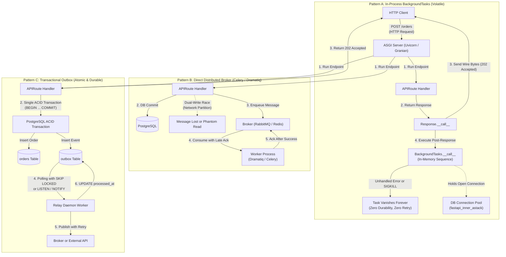

# In-Process BackgroundTasks vs Durable Distributed Queues (Celery 5.7.0, Dramatiq 2.2.1, and PostgreSQL Outbox)

> [!summary] Claim
> FastAPI's in-process `BackgroundTasks` executes tasks sequentially in worker memory only after the response's final ASGI `send()` has returned, providing zero durability, zero retries, and process-fate binding; production asynchronous side effects requiring at-least-once delivery or dual-write consistency require a durable broker with late acknowledgment (Celery 5.7.0 with `task_acks_late`, or Dramatiq 2.2.1, which acks after processing) or an atomic PostgreSQL Outbox.

Part of [FastAPI Internals and Patterns](README.md) in [API Engineering](../README.md).

## TL;DR

Starlette's `Response.__call__` runs `BackgroundTasks` sequentially in-process only after `await send({"type": "http.response.body", ...})` returns, running async tasks on the event loop and sync tasks through AnyIO's default thread limiter (starlette 1.10.0 starlette/responses.py, Response.__call__).
An HTTP `202 Accepted` is "intentionally noncommittal": the request "might or might not eventually be acted upon" (RFC 9110 Section 15.3.3), and an in-process task adds no durability against process crashes, OOM kills, or task exceptions.
Yield dependencies on the request stack (`fastapi_inner_astack`, which is where a yield dependency with no `scope` or `scope="request"` goes) stay open for the entire duration of all background tasks, and an exception inside a background task is re-raised to the ASGI server and logged there (Uvicorn logs `Exception in ASGI application`), never reported to the client and never retried.
The lab's 7 tests were run in verification only on CPython 3.14.6; the other matrix legs were not run, and the lab workspace cannot resolve on free-threaded 3.15t because `psycopg-binary==3.3.8` publishes no `cp315t` wheels, which is a lab dependency limit, not a Celery or Dramatiq one.
Never use in-process `BackgroundTasks` for billing, transactional emails, database mutations, webhooks, or any work whose loss matters; use Dramatiq, Celery with `task_acks_late = True`, or an atomic PostgreSQL Outbox.

## Mental model



The request lifecycle diverges fundamentally across these three architectural patterns once the HTTP client transmits its payload.
In Pattern A, FastAPI executes the endpoint, hands the HTTP response status code and serialized payload to the ASGI server's `send()`, and only then iterates over in-memory callables registered in `BackgroundTasks`; any process crash, server deployment, or unhandled exception permanently destroys the pending work because no state was written to disk or broker.
In Pattern B, the endpoint handler delegates durable execution to an external message broker like RabbitMQ or Redis via Celery or Dramatiq, achieving process isolation and retry resilience, but introducing the dual-write race condition if the database transaction and message enqueueing are not coordinated.
In Pattern C, the Transactional Outbox pattern binds domain state mutations and task event records into a single atomic PostgreSQL transaction committed to the Write-Ahead Log (WAL), after which an independent relay worker polls with `SELECT ... FOR UPDATE SKIP LOCKED` or listens to `pg_notify` to achieve true at-least-once asynchronous execution.

## How it works

### The In-Process BackgroundTasks Execution Pipeline

FastAPI models background task execution directly on Starlette's `starlette.background.BackgroundTasks` abstraction.
When an HTTP request enters an `APIRoute`, FastAPI compiles a dependency tree and allocates execution contexts in `fastapi/routing.py` within `get_request_handler`.
The ASGI application wraps endpoint execution inside two distinct `contextlib.AsyncExitStack` instances (fastapi 0.162.0 fastapi/routing.py, request_response):

```python
# Simplified excerpt: the inner app of request_response, comments and the
# response_awaited error branch removed
async def app(scope: Scope, receive: Receive, send: Send) -> None:
    response_awaited = False
    async with AsyncExitStack() as request_stack:
        scope["fastapi_inner_astack"] = request_stack
        async with AsyncExitStack() as function_stack:
            scope["fastapi_function_astack"] = function_stack
            response = await f(request)
        await response(scope, receive, send)
        response_awaited = True
```

This structural nesting establishes an invariant: all yield dependencies declared with `scope="function"` enter `function_stack` and are torn down immediately when `await f(request)` returns.
Conversely, yield dependencies declared with `scope="request"`, and yield dependencies with no `scope` at all (the computed default is `"request"`), enter `request_stack` (`fastapi_inner_astack`) and remain active during `await response(scope, receive, send)` (fastapi 0.162.0 fastapi/dependencies/utils.py, solve_dependencies; fastapi 0.162.0 fastapi/dependencies/models.py, _get_computed_scope).

In Starlette, `Response.__call__` implements the wire protocol exchange (starlette 1.10.0 starlette/responses.py, Response.__call__; excerpt, dedented by one level):

```python
async def __call__(self, scope: Scope, receive: Receive, send: Send) -> None:
    if scope["type"] == "websocket":
        send = self._wrap_websocket_denial_send(send)
    await send({"type": "http.response.start", "status": self.status_code, "headers": self.raw_headers})
    await send({"type": "http.response.body", "body": self.body})

    if self.background is not None:
        await self.background()
```

The application has handed the complete response to the server before any background code runs; whether the bytes have left the host yet depends on the server's transport buffering.
Under HTTP/1.1 the message ends at the `Content-Length` boundary or, for chunked transfer coding, at the `last-chunk` (`0\r\n`) followed by the final `CRLF` (RFC 9112 Section 7.1).
Under HTTP/2 the server ends the stream with a frame carrying the `END_STREAM` flag (RFC 9113 Section 6.1).
The client can therefore see `202 Accepted` or `200 OK` and conclude the exchange while the task has not yet started.

Only after both ASGI send events conclude does `Response.__call__` evaluate `if self.background is not None: await self.background()`.
In `starlette/background.py`, `BackgroundTasks.__call__` iterates over its internal list (starlette 1.10.0 starlette/background.py, BackgroundTasks):

```python
# Simplified excerpt: add_task omitted
class BackgroundTasks(BackgroundTask):
    def __init__(self, tasks: Sequence[BackgroundTask] | None = None):
        self.tasks = list(tasks) if tasks else []

    async def __call__(self) -> None:
        for task in self.tasks:
            await task()
```

Each task callable is evaluated in `BackgroundTask.__call__`, where `self.is_async` was computed once in `__init__` with `starlette._utils.is_async_callable(func)` (starlette 1.10.0 starlette/background.py, BackgroundTask.__call__; excerpt, dedented by one level):

```python
async def __call__(self) -> None:
    if self.is_async:
        await self.func(*self.args, **self.kwargs)
    else:
        await run_in_threadpool(self.func, *self.args, **self.kwargs)
```

In `starlette/concurrency.py`, `run_in_threadpool` binds the arguments with `functools.partial` and dispatches with `await anyio.to_thread.run_sync(func)` (starlette 1.10.0 starlette/concurrency.py, run_in_threadpool).
This dispatch introduces four failure modes:
First, tasks run strictly sequentially: if task 1 of 3 raises, tasks 2 and 3 are never executed (the lab's `test_in_process_background_task_unhandled_exception_drops_and_short_circuits` proves this).
Second, because `http.response.start` has already been sent, Starlette's `ServerErrorMiddleware` skips its `500 Internal Server Error` response and only re-raises, so the server logs the traceback and the client never learns of the failure (starlette 1.10.0 starlette/middleware/errors.py, ServerErrorMiddleware.__call__).
Third, synchronous background tasks consume tokens from AnyIO's default limiter (`anyio.to_thread.current_default_thread_limiter()`, a `CapacityLimiter(40)` on the asyncio backend; anyio 4.16.0 anyio/_backends/_asyncio.py, AsyncIOBackend.current_default_thread_limiter); if 40 synchronous background tasks block on slow I/O, every synchronous `def` endpoint and sync dependency in that process waits for a token.
Fourth, because `request_stack` (`fastapi_inner_astack`) wraps `await response(scope, receive, send)`, any request-scoped resource, such as an open SQLAlchemy database connection checked out in a yield dependency, is held open for the entire duration of all background tasks.

### Celery 5.7.0 Distributed Queue Mechanics

Celery decouples task dispatch from the ASGI application process by transmitting serialized messages through kombu to an AMQP broker (RabbitMQ) or a Redis list.
Task invocation via `Task.apply_async` or `task.delay` constructs a message envelope containing task identifier, positional arguments, keyword arguments, routing keys, and execution headers.

Celery 5.7.0 defaults to JSON serialization (`task_serializer = "json"`, `accept_content = ("json",)`, `task_protocol = 2`; celery 5.7.0 celery/app/defaults.py, NAMESPACES).
When a worker process retrieves a task, message acknowledgment behavior is governed by `task_acks_late`:

```python
# Default Celery behavior: Early Acknowledgment
task_acks_late = False  # the worker acks just before the task body runs
```

Under `task_acks_late = False`, the worker acknowledges the message when a pool process accepts the task, just before the task function runs (celery 5.7.0 celery/worker/request.py, Request.on_accepted and Request.execute); prefetched messages still waiting in the worker's buffer stay unacknowledged.
If the pool process is terminated by the Linux OOM killer (`SIGKILL`), a hardware failure, or a redeployment during task execution, the task is lost because the broker has already deleted the acknowledged message.
Hardening Celery for at-least-once delivery requires:

```python
task_acks_late = True
task_reject_on_worker_lost = True
worker_prefetch_multiplier = 1
```

Under `task_acks_late = True`, the ack is deferred until the task has executed, but "executed" includes raising: `task_acks_on_failure_or_timeout` defaults to `True`, so a task that raises is still acknowledged and not redelivered (celery 5.7.0 celery/app/defaults.py, NAMESPACES; celery 5.7.0 celery/worker/request.py, Request.on_failure).
Even with late ack, a pool process that exits abruptly gets its message acknowledged unless `task_reject_on_worker_lost = True`, in which case the main worker process calls `reject(requeue=True)` so the message is redelivered; the Celery docs warn that "Enabling this can cause message loops".
On RabbitMQ 4.0 and later, quorum queues drop or dead-letter a message after 20 redeliveries by default, which bounds that loop (Celery configuration reference, as of 2026-11).
The `worker_prefetch_multiplier` setting defaults to `4` (celery 5.7.0 celery/app/defaults.py, NAMESPACES).
Multiplied by worker concurrency (for example, 8 pool processes), a single Celery node reserves 32 messages (celery 5.7.0 celery/worker/consumer/consumer.py, Consumer).
If all 8 processes pick up 120-second tasks, the other 24 reserved messages, even 10-millisecond ones, wait up to 120 seconds in that node's buffer while workers on other nodes sit idle, because the broker has already delivered them to this node.

### Dramatiq 2.2.1 Actor Mechanics

Dramatiq was written by Bogdan Popa as a simpler alternative to Celery with safer defaults.
Dramatiq runs each worker process as a pool of threads (`dramatiq.Worker`, `worker_threads=8`), and its CLI starts one process per CPU by default (`--processes` default `multiprocessing.cpu_count()`, `--threads` default `8`; dramatiq 2.2.1 dramatiq/cli.py, make_argument_parser), so it is processes times threads, not threads instead of processes.

When an actor is declared via `@dramatiq.actor`, invocation with `actor.send(*args, **kwargs)` builds a `dramatiq.Message` encoded with the global encoder, which defaults to `JSONEncoder` (dramatiq 2.2.1 dramatiq/message.py, global_encoder).
The broker (`RabbitmqBroker` or `RedisBroker`) enqueues the message.
Dramatiq acknowledges a message only after its actor has run: the consumer thread acks it unless middleware marked it failed, in which case it nacks it into the dead-letter queue (`<queue>.XQ`) (dramatiq 2.2.1 dramatiq/worker.py, ConsumerThread.post_process_message).
When the actor raises and retries remain, `Retries` enqueues a delayed copy and the original is then acked; a worker killed mid-task leaves the message unacked, so RabbitMQ redelivers it when the channel closes.

Dramatiq embeds middleware directly into the processing pipeline (`default_middleware = [AgeLimit, TimeLimit, ShutdownNotifications, Callbacks, Pipelines, Retries]`; dramatiq 2.2.1 dramatiq/middleware/__init__.py):
- `dramatiq.middleware.Retries`: Implements exponential backoff with random jitter (`compute_backoff` multiplies by `uniform(1, 2)`; dramatiq 2.2.1 dramatiq/common.py, compute_backoff).
  The defaults are `max_retries = 20`, `min_backoff = 15000` ms (15 seconds), and `max_backoff = 86400000 * 7` ms (7 days) (dramatiq 2.2.1 dramatiq/middleware/retries.py, Retries).
- `dramatiq.middleware.AgeLimit`: Compares `message_timestamp` against `max_age`, which has no default (`None` disables the check), so it does nothing until you set `max_age` on the middleware, actor, or message.
  When set and exceeded, the message is marked failed and skipped, so it is dead-lettered rather than processed, which keeps a backlog of stale tasks from hitting backend databases after an outage (dramatiq 2.2.1 dramatiq/middleware/age_limit.py, AgeLimit.before_process_message).
- `dramatiq.brokers.stub.StubBroker`: An in-memory broker for hermetic unit tests; `broker.join(queue_name)` blocks until the queue drains, so tests run without RabbitMQ or Redis.

### The Dual-Write Problem and the PostgreSQL Transactional Outbox

When an API route mutates a relational database and enqueues an asynchronous task to Celery or Dramatiq, it executes two distinct network writes:
1. `db.commit()` to PostgreSQL.
2. `task.delay()` or `actor.send()` to RabbitMQ / Redis.

No distributed transaction coordinates these two independent storage systems.
If the application commits the database transaction and subsequently crashes or loses network connectivity to the broker before `task.delay()` completes, the domain change is permanent but the background task is lost.
If the application enqueues `task.delay()` before `db.commit()`, a fast worker can consume the message and query PostgreSQL before the API server's transaction has committed, and under the default `READ COMMITTED` isolation it does not see the row, triggering an entity-not-found error (Django's `ObjectDoesNotExist`, or an empty SQLAlchemy result).

```sql
-- Transactional Outbox Table Schema (PostgreSQL)
CREATE TABLE outbox (
    id UUID PRIMARY KEY DEFAULT gen_random_uuid(),
    event_type VARCHAR(128) NOT NULL,
    payload JSONB NOT NULL,
    status VARCHAR(32) NOT NULL DEFAULT 'pending',
    attempts INT NOT NULL DEFAULT 0,
    created_at TIMESTAMPTZ NOT NULL DEFAULT clock_timestamp(),
    processed_at TIMESTAMPTZ,
    last_error TEXT
);

CREATE INDEX idx_outbox_pending 
ON outbox (created_at) 
WHERE status IN ('pending', 'failed') AND attempts < 5;
```

The Transactional Outbox pattern guarantees consistency by writing both the domain mutation and the outbox event in the same ACID transaction:

```sql
BEGIN;
INSERT INTO orders (id, customer_id, amount_cents) VALUES ('ord_123', 'cust_456', 5000);
INSERT INTO outbox (event_type, payload) VALUES ('order.created', '{"order_id": "ord_123", "amount_cents": 5000}');
COMMIT;
```

Both records become durable together when the transaction's commit record is flushed to PostgreSQL's Write-Ahead Log (WAL) (with the default `synchronous_commit = on`).
If the transaction fails or aborts, neither record persists.
Once committed, a dedicated relay worker queries the outbox using `SELECT ... FOR UPDATE SKIP LOCKED` (PostgreSQL 9.5+):

```sql
SELECT id, event_type, payload, attempts
FROM outbox
WHERE status IN ('pending', 'failed') AND attempts < 5
ORDER BY created_at
LIMIT 50
FOR UPDATE SKIP LOCKED;
```

`FOR UPDATE SKIP LOCKED` locks the selected rows and, per the PostgreSQL manual, "any selected rows that cannot be immediately locked are skipped"; the manual adds that this "provides an inconsistent view of the data, so this is not suitable for general purpose work, but can be used to avoid lock contention with multiple consumers accessing a queue-like table" (PostgreSQL SELECT, The Locking Clause).
Multiple relay daemons can therefore poll the table in parallel and claim disjoint batches without waiting on each other's row locks; the table-level `ROW SHARE` lock is still taken normally.
The row locks last only as long as the claiming transaction, so a relay either publishes and marks rows inside that transaction or records a lease column (for example `locked_until`) before committing the claim.
Upon successfully dispatching the event to the external broker or API, the relay worker updates the record:

```sql
UPDATE outbox 
SET status = 'processed', processed_at = clock_timestamp() 
WHERE id = :id;
```

For low-latency dispatch without tight polling loops, a database trigger issues `PERFORM pg_notify('outbox_channel', NEW.id::text)`.
PostgreSQL delivers a notification only when the notifying transaction commits, and a listener that is disconnected misses it, so the relay daemon holds a persistent `LISTEN outbox_channel` connection to wake on commit while keeping the `SKIP LOCKED` poll as the fallback for missed notifications (PostgreSQL NOTIFY documentation).

## Numbers and limits

The operational boundaries of in-process background execution versus distributed task queues and transactional outboxes are measured across durability, concurrency, memory overhead, and latency.

| Architectural Dimension | FastAPI `BackgroundTasks` | Celery 5.7.0 (RabbitMQ/Redis) | Dramatiq 2.2.1 (RabbitMQ/Redis) | PostgreSQL Outbox (`SKIP LOCKED`) | Source / Authority |
|---|---|---|---|---|---|
| Durability Storage Medium | RAM only (volatile CPython process memory) | Broker RAM / Disk (AMQP durable queue, Redis RDB/AOF) | Broker RAM / Disk (AMQP durable queue, Redis RDB/AOF) | Disk (PostgreSQL WAL, fsync on transaction commit) | `(RFC 9110 Section 15.3.3)`, PostgreSQL manual |
| Default Acknowledgment Timing | None (no broker; nothing to ack) | Just before execution (`task_acks_late = False`) | After the actor runs (ack, or nack to `.XQ` if failed) | Post-relay update (`UPDATE outbox SET status='processed'`) | `(celery 5.7.0 celery/worker/request.py, Request.on_accepted)`, `(dramatiq 2.2.1 dramatiq/worker.py, ConsumerThread.post_process_message)` |
| Maximum Safe Task Duration | No safe bound: runs until done or the process stops; Uvicorn `timeout_graceful_shutdown` defaults to `None` | Hours / Days with late ack | Default `TimeLimit` is `600000` ms (10 minutes) per message | Bounded by the claim transaction or a lease column such as `locked_until` | `(uvicorn 0.54.0 uvicorn/config.py, Config.__init__)`, `(dramatiq 2.2.1 dramatiq/middleware/time_limit.py, TimeLimit)` |
| Default Threadpool Concurrency Limit | 40 tokens (`CapacityLimiter(40)`) | `worker_concurrency = None` -> `billiard.cpu_count()` (prefork pool) | 8 threads per process, 1 process per CPU via the CLI | N/A (relay process pool or async loop) | `(anyio 4.16.0 anyio/_backends/_asyncio.py, AsyncIOBackend.current_default_thread_limiter)`, `(celery 5.7.0 celery/worker/worker.py, WorkController)`, `(dramatiq 2.2.1 dramatiq/cli.py, make_argument_parser)` |
| Default Prefetch Depth | 0 (no queue) | 4x pool processes (`worker_prefetch_multiplier = 4`) | `queue_prefetch = min(worker_threads * 2, 65535)` = 16 per process at 8 threads | Configurable batch size (`LIMIT N`) | `(celery 5.7.0 celery/app/defaults.py, NAMESPACES)`, `(dramatiq 2.2.1 dramatiq/worker.py, Worker.__init__)` |
| Built-in Retry Backoff | None (0 retries; an exception aborts the remaining tasks) | None unless the task calls `self.retry()` or sets `autoretry_for`; `Task.max_retries = 3`, `default_retry_delay = 180` s | 20 retries, 15 s minimum to 7 days maximum, with jitter | Application-defined loop with exponential backoff | `(celery 5.7.0 celery/app/task.py, Task)`, `(dramatiq 2.2.1 dramatiq/middleware/retries.py, Retries)` |
| Enqueue Latency (p99) | 1.54 microseconds for `BackgroundTasks.add_task` (object creation and list append; measured, see Source) | Not measured: needs a live broker | Not measured: needs a live broker | Not measured: needs a live PostgreSQL | `add_task` timed with `time.perf_counter_ns` over 200,000 calls, 3 runs (p99 1541 to 1542 ns), Apple M3 Pro, macOS 27.3 (Darwin 27.3.0), CPython 3.14.6, starlette 1.10.0 |
| Worker Shutdown Behavior | Lost on `SIGKILL`; Uvicorn cancels it if `timeout_graceful_shutdown` expires | Warm shutdown on `SIGTERM`; loss on `SIGKILL` unless late ack and reject-on-worker-lost | Graceful `SIGTERM`; unacked message redelivered by RabbitMQ after `SIGKILL` | Committed events survive; uncommitted transactions roll back | Celery workers guide, Dramatiq docs |
| Blast Radius of Unhandled Error | Re-raised to the ASGI server and logged; later tasks in the list never run | Logged; task marked failed; retried only if configured | Logged; retried, then dead-lettered to `<queue>.XQ` after max retries | Logged; row marked `status = 'failed'` for inspection | Lab test `test_in_process_background_task_unhandled_exception_drops_and_short_circuits`, `(starlette 1.10.0 starlette/middleware/errors.py, ServerErrorMiddleware.__call__)` |
| Risk of Dual-Write Inconsistency | Severe (side effects uncoordinated with DB) | Severe (dual-write race between DB and broker) | Severe (dual-write race between DB and broker) | None for the DB write and the event row (one atomic commit); delivery downstream is at-least-once | microservices.io Transactional Outbox pattern |

## Portability

The portability matrix traces behavior across the CPython interpreter matrix, ASGI server implementations, and HTTP wire specifications.

| Runtime / Engine | Version | In-Process `BackgroundTasks` Support | Celery 5.7.0 Support | Dramatiq 2.2.1 Support | PostgreSQL Outbox Support | Portability Invariant and Source |
|---|---|---|---|---|---|---|
| CPython | 3.12.16 | Not run | Not run | Not run | Not run | Leg not run (matrix runs paused by the user, 2026-11-11); no claim made. |
| CPython | 3.13.18 | Not run | Not run | Not run | Not run | Leg not run; no claim made. |
| CPython | 3.14.6 | Supported | Not exercised by the lab | StubBroker test only | Simulated in memory only | Run here: `7 passed in 0.60s`, Apple M3 Pro, macOS 27.3 (Darwin 27.3.0, arm64). The pinned matrix names 3.14.10; the lab's default interpreter is 3.14.6. |
| CPython | 3.15.2 | Not run | Not run | Not run | Not run | Leg not run; no claim made. |
| CPython Free-Threaded | 3.15t | Not run | Not run | Not run | Not run | The lab workspace cannot resolve: `psycopg-binary==3.3.8` ships `cp315` wheels but no `cp315t` wheels (PyPI file list, as of 2026-11); the 3.14.10 leg named in STYLE.md was also not run. |
| Uvicorn | 0.54.0 | Native | External Process | External Process | External Daemon | Starlette runs `Response.background` inside the ASGI call; `timeout_graceful_shutdown` defaults to `None` (no forced cancel); not exercised by the lab, which uses `httpx.ASGITransport`. |
| Hypercorn | 0.18.0 | Native | External Process | External Process | External Daemon | Runs the same ASGI call on asyncio or Trio (AnyIO abstracts both); not exercised by the lab. |
| Granian | 2.8.7 | Native | External Process | External Process | External Daemon | Same Starlette code path; when bytes leave the host depends on the server's transport; not exercised by the lab. |
| HTTP/1.1 | RFC 9112 | Conforms | N/A | N/A | N/A | Message ends at the `Content-Length` boundary or at `last-chunk` plus final `CRLF` (RFC 9112 Section 7.1); the app has handed off the body before the task starts. |
| HTTP/2 | RFC 9113 | Conforms | N/A | N/A | N/A | Stream ends with a frame carrying `END_STREAM` (RFC 9113 Section 6.1). |
| HTTP/3 | RFC 9114 | Conforms | N/A | N/A | N/A | Request stream ends with the QUIC `STREAM` frame `FIN` bit (RFC 9000 Section 19.8). |

## Worked example

The worked example contrasts in-process background tasks with a resilient Transactional Outbox pattern implemented in FastAPI and verified with pytest.
The implementation lives at [implementation](../labs/src/api_labs/f11_fastapi_internals_and_patterns/background_tasks_vs_durable_queues.py) and the test suite at [test](../labs/tests/f11_fastapi_internals_and_patterns/test_backgroundtasks_vs_durable_task_queues_celery_and_dramatiq.py).

```python
# Simplified excerpt from labs/src/api_labs/f11_fastapi_internals_and_patterns/background_tasks_vs_durable_queues.py

@dataclass
class OutboxRecord:
    id: str
    event_type: str
    payload: dict[str, Any]
    status: str = "pending"
    attempts: int = 0
    created_at: float = field(default_factory=time.time)
    processed_at: float | None = None
    last_error: str | None = None


class TransactionalDatabase:
    def __init__(self) -> None:
        self.orders: dict[str, Order] = {}
        self.outbox: dict[str, OutboxRecord] = {}
        self._staged_orders: dict[str, Order] = {}
        self._staged_outbox: dict[str, OutboxRecord] = {}
        self._in_transaction: bool = False

    def begin(self) -> None:
        self._in_transaction = True
        self._staged_orders, self._staged_outbox = {}, {}

    def commit(self) -> None:
        self.orders.update(self._staged_orders)
        self.outbox.update(self._staged_outbox)
        self._in_transaction = False

    def rollback(self) -> None:
        self._staged_orders.clear()
        self._staged_outbox.clear()
        self._in_transaction = False

    def claim_pending_outbox(self, batch_size: int = 10) -> list[OutboxRecord]:
        claimed: list[OutboxRecord] = []
        for record in self.outbox.values():
            if record.status in ("pending", "failed") and record.attempts < 3:
                record.status = "processing"
                record.attempts += 1
                claimed.append(record)
                if len(claimed) >= batch_size:
                    break
        return claimed


def create_outbox_app(db: TransactionalDatabase) -> FastAPI:
    app = FastAPI()

    @app.post("/orders/outbox", status_code=202)
    async def place_order_outbox(payload: dict[str, Any]) -> dict[str, Any]:
        order_id = str(uuid.uuid4())
        outbox_id = str(uuid.uuid4())
        db.begin()
        try:
            order = Order(id=order_id, customer_id=payload["customer_id"], amount_cents=payload["amount_cents"])
            db.stage_order(order)
            outbox_entry = OutboxRecord(
                id=outbox_id,
                event_type="order.created",
                payload={"order_id": order_id, "amount_cents": order.amount_cents},
            )
            db.stage_outbox(outbox_entry)
            db.commit()
        except Exception as exc:
            db.rollback()
            raise HTTPException(status_code=500, detail="Transaction aborted") from exc
        return {"status": "accepted", "order_id": order_id, "outbox_id": outbox_id}

    return app
```

The test suite validates both the failure modes of `BackgroundTasks` and the durability guarantees of the Outbox and Dramatiq:

```python
# Simplified excerpt from labs/tests/f11_fastapi_internals_and_patterns/test_backgroundtasks_vs_durable_task_queues_celery_and_dramatiq.py

@pytest.mark.unit
@pytest.mark.asyncio
async def test_in_process_background_task_unhandled_exception_drops_and_short_circuits() -> None:
    db = TransactionalDatabase()
    task_log: list[str] = []
    app = create_in_process_app(db=db, task_log=task_log)

    async with httpx.AsyncClient(
        transport=httpx.ASGITransport(app=app, raise_app_exceptions=False),
        base_url="http://test",
    ) as client:
        response = await client.post(
            "/orders/in-process-faulty",
            json={"customer_id": "cust_102", "amount_cents": 9900},
        )

    assert response.status_code == 202
    assert response.json()["order_id"] in db.orders
    assert task_log == [f"task:started:{response.json()['order_id']}"]
    assert len(db.outbox) == 0


@pytest.mark.unit
def test_dramatiq_stub_broker_durable_delivery_and_ack() -> None:
    broker = StubBroker()
    dramatiq.set_broker(broker)
    messages_processed: list[str] = []

    @dramatiq.actor
    def process_invoice(invoice_id: str) -> None:
        messages_processed.append(invoice_id)

    worker = dramatiq.Worker(broker, worker_timeout=100)
    worker.start()
    process_invoice.send("inv_5001")
    broker.join(process_invoice.queue_name, timeout=2000)
    worker.stop()

    assert messages_processed == ["inv_5001"]
```

The execution output captured in verification on CPython 3.14.6, Apple M3 Pro, macOS 27.3 (Darwin 27.3.0, arm64):

```
$ cd labs && uv run --frozen pytest tests/f11_fastapi_internals_and_patterns/test_backgroundtasks_vs_durable_task_queues_celery_and_dramatiq.py -q
.......                                                                  [100%]
7 passed in 0.60s
```

## Pitfalls

> [!warning] Pitfall 1: The Phantom 202 Accepted Trap
> **Trigger**: An API endpoint returns `202 Accepted` after enqueuing work to FastAPI's in-process `BackgroundTasks`, but the task callable encounters a database deadlock, an unhandled network error, or an unexpected exception.
> **Symptom**: The client receives HTTP `202 Accepted` and assumes the operation succeeded; the background task crashes, Starlette re-raises the exception to the ASGI server, which logs it (Uvicorn: `Exception in ASGI application`), no retry occurs, and the work is permanently lost with zero notification to the caller.
> **Fix**: For operations requiring execution guarantees, return `202 Accepted` whose representation points to a status monitor (RFC 9110 Section 15.3.3; a `Location: /operations/{op_id}` header is a common convention, not something that section requires) backed by a persistent database record; never use in-process `BackgroundTasks` for tasks whose failure violates domain invariants.

> [!warning] Pitfall 2: Database Connection Pool Starvation via Request ExitStack Leakage
> **Trigger**: An endpoint uses a yield dependency (`scope="request"`) to manage database sessions (such as `async with sessionmaker() as session: yield session`), and attaches an in-process background task that performs slow external HTTP calls or sleeping.
> **Symptom**: Under concurrent traffic, SQLAlchemy raises `TimeoutError: QueuePool limit of size 5 overflow 10 reached, connection timed out` (defaults `pool_size=5`, `max_overflow=10`; sqlalchemy 2.1.8 sqlalchemy/pool/impl.py, QueuePool), or, without an application pool, PostgreSQL refuses new sessions and asyncpg raises `asyncpg.exceptions.TooManyConnectionsError`.
> **Fix**: Recognize that FastAPI's `fastapi_inner_astack` context manager does not exit until `Response.__call__` completes, keeping all request-scoped dependencies alive while `await self.background()` runs; never inject or capture request-scoped database sessions inside in-process background tasks.

> [!warning] Pitfall 3: Celery `acks_late=False` Message Obliteration on Kubernetes Deployments
> **Trigger**: Running Celery workers in Kubernetes with default configuration (`task_acks_late = False`), followed by a rolling deployment or pod eviction.
> **Symptom**: Kubernetes sends `SIGTERM` to the pod (Celery begins a warm shutdown and waits for running tasks), the grace period expires, Kubernetes sends `SIGKILL`, and in-flight tasks disappear without a trace because Celery acked each message when a pool process accepted it.
> **Fix**: Explicitly configure `task_acks_late = True`, `task_reject_on_worker_lost = True`, set `terminationGracePeriodSeconds` above the longest task, and make all task functions strictly idempotent, because late ack turns loss into redelivery.

> [!warning] Pitfall 4: The Dual-Write Race Condition
> **Trigger**: An endpoint calls `db.commit()` and then executes `celery_task.delay(order.id)`.
> **Symptom**: If the broker connection times out or the process dies between the database commit and broker dispatch, the order exists in the database but the background task is never created; conversely, if `celery_task.delay()` runs before `db.commit()`, the worker can pull the message first and fail to find the row (Django's `ObjectDoesNotExist`) because the database transaction is still in flight.
> **Fix**: Eliminate dual writes by storing outbox events in the same database transaction as the domain state, and relaying them asynchronously via `SELECT ... FOR UPDATE SKIP LOCKED` or PostgreSQL `LISTEN / NOTIFY`.

> [!warning] Pitfall 5: Celery Prefetch Head-of-Line Blocking
> **Trigger**: Mixing heterogeneous tasks (some executing in 10 milliseconds, others executing in 120 seconds) on workers configured with default `worker_prefetch_multiplier = 4`.
> **Symptom**: A single worker with 8 pool processes reserves 32 messages; once all 8 processes are busy with 120-second tasks, the other 24 reserved messages, fast ones included, wait in that node's buffer, causing high p99 latency while other worker nodes remain idle.
> **Fix**: Set `worker_prefetch_multiplier = 1` for clusters running long or variable-length tasks, or route heterogeneous tasks to dedicated queues and separate worker pools.

> [!warning] Pitfall 6: Silent Dropping of Parameter-Injected BackgroundTasks
> **Trigger**: An endpoint declares `background_tasks: BackgroundTasks` in its signature, calls `background_tasks.add_task(task_a)`, and subsequently returns a custom `Response(content=..., background=BackgroundTask(task_b))`.
> **Symptom**: `task_b` executes, but `task_a` is silently dropped without an error or log.
> **Fix**: Understand that FastAPI checks `if raw_response.background is None: raw_response.background = solved_result.background_tasks` (fastapi 0.162.0 fastapi/routing.py, get_request_handler); if `raw_response.background` is already populated, the injected `background_tasks` object is ignored, as the lab's `test_in_process_response_background_override_silently_drops_injected_tasks` proves; attach all tasks to a single container, for example `Response(..., background=background_tasks)` after adding every task to it.

## Security and robustness

### Serializer Exploitation and Remote Code Execution

The serialization boundary between API producers and asynchronous workers is a high-risk security attack surface.
Before Celery 4.0, `pickle` was the default serializer, so anyone who could write to the broker could make workers unpickle a crafted payload and run arbitrary code; Celery 4.0 states "json is the default serializer starting from this version" (Celery 4.0 release notes).
The result backend is a second trust boundary: CVE-2021-23727 covers Celery before 5.2.2, which "by default trusts the messages and metadata stored in backends (result stores)", so an attacker who can manipulate backend metadata can "trigger a stored command injection vulnerability" when that metadata is deserialized (NVD and CVE record CVE-2021-23727).
In Celery 5.7.0 these JSON settings are already the defaults; pin them explicitly so a later config change cannot silently re-enable `pickle`:

```python
# Celery 5.7.0 Security Hardening
task_serializer = "json"
result_serializer = "json"
accept_content = ["json"]
result_accept_content = ["json"]
task_protocol = 2
```

Dramatiq's global encoder defaults to `JSONEncoder`, but it also ships `dramatiq.encoder.PickleEncoder`, which `dramatiq.set_encoder` enables; treat any non-JSON encoder as a remote code execution surface on every worker (dramatiq 2.2.1 dramatiq/encoder.py, PickleEncoder).

### Denial of Service via Unbounded In-Process Queueing

FastAPI's `BackgroundTasks` stores each request's pending tasks in a plain Python list owned by that request; there is no shared queue and no bound.
Each pending task keeps its request coroutine, its connection state, and every request-scoped dependency alive, so under an ingress flood (for example, 10,000 requests per second, each registering a 200-millisecond task) in-flight work grows with arrival rate rather than with a configured limit.
Memory climbs until the OOM killer terminates the whole Uvicorn worker process, dropping every in-flight connection and every pending task with it; Uvicorn's `--limit-concurrency` (default `None`) is the only built-in cap, and it answers new requests with `503` once open connections or running request tasks (background tasks included, since they run inside the request task) reach the limit (uvicorn 0.54.0 uvicorn/protocols/http/h11_impl.py, H11Protocol.handle_events).
Distributed brokers support bounded queues and backpressure: RabbitMQ's `x-max-length` with `x-overflow` set to `reject-publish` discards new publishes and, with publisher confirms, tells the publisher via `basic.nack`, so the API can shed load with `429 Too Many Requests` or `503 Service Unavailable` (RabbitMQ Queue Length Limit documentation).

### Threadpool Starvation and Event Loop Blocking

In-process background tasks run directly inside the API server runtime:
- Synchronous tasks run via AnyIO's `run_sync`, consuming tokens from `anyio.to_thread.current_default_thread_limiter()` (40 threads).
- Asynchronous tasks run directly on the worker process's asyncio event loop.

If a developer places CPU-bound processing (such as image resizing, cryptographic hashing, or large JSON parsing) inside an `async def` background task, it blocks the event loop thread.
The worker ceases processing incoming TCP packets, heartbeats fail, Kubernetes readiness probes fail with connection timeouts, and the pod is killed.
Background tasks must never execute CPU-bound work on the event loop; offload CPU-intensive operations to dedicated worker processes or external microservices.

### Credential Leakage and Logging Boundaries

Background task arguments are frequently logged by task monitors (such as Celery Flower or Redis monitors).
Passing sensitive parameters (plain-text passwords, session tokens, AWS credentials, credit card numbers) as direct task arguments exposes them across application logs and worker storage backends.
Enforce a reference-only convention: pass opaque database primary keys or UUIDs in task payloads, and require the background worker to fetch sensitive state within authenticated, audited database boundaries.

## The principal's view

The decision between in-process background tasks, distributed queues, and transactional outboxes defines a team's operational complexity and system reliability boundaries.
In-process `BackgroundTasks` is an attractive trap: it requires zero infrastructure, zero message brokers, and zero operational overhead, making it tempting for early-stage prototypes.
However, a principal engineer must establish a hard invariant across the engineering organization: in-process `BackgroundTasks` is strictly prohibited for any operation whose failure alters business reality, compromises audit trails, or creates state divergence between microservices.

The selection rubric follows three distinct operational tiers:

1. **Tier 1: Ephemeral Non-Critical Operations (In-Process `BackgroundTasks`)**
   Permitted solely for best-effort, fire-and-forget side effects where total loss has zero business impact.
   Valid examples: incrementing a non-critical Redis metrics counter, emitting a statsd UDP packet, or deleting a temporary file cached on local disk.
   If the business loses revenue, fails an audit, or violates user trust when the task vanishes, it does not belong in `BackgroundTasks`.

2. **Tier 2: Asynchronous Distributed Processing (Dramatiq 2.2.1 or Celery 5.7.0)**
   Required for high-volume background work that is decoupled from immediate database state.
   Valid examples: video encoding, PDF report rendering, webhook fan-out, and third-party API batch processing.
   For modern Python services, Dramatiq is the preferred tool: it acks only after the actor runs, uses threads inside each process, ships rate limiters (`dramatiq.rate_limits`), and retries with exponential backoff by default, which removes the early-ack and no-retry defaults that Celery users must override; the trade-off is that task code must be thread-safe and Dramatiq has no built-in result store beyond the optional `Results` middleware.
   Celery 5.7.0 remains justifiable only in organizations with deep operational investments in Celery monitoring infrastructure (such as Flower) or specialized prefork concurrency requirements.

3. **Tier 3: Transactional Integrity and Event Sourcing (PostgreSQL Outbox)**
   Mandatory for any operation that must maintain strict consistency with relational database state.
   Valid examples: payment processing, order placement, account provisioning, user registration confirmation emails, and ledger modifications.
   By leveraging PostgreSQL's `SELECT ... FOR UPDATE SKIP LOCKED` or `LISTEN / NOTIFY`, teams achieve complete resilience against dual writes without the operational overhead of a distributed two-phase commit (2PC) coordinator.

When system scale reaches millions of events per hour, the polling outbox pattern transitions naturally to Change Data Capture (CDC) via Debezium tailing the PostgreSQL Write-Ahead Log into Apache Kafka or AWS SQS.
This preserves the application-level simplicity of single-transaction commits while offloading relay polling overhead entirely from the primary relational database.

## Interview questions

> [!question] L5: Predict the output and explain the execution order of the following FastAPI endpoint:
> ```python
> @app.post("/test", status_code=202)
> async def test_endpoint(background_tasks: BackgroundTasks):
>     print("1. Endpoint entered")
>     background_tasks.add_task(lambda: print("3. Background executed"))
>     print("2. Endpoint returning")
>     return {"status": "ok"}
> ```
>
> > [!success]- Answer
> > The output will be:
> > `1. Endpoint entered`
> > `2. Endpoint returning`
> > `3. Background executed`
> > FastAPI executes the endpoint coroutine to completion, serializes the response dictionary into JSON bytes, and invokes Starlette's `Response.__call__`.
> > In `Response.__call__`, the server sends the HTTP headers (`http.response.start`) and body (`http.response.body`) over the ASGI channel to the client.
> > Only after both `send()` calls have returned, meaning the server has accepted the complete response (not necessarily that the client has received it), does `Response.__call__` await `self.background()`, which runs the sync lambda through `run_in_threadpool`.
> >
> > Follow-up: What happens if the lambda raises an unhandled `ValueError`? Does the client receive an HTTP 500?

> [!question] L5: How does FastAPI's execution mechanism differ when you pass a standard `def` function versus an `async def` function to `BackgroundTasks.add_task`?
>
> > [!success]- Answer
> > When passing an `async def` function, Starlette's `BackgroundTask.__call__` detects `is_async_callable(func)` as true and directly awaits the coroutine on the main asyncio event loop.
> > When passing a standard `def` function, `is_async_callable(func)` evaluates to false, and Starlette delegates execution to `run_in_threadpool`, which invokes `anyio.to_thread.run_sync`.
> > The synchronous function executes inside AnyIO's shared worker threadpool, which is bounded by default to 40 concurrent tokens.
> > If multiple synchronous background tasks perform blocking I/O, they can exhaust the threadpool and starve all other synchronous `def` endpoints across the application.
> >
> > Follow-up: How do you adjust AnyIO's global threadpool capacity in a running FastAPI application?

> [!question] L6: Debug this API: Under load, this FastAPI application crashes with `QueuePool limit of size 5 overflow 10 reached, connection timed out`:
> ```python
> async def get_db():
>     async with engine.connect() as conn:
>         yield conn
> 
> @app.post("/export")
> async def export_report(
>     background_tasks: BackgroundTasks,
>     db: AsyncConnection = Depends(get_db),
> ):
>     order_count = await db.scalar(select(func.count()).select_from(orders))
>     background_tasks.add_task(slow_csv_generator, order_count)
>     return {"status": "processing"}
> ```
>
> > [!success]- Answer
> > The bug stems from FastAPI's dependency cleanup lifecycle.
> > In `fastapi/routing.py`, dependencies declared with yield enter `fastapi_inner_astack`, which wraps the execution of `await response(scope, receive, send)`.
> > Starlette executes `BackgroundTasks` inside `Response.__call__` before `response` finishes.
> > Consequently, the `get_db` generator cannot reach its `finally` block or context manager exit until `slow_csv_generator` completes.
> > The database connection remains checked out from the pool for the entire duration of the background task; under concurrent traffic, 15 concurrent requests hold all 15 pool connections, exhausting the pool and causing subsequent HTTP requests to fail with timeout errors.
> > To fix this, change the dependency scope or explicitly close the session before returning, or pass raw IDs to the background task and manage a fresh connection lifecycle inside the task.
> >
> > Follow-up: Why does changing `scope="function"` on the dependency resolve this pool starvation issue?

> [!question] L6: Explain why Celery's default setting `task_acks_late = False` causes silent task loss during Kubernetes pod autoscaling or redeployments, and how `task_reject_on_worker_lost` interacts with it.
>
> > [!success]- Answer
> > By default, Celery acknowledges the message when a pool process accepts the task, just before the task body runs (celery 5.7.0 celery/worker/request.py, Request.on_accepted).
> > When Kubernetes scales down a deployment or restarts a pod, it sends `SIGTERM`, waits for the termination grace period, and then issues `SIGKILL`.
> > If a worker process is terminated while executing a task, the broker will not redeliver the message because it was already acknowledged and removed from the queue.
> > Setting `task_acks_late = True` instructs Celery to defer the acknowledgment until the task has executed; because `task_acks_on_failure_or_timeout` defaults to `True`, a task that raises is still acknowledged.
> > However, if a pool process dies abruptly (OOM killer or segfault), Celery still acknowledges the message unless `task_reject_on_worker_lost = True`, in which case the main worker process rejects it with `requeue=True` so another worker can consume it; the docs warn this "can cause message loops".
> >
> > Follow-up: What prerequisite must your task code satisfy before enabling `task_acks_late = True`?

> [!question] L6: In FastAPI 0.162.0, predict the behavior of this route when a client issues a POST request:
> ```python
> @app.post("/hook", status_code=202)
> async def webhook(background_tasks: BackgroundTasks):
>     background_tasks.add_task(audit_log, "event_received")
>     return Response(
>         content='{"ok": true}',
>         media_type="application/json",
>         background=BackgroundTask(metric_log, "webhook_count"),
>     )
> ```
>
> > [!success]- Answer
> > Only `metric_log` will execute; `audit_log` will be silently dropped and will never run.
> > In `fastapi/routing.py`, within `get_request_handler`, FastAPI checks whether the returned object is an instance of `Response`.
> > If it is, the code evaluates: `if raw_response.background is None: raw_response.background = solved_result.background_tasks`.
> > Because the endpoint explicitly provided a `BackgroundTask` to the `Response` constructor, `raw_response.background` is not `None`.
> > FastAPI skips attaching `solved_result.background_tasks`, silently discarding all tasks added to the dependency-injected `background_tasks` object.
> >
> > Follow-up: How should the endpoint be rewritten if you must return a custom `Response` instance while preserving both tasks?

> [!question] L7: Explain why the "dual-write" problem cannot be solved by simply wrapping the database write and the Celery `task.delay()` call in a Python `try...except` block, and explain how the Transactional Outbox pattern guarantees consistency.
>
> > [!success]- Answer
> > Wrapping the operations in `try...except` fails because the relational database and the message broker are two independent storage systems lacking a distributed two-phase commit (2PC) coordinator.
> > If the database commits first and the network partition occurs before `task.delay()` reaches RabbitMQ, the database has permanently committed while the message broker has no record of the task.
> > If the message broker is published to first and the subsequent `db.commit()` fails due to a constraint violation or database crash, the worker executes a task for domain data that was never committed.
> > The Transactional Outbox pattern resolves this by avoiding dual writes across different systems: it writes both the domain record and an event record into the same database within a single ACID transaction.
> > The database engine guarantees that either both writes are committed to the Write-Ahead Log (WAL) or both are rolled back; an independent relay worker then reads the outbox table and dispatches messages with at-least-once delivery semantics.
> >
> > Follow-up: How do you handle duplicate event delivery on downstream consumers when using an outbox relay worker?

> [!question] L7: Design a high-throughput PostgreSQL Transactional Outbox relay worker capable of processing 10,000 events per second. How do you prevent lock contention, transaction table bloat, and connection exhaustion?
>
> > [!success]- Answer
> > To achieve 10,000 events per second without table bloat or lock contention, design the outbox table with PostgreSQL declarative range partitioning based on `created_at` (for example, hourly partitions).
> > Relay workers poll the table using `SELECT id, payload FROM outbox WHERE status = 'pending' ORDER BY id LIMIT 500 FOR UPDATE SKIP LOCKED`.
> > `FOR UPDATE SKIP LOCKED` allows dozens of concurrent worker processes to read and lock non-overlapping batches of rows simultaneously without waiting on row locks.
> > To eliminate tight polling loops during low-traffic windows, attach a trigger to the outbox table that emits `PERFORM pg_notify('outbox_events', NEW.id::text)`, allowing relay workers to idle on a persistent `LISTEN` connection and wake up immediately on commit.
> > To eliminate database write amplification and autovacuum bloat caused by updating millions of rows to `status = 'processed'`, workers delete processed records in batches or drop completed historical partitions using `ALTER TABLE outbox DETACH PARTITION` and `DROP TABLE`.
> >
> > Follow-up: What are the architectural trade-offs of replacing the polling relay worker with a Change Data Capture (CDC) pipeline like Debezium?

> [!question] L7+: Compare Dramatiq 2.2.1 and Celery 5.7.0 from an architectural perspective: how do their process models, thread usage, memory isolation, and default configuration invariants differ for mission-critical API platforms?
>
> > [!success]- Answer
> > Celery employs a prefork multi-process model by default, where the main worker process spawns pool child processes, one task per child at a time; Dramatiq's CLI starts one process per CPU, each running 8 worker threads fed by consumer threads (dramatiq 2.2.1 dramatiq/cli.py, make_argument_parser).
> > Celery's prefork model isolates each running task in its own process, so a C-extension segfault kills one child, but costs a process per unit of concurrency and needs fork-safe handling of connections opened before the fork.
> > Dramatiq runs several tasks per process on threads, which is lighter on memory, but task code must be thread-safe, one segfault kills every task in that process, and on GIL builds CPU-heavy actors serialize within a process; Dramatiq's CLI starts its processes with `fork` on Linux before CPython 3.14 and `forkserver` from 3.14 (spawn on macOS and Windows), so module-level connections still need care.
> > Dramatiq's defaults are safer: it acks only after the actor runs, `Retries` gives 20 retries with exponential backoff and jitter, and failed messages are dead-lettered; `AgeLimit` is in the default stack but inert until `max_age` is set.
> > Celery defaults to early acknowledgment (`task_acks_late = False`), prefetching 4 messages per process (`worker_prefetch_multiplier = 4`), and no automatic retries at all unless a task calls `self.retry()` or sets `autoretry_for`.
> >
> > Follow-up: How does CPython 3.13+ free-threaded execution impact the architectural choice between Dramatiq's thread-based model and Celery's prefork model?

## Related

Prerequisites: [[OpenAPI-Generation-Internals-in-FastAPI-Get-OpenAPI-and-Separate-Schemas]]

Next: [[Structuring-Large-FastAPI-Applications-APIRouter-Lifespan-and-Domain-Modules]]

See also: [[02-Programming-Languages/Python/Python-Backend-Interview-Prep/04-FastAPI]], [[02-Programming-Languages/Python/Python-Backend-Interview-Prep/08-Microservices-and-Messaging]], [[02-Programming-Languages/Python/Python-Backend-Interview-Prep/17-Concurrency-in-Web-Services-and-Coding]], [[Yield-Dependencies-AsyncExitStack-Cleanup-Timing-and-Scope]], [[Async-Def-vs-Def-Endpoints-and-AnyIO-Threadpool-Limiter-Semantics]], [[Custom-Response-Classes-ORJSONResponse-and-MsgSpec-Integration]], [[Transactional-Outbox-Pattern-Solving-Dual-Writes-Between-DB-and-Events]], [[Idempotent-Event-Consumers-Inbox-Pattern-and-Poison-Message-DLQs]]
- Lab: `labs/tests/f11_fastapi_internals_and_patterns/test_backgroundtasks_vs_durable_task_queues_celery_and_dramatiq.py`

## Further reading

- [RFC 9110: HTTP Semantics](https://www.rfc-editor.org/rfc/rfc9110.html) - Defines the normative contract for asynchronous processing and the non-guarantee semantics of HTTP 202 Accepted in Section 15.3.3.
- [RFC 9112: HTTP/1.1](https://www.rfc-editor.org/rfc/rfc9112.html) - Specifies message body framing, chunked transfer encoding, and connection boundaries in Section 7.1.
- [ASGI 3.0 Specification](https://asgi.readthedocs.io/en/latest/specs/main.html) - Details the asynchronous scope-receive-send protocol between ASGI servers and Python web applications.
- [Starlette Background Tasks Source](https://github.com/encode/starlette/tree/1.10.0) - Contains the reference implementation of `BackgroundTask` and `BackgroundTasks` in `starlette/background.py`.
- [FastAPI Routing and Lifecycle Source](https://github.com/fastapi/fastapi/tree/0.162.0) - Documents `fastapi_inner_astack` nesting and background task execution in `fastapi/routing.py`.
- [Celery User Guide and Configuration Reference](https://docs.celeryq.dev/en/v5.7.0/) - Comprehensive guide covering `task_acks_late`, `worker_prefetch_multiplier`, and AMQP consumer loops.
- [Dramatiq Documentation](https://dramatiq.io/) - The maintainer's documentation of actors, brokers, middleware, and the motivation for Dramatiq's defaults.
- [PostgreSQL Explicit Locking Documentation](https://www.postgresql.org/docs/current/explicit-locking.html) - Authoritative reference on row-level lock modes taken by `SELECT FOR UPDATE`.
- [PostgreSQL SELECT, The Locking Clause](https://www.postgresql.org/docs/current/sql-select.html) - The normative text for `SKIP LOCKED`, including its warning that it gives an inconsistent view suited only to queue-like tables.
- [microservices.io: Transactional Outbox](https://microservices.io/patterns/data/transactional-outbox.html) - Chris Richardson's pattern description of resolving dual writes between a database and a message broker.
