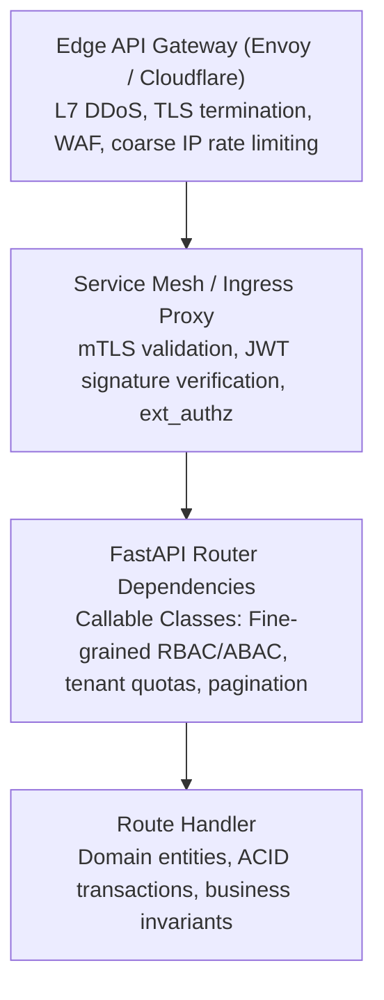

# Parameterized Dependencies in FastAPI: Callable Classes (__call__) for Role Guards, Rate Limiters, and Pagination Parsers

> [!summary] Claim
> Callable class instances parameterize dependency logic at startup via `__init__` while deferring request parameter binding and execution to `__call__`, enabling clean OpenAPI parameter propagation, sub-dependency composition, and value-based test overrides when implemented as frozen dataclasses.

Part of [FastAPI Internals and Patterns](README.md) in [API Engineering](../README.md).

## TL;DR

Callable class instances decouple route-registration configuration in `__init__` from per-request evaluation in `__call__`.
Every class-based dependency instance acts as a long-lived shared singleton across requests, so request-scoped data must never be stored on `self`, and any shared mutable state (such as a rate limiter's history) needs explicit synchronization.
Implementing guards as frozen dataclasses grants value equality and hashability, enabling direct overrides in `app.dependency_overrides` without leaking global references.
FastAPI inspects `__call__` signatures at startup to extract query parameters, headers, and child dependencies into OpenAPI schemas without wrapper boilerplate; the instance pattern relies only on `inspect.signature()`, which behaves the same on FastAPI 0.162.0's supported CPython releases (`Requires-Python: >=3.10`).
Do not use callable classes for simple parameterless dependencies, where a plain top-level function carries no constructor, no shared instance, and no equality semantics to get wrong.

## Mental model

```mermaid
flowchart TD
    subgraph RouteRegistration["Startup / Route Registration Phase"]
        Init["Instantiate Callable Class<br/>guard = RequirePermission('ledger:post')<br/>__init__ stores static policy on instance"]
        RouteDef["Endpoint Definition<br/>@app.get('/items', dependencies=[Depends(guard)])"]
        Inspection["FastAPI inspect.signature(guard)<br/>Binds self, inspects __call__ parameters"]
        DependantTree["Compile Dependant Node<br/>Registers query/header params and sub-dependencies into DAG"]
        OpenAPI["Generate OpenAPI Schema<br/>Extracts parameters and schemas from __call__ signature"]
        Init --> RouteDef --> Inspection --> DependantTree --> OpenAPI
    end

    subgraph RequestExecution["Per-Request Execution Phase"]
        Request["Incoming HTTP Request<br/>ASGI scope, receive, send"]
        SolveDep["solve_dependencies()<br/>Traverses Dependant DAG"]
        Overrides["Check app.dependency_overrides<br/>Matches guard instance by hash and equality"]
        SubDeps["Resolve Sub-Dependencies<br/>Injects Request, Header, current_user into __call__ kwargs"]
        ExecCall{"Is __call__ coroutine?"}
        AsyncExec["await guard.__call__(**kwargs)<br/>Executes on asyncio event loop"]
        SyncExec["await run_in_threadpool(guard, **kwargs)<br/>Offloads to Starlette AnyIO worker thread"]
        Endpoint["Invoke Route Handler<br/>Returns 200 OK or raises HTTPException"]

        Request --> SolveDep --> Overrides --> SubDeps --> ExecCall
        ExecCall -- "async def" --> AsyncExec --> Endpoint
        ExecCall -- "def" --> SyncExec --> Endpoint
    end
```



The route registration phase configures policy once at module import or application startup by invoking `__init__` on the dependency class.
When FastAPI compiles an `APIRoute`, `get_dependant()` calls `inspect.signature()` on the callable instance, which automatically binds `self` and exposes only the runtime parameters declared on `__call__`.
FastAPI parses these parameters into query parameters, header fields, and child `Dependant` nodes, exporting them directly into the generated OpenAPI specification.
During the per-request execution phase, `solve_dependencies()` checks `app.dependency_overrides` using the callable's hash and equality before resolving the dependency graph.
If `__call__` is an asynchronous coroutine function, FastAPI awaits it directly on the active event loop; if synchronous, FastAPI wraps execution in `run_in_threadpool()` using Starlette's AnyIO worker threadpool.

## How it works

FastAPI treats any Python callable as a valid dependency target in `Depends(dependency)`.
When a class object is passed directly, such as `Depends(CommonQueryParams)`, Python evaluates `inspect.isclass(call)` as `True`.
FastAPI inspects the constructor signature `CommonQueryParams.__init__` and instantiates a brand new instance on every request.
When a class *instance* is passed, such as `Depends(RequirePermission("ledger:post"))`, `inspect.isclass(call)` evaluates to `False`.
FastAPI discovers the `__call__` method via `_get_signature()` in `(fastapi 0.162.0 fastapi/dependencies/utils.py, _get_signature)`:

```python
def _get_signature(call: Callable[..., Any]) -> inspect.Signature:
    try:
        signature = inspect.signature(call, eval_str=True)
    except NameError:
        # Handle type annotations with if TYPE_CHECKING, not used by FastAPI
        # e.g. dependency return types
        if sys.version_info >= (3, 14):
            from annotationlib import Format

            signature = inspect.signature(call, annotation_format=Format.FORWARDREF)
        else:
            signature = inspect.signature(call)
    return signature
```

`get_dependant()` reaches this through `get_typed_signature(call)` in the same file.

Because `call` is a bound instance, Python's `inspect.signature()` strips the leading `self` parameter.
The remaining parameters define the request-time dependencies.
FastAPI loops through each parameter in `(fastapi 0.162.0 fastapi/dependencies/utils.py, get_dependant)`:
Parameters annotated with `Query()`, `Header()`, `Cookie()`, or `Path()` are appended to `dependant.query_params`, `dependant.header_params`, `dependant.cookie_params`, or `dependant.path_params`.
Parameters annotated with `Depends()` or `Security()` trigger recursive calls to `get_dependant()`, constructing a directed acyclic graph (DAG) of dependencies.

FastAPI classifies whether the callable is asynchronous via `_is_coroutine_callable_cached()` in `(fastapi 0.162.0 fastapi/dependencies/models.py, _is_coroutine_callable_cached)`:

```python
def _is_coroutine_callable_cached(call_identity: _CallIdentity) -> bool:
    call = call_identity.call
    if inspect.isroutine(_impartial(call)) and iscoroutinefunction(_impartial(call)):
        return True
    if inspect.isroutine(_unwrapped_call(call)) and iscoroutinefunction(
        _unwrapped_call(call)
    ):
        return True
    if inspect.isclass(_unwrapped_call(call)):
        return False
    dunder_call = getattr(_impartial(call), "__call__", None)  # noqa: B004
    if dunder_call is None:
        return False  # pragma: no cover
    if iscoroutinefunction(_impartial(dunder_call)) or iscoroutinefunction(
        _unwrapped_call(dunder_call)
    ):
        return True
    dunder_unwrapped_call = getattr(_unwrapped_call(call), "__call__", None)  # noqa: B004
    if dunder_unwrapped_call is None:
        return False  # pragma: no cover
    return iscoroutinefunction(
        _impartial(dunder_unwrapped_call)
    ) or iscoroutinefunction(_unwrapped_call(dunder_unwrapped_call))
```

This classification is wrapped in `@lru_cache(maxsize=_CALLABLE_CLASSIFICATION_CACHE_SIZE)` (`4096`) keyed by `_CallIdentity(call)`, whose `__hash__` returns `id(self.call)` and whose `__eq__` tests `self.call is other.call` `(fastapi 0.162.0 fastapi/dependencies/models.py, _CallIdentity)`.
Classification is therefore by identity, not by dataclass equality, and the cache holds a strong reference to each of up to 4,096 classified callables.
If `__call__` is an `async def` method, `solve_dependencies()` executes `await call(**solved_result.values)`.
If `__call__` is a synchronous `def` method, `solve_dependencies()` dispatches execution via `await run_in_threadpool(call, **solved_result.values)` in `(starlette 1.10.0 starlette/concurrency.py, run_in_threadpool)`.

FastAPI caches resolved dependencies within a request using `dependency_cache: dict[DependencyCacheKey, Any]`.
The cache key is computed in `(fastapi 0.162.0 fastapi/dependencies/models.py, _get_cache_key)`:

```python
def _get_cache_key(
    *,
    dependant: Dependant,
    uses_scopes_cache: _UsesScopesCache | None = None,
) -> DependencyCacheKey:
    scopes_for_cache = (
        tuple(sorted(set(_get_oauth_scopes(dependant=dependant))))
        if _uses_scopes(dependant=dependant, cache=uses_scopes_cache)
        else ()
    )
    return (
        dependant.call,
        scopes_for_cache,
        _get_computed_scope(dependant=dependant) or "",
    )
```

The first element of the tuple is `dependant.call`, which is the exact instance passed to `Depends()`.
In Python, dictionary lookup evaluates `hash(key)` followed by equality `key1 == key2`.
If the callable class does not implement `__eq__` and `__hash__`, Python falls back to object identity `id()`.
Under object identity, two distinct instances with identical configuration compare unequal.
Decorating the class with `@dataclass(frozen=True)` generates structural `__eq__` and `__hash__` methods based on constructor fields.
This allows equivalent guard specifications to share cached results within a request and enables clean value-based mocking in unit tests.
In the verification probe for this note, a route that declared `Depends(Cnt("z"))` both in `dependencies=[...]` and as a parameter invoked `Cnt.__call__` once per request (FastAPI 0.162.0, CPython 3.14.6).
The override lookup itself is `dependency_overrides.get(original_call, original_call)` inside `(fastapi 0.162.0 fastapi/dependencies/utils.py, solve_dependencies)`, an ordinary dictionary lookup by `__hash__` and `__eq__`.

### Role Guards and Permission Enforcement

A role guard verifies that an authenticated user possesses specific permissions before allowing execution to proceed.
The guard constructor captures required permissions, such as `RequirePermission("ledger:post")`.
Its `__call__` method declares a dependency on the authenticated user context via `user: Annotated[User, Depends(get_current_user)]`.
If the user lacks the permission, the guard raises `HTTPException(status_code=403, detail=...)` in compliance with `(RFC 9110 Section 15.5.4)`.
If authentication credentials are missing or malformed, the upstream `get_current_user` dependency raises `HTTPException(status_code=401, headers={"WWW-Authenticate": "Bearer"})` in compliance with `(RFC 9110 Section 15.5.2)`.

### Sliding Window Rate Limiters

A rate limiter restricts request velocity per client identity over a sliding time window.
The constructor accepts rate thresholds: `SlidingWindowRateLimiter(times=100, seconds=60.0)`.
Its `__call__` method takes `request: Request` and `response: Response`.
The limiter extracts the client host or API key, purges expired timestamps from an in-memory deque, and evaluates current volume against `self.times`.
On success, it appends rate limit metadata to `response.headers` using the three separate fields of `(draft-ietf-httpapi-ratelimit-headers-06 Section 3)`:
`RateLimit-Limit: 100`, `RateLimit-Remaining: 99`, `RateLimit-Reset: 60`.
Those field names are obsolete in the working group draft: `draft-ietf-httpapi-ratelimit-headers-08` (Sections 3 and 4) and the current `-11` (2026-05-23, still an Internet-Draft, not an RFC) replace them with `RateLimit-Policy: "default";q=100;w=60` and `RateLimit: "default";r=99;t=60` `(as of 2026-11)`.
The lab keeps the `-06` names; a new API should pin explicitly which draft revision it emits, because the field syntax has changed between revisions and the document is not yet an RFC.
In draft `-06` Section 3.4, `RateLimit-Reset` is the number of seconds until the quota resets; the lab's success path always sends `int(self.seconds)`, which overstates the wait for a sliding window whose oldest entry expires sooner.
If the client exceeds quota, the guard raises `HTTPException(status_code=429)` in compliance with `(RFC 6585 Section 4)` and populates the `Retry-After` header per `(RFC 9110 Section 10.2.3)`.

### Pagination Parsers

A pagination parser standardizes list endpoint pagination, bounding user-supplied offsets and page sizes while preventing database query exhaustion.
The constructor defines organizational defaults: `PaginationParser(default_limit=20, max_limit=100, allowed_order_by=("id", "created_at"))`.
The `__call__` method declares parameters with validation metadata:
`offset: Annotated[int, Query(ge=0)] = 0`, `limit: Annotated[int | None, Query(ge=1)] = None`, `order_by: Annotated[str, Query()] = "id"`, `descending: Annotated[bool, Query()] = False`.
FastAPI's OpenAPI compiler flattens the `Dependant` tree in `(fastapi 0.162.0 fastapi/openapi/utils.py, _get_openapi_dependency_data)`, deduplicating sub-dependencies by `_get_cache_key`, and `(fastapi 0.162.0 fastapi/openapi/utils.py, _get_openapi_operation_parameters)` turns the collected fields into query parameters on the OpenAPI operation.
The method validates that `resolved_limit <= self.max_limit` and `order_by in self.allowed_order_by`, raising `HTTPException(status_code=400)` on validation failure and returning a typed `PaginationParams` dataclass on success.

## Numbers and limits

The measured rows were re-measured during verification on Apple Silicon (arm64) macOS 27.3, Darwin `27.3.0`, CPython 3.14.6 (uv), FastAPI 0.162.0, Starlette 1.10.0, httpx 0.28.1, with a throwaway script run as `uv run --frozen python probe.py` from `labs/` `(as of 2026-11)`.
They are single-machine, single-run figures, not a benchmark suite.

| Metric | Bound / Measured Value | Mechanism / Source | Architectural Consequence |
|---|---|---|---|
| Direct `__call__` invocation overhead | 63.6 to 64.1 ns/op (3 runs) | `RequirePermission("ledger:post")(user)` timed with `time.perf_counter_ns()` over 500,000 iterations | Pure callable overhead is negligible compared to network I/O |
| Frozen dataclass shallow size | 48 bytes, plus a 288-byte instance `__dict__` | `sys.getsizeof(RequirePermission("ledger:post"))` and `sys.getsizeof(instance.__dict__)`; `getsizeof` excludes the `__dict__` and the field values | Long-lived guard singletons cost a few hundred bytes each; with `@dataclass(frozen=True, slots=True)` the same probe measured 48 bytes and no `__dict__`, with value hashing preserved |
| End-to-end request resolution latency | 334.7 to 353.2 us/req (2,831 to 2,988 rps, 3 runs of 2,000 requests after 200 warm-up) | Sequential `GET /secure/ledger` through in-process `httpx.ASGITransport` against `build_app()` | Includes the httpx client, ASGI dispatch, DAG traversal, token parsing, two threadpool hops (the sync `RequirePermission.__call__` and the sync endpoint), and JSON serialization |
| Callable classification cache size | 4,096 entries | `(fastapi 0.162.0 fastapi/dependencies/models.py, _CALLABLE_CLASSIFICATION_CACHE_SIZE)` | Dynamic dependency instantiations beyond 4,096 distinct objects evict LRU entries; cached entries keep their callables alive |
| AnyIO worker threadpool default limit | 40 worker threads | `CapacityLimiter(40)` in `(anyio 4.16.0 anyio/_backends/_asyncio.py, AsyncIOBackend.current_default_thread_limiter)`, used by `anyio.to_thread.run_sync` | Synchronous `def __call__` occupies a worker from the same per-event-loop pool as every sync endpoint |
| Pagination page cap | 100 items (class default), 50 in `build_app()` | Lab policy choice in `PaginationParser.max_limit`, not a standard | Bounds query size; pick from measured row size and latency budget |
| Rate limit response status code | `429 Too Many Requests` | `(RFC 6585 Section 4)`; RFC 9110 does not define `429` | Standard client backpressure status code |
| Rate limit retry window header | `Retry-After` (seconds) | `(RFC 9110 Section 10.2.3)`; `(RFC 6585 Section 4)` says a `429` response "MAY include a Retry-After header" | Directs clients when to re-attempt throttled requests |
| Rate limit quota headers | `RateLimit-Limit`, `RateLimit-Remaining`, `RateLimit-Reset` | `(draft-ietf-httpapi-ratelimit-headers-06 Section 3)`; replaced by `RateLimit` and `RateLimit-Policy` from `-08` through `-11` | Communicates current rate limit quota state; not yet standardized |
| Unauthorized response status code | `401 Unauthorized` | Sourced from `(RFC 9110 Section 15.5.2)` | Requires `WWW-Authenticate: Bearer` challenge header |
| Forbidden response status code | `403 Forbidden` | Sourced from `(RFC 9110 Section 15.5.4)` | Emitted when authenticated caller lacks required permission |

## Portability

Only the `3.14.6` leg was executed by a run (13 passed, shown under the worked example).
Lab matrix runs on the other interpreters and servers were paused by the user on 2026-11-11, so every other row is marked "Not run" and its cell states only what a cited source or the installed package proves `(as of 2026-11)`.
No row claims that the lab passes where it was not run.

| CPython Version / Runtime | Server / Protocol Stack | Status | Evidence |
|---|---|---|---|
| CPython `3.12.16` | Uvicorn `0.54.0` / HTTP/1.1 | Not run | FastAPI 0.162.0 `METADATA` declares `Requires-Python: >=3.10` and a `Python :: 3.12` classifier, and Uvicorn 0.54.0 lists `Python :: 3.12`; `_get_signature` calls `inspect.signature(call, eval_str=True)` and below 3.14 its `NameError` fallback is plain `inspect.signature(call)` (`fastapi/dependencies/utils.py`) |
| CPython `3.13.18` | Uvicorn `0.54.0` / HTTP/1.1 | Not run | Same metadata, with a `Python :: 3.13` classifier; annotations are still evaluated eagerly on 3.13, because "annotations ... are no longer evaluated eagerly" is listed as a 3.14 change (docs.python.org/3/whatsnew/3.14.html, "Deferred evaluation of annotations") |
| CPython `3.14.10` (run on `3.14.6`) | in-process `httpx.ASGITransport` | Run on `3.14.6` only | 13 passed on `3.14.6`; `3.14.10` not run; on `NameError`, `_get_signature` retries with `annotation_format=Format.FORWARDREF`, which `annotationlib` provides from 3.14 (docs.python.org/3/whatsnew/3.14.html) |
| CPython `3.15.2` | Uvicorn `0.54.0` / HTTP/1.1 | Not run | CPython 3.15 was released on 2026-10-09 (docs.python.org/3.15/whatsnew/3.15.html); the FastAPI 0.162.0 and Uvicorn 0.54.0 classifiers stop at `Python :: 3.14`, so neither declares 3.15 support |
| CPython `3.15.2t` (free-threaded) | any | Not run | `asyncio.Lock` is documented as "Not thread-safe" and asyncio primitives "should not be used for OS thread synchronization" (docs.python.org/3/library/asyncio-sync.html), so `SlidingWindowRateLimiter` is correct only while all callers share one event loop thread; a sync caller or a multi-threaded setup needs a `threading.Lock`, on any build |
| CPython `3.14.6` | Hypercorn `0.18.0` / HTTP/2 | Not run | Hypercorn 0.18.0 sets `http_version="2"` in `hypercorn/protocol/h2.py` and passes it into the `http` scope in `hypercorn/protocol/http_stream.py`; the ASGI HTTP connection scope allows `"1.0"`, `"1.1"`, `"2"` or `"3"` (asgi.readthedocs.io/en/latest/specs/www.html); FastAPI dependencies here read `request.client` and headers only |
| CPython `3.14.6` | Hypercorn `0.18.0` / HTTP/3 (QUIC) | Not run | `hypercorn/protocol/h3.py` sets `http_version="3"`; Hypercorn 0.18.0 `METADATA` has `Requires-Dist: aioquic>=0.9.0; extra == "h3"`, and `aioquic 1.7.2` is installed in the lab venv |
| CPython `3.14.6` | Granian `2.8.7` (ASGI interface) | Not run | `METADATA` declares `Requires-Python: >=3.10`; `granian/cli.py` defaults `--interface` to `rsgi`, so serving this ASGI app needs `--interface asgi`; `HTTPModes` in `granian/constants.py` is `auto`, `1`, `2` only, so Granian 2.8.7 offers no HTTP/3 mode; no test drives it |


## Worked example

The executable lab implementation is located at [implementation](../labs/src/api_labs/f11_fastapi_internals_and_patterns/class_based_dependencies.py) and its verification test suite is at [test](../labs/tests/f11_fastapi_internals_and_patterns/test_class_based_dependencies_callable_objects_and_parameterized_guards.py).

Here is the implementation of the parameterized dependencies and application factory:

```python
"""Parameterized class-based dependencies for FastAPI.

Provides reusable callable classes (__call__) for role-based access guards,
sliding window rate limiters, pagination parsers, and scoped audit yield dependencies.
"""

import asyncio
import time
from collections import deque
from collections.abc import AsyncIterator
from dataclasses import dataclass, field
from typing import Annotated

from fastapi import Depends, FastAPI, HTTPException, Query, Request, Response
from starlette import status


@dataclass(frozen=True)
class User:
    """Authenticated user context containing identity and granted permissions."""

    username: str
    permissions: frozenset[str]
    is_superuser: bool = False


async def get_current_user(request: Request) -> User:
    """Extract authenticated user context from request headers."""
    auth_header = request.headers.get("Authorization")
    if not auth_header:
        raise HTTPException(
            status_code=status.HTTP_401_UNAUTHORIZED,
            detail="Missing Authorization header",
            headers={"WWW-Authenticate": "Bearer"},
        )
    # Token format: Bearer <username>|<perm1,perm2,...>[|<superuser>]
    token = auth_header.removeprefix("Bearer ").strip()
    parts = token.split("|")
    if len(parts) < 2:
        raise HTTPException(
            status_code=status.HTTP_401_UNAUTHORIZED,
            detail="Malformed bearer token format",
            headers={"WWW-Authenticate": "Bearer"},
        )
    username = parts[0]
    roles = frozenset(r.strip() for r in parts[1].split(",") if r.strip())
    is_super = len(parts) > 2 and parts[2].lower() in {"superuser", "true", "1"}
    return User(username=username, permissions=roles, is_superuser=is_super)


@dataclass(frozen=True)
class RequirePermission:
    """Parameterized authorization guard checking required permissions on the caller.

    Because this class is a frozen dataclass, it is immutable, hashable, and supports
    value equality. Two distinct instances configured with the same permission compare
    equal and share the same hash, enabling clean value-based mocking in
    FastAPI's app.dependency_overrides dictionary without requiring global singleton leaks.
    """

    permission: str
    allow_superuser: bool = True

    def __call__(
        self,
        user: Annotated[User, Depends(get_current_user)],
    ) -> User:
        """Evaluate permission against current authenticated user."""
        if self.allow_superuser and user.is_superuser:
            return user
        if self.permission not in user.permissions:
            raise HTTPException(
                status_code=status.HTTP_403_FORBIDDEN,
                detail=f"Forbidden: missing required permission '{self.permission}'",
            )
        return user


class SlidingWindowRateLimiter:
    """In-memory sliding window rate limiter implemented as a callable class.

    Maintains per-client timestamp logs protected by an asyncio.Lock.
    Emits IETF draft RateLimit and RFC 9110 Retry-After response headers.
    """

    def __init__(self, times: int, seconds: float) -> None:
        self.times = times
        self.seconds = seconds
        self._history: dict[str, deque[float]] = {}
        self._lock = asyncio.Lock()

    async def __call__(self, request: Request, response: Response) -> None:
        """Evaluate sliding window rate limit for the requesting client host."""
        client_host = request.client.host if request.client else "127.0.0.1"
        now = time.monotonic()
        cutoff = now - self.seconds

        async with self._lock:
            timestamps = self._history.setdefault(client_host, deque())
            # Evict timestamps outside the active sliding window
            while timestamps and timestamps[0] <= cutoff:
                timestamps.popleft()

            current_count = len(timestamps)
            if current_count >= self.times:
                oldest = timestamps[0]
                retry_after = max(1, int(oldest + self.seconds - now))
                response.headers["RateLimit-Limit"] = str(self.times)
                response.headers["RateLimit-Remaining"] = "0"
                response.headers["RateLimit-Reset"] = str(retry_after)
                response.headers["Retry-After"] = str(retry_after)
                raise HTTPException(
                    status_code=status.HTTP_429_TOO_MANY_REQUESTS,
                    detail="Too Many Requests",
                    headers={
                        "RateLimit-Limit": str(self.times),
                        "RateLimit-Remaining": "0",
                        "RateLimit-Reset": str(retry_after),
                        "Retry-After": str(retry_after),
                    },
                )

            timestamps.append(now)
            remaining = self.times - len(timestamps)
            reset_seconds = int(self.seconds)
            response.headers["RateLimit-Limit"] = str(self.times)
            response.headers["RateLimit-Remaining"] = str(remaining)
            response.headers["RateLimit-Reset"] = str(reset_seconds)


@dataclass(frozen=True)
class PaginationParams:
    """Validated pagination and ordering parameters returned to endpoint handlers."""

    offset: int
    limit: int
    order_by: str
    descending: bool


@dataclass(frozen=True)
class PaginationParser:
    """Parameterized pagination parser with configurable limit caps and sort allowlists.

    The __call__ method declares query parameters with validation metadata.
    FastAPI's signature inspection automatically registers these parameters in the
    route Dependant and the generated OpenAPI specification.
    """

    default_limit: int = 20
    max_limit: int = 100
    allowed_order_by: tuple[str, ...] = ("id", "created_at")

    def __call__(
        self,
        offset: Annotated[int, Query(ge=0, description="Number of items to skip")] = 0,
        limit: Annotated[
            int | None,
            Query(ge=1, description="Page size limit"),
        ] = None,
        order_by: Annotated[
            str,
            Query(description="Sort field name"),
        ] = "id",
        descending: Annotated[
            bool,
            Query(description="Sort in descending order if true"),
        ] = False,
    ) -> PaginationParams:
        """Parse, clamp, and validate pagination query parameters."""
        resolved_limit = limit if limit is not None else self.default_limit
        if resolved_limit > self.max_limit:
            raise HTTPException(
                status_code=status.HTTP_400_BAD_REQUEST,
                detail=(
                    f"Requested limit {resolved_limit} exceeds maximum "
                    f"allowed limit of {self.max_limit}"
                ),
            )
        if order_by not in self.allowed_order_by:
            raise HTTPException(
                status_code=status.HTTP_400_BAD_REQUEST,
                detail=(
                    f"Invalid order_by field '{order_by}'. "
                    f"Allowed sort fields: {list(self.allowed_order_by)}"
                ),
            )
        return PaginationParams(
            offset=offset,
            limit=resolved_limit,
            order_by=order_by,
            descending=descending,
        )


@dataclass
class AuditLifecycleTracker:
    """Deterministic event recorder tracking lifecycle of yield dependencies."""

    events: list[str] = field(default_factory=list[str])


@dataclass(frozen=True)
class AuditScopeDependency:
    """Parameterized callable class implementing a yield dependency for scoped auditing.

    Configures the audit action name at construction time. Accesses runtime state
    via the request rather than storing mutable state on self. This preserves purity,
    guarantees safe concurrency across concurrent requests, and avoids Python's
    typing.Annotated metadata caching trap.
    """

    action_name: str

    async def __call__(self, request: Request) -> AsyncIterator[str]:
        """Record enter event before endpoint runs and exit event during teardown."""
        tracker: AuditLifecycleTracker | None = getattr(
            request.app.state,
            "audit_tracker",
            None,
        )
        if tracker is not None:
            tracker.events.append(f"enter:{self.action_name}")
        try:
            yield self.action_name
        finally:
            if tracker is not None:
                tracker.events.append(f"exit:{self.action_name}")


def build_app(
    *,
    rate_limit_requests: int = 2,
    rate_limit_window: float = 60.0,
    audit_tracker: AuditLifecycleTracker | None = None,
) -> FastAPI:
    """Construct a FastAPI test application registering parameterized dependencies."""
    app = FastAPI(title="Parameterized Dependencies Lab", version="1.0.0")

    tracker = audit_tracker if audit_tracker is not None else AuditLifecycleTracker()
    app.state.audit_tracker = tracker
    rate_limiter = SlidingWindowRateLimiter(times=rate_limit_requests, seconds=rate_limit_window)
    pagination = PaginationParser(
        default_limit=10,
        max_limit=50,
        allowed_order_by=("id", "created_at", "amount"),
    )
    audit_dep = AuditScopeDependency(action_name="ledger_mutation")

    @app.get("/secure/ledger")
    def get_ledger(
        current_user: Annotated[User, Depends(RequirePermission("ledger:post"))],
    ) -> dict[str, str]:
        return {
            "status": "success",
            "message": f"Ledger posted by {current_user.username}",
        }

    @app.get("/rate-limited")
    async def get_rate_limited(
        _: Annotated[None, Depends(rate_limiter)],
    ) -> dict[str, str]:
        return {"status": "ok", "resource": "protected_data"}

    @app.get("/items")
    def list_items(
        pagination_data: Annotated[PaginationParams, Depends(pagination)],
    ) -> dict[str, object]:
        return {
            "offset": pagination_data.offset,
            "limit": pagination_data.limit,
            "order_by": pagination_data.order_by,
            "descending": pagination_data.descending,
            "items": [],
        }

    @app.post("/audited-action")
    async def perform_audited_action(
        action: Annotated[str, Depends(audit_dep)],
    ) -> dict[str, str]:
        tracker.events.append(f"endpoint_executed:{action}")
        return {"action": action, "result": "completed"}

    return app
```

The accompanying test suite validates value-based dependency overriding, rate limit headers, query parameter parsing, OpenAPI parameter generation, and yield lifecycle timing:

```python
# Simplified excerpt from tests/f11_fastapi_internals_and_patterns/test_class_based_dependencies_callable_objects_and_parameterized_guards.py

@pytest.mark.unit
@pytest.mark.asyncio
async def test_role_guard_override_by_value_in_dependency_overrides() -> None:
    app = build_app()
    # RequirePermission is a frozen dataclass; instantiating an equivalent instance
    # in the test overrides the route's dependency by value without leaking global variables.
    mock_user = User(username="test_mock", permissions=frozenset(), is_superuser=False)
    app.dependency_overrides[RequirePermission("ledger:post")] = lambda: mock_user

    async with httpx.AsyncClient(
        transport=httpx.ASGITransport(app=app),
        base_url="http://test",
    ) as client:
        # Request has no Authorization header; mock should bypass authentication completely
        response = await client.get("/secure/ledger")

    assert response.status_code == 200
    assert response.json() == {
        "status": "success",
        "message": "Ledger posted by test_mock",
    }
```

The test output below was captured in this fact-check from `labs/` on macOS 27.3 arm64 (Darwin `27.3.0`) with CPython 3.14.6:

```text
$ uv run --frozen pytest tests/f11_fastapi_internals_and_patterns/test_class_based_dependencies_callable_objects_and_parameterized_guards.py -q
.............                                                            [100%]
13 passed in 0.41s
```

## Pitfalls

> [!warning] Mutable Instance State Leaking Across Requests (Singleton Concurrency Corruption)
> Trigger: Storing request-bound data (such as `self.current_user = user` or `self.client_ip = ip`) on instance attributes inside `__call__`.
> Symptom: With `async def __call__`, Request B overwrites `self.current_user` while Request A is suspended at an `await`; with `def __call__`, FastAPI runs the method in a worker thread, so two threads can interleave between the write and the read with no `await` at all.
> Either way Request A continues with Request B's identity and privileges, a race condition (CWE-362) that surfaces as an authorization failure such as OWASP API1:2023 Broken Object Level Authorization.
> Fix: Treat callable dependency instances as immutable singletons and pass request-scoped data only via return values or context variables.
> For deliberately shared state, match the lock to the execution model: `asyncio.Lock` serializes coroutines on one event loop but does not exclude threads, so state touched from a sync `def __call__` or from multiple threads needs a `threading.Lock`.

> [!warning] Test Override Inability Due to Missing Value Equality and Hashability
> Trigger: Defining a parameterized guard using standard Python classes without `__eq__` and `__hash__`, and attempting to override it in test code via `app.dependency_overrides[RequirePermission("admin")] = mock_guard`.
> Symptom: FastAPI's `app.dependency_overrides.get(original_call, original_call)` is a dictionary lookup by `__hash__` and `__eq__`, which default to object identity, so the newly instantiated key never matches and the production guard silently runs in unit tests.
> The verification probe for this note confirmed it: a plain-class dependency overridden with `app.dependency_overrides[Plain("x")] = lambda: "mock"` still returned `"prod"` (FastAPI 0.162.0, CPython 3.14.6).
> Fix: Decorate guard classes with `@dataclass(frozen=True)` so that constructor equality matches route registration instances by value, eliminating the need to leak internal module-level variables.
> Every field must itself be hashable; a `list` field makes `hash()` raise `TypeError` the first time the instance is used as a dictionary key.

> [!warning] Threadpool Exhaustion from Synchronous `def __call__`
> Trigger: Declaring `def __call__(self, ...)` instead of `async def __call__(self, ...)` when performing rate limiting, database lookups, or cryptographic hashing.
> Symptom: FastAPI offloads synchronous callables to Starlette's AnyIO worker threadpool via `run_in_threadpool()`, and every such call takes a token from the same default `CapacityLimiter(40)` that sync endpoints and other sync dependencies use; once 40 workers are busy, further calls queue for as long as the slowest holders run.
> Fix: Declare `async def __call__(self, ...)` whenever dependency logic performs asynchronous I/O, keep cheap pure-CPU checks such as `RequirePermission` either way, and route expensive CPU hashing to a dedicated `concurrent.futures.ProcessPoolExecutor` or a separately sized limiter.

> [!warning] CPython `typing.Annotated` Metadata Caching Trap with Pseudo-Immutable Dataclasses
> Trigger: Using `@dataclass(frozen=True)` on a dependency class while marking mutable fields (such as state trackers or database sessions) with `field(compare=False, hash=False)` to bypass hashing exceptions.
> Symptom: `typing.Annotated` is wrapped in `typing._tp_cache(typed=True)`, an `lru_cache` keyed by the hash and equality of its arguments, and `fastapi.params.Depends` is itself a `@dataclass(frozen=True)` whose equality compares `dependency`.
> So `Annotated[str, Depends(a)]` and a later `Annotated[str, Depends(b)]` with `a == b` return the same cached alias, whose metadata still points at `a`.
> The verification probe for this note reproduced it on CPython 3.14.6: the second alias was the identical object, a route declared with it called `a.__call__`, and `b`'s state was never touched, which leaks state between application factories, tests, or tenants.
> Fix: Keep dependency classes 100% pure; inject mutable services and event trackers via request context (`request.state` or child dependencies) rather than storing them on `self`.

> [!warning] Passing Class Type Instead of Callable Instance (`Depends(Class)` vs `Depends(instance)`)
> Trigger: Declaring `Depends(RequirePermission)` instead of `Depends(RequirePermission("ledger:post"))`.
> Symptom: FastAPI treats the class object as a constructor dependency and turns the dataclass `__init__` fields into query parameters, so a request without `?permission=` gets `422` with `{"type": "missing", "loc": ["query", "permission"]}` (`422 Unprocessable Content`, `(RFC 9110 Section 15.5.21)`).
> Worse, a request that supplies `?permission=anything` gets `200`: FastAPI constructs a `RequirePermission` and injects the instance itself, so `__call__` and the permission check never run, and the endpoint receives a guard object instead of a `User`.
> The verification probe for this note reproduced both responses (FastAPI 0.162.0, CPython 3.14.6).
> Fix: Always instantiate the parameterized dependency before passing it to `Depends()`, or use an explicit type alias such as `RequireLedgerPost = Annotated[User, Depends(RequirePermission("ledger:post"))]`.

## Security and robustness

Class-based dependencies serve as the primary perimeter defense for API authorization and denial-of-service resilience.
Failing to structure them defensively introduces high-severity vulnerabilities across the OWASP API Security Top 10 `(as of 2026-11)`.

### Broken Function Level Authorization (OWASP API5:2023)

When authorization checks are scattered across route handler bodies, engineers inevitably omit checks on newly added endpoints.
Parameterized guards enforce policy declaratively at the router or route level:

```python
router = APIRouter(
    prefix="/finance",
    dependencies=[Depends(RequirePermission("finance:admin"))],
)
```

By placing guards in `APIRouter.dependencies`, all nested paths inherit enforcement automatically.
The guard executes before the endpoint body runs and before the body is validated into Pydantic models, so no handler side effects happen under unauthorized requests.
It does not run before the body is read: `(fastapi 0.162.0 fastapi/routing.py, get_request_handler)` awaits `request.body()` and `request.json()` (or `request.form()`) before calling `solve_dependencies()`.
In the verification probe, a `POST` with a malformed JSON body to a route whose guard always raises `403` returned `422` and the guard never ran, so body size limits and unauthenticated upload cost must be enforced at the server or proxy, not in a dependency.

### Client IP Spoofing and Distributed Rate Limiter Bypass

Rate limiters that extract client identity via `request.client.host` are vulnerable to evasion behind reverse proxies.
Behind a proxy, `request.client.host` is the proxy's address unless the server rewrites it from forwarding headers, which collapses every client into one bucket.
If the server trusts `X-Forwarded-For` (non-standard) or `Forwarded` from untrusted hops, an attacker can rotate fake addresses to bypass limits, because `(RFC 7239 Section 8.1)` warns the field "may be modified, whether mistakenly or for malicious reasons, by every node on the way to the server".
The lab also falls back to the literal key `"127.0.0.1"` when `request.client` is `None`, sharing one bucket among all such callers, and its `_history` dictionary keeps one `deque` per client key forever, so an attacker cycling source addresses grows memory without bound.
Robust rate limiter dependencies should extract client identity using cryptographically verified JWT subject claims (`sub`) or validated API key hashes rather than raw socket addresses.

### Pagination Parameter Clamping and Denial of Service (OWASP API4:2023)

Endpoints accepting unconstrained `limit` query parameters allow malicious clients to request millions of rows in a single query (`GET /items?limit=10000000`).
This causes database buffer pool exhaustion, high memory serialization spikes in Pydantic, and potential Out-Of-Memory (OOM) worker crashes.
The lab's `PaginationParser` rejects rather than clamps: it resolves `limit if limit is not None else self.default_limit` and raises `400` when the result exceeds `self.max_limit`, while `Query(ge=1)` and `Query(ge=0)` make FastAPI return `422` for non-positive limits and negative offsets.
Clamping with `min(limit, self.max_limit)` is the lenient alternative; it hides client bugs but never fails a request.
Furthermore, sort fields must be strictly validated against an immutable allowlist (`self.allowed_order_by`) to prevent SQL injection or unindexed column sorting attacks.

### Fail-Closed Execution Invariant

If an external policy service or Redis rate-limiting node becomes unreachable, class-based dependencies must fail closed:
Role guards must deny access; `503 Service Unavailable` `(RFC 9110 Section 15.6.4)` tells the client the failure is temporary, whereas `403` would wrongly assert that the caller lacks the permission.
Rate limiters must reject traffic or switch to a conservative in-memory fallback rather than silently granting unbounded access.

## The principal's view

From an architectural standpoint, parameterized class-based dependencies represent a crucial middle tier between global ASGI middleware and endpoint-specific business logic.
Staff and principal engineers must deliberately position security and operational controls across the infrastructure stack.



### Architectural Trade-offs

#### 1. Callable Classes vs ASGI Middleware

ASGI middleware runs for every request across all routes, including static files and health checks.
Middleware lacks route-specific context; it cannot determine whether an endpoint requires `ledger:post` versus `reports:view` without re-implementing router regex matching.
Callable class dependencies run within FastAPI's routing lifecycle, after route matching has succeeded.
They have full access to typed Pydantic models, path parameters, and route-specific metadata, making them ideal for fine-grained authorization and parameterized parsing.

#### 2. Callable Classes vs Closures and Higher-Order Functions

A closure factory `def require_permission(perm: str): def dep(...): ...; return dep` produces anonymous local functions (`<locals>.dep`).
Closures cannot be compared by value, inspected cleanly in APIRoute DAG debug dumps, or mocked in `app.dependency_overrides` without exporting every closure instance as a global variable.
Frozen dataclass callable objects provide explicit `__repr__`, structural equality, hashability, and class inheritance, establishing maintainable enterprise architectural contracts.

#### 3. In-Process Rate Limiting vs Distributed Gateway Limiting

In-memory sliding window limiters (like the one implemented in our lab) operate entirely within a single Python worker process.
Under multi-worker deployments (e.g. 8 Uvicorn workers behind NGINX) or multi-pod Kubernetes clusters, in-memory limits are multiplied by the number of active workers, permitting quota bursting.
While in-memory limiters are suitable for protecting single-tenant microservices or unit testing, distributed production systems must back the limiter with an atomic Redis/Valkey sliding window or offload rate limiting to an Envoy edge proxy using the global rate limit service (RLS).

## Interview questions

> [!question] L5: What is the fundamental difference between passing a class directly to `Depends(MyClass)` versus passing a class instance `Depends(MyClass("param"))`?
>
> > [!success]- Answer
> > Passing a class directly causes FastAPI to inspect `MyClass.__init__` and instantiate a new object on every request using extracted parameters.
> > Passing an instance causes FastAPI to inspect `instance.__call__` while treating the pre-instantiated object as a shared singleton.
> > Constructor parameters in the instance pattern are fixed at route registration time, whereas `__call__` parameters are resolved dynamically per request.
> >
> > Follow-up: What happens to the `self` parameter when FastAPI inspects the instance's `__call__` signature?

> [!question] L5: How does FastAPI ensure that query parameters declared in a class dependency's `__call__` method appear in the generated OpenAPI schema?
>
> > [!success]- Answer
> > During route compilation, `get_dependant()` calls `get_typed_signature()` on the callable instance, which uses Python's `inspect.signature()` to extract parameter names and type annotations.
> > Parameters annotated with `Query()` are registered into `dependant.query_params`.
> > When `app.openapi()` executes, `_get_openapi_dependency_data()` flattens the `Dependant` tree and `_get_openapi_operation_parameters()` adds these parameters to the OpenAPI operation schema with their declared types, defaults, and validation bounds.
> >
> > Follow-up: Can a dependency's `__call__` method accept request body models via `Body()` or Pydantic classes?

> [!question] L6: Predict the output: What happens when you attempt to override a plain class-based guard in `app.dependency_overrides` versus a frozen dataclass guard?
>
> > [!success]- Answer
> > Overriding a plain class instance via `app.dependency_overrides[PlainGuard("admin")] = mock` fails because standard Python classes compare by object identity `id()`.
> > The newly instantiated key in the test does not match the instance created during route definition, causing FastAPI to execute the original production guard.
> > A frozen dataclass generates `__eq__` and `__hash__` based on constructor attributes, allowing dictionary lookup to succeed by value equality and correctly invoking the mock.
> >
> > Follow-up: How could you override a plain class instance without converting it to a dataclass?

> [!question] L6: Debug this API: A developer writes `class UserGuard: def __call__(self, user: User = Depends(get_user)): self.user = user; self.validate()`. What critical bug occurs in production?
>
> > [!success]- Answer
> > The guard instance is a long-lived shared singleton across all requests hitting that route.
> > Because `__call__` is a sync `def`, FastAPI runs it through `run_in_threadpool()`, so two requests execute it on different worker threads at once.
> > Thread B can assign `self.user` between thread A's assignment and thread A's `self.validate()`, so A validates (and may return) B's identity; with an `async def __call__` the same overwrite happens across any `await`.
> > The result is cross-tenant data leakage or privilege escalation, a race condition (CWE-362) presenting as broken authorization.
> >
> > Follow-up: How should the guard be refactored to remain concurrency-safe?

> [!question] L6: Why does defining `def __call__(self, ...)` instead of `async def __call__(self, ...)` degrade performance in an asynchronous FastAPI service?
>
> > [!success]- Answer
> > FastAPI inspects the callable via `_is_coroutine_callable_cached()` and detects that synchronous methods are not coroutines.
> > To avoid blocking the asyncio event loop, `solve_dependencies()` routes synchronous calls through Starlette's `run_in_threadpool()`.
> > This delegates execution to AnyIO's worker threadpool, which has a default limit of 40 worker threads.
> > High-concurrency traffic quickly saturates the worker threads, creating queue latency and context switching overhead.
> >
> > Follow-up: When is it actually desirable to define `__call__` as a synchronous `def` method?

> [!question] L7+: Explain the CPython `typing.Annotated` metadata caching trap when implementing class-based dependencies with pseudo-immutable fields.
>
> > [!success]- Answer
> > In CPython, `typing.Annotated` is decorated with `typing._tp_cache(typed=True)`, an `lru_cache` keyed by the hash and equality of the type and metadata, and `fastapi.params.Depends` is a frozen dataclass that compares by its `dependency`.
> > If a dependency class is decorated with `@dataclass(frozen=True)` but marks mutable fields with `field(compare=False, hash=False)`, two distinct instances compare equal.
> > When multiple application factories or routers declare `Annotated[T, Depends(instance)]`, Python reuses the cached alias holding the FIRST instance's hidden state.
> > This causes subsequent routers to silently execute against the first instance's references, violating isolation across tests or multi-tenant instances.
> >
> > Follow-up: How do you architect dependency injection to completely avoid storing mutable service references on class instances?

> [!question] L7+: How does FastAPI manage the lifecycle of a class-based yield dependency (`async def __call__(self): yield resource`), and when does teardown execute?
>
> > [!success]- Answer
> > FastAPI detects generator callables via `_is_gen_callable()` and `_is_async_gen_callable()` (`_is_async_gen_callable_cached()` inspects `__call__` for instances) and enters them on an `AsyncExitStack` stored in the ASGI scope: `fastapi_inner_astack` for the default `"request"` scope of yield dependencies, `fastapi_function_astack` for `Depends(..., scope="function")`.
> > The code prior to `yield` executes during dependency resolution, and the yielded value is injected into dependent handlers.
> > In `(fastapi 0.162.0 fastapi/routing.py, request_response)` the function stack closes right after the handler returns, before the response is sent, while the request stack closes only after `await response(scope, receive, send)` completes, so request-scoped teardown runs after the response has been sent.
> > Each stack unwinds LIFO: a dependency entered later exits first, so a yield dependency exits before the sub-dependencies it consumed, which were entered earlier.
> >
> > Follow-up: What happens to teardown execution if the route returns a `StreamingResponse`?

> [!question] L7+: An enterprise architecture team debates whether rate limiting and RBAC should live in FastAPI class dependencies or at the Envoy edge gateway. How do you decide?
>
> > [!success]- Answer
> > Coarse-grained controls belong at the edge gateway: IP reputation, volumetric DDoS mitigation, global client quotas, and token signature validation.
> > Fine-grained controls belong in application dependencies: domain permission evaluation (`user.can_edit_ledger(ledger_id)`), tenant tier feature gating, and database row ownership checks.
> > Application dependencies have access to database connections and parsed body payloads that the edge cannot inspect without decrypting and buffering traffic.
> > The optimal architecture enforces defense-in-depth: edge gateways protect backend compute from denial-of-service, while FastAPI class guards enforce business authorization contracts.
> >
> > Follow-up: How can an edge gateway delegate authorization decisions dynamically to a backend service without routing the full request?

## Related

Prerequisites: [[Testing-FastAPI-Applications-AsyncClient-Lifespan-and-Dependency-Overrides]]

Next: [[Mounting-Sub-Applications-WSGI-Legacy-Strangler-and-Static-Assets]]

See also: [[02-Programming-Languages/Python/Python-Backend-Interview-Prep/04-FastAPI]]

Sibling internals:
- [[APIRoute-Compilation-Signature-Inspection-and-Dependant-Construction]] for how FastAPI compiles route functions and inspects callables into the `Dependant` tree.
- [[Async-Def-vs-Def-Endpoints-and-AnyIO-Threadpool-Limiter-Semantics]] for threadpool offloading semantics when running synchronous dependencies.
- [[Dependency-Injection-Engine-DAG-Resolution-and-Use-Cache-Mechanics]] for dependency DAG traversal and request-scoped cache key evaluation.
- [[FastAPI-Security-Utilities-OAuth2-SecurityScopes-and-OpenAPI-Wiring]] for integrating security scopes with OpenAPI security schemes.
- [[OpenAPI-Generation-Internals-in-FastAPI-Get-OpenAPI-and-Separate-Schemas]] for how parameter metadata translates into OpenAPI JSON Schema.
- [[Request-Parameter-Validation-Path-Query-Header-Cookie-and-Body-Models]] for parameter validation and error formatting.
- [[Yield-Dependencies-AsyncExitStack-Cleanup-Timing-and-Scope]] for generator dependency teardown and `AsyncExitStack` mechanics.

- Lab: `labs/tests/f11_fastapi_internals_and_patterns/test_class_based_dependencies_callable_objects_and_parameterized_guards.py`

## Further reading

- [RFC 9110: HTTP Semantics](https://www.rfc-editor.org/rfc/rfc9110.html): Defines `401 Unauthorized` (Section 15.5.2), `403 Forbidden` (Section 15.5.4), `422 Unprocessable Content` (Section 15.5.21), `503 Service Unavailable` (Section 15.6.4), and the `Retry-After` header (Section 10.2.3).
- [RFC 7239: Forwarded HTTP Extension](https://www.rfc-editor.org/rfc/rfc7239.html): Defines the `Forwarded` header; Section 8.1 explains why a server must not trust it from untrusted hops.
- [RFC 6585: Additional HTTP Status Codes](https://www.rfc-editor.org/rfc/rfc6585.html): Establishes 429 Too Many Requests in Section 4 for rate limiting and client backpressure.
- [RFC 9457: Problem Details for HTTP APIs](https://www.rfc-editor.org/rfc/rfc9457.html): Specifies standardized machine-readable error responses for HTTP APIs.
- [IETF draft-ietf-httpapi-ratelimit-headers: RateLimit Fields for HTTP](https://datatracker.ietf.org/doc/draft-ietf-httpapi-ratelimit-headers/): Revision `-06` defines the separate `RateLimit-Limit`, `RateLimit-Remaining`, and `RateLimit-Reset` fields the lab emits; `-08` through the current `-11` replace them with `RateLimit` and `RateLimit-Policy` (still an Internet-Draft as of 2026-11).
- [ASGI HTTP and WebSocket specification](https://asgi.readthedocs.io/en/latest/specs/www.html): Defines the `http` connection scope that FastAPI dependencies see identically across HTTP/1.1, HTTP/2, and HTTP/3.
- [FastAPI Source Code (Release 0.162.0)](https://github.com/fastapi/fastapi/tree/0.162.0): Inspect `fastapi/dependencies/utils.py` and `fastapi/dependencies/models.py` for signature extraction and caching mechanics.
- [Starlette Source Code (Release 1.10.0)](https://github.com/encode/starlette/tree/1.10.0): Inspect `starlette/concurrency.py` for threadpool dispatch mechanics via `run_in_threadpool`.
- [PEP 593: Flexible Function and Variable Annotations](https://peps.python.org/pep-0593/): Introduces `typing.Annotated` used by FastAPI to attach dependency metadata to parameters.
- [asyncio synchronization primitives](https://docs.python.org/3/library/asyncio-sync.html): States that asyncio locks are not thread-safe, which bounds what `SlidingWindowRateLimiter` protects.
- [What's New In Python 3.14](https://docs.python.org/3/whatsnew/3.14.html): Documents deferred annotation evaluation and `annotationlib.Format.FORWARDREF`, the basis of the 3.14 branch in `_get_signature`.
- [Hypercorn 0.18.0 source](https://github.com/pgjones/hypercorn/tree/0.18.0): `hypercorn/protocol/h2.py` and `h3.py` show the `http_version` values placed in the ASGI scope.
- [Granian source (installed 2.8.7)](https://github.com/emmett-framework/granian): `granian/constants.py` and `cli.py` show the supported interfaces and HTTP modes.
- [PEP 649: Deferred Evaluation of Annotations Using Descriptors](https://peps.python.org/pep-0649/): Explains Python 3.14 annotation evaluation mechanics and `annotationlib`.
- [OWASP API Security Top 10 (2023 Edition)](https://api-security.owasp.org/editions/2023/en/0x11-t10): Lists Broken Object Level Authorization (API1:2023), Unrestricted Resource Consumption (API4:2023), and Broken Function Level Authorization (API5:2023), the risks these guards address.
