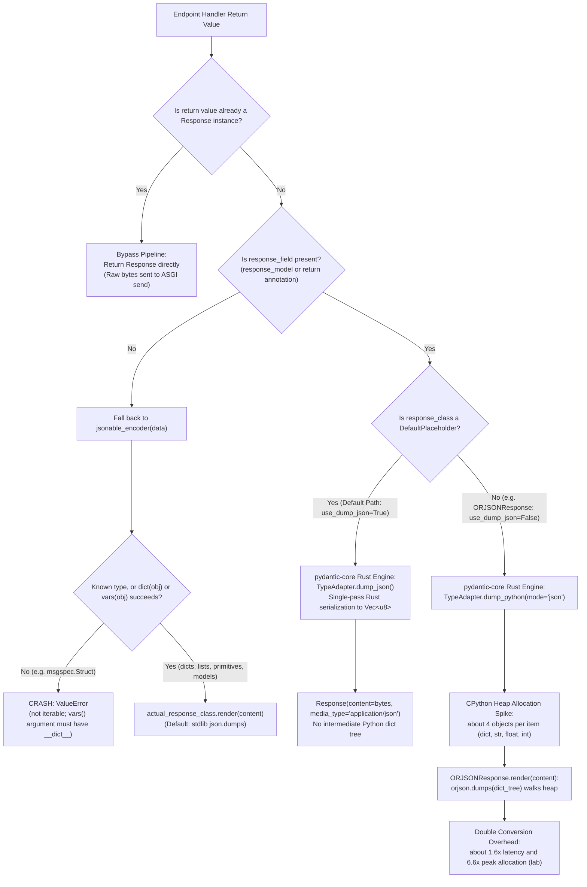

# High-Throughput JSON Serialization in FastAPI: ORJSONResponse (orjson 3.13.0), Rust Pydantic Dump, and msgspec (0.22.0)

> [!summary] Claim
> Setting `response_class=ORJSONResponse` in FastAPI 0.130.0 and later (as of 2026-11, FastAPI 0.162.0) is an anti-pattern that slows serialization by disabling Pydantic's single-pass Rust `dump_json` path and forcing an intermediate tree of Python dictionaries, whereas maximum serialization throughput requires either staying on FastAPI's default response serialization or bypassing the route serialization pipeline entirely with `msgspec` structs.

Part of [FastAPI Internals and Patterns](README.md) in [API Engineering](../README.md).

## TL;DR

FastAPI 0.162.0 serializes a `response_model` or Pydantic return annotation directly to UTF-8 JSON bytes in Rust via `pydantic_core.SchemaSerializer.to_json`, with no intermediate Python dictionary tree.
Setting `response_class=ORJSONResponse` disables this path because `response_class` is no longer a `DefaultPlaceholder`, so FastAPI runs `dump_python(mode="json")` and then `orjson.dumps` over the resulting tree.
Returning a bare `msgspec.Struct` fails twice over: a `-> Struct` annotation raises `FastAPIError` at route registration, and with `response_model=None` the request returns `500` because `jsonable_encoder` raises `ValueError` (the struct is neither iterable nor has a `__dict__`).
On CPython 3.14.6 on an Apple M3 Pro, encoding 10,000 items took 0.58 ms with `msgspec.json.encode`, 1.81 ms with Pydantic `dump_json`, and 2.89 ms with the `ORJSONResponse` pipeline (median of 41 calls, lab-measured).
Do not use custom response classes to bypass Pydantic when response validation and generated OpenAPI schemas are part of your public contract.

## Mental model



The diagram illustrates the branching decision inside FastAPI's request handler (`fastapi 0.162.0 fastapi/routing.py, get_request_handler`).
When an endpoint returns a `Response` instance, FastAPI detects `isinstance(raw_response, Response)`, attaches background tasks if none are set, and skips `serialize_response` entirely, so the pre-rendered bytes go to the ASGI `send` callable.
When the endpoint returns a raw data object, FastAPI checks whether a compiled `response_field` exists from `response_model` or the return annotation.
If `response_field` exists and `response_class` is still the `Default(JSONResponse)` placeholder, FastAPI validates the value and then `pydantic-core` serializes it directly into a contiguous UTF-8 byte buffer without building an intermediate Python object tree.
If the developer overrides `response_class` with `ORJSONResponse`, FastAPI disables the Rust JSON dumper, Pydantic materializes the payload as Python dictionaries and lists, and `orjson.dumps` then walks that tree a second time.
If `response_field` is missing and the endpoint returns a `msgspec.Struct`, the payload goes to `jsonable_encoder`, which falls through to `dict(obj)` and then `vars(obj)`; both fail, because a struct is not iterable and has no `__dict__`.

## How it works

### The Wire Protocol and HTTP Framing

Every buffered JSON response produced by FastAPI ends in Starlette's ASGI call (`starlette 1.10.0 starlette/responses.py, Response.__call__`).
The ASGI server (such as Uvicorn or Granian) receives two messages over the ASGI `send` channel: `http.response.start` with the status and raw headers, then one `http.response.body` with the whole body.
RFC 8259 Section 11 registers the `application/json` media type, and RFC 9110 Section 8.3 says a sender that generates a message containing content SHOULD generate a `Content-Type` header field.
Per RFC 9110 Section 8.6, `Content-Length` is a decimal non-negative integer number of octets, used to delimit framing when the representation is transferred as content.
Starlette's `Response.init_headers` calculates `content_length = str(len(body))` directly from `self.body` (`starlette 1.10.0 starlette/responses.py, Response.init_headers`).
An HTTP/1.1 response whose length is not known in advance is framed with the chunked transfer coding (RFC 9112 Section 7.1) or, failing that, delimited by closing the connection (RFC 9112 Section 6.3).
For buffered JSON responses, emitting a single contiguous `bytes` payload with an explicit `Content-Length` avoids HTTP/1.1 chunk-size lines and keeps the connection reusable.
RFC 8259 Section 8.1 mandates that JSON text exchanged between systems that are not part of a closed ecosystem MUST be encoded using UTF-8.
RFC 8259 Section 6 defines the number grammar, forbids `Infinity` and `NaN`, and notes that with IEEE 754 binary64 implementations only integers in `[-(2**53)+1, (2**53)-1]` (`[-9007199254740991, 9007199254740991]`) are interoperable.

### FastAPI Route Handler Pipeline Internals

In FastAPI 0.162.0, route compilation occurs in `fastapi.routing.APIRoute.__init__`, which builds the ASGI handler via `get_request_handler`.
When an endpoint is registered, FastAPI checks the `response_class` parameter.
By default, `response_class` is `Default(JSONResponse)`, which wraps `JSONResponse` inside a `fastapi.datastructures.DefaultPlaceholder`.
An application-level `FastAPI(default_response_class=ORJSONResponse)` also defeats the fast path: the route then receives the bare `ORJSONResponse` class, not a placeholder (verified in this lab environment).
During execution, `get_request_handler` inspects the route parameters:

```python
# (fastapi 0.162.0 fastapi/routing.py, get_request_handler)
# simplified excerpt: dedented, explanatory comment removed
use_dump_json = response_field is not None and isinstance(
    response_class, DefaultPlaceholder
)
with _operation(name="serialization", function=dependant.call):
    content = await serialize_response(
        field=response_field,
        response_content=raw_response,
        include=response_model_include,
        exclude=response_model_exclude,
        by_alias=response_model_by_alias,
        exclude_unset=response_model_exclude_unset,
        exclude_defaults=response_model_exclude_defaults,
        exclude_none=response_model_exclude_none,
        is_coroutine=is_coroutine,
        endpoint_ctx=endpoint_ctx,
        dump_json=use_dump_json,
    )
if use_dump_json:
    response = Response(
        content=content,
        media_type="application/json",
        **response_args,
    )
else:
    response = actual_response_class(content, **response_args)
```

`serialize_response` first validates the returned value with `field.validate` (a `TypeAdapter.validate_python(value, from_attributes=True)` call) and then picks `field.serialize_json if dump_json else field.serialize` (`fastapi 0.162.0 fastapi/routing.py, serialize_response`).
In `fastapi/_compat/v2.py`, `ModelField.serialize_json` maps directly to Pydantic's `TypeAdapter.dump_json`:

```python
# (fastapi 0.162.0 fastapi/_compat/v2.py, ModelField.serialize_json)
# simplified excerpt: dedented, source comments removed
def serialize_json(
    self,
    value: Any,
    *,
    include: IncEx | None = None,
    exclude: IncEx | None = None,
    by_alias: bool = True,
    exclude_unset: bool = False,
    exclude_defaults: bool = False,
    exclude_none: bool = False,
) -> bytes:
    return self._type_adapter.dump_json(
        value,
        include=include,
        exclude=exclude,
        by_alias=by_alias,
        exclude_unset=exclude_unset,
        exclude_defaults=exclude_defaults,
        exclude_none=exclude_none,
    )
```

`TypeAdapter.dump_json` returns `self.serializer.to_json(...)` (`pydantic 2.14.3 pydantic/type_adapter.py, TypeAdapter.dump_json`), which is the Rust method `SchemaSerializer::to_json` (`pydantic-core 2.50.4 src/serializers/mod.rs, SchemaSerializer::to_json`).
`to_json_bytes` allocates `Vec::with_capacity(expected_json_size)`, sized from the previous call's output length, and drives a `serde_json`-based serializer that walks the schema graph and writes UTF-8 JSON into that buffer (`pydantic-core 2.50.4 src/serializers/shared.rs, to_json_bytes`).
It does not build an intermediate tree of CPython `dict`, `list`, or `str` objects for the output.
The finished buffer is then copied once into a new CPython `bytes` object with `PyBytes::new`, so the path is single-pass but not zero-copy, and FastAPI passes that object to Starlette's `Response(content=content)`.
In `starlette.responses.Response.render`, `bytes` content is returned unchanged and a C-contiguous `memoryview` is returned as a byte cast without copying (`starlette 1.10.0 starlette/responses.py, Response.render`).

### The ORJSONResponse Paradox

Before FastAPI 0.130.0 (2026-02-22), FastAPI had no direct Rust-to-bytes response path.
With Pydantic v1, FastAPI used `fastapi.encoders.jsonable_encoder` to recursively transform models into Python dictionaries and primitives; with Pydantic v2 (supported since FastAPI 0.100.0), the response model was dumped to Python objects and then rendered by the response class.
Starlette's `JSONResponse` then calls `json.dumps(content, ensure_ascii=False, allow_nan=False, indent=None, separators=(",", ":")).encode("utf-8")` (`starlette 1.10.0 starlette/responses.py, JSONResponse.render`).
Because CPython's standard library `json.dumps` is slower than compiled third-party encoders for large collections, developers substituted `fastapi.responses.ORJSONResponse`.
`orjson 3.13.0` is a CPython extension written in Rust against the raw `pyo3-ffi` CPython bindings (its wheel SBOM lists `pyo3-ffi` and `pyo3-build-config`, not the high-level `pyo3` crate), and its README states that amd64 wheels use AVX-512 at runtime when available.
`ORJSONResponse.render` calls:

```python
# (fastapi 0.162.0 fastapi/responses.py, ORJSONResponse.render)
def render(self, content: Any) -> bytes:
    assert orjson is not None, "orjson must be installed to use ORJSONResponse"
    return orjson.dumps(
        content, option=orjson.OPT_NON_STR_KEYS | orjson.OPT_SERIALIZE_NUMPY
    )
```

In FastAPI 0.162.0, setting `response_class=ORJSONResponse` breaks the condition `isinstance(response_class, DefaultPlaceholder)`.
FastAPI sets `use_dump_json = False`.
Consequently, `serialize_response` calls `field.serialize`, which invokes `TypeAdapter.dump_python(value, mode="json", ...)` (`fastapi 0.162.0 fastapi/_compat/v2.py, ModelField.serialize`).
This forces Pydantic Core to allocate an entire tree of Python dictionaries and lists on the CPython heap; for 10,000 four-field items the lab counts 40,007 distinct objects in that tree.
FastAPI then passes this newly allocated tree to `ORJSONResponse(content)`.
`ORJSONResponse.render` invokes `orjson.dumps(content)`, which traverses the Python tree and encodes it into bytes.
This architecture pays three costs:
First, Pydantic's Rust engine builds Python dictionary objects in heap memory.
Second, `orjson` iterates through the newly created Python dictionaries to produce JSON bytes.
Third, CPython must deallocate the ephemeral dictionaries, strings, and numbers when the request finishes.
FastAPI 0.130.0 added the Pydantic-in-Rust response path (PR #14962, whose release note claims "2x (or more)" faster JSON responses), and FastAPI 0.131.0 (2026-02-22) deprecated `ORJSONResponse` and `UJSONResponse` (PR #14964).
In FastAPI 0.162.0 the class is wrapped in `typing_extensions.deprecated(..., category=FastAPIDeprecationWarning)`, so each instantiation emits `FastAPIDeprecationWarning` (subject to the active warning filters) with the message "ORJSONResponse is deprecated, FastAPI now serializes data directly to JSON bytes via Pydantic when a return type or response model is set, which is faster and doesn't need a custom response class." (`fastapi 0.162.0 fastapi/responses.py, ORJSONResponse`).

### The msgspec Architecture and C-Level Struct Layout

`msgspec 0.22.0` is a serialization and validation library by Jim Crist-Harif whose core is a C extension (`msgspec/_core`).
Unlike `pydantic.BaseModel`, which stores field values in an instance `__dict__`, a `msgspec.Struct` subclass declares its fields as `__slots__` (member descriptors), so each instance stores them in fixed slots inside the object, with no `__dict__` (verified in this lab environment).
The slot layout is fixed when the `Struct` subclass is created.
On CPython 3.14.6, `sys.getsizeof` reports 64 bytes for a four-field `msgspec.Struct` instance, 184 bytes for an equivalent four-key `dict`, and 72 bytes plus a 184-byte `__dict__` for an equivalent `pydantic.BaseModel` instance (lab-measured; field values excluded).
When `msgspec.json.encode` runs, its C encoder reads the struct's fields directly from those slots and writes JSON into an internal byte buffer.
`msgspec.json.Encoder.encode_into(obj, buffer, offset=0)` writes into a caller-owned `bytearray`, so a service can reuse one buffer across calls (`msgspec 0.22.0 msgspec/json.pyi, Encoder.encode_into`).

However, integrating `msgspec` directly into FastAPI reveals a fundamental architectural boundary:
FastAPI relies on Pydantic's `ModelField` and `jsonable_encoder` for request validation, response serialization, and OpenAPI schema generation.
If an endpoint returns a `msgspec.Struct` without a Pydantic `response_model`, FastAPI routes the return value to `jsonable_encoder`.
In `fastapi/encoders.py`, after its known-type branches, `jsonable_encoder` attempts `dict(obj)` and then `vars(obj)` (`fastapi 0.162.0 fastapi/encoders.py, jsonable_encoder`).
Because `msgspec.Struct` instances are not iterable and have no `__dict__`, both calls raise `TypeError`, and `jsonable_encoder` raises both errors together:
`ValueError: [TypeError("'Metric' object is not iterable"), TypeError('vars() argument must have __dict__ attribute')]`
The exception is unhandled, so the request ends with an HTTP `500 Internal Server Error`.
If a developer annotates an endpoint return type as `-> list[ItemMsgSpec]` without `response_model=None`, FastAPI's route compiler attempts to construct a Pydantic `ModelField` for the return type.
Because Pydantic cannot generate a schema for a `msgspec.Struct`, FastAPI raises at registration time:
`fastapi.exceptions.FastAPIError: Invalid args for response field! Hint: check that list[...] is a valid Pydantic field type.`

To achieve genuine zero-overhead serialization with `msgspec` in FastAPI, the application must intercept the endpoint before FastAPI's serialization pipeline runs.
This can be accomplished via two patterns:
1. Returning an instance of `Response` directly (for example `Response(content=msgspec.json.encode(data), media_type="application/json")` or a custom `MsgSpecResponse(data)`), which causes `get_request_handler` to skip `serialize_response` entirely.
2. Implementing a custom `APIRoute` subclass (`MsgSpecRoute`) that forces `response_model = None` at route registration time, wraps the endpoint, and renders the result via `msgspec.json.encode` before returning a concrete `Response`.

The lab's `MsgSpecRoute` replaces any `response_model`, including an explicit `response_model=SomeModel`, so that route's `200` schema in OpenAPI becomes `{}`; declare the documented schema with `responses={200: {"model": SomeModel}}` instead, which the lab environment confirms still emits `$ref: #/components/schemas/SomeModel`.
Both patterns also skip FastAPI's response validation, so nothing checks that the returned data matches the documented schema.

### The Response Class Contract and Type Coverage

A custom response class is a `starlette.responses.Response` subclass that overrides `render(content)` and usually `media_type`.
`Response.__init__` calls `render` once and stores the result in `self.body`, and `init_headers` then appends `content-length` and `content-type` unless the caller already passed them (`starlette 1.10.0 starlette/responses.py, Response.__init__` and `Response.init_headers`).
`JSONResponse.render` is the stdlib baseline: `json.dumps(content, ensure_ascii=False, allow_nan=False, indent=None, separators=(",", ":")).encode("utf-8")` (`starlette 1.10.0 starlette/responses.py, JSONResponse.render`).
FastAPI reads `response_class.media_type` when it builds the OpenAPI document, so a subclass that changes `media_type` changes the content-type key under which the success response is documented, and falls back to `application/json` when the attribute is `None` (`fastapi 0.162.0 fastapi/openapi/utils.py, get_openapi_path`).

The three encoders accept different input types, and the differences matter when a response class replaces the pipeline (all run on CPython 3.14.6, `uv run --frozen`, asserted in `test_msgspec_encoding_hooks_and_unsupported_types`):

| Input | `msgspec.json.encode` | `orjson.dumps` | FastAPI default path |
| :--- | :--- | :--- | :--- |
| `pydantic.BaseModel` instance | `TypeError: Encoding objects of type ... is unsupported`; works with `enc_hook=lambda o: o.model_dump()` | Raises `TypeError` unless a `default=` hook is given | Handled by `pydantic-core` |
| `decimal.Decimal("1.10")` | `"1.10"` (JSON string) | `TypeError: Type is not JSON serializable: decimal.Decimal`; `default=str` gives `"1.10"` | `dump_json` gives `"1.10"`; `jsonable_encoder` gives the float `1.1` (`fastapi/encoders.py, decimal_encoder`) |
| aware `datetime` (UTC) | `"2026-01-01T00:00:00Z"` | `"2026-01-01T00:00:00+00:00"` | `dump_json` follows Pydantic's ISO 8601 form |

The `Decimal` row is a contract hazard rather than a performance detail: the same field serializes as a string on the Rust path and as a number on the `jsonable_encoder` path, so switching an endpoint between the two changes the wire type clients see.
The `datetime` row and the `Decimal` cells for `dump_json` and `jsonable_encoder` were observed in scratch runs on CPython 3.14.6 (`uv run --frozen python`), not asserted in the lab test; the `datetime` cell for the FastAPI default path was not run at all and is Pydantic's documented ISO 8601 behavior.

## Numbers and limits

The following numbers were measured on an Apple M3 Pro (arm64, macOS 27.3, Darwin 27.3.0) with CPython 3.14.6 and `uv 0.11.26` under locked dependencies (`fastapi 0.162.0`, `starlette 1.10.0`, `pydantic 2.14.3`, `pydantic-core 2.50.4`, `orjson 3.13.0`, `msgspec 0.22.0`), on 2026-11-15.
Command, from `labs/`: `uv run --frozen python -m api_labs.f11_fastapi_internals_and_patterns.custom_response_classes_bench`.
The dataset is 10,000 deterministic items with an integer ID, a string name, a boolean, and a float score; latency is the median of 41 calls after one warm-up call, and peak allocation is the `tracemalloc` peak above baseline for one call, in KiB.

| Serialization Engine / Pipeline Path | Execution Latency (10k items) | Peak Memory Allocation | Wire Payload Size | Memory Overhead vs Raw Output | Status / Recommendation |
| :--- | :--- | :--- | :--- | :--- | :--- |
| `msgspec.json.encode(Structs)` | 0.58 ms | 642.7 KiB | 605,373 bytes | 1.09x (no intermediate dicts) | Best raw throughput; bypasses Pydantic pipeline |
| Pydantic `dump_json` (FastAPI default) | 1.81 ms | 591.4 KiB | 605,373 bytes | 1.00x (no intermediate dicts) | Recommended production default for FastAPI |
| Direct `orjson.dumps(dicts)` | 1.15 ms | 2,028.3 KiB | 605,373 bytes | 3.43x (dicts already exist) | Fast for raw dicts; does not serialize Pydantic models directly |
| `ORJSONResponse` pipeline (`dump_python(mode="json")` then `orjson.dumps`) | 2.89 ms | 3,888.9 KiB | 605,373 bytes | 6.58x (double conversion trap) | Deprecated since FastAPI 0.131.0; 1.6x slower than default |
| CPython stdlib `json.dumps(dicts)`, default separators | 3.68 ms | 1,338.7 KiB | 685,372 bytes | 2.00x (`", "` and `": "` separators) | Not what Starlette sends; shown for comparison |
| CPython stdlib `json.dumps(dicts)`, Starlette `JSONResponse` settings | 3.57 ms | 1,182.4 KiB | 605,373 bytes | 2.00x | About 2x slower than `dump_json`; the cost of the dict path is mostly `jsonable_encoder` (below) |

The object-level memory overhead measured via `sys.getsizeof` shows why `msgspec` scales efficiently (container only, field values excluded):
- `msgspec.Struct` instance: 64 bytes (no `__dict__`).
- Python native `dict` (4 keys): 184 bytes.
- `pydantic.BaseModel` instance: 72 bytes + 184 bytes `__dict__` = 256 bytes per instance.
For an in-memory collection of 100,000 records, the containers alone take 6.4 MB for `msgspec.Struct`, 18.4 MB for raw dictionaries, and 25.6 MB for Pydantic models; the field values add the same amount to each.

Under in-process ASGI round trips via `httpx.AsyncClient` with `httpx.ASGITransport` across 10,000 items (same command; median of 41 requests after one warm-up; no network or server in the loop):
- Direct `msgspec` endpoint (`/msgspec-direct`): 0.83 ms.
- Direct Pydantic `dump_json` endpoint (`/pydantic-direct-dump`): 2.12 ms.
- Default FastAPI `response_model` endpoint (`/default-dump-json`, which also revalidates the returned models): 2.44 ms.
- `ORJSONResponse` with `response_model` (`/orjson-with-model`): 3.84 ms.
- Standard library `JSONResponse` with dictionaries and no response model (`/stdlib-json-dicts`, `jsonable_encoder` then `json.dumps`): 43.77 ms.
An earlier run of the same command measured 3.72 ms for `/pydantic-direct-dump`, so treat differences of about 1.5 ms between adjacent rows as run-to-run noise; the order-of-magnitude gap to `/stdlib-json-dicts` reproduced in both runs.

## Portability

The tables below document compatibility across runtimes, libraries, ASGI servers, and HTTP versions (as of 2026-11).
Only the CPython 3.14.6 row was executed (13 passed, captured below).
The user paused the CPython matrix and container legs on 2026-11-11, so every other cell cites a published source instead of a run, and the cell says which source.
The dispatch logic under test (`isinstance(response_class, DefaultPlaceholder)`, `Response.render`) is pure Python, and `fastapi 0.162.0` and `starlette 1.10.0` publish only `py3-none-any` wheels (PyPI file lists), so the same source is installed on every interpreter below; that argument is an inference from the wheel tags, not a run.

| CPython | `pydantic-core 2.50.4` and `msgspec 0.22.0` wheels | `orjson 3.13.0` wheel | Basis |
| :--- | :--- | :--- | :--- |
| `3.12.16` | `cp312` on both | `cp312` | PEP 693; PyPI file lists; not run |
| `3.13.18` | `cp313` on both | `cp313` | PyPI file lists; not run |
| `3.14.6` (workspace) | `cp314` on both | `cp314` | PEP 745; full lab suite run on 2026-11-15 |
| `3.14.10` | `cp314` on both (same ABI tag as 3.14.6) | `cp314` | PyPI file lists; not run |
| `3.15.2` | `cp315` on both | `cp315` | PyPI file lists; not run |
| `3.15.2t` (free-threaded) | `cp315t` on both | no `cp314t` or `cp315t` wheel; README: "orjson may support PEP 703 free-threading when it is stable" | PEP 703; PyPI file lists and the orjson `3.13.0` README; not run |

Consequence for `3.15.2t`: the `ORJSONResponse` path has no published binary wheel there, while the default `dump_json` path and the `msgspec` path do.
`fastapi 0.162.0` declares `Requires-Python >=3.10` and `starlette 1.10.0` declares `>=3.11` on PyPI, so every row above is inside the supported range.

| Component | Version | Claim | Basis |
| :--- | :--- | :--- | :--- |
| FastAPI | `0.162.0` | `use_dump_json` fast path exists; `ORJSONResponse` and `UJSONResponse` emit `FastAPIDeprecationWarning` | `fastapi/routing.py`, `get_request_handler`; `fastapi/responses.py`; run in this lab |
| FastAPI | before `0.130.0` | No direct `dump_json` response path | FastAPI release notes, PR #14962 |
| Starlette | `1.10.0` | Consumes `bytes` from `render`; computes `content-length` unless supplied | `starlette/responses.py`, `Response.init_headers`; run in this lab |
| Uvicorn | `0.54.0` | Receives `http.response.start` then one `http.response.body`; no response-class-specific behavior | ASGI HTTP spec message flow; version from `uv.lock`; not run against a live server |
| Hypercorn | `0.18.0` | Same ASGI contract; HTTP/2 through `h2`, HTTP/3 through the optional `h3` extra (`aioquic`) | `hypercorn-0.18.0` package metadata; not run |
| Granian | `2.8.7` | FastAPI is an ASGI app, so it runs on Granian's ASGI interface, not RSGI | FastAPI is ASGI-only (source); version from `uv.lock`; not run |

| HTTP version | Rule that the buffered response must satisfy | Source |
| :--- | :--- | :--- |
| HTTP/1.1 | `Content-Length` is the octet count of the body; without it the body is chunked or close-delimited | RFC 9110 Section 8.6; RFC 9112 Sections 6.3 and 7.1 |
| HTTP/2 | A response is malformed if `content-length` differs from the sum of the DATA frame payload lengths, so a hand-set wrong value is a stream error | RFC 9113 Section 8.1.1 |
| HTTP/3 over QUIC | Same rule: `Content-Length` must equal the sum of the DATA frame lengths | RFC 9114 Section 4.1.2 |

The single-buffer `bytes` body from every encoder in this note satisfies all three rules, because `len(self.body)` is measured after `render`.
HTTP/2 and HTTP/3 framing was not exercised by a client in this lab; the in-process `httpx.ASGITransport` tests above never touch a wire protocol.

## Worked example

The implementation is located at [implementation](../labs/src/api_labs/f11_fastapi_internals_and_patterns/custom_response_classes.py) and verified by the test module at [test](../labs/tests/f11_fastapi_internals_and_patterns/test_custom_response_classes_orjsonresponse_and_msgspec_integration.py).
The benchmark that produced the numbers above is `labs/src/api_labs/f11_fastapi_internals_and_patterns/custom_response_classes_bench.py`.

Below is the verified implementation of `MsgSpecResponse` and `MsgSpecRoute`:

```python
# [implementation](../labs/src/api_labs/f11_fastapi_internals_and_patterns/custom_response_classes.py)
# excerpt: lines 1-101, verbatim; the benchmark models and helpers below them are omitted
import inspect
import json
from collections.abc import Callable, Mapping
from functools import wraps
from typing import Any

import msgspec
import orjson
import pydantic
from fastapi import Response
from fastapi.routing import APIRoute
from starlette.background import BackgroundTask


class MsgSpecResponse(Response):
    """High-throughput Starlette Response using msgspec.json.encode.

    Bypasses jsonable_encoder and CPython dictionary allocations by encoding
    msgspec.Struct instances, dataclasses, and primitive structures directly
    into JSON UTF-8 bytes via msgspec's C engine.
    """

    media_type = "application/json"

    def __init__(
        self,
        content: Any,
        status_code: int = 200,
        headers: Mapping[str, str] | None = None,
        media_type: str | None = None,
        background: BackgroundTask | None = None,
    ) -> None:
        super().__init__(
            content=content,
            status_code=status_code,
            headers=headers,
            media_type=media_type,
            background=background,
        )

    def render(self, content: Any) -> bytes:
        if isinstance(content, bytes):
            return content
        if isinstance(content, memoryview):
            return content.tobytes()
        return msgspec.json.encode(content)


def _build_async_msgspec_wrapper(fn: Any, status_code: int | None) -> Callable[..., Any]:
    @wraps(fn)
    async def async_msgspec_wrapper(*a: Any, **kw: Any) -> Response:
        result: Any = await fn(*a, **kw)
        if isinstance(result, Response):
            return result
        return MsgSpecResponse(
            content=result,
            status_code=status_code or 200,
        )

    return async_msgspec_wrapper


def _build_sync_msgspec_wrapper(fn: Any, status_code: int | None) -> Callable[..., Any]:
    @wraps(fn)
    def sync_msgspec_wrapper(*a: Any, **kw: Any) -> Response:
        result: Any = fn(*a, **kw)
        if isinstance(result, Response):
            return result
        return MsgSpecResponse(
            content=result,
            status_code=status_code or 200,
        )

    return sync_msgspec_wrapper


class MsgSpecRoute(APIRoute):
    """Custom APIRoute that automatically serializes endpoint return values via msgspec.

    Intercepts the endpoint invocation at the route level to serialize naked
    msgspec.Struct, dicts, lists, and primitives directly into a MsgSpecResponse,
    preventing FastAPI's serialize_response from calling jsonable_encoder on
    objects that lack a __dict__ attribute.
    """

    def __init__(self, *args: Any, **kwargs: Any) -> None:
        # Overwrite Default(None) placeholder with explicit None to disable
        # automatic Pydantic ModelField construction on return type annotations
        if "response_model" in kwargs:
            kwargs["response_model"] = None
        super().__init__(*args, **kwargs)
        fn: Any = self.endpoint

        if inspect.iscoroutinefunction(fn):
            wrapped_async = _build_async_msgspec_wrapper(fn, self.status_code)
            self.endpoint = wrapped_async
            self.dependant.call = wrapped_async
        else:
            wrapped_sync = _build_sync_msgspec_wrapper(fn, self.status_code)
            self.endpoint = wrapped_sync
            self.dependant.call = wrapped_sync
```

Below is the verified test suite validating response serialization, header emission, deprecation warnings, and edge cases:

```python
# [test](../labs/tests/f11_fastapi_internals_and_patterns/test_custom_response_classes_orjsonresponse_and_msgspec_integration.py)
# (simplified excerpt showing primary test cases)
@pytest.mark.unit
@pytest.mark.asyncio
async def test_default_response_model_uses_rust_dump_json() -> None:
    app = FastAPI()

    @app.get("/items", response_model=list[BenchmarkItemPydantic])
    def get_items() -> list[BenchmarkItemPydantic]:
        return [
            BenchmarkItemPydantic(id=1, name="alpha", active=True, score=98.5),
            BenchmarkItemPydantic(id=2, name="beta", active=False, score=42.0),
        ]

    async with httpx.AsyncClient(
        transport=httpx.ASGITransport(app=app), base_url="http://test"
    ) as client:
        resp = await client.get("/items")
        assert resp.status_code == 200
        assert resp.headers["content-type"] == "application/json"
        assert resp.headers["content-length"] == str(len(resp.content))
        data = resp.json()
        assert len(data) == 2


@pytest.mark.unit
@pytest.mark.asyncio
async def test_orjson_response_class_deprecation_and_pipeline_trap() -> None:
    app = FastAPI()
    with warnings.catch_warnings(record=True) as recorded_warnings:
        warnings.simplefilter("always")

        @app.get(
            "/orjson-items",
            response_model=list[BenchmarkItemPydantic],
            response_class=ORJSONResponse,
        )
        def get_orjson_items() -> list[BenchmarkItemPydantic]:
            return [BenchmarkItemPydantic(id=10, name="gamma", active=True, score=12.3)]

        async with httpx.AsyncClient(
            transport=httpx.ASGITransport(app=app), base_url="http://test"
        ) as client:
            resp = await client.get("/orjson-items")
            assert resp.status_code == 200
            assert resp.headers["content-type"] == "application/json"

        deprecation_warnings = [
            w for w in recorded_warnings if issubclass(w.category, FastAPIDeprecationWarning)
        ]
        assert len(deprecation_warnings) >= 1
        assert "ORJSONResponse is deprecated" in str(deprecation_warnings[0].message)
```

The first test checks the default path's wire contract (status, `Content-Type`, `Content-Length`), not which serializer ran; which serializer ran is proven by the spy tests described below, the source excerpt above, and the benchmark's allocation gap.
The test suite executed with zero failures.
The five tests added in the finish pass use a spy on `ModelField.serialize_json` and `ModelField.serialize` to prove which serializer each route called, rather than inferring it from timing: `test_response_class_selects_serializer_path` and `test_default_response_class_override_also_defeats_fast_path` assert `["serialize_json"]` for the default route and `["serialize"]` for both `response_class=ORJSONResponse` and `default_response_class=ORJSONResponse`.
The other three cover the OpenAPI `{}` schema for a `MsgSpecRoute` with an explicit `response_model` (and the `$ref` kept by `responses=`), the `enc_hook` and `Decimal` rows above, and the caller-supplied `content-length` override.
The captured execution output from CPython 3.14.6 on macOS 27.3 (arm64, Darwin 27.3.0), run on 2026-11-15, is:

```
$ uv run --frozen pytest tests/f11_fastapi_internals_and_patterns/test_custom_response_classes_orjsonresponse_and_msgspec_integration.py -v -p no:cacheprovider
============================= test session starts ==============================
platform darwin -- Python 3.14.6, pytest-9.2.0, pluggy-1.7.0
asyncio: mode=Mode.STRICT, debug=False, asyncio_default_fixture_loop_scope=function, asyncio_default_test_loop_scope=function
collecting ... collected 13 items

test_default_response_model_uses_rust_dump_json PASSED [  7%]
test_orjson_response_class_deprecation_and_pipeline_trap PASSED [ 15%]
test_msgspec_struct_fails_with_jsonable_encoder PASSED [ 23%]
test_msgspec_response_direct_return_bypasses_pipeline PASSED [ 30%]
test_msgspec_route_automatic_serialization_sync_and_async PASSED [ 38%]
test_non_finite_float_handling PASSED [ 46%]
test_strict_integer_precision_rfc_8259 PASSED [ 53%]
test_serialization_benchmark_data_integrity PASSED [ 61%]
test_response_class_selects_serializer_path PASSED [ 69%]
test_default_response_class_override_also_defeats_fast_path PASSED [ 76%]
test_msgspec_route_discards_response_model_but_responses_keeps_schema PASSED [ 84%]
test_msgspec_encoding_hooks_and_unsupported_types PASSED [ 92%]
test_caller_supplied_content_length_suppresses_computed_header PASSED [100%]

============================== 13 passed in 0.33s ==============================
```

The output above is the real `-v` run with the repeated module path prefix, the interpreter path, and the plugin list trimmed for width; no line was added or reworded.
Mutation testing and the CPython and container matrices were paused by the user on 2026-11-11 and were not run, so these tests have been shown to pass but not shown to fail under a deliberately broken implementation.

## Pitfalls

> [!warning] The ORJSONResponse Pipeline Degradation Trap
> **Trigger:** Setting `response_class=ORJSONResponse` or `default_response_class=ORJSONResponse` on a FastAPI application or router that uses Pydantic response models.
> **Symptom:** Serialization is about 1.6x slower than the default path in this lab (2.89 ms versus 1.81 ms for 10,000 items), peak allocation grows about 6.6x, and every response instantiation emits `FastAPIDeprecationWarning`.
> **Fix:** Remove `response_class=ORJSONResponse`.
> **Record:** no CVE applies; the upstream record is FastAPI PR #14962 (fast path, `0.130.0`) and PR #14964 (deprecation, `0.131.0`), both listed in the `0.162.0` release notes.
> Allow FastAPI's default response class (`Default(JSONResponse)`) to engage the `pydantic-core` Rust `dump_json` single-pass serialization path.

> [!warning] The msgspec Struct `jsonable_encoder` Crash
> **Trigger:** Returning an instance of `msgspec.Struct` from a FastAPI endpoint with `response_model=None` and without wrapping it in a native `Response` or overriding the route's response handling.
> **Symptom:** The request fails with an HTTP `500 Internal Server Error`, logging `ValueError: [TypeError("'Metric' object is not iterable"), TypeError('vars() argument must have __dict__ attribute')]`.
> **Record:** no CVE applies; the behavior follows from `fastapi 0.162.0 fastapi/encoders.py, jsonable_encoder`, which tries `dict(obj)` then `vars(obj)` and raises both errors together.
> **Fix:** Either return a pre-rendered `Response(content=msgspec.json.encode(data), media_type="application/json")` or attach a custom `APIRoute` subclass (such as `MsgSpecRoute`) that intercepts the returned value and serializes it with `msgspec.json.encode` before `serialize_response` is invoked.

> [!warning] The 64-Bit Integer JavaScript Precision Truncation Trap
> **Trigger:** Serializing 64-bit integer identifiers (e.g. Snowflake IDs or high-cardinality database primary keys exceeding `2^53 - 1` = `9,007,199,254,740,991`) directly to JSON numbers.
> **Symptom:** JavaScript clients silently round the value to the nearest IEEE 754 binary64 double, outside the interoperable range RFC 8259 Section 6 describes.
> **Record:** the X API documents this exact failure for its 64-bit Snowflake IDs: "Always use string IDs in your code", with the example `10765432100123456789` printed by JavaScript as `10765432100123458000` (X Developer Platform, "X IDs", docs.x.com/fundamentals/x-ids).
> **Fix:** Enable `orjson.OPT_STRICT_INTEGER` in tests to catch unsafe integers, and annotate large integer fields in Pydantic models or `msgspec.Struct` to serialize as strings (e.g. `Annotated[int, PlainSerializer(str)]`).

> [!warning] The Non-Finite Float 500 Error Trap
> **Trigger:** Returning floating-point values containing `float('nan')`, `float('inf')`, or `float('-inf')` from an endpoint without a response model, so Starlette's standard `JSONResponse` renders it.
> **Symptom:** The endpoint fails with an unhandled `ValueError: Out of range float values are not JSON compliant: nan` during response rendering, returning a `500` status code to clients.
> **Record:** RFC 8259 Section 6 does not allow `NaN` or `Infinity` literals, which is why Starlette passes `allow_nan=False` (`starlette 1.10.0 starlette/responses.py, JSONResponse.render`).
> **Fix:** Use FastAPI's default Pydantic serializer (`ser_json_inf_nan` defaults to `'null'`), `orjson`, or `msgspec`, all of which emit `null` for non-finite floats instead of raising (verified in this lab environment); the trade-off is silent data loss, so validate or reject non-finite values where they carry meaning.

> [!warning] The Return Annotation Schema Generation Collision
> **Trigger:** Using a `msgspec.Struct` as the return type annotation (e.g. `def get_user() -> UserStruct:`) without passing `response_model=None`.
> **Symptom:** FastAPI fails at startup during route registration with `fastapi.exceptions.FastAPIError: Invalid args for response field!`.
> **Record:** no CVE applies; the error text is raised by FastAPI when it cannot build a response `ModelField` (`fastapi 0.162.0 fastapi/utils.py, create_model_field`, which formats `_invalid_args_message`).
> **Fix:** In custom route classes like `MsgSpecRoute`, explicitly set `kwargs["response_model"] = None` before calling `super().__init__` to disable automatic Pydantic `ModelField` compilation on non-Pydantic annotations, and document the schema through `responses=`.

## Security and robustness

### Memory Exhaustion and Allocation Denial of Service

High-throughput JSON endpoints returning unbounded query results represent an asymmetric memory denial of service vector.
When an endpoint returns a collection of 50,000 four-field entities through the `ORJSONResponse` trap, `dump_python(mode="json")` allocates about 200,000 distinct heap objects (`dict`, `str`, `float`, and `int`); the lab counts 40,007 for 10,000 items.
Under concurrent request load, these transient allocations raise peak resident memory, fragment the heap, and count toward CPython's cyclic garbage collector thresholds.
A collection pass runs on the thread that triggered it, which in an `async def` endpoint is the event loop thread, so every other request on that worker waits for it.
Serializing via Pydantic's Rust `dump_json` or `msgspec.json.encode` cut peak traced allocation 6.6x in the lab (591.4 KiB versus 3,888.9 KiB) and leaves one byte buffer that is freed after the response is sent.
Enforce hard pagination boundaries (e.g. `limit <= 1000`) at the request validation boundary to prevent client-induced memory saturation (OWASP API4:2023 Unrestricted Resource Consumption).

### Number Precision, Financial Safety, and RFC 8259 Compliance

In distributed architectures, primary keys generated by Snowflake-style or Sonyflake algorithms are 64-bit integers.
RFC 8259 Section 6 states that integers are interoperable only within `[-(2**53)+1, (2**53)-1]`.
When backend Python services emit raw 64-bit integers like `18446744073709551615` or `123456789012345678`, JavaScript's `JSON.parse` yields `18446744073709552000` and `123456789012345680` (verified with Node.js in this environment).
This creates authorization or data corruption bugs when clients submit updated records referencing the rounded identifier.
Using `orjson.OPT_STRICT_INTEGER` acts as an automated boundary guard: `orjson.dumps(2**53, option=orjson.OPT_STRICT_INTEGER)` raises `orjson.JSONEncodeError` (in `orjson 3.13.0` the same object as `TypeError`) with `Integer exceeds 53-bit range`.
Without the option, `orjson` raises `Integer exceeds 64-bit range` above `2^64 - 1`, while `msgspec.json.encode(2**64)` emits the full integer (both verified in this lab environment).
All high-cardinality 64-bit entity identifiers must be cast to string representations in the serialization schema.

### Parser Discrepancies and Content-Length Smuggling

HTTP request smuggling and response desynchronization exploit disagreement between the declared message length and the bytes actually sent.
Starlette's `Response.__init__` executes `self.body = self.render(content)` before `init_headers` computes `Content-Length`.
This ensures that `len(self.body)` measures the exact octet count of the rendered UTF-8 payload.
Starlette only computes `Content-Length` when the caller did not pass one: a `content-length` key in `headers` suppresses it.
Never manually set the `Content-Length` header in route handler dictionaries.
A manual value can decouple the declared length from the actual encoded byte count, which ASGI servers either reject as a protocol error or which leaves the connection out of sync behind reverse proxies such as Nginx or AWS ALB.

## The principal's view

At staff and principal engineering levels, JSON serialization strategy is an architectural governance decision balancing three competing forces: developer productivity, contract safety, and runtime infrastructure cost.

FastAPI's historical recommendation to use `ORJSONResponse` was sound before FastAPI 0.130.0, when every response went through Python objects first.
However, maintaining custom response classes across an enterprise codebase after FastAPI 0.130.0 and Pydantic v2 represents active technical debt.
The default response serialization pipeline in modern FastAPI uses `pydantic-core`'s compiled Rust serializer and measured 1.81 ms for a 10,000-element payload in this lab.
For most microservices, the default pipeline is the optimal engineering choice: it retains automated OpenAPI schema generation, response validation, field aliases and masking (`response_model_exclude`), and needs no custom glue code.

When profiles show that JSON serialization dominates CPU time or creates GC pauses that breach p99 latency SLAs (e.g. in real-time pricing engines, financial order books, or high-volume log gateways), the correct architectural escalation is:
1. Transition the hot path to `msgspec.Struct` and a custom `MsgSpecRoute`; in this lab, encoding was about 3.1x faster (0.58 ms versus 1.81 ms) and the in-process round trip about 2.9x faster (0.83 ms versus 2.44 ms), at the cost of losing FastAPI's response validation.
2. Decouple the serialization engine from OpenAPI schema generation by generating static OpenAPI components via `msgspec.json.schema` or separating external contract definitions from internal hot-path execution.
3. If JSON bandwidth and CPU overhead still bound system throughput, transition the transport protocol from HTTP JSON to gRPC with Protocol Buffers or FlatBuffers, eliminating text parsing and string escaping overhead entirely.

## Interview questions

> [!question] L5: Why does returning a native Python dictionary from an endpoint result in slower serialization than returning a Pydantic model with a defined `response_model` in FastAPI 0.162.0?
>
> > [!success]- Answer
> > In FastAPI 0.162.0, when an endpoint has a compiled `response_model`, FastAPI engages the `dump_json` fast path where Pydantic's Rust core serializes the data directly into a JSON UTF-8 `bytes` buffer in one pass.
> > When returning a naked dictionary without a `response_model` or return annotation, FastAPI's `response_field` is `None`, which disables the Rust JSON dumper and routes the dictionary through `jsonable_encoder`.
> > `jsonable_encoder` walks and copies the whole structure in pure Python, and Starlette's `JSONResponse` then runs standard library `json.dumps`; in this lab that path took 43.77 ms for 10,000 items versus 2.44 ms for the default `response_model` path.
> >
> > Follow-up: What parameter can you add to a route returning a raw dictionary to avoid the standard library `json.dumps` fallback?

> [!question] L6: Predict the output and behavior of the following endpoint when requested by a client:
> ```python
> @app.get("/items", response_model=list[ItemModel], response_class=ORJSONResponse)
> def get_items():
>     return [ItemModel(id=1, name="widget")]
> ```
>
> > [!success]- Answer
> > The endpoint returns an HTTP `200 OK` status code with `Content-Type: application/json` and body `[{"id":1,"name":"widget"}]`.
> > However, when the response is instantiated the server emits a `FastAPIDeprecationWarning` stating that `ORJSONResponse` is deprecated because FastAPI now serializes data directly to JSON bytes via Pydantic when a return type or response model is set.
> > Furthermore, performance degrades because setting `response_class=ORJSONResponse` turns off `use_dump_json`, forcing Pydantic to execute `dump_python(mode="json")` to allocate intermediate Python dictionaries before passing them to `orjson.dumps`.
> >
> > Follow-up: How does FastAPI detect that `response_class` was customized rather than left at its default value?

> [!question] L6: Debug this API: A team attempts to speed up a FastAPI analytics endpoint by replacing Pydantic with `msgspec.Struct` as shown below, but the service will not serve it:
> ```python
> class Metric(msgspec.Struct):
>     name: str
>     value: float
>
> @app.get("/metrics")
> def get_metrics() -> list[Metric]:
>     return [Metric(name="cpu", value=0.75)]
> ```
> Why does this code fail, and what is the minimal fix?
>
> > [!success]- Answer
> > The code fails during route registration, at import time, because FastAPI inspects the return type annotation `list[Metric]` and attempts to create a Pydantic `ModelField`, which raises `FastAPIError: Invalid args for response field!` because Pydantic cannot build a schema for `msgspec.Struct`.
> > If registration is fixed by setting `response_model=None`, every request then returns `500` because `jsonable_encoder` raises `ValueError: [TypeError("'Metric' object is not iterable"), TypeError('vars() argument must have __dict__ attribute')]`, since a `msgspec.Struct` is neither iterable nor has a `__dict__`.
> > The minimal fix is to return a native Starlette `Response` directly: `return Response(content=msgspec.json.encode([Metric(name="cpu", value=0.75)]), media_type="application/json")`, with `-> Response` as the annotation.
> >
> > Follow-up: How would you structure this fix across an entire router with 50 endpoints without manually wrapping `Response(...)` in every function?

> [!question] L6: How does Starlette compute the `Content-Length` header for buffered JSON responses, and under what conditions is this header omitted?
>
> > [!success]- Answer
> > In `starlette.responses.Response.init_headers`, Starlette inspects `self.body` after `self.render(content)` has generated the raw byte buffer.
> > If `self.body` is not `None`, the caller's `headers` do not already contain `content-length`, and the response status code is not informational (`< 200`), `204 No Content`, or `304 Not Modified`, Starlette calculates `content_length = str(len(body))` and appends `(b"content-length", content_length.encode("latin-1"))` to `raw_headers`.
> > `Content-Length` is not computed for `StreamingResponse`, where the total size is unknown, for status codes below `200`, `204`, and `304`, or when the caller supplied a `content-length` header; Starlette does not inspect `Transfer-Encoding` when deciding.
> >
> > Follow-up: What RFC section governs message body length calculation in HTTP/1.1?

> [!question] L7: Explain how `orjson` and `msgspec` achieve higher serialization throughput than standard library `json.dumps` at the CPU architecture and memory management level.
>
> > [!success]- Answer
> > Both libraries implement the whole encode loop in compiled code (Rust for `orjson`, C for `msgspec`), dispatching on exact types and writing UTF-8 directly into a byte buffer, whereas the stdlib path builds a Python `str` that must then be copied again by `.encode("utf-8")`, as Starlette's `JSONResponse.render` does.
> > The `orjson 3.13.0` README states that its amd64 wheels run on x86-64-v1 or later and use AVX-512 at runtime when available, and that its aarch64 wheels target ARMv8-A; the sources read for this note say nothing about SIMD in `msgspec`, so do not attribute either library's speed to SIMD without profiling.
> > Furthermore, `msgspec.Struct` reads field values from fixed slots rather than an instance `__dict__`, and `msgspec.json.Encoder.encode_into` lets the caller reuse one output buffer across calls.
> >
> > Follow-up: Why can `msgspec` not serialize a standard `pydantic.BaseModel` instance at peak C speed without fallback hooks?

> [!question] L7: Under what circumstances can serializing numbers with `orjson` cause silent data corruption in client applications, and how does `orjson.OPT_STRICT_INTEGER` mitigate this risk?
>
> > [!success]- Answer
> > `orjson` by default serializes integers from `-2^63` up to `2^64 - 1` into raw JSON numeric literals and raises `Integer exceeds 64-bit range` beyond that.
> > However, standard browser JavaScript environments parse JSON numbers into IEEE 754 binary64 double-precision floats, which have a 53-bit significand, so RFC 8259 Section 6 calls only `[-(2**53)+1, (2**53)-1]` interoperable.
> > Any integer outside that range (such as 64-bit Snowflake identifiers) is silently rounded in JavaScript.
> > Configuring `orjson.dumps(..., option=orjson.OPT_STRICT_INTEGER)` makes `orjson` raise `JSONEncodeError` (in `orjson 3.13.0` the same object as `TypeError`) with `Integer exceeds 53-bit range` for such values, prompting developers to cast the identifier to a string.
> >
> > Follow-up: How does Pydantic v2 handle integer overflow during JSON serialization?

> [!question] L7+: Design a low-allocation, high-throughput microservice architecture in FastAPI that serves 100,000 requests per second of complex domain objects while preserving OpenAPI 3.1 documentation.
>
> > [!success]- Answer
> > The architecture decouples schema generation from runtime request execution by declaring route schemas with Pydantic models for OpenAPI documentation while executing serialization through `msgspec`.
> > Each route uses a custom `MsgSpecRoute(APIRoute)` that forces `response_model = None` at registration while declaring the documented schema in `responses={200: {"model": DomainModel}}`, which still emits a `$ref` to `DomainModel` in the OpenAPI document.
> > Endpoint handlers read domain data directly into `msgspec.Struct` instances, whose containers are 75% smaller than Pydantic models (64 versus 256 bytes per four-field instance on CPython 3.14.6), and encode them via a reusable `msgspec.json.Encoder` per worker thread.
> > The application runs on a compiled-protocol ASGI server such as Granian's ASGI interface or Uvicorn with `httptools`, scaled out across worker processes, because FastAPI is an ASGI application and cannot use Granian's RSGI interface.
> >
> > Follow-up: What telemetry trade-offs emerge when bypassing FastAPI's inner dependency and serialization stacks?

> [!question] L5: What happens when an endpoint serializes a floating-point `NaN` value using Starlette's `JSONResponse` compared to `ORJSONResponse` or Pydantic `dump_json`?
>
> > [!success]- Answer
> > Starlette's `JSONResponse.render` calls `json.dumps` with `allow_nan=False`, which causes `json.dumps` to raise a `ValueError: Out of range float values are not JSON compliant: nan`, resulting in an unhandled `500` error.
> > In contrast, both `ORJSONResponse` and Pydantic's Rust `dump_json` (with the default `ser_json_inf_nan='null'`) emit JSON `null` for `float('nan')`, `float('inf')`, and `float('-inf')`, which keeps the output valid JSON but silently loses the value.
> >
> > Follow-up: Which section of RFC 8259 specifies the grammar rules that prohibit raw `NaN` and `Infinity` literals in JSON?

## Related

Prerequisites: [[Response-Serialization-Pipeline-Response-Model-and-Double-Validation-Cost]]

Next: [[FastAPI-Security-Utilities-OAuth2-SecurityScopes-and-OpenAPI-Wiring]]

See also: [[02-Programming-Languages/Python/Python-Backend-Interview-Prep/04-FastAPI]]

- Lab: `labs/tests/f11_fastapi_internals_and_patterns/test_custom_response_classes_orjsonresponse_and_msgspec_integration.py`

## Further reading

- IETF RFC 8259: The JavaScript Object Notation (JSON) Data Interchange Format (Section 6 Numbers, Section 8.1 Character Encoding, Section 11 IANA Considerations) establishes normative standards for UTF-8 encoding, the `application/json` media type, and IEEE 754 precision limits.
- IETF RFC 9110: HTTP Semantics (Section 8.3 Content-Type, Section 8.6 Content-Length) specifies representation metadata and message framing rules.
- IETF RFC 9112: HTTP/1.1 (Section 6.1 Transfer-Encoding, Section 6.3 Message Body Length, Section 7.1 Chunked Transfer Coding) governs wire-level message framing and chunked body transmission.
- FastAPI release notes for 0.130.0 and 0.131.0 (PRs #14962 and #14964) record when the Pydantic-in-Rust response path landed and when `ORJSONResponse` was deprecated.
- FastAPI Official Documentation: Custom Response - HTML, Stream, File, others documents custom response classes and the deprecation of `ORJSONResponse` in favor of direct Pydantic JSON dumping.
- Pydantic Core source, now in the `pydantic/pydantic` repository under `pydantic-core/` (`src/serializers/mod.rs` and `src/serializers/shared.rs` at tag `v2.14.3`), contains the Rust `SchemaSerializer::to_json` and `to_json_bytes` implementation powering FastAPI's default fast path.
- orjson Repository (`ijl/orjson`) provides the source implementation and technical documentation for Rust-accelerated CPython JSON serialization and strict integer enforcement.
- msgspec Documentation and Benchmarks (`jcrist/msgspec`) details `Struct` layout, `Encoder.encode_into` buffer reuse, and JSON decoding and encoding mechanisms.
- IETF RFC 9113: HTTP/2 (Section 8.1.1 Malformed Messages) and RFC 9114: HTTP/3 (Section 4.1.2 Malformed Requests and Responses) make a `content-length` that disagrees with the DATA frame lengths a protocol error.
- X Developer Platform, "X IDs" (docs.x.com/fundamentals/x-ids) is the vendor's own statement that 64-bit IDs must travel as strings because JavaScript clients lose precision.
- orjson `3.13.0` README documents the supported platforms, the AVX-512 runtime dispatch, and the free-threading statement quoted in Portability.
