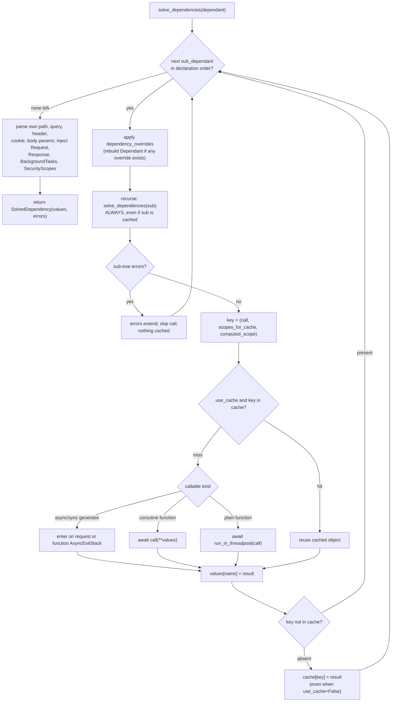

# Inside solve_dependencies(): Dependency DAG Traversal, Cache Key Tuple (call, tuple(security_scopes)), and use_cache=True

> [!summary] Claim
> FastAPI memoizes each dependency once per request in a plain `dict` keyed by `(call, sorted scopes if the dependency uses scopes, computed scope)`, so a diamond collapses to one call, but the key is equality-based, the walk is depth-first and strictly sequential, and a cache hit still re-solves the cached node's whole subtree.

Part of [FastAPI Internals and Patterns](README.md) in [API Engineering](../README.md).

## TL;DR

- Mechanism: `solve_dependencies()` walks the `Dependant` tree depth-first, left to right, one `await` at a time, and stores every result in a per-request `dependency_cache` dict keyed by `_get_cache_key()`.
- Contract: in FastAPI `0.162.0` the key is `(dependant.call, tuple(sorted(set(scopes))) or (), computed_scope or "")`, not the 2-tuple `(call, tuple(security_scopes))` of `<= 0.120.x` that this note's title names; scopes count only when the dependency or a descendant reads them.
- Trap: `use_cache=False` only skips the lookup, it still writes the cache, so the edge order decides whether a later cached edge reuses the "fresh" value; and a failed node is never cached, so a diamond reports its `422` errors once per path.
- Portability: the lab passes on CPython 3.14.6 and its earlier 19-test version passed unchanged on 3.12.13, 3.13.18, and 3.15.2; the behavior that changes is FastAPI's, at `0.121.0`, `0.123.0`, and `0.123.9` (`0.140.0` only moved the key code).
- When not to use it: for anything that must outlive one request (connection pools, settings, JWKS) use lifespan state, and for independent I/O that should overlap, gather it yourself, because the resolver never runs siblings concurrently.

## Mental model



Read it with the diamond `A -> B`, `A -> C`, `B -> D`, `C -> D` in mind.
The endpoint `A` is the root `Dependant`; the loop takes `B` first and recurses into it before anything else happens.
Inside `B` the loop reaches `D`, recurses into `D` (which has no sub-dependencies), misses the cache, calls `D`, and stores the result under `(D, (), "")`.
Back at the root the loop takes `C`, recurses into it, and inside `C` reaches `D` again: it still recurses into `D` (the `REC` box), then computes the same key and takes the `hit` arrow, so `D` is not called a second time.
The `errors` arrow is why a broken leaf is reported once per path, and the `absent` arrow after the call is why `use_cache=False` on the first edge still seeds the cache for the second.

## How it works

### The graph is a tree at startup and a DAG only at request time

`APIRoute.__init__` calls `_populate_api_route_state()`, which calls `_build_dependant_with_parameterless_dependencies()`, which calls `get_dependant(path=..., call=endpoint, scope="function")` and then inserts one sub-dependant per `dependencies=[...]` entry at the front of `dependant.dependencies` (fastapi 0.162.0 fastapi/routing.py, `_populate_api_route_state` and `_build_dependant_with_parameterless_dependencies`).
`get_dependant()` reads the typed signature, and for every parameter whose `analyze_param()` result carries a `params.Depends`, it recurses into `get_dependant()` for that callable and appends the result to `dependant.dependencies` (fastapi 0.162.0 fastapi/dependencies/utils.py, `get_dependant`).
Nothing in that recursion deduplicates: a callable reached by two paths becomes two distinct `Dependant` objects with the same `call` (their inherited scopes can differ).
The lab lists the keys of a route depth-first and gets `shared` twice under `/scopes-ignored`, once under each guard.
Deduplication happens only at request time, by key equality in the cache dict, which is why the title calls it a DAG traversal even though the in-memory structure is a tree.
There is no cycle detection either: a callable whose signature depends on itself recurses until CPython raises `RecursionError` during route registration, which the lab's `test_dependency_cycle_fails_at_route_registration` proves.
Ordering is fixed at startup: the router-level and decorator-level lists come from `[*include_context.dependencies, *route.dependencies]` and `[*parent_router.dependencies, *(dependencies or [])]` concatenations in `routing.py`, so router dependencies run before decorator dependencies, which run before parameter dependencies.

`Depends` itself is a frozen dataclass with three fields, `dependency`, `use_cache=True`, and `scope=None`, and `Security` adds `scopes` (fastapi 0.162.0 fastapi/params.py, `Depends` and `Security`).
`get_dependant()` copies `use_cache` and `scope` from the `Depends` marker onto the child `Dependant`, and passes `parent_oauth_scopes=current_scopes`, where `current_scopes` is the parent's inherited scopes plus its own.
`get_parameterless_sub_dependant()`, which builds each `dependencies=[...]` entry, passes `scope` and the `Security` scopes but not `use_cache`, so `dependencies=[Depends(f, use_cache=False)]` is silently cached (fastapi 0.162.0 fastapi/dependencies/utils.py, `get_parameterless_sub_dependant`); the lab's `test_use_cache_false_is_dropped_on_a_parameterless_dependency` proves it.

### The per-request cache dict

`get_request_handler()` calls `solve_dependencies()` without a `dependency_cache` argument, so each HTTP request starts with `dependency_cache = {}` (fastapi 0.162.0 fastapi/routing.py, `get_request_handler`; fastapi/dependencies/utils.py, `solve_dependencies`).
The same dict object is threaded through every recursive call, so the whole tree shares one memo table, and it is discarded with the `SolvedDependency` once the endpoint returns.
The lab's `test_cache_is_per_request_not_per_process` sends `/diamond` twice and counts two calls of `shared`, one per request.
For a WebSocket route, the handler calls `solve_dependencies()` once before the endpoint coroutine starts, so the cache and every injected value live as long as the connection, not per message (fastapi 0.162.0 fastapi/routing.py, the `solve_dependencies` call in the WebSocket handler; the ASGI specification says a WebSocket connection scope "lives as long as the socket itself").
Before `0.117.0` the function began with `dependency_cache = dependency_cache or {}`, which replaced an empty dict passed by the caller with a fresh one and forced a `dependency_cache.update(solved_result.dependency_cache)` merge after every recursion (fastapi 0.115.0 fastapi/dependencies/utils.py, `solve_dependencies`); `0.117.0` changed it to create the dict only if it is `None` (PR 13689 in the release notes).

### The loop body, line by line

For each `sub_dependant` in `dependant.dependencies`, in declaration order, `solve_dependencies()` in `0.162.0` does exactly this:

1. If `dependency_overrides_provider.dependency_overrides` is non-empty, it looks up `sub_dependant.call` in that dict and calls `get_dependant()` again for the replacement (or for the original, when the lookup misses), producing `use_sub_dependant`; this rebuild happens for every sub-dependant on every request while any override is registered.
2. It recurses: `solved_result = await solve_dependencies(request=..., dependant=use_sub_dependant, ..., dependency_cache=dependency_cache)`.
   This happens before the cache is consulted, so a cache hit on `D` still walks `D`'s subtree and re-parses `D`'s own path, query, header, cookie, and body parameters.
3. If `solved_result.errors` is non-empty it extends `errors` and `continue`s: the sub-dependant is not called and nothing is cached.
4. It computes `sub_dependant_cache_key = _get_cache_key(dependant=sub_dependant, ...)`; note it is the original `sub_dependant`, not `use_sub_dependant`, so an override is cached under the original callable.
5. If `sub_dependant.use_cache and key in dependency_cache`, the cached object is reused.
6. Otherwise it dispatches on the callable kind: generators go through `_solve_generator()` onto the request-scoped `fastapi_inner_astack` or, for `scope="function"`, onto `fastapi_function_astack`; coroutine functions are awaited directly; everything else runs through `run_in_threadpool()`, which is `anyio.to_thread.run_sync()` (starlette 1.10.0 starlette/concurrency.py, `run_in_threadpool`).
7. If `sub_dependant.name is not None` it stores the result in `values[name]`; parameterless dependencies from `dependencies=[...]` have no name, so their result is cached but never injected.
8. If the key is absent it writes `dependency_cache[key] = solved`; this runs whatever `use_cache` says.

After the loop the function parses its own request parameters and injects `Request`, `WebSocket`, `HTTPConnection`, `Response`, `BackgroundTasks`, and `SecurityScopes`, the last one built as `SecurityScopes(scopes=_get_oauth_scopes(dependant=dependant))`.
Every step is a plain `await` in a `for` loop; there is no task group, so siblings never overlap, which `test_sibling_dependencies_are_awaited_sequentially` proves by inserting an `anyio.lowlevel.checkpoint()` between a start and end event in each sibling.

### The cache key in 0.162.0

The key type is `DependencyCacheKey = tuple[Callable[..., Any] | None, tuple[str, ...], str]` (fastapi 0.162.0 fastapi/types.py, `DependencyCacheKey`), produced by this upstream function (verbatim upstream source, not lab code):

```python
def _get_cache_key(
    *,
    dependant: Dependant,
    uses_scopes_cache: _UsesScopesCache | None = None,
) -> DependencyCacheKey:
    scopes_for_cache = (
        tuple(sorted(set(_get_oauth_scopes(dependant=dependant))))
        if _uses_scopes(dependant=dependant, cache=uses_scopes_cache)
        else ()
    )
    return (
        dependant.call,
        scopes_for_cache,
        _get_computed_scope(dependant=dependant) or "",
    )
```

That block is copied from fastapi 0.162.0 fastapi/dependencies/models.py, `_get_cache_key`.

Element one is the callable object itself, hashed and compared with its own `__hash__` and `__eq__`.
For a function that means identity; for a callable instance it means whatever the class defines, which is the root of two pitfalls below.
Element two is `_get_oauth_scopes()`, a copy of the parent's scopes with each of the dependant's own scopes appended unless already present, then passed through `set` and `sorted`, so `["b", "a"]` and `["a", "b"]` produce the same `("a", "b")`.
It is included only when `_uses_scopes()` is true: the dependant declared its own `Security(..., scopes=...)`, takes a `SecurityScopes` parameter, is a `SecurityBase` instance such as `OAuth2PasswordBearer` (checked through `functools.partial` and `inspect.unwrap`), or has any descendant for which the same test is true.
`_uses_scopes()` is memoized per request in `_uses_scopes_cache`, a dict keyed by `id(dependant)` that also stores the `Dependant` so a recycled `id` cannot alias.
Element three is `_get_computed_scope()`: the explicit `scope` if set, otherwise `"request"` for a sync or async generator and `None` (stored as `""`) for anything else.
So `Depends(session)` and `Depends(session, scope="function")` are two cache entries and enter the generator twice, as `test_generator_scope_is_part_of_the_key` shows.

`get_flat_params()`, which builds the flat parameter list used for OpenAPI, walks the same tree with the same key and a `visited` list, so a diamond leaf's query parameter appears once in the schema even though the request-time code validates it once per path (`test_openapi_lists_a_diamond_leaf_parameter_once`).

### How the key evolved

| FastAPI | Key | Source |
|---|---|---|
| `0.28.0` | per-request cache introduced, with `use_cache=False` opt-out | release notes, PR 292 |
| `0.80.0` | scopes added so `Security()` and `Depends()` uses with different scopes do not share | release notes, PR 2945 |
| `0.115.0` to `0.120.x` | `(call, tuple(sorted(set(security_scopes or []))))`, a `Dependant` field set in `__post_init__` | models.py at `0.115.0` and `0.120.0` |
| `0.121.0` | `(call, sorted scopes, computed_scope or "")`, a `cached_property`, with `Depends(scope=...)` | models.py at `0.121.0`; PR 14262 |
| `0.123.0` | scopes replaced by `()` unless own scopes, a `SecurityScopes` parameter, or a scope-using descendant | models.py at `0.123.0`; PR 14419 |
| `0.123.9` | `SecurityBase` instances also count as using scopes (absent at `0.123.8`, present at `0.123.9`) | models.py at both tags; PR 14459 in the `0.123.9` release notes |
| `0.140.0` | key moved to module-level `_get_cache_key()`, `Dependant` became `@dataclass(slots=True)` | models.py at `0.139.2` and `0.140.0`; PR 16049 "Reduce memory usage in dependencies" |

The practical effect of `0.123.0`: before it, a plain `get_db` reached under `Security(read_guard, scopes=["read"])` and `Security(write_guard, scopes=["write"])` inherited different scopes, got different keys, and opened two sessions; from `0.123.0` it gets `(get_db, (), "")` on both paths and opens one.
`test_inherited_scopes_do_not_split_a_leaf_that_ignores_them` is that case.

### Callable classification caches

Deciding whether a callable is a generator, async generator, or coroutine function is cached process-wide by three `functools.lru_cache(maxsize=4096)` functions keyed by `_CallIdentity`, a wrapper that hashes by `id(call)` and compares with `is` (fastapi 0.162.0 fastapi/dependencies/models.py, `_CALLABLE_CLASSIFICATION_CACHE_SIZE`, `_CallIdentity`, `_is_coroutine_callable_cached`).
Those caches are identity-based on purpose, so they never confuse two equal callable instances, and `functools.lru_cache` is documented as thread-safe for concurrent updates (Python 3.14 functools documentation, `lru_cache`).
They also keep up to 4096 callables alive, because an `lru_cache` keeps references to its arguments until they age out (same documentation).

### The CPython typing cache that sits in front of all of this

`Annotated` is decorated with `@_tp_cache(typed=True)`, which wraps it in `functools.lru_cache(typed=typed)` with the default `maxsize=128` and falls back to an uncached call when the arguments are unhashable (CPython 3.14 Lib/typing.py, `_tp_cache` and `Annotated`).
So `Annotated[str, Depends(TenantGuard("acme", log_b))]` returns the previously built alias `Annotated[str, Depends(TenantGuard("acme", log_a))]` whenever `Depends(...)` compares equal, which it does when the callable's `__eq__` ignores the field that differs.
FastAPI then reads the dependency out of the alias metadata, so the second app is wired to the first app's instance.
`test_typing_cache_hands_a_second_app_the_first_apps_equal_instance` proves it on every CPython in the matrix; whether it happens in a real process depends on whether the first alias is still among the 128 most recent `Annotated` subscriptions, which makes it look nondeterministic.

## Numbers and limits

| Quantity | Value | Source or measurement |
|---|---|---|
| Elements in the cache key | 3 (`call`, scopes, computed scope); 2 before `0.121.0` | fastapi 0.162.0 fastapi/types.py, `DependencyCacheKey`; models.py at `0.120.0` |
| Cache lifetime | one dict per HTTP request; one per WebSocket connection | fastapi 0.162.0 fastapi/routing.py, `get_request_handler` and the WebSocket handler |
| Calls of the diamond leaf `D` | 1 cached; 2 with `use_cache=False` on the later edge; 1 with it on the earlier edge | lab, CPython 3.14.6 |
| Copies of one leaf validation error | one per path to the leaf (2 in the diamond) | lab, `test_failed_leaf_is_not_cached_so_a_diamond_reports_the_error_twice` |
| Sibling overlap | 0: siblings run strictly one after another | lab, `test_sibling_dependencies_are_awaited_sequentially` |
| Callable classification LRU size | 4096 entries in each of 3 caches | fastapi 0.162.0 fastapi/dependencies/models.py, `_CALLABLE_CLASSIFICATION_CACHE_SIZE`; limit updated in `0.140.1` (PR 16062) |
| `typing.Annotated` alias cache | `lru_cache` default `maxsize=128`, `typed=True` | CPython 3.14 Lib/typing.py, `_tp_cache`; functools docs |
| Default recursion limit | 1000 | measured: `sys.getrecursionlimit()` on CPython 3.14.6, macOS 27.3 arm64 |
| Longest linear dependency chain that registers | 972 `async def` dependencies below the endpoint | measured once with a scratch script (not part of the lab; binary search over chain length, `app.get()` until `RecursionError`), CPython 3.14.6, FastAPI 0.162.0, macOS 27.3 arm64; depends on caller stack depth |
| Longest linear chain that also serves `200 OK` | 963 | same scratch run, request sent through `fastapi.testclient.TestClient`; the request-time recursion is deeper per level than registration |
| Per-edge cost of a cache hit versus a miss | not stated: a hit still re-walks the subtree, so the cost scales with the parameters that subtree validates; measure your own route | mechanism from `solve_dependencies()` steps 2 and 5; no benchmark was run |

## Portability

| Dimension | Behavior | Evidence |
|---|---|---|
| CPython 3.12.13 | 19 of 19 lab tests passed | drafter's `uv run --frozen --python 3.12 pytest <lab> -q` on the 19-test lab; not re-run after verification added the 20th test (matrix runs paused); `3.12.16` from the pinned matrix is not installed |
| CPython 3.13.18 | 19 of 19 passed | drafter's run with `--python 3.13`; not re-run on the 20-test lab |
| CPython 3.14.6 | 20 of 20 pass | workspace interpreter, re-run in verification; `3.14.10` is not installed |
| CPython 3.15.2 | 19 of 19 passed | drafter's run with `--python /opt/homebrew/bin/python3.15`; not re-run on the 20-test lab |
| CPython 3.15.0b3 (uv build) | not run: collection fails with `ModuleNotFoundError: No module named 'hypothesis._native'` | the pinned `hypothesis` has no native module for that beta |
| CPython 3.15t free-threaded | not run: `psycopg-binary==3.3.8` has no wheel for the platform, so the environment cannot be built | uv error captured here |
| Free-threaded semantics | the cache dict is per request and never shared across threads; the three classification caches are `lru_cache`, documented thread-safe | source and functools docs, not exercised on 3.15t |
| FastAPI `<= 0.120.x` | 2-tuple key; inherited scopes split plain dependencies | models.py at `0.115.0` and `0.120.0` |
| FastAPI `0.121.0` to `0.122.x` | 3-tuple key; inherited scopes still split | models.py at `0.121.0` |
| FastAPI `>= 0.123.0` | inherited scopes ignored unless used | models.py at `0.123.0`; PR 14419 |
| Uvicorn, Hypercorn, Granian | identical: the cache lives inside the ASGI app, created per `solve_dependencies()` call | fastapi 0.162.0 fastapi/routing.py; not run against each server |
| HTTP/1.1, HTTP/2, HTTP/3 | identical per request: one ASGI `http` scope per request, so one cache per request even on a multiplexed connection | ASGI HTTP and WebSocket specification ("A protocol server should give different scopes to different requests on the same HTTP/2 or HTTP/3 connection"); no server run |

## Worked example

The [implementation](../labs/src/api_labs/f11_fastapi_internals_and_patterns/dependency_dag_cache.py) builds one route per rule, and the [test](../labs/tests/f11_fastapi_internals_and_patterns/test_dependency_injection_engine_dag_resolution_and_use_cache_mechanics.py) asserts the exact call log for each.

The diamond and its two `use_cache=False` variants (simplified excerpt):

```python
    async def shared() -> object:
        log.record("shared")
        return object()

    async def left(d: Annotated[object, Depends(shared)]) -> object:
        log.record("left")
        return d

    async def right(d: Annotated[object, Depends(shared)]) -> object:
        log.record("right")
        return d

    async def left_fresh(d: Annotated[object, Depends(shared, use_cache=False)]) -> object:
        log.record("left_fresh")
        return d

    async def right_fresh(d: Annotated[object, Depends(shared, use_cache=False)]) -> object:
        log.record("right_fresh")
        return d

    @app.get("/diamond")
    async def diamond(
        b: Annotated[object, Depends(left)], c: Annotated[object, Depends(right)]
    ) -> dict[str, bool]:
        return {"same_instance": b is c}

    @app.get("/fresh-last")
    async def fresh_last(
        b: Annotated[object, Depends(left)], c: Annotated[object, Depends(right_fresh)]
    ) -> dict[str, bool]:
        return {"same_instance": b is c}

    @app.get("/fresh-first")
    async def fresh_first(
        b: Annotated[object, Depends(left_fresh)], c: Annotated[object, Depends(right)]
    ) -> dict[str, bool]:
        return {"same_instance": b is c}
```

The assertions that pin the order-dependence of `use_cache=False` (simplified excerpt):

```python
async def test_use_cache_false_on_the_second_edge_runs_the_leaf_twice() -> None:
    log = CallLog()
    status, body = await get_json(build_dag_app(log).app, "/fresh-last")
    assert status == 200
    assert body == {"same_instance": False}
    assert log.events == ["shared", "left", "shared", "right_fresh"]


async def test_use_cache_false_on_the_first_edge_still_seeds_the_cache() -> None:
    log = CallLog()
    status, body = await get_json(build_dag_app(log).app, "/fresh-first")
    assert status == 200
    assert body == {"same_instance": True}
    assert log.events == ["shared", "left_fresh", "right"]
```

The re-walk on a cache hit: `parent` depends on `Depends(fresh_child, use_cache=False)`, and both `via_left` and `via_right` depend on `parent`, so the log is `["fresh_child", "parent", "fresh_child"]`: `parent` runs once, but its subtree is solved twice and the second `fresh_child` result is thrown away.

The cache keys as FastAPI computes them, read through the private `_get_cache_key()` (simplified excerpt):

```python
    assert dependency_cache_keys(app, "/scopes-order") == [
        ("scoped_principal", ("a", "b"), ""),
        ("scoped_principal", ("a", "b"), ""),
    ]
    assert dependency_cache_keys(app, "/scopes-ignored") == [
        ("read_guard", ("read",), ""),
        ("shared", (), ""),
        ("write_guard", ("write",), ""),
        ("shared", (), ""),
    ]
    assert dependency_cache_keys(app, "/generator-scope") == [
        ("session", (), "request"),
        ("session", (), "function"),
    ]
```

Output captured from `uv run --frozen pytest tests/f11_fastapi_internals_and_patterns/test_dependency_injection_engine_dag_resolution_and_use_cache_mechanics.py -q` in `labs/`, CPython 3.14.6, FastAPI 0.162.0, Starlette 1.10.0, macOS 27.3 (Darwin 27.3.0 arm64):

```text
....................                                                     [100%]
20 passed in 0.32s
```

## Pitfalls

> [!warning] `use_cache=False` does not isolate the value
> Trigger: one edge declares `Depends(get_db, use_cache=False)` to get a private session, and it happens to be resolved before another edge that uses the default.
> Symptom: the "private" session is the one every later cached consumer receives, so a rollback in one consumer is visible to the others; swapping parameter order changes behavior.
> Fix: `use_cache=False` means "do not read the cache", not "do not write it" (step 8 of the loop), and in a `dependencies=[...]` list it is dropped entirely; give the private value its own callable, for example a thin wrapper function, so its key differs.

> [!warning] A failed leaf is validated once per path
> Trigger: a leaf with a required parameter, such as `q: int`, is reachable through two parents.
> Symptom: the `422` body lists the same `{"loc": ["query", "q"], "type": "missing"}` error twice, which clients and contract tests read as two problems.
> Fix: errors short-circuit before the cache write (step 3), so nothing dedupes them; declare request parameters on one node, or on the endpoint, and pass the parsed value down.

> [!warning] A plain `@dataclass` guard registers fine and then fails every request
> Trigger: `@dataclass class RoleGuard: role: str` with an `async def __call__`, used as `Depends(RoleGuard("admin"))`.
> Symptom: startup succeeds because route registration never hashes the callable (the classification caches key on `_CallIdentity`), and `/openapi.json` works because `get_flat_params()` deduplicates with a list, but every request raises `TypeError: cannot use 'tuple' as a dict key (unhashable type: 'RoleGuard')` at the `key in dependency_cache` line and returns `500`.
> Fix: `eq=True` without `frozen=True` sets `__hash__ = None`; use `@dataclass(frozen=True)`, or `eq=False` for identity semantics, and cover it with a request-level test, not just an import test.

> [!warning] Equal callable instances are one dependency, across routes and across apps
> Trigger: a frozen dataclass dependency whose `__eq__` ignores state, such as `field(compare=False)` on a session factory, built per tenant by an app factory.
> Symptom: within a request, two equal instances share one cache entry; across apps, CPython's `Annotated` cache can wire the second app to the first app's instance, so tenant B's route uses tenant A's resources.
> Fix: include every behavior-relevant field in `__eq__` and `__hash__`, or use `eq=False` so identity is the key; do not hide state from equality on objects that FastAPI will hash.

> [!warning] Overrides rebuild the graph per request
> Trigger: `app.dependency_overrides` is non-empty in production, for example as a feature switch.
> Symptom: every sub-dependant of every request goes through `get_dependant()` again, re-reading signatures and annotations, even for callables that are not overridden.
> Fix: keep overrides to tests; select implementations at startup instead.

> [!warning] A dependency that reads scopes indirectly is shared across scope contexts
> Trigger: since `0.123.0`, a dependency without a `SecurityScopes` parameter, own scopes, or a scope-using descendant reads the required scopes from `request.state` or a context variable.
> Symptom: its result is computed under the first path's scopes and reused under a stricter path, so a check meant for `admin` can pass with a `read` context.
> Fix: take `security_scopes: SecurityScopes` explicitly, which both documents the dependency and puts the scopes in its key.

There is no CVE or public postmortem specific to the dependency cache as of 2026-11; the history above is FastAPI's own release notes, which record the scope-sharing bug fixed in `0.80.0` (PR 2945) and the over-splitting fixed in `0.123.0` (PR 14419).

## Security and robustness

The cache is an authorization boundary: it decides which callers share one computed principal, session, or permission check.
The threat is cache confusion, where a value computed for one authorization context is reused in another; when a weaker check satisfies a stronger route, the outcome is `API5:2023 Broken Function Level Authorization` in the OWASP API Security Top 10 2023.
FastAPI's defense is putting scopes in the key whenever the dependency can observe them, so `Security(get_user, scopes=["admin"])` and `Depends(get_user)` are separate entries, and since `0.123.0` the same logic avoids splitting dependencies that cannot observe scopes.
That defense is only as good as FastAPI's view of "observes": a dependency that reaches scopes, tenant, or role through a side channel defeats it, so keep authorization inputs in the signature.

The key is only as safe as the callable's `__eq__`: two equal instances are one dependency, and CPython's `typing` alias cache extends that equality across apps in one process.
For multi-tenant or plugin systems that build routes per tenant, treat any hashable callable instance as a global singleton by value.

The error path amplifies: a leaf reachable through `N` paths produces `N` copies of its validation errors, so very wide fan-in turns one bad parameter into a large `422` body.
The graph is static, so `N` is bounded at startup, but it is worth testing the error response size of the widest route, since unbounded response work is the `API4:2023 Unrestricted Resource Consumption` class.

Robustness limits are startup-time: no cycle detection beyond `RecursionError`, and a linear chain of 963 levels was the measured ceiling for serving a request on CPython 3.14.6.
Generated dependency graphs, for example from plugin registries, should be checked for cycles and depth before they reach `APIRoute`.

## The principal's view

Treat `Depends` as request-scoped memoization over a static graph, not as a container with lifetimes: there is exactly one lifetime (the request, or the WebSocket connection), and everything longer belongs in lifespan state or module-level singletons that dependencies merely look up.
Standardize three rules across teams: dependency callables are functions or frozen, fully-compared classes; authorization inputs appear in the signature (`SecurityScopes`, explicit parameters); request parameters are declared once, near the endpoint, not in shared leaves.
The organizational trade-off is that FastAPI's resolver is simple and predictable (sequential, depth-first, declaration-ordered) at the cost of overlap and per-request work: a cache hit still re-walks the subtree, and independent I/O dependencies never run concurrently.
If profiling shows dependency resolution dominating a hot route, flatten that route's graph, move parsing to the endpoint, and gather independent I/O explicitly with `anyio.create_task_group()` inside one dependency; when that is still not enough, the sibling note on FastAPI's architectural limits compares raw Starlette and Litestar.
Pin FastAPI deliberately: the key changed shape in `0.121.0` and semantics in `0.123.0` and `0.123.9`, and an upgrade across those can change how many database sessions or token decodes a request performs.

## Interview questions

> [!question] L5: What does `use_cache=True` cache, for how long, and keyed by what?
>
> > [!success]- Answer
> > It caches the return value (or the yielded value) of a dependency callable in a dict created for one request.
> > The dict is discarded after the endpoint runs, so nothing is shared between requests; for WebSockets it lives for the connection.
> > In FastAPI `0.162.0` the key is the callable, the sorted scopes if the dependency uses scopes, and the computed scope (`"request"` for generators by default).
> >
> > Follow-up: Why is the callable itself, rather than its name or qualified name, the first element?

> [!question] L5: If a router has `dependencies=[Depends(get_user)]`, the route decorator has `dependencies=[Depends(get_user)]`, and the endpoint takes `user: Annotated[User, Depends(get_user)]`, how many times does `get_user` run per request?
>
> > [!success]- Answer
> > Once.
> > All three create sub-dependants with the same key `(get_user, (), "")`; the router one runs first, stores the result, and the other two hit the cache.
> > The parameterless ones have `name=None`, so their result is cached but not injected anywhere.
> >
> > Follow-up: What changes if the route entry is `Security(get_user, scopes=["admin"])`?

> [!question] L6 (predict the output): If `left_fresh` depends on `Depends(shared, use_cache=False)`, `right` depends on `Depends(shared)`, and the endpoint takes `left_fresh` then `right`, what is the call log, does the endpoint get the same object twice, and what changes when the parameter order is reversed?
>
> > [!success]- Answer
> > `["shared", "left_fresh", "right"]`, and yes, both receive the same object.
> > `use_cache=False` skips the lookup but the result is still written because the key was absent, so `right` hits it.
> > Reversed, `right` resolves first and caches, then `left_fresh` ignores the cache and calls `shared` again, so the log has two `shared` entries and the objects differ.
> >
> > Follow-up: How would you give one consumer a guaranteed private instance regardless of order?

> [!question] L6: Why are OAuth2 scopes part of the key at all, and what did `0.123.0` change?
>
> > [!success]- Answer
> > A dependency that reads `SecurityScopes` can return different results under different required scopes, so sharing one result across `Security(..., scopes=["admin"])` and a plain `Depends` would be cache confusion; `0.80.0` fixed exactly that.
> > Before `0.123.0` every dependant carried its inherited scopes in the key, so a plain `get_db` under two differently-scoped guards was opened twice.
> > From `0.123.0` scopes enter the key only if the dependant has own scopes, takes `SecurityScopes`, has a scope-using descendant, and from `0.123.9` also if it is a `SecurityBase` instance.
> >
> > Follow-up: Which kind of dependency is now silently shared across scope contexts, and why might that be a bug?

> [!question] L6: When two edges declare `Security(principal, scopes=["a", "b"])` and `Security(principal, scopes=["b", "a"])`, what does `principal` see on each edge?
>
> > [!success]- Answer
> > It runs once and sees `scope_str == "a b"`.
> > The key sorts and deduplicates scopes, so both edges have key `(principal, ("a", "b"), "")`, and the second edge reuses the first result, including its scope order.
> > Any logic that depends on scope order will see the first edge's order on every edge.
> >
> > Follow-up: Is sorting the right normalization, or should the key be a `frozenset`?

> [!question] L6 (debug this API): Why does a route return `422` with two identical `{"type": "missing", "loc": ["query", "q"]}` errors when the endpoint has no `q` parameter, and how do you fix it?
>
> > [!success]- Answer
> > `q` belongs to a shared leaf dependency reached through two parents.
> > `solve_dependencies()` recurses into the leaf once per path, collects its validation errors, and `continue`s without calling or caching it, so the second path validates and reports again.
> > Declare `q` once on the endpoint or on a single parsing dependency and pass the parsed value to the consumers.
> >
> > Follow-up: Why does the OpenAPI document list `q` only once?

> [!question] L6 (debug this API): After a role-guard class is converted to `@dataclass`, why does every request return `500` with `TypeError: unhashable type` while startup and the OpenAPI page still work?
>
> > [!success]- Answer
> > `@dataclass` with the default `eq=True` and no `frozen=True` sets `__hash__` to `None`.
> > The callable is the first element of the cache key, and `key in dependency_cache` hashes it on every request.
> > Startup works because registration never hashes the callable (the classification caches wrap it in the identity-hashed `_CallIdentity`), and the OpenAPI page works because `get_flat_params()` deduplicates with a list, which only needs `__eq__`; use `frozen=True` or `eq=False`.
> >
> > Follow-up: With `frozen=True`, what happens when two routes use `RoleGuard("admin")` built separately?

> [!question] L7+: An app factory builds one FastAPI app per tenant in one process, each with `Depends(TenantDb(tenant, pool))` where `pool` is `field(compare=False)`, and tenant B's requests occasionally hit tenant A's pool; what is happening?
>
> > [!success]- Answer
> > `Annotated` is wrapped in an `lru_cache` (`typing._tp_cache`, `maxsize=128`), so subscripting it with metadata equal to an earlier subscription returns the earlier alias object.
> > Because `pool` is excluded from equality, `Depends(TenantDb("b", pool_b))` can equal an earlier `Depends(TenantDb("b", pool_a))` from another factory call, so FastAPI reads the old instance out of the alias.
> > It looks intermittent because it depends on LRU eviction; fix it by making equality cover all behavior-relevant state or by using identity equality.
> >
> > Follow-up: Would `from __future__ import annotations` change the outcome, and why?

> [!question] L7+: Why does FastAPI resolve sibling dependencies sequentially, and what would it cost to make the resolver concurrent?
>
> > [!success]- Answer
> > The loop is a plain `for` with `await`, which gives deterministic order for side effects, for `AsyncExitStack` registration (and so LIFO teardown), and for which edge seeds the cache.
> > Concurrent resolution would need a per-key future so two siblings needing `D` wait on one computation, ordered teardown independent of completion order, and a rule for which branch's errors win.
> > It would also break code that relies on declaration order, such as an auth dependency that must run before a rate limiter.
> >
> > Follow-up: How would you get overlap for two independent HTTP calls today without changing FastAPI?

> [!question] L7+: Profiling shows dependency resolution taking a large share of a hot route's time even though every shared dependency is cached; where does the time go?
>
> > [!success]- Answer
> > A cache hit happens after the recursive `solve_dependencies()` call, so every path to a cached node re-walks its subtree and re-parses that subtree's path, query, header, cookie, and body parameters.
> > Each edge also computes a cache key, which checks `_uses_scopes()` (memoized per request), builds the sorted scope tuple only for scope-using dependants, and looks up the computed scope, and plain `def` dependencies pay a thread hop on each miss.
> > Flatten the graph for that route, move parsing up to the endpoint, convert cheap sync dependencies to `async def`, and measure before and after.
> >
> > Follow-up: What would you measure to prove the re-walk, rather than the leaf call, is the cost?

## Related

Prerequisites: [[Request-Parameter-Validation-Path-Query-Header-Cookie-and-Body-Models]]

Next: [[Yield-Dependencies-AsyncExitStack-Cleanup-Timing-and-Scope]]

See also: [[02-Programming-Languages/Python/Python-Backend-Interview-Prep/04-FastAPI]]

- [[APIRoute-Compilation-Signature-Inspection-and-Dependant-Construction]] builds the `Dependant` tree this note walks.
- [[FastAPI-Security-Utilities-OAuth2-SecurityScopes-and-OpenAPI-Wiring]] covers `Security()`, `SecurityScopes`, and the scope union that feeds the key.
- [[Class-Based-Dependencies-Callable-Objects-and-Parameterized-Guards]] covers callable instances, whose `__eq__` and `__hash__` become the key.
- [[Async-Def-vs-Def-Endpoints-and-AnyIO-Threadpool-Limiter-Semantics]] covers the `run_in_threadpool()` hop a sync dependency pays on a miss.
- [[Testing-FastAPI-Applications-AsyncClient-Lifespan-and-Dependency-Overrides]] covers `dependency_overrides`, which this note shows are cached under the original callable.
- [[FastAPI-Architectural-Limits-and-Comparison-with-Litestar-and-Raw-Starlette]] covers when per-request DI cost justifies another framework.
- Lab: `labs/tests/f11_fastapi_internals_and_patterns/test_dependency_injection_engine_dag_resolution_and_use_cache_mechanics.py`

## Further reading

- [fastapi 0.162.0 fastapi/dependencies/utils.py](https://github.com/fastapi/fastapi/blob/0.162.0/fastapi/dependencies/utils.py): `get_dependant()`, `get_flat_params()`, and `solve_dependencies()`, the whole mechanism in one file.
- [fastapi 0.162.0 fastapi/dependencies/models.py](https://github.com/fastapi/fastapi/blob/0.162.0/fastapi/dependencies/models.py): `Dependant`, `_get_cache_key()`, `_uses_scopes()`, and the identity-keyed classification caches.
- [fastapi 0.115.0 fastapi/dependencies/models.py](https://raw.githubusercontent.com/fastapi/fastapi/0.115.0/fastapi/dependencies/models.py): the original `(call, tuple(sorted(set(security_scopes))))` key the title refers to.
- [fastapi 0.123.0 fastapi/dependencies/models.py](https://raw.githubusercontent.com/fastapi/fastapi/0.123.0/fastapi/dependencies/models.py): the first release that drops unused scopes from the key.
- [FastAPI release notes at 0.162.0](https://raw.githubusercontent.com/fastapi/fastapi/0.162.0/docs/en/docs/release-notes.md): PRs 292, 2945, 13689, 14262, 14419, 16049, and 16062 date every change above.
- [FastAPI tutorial, Using the same dependency multiple times](https://raw.githubusercontent.com/fastapi/fastapi/0.162.0/docs/en/docs/tutorial/dependencies/sub-dependencies.md): the maintainer's statement of the per-request cache contract and `use_cache=False`.
- [CPython 3.14 Lib/typing.py](https://github.com/python/cpython/blob/3.14/Lib/typing.py): `_tp_cache` and `Annotated`, the equality-keyed alias cache behind the cross-app pitfall.
- [Python 3.14 functools.lru_cache](https://docs.python.org/3.14/library/functools.html): default `maxsize=128`, thread safety, and reference retention.
- [ASGI HTTP and WebSocket specification](https://asgi.readthedocs.io/en/latest/specs/www.html): one connection scope per HTTP request and per WebSocket socket, which fixes the cache lifetime.
