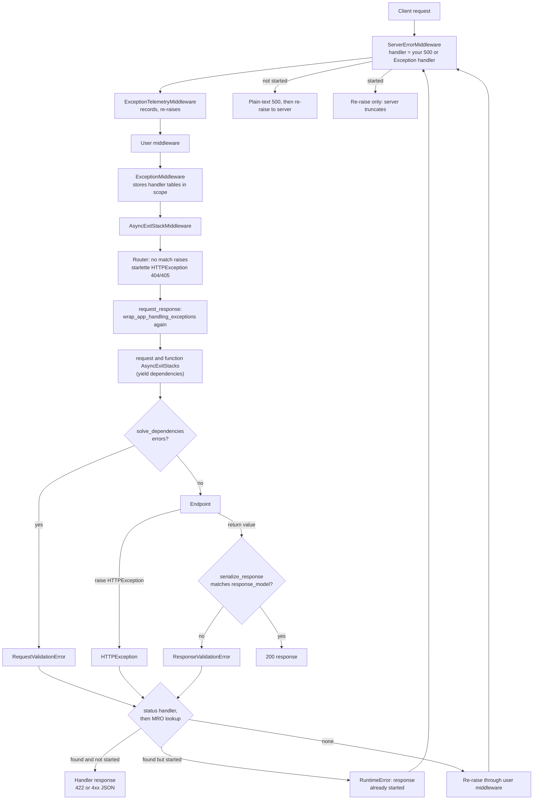

# FastAPI Exception Handling: HTTPException, WebSocketException, RequestValidationError (422), and ResponseValidationError (500)

> [!summary] Claim
> FastAPI routes every exception through one Starlette function, `wrap_app_handling_exceptions`, that looks a handler up by status code and then by MRO: `HTTPException` and `RequestValidationError` find a default handler and become `4xx` JSON, while `ResponseValidationError` finds none on purpose and escapes to `ServerErrorMiddleware` as a plain-text `500`, and all of it stops working the instant `http.response.start` has been sent.

Part of [FastAPI Internals and Patterns](README.md) in [API Engineering](../README.md).

## TL;DR

Mechanism: `FastAPI.build_middleware_stack` puts `ServerErrorMiddleware` outermost and `ExceptionMiddleware` inside user middleware, and `request_response` wraps each route a second time, so a handled exception becomes a response before user middleware sees it while an unhandled one reaches `ServerErrorMiddleware`, which sends `500` and re-raises.
Contract rule: client input failures raise `RequestValidationError` (`422`, body `{"detail": [...]}`), server output that breaks `response_model` raises `ResponseValidationError` (`500 Internal Server Error`), and custom HTTP handlers must be registered on `starlette.exceptions.HTTPException` to also catch the router's `404` and `405`.
The trap: once headers are on the wire no handler can change the status, so an exception inside a `StreamingResponse`, or a JSON Lines item that fails validation, yields a `200` with a truncated body instead of an error.
Portability: status codes are chosen by FastAPI and Starlette, not the server, but what a client sees after a mid-stream failure (missing last chunk, `StreamClosed`, pre-accept `403`) is server code; this note proves the app layer on CPython 3.14.6 and reads Uvicorn 0.54.0 and Hypercorn 0.18.0 source for the rest.
When not to use it: do not use exceptions as the control flow for high-rate expected outcomes, do not remap `ResponseValidationError` to `422`, and do not rely on the default `422` body in public APIs, because it echoes the rejected `input` back to the caller.

## Mental model



A request enters `ServerErrorMiddleware`, passes FastAPI's telemetry layer and user middleware, and reaches `ExceptionMiddleware`, which only stores its two handler tables in `scope["starlette.exception_handlers"]` and wraps the router.
The route itself is wrapped again by `request_response`, so an exception from validation, the endpoint, or serialization is first looked up at the route, after the yield dependency stacks have already seen it and closed.
The lookup checks the integer status table for `HTTPException` subclasses, then walks `type(exc).__mro__` through the class table.
A match whose response has not started sends the handler's response, which travels back out through user middleware as an ordinary response; a match after `http.response.start` becomes a `RuntimeError`; no match re-raises.
Anything re-raised climbs to `ServerErrorMiddleware`, which sends a `500` only if nothing has been sent yet and always re-raises so the server logs it.

## How it works

### 1. The middleware onion and the two lookup sites

`FastAPI.build_middleware_stack` overrides Starlette's version to insert `AsyncExitStackMiddleware` inside `ExceptionMiddleware` and to add `ExceptionTelemetryMiddleware` `(fastapi 0.162.0 fastapi/applications.py, FastAPI.build_middleware_stack)`.
It also partitions `self.exception_handlers`: any key equal to `500` or `Exception` becomes the single `handler` of `ServerErrorMiddleware`, and every other key goes to `ExceptionMiddleware`.

```python
# Simplified excerpt from fastapi/applications.py, FastAPI.build_middleware_stack
for key, value in self.exception_handlers.items():
    if key in (500, Exception):
        error_handler = value
    else:
        exception_handlers[key] = value

middleware = (
    [
        Middleware(ServerErrorMiddleware, handler=error_handler, debug=debug),
        Middleware(ExceptionTelemetryMiddleware),
    ]
    + self.user_middleware
    + [
        Middleware(ExceptionMiddleware, handlers=exception_handlers, debug=debug),
        Middleware(AsyncExitStackMiddleware),
    ]
)
```

`FastAPI.__init__` seeds the table with `setdefault`, so a handler passed in the constructor wins: `http_exception_handler` under `starlette.exceptions.HTTPException` (the module imports Starlette's class, not FastAPI's subclass), `request_validation_exception_handler` under `RequestValidationError`, and `websocket_request_validation_exception_handler` under `WebSocketRequestValidationError` `(fastapi 0.162.0 fastapi/applications.py, FastAPI.__init__)`.
There is no default entry for `ResponseValidationError`, and its base `ValidationException` subclasses plain `Exception`, so its MRO meets no registered class `(fastapi 0.162.0 fastapi/exceptions.py, ResponseValidationError)`.

`ExceptionMiddleware.__call__` stores `(self._exception_handlers, self._status_handlers)` in the scope and wraps the inner app with `wrap_app_handling_exceptions` `(starlette 1.10.0 starlette/middleware/exceptions.py, ExceptionMiddleware.__call__)`.
`add_exception_handler` sends integer keys to `_status_handlers` and classes to `_exception_handlers`, which starts with Starlette's own `http_exception` and `websocket_exception` entries before FastAPI's handlers overwrite the first one.
FastAPI's `request_response` repeats the wrap around every route, reading the same tables from the scope `(fastapi 0.162.0 fastapi/routing.py, request_response)`.
That second wrap is why the route's own exceptions are handled inside the route, while router-level `404 Not Found` and `405 Method Not Allowed` (raised by Starlette's router before any route runs) are handled by `ExceptionMiddleware`'s wrap.
The lookup itself is the whole algorithm:

```python
# Excerpt from starlette/_exception_handler.py, wrap_app_handling_exceptions
        try:
            await app(scope, receive, sender)
        except Exception as exc:
            handler = None

            if isinstance(exc, HTTPException):
                handler = status_handlers.get(exc.status_code)

            if handler is None:
                handler = _lookup_exception_handler(exception_handlers, exc)

            if handler is None:
                raise exc

            if response_started:
                raise RuntimeError("Caught handled exception, but response already started.") from exc

            if is_async_callable(handler):
                response = await handler(conn, exc)  # type: ignore[arg-type]
            else:
                response = await run_in_threadpool(handler, conn, exc)  # type: ignore[arg-type]
            if response is not None:
                await response(scope, receive, sender)
            # Reused exception instances accumulate tracebacks across requests.
            exc.__traceback__ = None
```

`_lookup_exception_handler` returns the first class in `type(exc).__mro__` present in the table `(starlette 1.10.0 starlette/_exception_handler.py, _lookup_exception_handler)`.
Four consequences follow directly from this code.
A status handler such as `@app.exception_handler(404)` beats every class handler for any `HTTPException` with that code, router `404` included (lab: `test_catch_all_handler_runs_outermost_and_still_reraises`).
A synchronous handler runs in the AnyIO thread pool, competing with `def` endpoints for the same limiter (see [[Async-Def-vs-Def-Endpoints-and-AnyIO-Threadpool-Limiter-Semantics]]).
A handler may return `None`, which is how WebSocket handlers work: they act on the connection instead of returning a response.
`exc.__traceback__ = None` runs only on the handled path; it stops a module-level instance raised by many requests from extending one traceback forever (lab: `test_handled_shared_exception_has_traceback_reset`).

### 2. HTTPException: detail, headers, and bodiless statuses

Starlette's `HTTPException(status_code, detail=None, headers=None)` fills a missing `detail` from `http.client.responses`, so `HTTPException(404)` carries `"Not Found"` `(starlette 1.10.0 starlette/exceptions.py, HTTPException.__init__)`.
FastAPI's subclass only widens `detail` from `str | None` to `Any` and adds documentation; it defines no new attributes `(fastapi 0.162.0 fastapi/exceptions.py, HTTPException)`.
FastAPI's default handler sends `{"detail": exc.detail}` as JSON with `exc.headers`, unless `is_body_allowed_for_status_code` says the status forbids content, in which case it sends a bare `Response` with the headers only `(fastapi 0.162.0 fastapi/exception_handlers.py, http_exception_handler)`.
That predicate returns `False` for codes below `200` and for `204`, `205`, and `304` `(fastapi 0.162.0 fastapi/utils.py, is_body_allowed_for_status_code)`, a superset of the RFC rule that `1xx`, `204`, and `304` carry no content `(RFC 9110 Section 6.4.1)`.
Starlette's own fallback, `ExceptionMiddleware.http_exception`, would send `PlainTextResponse(exc.detail)` and strips only `204` and `304`, but in a FastAPI app it is always overwritten.
The `headers` mapping goes to the wire verbatim, so the status-specific header rules are the caller's job: a `401` "MUST send a `WWW-Authenticate` header field" `(RFC 9110 Section 15.5.2)`, and the lab's WebSocket denial sends `WWW-Authenticate: Bearer` for that reason.

### 3. RequestValidationError: from bytes to 422

The handler built by `get_request_handler` reads the body before solving dependencies `(fastapi 0.162.0 fastapi/routing.py, get_request_handler)`.
It decodes JSON only when `Content-Type` has main type `application` and subtype `json` or a `+json` suffix, parsed with `email.message.Message`; with no `Content-Type` at all it decodes only if `strict_content_type` is `False`, whose default is `True`.
Any other content type leaves the raw bytes as the body, so a JSON document sent as `text/plain` fails model validation (lab: `test_text_plain_json_is_not_parsed_as_json` gets `422` with `type` `model_attributes_type` at `loc` `["body"]`).
That gate is the fix for CVE-2021-32677: before FastAPI `0.65.2` a `text/plain` body was parsed as JSON, and because `text/plain` is a CORS simple request with no preflight, a browser would send it cross-site with cookies (GitHub advisory GHSA-8h2j-cgx8-6xv7).
A `json.JSONDecodeError` becomes a one-item `RequestValidationError` with `type` `json_invalid`, `loc` `("body", e.pos)`, `input` `{}`, and `body=e.doc`; any other exception while reading or parsing becomes `HTTPException(400, "There was an error parsing the body")`, and an `HTTPException` raised there (for example by a body-size middleware) passes through unchanged.

```python
# Excerpt from fastapi/routing.py, get_request_handler
        except json.JSONDecodeError as e:
            validation_error = RequestValidationError(
                [
                    {
                        "type": "json_invalid",
                        "loc": ("body", e.pos),
                        "msg": "JSON decode error",
                        "input": {},
                        "ctx": {"error": e.msg},
                    }
                ],
                body=e.doc,
                endpoint_ctx=endpoint_ctx,
            )
            _validation_failed(validation_error)
            raise validation_error from e
```

When the body parses, `solve_dependencies` validates every path, query, header, cookie, and body parameter and accumulates errors instead of stopping at the first (see [[Request-Parameter-Validation-Path-Query-Header-Cookie-and-Body-Models]]).
Each parameter goes through `ModelField.validate`, which calls `TypeAdapter.validate_python(value, from_attributes=True)` and, on `ValidationError`, returns `exc.errors(include_url=False)` with the location prefix (`"body"`, `"query"`, `"header"`) prepended `(fastapi 0.162.0 fastapi/_compat/v2.py, ModelField.validate)`.
For a `BaseModel` body that call reaches the Rust model validator, which since the monorepo merge lives under the pydantic `v2.14.3` tag `(pydantic-core 2.50.4 pydantic-core/src/validators/model.rs, ModelValidator::validate)`.
If any errors were collected the handler raises `RequestValidationError(errors, body=None if body is Undefined else body, endpoint_ctx=endpoint_ctx)` after calling the `_validation_failed` telemetry hook, which returns immediately when FastAPI telemetry is not active for the request and otherwise copies `body` and `errors()` into the request's telemetry data and emits a `fastapi.validation.failed` log event when a logger is configured `(fastapi 0.162.0 fastapi/telemetry/_api.py, _validation_failed)`.
`endpoint_ctx` carries the endpoint's function name, file, line, and `"<METHOD> <path>"`, which `ValidationException.__str__` appends to the message, so a server log line points at the code that declared the parameter `(fastapi 0.162.0 fastapi/exceptions.py, ValidationException._format_endpoint_context)`.
The default handler is a single `return` and sets the status code by hand:

```python
# Excerpt from fastapi/exception_handlers.py
async def request_validation_exception_handler(
    request: Request, exc: RequestValidationError
) -> JSONResponse:
    return JSONResponse(
        status_code=422,
        content={"detail": jsonable_encoder(exc.errors())},
    )
```

Two properties of that body matter in production.
Each error dict keeps its `input`, and `ConfigDict(hide_input_in_errors=True)` does not remove it, because that setting only changes `str(ValidationError)` while FastAPI serializes `errors()` (lab: `test_default_422_echoes_input_despite_hide_input_in_errors` posts `{"pin": "hunter2"}` and gets `"input": "hunter2"` back).
`jsonable_encoder` re-walks every `input` recursively, so the error path costs more than the validation that failed, and for deep input it fails outright (section "Numbers and limits").
The choice of `422` is FastAPI's convention, not the RFC's: `422` means the server understood the content type "and the syntax of the request content is correct" `(RFC 9110 Section 15.5.21)`, which fits a `price` below zero but not a `json_invalid` syntax error or a bad query string, both of which are closer to `400 Bad Request` `(RFC 9110 Section 15.5.1)`.

### 4. ResponseValidationError: an internal invariant, deliberately unhandled

After the endpoint returns, `serialize_response` validates the value against the route's `response_field` with `loc=("response",)`, in the thread pool when the endpoint was a `def` function, and raises `ResponseValidationError(errors=errors, body=response_content, endpoint_ctx=ctx)` on failure `(fastapi 0.162.0 fastapi/routing.py, serialize_response)`.
The lookup finds no handler, so the exception leaves the route wrap, passes `ExceptionMiddleware`, user middleware (a `BaseHTTPMiddleware` sees it raised from `call_next`), and `ExceptionTelemetryMiddleware`, which records it and re-raises `(fastapi 0.162.0 fastapi/telemetry/_asgi.py, ExceptionTelemetryMiddleware.__call__)`.
`ServerErrorMiddleware` then picks, in order, `debug_response` if `debug=True`, `error_response` (`PlainTextResponse("Internal Server Error", status_code=500)`) if no handler was installed, or the installed `500`/`Exception` handler; it sends that response only if its own `response_started` flag is unset, and then re-raises unconditionally `(starlette 1.10.0 starlette/middleware/errors.py, ServerErrorMiddleware.__call__)`.
The source comment states the reason for the re-raise: "This allows servers to log the error, or allows test clients to optionally raise the error within the test case", which is why tests pass `raise_app_exceptions=False` to `httpx.ASGITransport` to observe the `500`.
The design keeps the egress check on the server's side of the blame line: the client did nothing wrong, the body that failed contains server data, and a `5xx` is what retry policies, load balancers, and SLO alerts already treat as the service's fault `(RFC 9110 Section 15.6.1)`.
Response-model mechanics, including the double-validation cost, belong to [[Response-Serialization-Pipeline-Response-Model-and-Double-Validation-Cost]].

Generator endpoints change the timing.
An `async def` endpoint annotated `-> AsyncIterator[Item]` with no explicit `response_class` streams JSON Lines, and FastAPI validates each yielded item against a `stream_item_field` inside `_serialize_data`, raising `ResponseValidationError` per item `(fastapi 0.162.0 fastapi/routing.py, get_request_handler, _serialize_data)`.
By then `StreamingResponse.stream_response` has already sent `http.response.start` with `200`, so the error cannot become a `500`: the lab's `/jsonl-bug` returns `200`, `Content-Type: application/jsonl`, and exactly `{"id":1}\n` before the stream dies (`test_jsonl_item_validation_fails_after_200_headers`).

### 5. Catch-all handlers live in a different layer

Registering `@app.exception_handler(Exception)` or `@app.exception_handler(500)` does not add a row to the `ExceptionMiddleware` table; `build_middleware_stack` moves it into `ServerErrorMiddleware` (section 1).
So the catch-all runs outside every user middleware, after `ExceptionTelemetryMiddleware`, and the original exception is still re-raised to the server after the handler's response is sent (lab: the `/boom` request returns the handler's JSON `500` with `raise_app_exceptions=False` and raises `ValueError` with it on).
It does not catch exceptions that some `ExceptionMiddleware` handler already matched, and with `debug=True` it is bypassed for the traceback page.
Because `ServerErrorMiddleware.__call__` returns early for any scope type other than `http`, it never covers WebSocket connections at all.
Registering a handler for `ResponseValidationError` itself, by contrast, puts it in `ExceptionMiddleware`'s table, so it runs inside user middleware and its response is a normal response that is not re-raised (lab: `test_custom_handlers_rfc9457_and_response_validation_telemetry`).

### 6. WebSockets: close codes, a 403 that hides the reason, and denial responses

A WebSocket route is wrapped by FastAPI's `websocket_session`, which applies the same `wrap_app_handling_exceptions` with a `WebSocket` as the connection `(fastapi 0.162.0 fastapi/routing.py, websocket_session)`.
Parameter validation happens in `get_websocket_app` before the endpoint runs, so it always fails before `accept`, raising `WebSocketRequestValidationError(errors, endpoint_ctx=...)` `(fastapi 0.162.0 fastapi/routing.py, get_websocket_app)`.
The default handler calls `websocket.close(code=WS_1008_POLICY_VIOLATION, reason=jsonable_encoder(exc.errors()))`, passing a list where ASGI expects a string `(fastapi 0.162.0 fastapi/exception_handlers.py, websocket_request_validation_exception_handler)`.
`1008` means the endpoint "received a message that violates its policy" `(RFC 6455 Section 7.4.1)`, but a close before accept never reaches the wire as a close frame: the ASGI spec says a `websocket.close` sent before the connection is accepted makes the server reject the handshake with HTTP `403` (ASGI HTTP and WebSocket spec, "Close - send event"), and Uvicorn sets `initial_response = (http.HTTPStatus.FORBIDDEN, [], b"")` in `asgi_send` `(uvicorn 0.54.0 uvicorn/protocols/websockets/websockets_impl.py, WebSocketProtocol.asgi_send)`, with the same `403` in the `websockets_sansio_impl.py` and `wsproto_impl.py` backends.
RFC 6455 allows exactly this at handshake time: in its origin-check step, a server that does not wish to accept the connection "MUST return an appropriate HTTP error code (e.g., 403 Forbidden) and abort the WebSocket handshake" `(RFC 6455 Section 4.2.2)`, and the ASGI spec adds that this "may present on some browsers as a different WebSocket error code (such as 1006, Abnormal Closure)".
Starlette's `TestClient` reports the pre-accept close as `WebSocketDisconnect(code=1008)`, which is what the lab asserts, so a test can pass while a real client only ever sees `403` and no reason.

`WebSocketException(code, reason)` after `accept` does produce a close frame: Starlette's built-in `websocket_exception` handler calls `websocket.close(code=exc.code, reason=exc.reason)` `(starlette 1.10.0 starlette/middleware/exceptions.py, ExceptionMiddleware.websocket_exception)`, and the lab receives code `1008` and the reason text.
The close payload is a 2-byte code followed by the UTF-8 reason `(RFC 6455 Section 5.5.1)`, and every control frame payload is at most 125 bytes `(RFC 6455 Section 5.5)`, so the reason has 123 bytes; with Uvicorn's `websockets` backend a longer reason fails `Frame.check` with `ProtocolError("control frame too long")` on the server `(websockets 17.4 src/websockets/frames.py, Frame.check)`.

An `HTTPException` raised before `accept` takes a better path.
FastAPI's `http_exception_handler` is called with the `WebSocket` as the request and returns a `JSONResponse`; `Response.__call__` sees `scope["type"] == "websocket"` and rewrites `http.response.start` and `http.response.body` into `websocket.http.response.start` and `websocket.http.response.body` `(starlette 1.10.0 starlette/responses.py, Response._wrap_websocket_denial_send)`.
That is the ASGI WebSocket Denial Response extension, which Uvicorn advertises as `"extensions": {"websocket.http.response": {}}` in all three backends, so the client gets a real HTTP status, headers, and JSON body (lab: `401`, `WWW-Authenticate: Bearer`, `{"detail": "Missing session token"}`).
A custom `WebSocketRequestValidationError` handler can do the same with `websocket.send_denial_response(JSONResponse(...))`, which raises `RuntimeError` if the server does not advertise the extension `(starlette 1.10.0 starlette/websockets.py, WebSocket.send_denial_response)`; the lab answers a bad `token` with `422` and `{"invalid": ["query.token"]}`.
Unhandled exceptions get no `500` from the app layer, because `ServerErrorMiddleware` skips WebSocket scopes; Uvicorn's `run_asgi` logs "Exception in ASGI application", sends its own `500` if the handshake had not started, and otherwise waits for the handshake to complete and closes the transport `(uvicorn 0.54.0 uvicorn/protocols/websockets/websockets_impl.py, WebSocketProtocol.run_asgi)`.
A peer whose connection closes without a Close frame records close code `1006` `(RFC 6455 Section 7.1.5)`; that wire outcome is inferred from the source and the RFC, not captured here.

### 7. The response-started trap

`StreamingResponse.stream_response` sends `http.response.start` before it pulls the first item from the iterator `(starlette 1.10.0 starlette/responses.py, StreamingResponse.stream_response)`, so the status and headers are committed even if the generator fails on its first step.
If the generator then raises, `wrap_app_handling_exceptions` looks for a handler: with none (a `RuntimeError`) it re-raises the original exception unchanged, and with one (an `HTTPException`) it raises `RuntimeError("Caught handled exception, but response already started.")` from it (lab: `test_exception_after_response_started` proves both branches).
`ServerErrorMiddleware` sees its own `response_started` flag, skips the `500`, and re-raises.
A request gets "exactly one" final response `(RFC 9110 Section 15)`, and in HTTP/2 that final status is one `HEADERS` block `(RFC 9113 Section 8.1)`, so nothing at the application layer can replace it.
What the client observes is server code.
Uvicorn's h11 cycle sends a `500` only if `response_started` is false and otherwise calls `transport.close()` `(uvicorn 0.54.0 uvicorn/protocols/http/h11_impl.py, RequestResponseCycle.run_asgi)`, so a chunked body ends without the zero-length last chunk, which a client must treat as an incomplete message `(RFC 9112 Section 7.1 and Section 8)`.
Hypercorn 0.18.0, read from source and not run, logs "Error in ASGI Framework" and calls `app_send(None)`; `HTTPStream.app_send` sends a `500` if the state is still `REQUEST` and otherwise only `StreamClosed` `(hypercorn 0.18.0 hypercorn/protocol/http_stream.py, HTTPStream.app_send)`.
Over HTTP/1.1, `H11Protocol._maybe_recycle` finds `our_state` is not `h11.DONE` and sends `Closed()`, dropping the connection without the last chunk `(hypercorn 0.18.0 hypercorn/protocol/h11.py, H11Protocol._maybe_recycle)`.
Over HTTP/2 the protocol's per-stream abort is `RST_STREAM` `(RFC 9113 Section 6.4)` with `INTERNAL_ERROR` (`0x02`) `(RFC 9113 Section 7)`, but Hypercorn's `H2Protocol._close_stream` only pops the stream and hands it a `StreamClosed` event, and its one `reset_stream` call is for requests arriving after shutdown, so this path sends no reset `(hypercorn 0.18.0 hypercorn/protocol/h2.py, H2Protocol._close_stream)`.
HTTP/3 defines `H3_INTERNAL_ERROR` (`0x0102`) for the same purpose `(RFC 9114 Section 8.1)`; no server here was read or run over HTTP/3.

### 8. Yield dependencies see the exception first

`request_response` runs the endpoint inside two nested `AsyncExitStack`s (`fastapi_inner_astack` for `scope="request"` dependencies, `fastapi_function_astack` for `scope="function"`) and only then sets `response_awaited = True`; the route-level `wrap_app_handling_exceptions` sits outside both `(fastapi 0.162.0 fastapi/routing.py, request_response)`.
So a dependency with `yield` that wraps `yield` in `try/except HTTPException: ...; raise` observes the exception before the handler builds the response (lab: `observer saw 409 before the handler ran`).
A dependency that catches `Exception` and does not re-raise breaks the request in a scope-dependent way, verified in the lab on FastAPI 0.162.0:
in the default request scope the outer stack suppresses the error, `response_awaited` stays `False`, and FastAPI raises `FastAPIError("Response not awaited. ...")`;
in `scope="function"` the inner stack suppresses it, execution falls through to `await response(...)` with `response` never assigned, and the result is an `UnboundLocalError`.
Either one escapes as an unhandled exception and becomes a plain `500`.
FastAPI's release notes record the timing history: `0.118.0` moved yield exit code to run "after the response is sent" again, and `0.121.0` added "support `scope="request"` for dependencies with `yield` that exit before the response is sent" (FastAPI release notes); the full lifecycle is in [[Yield-Dependencies-AsyncExitStack-Cleanup-Timing-and-Scope]].

## Numbers and limits

Machine for every measured row: Apple M3 Pro, macOS 27.3 (`uname -r` 27.3.0, arm64), CPython 3.14.6, FastAPI 0.162.0, Starlette 1.10.0, pydantic 2.14.3, pydantic-core 2.50.4 `(as of 2026-11)`.

| Quantity | Value | Source or method | Consequence |
| :--- | :--- | :--- | :--- |
| Default inbound validation status | `422` | `(fastapi 0.162.0 fastapi/exception_handlers.py, request_validation_exception_handler)`, `(RFC 9110 Section 15.5.21)` | Also used for JSON syntax errors and query or header errors, which RFC 9110 would call `400`. |
| Body parse failure other than JSON syntax | `400` | `(fastapi 0.162.0 fastapi/routing.py, get_request_handler)` | `detail` is `"There was an error parsing the body"`; the cause is chained, not exposed. |
| Default outbound validation status | `500`, body `Internal Server Error`, `text/plain; charset=utf-8` | `(starlette 1.10.0 starlette/middleware/errors.py, ServerErrorMiddleware.error_response)`; lab | No schema detail reaches the client unless `debug=True`. |
| Statuses whose error body FastAPI strips | `< 200`, `204`, `205`, `304` | `(fastapi 0.162.0 fastapi/utils.py, is_body_allowed_for_status_code)`, `(RFC 9110 Section 6.4.1)` | `HTTPException(204, detail=...)` sends headers and no body (lab). |
| JSON nesting depth vs status | depth 300 -> `422`; 1,000 -> `500`; 100,000 -> `400` | Lab `test_nested_json_depth_changes_the_status_code`, body `b"[" * n + b"]" * n` to `POST /items/1` | At 1,000 `jsonable_encoder` hits `RecursionError` inside the default `422` handler; at 100,000 `json.loads` itself does. |
| WebSocket close payload | 125 bytes total, reason <= 123 UTF-8 bytes | `(RFC 6455 Section 5.5)`, `(RFC 6455 Section 5.5.1)` | A verbose `WebSocketException.reason` raises `ProtocolError` on the server with the `websockets` backend. |
| WebSocket validation close code | `1008`, sent as HTTP `403` before accept | `(RFC 6455 Section 7.4.1)`, Uvicorn 0.54.0 source | The client never sees the code or the reason. |
| Error path: `json.loads` failure plus `RequestValidationError` | 2.47 us median per call | `timeit.repeat(number=20000, repeat=7)` in a scratch script run with `uv run --frozen python -I` in the lab venv, 2026-11-21; 1-minute load average 41 on 12 cores during the run | Measured under contention, so an upper bound. |
| Error path: 5-field `TypeAdapter` model, 5 errors, `errors(include_url=False)` | 2.41 us median per call | Same command and run | Upper bound for the same reason; scales with error count, before `jsonable_encoder` runs. |
| Handler lookup: `_lookup_exception_handler` for `fastapi.HTTPException` | 0.08 us median per call, MRO length 5 | Same command and run; `len(HTTPException.__mro__) == len(RequestValidationError.__mro__) == 5` | The match is the second MRO entry; the lookup is about 30x cheaper than building the errors, so it is never the bottleneck. |
| Lab suite | 20 tests, 1.06 s wall | `uv run --frozen pytest ... -q` (output in Worked example) | Includes the 100,000-deep body. |

## Portability

| Dimension | Version or mode | App-layer status codes (`422`, `500`, `4xx`) | Mid-stream failure on the wire | WebSocket pre-accept error | Evidence |
| :--- | :--- | :--- | :--- | :--- | :--- |
| CPython | `3.14.6` (workspace) | All 20 lab tests pass | Not observable in-process | `1008` close, denial `401` and `422` | Lab run below, macOS 27.3 arm64. |
| CPython | `3.12`, `3.13`, `3.15`, `3.15t` | Not run | Not run | Not run | Matrix legs paused by the user on 2026-11-11; nothing is claimed for them. |
| FastAPI | `< 0.65.2` vs `>= 0.65.2` | `text/plain` JSON parsed (CVE-2021-32677) vs rejected | Same | Same | GitHub advisory GHSA-8h2j-cgx8-6xv7. |
| FastAPI | `0.118.0`, `0.121.0` | Same | Same | Same | Yield exit after response, then `scope="request"`/`"function"` (FastAPI release notes). |
| Uvicorn | `0.54.0` | Chosen by the app | h11: transport closed, no last chunk | HTTP `403`; denial responses supported | `h11_impl.py` and `websockets_impl.py` source read. |
| Hypercorn | `0.18.0` | Chosen by the app | HTTP/1.1 `Closed()`; HTTP/2 `StreamClosed`, no `RST_STREAM` | HTTP `403` via `_send_error_response(403)` | Source read, not run `(hypercorn 0.18.0 hypercorn/protocol/ws_stream.py, WSStream.app_send)`. |
| Granian | `2.8.7` | Chosen by the app | Not established | Not established | Its HTTP layer is a compiled Rust extension; no source was read. |
| HTTP/1.1 | RFC 9112 | Identical | Incomplete chunked message `(RFC 9112 Section 7.1)` | Upgrade answered with an HTTP status | RFC text. |
| HTTP/2 | RFC 9113 | Identical | Protocol offers `RST_STREAM` with `INTERNAL_ERROR` `(RFC 9113 Section 6.4)` | Not covered (RFC 8441 extended CONNECT not read) | RFC text. |
| HTTP/3 | RFC 9114 | Identical | Protocol offers `H3_INTERNAL_ERROR` `0x0102` `(RFC 9114 Section 8.1)` | Not covered | RFC text; no server run over QUIC. |

Every status code in the third column is computed by FastAPI and Starlette Python code that does not consult the server, so it is the same on any ASGI server; the server only decides the bytes after a failure it was never told about.
The Debian Trixie and Alpine musl container legs were not run.

## Worked example

The runnable [implementation](../labs/src/api_labs/f11_fastapi_internals_and_patterns/exception_handling.py) builds five small apps, and the [test](../labs/tests/f11_fastapi_internals_and_patterns/test_exception_handling_in_fastapi_httpexception_vs_requestvalidationerror.py) drives them in-process through `httpx.ASGITransport` and Starlette's `TestClient`.

The custom handlers are the pattern this note recommends: an RFC 9457 body for input errors that never echoes `input`, a redacted `500` for output errors that keeps the evidence server-side, and a WebSocket denial response instead of a pre-accept close.

```python
# Simplified excerpt from exception_handling.py, build_custom_handler_app
    @app.exception_handler(RequestValidationError)
    async def rfc9457_validation_handler(
        request: Request,
        exc: RequestValidationError,
    ) -> JSONResponse:
        # Field paths and messages only: the offending 'input' is never echoed to the caller.
        errors = [
            {
                "pointer": "#/" + "/".join(str(loc) for loc in error.get("loc", ())[1:]),
                "location": str(error.get("loc", ("unknown",))[0]),
                "detail": error.get("msg", ""),
                "code": error.get("type", ""),
            }
            for error in exc.errors()
        ]
        problem_doc = {
            "type": "https://errors.example.com/invalid-request",
            "title": "Invalid Request Content",
            "status": 422,
            "detail": f"Request input validation failed with {len(errors)} error(s).",
            "instance": request.url.path,
            "errors": errors,
        }
        return ProblemDetailResponse(content=problem_doc, status_code=422)

    @app.exception_handler(ResponseValidationError)
    async def custom_response_validation_handler(
        request: Request,
        exc: ResponseValidationError,
    ) -> JSONResponse:
        # Capture internal violation telemetry while redacting internal details from the client.
        captured_server_errors.append(
            {
                "path": request.url.path,
                "body": exc.body,
                "errors": exc.errors(),
            }
        )
        problem_doc = {
            "type": "https://errors.example.com/internal-contract-violation",
            "title": "Internal Schema Contract Violation",
            "status": 500,
            "detail": "An internal error occurred while validating the service response.",
            "instance": request.url.path,
        }
        return ProblemDetailResponse(content=problem_doc, status_code=500)

    @app.exception_handler(WebSocketRequestValidationError)
    async def ws_validation_denial_handler(
        websocket: WebSocket,
        exc: WebSocketRequestValidationError,
    ) -> None:
        # Answer the handshake with a real HTTP response instead of a pre-accept close.
        fields = [".".join(str(loc) for loc in error.get("loc", ())) for error in exc.errors()]
        await websocket.send_denial_response(
            JSONResponse({"invalid": fields}, status_code=422),
        )
```

The streaming trap is four lines of endpoint and one surprising assertion:

```python
# Simplified excerpt from exception_handling.py and the test module
    @app.get("/jsonl-bug")
    async def get_jsonl_bug() -> AsyncIterator[StreamItem]:
        # The second item fails per-item validation after the 200 headers are sent.
        yield StreamItem(id=1)
        yield {"id": "not-an-int"}  # type: ignore[misc]

# test_jsonl_item_validation_fails_after_200_headers
    assert response.status_code == 200
    assert response.headers["content-type"] == "application/jsonl"
    assert response.content == b'{"id":1}\n'
```

Output captured from the final run, from `labs/`, CPython 3.14.6 (uv), macOS 27.3 arm64 (`uname -r` 27.3.0), Apple M3 Pro, 2026-11-21:

```
$ uv run --frozen pytest tests/f11_fastapi_internals_and_patterns/test_exception_handling_in_fastapi_httpexception_vs_requestvalidationerror.py -q
....................                                                     [100%]
20 passed in 1.06s
```

## Pitfalls

> [!warning] Registering the custom HTTP handler on FastAPI's subclass
> Trigger: `@app.exception_handler(fastapi.HTTPException)` to install a house error envelope.
> Symptom: your own `raise HTTPException(...)` calls get the envelope, but router `404` and `405` responses still return `{"detail": "Not Found"}`, because Starlette's router raises `starlette.exceptions.HTTPException`, whose MRO does not contain the FastAPI subclass, and FastAPI's default handler on the base class answers (lab: `test_starlette_vs_fastapi_http_exception_mro_routing_trap`).
> Fix: register on `starlette.exceptions.HTTPException`; FastAPI's guide says "when you register an exception handler, you should register it for Starlette's `HTTPException`" (FastAPI tutorial, Handling Errors).

> [!warning] Parsing bodies yourself reopens CVE-2021-32677
> Trigger: reading `await request.json()` in a handler or middleware, or setting `strict_content_type=False`, for an endpoint that authenticates with cookies.
> Symptom: a cross-site `text/plain` or content-type-less `POST`, which browsers send without a CORS preflight, is parsed and acted on; this is exactly the CSRF that FastAPI `0.65.2` fixed (GHSA-8h2j-cgx8-6xv7: CVSS 5.3 medium in the FastAPI repository advisory, CVSS 3.1 8.2 high in the GitHub Advisory Database, as of 2026-11).
> Fix: declare bodies as parameters so FastAPI's `application/json` and `+json` gate applies (lab: `test_text_plain_json_is_not_parsed_as_json`), keep `strict_content_type=True`, and add CSRF tokens or `SameSite` cookies rather than relying on content-type checks alone.

> [!warning] User input in `HTTPException(headers=...)`
> Trigger: copying a request value into an error header, for example `headers={"X-Error-Code": code_from_query}`.
> Symptom: on Uvicorn before `0.11.7`, CRLF in a header value was not escaped, so input could add headers or a whole response (CVE-2020-7695, GitHub advisory GHSA-f97h-2pfx-f59f); current stacks refuse it instead, h11 raising `LocalProtocolError("Illegal header value ...")` and Uvicorn's httptools path raising `RuntimeError("Invalid HTTP header value.")`, which turns a `4xx` into a server error (lab: `test_crlf_in_exception_headers_is_refused_by_the_wire_layer`).
> Fix: put only server-chosen constants in error headers, and put caller data in the JSON body where it is escaped.

> [!warning] Remapping ResponseValidationError to 422
> Trigger: one handler for "all validation errors" that returns `422` for `ResponseValidationError` too.
> Symptom: a bad migration or a downstream contract change shows up as client errors, clients "fix" their input and retry, and `5xx` alerts never fire.
> Fix: keep it a `5xx` whose body is opaque, log `exc.body`, `exc.errors()`, and `exc.endpoint_path` internally (lab: `test_custom_handlers_rfc9457_and_response_validation_telemetry`), and alert on its rate.

> [!warning] The default 422 echoes secrets, and hide_input_in_errors does not stop it
> Trigger: a password, card number, or token field that fails type or constraint validation, with the default handler.
> Symptom: the response body contains `"input": "<the secret>"`, which then lands in client logs, browser devtools, and any proxy that logs error bodies; `ConfigDict(hide_input_in_errors=True)` changes only `str(ValidationError)` (lab: `test_default_422_echoes_input_despite_hide_input_in_errors`).
> Fix: override the `RequestValidationError` handler and emit `loc`, `msg`, and `type` only, as the lab's RFC 9457 handler does.

> [!warning] debug=True turns every 500 into a source leak
> Trigger: `FastAPI(debug=True)` reaching a deployed environment.
> Symptom: `ServerErrorMiddleware.debug_response` returns the traceback as HTML for `Accept: text/html` and as `traceback.format_exception` text otherwise, bypassing any installed `500` handler; Starlette's docs say that with debug enabled "instead of using the installed 500 handler, Starlette will respond with a traceback response" (Starlette docs, Exceptions), and for `ResponseValidationError` the message includes every error's `input`, which is server data.
> Fix: derive `debug` from an environment flag that defaults to `False`, and test that a deployed build returns `text/plain` `Internal Server Error` for a forced fault; OWASP files verbose errors under API8:2023 Security Misconfiguration.

> [!warning] A 200 that is really a failure
> Trigger: `StreamingResponse`, Server-Sent Events, or a JSON Lines generator endpoint whose iterator raises or yields an invalid item.
> Symptom: access logs show `200`, the client gets a truncated body, and the server logs an exception with no `500` anywhere (lab: `test_jsonl_item_validation_fails_after_200_headers`, `test_exception_after_response_started`).
> Fix: validate and fetch everything that can fail before returning the response, end streams with an explicit terminal record that clients require, and alert on the server's exception log rather than on status codes.

> [!warning] A catch-all Exception handler that is not where you think
> Trigger: `@app.exception_handler(Exception)` added to "handle everything" and to stop error noise.
> Symptom: it runs in `ServerErrorMiddleware`, outside your logging and correlation-ID middleware, the exception is still re-raised to the server, `debug=True` bypasses it, and WebSocket errors never reach it (lab: `test_catch_all_handler_runs_outermost_and_still_reraises`).
> Fix: register specific domain exception classes, which land in `ExceptionMiddleware` inside your middleware, and treat the catch-all as a last-resort body formatter only.

> [!warning] Yield dependencies that swallow exceptions
> Trigger: `try: yield session` followed by `except Exception: session.rollback()` with no `raise`.
> Symptom: `FastAPIError: Response not awaited` in the default scope or `UnboundLocalError` for `scope="function"`, both as plain `500`s with the original error lost (lab: `test_yield_dependency_that_swallows_errors_breaks_the_response`).
> Fix: always end the `except` block with `raise`; the error message itself links FastAPI's "dependencies with yield and except" docs.

> [!warning] WebSocket clients that cannot tell why they were rejected
> Trigger: default `WebSocketRequestValidationError` handling, or a long `WebSocketException.reason`.
> Symptom: browsers see a failed upgrade with HTTP `403` and no body, while `TestClient` shows `1008`, so tests pass and production debugging stalls; after accept, a reason over 123 bytes makes the server's close fail.
> Fix: answer pre-accept failures with a denial response (`HTTPException`, or `send_denial_response` in a custom handler, lab: `test_websocket_denial_responses_carry_http_status_and_body`) and keep post-accept reasons to short stable codes.

## Security and robustness

Threat model: the error path is attacker-reachable on every route without authentication, because validation runs before the endpoint, so its cost, its output, and its failure modes are part of the public surface.

Information disclosure (OWASP API8:2023 Security Misconfiguration).
The default `422` echoes `input`, `debug=True` echoes tracebacks and server data, and `RequestValidationError.body` and `ResponseValidationError.body` hold the full payloads in memory for any handler that logs them.
Defense in depth: a custom `RequestValidationError` handler that drops `input`, a `ResponseValidationError` handler that returns an opaque body with a non-dereferenceable `instance` identifier, which RFC 9457 allows to be "opaque to the client" `(RFC 9457 Section 3.1.5)`, a log pipeline that redacts known secret fields, and a deployment check that `debug` is off.

Resource consumption (OWASP API4:2023 Unrestricted Resource Consumption).
JSON syntax errors stop at the first bad byte, but nesting is not limited: the lab shows a 2,000-byte body of 1,000 nested arrays reaching `500` through `RecursionError` inside the default handler's `jsonable_encoder`, and 100,000 levels reaching `400` through `RecursionError` in `json.loads`.
A handler that does not re-encode `input` removes the `500` path; a body-size limit at the proxy (`client_max_body_size` in Nginx, the buffer filter's `max_request_bytes` in Envoy) or an ASGI middleware that raises `HTTPException(413)` while reading bounds the cost, and an `HTTPException` raised during body reading passes through FastAPI unchanged.

Injection through error metadata.
Error headers are a response-splitting surface (CVE-2020-7695 in Uvicorn before `0.11.7`); today h11 and Uvicorn's httptools path refuse CRLF, which converts the attack into a server error rather than silent success, so keep caller data out of headers entirely.

Request forgery through lenient parsing.
The content-type gate fixed in CVE-2021-32677 is the only thing stopping a browser form or `fetch` with `text/plain` from reaching a JSON endpoint without preflight; code that parses `request.body()` itself must re-implement it.

Contract normalization (RFC 9457).
The default bodies differ by source (`detail` is a string for `HTTPException`, a list for `RequestValidationError`, and plain text for `500`), which forces brittle client parsing.
A single `application/problem+json` shape with `type`, `title`, `status`, `detail`, and `instance` fixes that; extension members are allowed `(RFC 9457 Section 3.2)` but none is standardized, and the RFC's own validation example uses an `errors` array of `detail` plus a JSON Pointer `pointer` such as `"#/age"` `(RFC 9457 Section 3)`, which the lab follows; clients "MUST ignore any such extensions that they don't recognize".

## The principal's view

The decision is where the blame line sits and who owns each side of it.
`RequestValidationError` is an ingress contract owned by the caller, `ResponseValidationError` is an egress invariant owned by the service team, and `HTTPException` is a domain decision owned by whoever raised it; the status class (`4xx` vs `5xx`) is the only signal that every retry policy, load balancer, and SLO dashboard already understands, so getting it right matters more than the body.

Organizationally, standardize the envelope once per company, not per service: one shared package that registers handlers for Starlette's `HTTPException`, `RequestValidationError`, `ResponseValidationError`, `WebSocketRequestValidationError`, and a small set of domain base classes, with contract tests that force each path.
The trade-off is coupling every service to that package's release cadence, and the failure mode is a team that bypasses it with a catch-all `Exception` handler that sits outside their middleware.

Keep HTTP out of the domain: repositories and RPC clients raise domain exceptions (`NotFound`, `Conflict`, `QuotaExceeded`), and only the presentation layer maps them to status codes, which keeps those modules reusable from workers and CLIs where an `HTTPException` is meaningless.

Treat streaming as a different contract: once a team ships SSE or JSON Lines, status codes stop describing outcomes, so the protocol needs an in-band error record and a terminal record, and monitoring must move from status codes to server exception logs.

When to choose differently: if the API is mostly streaming or bidirectional, gRPC's trailing status (`grpc-status` sent after the messages) solves the response-started problem at the protocol level; if the hot path rejects most requests by design (abuse filtering, quota checks), return early with explicit responses instead of raising, because the measured error path is dominated by error-dict construction and JSON encoding rather than by the exception itself; and if the team needs per-exception middleware placement control, raw Starlette or Litestar make the stack explicit instead of partitioning it for you (see [[FastAPI-Architectural-Limits-and-Comparison-with-Litestar-and-Raw-Starlette]]).

## Interview questions

> [!question] L5: What is the difference between `fastapi.HTTPException` and `starlette.exceptions.HTTPException`, and which one should a custom handler be registered on?
>
> > [!success]- Answer
> > `fastapi.HTTPException` subclasses Starlette's class and only widens `detail` from `str | None` to any JSON-able value; it adds no attributes.
> > Handler lookup walks the raised exception's MRO upward, so a handler on the subclass never matches an instance of the base class.
> > Starlette's router raises the base class for unmatched paths (`404`) and methods (`405`), so those bypass a subclass handler and get FastAPI's default `{"detail": "Not Found"}`.
> > Register on `starlette.exceptions.HTTPException` to cover both your raises and the router's.
> >
> > Follow-up: How does an integer handler such as `@app.exception_handler(404)` interact with the class handler for the same exception?

> [!question] L5: Why does FastAPI return `422` for invalid input but `500` for an invalid response, when both are Pydantic validation failures?
>
> > [!success]- Answer
> > The inbound failure is the caller's fault, so FastAPI registers a default handler for `RequestValidationError` that returns `422` with the error list.
> > The outbound failure means the server produced data that breaks its own declared contract, so FastAPI registers no handler for `ResponseValidationError`.
> > It escapes to `ServerErrorMiddleware`, which returns a plain-text `500` and re-raises for the server log.
> > That keeps server data out of the response and makes the failure count against the service in every `5xx` alert.
> >
> > Follow-up: Which of FastAPI's `422` cases does RFC 9110 Section 15.5.21 not actually describe?

> [!question] L6: Predict the output: an `async def` endpoint annotated `-> AsyncIterator[Item]` (with `Item` having `id: int`) yields `Item(id=1)` and then `{"id": "x"}`; what status, content type, and body does the client get, and what does the server log?
>
> > [!success]- Answer
> > The client gets `200` with `Content-Type: application/jsonl` and the body `{"id":1}\n`, then the stream ends.
> > FastAPI streams generator endpoints as JSON Lines and validates each item against the stream item type, so the second item raises `ResponseValidationError`.
> > `StreamingResponse` had already sent `http.response.start` before iterating, so no handler can change the status and `ServerErrorMiddleware` skips its `500`.
> > The server logs the `ResponseValidationError` traceback; on Uvicorn over HTTP/1.1 the connection is closed without the last chunk.
> >
> > Follow-up: How would you design the stream format so a client can tell a complete stream from a truncated one?

> [!question] L6: Debug this API: why does a `BaseHTTPMiddleware` that wraps `call_next` in `try/except Exception` to count errors never count validation errors or `HTTPException`, only some `500`s?
>
> > [!success]- Answer
> > `ExceptionMiddleware` sits inside user middleware, and FastAPI's `request_response` handles route exceptions even deeper, at the route.
> > `RequestValidationError` and `HTTPException` have handlers, so they become ordinary `422` or `4xx` responses before `call_next` returns, and nothing is raised.
> > Only unhandled exceptions, such as `ResponseValidationError` or a bare `ValueError`, propagate through `call_next`.
> > Count by `response.status_code` in the middleware, or hook the handlers, or use FastAPI's `ExceptionTelemetryMiddleware` and `fastapi.validation.failed` log event.
> >
> > Follow-up: Where does a handler registered with `@app.exception_handler(Exception)` run relative to that middleware, and why?

> [!question] L6: Why does a WebSocket client see HTTP `403` with no reason when a query parameter fails validation, and how do you give it a useful error?
>
> > [!success]- Answer
> > Parameter validation runs before the endpoint, so it fails before `accept`, and the default handler calls `websocket.close(code=1008, reason=...)`.
> > The ASGI spec says a close before accept rejects the handshake with `403`, and Uvicorn sends exactly that with an empty body, so the code and reason never reach the wire.
> > Starlette's `TestClient` reports `WebSocketDisconnect(1008)`, which hides the problem in tests.
> > Use the WebSocket Denial Response extension: raise `HTTPException` before accept, or register a `WebSocketRequestValidationError` handler that calls `websocket.send_denial_response(JSONResponse(..., status_code=422))`.
> >
> > Follow-up: What happens to `send_denial_response` on a server that does not advertise `websocket.http.response`?

> [!question] L6: Why does a JSON `500` handler registered with `@app.exception_handler(Exception)` still leave a full traceback in the server log for every error and miss the header your correlation-ID middleware adds?
>
> > [!success]- Answer
> > `build_middleware_stack` moves handlers keyed on `500` or `Exception` into `ServerErrorMiddleware`, the outermost layer.
> > That layer is outside user middleware, so the correlation-ID middleware has already unwound when the handler's response is sent.
> > `ServerErrorMiddleware` always re-raises after sending, so the server logs the traceback by design.
> > Register domain exception classes so they are handled in `ExceptionMiddleware`, inside your middleware, and keep the catch-all minimal.
> >
> > Follow-up: Does that catch-all cover WebSocket routes?

> [!question] L7: Why does a yield dependency that does `except Exception: await session.rollback()` without `raise` log `FastAPIError: Response not awaited` by default but `UnboundLocalError` after a refactor to `Depends(..., scope="function")`?
>
> > [!success]- Answer
> > `request_response` runs the endpoint inside an outer `AsyncExitStack` for request-scoped dependencies and an inner one for function-scoped ones, and sets `response_awaited = True` only after sending the response.
> > In the request scope, the outer stack swallows the error, the send and the flag are skipped, and FastAPI raises `FastAPIError` when it sees the flag still `False`.
> > In the function scope, the inner stack swallows it, so control falls through to `await response(...)` with `response` never assigned, which is an `UnboundLocalError`.
> > Both are unhandled and become plain `500`s with the original exception lost; the fix is to re-raise.
> >
> > Follow-up: Why does a dependency that catches `HTTPException` and re-raises see the exception before the handler builds the response?

> [!question] L7: Design the error contract for a public API platform of 200 FastAPI services, covering input errors, domain errors, server bugs, and streaming endpoints.
>
> > [!success]- Answer
> > One shared package registers handlers for Starlette's `HTTPException`, `RequestValidationError`, `ResponseValidationError`, and `WebSocketRequestValidationError`, all emitting `application/problem+json` per RFC 9457.
> > Input errors return `type`, `title`, `status`, and an `errors` extension of `pointer`, `detail`, and `code`, never `input`.
> > Domain errors are domain exception classes mapped in the presentation layer, so storage code never raises HTTP types.
> > Server bugs return an opaque `5xx` with a non-dereferenceable `instance` id that joins the full `exc.body` and `exc.errors()` in access-controlled logs.
> > Streaming endpoints carry an in-band error record and a terminal record, and are monitored by exception logs rather than status codes.
> > Contract tests force each path per service, and `debug` is checked off in every deployed build.
> >
> > Follow-up: How do you roll out a new envelope without breaking clients that parse the old `{"detail": ...}` shape?

> [!question] L7: Why does Starlette set `exc.__traceback__ = None` after a handled exception, and what does it not protect you from?
>
> > [!success]- Answer
> > The source comment says "Reused exception instances accumulate tracebacks across requests"; a module-level instance such as `NOT_FOUND = HTTPException(404)` raised by many requests would otherwise extend the same traceback, pinning frames and their locals.
> > The reset runs only on the handled path, after the handler's response is sent (the lab asserts the shared instance's traceback is `None` after each request).
> > Unhandled exceptions keep their tracebacks for `ServerErrorMiddleware` and the server log, and the reset does nothing about reference cycles from an exception stored in a local of a frame its own traceback references.
> >
> > Follow-up: What does clearing `__traceback__` cost an error tracker that reads exceptions asynchronously after the response?

## Related

Prerequisites: [[FastAPI-Security-Utilities-OAuth2-SecurityScopes-and-OpenAPI-Wiring]]

Next: [[OpenAPI-Generation-Internals-in-FastAPI-Get-OpenAPI-and-Separate-Schemas]]

See also: [[02-Programming-Languages/Python/Python-Backend-Interview-Prep/04-FastAPI]], [[Request-Parameter-Validation-Path-Query-Header-Cookie-and-Body-Models]], [[Response-Serialization-Pipeline-Response-Model-and-Double-Validation-Cost]], [[Yield-Dependencies-AsyncExitStack-Cleanup-Timing-and-Scope]], [[Yield-Dependencies-Inside-StreamingResponse-and-Resource-Lifecycle-Traps]], [[Async-Def-vs-Def-Endpoints-and-AnyIO-Threadpool-Limiter-Semantics]], [[Testing-FastAPI-Applications-AsyncClient-Lifespan-and-Dependency-Overrides]], [[FastAPI-Architecture-What-FastAPI-Adds-Over-Starlette-and-Pydantic]], [[FastAPI-Architectural-Limits-and-Comparison-with-Litestar-and-Raw-Starlette]]

- Lab: `labs/tests/f11_fastapi_internals_and_patterns/test_exception_handling_in_fastapi_httpexception_vs_requestvalidationerror.py`

## Further reading

- [RFC 9110: HTTP Semantics, Section 15](https://www.rfc-editor.org/rfc/rfc9110.html#section-15) - the meaning of `400`, `401`, `422`, and `500`, and the "exactly one" final response rule.
- [RFC 9457: Problem Details for HTTP APIs](https://www.rfc-editor.org/rfc/rfc9457.html) - the `application/problem+json` members, extension rules, and the validation-error example.
- [RFC 6455: The WebSocket Protocol](https://www.rfc-editor.org/rfc/rfc6455.html) - handshake rejection (Section 4.2.2), the 125-byte control frame limit (Section 5.5), and close codes (Section 7.4.1).
- [RFC 9112: HTTP/1.1, Section 7.1](https://www.rfc-editor.org/rfc/rfc9112.html#section-7.1) - why a chunked body without the last chunk is incomplete.
- [RFC 9113: HTTP/2, Section 6.4](https://www.rfc-editor.org/rfc/rfc9113.html#section-6.4) - `RST_STREAM`, the per-stream abort a mid-stream failure could use.
- [ASGI HTTP and WebSocket specification](https://asgi.readthedocs.io/en/latest/specs/www.html) - the pre-accept close -> `403` rule.
- [Starlette 1.10.0 `_exception_handler.py`](https://github.com/encode/starlette/blob/1.10.0/starlette/_exception_handler.py) - the entire lookup, response-started, and traceback-reset logic in one function.
- [Starlette 1.10.0 `middleware/errors.py`](https://github.com/encode/starlette/blob/1.10.0/starlette/middleware/errors.py) - `ServerErrorMiddleware`, its debug page, and the unconditional re-raise.
- [FastAPI 0.162.0 `exception_handlers.py`](https://github.com/fastapi/fastapi/blob/0.162.0/fastapi/exception_handlers.py) - the three default handlers.
- [FastAPI 0.162.0 `routing.py`](https://github.com/fastapi/fastapi/blob/0.162.0/fastapi/routing.py) - body parsing, `serialize_response`, JSON Lines item validation, and `request_response`.
- [GHSA-8h2j-cgx8-6xv7 (CVE-2021-32677)](https://github.com/fastapi/fastapi/security/advisories/GHSA-8h2j-cgx8-6xv7) - the content-type CSRF fix in FastAPI `0.65.2`.
- [GHSA-f97h-2pfx-f59f (CVE-2020-7695)](https://github.com/advisories/GHSA-f97h-2pfx-f59f) - HTTP response splitting through header values in Uvicorn before `0.11.7`.
