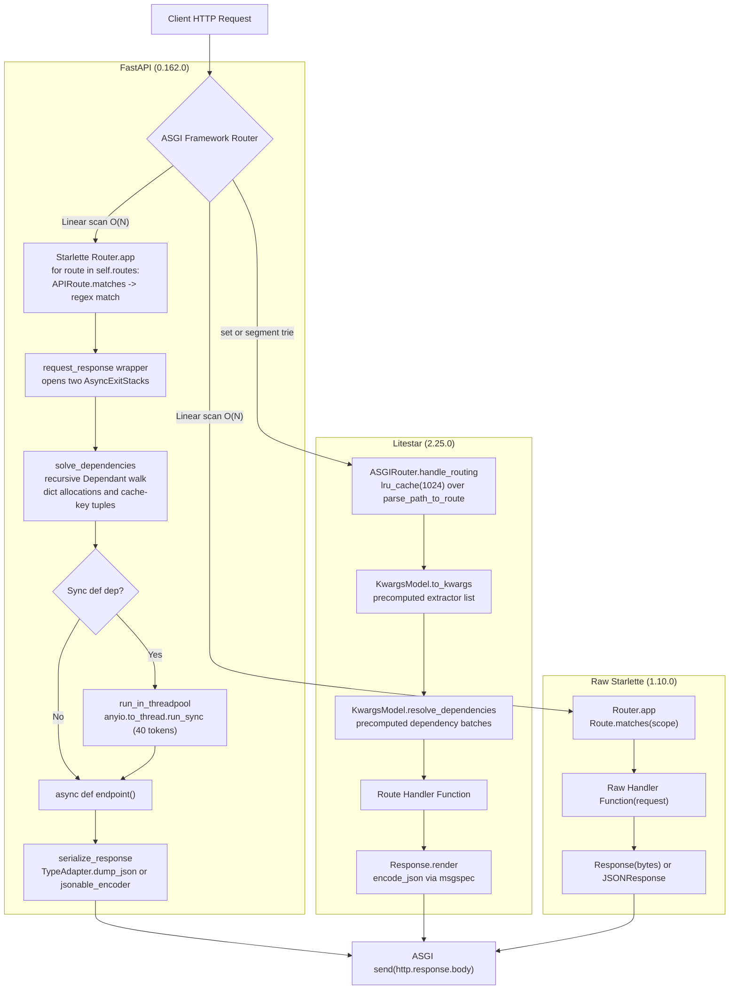

# When FastAPI Becomes the Bottleneck: Per-Request DI Overhead, Startup Cold-Start Cost, and Comparison with Litestar (2.25.0) and Raw Starlette

> [!summary] Claim
> FastAPI (0.162.0) pays per-request CPU for a recursive runtime walk of the `Dependant` graph and for Starlette's linear route scan, so high-route-count or sub-millisecond services should measure that cost and move hot paths to Litestar (2.25.0), whose routes are looked up by hash or path segment and whose dependency order is precomputed, or to raw Starlette (1.10.0), which skips signature-driven injection entirely.

Part of [FastAPI Internals and Patterns](README.md) in [API Engineering](../README.md).

## TL;DR

FastAPI resolves dependencies per request by recursively calling `solve_dependencies` over the `Dependant` graph and finds the route by a linear scan of Starlette's `Router.routes`, whereas Litestar (2.25.0) looks up static paths in a `set`, walks a per-segment trie for parameterized paths, caches results in an instance `lru_cache(1024)`, and resolves dependencies from batches topologically sorted at startup.
When an endpoint needs sub-millisecond latency or the app registers hundreds of routes, take routing and dependency resolution off the per-request reflection path, and keep blocking work out of synchronous dependencies.
Declaring synchronous `def` dependencies inside `async def` endpoints makes FastAPI dispatch each one to an AnyIO worker thread via `run_in_threadpool`, one hop at a time; in the lab a chain of five cost 3.9x the async chain (`484.9 us` vs `125.3 us`), and every hop holds one of the 40 tokens of the default per-event-loop limiter.
Portability: FastAPI 0.162.0 requires Python `>=3.10` and Starlette 1.10.0 requires `>=3.11`; on CPython 3.14+, FastAPI's `_get_signature` falls back to `annotationlib.Format.FORWARDREF` when `inspect.signature(call, eval_str=True)` raises `NameError` `(fastapi 0.162.0 fastapi/dependencies/utils.py, _get_signature)`.
Do not discard FastAPI for raw Starlette or Litestar when developer velocity, generated OpenAPI contracts, Swagger UI, and Pydantic validation tooling outweigh tens to hundreds of microseconds of framework overhead per request.

## Mental model

The following diagram contrasts the request execution pipeline across FastAPI (0.162.0), Litestar (2.25.0), and raw Starlette (1.10.0), showing where per-request overhead accumulates in routing, dependency resolution, threadpool dispatch, and serialization.



When an HTTP request arrives over the ASGI interface `(ASGI Specification v3.0)`, the frameworks diverge at the first boundary: routing.
FastAPI relies on Starlette's `Router.app`, which scans `self.routes` in order, calling each route's `matches`, which runs `self.path_regex.match(route_path)`, until one returns `Match.FULL`; a path match with the wrong method returns `Match.PARTIAL`, which is remembered and later answered with `405 Method Not Allowed` `(RFC 9110 Section 15.5.6)`.
Litestar's `ASGIRouter.__call__` calls `handle_routing`, an instance-level `lru_cache(1024)` over `parse_path_to_route`, which checks a `set` of parameter-free paths first and otherwise walks a trie with one node per path segment, so the lookup cost depends on the number of segments, not the number of routes.
Once the route is found, FastAPI calls `solve_dependencies`, which recurses through the `Dependant` graph, allocates argument dictionaries, builds cache-key tuples, and hops into the AnyIO threadpool for every synchronous `def` dependency.
Litestar runs `KwargsModel.to_kwargs`, a flat list of parameter extractors built at startup, and then `KwargsModel.resolve_dependencies`, which calls each provider in batches whose order was computed at startup.
At serialization, FastAPI either calls `pydantic-core` through `TypeAdapter.dump_json` (when a response model exists, including one inferred from the return annotation) or falls back to the pure-Python `jsonable_encoder` followed by `json.dumps`, Litestar renders through a module-level `msgspec.json.Encoder`, and raw Starlette returns bytes or a `JSONResponse` rendered with `json.dumps`.

## How it works

### 1. Per-Request Dependency Injection Engine Overhead

In FastAPI (0.162.0), every request to an `APIRoute` enters the ASGI app built by `request_response` `(fastapi 0.162.0 fastapi/routing.py, request_response)`, which opens two `AsyncExitStack` objects and stores them as `scope["fastapi_inner_astack"]` and `scope["fastapi_function_astack"]`, then awaits the closure returned by `get_request_handler` `(fastapi 0.162.0 fastapi/routing.py, get_request_handler)`.
Before the path operation function runs, that closure calls `solve_dependencies` `(fastapi 0.162.0 fastapi/dependencies/utils.py, solve_dependencies)`.
This function is a runtime graph evaluator.
On every call it allocates new local state (simplified excerpt; the real function also creates a placeholder `Response` between these lines):
```python
values: dict[str, Any] = {}
errors: list[Any] = []
if dependency_cache is None:
    dependency_cache = {}
if _uses_scopes_cache is None:
    _uses_scopes_cache = {}
```
For every sub-dependency in `dependant.dependencies`, FastAPI first recursively awaits `solve_dependencies(...)` for that sub-dependency, and only then computes `_get_cache_key(dependant=sub_dependant, uses_scopes_cache=_uses_scopes_cache)`.
The order matters: the sub-dependency's own parameters and sub-graph are solved again even when its result is already cached; the cache only skips calling the dependency callable itself.
If `sub_dependant.use_cache` is `True` and the key is in `dependency_cache`, the cached value is reused.
`_get_cache_key` builds a fresh tuple of the dependency callable, a sorted tuple of OAuth scopes when the dependency uses scopes, and the computed dependency scope string `(fastapi 0.162.0 fastapi/dependencies/models.py, _get_cache_key)`.
If the dependency is a generator, FastAPI routes it through `_solve_generator` and enters it on `scope["fastapi_inner_astack"]`, or on `scope["fastapi_function_astack"]` when the dependency declares `scope="function"`.
If the dependency is a synchronous function (`def`), FastAPI runs `solved = await run_in_threadpool(call, **solved_result.values)`.
After the sub-dependencies are resolved, FastAPI extracts parameters from the connection by calling `request_params_to_args` (simplified excerpt; the source spreads each call over several lines):
```python
path_values, path_errors = request_params_to_args(dependant.path_params, request.path_params)
query_values, query_errors = request_params_to_args(dependant.query_params, request.query_params)
header_values, header_errors = request_params_to_args(dependant.header_params, request.headers)
cookie_values, cookie_errors = request_params_to_args(dependant.cookie_params, request.cookies)
values.update(path_values)
values.update(query_values)
values.update(header_values)
values.update(cookie_values)
```
Each `request_params_to_args` call iterates over the field definitions and validates each value through its Pydantic `ModelField`.
If `dependant.body_params` is non-empty, FastAPI awaits `request_body_to_args`, which validates the body fields against their Pydantic models.
FastAPI then returns a `SolvedDependency` dataclass instance:
```python
    return SolvedDependency(
        values=values,
        errors=errors,
        background_tasks=background_tasks,
        response=response,
        dependency_cache=dependency_cache,
    )
```
Every level of the graph therefore allocates at least two dictionaries, a list, one cache-key tuple per sub-dependency, and a `SolvedDependency`, which multiplies by request rate into steady allocator and garbage-collector pressure.
In the lab, adding a chain of five `async def` dependencies to an endpoint raised the median in-process request time from `97.0 us` to `125.3 us`, about `5.7 us` per dependency (measurement method in Numbers and limits).

### 2. Litestar's Ahead-of-Time (AOT) Dependency Compilation

Litestar (2.25.0) moves dependency graph analysis to application startup.
When the app is built, `BaseRouteHandler.on_registration` validates the handler function and resolves its layered dependencies, guards, middleware, and DTOs `(litestar 2.25.0 litestar/handlers/base.py, on_registration)`, and `HTTPRouteHandler.on_registration` extends it `(litestar 2.25.0 litestar/handlers/http_handlers/base.py, on_registration)`.
Each `HTTPRoute.create_handler_map` then calls `create_kwargs_model`, which calls `KwargsModel.create_for_signature_model` once per handler `(litestar 2.25.0 litestar/_kwargs/kwargs_model.py, KwargsModel.create_for_signature_model)`.
The resulting `KwargsModel` holds a list of extractor callables in `self.extractors` and a list of dependency batches in `self.dependency_batches`, computed by `create_dependency_batches` as topological layers of the dependency graph `(litestar 2.25.0 litestar/_kwargs/dependencies.py, create_dependency_batches)`.
At request time the extractors run in order:
```python
    async def to_kwargs(self, connection: ASGIConnection) -> dict[str, Any]:
        """Return a dictionary of kwargs. Async values, i.e. CoRoutines, are not resolved to ensure this function is
        sync.

        Args:
            connection: An instance of :class:`Request <litestar.connection.Request>` or
                :class:`WebSocket <litestar.connection.WebSocket>`.

        Returns:
            A string keyed dictionary of kwargs expected by the handler function and its dependencies.
        """
        output: dict[str, Any] = {}

        for extractor in self.extractors:
            await extractor(output, connection)

        return output
```
Dependencies are still executed per request: `KwargsModel.resolve_dependencies` walks the precomputed batches, awaits a single-member batch directly, and runs a multi-member batch concurrently in an AnyIO task group `(litestar 2.25.0 litestar/_kwargs/kwargs_model.py, KwargsModel.resolve_dependencies)`.
For each dependency, `resolve_dependency` validates its arguments with `signature_model.parse_values_from_connection_kwargs` and calls the provider `(litestar 2.25.0 litestar/_kwargs/dependencies.py, resolve_dependency)`.
What Litestar skips at request time is graph discovery and per-request cache-key computation, not validation.
`Provide(use_cache=True)` stores the first value on the `Provide` instance and returns it on every later call, so the cache spans requests for the life of the app, unlike FastAPI's per-request `dependency_cache` `(litestar 2.25.0 litestar/di.py, Provide.__call__)`.
Some misconfigurations fail at startup: a handler without a return annotation raises `ImproperlyConfiguredException` from `_validate_handler_function` `(litestar 2.25.0 litestar/handlers/http_handlers/base.py, HTTPRouteHandler._validate_handler_function)`.
A dependency cycle is not detected: with two providers `a` and `b` that each depend on the other, `Litestar(...)` did not return within 8 s, and `faulthandler` showed `_create_dependency_graph` recursing at `litestar/_kwargs/kwargs_model.py` line 503 (run once under CPython 3.14.6 on the lab machine).

### 3. Routing Topology: Linear Scanning vs Segment Trie

A scalability bottleneck in large FastAPI applications comes from Starlette's routing `(starlette 1.10.0 starlette/routing.py, Router.app)`.
FastAPI's `APIRouter` subclasses Starlette's `Router`, and routes are stored in a plain list: `self.routes = [] if routes is None else list(routes)`.
When a request arrives, `Router.app` runs (simplified excerpt; source comments removed):
```python
partial = None

for route in self.routes:
    match, child_scope = route.matches(scope)
    if match is Match.FULL:
        scope["route"] = route
        scope.update(child_scope)
        await route.handle(scope, receive, send)
        return
    elif match is Match.PARTIAL and partial is None:
        partial = route
        partial_scope = child_scope
```
Inside `Route.matches` `(starlette 1.10.0 starlette/routing.py, Route.matches)`, Starlette runs:
```python
            match = self.path_regex.match(route_path)
```
The scan is O(N) in the number of routes registered on the router.
For an application with 500 routes, a request to `/route_499` calls `matches` 500 times.
FastAPI's `APIRoute.matches` adds a `_get_scope_effective_route_context(scope)` lookup before delegating to Starlette's `Route.matches` `(fastapi 0.162.0 fastapi/routing.py, APIRoute.matches)`, which is why its per-route scan cost is higher.
Measured in the lab: one non-matching Starlette `Route.matches` call costs `173.7 ns` (the bare compiled regex miss is `80.7 ns`), and the tail-minus-head request delta at 500 routes is `90.0 us` for Starlette and `171.4 us` for FastAPI, about `180 ns` and `343 ns` per skipped route.
To produce `405 Method Not Allowed` `(RFC 9110 Section 15.5.6)`, Starlette cannot stop at a path match with the wrong method; it records the first `Match.PARTIAL` and keeps scanning in case a later route matches both path and method.
When nothing matches and `redirect_slashes` is `True` (the default), `Router.app` scans every route a second time with the trailing slash toggled before answering `404`, so a miss costs about 2N `matches` calls.
Litestar (2.25.0) builds its routing structure during startup in `ASGIRouter.construct_routing_trie()` `(litestar 2.25.0 litestar/_asgi/asgi_router.py, ASGIRouter.construct_routing_trie)`.
At request time `parse_path_to_route` first checks `if path in plain_routes`, a `set` of parameter-free paths, then tries a compiled alternation regex of mount paths, and otherwise calls `traverse_route_map`, which splits the path on `/` and follows one dictionary child per segment `(litestar 2.25.0 litestar/_asgi/routing_trie/traversal.py, parse_path_to_route)`.
The trie is a per-segment trie (one node per path component), not a compressed radix tree.
The lookup cost is O(k) in the number of path segments and independent of the number of registered routes.
Litestar wraps the lookup in an instance-level cache:
```python
        self.handle_routing = lru_cache(1024)(self._handle_routing)
```
The cache key is the `(path, method)` pair, so parameterized paths with high-cardinality values (for example `/users/{id}`) churn the 1024 entries, and `404` or `405` outcomes are recomputed every time because `lru_cache` does not store raised exceptions.
Measured in the lab: a cached `handle_routing` hit costs `85.2 ns` and an uncached `_handle_routing` call for `/route_499` costs `223.7 ns`.

### 4. Startup Cold-Start Breakdown

In scale-to-zero environments such as AWS Lambda, Google Cloud Run, and Knative, application import and construction time is paid on the first request after a cold start.
FastAPI's per-route startup cost is in `APIRoute.__init__` `(fastapi 0.162.0 fastapi/routing.py, APIRoute.__init__)`, which calls `_populate_api_route_state`, which calls `_build_dependant_with_parameterless_dependencies`, which calls `get_dependant` `(fastapi 0.162.0 fastapi/dependencies/utils.py, get_dependant)`.
`get_dependant` calls `get_typed_signature`, which calls `inspect.signature(call, eval_str=True)` to read parameter names, defaults, and annotations.
It then builds Pydantic-backed `ModelField` wrappers for every path, query, header, cookie, and body parameter.
For the response model, including one inferred from the endpoint's return annotation, `_populate_api_route_state` calls `create_model_field`, and each `ModelField` builds a `TypeAdapter`, which makes `pydantic-core` build a validator and serializer `(fastapi 0.162.0 fastapi/_compat/v2.py, ModelField)`.
Counting calls in the lab, building 500 trivial routes (no parameters, `-> dict[str, Any]` return annotation) made 1000 `inspect.signature` calls, two per route.
Measured in the lab, the first build of a 500-route app took `4.49 ms` in raw Starlette (1.10.0), `58.41 ms` in FastAPI (0.162.0), and `154.85 ms` in Litestar (2.25.0); medians of seven further builds in the same process were `1.34 ms`, `51.71 ms`, and `136.44 ms`.
Litestar front-loads more work: `on_registration` per handler, a `KwargsModel` per handler, the routing trie, and an automatically added `OPTIONS` handler for every path, which doubles the handler count `(litestar 2.25.0 litestar/routes/http.py, HTTPRoute.__init__)`.
Litestar trades startup time for less per-request lookup work, not for reflection-free execution, since dependency and handler arguments are still validated per request.
Raw Starlette is cheap to build because `Route.__init__` only wraps the endpoint, normalizes the method set, and calls `compile_path`, which builds one anchored regex from the path and the parameter convertors, without reading endpoint signatures or building validation models `(starlette 1.10.0 starlette/routing.py, compile_path)`.

### 5. Serialization Pipeline: `jsonable_encoder` vs `pydantic-core` vs `msgspec`

Serialization is the second major runtime cost in Python web frameworks.
FastAPI (0.162.0) chooses the path in `get_request_handler` and `serialize_response` `(fastapi 0.162.0 fastapi/routing.py, serialize_response)`.
FastAPI infers a response model from the endpoint's return annotation when `response_model` is not passed, unless the annotation is a `Response` subclass `(fastapi 0.162.0 fastapi/routing.py, _populate_api_route_state)`.
If a response field exists and the default response class is used, `use_dump_json` is `True`: `serialize_response` validates the return value with `field.validate` and then calls `field.serialize_json`, which calls `self._type_adapter.dump_json(...)` and returns JSON bytes from `pydantic-core` without an intermediate Python dictionary `(fastapi 0.162.0 fastapi/_compat/v2.py, ModelField.serialize_json)`.
If there is no response field (no `response_model` and no usable return annotation), `serialize_response` returns `jsonable_encoder(response_content)` and the default `JSONResponse` then renders it with `json.dumps(content, ensure_ascii=False, allow_nan=False, indent=None, separators=(",", ":"))`.
If a custom response class is set, the response field is still validated and converted with `field.serialize` (Python mode), and the class renders the result.
The `_serialize_data` helper inside `get_request_handler` (`jsonable_encoder` then `json.dumps(_normalize_non_finite_floats(data))`) applies only to streamed JSON Lines and Server-Sent Events items, not to ordinary responses.
`jsonable_encoder` is a pure-Python recursive function that walks dictionaries, lists, dataclasses, and Pydantic models, converting datetimes, UUIDs, and enums into JSON-compatible Python values.
Measured in the lab for 500 dictionaries of the shape `{"id": int, "name": str, "price": float, "tags": [str, str]}`: `jsonable_encoder` plus `JSONResponse` rendering took `2.023 ms`, `JSONResponse` alone on the same dictionaries `0.218 ms`, `TypeAdapter(list[Item]).dump_json` on already-built models `0.103 ms`, and validate-then-dump from dictionaries (what FastAPI's fast path does) `0.251 ms`.
Litestar renders responses through `Response.render`, which calls `encode_json`, which uses a module-level `msgspec.json.Encoder(enc_hook=default_serializer)` `(litestar 2.25.0 litestar/serialization/msgspec_hooks.py, encode_json)` `(msgspec 0.22.0)`.
`msgspec.Struct` types are C-implemented classes created by `msgspec` itself when the class is defined; Litestar does not compile them.
`msgspec.json.encode` writes JSON into a newly allocated output buffer in C.
Measured in the lab: `msgspec.json.encode` took `0.037 ms` for 500 equivalent `msgspec.Struct` instances and `0.046 ms` for the 500 dictionaries, versus `2.023 ms` for the `jsonable_encoder` path (about 44x).

### 6. The AnyIO Threadpool Limiter Trap

A subtle concurrency trap in FastAPI comes from combining synchronous `def` dependencies with `async def` endpoints.
FastAPI treats every dependency declared with `def` (not a generator) as potentially blocking.
Inside `solve_dependencies` `(fastapi 0.162.0 fastapi/dependencies/utils.py, solve_dependencies)`, FastAPI dispatches it with Starlette's helper:
```python
            solved = await run_in_threadpool(call, **solved_result.values)
```
`run_in_threadpool` wraps the call in `functools.partial` and awaits `anyio.to_thread.run_sync(func)` `(starlette 1.10.0 starlette/concurrency.py, run_in_threadpool)`.
`run_sync` without an explicit `limiter` uses the default capacity limiter, which the asyncio backend creates lazily as `CapacityLimiter(40)` and stores in a `RunVar`, so there is one 40-token limiter per event loop, which in practice means per worker process `(anyio 4.16.0 anyio/_backends/_asyncio.py, AsyncIOBackend.current_default_thread_limiter)`.
Sub-dependencies are awaited one after another in the `for sub_dependant in dependant.dependencies` loop, so a chain of five synchronous dependencies makes five sequential thread hops.
Each hop costs:
1. Acquiring a token from the AnyIO `CapacityLimiter`.
2. Handing the callable to a worker thread.
3. Executing the callable on that thread.
4. Waking the event loop thread to resume the awaiting coroutine.
Measured in the lab: the five-deep `async def` chain took `125.3 us` and the five-deep `def` chain `484.9 us` (3.9x, about `72 us` extra per hop); a single `def` dependency added `84.5 us` over a single `async def` one.
Under load, every in-flight synchronous dependency, `def` endpoint, and other `run_in_threadpool` user holds a token, so once 40 are blocked on slow I/O, further sync work queues behind them while pure `async` work keeps running.
Sync generator dependencies take a default token for `__enter__` only: `contextmanager_in_threadpool` runs `cm.__exit__` under a fresh `CapacityLimiter(1)` per call so that cleanup cannot deadlock waiting for a free token `(fastapi 0.162.0 fastapi/concurrency.py, contextmanager_in_threadpool)`.
Queued requests then see tail latency grow with the blocked call's duration, and an upstream proxy may answer `504 Gateway Timeout` `(RFC 9110 Section 15.6.5)`.
Litestar handles this differently: a synchronous provider runs inline on the event loop unless declared with `Provide(..., sync_to_thread=True)`, and Litestar emits a warning when the flag is omitted (`warn_implicit_sync_to_thread`) `(litestar 2.25.0 litestar/di.py, Provide.__init__)`, so the failure mode there is a blocked event loop rather than a starved threadpool.
With `sync_to_thread=True` on asyncio, Litestar does not use AnyIO's limiter: `sync_to_thread` calls `asyncio.get_running_loop().run_in_executor(get_asyncio_executor(), bound_fn)`, which uses the loop's default `ThreadPoolExecutor` unless one is set with `set_asyncio_executor` `(litestar 2.25.0 litestar/concurrency.py, sync_to_thread)`.

## Numbers and limits

All lab numbers below were measured once on 2026-11-15 on an Apple M3 Pro under macOS 27.3 (Darwin `27.3.0`, arm64) with CPython 3.14.6 from uv, running `uv run --frozen python <harness>` from `labs/` against the lab module `fastapi_architectural_limits.py`.
Request latencies are medians of 300 sequential `GET` requests after 50 warm-up requests through `httpx.AsyncClient(transport=httpx.ASGITransport(app=app))`, so they include the in-process client's own overhead and are useful only as differences between rows.
Micro-timings use `timeit`; serialization rows are the best of five runs of 200 iterations.

| Metric / Architectural Boundary | Raw Starlette (1.10.0) | FastAPI (0.162.0) | Litestar (2.25.0) | Source / Limiting Mechanism |
|---|---|---|---|---|
| 500-route app build, first call | `4.49 ms` | `58.41 ms` | `154.85 ms` | Lab, `measure_cold_start(500)`; Starlette compiles regexes; FastAPI builds `Dependant` and `ModelField`; Litestar registers handlers, `KwargsModel`, trie, and `OPTIONS` handlers |
| 500-route app build, median of 7 repeats | `1.34 ms` | `51.71 ms` | `136.44 ms` | Lab, same builders called again in the same process |
| Per-route build cost (first call / 500) | `~9.0 us` | `~116.8 us` | `~309.7 us` | Derived from the first-call row |
| `inspect.signature` calls, 500 trivial routes | `0` | `1000` | not counted | Lab, counting wrapper around `inspect.signature` |
| Route matching complexity | `O(N)` linear scan | `O(N)` linear scan | `O(1)` set hit for static paths, `O(k)` segment trie, `lru_cache(1024)` | (starlette 1.10.0 starlette/routing.py, Router.app); (litestar 2.25.0 litestar/_asgi/routing_trie/traversal.py, parse_path_to_route) |
| Latency: head route (`/route_0`) | `69.5 us` | `92.4 us` | `78.1 us` | Lab, median in-process request |
| Latency: tail route (`/route_499`) | `159.6 us` | `263.8 us` | `87.2 us` | Lab, median in-process request |
| Tail minus head at 500 routes | `+90.0 us` | `+171.4 us` | `+9.0 us` | Lab; Litestar's delta is within run-to-run noise of a cached lookup |
| One non-matching `Route.matches` call | `173.7 ns` | `~343 ns` (derived from delta / 499) | N/A | Lab `timeit`; bare regex miss is `80.7 ns`; FastAPI adds `_get_scope_effective_route_context` |
| Litestar `handle_routing` cache hit / miss | N/A | N/A | `85.2 ns` / `223.7 ns` | Lab `timeit` on `/route_499` |
| DI: 0 dependencies | Baseline (`69.5 us` head route) | `97.0 us` | `77.5 us` | Lab; FastAPI row includes the two `AsyncExitStack` objects and the inferred-response-model `dump_json` path |
| DI: 1 async dependency | N/A (no DI) | `104.8 us` | `83.9 us` | Lab |
| DI: 5 chained async dependencies | N/A (no DI) | `125.3 us` | `90.5 us` | Lab; adds `28.3 us` over 0 deps in FastAPI and `13.0 us` in Litestar |
| DI: 1 sync dependency (`def`) | N/A (no DI) | `189.3 us` | not measured (`sync_to_thread` opt-in) | Lab; one `run_in_threadpool` hop adds `84.5 us` over the async case |
| DI: 5 chained sync dependencies (`def`) | N/A (no DI) | `484.9 us` | not measured | Lab; five sequential hops add `359.6 us` over the async chain |
| Default thread capacity for sync work | N/A | `40 tokens` per event loop (AnyIO limiter) | asyncio: the loop's default `ThreadPoolExecutor` via `run_in_executor` when `sync_to_thread=True`, unless `set_asyncio_executor` is used | (anyio 4.16.0 anyio/_backends/_asyncio.py, AsyncIOBackend.current_default_thread_limiter); (litestar 2.25.0 litestar/concurrency.py, sync_to_thread) |
| Serialize 500 dicts | `0.218 ms` (`JSONResponse`) | `2.023 ms` (`jsonable_encoder` + `JSONResponse`) | `0.046 ms` (`msgspec.json.encode`) | Lab `timeit`, payload shape in How it works section 5 |
| Serialize 500 models | N/A | `0.103 ms` dump only, `0.251 ms` validate + dump from dicts | `0.037 ms` (`msgspec.Struct`) | Lab `timeit`; `TypeAdapter(list[Item]).dump_json` |
| Litestar routing cache size | N/A | N/A | `1024 entries` | (litestar 2.25.0 litestar/_asgi/asgi_router.py, ASGIRouter.__init__) |

## Portability

The matrix below records what this note's lab proved and what it did not (as of 2026-11).
Only the CPython 3.14.6 leg was executed for this verification; the other CPython legs and all server legs were not run, and their cells state only what the cited specification or package metadata says.

| Environment / Runtime Leg | Raw Starlette (1.10.0) | FastAPI (0.162.0) | Litestar (2.25.0) | Specification / Upstream Citation |
|---|---|---|---|---|
| CPython `3.12.16` | Not run here; package allows it (`Requires-Python: >=3.11`). | Not run here; package allows it (`>=3.10`). | Not run here; package allows it (`>=3.8,<4.0`). | Package `METADATA`; lab `pyproject.toml` `requires-python = ">=3.12,<3.16"` |
| CPython `3.13.18` | Not run here; the experimental JIT of PEP 744 is off unless CPython is built with `--enable-experimental-jit`, and `re` matching runs in C either way. | Not run here. | Not run here. | (PEP 744, JIT Compilation) |
| CPython `3.14.6` (lab default) / `3.14.10` | `3.14.6`: lab test passed (5 tests). `3.14.10`: not run. | `3.14.6`: lab test passed; on 3.14+ `_get_signature` can fall back to `annotationlib.Format.FORWARDREF`. | `3.14.6`: lab test passed. | Lab run below; (fastapi 0.162.0 fastapi/dependencies/utils.py, _get_signature); deferred annotations (PEP 649) are the default from 3.14 |
| CPython `3.15.2` | Not run here. | Not run here. | Not run here. | Lab `pyproject.toml` upper bound `<3.16` |
| CPython `3.15.2t` free-threaded | Not run here. | Not run here; free-threaded builds use biased reference counting and mimalloc, so per-request allocations are thread-local in the common case. | Not run here. | (PEP 703, Making the Global Interpreter Lock Optional in CPython); free-threaded build supported but optional since 3.14 (PEP 779) |
| Uvicorn `0.54.0` | Not run here; ships `h11_impl.py` and `httptools_impl.py` HTTP/1.1 protocol implementations. | Not run here. | Not run here; any ASGI 3.0 callable. | (uvicorn 0.54.0 uvicorn/protocols/http/httptools_impl.py) |
| Hypercorn `0.18.0` | Not run here; HTTP/2 through the required `h2` dependency, HTTP/3 through the optional `h3` extra (`aioquic`). | Not run here. | Not run here. | (hypercorn 0.18.0 hypercorn/asyncio/run.py); hypercorn 0.18.0 `METADATA` |
| Granian `2.8.7` | Not run here; Rust HTTP server bridging to the Python ASGI app. | Not run here; the Python event loop still runs FastAPI's routing and DI. | Not run here. | (granian 2.8.7 src/asgi/io.rs) |
| HTTP/1.1 framing | Server-side `Content-Length` or chunked `Transfer-Encoding` `(RFC 9112 Section 6)`; the framework only emits ASGI `http.response.body` messages. | Same; routing and DI cost do not depend on framing. | Same. | (RFC 9112 Section 6.1) |
| HTTP/2 multiplexing | Many streams over one TCP connection `(RFC 9113 Section 5.1)`; each stream is a separate ASGI request to the app. | Same; more concurrent streams per connection means more concurrent `run_in_threadpool` callers sharing the 40 tokens. | Same. | (RFC 9113 Section 5.1) |
| HTTP/3 over QUIC | Streams on QUIC avoid transport-level head-of-line blocking between requests `(RFC 9114)`. | Same; application routing and DI cost unchanged. | Same. | (RFC 9114 Section 4.1) |

## Worked example

The runnable lab defines builders for raw Starlette (1.10.0), FastAPI (0.162.0), and Litestar (2.25.0) apps, measures startup route-build time, and builds dependency-injection topologies for both DI frameworks.
The source code is located at [implementation](../labs/src/api_labs/f11_fastapi_internals_and_patterns/fastapi_architectural_limits.py) and verified by the test suite at [test](../labs/tests/f11_fastapi_internals_and_patterns/test_fastapi_architectural_limits_and_comparison_with_litestar_and_raw_starlette.py).
Excerpt: lines 1-87 of the implementation, verbatim; the DI builders (`build_fastapi_di_app`, `build_litestar_di_app`) follow in the file.

```python
"""Architectural performance limits and comparison across FastAPI, Litestar, and Starlette."""

import time
from dataclasses import dataclass
from typing import Annotated, Any

from fastapi import Depends, FastAPI
from litestar import Litestar, get
from litestar.di import NamedDependency, Provide
from starlette.applications import Starlette
from starlette.requests import Request
from starlette.responses import JSONResponse, Response
from starlette.routing import Route


@dataclass(frozen=True)
class FrameworkColdStartMetrics:
    """Startup initialization duration for N-route applications."""

    starlette_init_ms: float
    fastapi_init_ms: float
    litestar_init_ms: float
    route_count: int


def build_starlette_app(route_count: int = 500) -> Starlette:
    """Build a raw Starlette application with N linearly matched routes."""
    routes: list[Route] = []
    for i in range(route_count):

        async def handler(request: Request, idx: int = i) -> Response:
            return JSONResponse({"route": idx, "framework": "starlette"})

        routes.append(Route(f"/route_{i}", handler, methods=["GET"]))
    return Starlette(routes=routes)


def build_fastapi_app(route_count: int = 500) -> FastAPI:
    """Build a FastAPI application with N routes and Dependant structures."""
    app = FastAPI(openapi_url=None, docs_url=None, redoc_url=None)
    for i in range(route_count):

        def _register(idx: int) -> None:
            @app.get(f"/route_{idx}")
            async def endpoint() -> dict[str, Any]:
                return {"route": idx, "framework": "fastapi"}

        _register(i)
    return app


def build_litestar_app(route_count: int = 500) -> Litestar:
    """Build a Litestar application with N routes compiled into a routing trie."""
    route_handlers: list[Any] = []
    for i in range(route_count):

        def _make_handler(idx: int) -> Any:
            @get(f"/route_{idx}")
            async def handler() -> dict[str, Any]:
                return {"route": idx, "framework": "litestar"}

            return handler

        route_handlers.append(_make_handler(i))
    return Litestar(route_handlers=route_handlers, openapi_config=None)


def measure_cold_start(route_count: int = 100) -> FrameworkColdStartMetrics:
    """Measure synchronous app instantiation and route compilation time."""
    t0 = time.perf_counter()
    _ = build_starlette_app(route_count)
    t_starlette = (time.perf_counter() - t0) * 1000.0

    t0 = time.perf_counter()
    _ = build_fastapi_app(route_count)
    t_fastapi = (time.perf_counter() - t0) * 1000.0

    t0 = time.perf_counter()
    _ = build_litestar_app(route_count)
    t_litestar = (time.perf_counter() - t0) * 1000.0

    return FrameworkColdStartMetrics(
        starlette_init_ms=t_starlette,
        fastapi_init_ms=t_fastapi,
        litestar_init_ms=t_litestar,
        route_count=route_count,
    )
```

The test module checks that each framework routes head and tail paths correctly and that both DI engines resolve their chains.
Excerpt: lines 1-29 and 54-82 of the test module, verbatim; the Starlette routing test, the Litestar DI test, and the FastAPI-versus-Litestar routing test are omitted here.

```python
"""Unit tests for FastAPI architectural limits, cold-start cost, and Litestar/Starlette."""

from typing import Any, cast

import httpx
import pytest

from api_labs.f11_fastapi_internals_and_patterns.fastapi_architectural_limits import (
    build_fastapi_app,
    build_fastapi_di_app,
    build_litestar_app,
    build_litestar_di_app,
    build_starlette_app,
    measure_cold_start,
)


@pytest.mark.unit
def test_cold_start_route_compilation_scaling() -> None:
    """Verify that route initialization completes across frameworks and Starlette is lowest cost."""
    metrics = measure_cold_start(route_count=50)

    assert metrics.route_count == 50
    assert metrics.starlette_init_ms > 0.0
    assert metrics.fastapi_init_ms > 0.0
    assert metrics.litestar_init_ms > 0.0
    # Starlette performs zero signature inspection or Pydantic model compilation,
    # making its per-route instantiation substantially faster than FastAPI.
    assert metrics.starlette_init_ms <= metrics.fastapi_init_ms


@pytest.mark.unit
@pytest.mark.asyncio
async def test_fastapi_dependency_injection_resolution() -> None:
    """Verify FastAPI runtime DI engine resolves async and sync threadpool dependency chains."""
    app = build_fastapi_di_app()

    async with httpx.AsyncClient(
        transport=httpx.ASGITransport(app=app), base_url="http://test"
    ) as client:
        resp_0 = await client.get("/dep-0")
        resp_1 = await client.get("/dep-1")
        resp_5 = await client.get("/dep-5")
        resp_sync_1 = await client.get("/dep-sync-1")
        resp_sync_5 = await client.get("/dep-sync-5")

    assert resp_0.status_code == 200
    assert resp_0.json() == {"result": 0}

    assert resp_1.status_code == 200
    assert resp_1.json() == {"result": 1}

    assert resp_5.status_code == 200
    assert resp_5.json() == {"result": 5}

    assert resp_sync_1.status_code == 200
    assert resp_sync_1.json() == {"result": 1}

    assert resp_sync_5.status_code == 200
    assert resp_sync_5.json() == {"result": 5}
```

The following pytest output was captured on 2026-11-15 from `labs/` under CPython 3.14.6 on macOS 27.3 (Darwin `27.3.0`, arm64, Apple M3 Pro):

```text
$ uv run --frozen pytest tests/f11_fastapi_internals_and_patterns/test_fastapi_architectural_limits_and_comparison_with_litestar_and_raw_starlette.py
============================= test session starts ==============================
platform darwin -- Python 3.14.6, pytest-9.2.0, pluggy-1.7.0
rootdir: /Users/shreejitverma/github/The-Distinguished-Engineer/build/api_notes/jobs/FastAPI-Architectural-Limits-and-Comparison-with-Litestar-and-Raw-Starlette/verify/labs
configfile: pyproject.toml
plugins: platformdirs-4.14.5, schemathesis-4.33.1, cov-7.1.0, hypothesis-6.170.14, inline-snapshot-0.36.1, Faker-40.44.0, locust-2.47.0, typeguard-4.6.0, anyio-4.16.0, asyncio-1.4.1.post1, respx-0.23.1
asyncio: mode=Mode.STRICT, debug=False, asyncio_default_fixture_loop_scope=function, asyncio_default_test_loop_scope=function
collected 5 items

tests/f11_fastapi_internals_and_patterns/test_fastapi_architectural_limits_and_comparison_with_litestar_and_raw_starlette.py . [ 20%]
....                                                                     [100%]

============================== 5 passed in 0.49s ===============================
```

## Pitfalls

> [!warning] AnyIO Threadpool Limiter Exhaustion via Synchronous Dependencies
> **Trigger**: Declaring synchronous `def` dependencies that do blocking I/O (e.g., `def get_db() -> Session:`) on endpoints that receive high concurrent traffic.
> **Symptom**: Tail latency grows with the duration of the blocking call once concurrency passes the token count, upstream proxies return `504 Gateway Timeout`, and CPU stays low while requests wait for tokens.
> **Root cause**: FastAPI runs every synchronous non-generator dependency through `run_in_threadpool` `(fastapi 0.162.0 fastapi/dependencies/utils.py, solve_dependencies)`, and AnyIO's default limiter is `CapacityLimiter(40)` per event loop `(anyio 4.16.0 anyio/_backends/_asyncio.py, AsyncIOBackend.current_default_thread_limiter)`.
> When 40 threadpool calls in one worker are blocked on a database query or file read, every further threadpool call in that worker waits for a token, whatever the number of CPU cores.
> **Fix**: Make I/O-bound dependencies `async def` with an async driver (for example `asyncpg`, or SQLAlchemy's `AsyncSession`).
> If synchronous dependencies must stay, raise the limit during lifespan startup with `anyio.to_thread.current_default_thread_limiter().total_tokens = 200`, and size the database pool to match, because more threads only help if the downstream resource can absorb them.

> [!warning] O(N) Tail Route Latency Degradation in Monolithic Routers
> **Trigger**: Registering hundreds of path operations directly on one `FastAPI` app or flat `APIRouter`.
> **Symptom**: Routes registered late show consistently higher p50 and p99 latency than routes registered early, and profiles show time in `starlette.routing.Route.matches` and FastAPI's `APIRoute.matches`.
> **Root cause**: Starlette's `Router.app` scans `self.routes` in registration order `(starlette 1.10.0 starlette/routing.py, Router.app)`.
> At the `~343 ns` per skipped FastAPI route measured in this lab, a route at index 580 pays about `200 us` of scanning per request, and a `404` pays roughly twice the full scan because of the `redirect_slashes` second pass.
> **Fix**: Register the hottest routes first, or partition the app into sub-applications mounted with `app.mount("/billing", billing_app)` `[[Mounting-Sub-Applications-WSGI-Legacy-Strangler-and-Static-Assets]]` so each request scans the top-level list (one `Mount` per prefix) plus only the sub-application's routes, or move latency-critical domains to Litestar's set-and-trie router.
> The trade-off of mounting is that a mounted sub-application has its own middleware, exception handlers, and OpenAPI document.

> [!warning] Serverless Cold-Start Cost on Scale-to-Zero FaaS
> **Trigger**: Deploying large FastAPI applications with many routes and deep Pydantic V2 models to scale-to-zero serverless runtimes (AWS Lambda, Google Cloud Run).
> **Symptom**: The first request after scale-up waits for module import and app construction; the lab measured `58.41 ms` just to build 500 trivial FastAPI routes, and real models, imports, and OpenAPI generation add to that.
> **Root cause**: During import and instantiation, FastAPI builds each `APIRoute`, calling `inspect.signature` and building Pydantic `TypeAdapter` validators and serializers for parameters and response models `(fastapi 0.162.0 fastapi/routing.py, APIRoute.__init__)`.
> Requesting `/openapi.json` or `/docs` also triggers `get_openapi`, which generates JSON Schema for every registered model on first use.
> **Fix**: Disable OpenAPI generation in production serverless deployments by passing `openapi_url=None`, `docs_url=None`, and `redoc_url=None` to `FastAPI(...)`, and publish the schema from CI instead.
> Split the monolith into smaller functions that only import the routes each trigger needs, or use raw Starlette endpoints for the hottest functions; the trade-off is losing generated validation and documentation for those endpoints.

> [!warning] Pure-Python Recursive Serialization via `jsonable_encoder`
> **Trigger**: Returning large dictionaries or lists from a FastAPI route that has neither `response_model` nor a usable return annotation (for example no annotation, or `-> Any`).
> **Symptom**: High CPU and p99 latency on large JSON payloads, with profiles dominated by `fastapi.encoders.jsonable_encoder`.
> **Root cause**: Without a response field, `serialize_response` returns `jsonable_encoder(response_content)` and `JSONResponse` then calls `json.dumps` `(fastapi 0.162.0 fastapi/routing.py, serialize_response)`.
> `jsonable_encoder` is a pure-Python recursive walker; in the lab it took `2.023 ms` for 500 small dictionaries versus `0.251 ms` for validate-and-dump through `pydantic-core` and `0.046 ms` for `msgspec.json.encode`.
> **Fix**: Declare `response_model=list[MyModel]` or annotate the return type (`-> list[MyModel]`) to enable the `TypeAdapter.dump_json` fast path with the default response class, or serialize directly with `msgspec.json.encode(...)` and return `starlette.responses.Response(content=payload_bytes, media_type="application/json")`.
> The trade-off of returning raw bytes is that FastAPI no longer validates or filters the response against a model.

## Security and robustness

### ReDoS and Regular Expression Cost in Route Scanning

Starlette and FastAPI compile route paths into anchored regular expressions `(starlette 1.10.0 starlette/routing.py, compile_path)`, built from the convertor patterns in `starlette/convertors.py`: `str` is `[^/]+`, `path` is `.*`, `int` is `[0-9]+`, `float` is `[0-9]+(\.[0-9]+)?`, and `uuid` is a fixed-width hex pattern.
None of the built-in patterns has nested quantifiers, so a single built-in convertor per route matches in linear time; a route with two `path` convertors (for example `/{a:path}/x/{b:path}/y`) backtracks in time quadratic in the path length on a near miss.
Catastrophic (exponential) backtracking needs a custom convertor registered with `register_url_convertor` whose `regex` contains nested or overlapping quantifiers.
Because `Router.app` runs `matches` on every route in order, a slow pattern near the top of the list taxes every request, including requests for unrelated routes.
Litestar's `traverse_route_map` splits the path on `/` and follows dictionary children, and path parameters are converted by parser functions rather than regexes, so its per-segment lookup has no backtracking; mount paths are the exception, matched with a compiled alternation of the mount path strings.
To harden FastAPI, avoid custom regex convertors with nested quantifiers, avoid multiple `path` convertors in one route, and enforce URI length limits at the reverse proxy or API gateway (OWASP API4:2023 Unrestricted Resource Consumption).

### Denial of Service via AnyIO Threadpool Exhaustion

The per-event-loop AnyIO capacity limiter is a denial-of-service lever in FastAPI applications (OWASP API4:2023 Unrestricted Resource Consumption).
If an unauthenticated endpoint (such as a health check or public login route) has a synchronous dependency that blocks on I/O (for example checking database connectivity), an attacker who can hold 40 such requests open per worker process occupies all 40 tokens.
Every other request in that worker that needs the threadpool, such as `def` endpoints, synchronous dependencies, and sync generator dependencies, then waits for a token, while requests that are purely `async` keep being served.
Audit dependency signatures so that no blocking synchronous call sits on unauthenticated paths, put timeouts on the blocking calls themselves, and rate-limit at the edge.

### Resource Lifetime of Yield Dependencies and Streaming

FastAPI's `request_response` wrapper keeps two `AsyncExitStack` objects in `request.scope` for yield dependencies `[[Yield-Dependencies-AsyncExitStack-Cleanup-Timing-and-Scope]]` `(fastapi 0.162.0 fastapi/routing.py, request_response)`.
Dependencies with `scope="function"` are entered on `fastapi_function_astack`, which closes as soon as the endpoint function returns, before the response is sent.
Default (request-scoped) yield dependencies are entered on `fastapi_inner_astack`, which closes only after `await response(scope, receive, send)` returns, so a database session from a default yield dependency stays checked out for the whole duration of a `StreamingResponse`.
If the client disconnects mid-stream, Starlette's `StreamingResponse` reacts according to the server's ASGI `spec_version`: below `2.4` it listens for the `http.disconnect` event that the ASGI server (not Starlette) delivers and cancels its task group, and at `2.4` or later a failed `send` raises `OSError`, which it re-raises as `ClientDisconnect` `(starlette 1.10.0 starlette/responses.py, StreamingResponse.__call__)`.
Either way the exception or cancellation unwinds through `fastapi_inner_astack`, so the post-`yield` code runs with it unless the dependency swallows it.
Litestar (2.25.0) inverts the timing: its yield dependencies go into a `DependencyCleanupGroup` entered on an `AsyncExitStack` inside `HTTPRoute._call_handler_function`, which exits after `to_response` builds the response object and before `HTTPRoute.handle` awaits `response(scope, receive, send)` `(litestar 2.25.0 litestar/routes/http.py, HTTPRoute._call_handler_function)`.
A Litestar streaming body therefore must not use a resource owned by a yield dependency, because that resource is already cleaned up when streaming starts.

## The principal's view

At the staff-plus level, choosing between FastAPI, Litestar, and raw Starlette is an architectural decision that trades developer throughput against per-request CPU.
FastAPI is the widely adopted default for team ergonomics.
Its integration with Pydantic V2, generated OpenAPI schemas, interactive Swagger UI, and broad developer familiarity reduce time-to-market for internal services, CRUD APIs, and enterprise web applications.
For services whose p99 budget is tens of milliseconds and whose latency is dominated by network and database calls, the framework overhead measured here (tens of microseconds for dependency resolution, up to a few hundred microseconds for scanning a 500-route list) is usually a small fraction of the budget.

The calculation changes at high request rates per core, at low-latency edge gateways, and at telemetry ingest with p99 budgets under 5 milliseconds.
At 20,000 requests per second on one core, the entire CPU budget per request is `50 us`, which is less than the `171.4 us` tail-route scan the lab measured for FastAPI at 500 routes, so such a service needs many processes per node or a different design.
In these regimes, a principal engineer should guide the architecture:
1. **Adopt Litestar (2.25.0)** when the team needs type-safe validation and OpenAPI documentation but cannot afford FastAPI's per-request graph walk and linear routing.
Litestar's set-and-trie routing, precomputed `KwargsModel` extractors and dependency batches, and `msgspec` serialization measured `78.1 us` against raw Starlette's `69.5 us` on the head route in this lab (about 12% slower) and stayed flat at the tail; the trade-offs are slower startup, different yield-dependency timing, and a smaller ecosystem.
2. **Adopt Raw Starlette (1.10.0)** for micro-proxies, custom API gateways, or streaming routers where endpoint parameters are minimal and maximum throughput matters more than generated validation and documentation.
3. **Decouple the Stack**: Apply the Strangler Fig pattern `[[Mounting-Sub-Applications-WSGI-Legacy-Strangler-and-Static-Assets]]` by keeping FastAPI for complex administrative and CRUD domains while routing high-frequency ingest endpoints through raw ASGI or Litestar apps mounted in the same process.
4. **Transition to Systems Languages (Rust / Go)**: When single-node p99 latency must stay sub-millisecond at very high request rates, Python's interpreter overhead, reference counting, and garbage collection become the ceiling.
At that threshold, re-architect the service in Go (using `net/http` or `fasthttp`) or Rust (using `axum` or `actix-web`).

## Interview questions

> [!question] L5: Why does declaring a synchronous `def` dependency inside an `async def` FastAPI endpoint add latency compared to an `async def` dependency?
>
> > [!success]- Answer
> > FastAPI awaits `async def` dependencies directly on the event loop thread, so there is no thread handoff.
> > For a synchronous non-generator `def` dependency, `solve_dependencies` calls `run_in_threadpool`, which awaits `anyio.to_thread.run_sync` `(starlette 1.10.0 starlette/concurrency.py, run_in_threadpool)`.
> > Each hop acquires a token from AnyIO's default `CapacityLimiter` (40 tokens per event loop), hands the call to a worker thread, and wakes the event loop thread when it completes.
> > In this lab one `def` dependency added `84.5 us` over an `async def` one, and a five-deep chain cost `484.9 us` versus `125.3 us`, because the hops run one after another.
> > Under load, blocked calls hold tokens, so once 40 are in flight further sync work in that worker queues.
> >
> > Follow-up: How can you increase the AnyIO threadpool capacity limiter, and what system-level side effects occur if you set it to 1,000?

> [!question] L6: Predict the output and explain the routing performance difference between requests to `/api/v1/auth/login` and `/api/v1/telemetry/events` in a FastAPI app with 500 registered routes where auth is registered first and telemetry is registered last.
>
> > [!success]- Answer
> > Both requests return `200 OK` with their JSON payloads, but `/api/v1/telemetry/events` is consistently slower; this lab measured `171.4 us` more for the last of 500 FastAPI routes than for the first.
> > Starlette's `Router.app` iterates over `self.routes` and calls each route's `matches`, which runs `self.path_regex.match(route_path)` `(starlette 1.10.0 starlette/routing.py, Router.app)`, and FastAPI's `APIRoute.matches` adds a scope lookup on top.
> > The first route matches after one call, whereas the 500th route matches only after 499 failed calls, making resolution an O(N) scan.
> > On Litestar both paths are parameter-free, so `parse_path_to_route` finds them with a `set` membership test and the result is cached by `lru_cache(1024)`; the lab measured a `9.0 us` tail-minus-head difference, within noise.
> >
> > Follow-up: How does Starlette's handling of `405 Method Not Allowed` prevent it from breaking the route iteration early when a path matches a route that does not support the requested HTTP method?

> [!question] L6: Debug this API: given a high-throughput FastAPI reporting endpoint returning raw dictionaries of 1,000 records where latency profiling shows 85% of time spent inside `fastapi.encoders.jsonable_encoder`, how do you eliminate this serialization bottleneck without modifying the underlying database query?
>
> > [!success]- Answer
> > The endpoint has no response field: it declares no `response_model` and its return annotation is missing or not usable (for example `-> Any`), so `serialize_response` falls back to `jsonable_encoder(response_content)` and `JSONResponse` then calls `json.dumps`.
> > `jsonable_encoder` walks the 1,000 records recursively in pure Python before `json.dumps` sees them.
> > Declare `response_model=list[RecordModel]` or annotate `-> list[RecordModel]`; with the default response class FastAPI then validates and serializes through `TypeAdapter.dump_json` in `pydantic-core`, which in this lab was about 8x faster than the `jsonable_encoder` path for 500 records (`0.251 ms` vs `2.023 ms`).
> > Alternatively, bypass the response pipeline by serializing with `orjson.dumps(records)` or `msgspec.json.encode(records)` and returning `starlette.responses.Response(content=json_bytes, media_type="application/json")`.
> >
> > Follow-up: Why does returning `Response(content=orjson.dumps(...))` bypass Pydantic response validation, and what security trade-off does that introduce?

> [!question] L6: Explain how Litestar's `KwargsModel` reduces per-request work compared to FastAPI's `solve_dependencies`, and what work it still does at request time.
>
> > [!success]- Answer
> > Litestar builds a `KwargsModel` once per handler at startup in `KwargsModel.create_for_signature_model` `(litestar 2.25.0 litestar/_kwargs/kwargs_model.py, KwargsModel.create_for_signature_model)`.
> > It stores a list of extractor callables in `self.extractors` and topologically sorted dependency batches in `self.dependency_batches`.
> > Per request, `to_kwargs` runs the extractors in order, and `resolve_dependencies` calls each provider batch by batch, validating each provider's arguments with its signature model; multi-member batches run concurrently in an AnyIO task group.
> > FastAPI instead recurses through the `Dependant` graph on every request, re-solving sub-graphs even for cached dependencies, building cache-key tuples, and allocating dictionaries and a `SolvedDependency` per level.
> > Both still validate per request; Litestar avoids the graph walk and cache-key work, not validation.
> >
> > Follow-up: How does Litestar handle dependencies that declare other nested dependencies during its bootstrap phase, and what happens if two providers depend on each other?

> [!question] L6: Why does Starlette have a substantially faster cold-start initialization time than FastAPI when loading 500 routes?
>
> > [!success]- Answer
> > Starlette's `Route("/path", endpoint)` wraps the endpoint, normalizes the method set, and calls `compile_path`, which builds one anchored regex and the parameter convertor map `(starlette 1.10.0 starlette/routing.py, Route.__init__)`.
> > FastAPI's `@app.get(...)` builds an `APIRoute`, whose `__init__` calls `get_dependant`, which runs `inspect.signature(call, eval_str=True)`, analyzes every parameter, and builds Pydantic `ModelField` objects, plus a `TypeAdapter` for the response model inferred from the return annotation.
> > In this lab, 500 trivial routes made 1000 `inspect.signature` calls, and the first build took `58.41 ms` in FastAPI versus `4.49 ms` in Starlette (about 13x).
> >
> > Follow-up: How does FastAPI's automatic OpenAPI schema generation (`get_openapi`) compound this cold-start delay if triggered during application initialization?

> [!question] L7: Under free-threaded CPython (PEP 703, no GIL), what limits how FastAPI and Litestar request handling scale across 32 cores?
>
> > [!success]- Answer
> > In the free-threaded build, Python threads run bytecode in parallel, and PEP 703 keeps that safe with biased reference counting (non-atomic for the owning thread, atomic for others), per-object locks, and a thread-safe mimalloc allocator.
> > Per-request objects such as FastAPI's `values` and `dependency_cache` dictionaries, cache-key tuples, and `SolvedDependency` instances are created and dropped by one thread, so they mostly take the cheap owner-thread path.
> > Contention comes from shared mutable state: the router's route list is read-only after startup, but shared caches are not, for example Litestar's `handle_routing` `lru_cache`, which every thread updates, and its `Provide(use_cache=True)` values, and FastAPI's per-event-loop AnyIO limiter if threads share a loop.
> > Neither ASGI server topology nor this lab exercises free-threaded multi-core scaling, so any claim about which framework scales better must be measured on a `3.15t` build with a multi-threaded server.
> >
> > Follow-up: Which objects do immortal objects (PEP 683, CPython 3.12+) exempt from reference count writes, and why does that matter for framework singletons like `None` or interned strings shared across threads?

> [!question] L7: For an enterprise API gateway routing 50,000 requests per second across 1,200 microservice endpoints, how would you architect a hybrid Python deployment that preserves FastAPI documentation while eliminating runtime routing and dependency injection overhead?
>
> > [!success]- Answer
> > I would decouple contract authoring and documentation from the high-throughput request path.
> > In CI, instantiate the FastAPI application offline to export `openapi.json` and the Swagger UI assets.
> > For runtime execution, implement the high-throughput layer with Litestar (set lookup for static paths, segment trie for parameterized ones) or with a hand-written dispatch table over raw ASGI, and validate with precompiled `msgspec.Struct` decoders.
> > In a pure FastAPI codebase, partition the 1,200 endpoints into sub-applications mounted with `app.mount` on distinct prefixes, cutting each request's scan to the mount list plus one sub-app's routes, and register the hottest routes first.
> > Route high-frequency telemetry and webhook endpoints to dedicated raw ASGI callables that bypass `solve_dependencies`, and spread the load over many worker processes since 50,000 requests per second exceeds what one Python process serves.
> >
> > Follow-up: How would you maintain type-safe synchronization between the offline OpenAPI contract and the runtime msgspec structs to prevent contract drift?

> [!question] L7: Compare the cleanup timing of FastAPI's `AsyncExitStack` yield dependencies with Litestar's `DependencyCleanupGroup` when an ASGI client disconnects mid-stream.
>
> > [!success]- Answer
> > FastAPI's `request_response` wrapper opens `fastapi_inner_astack` and `fastapi_function_astack` `(fastapi 0.162.0 fastapi/routing.py, request_response)`.
> > Yield dependencies with `scope="function"` are cleaned up when the endpoint returns, before the response is sent; default (request-scoped) ones are cleaned up after `await response(scope, receive, send)` finishes, so they stay open for the whole stream.
> > When the client disconnects, `StreamingResponse` either cancels its task group on `http.disconnect` (ASGI `spec_version` below `2.4`) or raises `ClientDisconnect` when `send` fails (`2.4` or later), and that cancellation or exception unwinds `fastapi_inner_astack`, so post-`yield` code runs with it; headers are already sent, so no error response can reach the client.
> > Litestar closes its `DependencyCleanupGroup` on the `AsyncExitStack` inside `HTTPRoute._call_handler_function`, after `to_response` returns and before `HTTPRoute.handle` sends the response `(litestar 2.25.0 litestar/routes/http.py, HTTPRoute._call_handler_function)`.
> > So in Litestar a client disconnect mid-stream cannot affect dependency cleanup, because cleanup has already happened, and a streaming body must not rely on a resource owned by a yield dependency.
> >
> > Follow-up: How does FastAPI's `scope="request"` vs `scope="function"` parameter on `Depends()` affect the exact timing of `__aexit__` execution relative to background tasks?

## Related

Prerequisites: [[Mounting-Sub-Applications-WSGI-Legacy-Strangler-and-Static-Assets]]

Next: [[CPython-Asyncio-Event-Loop-Internals-Selectors-Ready-Queue-and-Timers]]

See also: [[02-Programming-Languages/Python/Python-Backend-Interview-Prep/04-FastAPI]]
- [[APIRoute-Compilation-Signature-Inspection-and-Dependant-Construction]]
- [[Async-Def-vs-Def-Endpoints-and-AnyIO-Threadpool-Limiter-Semantics]]
- [[Dependency-Injection-Engine-DAG-Resolution-and-Use-Cache-Mechanics]]
- [[Response-Serialization-Pipeline-Response-Model-and-Double-Validation-Cost]]
- [[Custom-Response-Classes-ORJSONResponse-and-MsgSpec-Integration]]
- [[Yield-Dependencies-AsyncExitStack-Cleanup-Timing-and-Scope]]

- Lab: `labs/tests/f11_fastapi_internals_and_patterns/test_fastapi_architectural_limits_and_comparison_with_litestar_and_raw_starlette.py`

## Further reading

- [RFC 9110 - HTTP Semantics](https://www.rfc-editor.org/rfc/rfc9110.html): The IETF standard for HTTP methods and status codes, including `405 Method Not Allowed` (Section 15.5.6) and `504 Gateway Timeout` (Section 15.6.5).
- [RFC 9112 - HTTP/1.1](https://www.rfc-editor.org/rfc/rfc9112.html): The IETF standard defining HTTP/1.1 message framing, chunked transfer coding, and persistent connections.
- [ASGI Specification v3.0](https://asgi.readthedocs.io/en/latest/specs/main.html): The interface between asynchronous Python servers and applications, including the `http.disconnect` event.
- [FastAPI Dependency Injection Engine Source](https://github.com/fastapi/fastapi/blob/0.162.0/fastapi/dependencies/utils.py): The source of `solve_dependencies` and `get_dependant`, showing the recursive per-request walk and the threadpool dispatch.
- [Starlette Routing Source](https://github.com/encode/starlette/blob/1.10.0/starlette/routing.py): The source of `Router.app`, `Route.matches`, and `compile_path`, establishing the linear scan and the `redirect_slashes` second pass.
- [Litestar ASGI Router Source](https://github.com/litestar-org/litestar/blob/v2.25.0/litestar/_asgi/asgi_router.py): The source of `ASGIRouter`, its per-instance `lru_cache(1024)`, and `construct_routing_trie`.
- [Litestar KwargsModel Source](https://github.com/litestar-org/litestar/blob/v2.25.0/litestar/_kwargs/kwargs_model.py): The startup-time parameter and dependency planning, and the per-request `to_kwargs` and `resolve_dependencies`.
- [PEP 703 - Making the Global Interpreter Lock Optional in CPython](https://peps.python.org/pep-0703/): The free-threaded execution model, including biased reference counting and the mimalloc allocator.
