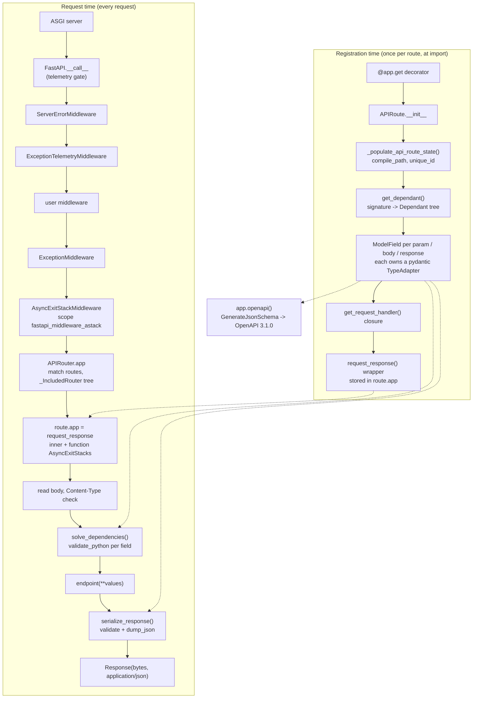

# FastAPI (0.162.0) Architecture: The Glue Layer Connecting Starlette Routing, Pydantic v2 TypeAdapters, and OpenAPI 3.1

> [!summary] Claim
> FastAPI 0.162.0 is not a new server or a new validator: it is a compiler that, at route registration, turns a Python function signature into Pydantic `TypeAdapter`s and a request-handler closure plugged into Starlette's `Route.app` slot, and a renderer that turns the same adapters into an OpenAPI 3.1.0 document, so every behavior you see is either Starlette's, Pydantic's, or one of a small number of FastAPI overrides you can name.

Part of [FastAPI Internals and Patterns](README.md) in [API Engineering](../README.md).

## TL;DR

- Mechanism: `FastAPI` subclasses `Starlette`, `APIRouter` subclasses `starlette.routing.Router`, and `APIRoute` subclasses `starlette.routing.Route`; at decorator time `APIRoute` builds a `Dependant` tree plus one `ModelField` (a thin wrapper around a `pydantic.TypeAdapter`) per parameter and per response, then stores `request_response(get_request_handler(...))` in `self.app`.
- Contract rule: request data reaches Pydantic as already-parsed Python objects (`json.loads` in Starlette, then `TypeAdapter.validate_python(..., from_attributes=True)`), and, with the default response class, a typed response leaves through `TypeAdapter.dump_json` as raw bytes in a plain `Response`, not through `JSONResponse`.
- The trap: FastAPI overrides more than it extends - `FastAPI.__init__` never calls `Starlette.__init__`, `APIRoute` never calls `Route.__init__`, and the overrides silently drop Starlette features (implicit `HEAD`, `max_body_size`) and add requirements (an `APIRoute` crashes with `AssertionError` outside a FastAPI middleware stack).
- Portability: the glue is pure Python over the ASGI `scope`, so it is server- and HTTP-version-independent; what varies is the FastAPI minor release, because 0.126 to 0.162 (2025-12 to 2026-10) dropped Pydantic v1, moved serialization into Rust, made `Content-Type` checks strict, stopped copying included routes, and added native OpenTelemetry.
- When not to use it: when the per-request cost of dependency solving and adapter validation is the bottleneck, or when you need routing semantics FastAPI does not expose; then drop to raw Starlette or another framework (see [[FastAPI-Architectural-Limits-and-Comparison-with-Litestar-and-Raw-Starlette]]).

## Mental model



The top subgraph runs once per route when the module is imported: the decorator constructs an `APIRoute`, which compiles the path with Starlette's `compile_path`, inspects the endpoint signature into a `Dependant`, and wraps every parameter, the body, and the response annotation in a `ModelField` whose `__post_init__` builds a `TypeAdapter`.
The last step bakes all of that into a closure from `get_request_handler()` and wraps it in FastAPI's own copy of Starlette's `request_response`, which becomes `route.app`.
The bottom subgraph runs per request: Starlette's machinery (middleware onion, router matching, `Route.handle`) carries the request to `route.app`, where FastAPI's closure reads the body, calls `solve_dependencies()` to validate each value through its prebuilt adapter, runs the endpoint, and serializes the result through the response adapter.
The dotted edges are the point of the design: the same `ModelField` objects feed request validation, response serialization, and the OpenAPI document, which is why the three never disagree about a type.

## How it works

### 1. The class hierarchy is inheritance in name and replacement in practice

`FastAPI` is declared as `class FastAPI(Starlette)` (fastapi 0.162.0 fastapi/applications.py, FastAPI).
Its `__init__` assigns `debug`, `state`, `router`, `exception_handlers`, `user_middleware`, and `middleware_stack` itself and never calls `super().__init__()`; the only `super()` uses in the file are `super().__call__` (fastapi 0.162.0 fastapi/applications.py, FastAPI.__init__ and FastAPI.__call__).
Starlette 1.10.0's `__init__` additionally sets `self.max_body_size` and its `build_middleware_stack` inserts `RequestBodyLimitMiddleware` when it is not `None` (starlette 1.10.0 starlette/applications.py, Starlette.__init__ and Starlette.build_middleware_stack).
Because FastAPI replaces both methods, a FastAPI app has no `max_body_size` attribute, and `FastAPI(max_body_size=...)` is a `TypeError` because FastAPI's keyword-only signature does not declare it; the lab proves both.
`self.router` is an `APIRouter`, constructed with `dependency_overrides_provider=self`, which is how `app.dependency_overrides` reaches every route without a global (fastapi 0.162.0 fastapi/applications.py, FastAPI.__init__).

`APIRouter` subclasses `starlette.routing.Router` and does call `super().__init__(routes=..., redirect_slashes=..., default=..., lifespan=...)`, but it does not forward Starlette 1.10.0's newer `middleware` and `max_body_size` router arguments (fastapi 0.162.0 fastapi/routing.py, APIRouter.__init__).
It wraps async-generator and generator function lifespans itself (`asynccontextmanager` and a vendored `_wrap_gen_lifespan_context`) before passing them on, so the `StarletteDeprecationWarning` that Starlette's `Router.__init__` emits for both kinds never fires under FastAPI (starlette 1.10.0 starlette/routing.py, Router.__init__; fastapi 0.162.0 fastapi/routing.py, APIRouter.__init__).
It keeps `on_startup` and `on_shutdown` lists locally with the comment that Starlette removed support in Kludex/starlette PR 3117, implementing them through `_DefaultLifespan` (fastapi 0.162.0 fastapi/routing.py, APIRouter.__init__).
It overrides `Router.app`, the dispatch loop, to add telemetry route naming (`_route_selected`) while keeping Starlette's FULL-then-PARTIAL match order and slash-redirect fallback (fastapi 0.162.0 fastapi/routing.py, APIRouter.app).

`APIRoute` subclasses `starlette.routing.Route` but does not call `Route.__init__`; it calls `_populate_api_route_state()` and then sets `self.app = request_response(self.get_route_handler())` (fastapi 0.162.0 fastapi/routing.py, APIRoute.__init__).
Two consequences follow from skipping `Route.__init__`.
First, Starlette adds `HEAD` whenever `GET` is in `methods` (starlette 1.10.0 starlette/routing.py, Route.__init__), but `_populate_api_route_state` computes `{method.upper() for method in methods}` with no `HEAD` (fastapi 0.162.0 fastapi/routing.py, _populate_api_route_state), so a FastAPI `GET` route answers `HEAD` with `405` and `Allow: GET`.
Second, Starlette's per-route `middleware` and `max_body_size` options do not exist on `APIRoute`.
For a route registered directly on the app, `APIRoute.matches` delegates to `Route.matches` and adds `child_scope["route"] = self`, and `APIRoute.handle` delegates to `Route.handle`, which produces the `405` and its `Allow` header; for a route reached through an included router, both methods use the `_EffectiveRouteContext` instead, and `APIRoute.handle` builds the same `405` and `Allow` header itself from that context's `methods` (fastapi 0.162.0 fastapi/routing.py, APIRoute.matches and APIRoute.handle).

### 2. Registration: compiling a signature into adapters

`_populate_api_route_state()` is the compiler front end (fastapi 0.162.0 fastapi/routing.py, _populate_api_route_state):

- `route.unique_id = route.operation_id or generate_unique_id(route)`, where `generate_unique_id` is `re.sub(r"\W", "_", f"{route.name}{route.path_format}")` plus `_` plus `list(route.methods)[0].lower()` (fastapi 0.162.0 fastapi/utils.py, generate_unique_id).
- Each entry of `responses=` with a `model` becomes a `ModelField` named `Response_<code>_<unique_id>` in `mode="serialization"`.
- `_build_dependant_with_parameterless_dependencies()` calls `get_dependant()` to classify every parameter as path, query, header, cookie, body, or a special injectable (`Request`, `Response`, `BackgroundTasks`, `SecurityScopes`); the classification rules are the subject of [[APIRoute-Compilation-Signature-Inspection-and-Dependant-Construction]].
- `_get_body_field()` returns the single body `ModelField` as is, or synthesizes a model named `Body_<unique_id>` through `create_body_model`, which calls `pydantic.create_model`, when several body parameters must be embedded (fastapi 0.162.0 fastapi/dependencies/utils.py, _get_body_field; fastapi/_compat/v2.py, create_body_model); its docstring states that this field drives OpenAPI and form detection and is not used to validate the body.
- If `response_model` was not passed, the return annotation becomes the response model unless it is a `Response` subclass (fastapi 0.162.0 fastapi/routing.py, _populate_api_route_state); passing `response_model=None` explicitly turns that off.
- Generator endpoints are classified as JSON Lines (`is_json_stream`) or Server-Sent Events (`is_sse_stream`) streams, with a separate `stream_item_field`.

A `ModelField` is a dataclass with `field_info`, `name`, `mode`, and `config`, whose `__post_init__` builds `TypeAdapter(Annotated[annotation, *metadata, Field(**attributes)], config=config)` (fastapi 0.162.0 fastapi/_compat/v2.py, ModelField).
Its `validate()` calls `self._type_adapter.validate_python(value, from_attributes=True)` and converts a `ValidationError` into FastAPI's error-dict list with a location prefix; `serialize()` calls `dump_python`, and `serialize_json()` calls `dump_json` (fastapi 0.162.0 fastapi/_compat/v2.py, ModelField.validate, serialize, serialize_json).
This is why FastAPI follows the Pydantic documentation's advice to "create a `TypeAdapter` for a given type just once and reuse it in loops" (Pydantic docs, TypeAdapter): the adapter, and the `CoreSchema` validator and serializer that pydantic-core compiles behind it, is built once per field at import, not once per request.
In a scratch probe for this note, a single `POST /i/{iid}` route with a path parameter, a body model, an optional query parameter, and a return annotation constructed 4 `ModelField`s, hence 4 `TypeAdapter`s, counted by wrapping `ModelField.__post_init__` (reproduced in the fact-check, CPython 3.14.6, macOS 27.3 arm64).
The final step, `get_request_handler()`, closes over the `Dependant`, `body_field`, `response_field`, status code, response class, include and exclude settings, and the `dependency_overrides_provider`, and returns `async def app(request) -> Response` (fastapi 0.162.0 fastapi/routing.py, get_request_handler).

### 3. Request time: what the closure does that Starlette does not

FastAPI's `request_response` is labelled in source as a copy of Starlette's, modified to open two `AsyncExitStack`s and to store them as `scope["fastapi_inner_astack"]` (request scope) and `scope["fastapi_function_astack"]` (function scope) around the endpoint call and the response send (fastapi 0.162.0 fastapi/routing.py, request_response; starlette 1.10.0 starlette/routing.py, request_response).
If the response was never awaited because a `yield` dependency swallowed an exception, it raises `FastAPIError("Response not awaited. ...")`; the scope rules for those stacks belong to [[Yield-Dependencies-AsyncExitStack-Cleanup-Timing-and-Scope]].

Inside the closure, in order (fastapi 0.162.0 fastapi/routing.py, get_request_handler):

1. It asserts that `scope["fastapi_middleware_astack"]` is an `AsyncExitStack`; that stack is created by `AsyncExitStackMiddleware`, which only `FastAPI.build_middleware_stack` installs (fastapi 0.162.0 fastapi/middleware/asyncexitstack.py, AsyncExitStackMiddleware).
   This is the hard coupling: an `APIRoute` placed directly in a plain `Starlette(routes=[...])` raises `AssertionError: fastapi_middleware_astack not found in request scope` on its first request, which the lab proves.
2. Body reading: forms go through `request.form()` with `body.close` pushed onto the middleware stack; otherwise `await request.body()`.
   With `strict_content_type=True` (the default since 0.132.0), the body is parsed as JSON only if `Content-Type` has main type `application` and subtype `json` or a `+json` suffix, parsed with `email.message.Message`; a missing header is parsed as JSON only when `strict_content_type=False`.
   A body that is not JSON is passed on as raw `bytes`, so a JSON payload sent as `text/plain` reaches the model adapter as bytes and fails with `model_attributes_type` and `422`, not `415`.
   The flag only changes the missing-header case: a present non-JSON `Content-Type` is never parsed as JSON, whatever the flag says.
   That rule exists because of CVE-2021-32677: before 0.65.2 FastAPI parsed `text/plain` bodies as JSON, and since `text/plain` requests are CORS "simple requests" that skip preflight, a browser could be made to send a cookie-authenticated JSON request cross-site (FastAPI release notes, 0.65.2).
   0.65.3 then restored JSON parsing for requests with no `Content-Type`, and 0.132.0 made that fallback opt-in again through `strict_content_type`.
   A `json.JSONDecodeError` becomes a `RequestValidationError` with `type` `json_invalid` and `loc` `("body", e.pos)`, the character offset of the failure; any other parse exception becomes `HTTPException(400, "There was an error parsing the body")`.
3. `solve_dependencies()` walks the `Dependant` tree, applying `dependency_overrides` by swapping the callable and rebuilding its `Dependant`, caching results per request, routing generator dependencies to the request or function exit stack, and validating path, query, header, cookie, and body values through their `ModelField`s (fastapi 0.162.0 fastapi/dependencies/utils.py, solve_dependencies); the cache key and DAG traversal are covered in [[Dependency-Injection-Engine-DAG-Resolution-and-Use-Cache-Mechanics]].
   Errors from every location are accumulated, not short-circuited, and then raised together as one `RequestValidationError`.
4. The endpoint runs on the event loop if it is a coroutine function, or in Starlette's threadpool via `run_in_threadpool` if it is a plain `def` (fastapi 0.162.0 fastapi/routing.py, run_endpoint_function); the limiter semantics are in [[Async-Def-vs-Def-Endpoints-and-AnyIO-Threadpool-Limiter-Semantics]].
5. If the endpoint returned a `Response`, it is used as is, with dependency `BackgroundTasks` attached only if the response had none.
   Otherwise `serialize_response()` validates the return value through `response_field` (raising `ResponseValidationError` on failure) and serializes it.
   When a `response_field` exists and no custom `response_class` was set, it takes the fast path added in 0.130.0 ("Serialize JSON response with Pydantic (in Rust)", FastAPI release notes, 0.130.0): `field.serialize_json()` returns JSON bytes from pydantic-core and FastAPI wraps them in a plain `Response(content=..., media_type="application/json")`.
   With a `response_field` and a custom `response_class`, it calls `field.serialize()`, which is `dump_python(mode="json")`, and hands the result to that class.
   Without a `response_field` it calls `jsonable_encoder()` and hands the Python object to the response class, by default Starlette's `JSONResponse`, which renders with `json.dumps(content, ensure_ascii=False, allow_nan=False, indent=None, separators=(",", ":"))` (starlette 1.10.0 starlette/responses.py, JSONResponse.render).
   The paths disagree on non-finite floats: pydantic-core's `dump_json` serializes `inf` as `null`, while `dump_python(mode="json")` and `jsonable_encoder` both keep the Python `inf` float, so `JSONResponse` raises `ValueError` and the client sees `500`; the lab proves the first and last, and the fact-check reproduced the custom-`response_class` case (`500`) on 0.162.0.
   The response pipeline and its double-validation cost are covered in [[Response-Serialization-Pipeline-Response-Model-and-Double-Validation-Cost]].
6. If the final status code of a response FastAPI built from the return value forbids a body (below `200`, or `204`, `205`, `304`), the body is emptied; a `Response` the endpoint returned itself is not touched (fastapi 0.162.0 fastapi/utils.py, is_body_allowed_for_status_code), matching RFC 9110 Section 15.3.5, under which `204` has "no additional content to send".

### 4. The middleware stack FastAPI rebuilds

`FastAPI.build_middleware_stack` is a duplicate of Starlette's with two layers added (fastapi 0.162.0 fastapi/applications.py, FastAPI.build_middleware_stack).
The lab walks the built stack and records, outermost first: `ServerErrorMiddleware`, `ExceptionTelemetryMiddleware`, user middleware, `ExceptionMiddleware`, `AsyncExitStackMiddleware`, `APIRouter`.
The Starlette 1.10.0 stack for comparison is `ServerErrorMiddleware`, optional `RequestBodyLimitMiddleware`, user middleware, `ExceptionMiddleware`, `Router`.
The source comment explains why `AsyncExitStackMiddleware` sits inside user middleware: user middleware can start a new AnyIO task group and so a new `contextvars` context copy, and an exit stack outside them would not see context variables set inside; in 0.162.0 that stack only closes uploaded files, because `yield` dependencies moved to their own stacks.
`FastAPI.__init__` also registers three default exception handlers with `setdefault`: `HTTPException` -> `http_exception_handler`, `RequestValidationError` -> `request_validation_exception_handler` (a `422` with `{"detail": [...]}`), and `WebSocketRequestValidationError` -> close with code `1008` (fastapi 0.162.0 fastapi/exception_handlers.py); a bare `Starlette()` has none.
The full mapping of these errors to status codes is in [[Exception-Handling-in-FastAPI-HTTPException-vs-RequestValidationError]].

`FastAPI.__call__` adds a gate in front of Starlette's: `lifespan` scopes go through `fastapi.telemetry._runtime.lifespan`, and `http` or `websocket` scopes go through `NativeTelemetry` only when `NativeTelemetry.enabled()` finds a configured OpenTelemetry tracer, meter, or logger provider (fastapi 0.162.0 fastapi/applications.py, FastAPI.__call__; fastapi/telemetry/_asgi.py, NativeTelemetry.enabled).
Native OpenTelemetry support arrived in 0.142.0 (2026-09-29), and since 0.143.0 (2026-10-08) exporter auto-configuration from `OTEL_*` variables requires `FASTAPI_OTEL_AUTO_CONFIGURE=true` (FastAPI release notes).

### 5. Router composition stopped copying in 0.137.0

Before 0.137.0 (2026-06-14), `include_router()` cloned every route of the included router into the parent; the release notes for 0.137.0 describe the change as "Refactor internals to preserve `APIRouter` and `APIRoute` instances" and warn that `router.routes` "is no longer a plain list of `APIRoute` objects" but a tree (FastAPI release notes, 0.137.0).
In 0.162.0, `include_router()` appends one `_IncludedRouter(original_router=router, include_context=...)` and merges the child's lifespan into the parent's (fastapi 0.162.0 fastapi/routing.py, APIRouter.include_router).
`_IncludedRouter.effective_candidates()` builds `_EffectiveRouteContext` objects lazily under a `threading.Lock`, caching them against `_get_routes_version()`, which sums the router's own `_routes_version` counter and the versions of every router it includes; `_mark_routes_changed()` increments that counter from `add_route`, `add_api_route`, `add_websocket_route`, `add_api_websocket_route`, `include_router`, and `frontend` (fastapi 0.162.0 fastapi/routing.py, _IncludedRouter.effective_candidates, APIRouter._get_routes_version, and APIRouter._mark_routes_changed).
Each `_EffectiveRouteContext.from_api_route()` reruns `_populate_api_route_state` with the include prefix, tags, dependencies, and responses merged in, and builds its own `request_response(original_route.get_route_handler())`, so a router included twice compiles its handlers twice, once per inclusion context (fastapi 0.162.0 fastapi/routing.py, _EffectiveRouteContext.from_api_route).
The practical result, proven in the lab: you may include a router before adding routes to it, the prefixed contexts do not exist until the first request or OpenAPI build, and the original `APIRouter` object remains reachable as `original_router`.
Router layout at scale is the subject of [[Structuring-Large-FastAPI-Applications-APIRouter-Lifespan-and-Domain-Modules]].

### 6. OpenAPI 3.1 from the same fields

`app.openapi()` calls `get_openapi()` with `openapi_version` defaulting to `"3.1.0"`, and caches the result in `app.openapi_schema` until `router._get_routes_version()` changes (fastapi 0.162.0 fastapi/applications.py, FastAPI.openapi).
`get_openapi()` collects every `ModelField` from every route with `iter_route_contexts()` (which flattens the `_IncludedRouter` tree), generates all JSON Schemas in one `GenerateJsonSchema(ref_template="#/components/schemas/{model}")` pass, emits `paths`, `webhooks`, and `components.schemas` (only the schemas are sorted by name; paths keep route order), and finally validates the dict through FastAPI's own Pydantic `OpenAPI` model (fastapi 0.162.0 fastapi/openapi/utils.py, get_openapi; fastapi/_compat/v2.py, get_definitions).
OpenAPI 3.1.0 makes the Schema Object "a superset of JSON Schema Specification Draft 2020-12" (OpenAPI 3.1.0 Section 4.4), which is what lets FastAPI publish Pydantic's JSON Schema output with only `$ref` rewriting; the version string is an attribute you can overwrite, and the source docstring calls doing so "a hack".
Every app with a validated route also gets `HTTPValidationError` and `ValidationError` component schemas describing the `422` body.
The operation ID is `route.operation_id or route.unique_id`, and a repeat only triggers `warnings.warn("Duplicate Operation ID ...")` (fastapi 0.162.0 fastapi/openapi/utils.py, get_openapi_operation_metadata), although OpenAPI 3.1.0 Section 4.8.10.1 says the ID "MUST be unique among all operations described in the API".
The schema-generation details, including `separate_input_output_schemas`, are in [[OpenAPI-Generation-Internals-in-FastAPI-Get-OpenAPI-and-Separate-Schemas]].

## Numbers and limits

| Quantity | Value | Source |
|---|---|---|
| OpenAPI version emitted | `3.1.0` | fastapi 0.162.0 fastapi/applications.py, `openapi_version` |
| Component reference template | `#/components/schemas/{model}` | fastapi 0.162.0 fastapi/openapi/constants.py, `REF_TEMPLATE` |
| `TypeAdapter`s built for one route (path + body + query + response) | 4 | measured, scratch probe wrapping `ModelField.__post_init__`, CPython 3.14.6, macOS 27.3 arm64 (`uname -r` `27.3.0`), Apple M3 Pro; reproduced in the fact-check |
| Route registration cost | 0.8 to 2.4 ms per route (13 recorded runs of 50 to 500 `POST` routes with path param + body; the drafter's earlier 426 us was not reproduced) | measured in the fact-check with `.venv/bin/python -I probe.py` (`time.perf_counter` around `app.post(...)(endpoint)`), same machine and CPython, under a load average of about 81 from other jobs; treat as order of magnitude only |
| In-process `GET` round trip via `httpx.ASGITransport` | FastAPI median 127.0 us (min 94.0), raw Starlette median 87.0 us (min 69.3) | measured in the fact-check, 7 alternating rounds of 2000 requests after 200 warm-up requests each, same machine and load; includes the httpx client cost and is noisy |
| Default request body limit | none (`FastAPI` has no `max_body_size`) | fastapi 0.162.0 fastapi/applications.py; lab test |
| Multipart limits per `request.form()` | `max_files=1000`, `max_fields=1000`, `max_part_size=1048576` bytes | starlette 1.10.0 starlette/requests.py, Request.form |
| Validation error status | `422` | fastapi 0.162.0 fastapi/exception_handlers.py; RFC 9110 Section 15.5.21 |
| Body-limit status (opt-in middleware) | `413` `Content Too Large` | starlette 1.10.0 starlette/middleware/body_limit.py; RFC 9110 Section 15.5.14 |
| Statuses whose body FastAPI strips | below `200`, `204`, `205`, `304` | fastapi 0.162.0 fastapi/utils.py, is_body_allowed_for_status_code |
| Declared runtime support | `Requires-Python: >=3.10`, classifiers 3.10 to 3.14, `starlette>=0.46.0`, `pydantic>=2.9.0` | fastapi-0.162.0.dist-info/METADATA |
| Release cadence | 0.143.0 to 0.162.0 shipped between 2026-10-08 and 2026-10-23 | FastAPI release notes (as of 2026-11) |

The two timing rows are the least reliable numbers here: they come from scratch runs on a heavily loaded laptop, not from a pinned benchmark harness, the drafter's and the fact-checker's runs differ by a factor of 3 for registration, and only the direction (FastAPI's glue adds tens of microseconds over a hand-written Starlette handler for this route, and registration costs on the order of a millisecond per route) should be relied on.

## Portability

| Dimension | Behavior | Evidence |
|---|---|---|
| CPython 3.14.6 (workspace interpreter) | all 14 lab tests pass | lab run, macOS 27.3 arm64 |
| CPython 3.12 and 3.13 | declared supported (`Requires-Python: >=3.10`, classifiers `3.12` and `3.13`); the lab was not run on them (matrix paused by the user, 2026-11-11) | fastapi-0.162.0.dist-info/METADATA; no run |
| CPython 3.15 and 3.15t (free-threaded) | no `3.15` classifier in 0.162.0, so support is not declared; the lab was not run on them (matrix paused 2026-11-11), and the lazy `_IncludedRouter` build under a `threading.Lock` is not exercised on a free-threaded build | fastapi-0.162.0.dist-info/METADATA; no run |
| FastAPI before 0.137.0 | `include_router` copies routes; routes added after inclusion are not served | FastAPI release notes, 0.137.0 |
| FastAPI 0.65.3 to 0.131.x | a request with no `Content-Type` is parsed as JSON; `strict_content_type` does not exist | FastAPI release notes, 0.65.3 and 0.132.0 |
| FastAPI before 0.65.2 | `text/plain` bodies are parsed as JSON (CVE-2021-32677) | FastAPI release notes, 0.65.2 |
| FastAPI before 0.130.0 | typed responses go through `dump_python(mode="json")` + `JSONResponse`, so a typed `inf` response is a `500` instead of `null` | FastAPI release notes, 0.130.0; executed in the fact-check: 0.129.2 (Starlette 0.52.1, Pydantic 2.14.3) -> `500`, 0.130.0 -> `200` `{"price":null}`, CPython 3.14.6 |
| FastAPI 0.126.0 and 0.128.0 | Pydantic v1 dropped, then `pydantic.v1` models dropped | FastAPI release notes |
| Starlette 1.10.0 `Route` vs `APIRoute` | Starlette adds `HEAD` for `GET`; FastAPI does not | lab test; source of both |
| Uvicorn, Hypercorn, Granian | routing, validation, and serialization never name a server: a search of the installed fastapi 0.162.0 and starlette 1.10.0 packages for `uvicorn`, `hypercorn`, and `granian` found no match; the only server-derived inputs are `scope["server"]` and `scope["http_version"]`, read solely by the OpenTelemetry attribute code | grep of `labs/.venv` site-packages (fastapi/telemetry/_asgi.py); not run against any of the three servers |
| HTTP/1.1, HTTP/2, HTTP/3 | `scope["http_version"]` is one of `"1.0"`, `"1.1"`, `"2"`, or `"3"`, and the ASGI HTTP format covers HTTP/1.0, 1.1, 2, and 3 (ASGI HTTP spec, asgi.readthedocs.io); FastAPI uses it only as the `network.protocol.version` telemetry attribute, so the `HEAD` -> `405` behavior does not depend on it; not run over the wire | fastapi 0.162.0 fastapi/telemetry/_asgi.py; ASGI HTTP spec |

## Worked example

The lab builds one app in which each route isolates one glue mechanism, plus helpers that expose what `APIRoute` compiled and what middleware FastAPI built: [implementation](../labs/src/api_labs/f11_fastapi_internals_and_patterns/glue_layer.py) and [test](../labs/tests/f11_fastapi_internals_and_patterns/test_fastapi_architecture_what_fastapi_adds_over_starlette_and_pydantic.py).

```python
"""What FastAPI adds over Starlette and Pydantic: the glue layer, made inspectable."""

from dataclasses import dataclass
from typing import TYPE_CHECKING, Any

from fastapi import APIRouter, FastAPI
from fastapi.routing import APIRoute
from pydantic import BaseModel
from starlette.applications import Starlette
from starlette.routing import Router

if TYPE_CHECKING:
    from starlette.types import ASGIApp


class Item(BaseModel):
    id: int
    name: str
    price: float = 1.0


@dataclass(frozen=True)
class RouteAnatomy:
    """What APIRoute compiled from one endpoint signature at registration time."""

    methods: frozenset[str]
    handler_qualname: str
    path_params: tuple[str, ...]
    query_params: tuple[str, ...]
    body_param: str | None
    response_adapter_type: str | None
    unique_id: str


def build_glue_app() -> tuple[FastAPI, APIRouter]:
    """Build an app whose routes each exercise one glue mechanism."""
    app = FastAPI(title="glue", version="1")
    router = APIRouter(prefix="/v1")

    @app.get("/items/{item_id}", response_model=Item)
    async def read_item(item_id: int, verbose: bool = False) -> dict[str, Any]:
        # `secret` is not in Item; `inf` is not valid JSON.
        return {"id": item_id, "name": "widget", "price": float("inf"), "secret": "s3"}

    @app.get("/unvalidated", response_model=None)
    async def unvalidated() -> dict[str, float]:
        # response_model=None disables the TypeAdapter: jsonable_encoder + JSONResponse.
        return {"price": float("inf")}

    @app.post("/items")
    async def create_item(item: Item) -> Item:
        return item

    # Included before it has any routes: inclusion stores the router, not copies.
    app.include_router(router)

    @router.get("/late")
    async def late() -> dict[str, bool]:
        return {"late": True}

    return app, router


def find_api_route(app: FastAPI, path: str, method: str) -> APIRoute:
    for route in app.routes:
        if isinstance(route, APIRoute) and route.path == path and method in (route.methods or ()):
            return route
    raise LookupError(f"{method} {path}")


def describe_route(route: APIRoute) -> RouteAnatomy:
    response_field = route.response_field
    adapter = None if response_field is None else vars(response_field)["_type_adapter"]
    return RouteAnatomy(
        methods=frozenset(route.methods or ()),
        handler_qualname=getattr(route.app, "__qualname__", type(route.app).__name__),
        path_params=tuple(p.name for p in route.dependant.path_params),
        query_params=tuple(p.name for p in route.dependant.query_params),
        body_param=None if route.body_field is None else route.body_field.name,
        response_adapter_type=None if adapter is None else type(adapter).__name__,
        unique_id=route.unique_id,
    )


def middleware_chain(app: Starlette) -> list[str]:
    """Walk the `.app` links of the built middleware stack, outermost first."""
    names: list[str] = []
    node: ASGIApp | None = app.build_middleware_stack()
    while node is not None:
        names.append(type(node).__name__)
        nxt: ASGIApp | None = getattr(node, "app", None)
        # Router.app is a bound method: the router is the end of the chain.
        node = None if isinstance(node, Router) else nxt
    return names
```

Simplified excerpt of the test module (four of the fourteen tests, copied verbatim; imports and the `client_for` helper omitted):

```python
@pytest.mark.unit
@pytest.mark.asyncio
async def test_response_model_filters_fields_and_serializes_in_rust() -> None:
    app, _ = build_glue_app()
    async with client_for(app) as client:
        response = await client.get("/items/3")
    assert response.status_code == 200
    assert response.headers["content-type"] == "application/json"
    # `secret` dropped by the TypeAdapter; inf -> null by pydantic-core dump_json.
    assert response.content == b'{"id":3,"name":"widget","price":null}'


@pytest.mark.unit
@pytest.mark.asyncio
async def test_without_response_model_json_response_rejects_non_finite_floats() -> None:
    app, _ = build_glue_app()
    async with client_for(app) as client:
        response = await client.get("/unvalidated")
    # jsonable_encoder keeps inf; JSONResponse uses json.dumps(allow_nan=False).
    assert response.status_code == 500
    assert response.text == "Internal Server Error"


@pytest.mark.unit
@pytest.mark.asyncio
async def test_apiroute_cannot_run_inside_plain_starlette() -> None:
    app, _ = build_glue_app()
    route = find_api_route(app, "/items/{item_id}", "GET")
    bare = Starlette(routes=[route])
    transport = httpx.ASGITransport(app=bare, raise_app_exceptions=True)
    async with httpx.AsyncClient(transport=transport, base_url="http://test") as client:
        with pytest.raises(AssertionError, match="fastapi_middleware_astack"):
            await client.get("/items/3")


@pytest.mark.unit
@pytest.mark.asyncio
async def test_include_router_stores_router_lazily_and_sees_late_routes() -> None:
    app, router = build_glue_app()
    included = app.routes[-1]
    assert type(included).__name__ == "_IncludedRouter"
    # Effective (prefixed) route contexts are not built until first match.
    assert vars(included)["_effective_candidates_version"] is None
    async with client_for(app) as client:
        response = await client.get("/v1/late")
    assert response.status_code == 200
    assert response.json() == {"late": True}
    assert vars(included)["_effective_candidates_version"] == 1
    assert vars(included)["original_router"] is router
```

The remaining tests prove the class hierarchy and skipped `Starlette.__init__`, the exact middleware order against a bare `Starlette()`, the compiled `RouteAnatomy` (`request_response.<locals>.app`, `TypeAdapter`, `unique_id` `read_item_items__item_id__get`), `HEAD` -> `405` against a Starlette `Route` -> `200`, `text/plain` -> `422` against `application/merge-patch+json` -> `200`, `json_invalid` at `loc` `["body", 8]`, lax coercion of `"7"` to `7`, OpenAPI `3.1.0` caching and invalidation, the three default exception handlers, and `413` from an explicitly added `RequestBodyLimitMiddleware`.
Several tests carry a built-in control: the same request against plain Starlette or a second route must behave differently, so a test cannot pass if the FastAPI-specific mechanism is absent.
Some assertions read private names (`_IncludedRouter`, `_effective_candidates_version`, `ModelField._type_adapter`) through `vars()`; they pin FastAPI 0.162.0 internals on purpose and will need updating when those internals move.

Captured run, from `labs/`, on CPython 3.14.6, macOS 27.3 arm64:

```text
$ uv run --frozen pytest tests/f11_fastapi_internals_and_patterns/test_fastapi_architecture_what_fastapi_adds_over_starlette_and_pydantic.py -q -p no:cacheprovider
..............                                                           [100%]
14 passed in 1.21s
```

## Pitfalls

> [!warning] `HEAD` is not free on FastAPI `GET` routes
> Trigger: a load balancer health check, uptime monitor, or CDN that probes with `HEAD /health`.
> Symptom: `405 Method Not Allowed` with `Allow: GET`, even though the same path works for `GET` and Starlette `Route` would have answered `200`.
> Mechanism: `APIRoute` skips `Route.__init__`, which is where Starlette adds `HEAD` (starlette 1.10.0 starlette/routing.py, Route.__init__); RFC 9110 Section 9.1 says "All general-purpose servers MUST support the methods GET and HEAD".
> Fix: declare `@app.api_route("/health", methods=["GET", "HEAD"])`, or point probes at `GET`; the lab test `test_get_route_does_not_imply_head_unlike_starlette_route` reproduces it.

> [!warning] A JSON body with the wrong `Content-Type` is a `422`, not a `415`
> Trigger: a client sends JSON as `text/plain`, or omits `Content-Type` after an upgrade past 0.132.0 made `strict_content_type=True` the default.
> Symptom: `422` with `type` `model_attributes_type` and the raw body echoed as `input`, which looks like a schema bug rather than a header bug.
> Mechanism: non-JSON media types leave the body as `bytes`, and the body adapter rejects `bytes`; RFC 9110 Section 15.5.16 defines `415` for exactly this case, but FastAPI does not emit it.
> Fix: fix the client; `strict_content_type=False` on the app, router, or route only rescues clients that send no `Content-Type` at all, and a `text/plain` JSON body stays rejected because accepting it is the CSRF hole of CVE-2021-32677; add a custom check if you want a real `415`.

> [!warning] `inf` and `nan` serialize differently depending on whether a response model exists
> Trigger: a float computed as `inf` or `nan` (a division by zero, an empty-window average) in an endpoint.
> Symptom: with a return annotation or `response_model` and the default response class, clients silently receive `null`; with `response_model=None` (the `jsonable_encoder` path) or a custom `response_class` such as an explicit `JSONResponse` (the `dump_python(mode="json")` path), the request fails with `500` and a `ValueError` from `json.dumps(allow_nan=False)`.
> Fix: decide non-finite policy in the model with a validator that rejects non-finite input or a serializer that maps it explicitly, and test it; the Pydantic `ser_json_inf_nan` config (`'null'`, `'constants'`, `'strings'`, default `'null'`; pydantic 2.14.3 pydantic/config.py, ConfigDict.ser_json_inf_nan) only changes `dump_json` output, because in the fact-check `dump_python(mode="json")` returned the raw `inf` float under all three values, and `'constants'` emits `Infinity`, which is not JSON; the lab proves the `null` and `500` behaviors.

> [!warning] Code that walks `app.routes` breaks after 0.137.0
> Trigger: tooling that iterates `app.routes` to collect `APIRoute`s for permissions, metrics labels, or contract generation.
> Symptom: routes from included routers are missing, because they now sit inside `_IncludedRouter` nodes; the 0.137.0 notes say `router.routes` "should be considered an internal implementation detail".
> Fix: use `app.openapi()` or `fastapi.routing.iter_route_contexts(app.routes)`, which flattens the tree, and pin the FastAPI minor version in tooling that touches internals.

> [!warning] Mounting an `APIRouter` or `APIRoute` in a plain Starlette app
> Trigger: reusing FastAPI routes inside an existing Starlette application, or a test harness that builds `Starlette(routes=router.routes)`.
> Symptom: every request fails with `AssertionError: fastapi_middleware_astack not found in request scope`.
> Under `python -O` the assertion is stripped and the route appears to work: in the fact-check, a JSON `GET` returned `200` while a `Form()` request returned `400` `There was an error parsing the body`, because `push_async_callback` on `None` raises an `AttributeError` that the body-parsing `except Exception` turns into `HTTPException(400)` (executed once on CPython 3.14.6 with `-O`, not part of the lab), which is worse because the failure becomes conditional and looks like a client error.
> Fix: mount a whole `FastAPI` sub-application instead (see [[Mounting-Sub-Applications-WSGI-Legacy-Strangler-and-Static-Assets]]).

> [!warning] Multi-method routes and duplicate operation IDs
> Trigger: `@app.api_route("/x", methods=["GET", "POST"])` without `operation_id`.
> Symptom: both operations get the same `operationId`, suffixed with whichever method `list(route.methods)[0]` returns from a `set`, and FastAPI only emits a `Duplicate Operation ID` warning; generated SDKs collide or rename methods.
> Mechanism: string hashing is randomized per process, so the suffix can change between runs (fastapi 0.162.0 fastapi/utils.py, generate_unique_id); in the fact-check, `PYTHONHASHSEED=0` and `1` gave `x_x_get` for both operations and seeds `2` to `7` gave `x_x_post`, each with a `Duplicate Operation ID` warning (CPython 3.14.6, not part of the lab).
> Fix: split the handlers, or pass a deterministic `generate_unique_id_function`, and run an OpenAPI diff in CI (see [[Breaking-Change-Detection-and-Semantic-OpenAPI-Diffing]]).

> [!warning] Multipart parsing has a CVE history
> Trigger: any endpoint declaring `Form()` or `File()`.
> Incidents: CVE-2024-24762 (GHSA-2jv5-9r88-3w3p) was a `Content-Type` option ReDoS in `python-multipart` `<= 0.0.6`, fixed in `0.0.7`, which "consum[es] CPU resources and stall[s] indefinitely ... while holding the main event loop"; FastAPI 0.109.1 raised its minimum `python-multipart` for it.
> CVE-2024-47874 (GHSA-f96h-pmfr-66vw) let Starlette `< 0.40.0` buffer multipart parts without a `filename` "in byte strings with no size limit", fixed in `0.40.0`.
> Fix: keep `python-multipart` and Starlette current, and treat the `request.form()` limits as the last line of defense, not the first.

## Security and robustness

- Body size: FastAPI 0.162.0 has no request body limit at all, because it replaced the Starlette constructor that accepts `max_body_size`; `request.body()` buffers whatever the server delivers.
  Add `starlette.middleware.body_limit.RequestBodyLimitMiddleware` with `app.add_middleware(...)` (the lab proves `413`), and enforce a second limit at the proxy (OWASP API Security Top 10 2023, API4:2023 Unrestricted Resource Consumption).
- CSRF through content negotiation: the `Content-Type` gate in `get_request_handler()` is a security control, not a convenience; CVE-2021-32677 showed that parsing `text/plain` as JSON lets a browser send cookie-authenticated JSON cross-site without a CORS preflight, so never "fix" `422` complaints by parsing every media type as JSON.
- Parsing before validation: JSON is parsed by `json.loads` into Python objects before Pydantic sees it, so parse cost and memory are paid for the full body even when the first field is invalid, and Pydantic's `validate_json` single-pass path is not used for request bodies (see [[Single-Pass-JSON-Validation-Model-Validate-JSON-vs-JSON-Loads]]).
- Lax coercion is the default: `"7"` becomes `7` for an `int` field, which the lab proves; identifiers, amounts, and flags that must not be coerced need `strict` fields (see [[Lax-vs-Strict-Validation-Modes-and-Coercion-Tables]]).
- `from_attributes=True` on every `ModelField.validate()` means response models read attributes from arbitrary objects, including ORM instances that lazy-load on attribute access (see [[ORM-Mode-From-Attributes-and-Preventing-Accidental-Lazy-Loads]]).
- Response filtering is a security control: the response adapter drops fields not in the model (the lab's `secret`), which is the main defense against Excessive Data Exposure (OWASP API3:2023 Broken Object Property Level Authorization), but only when a response model or return annotation exists; returning a `Response` or `dict` with `response_model=None` bypasses it.
- `422` bodies echo `input`, so a validation error can reflect the submitted secret or token back to the caller and into logs; override the `RequestValidationError` handler if inputs may be sensitive.
- `/docs`, `/redoc`, and `/openapi.json` are on by default and are added as plain Starlette routes with `include_in_schema=False`; disable them with `openapi_url=None` in public deployments where the schema is sensitive, and remember that `docs_url` and `redoc_url` depend on `openapi_url`.
- Assertions guard invariants: several glue checks (`fastapi_middleware_astack`, prefix shape, response body for status codes) are `assert` statements, which vanish under `python -O`; do not run FastAPI with `-O` expecting the same failure modes.

## The principal's view

The architectural decision is whether FastAPI's compile-once glue is the right contract boundary for a service, and the answer depends on which of its three jobs the organization values.
If the value is the single source of truth, one `ModelField` feeding validation, serialization, and the OpenAPI document, then FastAPI is a schema compiler and the org should invest in that: pin the minor version, gate OpenAPI diffs in CI, and treat `router.routes` and other internals as private.
If the value is throughput, the per-request work FastAPI adds (dependency solving, per-field adapter calls, error accumulation) is the cost to measure, and the honest comparison is against a hand-written Starlette handler that calls one `TypeAdapter.validate_json` itself.
The organizational trade-off is release velocity: between 2025-12 and 2026-10 FastAPI changed Pydantic support, serialization, `Content-Type` handling, router composition, `root_path`, and telemetry, several of them under "Breaking Changes" headings, so a platform team either owns an upgrade cadence with contract tests or freezes a version and accepts drift from upstream fixes.
Choose raw Starlette when you need features FastAPI's overrides remove (per-route middleware, implicit `HEAD`, router-level body limits) or when the endpoint is a thin proxy where validation is someone else's job.
Choose a framework with a different serialization core when the bottleneck is encoding (see [[Custom-Response-Classes-ORJSONResponse-and-MsgSpec-Integration]]), and choose gRPC or another IDL-first stack when contracts must be designed before code rather than derived from it (see [[Design-First-vs-Code-First-OpenAPI-and-CI-Drift-Gates]]).

## Interview questions

> [!question] L5: What does FastAPI itself implement, as opposed to Starlette or Pydantic?
>
> > [!success]- Answer
> > Starlette supplies the ASGI application, middleware onion, routing regexes, request and response classes, and exception middleware.
> > Pydantic supplies validation, serialization, and JSON Schema through `TypeAdapter` and pydantic-core.
> > FastAPI supplies the compiler between them: signature inspection into a `Dependant`, one `ModelField` per parameter and response, the `get_request_handler()` closure, dependency solving, error aggregation into `422`, and the OpenAPI 3.1 renderer.
> >
> > Follow-up: Which FastAPI classes subclass which Starlette classes, and which constructors do they skip?

> [!question] L5: Predict the output: given `@app.get("/items/{item_id}")`, what status and headers does `HEAD /items/3` return, and what would a Starlette `Route` return?
>
> > [!success]- Answer
> > FastAPI returns `405` with `Allow: GET`.
> > `APIRoute` computes its method set without adding `HEAD`, because it does not run `Route.__init__`, which is where Starlette adds `HEAD` for `GET`.
> > A Starlette `Route` with the same path returns `200` for `HEAD`.
> >
> > Follow-up: Which RFC 9110 requirement does this conflict with, and how do you fix it per route?

> [!question] L6: When does FastAPI build the `TypeAdapter`s for a route, and why does that matter?
>
> > [!success]- Answer
> > At registration, inside `ModelField.__post_init__`, called from `_populate_api_route_state()` when the decorator constructs the `APIRoute`.
> > Building the adapter compiles a pydantic-core validator and serializer, which is expensive, so doing it once per field keeps per-request cost to validation calls only.
> > It moves cost to import time, which shows up as cold-start latency in large apps, and in 0.162.0 each inclusion context of a router builds its own handler too, lazily on first match.
> >
> > Follow-up: How would you measure registration cost versus per-request cost for a 2000-route service?

> [!question] L6: Debug this API: why does a mobile client posting JSON get `422` with `"type": "model_attributes_type"` and its whole body echoed as a string in `input`, while `curl -H 'Content-Type: application/json'` with the same body works?
>
> > [!success]- Answer
> > The client sends the JSON with a non-JSON `Content-Type` such as `text/plain`, or none at all.
> > Since 0.132.0 FastAPI defaults to `strict_content_type=True` and parses JSON only for `application/json` or `+json` subtypes, so the body reaches the model adapter as `bytes` and fails model validation.
> > Fix the client header; `strict_content_type=False` helps only if the client sends no `Content-Type`, because a present non-JSON media type is never parsed as JSON.
> > Accepting `text/plain` JSON would reopen CVE-2021-32677, a CSRF through CORS simple requests.
> >
> > Follow-up: Which status code would RFC 9110 suggest instead, and how would you emit it?

> [!question] L6: Why can a typed endpoint return `inf` successfully while an untyped one returns `500` for the same value?
>
> > [!success]- Answer
> > With a response model or return annotation and the default response class, FastAPI serializes through `TypeAdapter.dump_json` in pydantic-core, which writes `inf` as `null` by default.
> > With `response_model=None`, it calls `jsonable_encoder` and renders with Starlette's `JSONResponse`, whose `json.dumps(..., allow_nan=False)` raises `ValueError`.
> > The serialization path, not the data, decides the outcome.
> >
> > Follow-up: Where would you encode a non-finite float policy so both paths agree?

> [!question] L6: What changed about `include_router()` in 0.137.0, and what breaks because of it?
>
> > [!success]- Answer
> > It stopped cloning routes and started storing the included router in an `_IncludedRouter` node, building prefixed `_EffectiveRouteContext` objects lazily and caching them against a routes-version counter.
> > Routes added to a router after inclusion now work, and including a router before populating it works.
> > Code that iterates `app.routes` expecting a flat list of `APIRoute`s misses included routes.
> >
> > Follow-up: How does the lazy build stay correct when two requests hit an unbuilt router concurrently on a free-threaded build?

> [!question] L7+: Why does an `APIRoute` copied into a plain Starlette app fail with `AssertionError: fastapi_middleware_astack not found in request scope`, and should FastAPI remove that coupling?
>
> > [!success]- Answer
> > The handler closure requires an `AsyncExitStack` in the scope for closing uploaded files, and only `FastAPI.build_middleware_stack` installs `AsyncExitStackMiddleware` to provide it.
> > The coupling keeps file cleanup in the same `contextvars` context as the endpoint, inside user middleware that may copy the context.
> > Removing it would mean creating the stack lazily in the route, which changes cleanup timing; the cheaper contract is to make FastAPI routes portable only as whole mounted `FastAPI` apps.
> >
> > Follow-up: Under `python -O` the assertion disappears; which requests still fail, and why is that worse?

> [!question] L7+: How do you decide whether a platform of 40 services should standardize on FastAPI, raw Starlette, or another framework?
>
> > [!success]- Answer
> > Separate the three values FastAPI provides: a single type source for validation, serialization, and docs; developer ergonomics; and nothing on raw throughput beyond what Pydantic and Starlette provide.
> > Measure the per-request glue cost on a representative route against a hand-written Starlette handler, and weigh it against the cost of maintaining contracts by hand.
> > Price in upgrade cadence: FastAPI shipped many breaking minor releases in 2026, so standardization needs a pinned version, OpenAPI diff gates, and an owner for upgrades.
> >
> > Follow-up: Which services would you exempt, and what contract mechanism replaces OpenAPI generation for them?

> [!question] L7+: Why is FastAPI's error aggregation (all locations in one `422`) a design choice with costs, and when would you change it?
>
> > [!success]- Answer
> > `solve_dependencies()` validates path, query, header, cookie, and body fields and accumulates every error before raising one `RequestValidationError`.
> > Clients get every error in one round trip, but the server always parses and validates the full body even when a path parameter is already invalid, and the response echoes every invalid input.
> > For expensive bodies or hostile traffic, fail fast in a dependency or middleware that checks cheap fields first.
> >
> > Follow-up: How would you keep the OpenAPI `422` schema accurate after customizing the handler?

## Related

Prerequisites: [[ASGI-State-Isolation-and-ContextVars-Across-Request-Lifecycle]]

Next: [[APIRoute-Compilation-Signature-Inspection-and-Dependant-Construction]]

See also: [[02-Programming-Languages/Python/Python-Backend-Interview-Prep/04-FastAPI]], [[Starlette-Routing-Internals-Regex-Compilation-and-Mount-Dispatch]], [[Pure-ASGI-Middleware-Onion-Architecture-and-Send-Receive-Wrapping]], [[Starlette-Exception-Hierarchy-ServerErrorMiddleware-vs-ExceptionMiddleware]], [[TypeAdapter-for-Validating-and-Serializing-Arbitrary-Types]], [[Pydantic-v2-Architecture-CoreSchema-and-Rust-Pydantic-Core]], [[OpenAPI-3-1-Architecture-and-JSON-Schema-Alignment]], [[Dependency-Injection-Engine-DAG-Resolution-and-Use-Cache-Mechanics]], [[Response-Serialization-Pipeline-Response-Model-and-Double-Validation-Cost]], [[FastAPI-Architectural-Limits-and-Comparison-with-Litestar-and-Raw-Starlette]]

- Lab: `labs/tests/f11_fastapi_internals_and_patterns/test_fastapi_architecture_what_fastapi_adds_over_starlette_and_pydantic.py`

## Further reading

- [FastAPI 0.162.0 `fastapi/routing.py`](https://github.com/fastapi/fastapi/blob/0.162.0/fastapi/routing.py): `APIRoute`, `request_response`, `get_request_handler`, and `_IncludedRouter`, the whole glue layer in one file.
- [FastAPI release notes at 0.162.0](https://github.com/fastapi/fastapi/blob/0.162.0/docs/en/docs/release-notes.md): the 0.137.0 router-preservation entry is the clearest maintainer statement of how composition changed.
- [Starlette 1.10.0 `starlette/applications.py`](https://github.com/Kludex/starlette/blob/1.10.0/starlette/applications.py): the constructor and middleware stack FastAPI replaces, including `max_body_size`.
- [OpenAPI Specification 3.1.0](https://spec.openapis.org/oas/v3.1.0.html): Section 4.4 on JSON Schema 2020-12 alignment and Section 4.8.10.1 on `operationId` uniqueness.
- [RFC 9110](https://www.rfc-editor.org/rfc/rfc9110.html): Sections 9.1, 15.5.6, 15.5.16, and 15.5.21 define the `HEAD`, `405`, `415`, and `422` semantics FastAPI follows or departs from.
- [ASGI HTTP and WebSocket specification](https://asgi.readthedocs.io/en/latest/specs/www.html): the `scope` keys, including `http_version`, that are the only interface between any server and FastAPI.
- [Pydantic TypeAdapter documentation](https://pydantic.dev/docs/validation/latest/concepts/type_adapter/): the build-once, reuse-everywhere rule FastAPI's `ModelField` is built on.
- [GHSA-2jv5-9r88-3w3p](https://github.com/advisories/GHSA-2jv5-9r88-3w3p) and [GHSA-f96h-pmfr-66vw](https://github.com/advisories/GHSA-f96h-pmfr-66vw): the multipart ReDoS and unbounded-field advisories behind the form-parsing limits.
