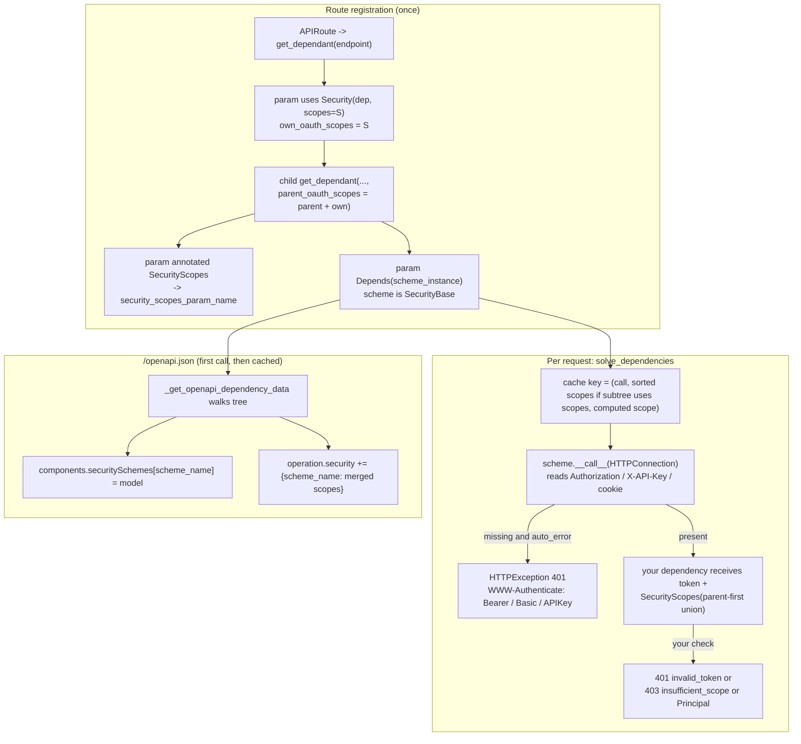

# FastAPI Security Primitives: Security(), SecurityScopes, OAuth2PasswordBearer, HTTPBearer, and APIKeyHeader Internals

> [!summary] Claim
> FastAPI (`0.162.0`) security classes are only credential extractors plus OpenAPI metadata: `Security(dep, scopes=[...])` is a `Depends` subclass whose scopes are concatenated parent-first down the `Dependant` tree at route registration, injected as `SecurityScopes` and folded into the dependency cache key, and copied into the operation's `security` list, while the actual authorization decision is always your code.

Part of [FastAPI Internals and Patterns](README.md) in [API Engineering](../README.md).

## TL;DR

- Mechanism: every `fastapi.security` class is a callable `SecurityBase` instance with a `model` (an OpenAPI Security Scheme Object) and a `scheme_name`; as a dependency it reads one header, query parameter, or cookie from the `HTTPConnection`, and `Security(..., scopes=[...])` adds `own_oauth_scopes` that `get_dependant()` appends to each child's `parent_oauth_scopes`.
- Contract rule: `SecurityScopes.scopes` is the de-duplicated, parent-first union of every scope declared on the path from the endpoint down to the dependency that asks for it, and the same union, per scheme, becomes `{"<scheme_name>": [...]}` in the operation's OpenAPI `security` array.
- The trap: OpenAPI reads multiple entries in an operation's `security` array as alternatives (OR), but FastAPI emits one entry per scheme and runs every dependency, so two schemes on one route are documented as "either" and enforced as "both"; and `OAuth2PasswordBearer` forwards an empty token from `Authorization: Bearer` to your code.
- Portability fact: the classes are pure Python over Starlette's `HTTPConnection`, so behavior is identical across ASGI servers and HTTP versions; what changes is the FastAPI release - missing credentials became `401` with `WWW-Authenticate` for every class in `0.122.0` (the API key classes, `HTTPBearer`, `HTTPDigest`, `OAuth2`, and `OpenIdConnect` answered `403` before), scope propagation and OpenAPI scope merging were fixed in `0.122.1`, `0.123.8`, and `0.123.9`, and WebSocket support for security dependencies arrived in `0.144.0` `(as of 2026-11)`.
- When not to use it: do not treat `OAuth2PasswordBearer` or `OAuth2PasswordRequestForm` as an OAuth 2.0 implementation (the password grant is forbidden by RFC 9700 Section 2.4), and do not put token verification inside these classes when authentication already happens at a gateway or in Starlette middleware; use them for extraction and documentation only.

## Mental model



At startup FastAPI walks each endpoint signature once: every `Security(dep, scopes=S)` parameter creates a child `Dependant` whose `own_oauth_scopes` is `S` and whose `parent_oauth_scopes` is everything declared above it, so scopes flow downward and never upward.
A parameter annotated `SecurityScopes` is not a request field; it only marks the `Dependant` so that the solver later injects the accumulated list.
At request time the solver resolves children first, keyed by a cache key that includes the sorted scope set only when the subtree actually uses scopes, so the same user loader declared with two different scope sets runs twice while a plain helper underneath runs once.
The scheme instance itself only extracts a credential and raises `401` with a challenge when it is absent; everything after that (signature, expiry, scope check, the `403`) is application code.
Independently, OpenAPI generation walks the same tree, registers each `SecurityBase.model` under its `scheme_name`, and emits one security requirement per scheme with the scopes merged along the path.

## How it works

### The class hierarchy: two attributes and a `__call__`

`SecurityBase` declares only `model: SecurityBaseModel` and `scheme_name: str` `(fastapi 0.162.0 fastapi/security/base.py, SecurityBase)`.
Every concrete scheme sets `self.scheme_name = scheme_name or self.__class__.__name__`, stores `auto_error`, builds a Pydantic `model` from `fastapi.openapi.models`, and implements `async def __call__(self, request: HTTPConnection)`.
Because `__call__` takes `HTTPConnection` rather than `Request`, the same instance works on HTTP and WebSocket routes; the release notes attribute WebSocket support for security dependencies to `0.144.0` (PR `#10147`) `(fastapi 0.162.0 docs/en/docs/release-notes.md, 0.144.0)`.
`fastapi.security` exports `APIKeyCookie`, `APIKeyHeader`, `APIKeyQuery`, `HTTPAuthorizationCredentials`, `HTTPBasic`, `HTTPBasicCredentials`, `HTTPBearer`, `HTTPDigest`, `OAuth2`, `OAuth2AuthorizationCodeBearer`, `OAuth2PasswordBearer`, `OAuth2PasswordRequestForm`, `OAuth2PasswordRequestFormStrict`, `SecurityScopes`, and `OpenIdConnect` `(fastapi 0.162.0 fastapi/security/__init__.py)`.

| Class | Reads | Returns | Missing-credential challenge | OpenAPI `model` |
|---|---|---|---|---|
| `APIKeyHeader(name=...)` | `request.headers.get(name)` | `str` | `WWW-Authenticate: APIKey` | `{"type": "apiKey", "in": "header", "name": ...}` |
| `APIKeyQuery(name=...)` | `request.query_params.get(name)` | `str` | `WWW-Authenticate: APIKey` | `in: query` |
| `APIKeyCookie(name=...)` | `request.cookies.get(name)` | `str` | `WWW-Authenticate: APIKey` | `in: cookie` |
| `HTTPBearer(bearerFormat=...)` | `Authorization`, scheme must be `bearer` and credentials non-empty | `HTTPAuthorizationCredentials` | `WWW-Authenticate: Bearer` | `{"type": "http", "scheme": "bearer"}` |
| `HTTPBasic(realm=...)` | `Authorization`, base64 `user:password` | `HTTPBasicCredentials` | `Basic` or `Basic realm="..."` | `{"type": "http", "scheme": "basic"}` |
| `HTTPDigest()` | `Authorization`, scheme must be `digest` | `HTTPAuthorizationCredentials` (no Digest verification) | `WWW-Authenticate: Digest` | `scheme: digest` |
| `OAuth2(flows=...)` | `Authorization`, any value | the whole header string, scheme included | `WWW-Authenticate: Bearer` | `{"type": "oauth2", "flows": ...}` |
| `OAuth2PasswordBearer(tokenUrl=...)` | `Authorization`, scheme must be `bearer` | `str`, possibly `""` | `WWW-Authenticate: Bearer` | `flows.password` |
| `OAuth2AuthorizationCodeBearer(...)` | same as above | `str` | `WWW-Authenticate: Bearer` | `flows.authorizationCode` |
| `OpenIdConnect(openIdConnectUrl=...)` | `Authorization`, any value | the whole header string | `WWW-Authenticate: Bearer` | `{"type": "openIdConnect", ...}` |

Sources for every row: `(fastapi 0.162.0 fastapi/security/api_key.py, APIKeyBase.check_api_key)`, `(fastapi 0.162.0 fastapi/security/http.py, HTTPBase.make_authenticate_headers)`, `(fastapi 0.162.0 fastapi/security/http.py, HTTPBasic.__call__)`, `(fastapi 0.162.0 fastapi/security/oauth2.py, OAuth2.make_not_authenticated_error)`, `(fastapi 0.162.0 fastapi/security/open_id_connect_url.py, OpenIdConnect.__call__)`.

### Parsing `Authorization`: one `partition`, one `strip`

All `Authorization`-based schemes call one helper:

```python
# fastapi 0.162.0 fastapi/security/utils.py (verbatim)
def get_authorization_scheme_param(
    authorization_header_value: str | None,
) -> tuple[str, str]:
    if not authorization_header_value:
        return "", ""
    scheme, _, param = authorization_header_value.partition(" ")
    return scheme, param.strip()
```

It splits at the first space and strips whitespace from the remainder, so `bearer   abc  ` yields `("bearer", "abc")` (the lab proves this through `HTTPBearer`).
Scheme matching is `scheme.lower() != "bearer"`, which implements RFC 9110 Section 11.1 ("It uses a case-insensitive token to identify the authentication scheme").
Nothing validates the credential grammar: RFC 9110 Section 11.4 defines `credentials = auth-scheme [ 1*SP ( token68 / #auth-param ) ]` and RFC 6750 Section 2.1 defines `credentials = "Bearer" 1*SP b64token` with `b64token = 1*( ALPHA / DIGIT / "-" / "." / "_" / "~" / "+" / "/" ) *"="`, but FastAPI accepts any bytes after the space, including internal spaces.
The header is read with `request.headers.get("Authorization")`; Starlette's `Headers.__getitem__` lowercases the key and returns the first matching raw header `(starlette 1.10.0 starlette/datastructures.py, Headers.__getitem__)`, so with duplicated `Authorization` lines FastAPI sees the first one, which may not be the one an upstream proxy validated.

The four bearer-family classes differ in exactly one branch, and that branch matters:

- `HTTPBearer.__call__` rejects when `not (authorization and scheme and credentials)` and then when the scheme is not `bearer` `(fastapi 0.162.0 fastapi/security/http.py, HTTPBearer.__call__)`.
- `OAuth2PasswordBearer.__call__` rejects only when `not authorization or scheme.lower() != "bearer"` and returns `param` `(fastapi 0.162.0 fastapi/security/oauth2.py, OAuth2PasswordBearer.__call__)`, so `Authorization: Bearer` with nothing after it returns `""` to your dependency; the lab records `tokens_seen == [""]`.
- `OAuth2.__call__` and `OpenIdConnect.__call__` check only that the header exists and return it whole, including the `Bearer ` prefix.

`HTTPBasic.__call__` has a second asymmetry: `auto_error=False` only covers the missing-header and wrong-scheme case; a header that fails base64 or ASCII decoding, or that decodes without a `:` separator, raises `make_not_authenticated_error()` unconditionally `(fastapi 0.162.0 fastapi/security/http.py, HTTPBasic.__call__)`.
The lab sends `Basic bm9jb2xvbg==` (base64 of `nocolon`) to an `HTTPBasic(auto_error=False)` route and gets `401` with `WWW-Authenticate: Basic`, not `None`.

### Challenges and status codes

Since `0.122.0` (PR `#13786`) every class raises `HTTPException(status_code=401, detail="Not authenticated", headers={"WWW-Authenticate": ...})` from an overridable `make_not_authenticated_error()` `(fastapi 0.162.0 docs/en/docs/release-notes.md, 0.122.0)`.
Before that the change was not uniform: `APIKeyBase`, `HTTPBase`, `HTTPBearer`, `HTTPDigest`, `OAuth2`, and `OpenIdConnect` raised `403` `Not authenticated` with no challenge, while `HTTPBasic`, `OAuth2PasswordBearer`, and `OAuth2AuthorizationCodeBearer` already raised `401` with `WWW-Authenticate` `(fastapi 0.121.3 fastapi/security/http.py, HTTPBearer.__call__)` `(fastapi 0.121.3 fastapi/security/oauth2.py, OAuth2PasswordBearer.__call__)`; the FastAPI how-to page simplifies this to "they used the HTTP status code `403 Forbidden`".
That change aligns with RFC 9110 Section 15.5.2: "The server generating a 401 response MUST send a WWW-Authenticate header field (Section 11.6.1) containing at least one challenge applicable to the target resource."
For API keys there is no registered scheme, so FastAPI invents the challenge `APIKey`; its docstring cites RFC 9110 for the requirement that a `401` carry `WWW-Authenticate` `(fastapi 0.162.0 fastapi/security/api_key.py, APIKeyBase.make_not_authenticated_error)`.
`HTTPBase.make_authenticate_headers` builds the challenge as `self.model.scheme.title()`, so `bearer` becomes `Bearer` and `digest` becomes `Digest` `(fastapi 0.162.0 fastapi/security/http.py, HTTPBase.make_authenticate_headers)`.
The maintained recipe for keeping the old `403` is to subclass and override `make_not_authenticated_error`, which returns (not raises) the exception (FastAPI docs, "Use Old 403 Authentication Error Status Codes").

The schemes only cover "no credential"; the rest of the RFC 6750 error vocabulary is yours.
RFC 6750 Section 3 says the resource server "MUST include the HTTP `WWW-Authenticate` response header field" when the request lacks credentials or has a token that does not enable access, and defines the `scope` and `error` auth-params.
RFC 6750 Section 3.1 assigns `invalid_request` -> `400`, `invalid_token` -> `401`, and `insufficient_scope` -> `403` (each a SHOULD).
RFC 9110 Section 15.5.4 adds: "If authentication credentials were provided in the request, the server considers them insufficient to grant access."
The FastAPI OAuth2 scopes tutorial raises `401` with `detail="Not enough permissions"` for a missing scope and puts `Bearer scope="..."` in the challenge, which disagrees with RFC 6750 Section 3.1's `403` for `insufficient_scope`; the lab uses `403` and `Bearer error="insufficient_scope", scope="orders:write orders:read"`.

### `Security()` is `Depends()` plus one field

`params.Security` is a frozen dataclass subclass of `params.Depends` adding `scopes: Sequence[str] | None = None` `(fastapi 0.162.0 fastapi/params.py, Security)`; `Depends` carries `dependency`, `use_cache`, and `scope` (the `"function" | "request"` lifetime, unrelated to OAuth scopes) `(fastapi 0.162.0 fastapi/params.py, Depends)`.
The release notes record that `Depends()` and `Security()` results were made hashable in `0.121.3` (PR `#14372`).
In `get_dependant()` the current node computes `current_scopes = (parent_oauth_scopes or []) + (own_oauth_scopes or [])`, and for each `Depends`-valued parameter it passes `own_oauth_scopes=list(depends.scopes)` only when the marker is a `params.Security`, and always `parent_oauth_scopes=current_scopes` `(fastapi 0.162.0 fastapi/dependencies/utils.py, get_dependant)`.
So `Depends(child)` under a `Security` parent still inherits the parent's scopes; only declaring new scopes requires `Security`.
Route-level and router-level `dependencies=[Security(dep, scopes=[...])]` go through `get_parameterless_sub_dependant()`, which sets `own_oauth_scopes` from the `Security` marker but no parent scopes, and `_build_dependant_with_parameterless_dependencies()` inserts them in front of the endpoint's own dependencies `(fastapi 0.162.0 fastapi/dependencies/utils.py, get_parameterless_sub_dependant)` `(fastapi 0.162.0 fastapi/routing.py, _build_dependant_with_parameterless_dependencies)`.

`add_non_field_param_to_dependency()` treats any parameter whose annotation is a subclass of `SecurityScopes` like `Request` or `BackgroundTasks`: it stores the name in `dependant.security_scopes_param_name` and creates no request field `(fastapi 0.162.0 fastapi/dependencies/utils.py, add_non_field_param_to_dependency)`.
At request time, after all sub-dependencies and parameters are solved, `solve_dependencies()` injects `SecurityScopes(scopes=_get_oauth_scopes(dependant=dependant))` `(fastapi 0.162.0 fastapi/dependencies/utils.py, solve_dependencies)`.
`_get_oauth_scopes()` copies `parent_oauth_scopes` and appends each own scope not already present, deliberately using a list to keep order ("This doesn't use a set to preserve order, just in case") `(fastapi 0.162.0 fastapi/dependencies/models.py, _get_oauth_scopes)`.
`SecurityScopes.__init__` stores `scopes or []` and `scope_str = " ".join(self.scopes)` `(fastapi 0.162.0 fastapi/security/oauth2.py, SecurityScopes)`, which is exactly the RFC 6749 Section 3.3 space-delimited `scope` syntax ready for the RFC 6750 `scope` auth-param.

In the lab, `POST /orders` declares `Security(get_active_user, scopes=["orders:write"])` and `get_active_user` declares `Security(get_current_user, scopes=["orders:read"])`, so `get_current_user` sees `["orders:write", "orders:read"]`: outer requirement first, inner appended.

### Scopes in the dependency cache key

`_get_cache_key()` returns `(dependant.call, scopes_for_cache, computed_scope or "")`, where `scopes_for_cache` is `tuple(sorted(set(_get_oauth_scopes(...))))` only when `_uses_scopes(dependant)` is true and `()` otherwise `(fastapi 0.162.0 fastapi/dependencies/models.py, _get_cache_key)`.
`_uses_scopes()` is true when the node declares own scopes, takes a `SecurityScopes` parameter, is itself a `SecurityBase` instance, or has any descendant for which that holds, memoized per walk by `id(dependant)` `(fastapi 0.162.0 fastapi/dependencies/models.py, _uses_scopes)`.
Consequences proven in the lab on `GET /report`, which declares `Security(get_current_user, ["orders:read"])`, `Security(get_current_user, ["orders:write"])`, and `Security(get_current_user, ["orders:read"])` again:

- `get_current_user` runs twice (`scope_log == [["orders:read"], ["orders:write"]]`), because two distinct scope sets give two keys.
- The third declaration reuses the first result object (`reader is again` is `True`).
- `request_id`, a plain dependency of `get_current_user` with no scope-using subtree, runs once (`request_id_calls == 1`).
- The scope set is sorted for the key, so `["a", "b"]` and `["b", "a"]` share a cache entry while the injected `SecurityScopes` still preserves declaration order.

Release notes trace this design: "Fix hierarchical security scope propagation" in `0.122.1` (PR `#5624`) `(fastapi 0.162.0 docs/en/docs/release-notes.md, 0.122.1)`.

`dependency_overrides` keeps scopes: when an override exists the solver rebuilds the sub-dependant with `get_dependant(..., parent_oauth_scopes=_get_oauth_scopes(dependant=sub_dependant))`, so the override inherits the full union including the overridden node's own scopes `(fastapi 0.162.0 fastapi/dependencies/utils.py, solve_dependencies)`; the lab's override sees `["orders:write", "orders:read"]`.

### Order of operations inside a request

`get_request_handler()` reads and parses the body (JSON or `request.form()`) before it calls `solve_dependencies()` `(fastapi 0.162.0 fastapi/routing.py, get_request_handler)`.
The lab's `POST /notes` shows the consequence: malformed JSON with no `Authorization` returns `422` `json_invalid`, while a schema-invalid body returns `401` `Bearer`, because `solve_dependencies()` solves sub-dependencies (the scheme) before it validates the endpoint's own path, query, header, cookie, and body fields, and a raised `HTTPException` aborts the walk `(fastapi 0.162.0 fastapi/dependencies/utils.py, solve_dependencies)`.
By the same code path a missing required query parameter also loses to the scheme's `401` (inference from the source; the lab tests only the body case).
Sub-dependencies resolve in parameter order, so on the lab's `/both` route (`HTTPBearer` declared before `APIKeyHeader`) a request with only `X-API-Key` fails with `WWW-Authenticate: Bearer`.

### OpenAPI wiring

`_get_openapi_dependency_data()` walks the endpoint's `Dependant` tree depth-first with a `visited` list of cache keys, carries the merged scope list down, and records `(dependant, oauth_scopes)` for every non-root node whose unwrapped call is a `SecurityBase` instance `(fastapi 0.162.0 fastapi/openapi/utils.py, _get_openapi_dependency_data)`.
`_get_openapi_security_definitions()` serializes each scheme's `model` with `jsonable_encoder(..., by_alias=True, exclude_none=True)` into `security_definitions[scheme_name]` and builds `operation_security` as one single-key dict per `scheme_name`, merging scopes for repeated schemes in first-seen order `(fastapi 0.162.0 fastapi/openapi/utils.py, _get_openapi_security_definitions)`.
`get_openapi_path()` extends `operation["security"]` with that list and returns the definitions, which `get_openapi()` merges into `components.securitySchemes` with `dict.update` `(fastapi 0.162.0 fastapi/openapi/utils.py, get_openapi_path)`.
Scope merging and de-duplication of schemes with different scopes were fixed in `0.123.8` (PR `#14455`) and `0.123.9` (PR `#14459`), and top-level app security schemes in `0.120.4` (PR `#14266`) `(fastapi 0.162.0 docs/en/docs/release-notes.md)`.

What the lab's spec contains (reformatted excerpt of the captured `/openapi.json`, `components.securitySchemes` minus `HTTPBasic`):

```json
{"OAuth2PasswordBearer": {"type": "oauth2", "flows": {"password": {
    "scopes": {"orders:read": "Read orders", "orders:write": "Create orders"},
    "tokenUrl": "/token"}}},
 "HTTPBearer": {"type": "http", "scheme": "bearer", "bearerFormat": "opaque"},
 "APIKeyHeader": {"type": "apiKey", "in": "header", "name": "X-API-Key"}}
```

| Operation | Emitted `security` |
|---|---|
| `POST /orders` | `[{"OAuth2PasswordBearer": ["orders:write", "orders:read"]}]` |
| `GET /orders` | `[{"OAuth2PasswordBearer": ["orders:read"]}]` |
| `GET /report` | `[{"OAuth2PasswordBearer": ["orders:read", "orders:write"]}]` |
| `GET /both` | `[{"HTTPBearer": []}, {"APIKeyHeader": []}]` |
| `POST /token` | absent |

Three properties of this output follow from the code and the OpenAPI 3.1.0 text:

1. FastAPI never writes a top-level `security` field; every requirement is per operation (the lab asserts `"security" not in spec`).
2. OpenAPI 3.1.0 Section 4.8.30 (Security Requirement Object) says that when a list of Security Requirement Objects is given, "only one of the Security Requirement Objects in the list needs to be satisfied", whereas "Security Requirement Objects that contain multiple schemes require that all schemes MUST be satisfied"; FastAPI's one-dict-per-scheme list therefore documents OR, while its runtime enforces AND (lab: `/both` with only `X-API-Key` is `401`).
3. The same section says the array value is a list of scope names for `oauth2` and `openIdConnect`, and for other types "MAY contain a list of role names"; FastAPI puts scopes into the array for any scheme type, so `Security(api_key_header, scopes=["admin"])` is valid 3.1.0 but would be invalid in OpenAPI 3.0, whose Security Requirement Object (OpenAPI 3.0.3 Section 4.7.30) says "For other security scheme types, the array MUST be empty", which matters when `app.openapi_version` is downgraded.

`scheme_name` is the component key, and it defaults to the class name.
Two `OAuth2PasswordBearer` instances with different `tokenUrl` values both register as `OAuth2PasswordBearer`, `dict.update` keeps the later one, and both operations then reference it; the lab's colliding app ends with one component whose `tokenUrl` is `/second-token`.
FastAPI emits `openapi: "3.1.0"` by default; `app.openapi_version` can be overwritten, which FastAPI's own docstring calls "a hack" `(fastapi 0.162.0 fastapi/applications.py, FastAPI.openapi_version)`.

Swagger UI integration is separate from the schema: `get_swagger_ui_html()` writes `oauth2RedirectUrl` when `swagger_ui_oauth2_redirect_url` is set (default `/docs/oauth2-redirect`) and calls `ui.initOAuth(...)` with `swagger_ui_init_oauth` `(fastapi 0.162.0 fastapi/openapi/docs.py, get_swagger_ui_html)` `(fastapi 0.162.0 fastapi/applications.py, FastAPI.__init__)`.
The "Authorize" dialog uses the `tokenUrl` string exactly as the `flows.password` object states it; FastAPI does not rewrite it, so the value must be reachable from the browser's point of view.
For an OpenAPI 3 document, Swagger UI's `authorizeRequest` resolves a relative `tokenUrl` against the selected server URL (`parseUrl(url, finalServerUrl, true)`), not against the document URL `(swagger-ui 5.35.0 src/core/plugins/auth/actions.js, authorizeRequest)`, matching OpenAPI 3.1.0 Section 4.7 ("relative references are resolved using the URLs defined in the Server Object as a Base URL"); FastAPI loads `swagger-ui-dist@5` from jsDelivr, whose latest `5.x` is `5.35.0` `(as of 2026-11)`.

### `OAuth2PasswordRequestForm`

`OAuth2PasswordRequestForm` is a class dependency whose `__init__` parameters are `Form()` fields: `grant_type: str | None = Form(pattern="^password$")` defaulting to `None`, `username: str`, `password: str` (with `format: password` in the schema), `scope: str = ""`, `client_id: str | None`, and `client_secret: str | None` `(fastapi 0.162.0 fastapi/security/oauth2.py, OAuth2PasswordRequestForm)`.
It sets `self.scopes = scope.split()`, which splits on any whitespace run, more lenient than the single `SP` of RFC 6749 Section 3.3 (`scope = scope-token *( SP scope-token )`); the lab's `"orders:read  orders:write\tadmin"` yields three scopes.
`OAuth2PasswordRequestFormStrict` makes `grant_type` required; both pin it to `^password$`, so `grant_type=client_credentials` is a `422` `string_pattern_mismatch` at `["body", "grant_type"]` in the lab.
Being a form, it requires `python-multipart`; `analyze_param()` calls `ensure_multipart_is_installed()` for every `Form` field while the route's `Dependant` is built, so a missing package raises `RuntimeError` at route registration, not at the first request `(fastapi 0.162.0 fastapi/dependencies/utils.py, analyze_param)`.
RFC 9700 Section 2.4 says "The resource owner password credentials grant [RFC6749] MUST NOT be used", so this class is a tutorial and a test fixture, not a production token endpoint; see [[OAuth-2-0-to-OAuth-2-1-and-RFC-9700-Security-BCP]].

## Numbers and limits

Measured values come from the lab run on CPython `3.14.6`, macOS `27.3` (`Darwin 27.3.0`, `arm64`), `fastapi 0.162.0`, `starlette 1.10.0`, command `uv run --frozen pytest tests/f11_fastapi_internals_and_patterns/test_fastapi_security_utilities_oauth2_securityscopes_and_openapi_wiring.py -v` from `labs/`.

| Item | Value | Source |
|---|---|---|
| Attributes a `SecurityBase` must carry | `2` (`model`, `scheme_name`) | `(fastapi 0.162.0 fastapi/security/base.py, SecurityBase)` |
| Elements in a dependency cache key | `3` (`call`, sorted scope tuple or `()`, computed lifetime scope or `""`) | `(fastapi 0.162.0 fastapi/dependencies/models.py, _get_cache_key)` |
| Calls of the user loader for 3 `Security` declarations with 2 distinct scope sets | `2` | Measured (lab `test_scoped_cache_key_splits_security_calls_but_shares_plain_dependency`) |
| Calls of a plain helper below those loaders | `1` | Measured (same test) |
| Callable-classification `lru_cache` size | `4096` | `(fastapi 0.162.0 fastapi/dependencies/models.py, _CALLABLE_CLASSIFICATION_CACHE_SIZE)` |
| Status for missing credentials | `401` for every class since `0.122.0` (2025-11-24); before, `403` for 7 classes, `401` for `HTTPBasic` and the two OAuth2 bearer classes (`fastapi 0.121.3` source) | `(fastapi 0.162.0 docs/en/docs/release-notes.md, 0.122.0)` |
| `insufficient_scope` status | `403` (SHOULD) | RFC 6750 Section 3.1 |
| Allowed `scope-token` octets | `%x21 / %x23-5B / %x5D-7E` (printable ASCII minus space, `"`, `\`) | RFC 6749 Section 3.3 |
| Default OpenAPI version emitted | `3.1.0` | `(fastapi 0.162.0 fastapi/applications.py, FastAPI.openapi_version)` |
| `Headers.get` cost | linear scan of the raw header list per lookup | `(starlette 1.10.0 starlette/datastructures.py, Headers.__getitem__)` |
| OpenAPI walk dedup structure | `visited: list` of cache keys, so membership is linear per node | `(fastapi 0.162.0 fastapi/openapi/utils.py, _get_openapi_dependency_data)` |
| `python-multipart` ReDoS (CVE-2024-24762) | affected `<= 0.0.6`, fixed `0.0.7`; lab pins `0.0.33` | GHSA-2jv5-9r88-3w3p |
| Lab wall time | `14 passed in 0.36s` | Measured (verifier rerun, 2026-11-15) |

There are no per-request numbers worth benchmarking here: a scheme call is one header lookup and one `str.partition`, dwarfed by token verification (JWT signature or introspection round trip), which is application code.
This note makes no per-request cost claim for `Security` versus `Depends`; the only measured quantities are the call counts above.

## Portability

| Dimension | Cell | Status |
|---|---|---|
| CPython `3.14.6` (workspace venv, `macos-aarch64`) | All 14 lab tests pass | Proven by lab run (the contract pin `3.14.10` was not the interpreter used) |
| CPython `3.12.16`, `3.13.18`, `3.15.2`, `3.15.2t` | Not run | Lab runs were limited to one interpreter by the 2026-11-11 instruction; FastAPI `0.162.0` declares `Requires-Python: >=3.10` with classifiers through `3.14`, and Starlette `1.10.0` classifiers reach `3.15` (installed `METADATA`) |
| Interpreter-dependent code on the security path | `iscoroutinefunction` from `inspect` on `>= 3.13`, from `asyncio` below; `annotationlib.Format.FORWARDREF` signature fallback on `>= 3.14` | `(fastapi 0.162.0 fastapi/dependencies/models.py)`, `(fastapi 0.162.0 fastapi/dependencies/utils.py, _get_signature)`; the security classes themselves have no version branches |
| Free-threaded `3.15t` | Not run; the scheme classes in `fastapi/security/*.py` assign `self.model`, `self.scheme_name`, and `self.auto_error` only inside `__init__` and keep no module-level mutable state, so shared instances are read-only after construction | Read from `(fastapi 0.162.0 fastapi/security/*.py)`; no free-threaded run was made |
| FastAPI `< 0.122.0` | Missing credentials answer `403` without `WWW-Authenticate` for the API key classes, `HTTPBearer`, `HTTPDigest`, `OAuth2`, and `OpenIdConnect`; `HTTPBasic` and the OAuth2 bearer classes already answered `401` | Release notes `0.122.0`, PR `#13786`; `fastapi 0.121.3` `fastapi/security/*.py` |
| FastAPI `< 0.122.1` | Hierarchical scope propagation differs | Release notes `0.122.1`, PR `#5624` |
| FastAPI `< 0.123.9` | OpenAPI scope merging differs in corner cases (parent with scopes, child scheme without) | Release notes `0.123.8` (PR `#14455`) and `0.123.9` (PR `#14459`) |
| FastAPI `< 0.144.0` | Security dependencies not supported on WebSocket routes | Release notes `0.144.0`, PR `#10147` |
| FastAPI `< 0.115.13` | `OAuth2PasswordBearer` has no `refreshUrl` parameter | Release notes `0.115.13`, PR `#11460` |
| Uvicorn, Hypercorn, Granian | Same behavior: the schemes read the ASGI `headers` list through Starlette `Headers`, which lowercases the lookup key | `(starlette 1.10.0 starlette/datastructures.py, Headers.__getitem__)`; no server leg was run |
| HTTP/1.1, HTTP/2, HTTP/3 | Same behavior: the header lookup is case-insensitive and the scheme comparison is `lower()`-based | Source as above; no protocol leg was run |
| Debian Trixie, Alpine musl | Not run | `fastapi 0.162.0` and `starlette 1.10.0` are pure-Python wheels (`Tag: py3-none-any` in the installed `WHEEL` files), so the wheels contain no libc-specific code |

## Worked example

The [implementation](../labs/src/api_labs/f11_fastapi_internals_and_patterns/security_primitives.py) builds one app with an `OAuth2PasswordBearer` scope chain, `HTTPBearer`, `APIKeyHeader`, an optional `HTTPBasic`, a scoped JSON-body route, and an `OAuth2PasswordRequestForm` echo endpoint, plus a second app with two colliding `OAuth2PasswordBearer` instances; the [test](../labs/tests/f11_fastapi_internals_and_patterns/test_fastapi_security_utilities_oauth2_securityscopes_and_openapi_wiring.py) drives both in process through `httpx.ASGITransport`.

The scope chain and the RFC 6750 error mapping (simplified excerpt of `security_primitives.py`; the full file also defines the bearer, API key, basic, token, notes, report, and colliding-scheme routes):

```python
TOKEN_GRANTS: dict[str, frozenset[str]] = {
    "tok-reader": frozenset({"orders:read"}),
    "tok-writer": frozenset({"orders:read", "orders:write"}),
}

oauth2_scheme = OAuth2PasswordBearer(
    tokenUrl="/token",
    scopes={"orders:read": "Read orders", "orders:write": "Create orders"},
)


def bearer_challenge(security_scopes: SecurityScopes, error: str) -> str:
    """Build an RFC 6750 Section 3 challenge; scope is listed only when the chain requires one."""
    params = [f'error="{error}"']
    if security_scopes.scopes:
        params.append(f'scope="{security_scopes.scope_str}"')
    return "Bearer " + ", ".join(params)


def build_security_app(recorder: SecurityRecorder) -> FastAPI:
    app = FastAPI()

    def request_id() -> str:
        # Plain dependency: no scopes in its subtree, so its cache key ignores scopes.
        recorder.request_id_calls += 1
        return f"req-{recorder.request_id_calls}"

    async def get_current_user(
        security_scopes: SecurityScopes,
        token: Annotated[str, Depends(oauth2_scheme)],
        rid: Annotated[str, Depends(request_id)],
    ) -> Principal:
        recorder.scope_log.append(list(security_scopes.scopes))
        recorder.tokens_seen.append(token)
        granted = TOKEN_GRANTS.get(token)
        if granted is None:
            raise HTTPException(
                status_code=status.HTTP_401_UNAUTHORIZED,
                detail="Invalid token",
                headers={"WWW-Authenticate": bearer_challenge(security_scopes, "invalid_token")},
            )
        missing = [s for s in security_scopes.scopes if s not in granted]
        if missing:
            # RFC 6750 Section 3.1: insufficient_scope SHOULD be 403, not 401.
            raise HTTPException(
                status_code=status.HTTP_403_FORBIDDEN,
                detail=f"Missing scopes: {' '.join(missing)}",
                headers={
                    "WWW-Authenticate": bearer_challenge(security_scopes, "insufficient_scope")
                },
            )
        return Principal(token=token, granted=granted)

    async def get_active_user(
        user: Annotated[Principal, Security(get_current_user, scopes=["orders:read"])],
    ) -> Principal:
        return user

    @app.post("/orders")
    async def create_order(
        user: Annotated[Principal, Security(get_active_user, scopes=["orders:write"])],
    ) -> dict[str, str]:
        return {"token": user.token}
```

Two of the fourteen tests (simplified excerpt of the test module):

```python
@pytest.mark.unit
@pytest.mark.asyncio
async def test_insufficient_scope_is_403_with_rfc6750_scope_challenge() -> None:
    recorder = SecurityRecorder()
    async with client_for(build_security_app(recorder)) as client:
        response = await client.post("/orders", headers={"Authorization": "Bearer tok-reader"})

    assert response.status_code == 403
    assert response.headers["www-authenticate"] == (
        'Bearer error="insufficient_scope", scope="orders:write orders:read"'
    )
    assert response.json() == {"detail": "Missing scopes: orders:write"}


@pytest.mark.unit
@pytest.mark.asyncio
async def test_two_schemes_emit_openapi_alternatives_but_runtime_requires_both() -> None:
    async with client_for(build_security_app(SecurityRecorder())) as client:
        spec = (await client.get("/openapi.json")).json()
        key_only = await client.get("/both", headers={"X-API-Key": "k"})
        both = await client.get(
            "/both", headers={"X-API-Key": "k", "Authorization": "Bearer opaque-1"}
        )

    # Two list entries mean "either one" in OpenAPI (Security Requirement Object) ...
    assert operation_security(spec, "/both", "get") == [{"HTTPBearer": []}, {"APIKeyHeader": []}]
    # ... but every dependency runs, so the server demands both.
    assert key_only.status_code == 401
    assert key_only.headers["www-authenticate"] == "Bearer"
    assert both.status_code == 200
    assert both.json() == {"credentials": "opaque-1", "key": "k"}
```

Captured output, CPython `3.14.6` on macOS `27.3` `arm64`, from `labs/` (the per-test path prefix `tests/f11_fastapi_internals_and_patterns/test_fastapi_security_utilities_oauth2_securityscopes_and_openapi_wiring.py::` is shortened to `...::`; the header lines are omitted):

```text
$ uv run --frozen pytest tests/f11_fastapi_internals_and_patterns/test_fastapi_security_utilities_oauth2_securityscopes_and_openapi_wiring.py -v
collecting ... collected 14 items

...::test_security_scopes_accumulate_parent_first_across_security_chain PASSED [  7%]
...::test_insufficient_scope_is_403_with_rfc6750_scope_challenge PASSED [ 14%]
...::test_missing_authorization_short_circuits_before_user_dependency PASSED [ 21%]
...::test_oauth2_password_bearer_forwards_empty_token_while_http_bearer_rejects PASSED [ 28%]
...::test_body_is_parsed_before_security_but_validated_after_it PASSED [ 35%]
...::test_scheme_match_is_case_insensitive_and_credentials_are_stripped PASSED [ 42%]
...::test_scoped_cache_key_splits_security_calls_but_shares_plain_dependency PASSED [ 50%]
...::test_openapi_security_requirements_mirror_scope_chain PASSED [ 57%]
...::test_two_schemes_emit_openapi_alternatives_but_runtime_requires_both PASSED [ 64%]
...::test_default_scheme_name_collision_keeps_last_definition PASSED [ 71%]
...::test_password_form_splits_scope_on_any_whitespace_and_pins_grant_type PASSED [ 78%]
...::test_api_key_header_missing_sends_nonstandard_apikey_challenge PASSED [ 85%]
...::test_http_basic_auto_error_false_still_raises_on_malformed_credentials PASSED [ 92%]
...::test_dependency_override_inherits_security_scopes PASSED [100%]

============================== 14 passed in 0.36s ==============================
```

What each test pins down:

- Scope accumulation is parent-first (`["orders:write", "orders:read"]`), and a dependency override receives the same list.
- Missing `Authorization` fails inside the scheme with `401` `Bearer`, before the user loader or its helper runs.
- `OAuth2PasswordBearer` passes `""` through for `Authorization: Bearer`, while `HTTPBearer` rejects it.
- Malformed JSON is rejected with `422` before the scheme runs, while a schema-invalid body loses to the scheme's `401`.
- The cache key splits on scope sets but not for scope-free helpers.
- The OpenAPI `security` arrays and `securitySchemes` match the tables above, including the OR-versus-AND mismatch and the last-wins `scheme_name` collision.
- `OAuth2PasswordRequestForm` splits `scope` on any whitespace and rejects a non-`password` `grant_type` with `422`.
- `APIKeyHeader` answers `WWW-Authenticate: APIKey` and matches the header name case-insensitively.
- `HTTPBasic(auto_error=False)` still raises on a malformed credential.

## Pitfalls

> [!warning] Documenting OR while enforcing AND
> Trigger: a route declares `Depends(http_bearer)` and `Depends(api_key_header)` so that "either credential works".
> Symptom: the OpenAPI document lists `[{"HTTPBearer": []}, {"APIKeyHeader": []}]`, which per OpenAPI 3.1.0 Section 4.8.30 means either one suffices, but requests with only one credential get `401`; generated SDKs and gateways that trust the spec send one credential and fail.
> Fix: for "either", construct both schemes with `auto_error=False` and write one dependency that accepts whichever is present and raises otherwise (the runtime then matches the documented OR); for "both", accept that FastAPI cannot express a combined requirement object and post-process `app.openapi()` (see [[OpenAPI-Generation-Internals-in-FastAPI-Get-OpenAPI-and-Separate-Schemas]]).

> [!warning] `OAuth2PasswordBearer` hands you an empty token
> Trigger: a client sends `Authorization: Bearer` (no token) or `Authorization: Bearer ` with trailing spaces.
> Symptom: the dependency receives `""`; a token cache keyed by token string, or a verifier that treats an empty string as "no claims to check", can turn this into a bypass.
> Fix: reject falsy tokens explicitly in the user loader, or extract with `HTTPBearer`, which refuses empty credentials inside the scheme `(fastapi 0.162.0 fastapi/security/http.py, HTTPBearer.__call__)`.

> [!warning] The `403` to `401` switch in `0.122.0`
> Trigger: upgrading across FastAPI `0.122.0`.
> Symptom: clients, tests, or gateways that keyed on `403` for "not logged in" change behavior, and every such response now carries a `WWW-Authenticate` challenge.
> Fix: assert the new contract in tests, or subclass and override `make_not_authenticated_error` as the FastAPI how-to documents; release notes `0.122.0` (PR `#13786`) are the primary record.

> [!warning] Following the tutorial's `401` for missing scopes
> Trigger: copying the scopes tutorial, which raises `401` `Not enough permissions` when a scope is missing.
> Symptom: clients that refresh or re-authenticate on `401` loop forever, because a new token for the same user has the same grants.
> Fix: answer `403` with `WWW-Authenticate: Bearer error="insufficient_scope", scope="..."` per RFC 6750 Section 3.1, as the lab does, and reserve `401` for missing or invalid tokens.

> [!warning] Default `scheme_name` collisions
> Trigger: two instances of the same class with different configuration, for example two `OAuth2PasswordBearer` objects for two identity providers, or two `APIKeyHeader` objects for `X-API-Key` and `X-Admin-Key`.
> Symptom: `components.securitySchemes` keeps only the last one registered, every operation references it, and Swagger UI sends the wrong header or posts to the wrong `tokenUrl`; runtime enforcement is unaffected, so tests that only exercise requests stay green.
> Fix: always pass an explicit, unique `scheme_name`, and add a contract test that counts `securitySchemes` entries.

> [!warning] Unauthenticated body parsing runs before your security dependency
> Trigger: a route with a form or JSON body protected only by a security dependency.
> Symptom: `get_request_handler()` parses the body before `solve_dependencies()`, so unauthenticated clients reach the JSON or multipart parser; CVE-2024-24762 (GHSA-2jv5-9r88-3w3p) was a ReDoS in `python-multipart <= 0.0.6` reached through `Content-Type` parsing on form endpoints, which in FastAPI includes `OAuth2PasswordRequestForm` token endpoints; that advisory lists only `python-multipart` (`<= 0.0.6`, patched `0.0.7`), and FastAPI `0.109.1` (2024-02-03) raised its minimum to `python-multipart>=0.0.7` (release notes `0.109.1`), with the FastAPI-side advisory GHSA-qf9m-vfgh-m389 later withdrawn as a duplicate.
> Fix: keep `python-multipart` current (the lab pins `0.0.33`), enforce body size limits and authentication at the edge or in ASGI middleware for expensive bodies, and see [[Unrestricted-Resource-Consumption-API4-2023-Payload-Depth-and-Limit-Guards]].

> [!warning] `HTTPBasic(auto_error=False)` is not fully optional
> Trigger: an endpoint meant to work anonymously or with Basic credentials.
> Symptom: a malformed `Authorization: Basic ...` value (bad base64, non-ASCII, no `:`) still produces `401`, while an absent header produces `None`.
> Fix: if optional really means optional, subclass and catch, or read the header yourself; document the behavior in a test like the lab's.

## Security and robustness

- Threat model: the security classes defend only against "credential absent"; authenticity, expiry, audience, revocation, and authorization are application code, which maps to OWASP API2:2023 Broken Authentication if the loader is weak and API5:2023 Broken Function Level Authorization if scope checks are missing on some routes.
- Deny by default: because enforcement is per dependency, a route that forgets its `Security(...)` parameter is public; put the guard in `APIRouter(dependencies=[Security(get_current_user, scopes=[...])])` and write a test that walks `app.routes` and fails on any operation without a `security` entry (see [[Defeating-BFLA-API5-2023-Function-Level-Guards-and-Deny-By-Default-Routers]]).
- Scope semantics: scopes are opaque, case-sensitive strings (RFC 6749 Section 3.3), and `SecurityScopes` only reports what the route requires; checking "required is a subset of granted" is the minimum, and object-level checks (API1:2023 Broken Object Level Authorization) still belong in the domain or query layer ([[Where-Authorization-Lives-Gateway-Middleware-vs-Domain-and-Query-Layer]]).
- Token audience: RFC 9700 Section 2.3 says access tokens "SHOULD be audience-restricted to a specific resource server"; a FastAPI loader that verifies only the signature accepts tokens minted for a sibling API.
- API keys: `APIKeyQuery` puts secrets in URLs, which end up in access logs and `Referer`; prefer `APIKeyHeader`, store keys hashed, and compare with `hmac.compare_digest` ([[API-Key-Engineering-Prefixed-Entropy-Hashed-Storage-and-Zero-Downtime-Rotation]]).
- Cookie-borne credentials: `APIKeyCookie` makes the endpoint CSRF-relevant, which header-borne bearer tokens are not ([[CSRF-in-Cookie-Authenticated-APIs-SameSite-Double-Submit-and-Fetch-Metadata]]).
- Header ambiguity: with duplicated `Authorization` lines FastAPI uses the first; if an edge proxy validates the last, a smuggled second header splits the decision, so normalize or reject duplicates at the edge.
- Error content: the schemes return a fixed `detail` of `Not authenticated`; keep your own `401` and `403` bodies equally uninformative about which check failed, and never echo tokens into logs ([[Structured-Log-Redaction-and-Preventing-PII-and-Token-Leaks]]).
- Defense in depth: verify tokens once at the edge or in middleware when possible, and keep the FastAPI dependency as the authorization and documentation layer ([[API-Authentication-Architecture-Edge-Verification-vs-Zero-Trust-Propagation]]).

## The principal's view

The decision is where the boundary between "authentication plumbing" and "authorization policy" lives in a FastAPI estate.
FastAPI's security primitives give two things for free: credential extraction with correct `401` challenges, and machine-readable security metadata in OpenAPI that drives Swagger UI, SDK generators, and gateway import.
They give nothing on verification or policy, and their OpenAPI model is lossy: no top-level `security`, no combined (AND) requirement objects, class-name defaults for component keys.
A staff-plus engineer therefore standardizes one internal package that wraps the primitives: explicit `scheme_name` values, a single `get_principal` loader that verifies tokens (JWKS, audience, expiry) and maps `SecurityScopes` to `401` or `403` per RFC 6750, router-level `Security` guards for deny-by-default, and a CI contract test that diffs the generated `security` arrays against policy.
The organizational trade-off is that scopes declared in Python signatures are invisible to non-Python services and to the authorization server; once more than a handful of services share a scope vocabulary, move the scope catalogue into a shared registry and generate both the `Security(...)` declarations and the identity provider's scope list from it.
Choose something else when policy is relational or attribute-based (ownership, tenancy, sharing), because a static scope list per route cannot express it; use a policy engine or ReBAC service called from the loader ([[Authorization-Models-Scopes-RBAC-ABAC-and-Zanzibar-ReBAC]]).
Choose gateway enforcement when many languages share one API surface, keeping FastAPI's `Security` only for documentation and a second, cheap check.
Litestar `2.25.0` exposes route and router `guards` and a `litestar.security` package (`jwt`, `session_auth`) as framework objects rather than dependency conventions, which is worth weighing for greenfield services `(litestar 2.25.0 litestar/router.py, Router.__init__)` ([[FastAPI-Architectural-Limits-and-Comparison-with-Litestar-and-Raw-Starlette]]).

## Interview questions

> [!question] L5: What does `OAuth2PasswordBearer(tokenUrl="/token")` actually do at request time, and what does it not do?
>
> > [!success]- Answer
> > It reads `Authorization`, splits at the first space, and returns the remainder if the scheme is `bearer` case-insensitively.
> > If the header is missing or uses another scheme it raises `401` with `WWW-Authenticate: Bearer`, or returns `None` with `auto_error=False`.
> > It does not verify, decode, or look up the token, and it never contacts `tokenUrl`; `tokenUrl` exists only for the OpenAPI `flows.password` object and Swagger UI.
> >
> > Follow-up: What does it return for `Authorization: Bearer` with no token, and why does that matter?

> [!question] L5: Why does a FastAPI security class return `401` for missing credentials, and what header must accompany it?
>
> > [!success]- Answer
> > RFC 9110 Section 15.5.2 defines `401` as lacking valid authentication credentials and requires the server to send `WWW-Authenticate` with at least one applicable challenge.
> > Since FastAPI `0.122.0` the classes raise `401` with `Bearer`, `Basic`, `Digest`, or the non-standard `APIKey` challenge; before that the API key, `HTTPBearer`, `HTTPDigest`, `OAuth2`, and `OpenIdConnect` classes returned `403` with no challenge.
> > `403` is for an authenticated client whose credentials are insufficient (RFC 9110 Section 15.5.4).
> >
> > Follow-up: How do you restore `403` for a legacy client without forking FastAPI?

> [!question] L6: How do scopes declared with nested `Security()` calls reach a dependency, and in what order?
>
> > [!success]- Answer
> > At registration `get_dependant()` passes each child `parent_oauth_scopes = parent + own`, and `Security(dep, scopes=S)` sets the child's `own_oauth_scopes` to `S`.
> > At request time `solve_dependencies()` injects `SecurityScopes(scopes=_get_oauth_scopes(dependant))`, which is the parent list followed by own scopes not already present.
> > So the endpoint-level requirement comes first and inner requirements are appended; a plain `Depends` child still inherits the parent's scopes.
> >
> > Follow-up: Which list order does the dependency cache key use, and why does that not matter for correctness?

> [!question] L6 (Predict-the-output): An endpoint declares `a = Security(get_user, scopes=["r"])`, `b = Security(get_user, scopes=["w"])`, and `c = Security(get_user, scopes=["r"])`; `get_user` depends on `oauth2_scheme` and on a plain `request_id()` counter. How many times do `get_user` and `request_id` run, and is `a is c`?
>
> > [!success]- Answer
> > `get_user` runs twice, `request_id` runs once, and `a is c` is `True`.
> > The cache key includes the sorted scope tuple only when the subtree uses scopes; `get_user` takes scopes (and depends on a `SecurityBase`), so `("r",)` and `("w",)` are separate keys and the second `("r",)` hits the cache.
> > `request_id` has no scope-using subtree, so its key ignores scopes and both `get_user` calls share one value.
> > The lab's `/report` route measures exactly this.
> >
> > Follow-up: What changes if `request_id` takes a `SecurityScopes` parameter?

> [!question] L6 (Debug-this-API): Your OpenAPI shows `security: [{"HTTPBearer": []}, {"APIKeyHeader": []}]` for `GET /both`, the generated SDK sends only the API key, and the server answers `401` with `WWW-Authenticate: Bearer`. What is wrong?
>
> > [!success]- Answer
> > OpenAPI 3.1.0 Section 4.8.30 reads multiple Security Requirement Objects in a list as alternatives, so the SDK correctly sends one credential.
> > FastAPI emits one object per scheme but resolves every dependency, and `HTTPBearer` (declared first) raises `401` when `Authorization` is absent.
> > Fix the runtime to match the document: use `auto_error=False` on both schemes and one dependency that accepts either and raises if neither is present.
> > If both credentials are genuinely required, the document is what is wrong, and you must post-process `app.openapi()` into a single object `{"HTTPBearer": [], "APIKeyHeader": []}`.
> >
> > Follow-up: How would you catch this class of drift in CI?

> [!question] L6: Two teams each create `OAuth2PasswordBearer` with different `tokenUrl` values in one app; Swagger UI posts every login to the second team's endpoint. Why?
>
> > [!success]- Answer
> > `scheme_name` defaults to the class name, so both register as `OAuth2PasswordBearer` in `components.securitySchemes`.
> > `get_openapi()` merges path results with `dict.update`, so the last definition wins and every operation references the same key.
> > Runtime extraction is unaffected because each route still calls its own instance, which is why request tests pass.
> > Pass explicit unique `scheme_name` values and add a test that asserts the component count.
> >
> > Follow-up: Does the collision also affect the dependency cache key?

> [!question] L7+: Design the error contract for a FastAPI resource server that uses `SecurityScopes`, and justify each status and header against the RFCs.
>
> > [!success]- Answer
> > No credential: `401` with `WWW-Authenticate: Bearer` (RFC 9110 Section 15.5.2 requires a challenge; RFC 6750 Section 3 says the server MUST include `WWW-Authenticate`), which the scheme already does.
> > Malformed request, such as a token in both the header and the query: `400` `invalid_request` (RFC 6750 Section 3.1).
> > Expired, revoked, or unverifiable token: `401` with `Bearer error="invalid_token"` so clients refresh.
> > Valid token missing a scope: `403` with `Bearer error="insufficient_scope", scope="<scope_str>"`, so clients do not refresh in a loop and can request a token with the listed scopes.
> > `scope_str` is the space-delimited RFC 6749 Section 3.3 form, so it can be passed directly into the auth-param.
> >
> > Follow-up: Should the `scope` auth-param list all required scopes or only the missing ones, and what does each leak?

> [!question] L7+: Why does FastAPI put OAuth scopes into the dependency cache key at all, and what would break if it did not?
>
> > [!success]- Answer
> > The same callable can be declared with different scope requirements in one request, and its result may depend on them, because it receives `SecurityScopes` and may raise `403` for one set but not another.
> > Without scopes in the key, the first resolution (say with `["r"]`) would be reused for the `["w"]` declaration, silently skipping the stricter check, which is an authorization bypass.
> > FastAPI only adds scopes when the subtree uses them, so unrelated helpers keep a single cached value; the scope set is sorted so equivalent requirements share an entry.
> > The cost is duplicated work (two token verifications) when one route needs several scope sets; collapse them into one `Security` declaration if that matters.
> >
> > Follow-up: How do `use_cache=False` and the lifetime `scope="request"` interact with this key?

> [!question] L7+: Your platform team wants to drop FastAPI security dependencies and verify JWTs in an ASGI middleware. What do you lose and how do you keep it?
>
> > [!success]- Answer
> > You lose per-operation OpenAPI `security` entries and `securitySchemes`, which drive Swagger UI, SDK generation, and gateway policy import, and you lose per-route `SecurityScopes`.
> > You keep correctness if the middleware attaches a verified principal to `scope["state"]` or `request.state`, and a thin `Security(get_principal, scopes=[...])` dependency reads it, checks scopes, and still depends on a `SecurityBase` instance so the documentation is generated.
> > That split also verifies the token once per request regardless of how many scope sets a route declares.
> >
> > Follow-up: Where would you enforce body-size limits so unauthenticated clients cannot reach the JSON or multipart parser?

## Related

Prerequisites: [[Custom-Response-Classes-ORJSONResponse-and-MsgSpec-Integration]]

Next: [[Exception-Handling-in-FastAPI-HTTPException-vs-RequestValidationError]]

See also: [[02-Programming-Languages/Python/Python-Backend-Interview-Prep/04-FastAPI]], [[02-Programming-Languages/Python/Python-Backend-Interview-Prep/07-Auth-and-Security]], [[Dependency-Injection-Engine-DAG-Resolution-and-Use-Cache-Mechanics]], [[Class-Based-Dependencies-Callable-Objects-and-Parameterized-Guards]], [[OpenAPI-Generation-Internals-in-FastAPI-Get-OpenAPI-and-Separate-Schemas]], [[Testing-FastAPI-Applications-AsyncClient-Lifespan-and-Dependency-Overrides]], [[Starlette-AuthenticationMiddleware-SessionMiddleware-and-TrustedHost]], [[OAuth-2-0-to-OAuth-2-1-and-RFC-9700-Security-BCP]], [[JWT-JWS-JWK-Structure-and-RFC-9068-Access-Token-Profile]], [[API-Key-Engineering-Prefixed-Entropy-Hashed-Storage-and-Zero-Downtime-Rotation]], [[Authorization-Models-Scopes-RBAC-ABAC-and-Zanzibar-ReBAC]], [[Defeating-BFLA-API5-2023-Function-Level-Guards-and-Deny-By-Default-Routers]]

- Lab: `labs/tests/f11_fastapi_internals_and_patterns/test_fastapi_security_utilities_oauth2_securityscopes_and_openapi_wiring.py`

## Further reading

- [fastapi 0.162.0 `fastapi/security/`](https://github.com/fastapi/fastapi/tree/0.162.0/fastapi/security) - The whole extraction layer in about 1,560 lines across seven files; read `utils.py`, `http.py`, and `oauth2.py` first.
- [fastapi 0.162.0 `fastapi/dependencies/models.py`](https://github.com/fastapi/fastapi/blob/0.162.0/fastapi/dependencies/models.py) - `_get_oauth_scopes`, `_get_cache_key`, and `_uses_scopes`, the scope propagation and cache semantics.
- [fastapi 0.162.0 `fastapi/openapi/utils.py`](https://github.com/fastapi/fastapi/blob/0.162.0/fastapi/openapi/utils.py) - `_get_openapi_dependency_data` and `_get_openapi_security_definitions`, the OpenAPI wiring.
- [FastAPI release notes](https://github.com/fastapi/fastapi/blob/0.162.0/docs/en/docs/release-notes.md) - Primary record of the `401` switch (`0.122.0`), scope fixes (`0.122.1`, `0.123.8`, `0.123.9`), and WebSocket support (`0.144.0`).
- [RFC 6750: OAuth 2.0 Bearer Token Usage](https://www.rfc-editor.org/rfc/rfc6750.html) - Sections 2.1 (header syntax), 3 (`WWW-Authenticate`), and 3.1 (error codes and their status codes).
- [RFC 6749: The OAuth 2.0 Authorization Framework](https://www.rfc-editor.org/rfc/rfc6749.html) - Section 3.3 defines the `scope` grammar that `scope_str` and `OAuth2PasswordRequestForm` implement.
- [RFC 9110: HTTP Semantics](https://www.rfc-editor.org/rfc/rfc9110.html) - Sections 11 (authentication framework), 15.5.2 (`401`), and 15.5.4 (`403`).
- [RFC 9700: Best Current Practice for OAuth 2.0 Security](https://www.rfc-editor.org/rfc/rfc9700.html) - Section 2.4 forbids the password grant; Section 2.3 asks for audience-restricted tokens.
- [OpenAPI Specification 3.1.0](https://spec.openapis.org/oas/v3.1.0.html) - Sections 4.8.27 (Security Scheme Object) and 4.8.30 (Security Requirement Object) define what FastAPI's output means.
- [GHSA-2jv5-9r88-3w3p (CVE-2024-24762)](https://github.com/advisories/GHSA-2jv5-9r88-3w3p) - The `python-multipart` ReDoS reachable through form endpoints such as token routes.
