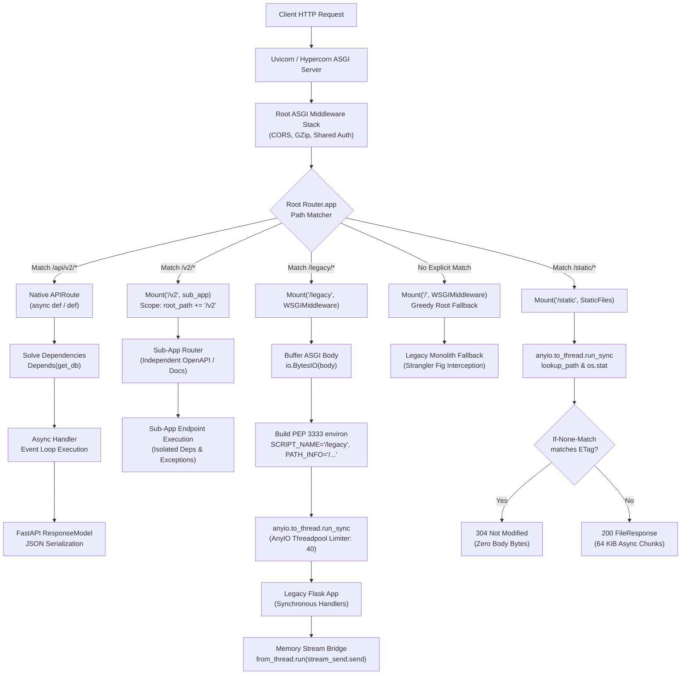
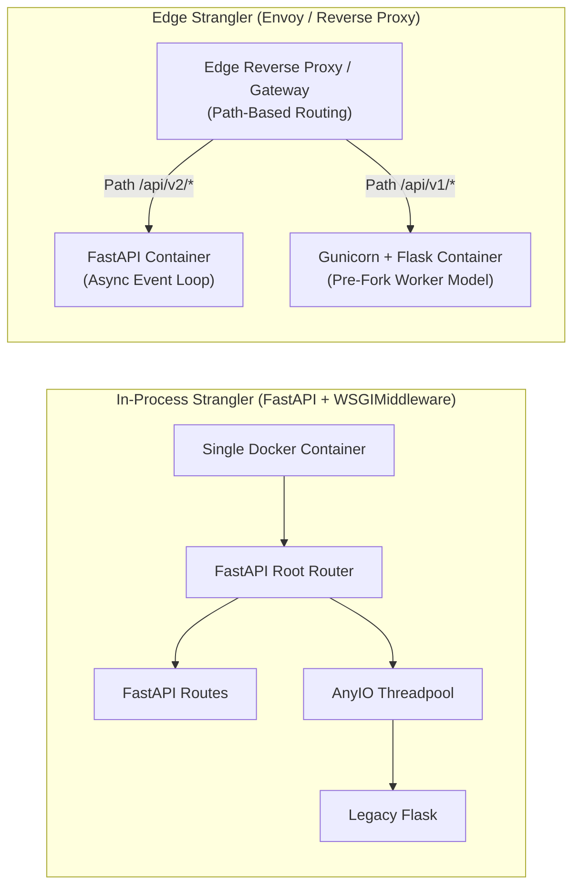

# Incremental Monolith Migration: Mounting Legacy Flask/WSGI Apps and Versioned Sub-Apps Inside FastAPI with WSGIMiddleware

> [!summary] Claim
> Mounting legacy WSGI frameworks and versioned sub-applications inside a root FastAPI ASGI router using `Mount` and `WSGIMiddleware` enables zero-downtime Strangler Fig monolith migrations, but strictly bifurcates request lifecycles: mounted sub-apps completely bypass parent FastAPI dependency injection guards, suppress child lifespan context managers by default, and buffer entire streaming request bodies into memory before synchronous execution across an AnyIO threadpool.

Part of [FastAPI Internals and Patterns](README.md) in [API Engineering](../README.md).

## TL;DR

`starlette.routing.Mount` rewrites the ASGI connection scope by stripping matching path prefixes into `root_path` and passing relative paths to child ASGI or WSGI applications.
Root `FastAPI(dependencies=[...])` guards run only inside the request handler each `APIRoute` builds with `get_request_handler`, so mounted sub-applications and WSGI callables bypass them completely.
Starlette never propagates ASGI lifespan startup and shutdown events to mounted sub-applications by default, requiring a manual composite lifespan context manager.
`starlette.middleware.wsgi` has been deprecated in favor of `a2wsgi` since Starlette 0.19.0, and in Starlette 1.10.0 (as of 2026-11) it still emits `StarletteDeprecationWarning` on import, eagerly buffers request bodies into memory, and never calls `close()` on WSGI response iterables.
Do not use in-process WSGI mounting when unmigrated monolith endpoints handle multi-gigabyte streaming uploads or heavy CPU-bound tasks that exhaust the default 40-thread AnyIO worker pool; route at the reverse proxy or API gateway instead.

## Mental model

An incoming HTTP connection enters the root ASGI server and flows through the root application's middleware pipeline before reaching the router's routing table.
When the router encounters a `Mount` route, it mutates the ASGI `scope` by appending the matched prefix to `root_path` and stripping it from the active routing path.
Native FastAPI routes execute asynchronously within the primary event loop, evaluating dependencies and response serialization models.
Mounted WSGI applications receive an adapted PEP 3333 `environ` dictionary, where request bodies are buffered into memory and synchronous handler iteration is dispatched to an AnyIO worker thread.
Mounted FastAPI sub-applications operate as independent ASGI routers with isolated dependency graphs, isolated exception handlers, and distinct OpenAPI documentation registries.



The diagram illustrates how the root router acts as an in-process traffic director.
Every request passes through the root ASGI middleware stack, guaranteeing unified observability and authentication across all subsystems.
When a route matches an explicit native endpoint, it proceeds through FastAPI's dependency injection engine and executes on the event loop.
When a request targets `/v2`, `Mount` adjusts the ASGI scope and hands execution to the secondary FastAPI router, keeping schemas and lifecycles modular.
Requests targeting `/legacy` trigger `WSGIMiddleware`, which drains the ASGI receive channel, packages the byte payload into an in-memory `io.BytesIO` buffer, and delegates execution to worker threads via AnyIO.
Unmatched requests cascade to the root fallback mount at `"/"`, allowing the unmigrated Flask monolith to service legacy routes until native replacements are implemented.
Static file requests bypass application business logic entirely, resolving file descriptors and verifying HTTP conditional caching headers on worker threads before streaming file chunks.

## How it works

### 1. ASGI Connection Scope and Path Stripping Mechanics

In the ASGI 3.0 specification, an incoming HTTP connection is represented by a mutable dictionary called `scope` (ASGI HTTP and WebSocket specification 2.5, HTTP Connection Scope).
The `scope` dictionary contains protocol-level metadata including `scope["type"] = "http"`, `scope["method"]`, `scope["path"]`, `scope["headers"]`, and `scope["root_path"]`.
The `scope["path"]` key is the HTTP request target excluding the query string, with percent-encoded sequences and UTF-8 byte sequences decoded into characters (ASGI HTTP and WebSocket specification 2.5, HTTP Connection Scope); the request target itself is defined in (RFC 9112 Section 3.2).
The `scope["root_path"]` key is "the root path this application is mounted at; same as `SCRIPT_NAME` in WSGI", defaulting to an empty string `""` when missing (same section).

When an application registers a mount using `app.mount(path, app=sub_app)`, Starlette instantiates a `starlette.routing.Mount` object `(starlette 1.10.0 starlette/routing.py, Mount.__init__)`.
The constructor strips trailing slashes from the mounted path and compiles a regular expression:

```python
self.path = path.rstrip("/")
self.path_regex, self.path_format, self.param_convertors = compile_path(self.path + "/{path:path}")
```

During request dispatch in `Router.app`, Starlette iterates sequentially through `self.routes` and evaluates `route.matches(scope)` `(starlette 1.10.0 starlette/routing.py, Router.app)`.
For a `Mount` instance, `matches` extracts the effective path via `get_route_path(scope)` `(starlette 1.10.0 starlette/_utils.py, get_route_path)`, shown here with blank lines elided:

```python
def get_route_path(scope: Scope) -> str:
    path: str = scope["path"]
    root_path = scope.get("root_path", "")
    if not root_path:
        return path
    if not path.startswith(root_path):
        return path
    if path == root_path:
        return ""
    if path[len(root_path)] == "/":
        return path[len(root_path) :]
    return path
```

If `route_path` matches `self.path_regex`, `Mount.matches` separates the prefix from the trailing sub-path (simplified excerpt; the convertor loop between the first two lines is elided):

```python
matched_params = match.groupdict()
remaining_path = "/" + matched_params.pop("path")
matched_path = route_path[: -len(remaining_path)]
```

`Mount.matches` returns a `Match.FULL` status and constructs a `child_scope` dictionary (source comments elided):

```python
child_scope = {
    "path_params": path_params,
    "app_root_path": scope.get("app_root_path", root_path),
    "root_path": root_path + matched_path,
    "endpoint": self.app,
}
```

Notice that `scope["path"]` remains unchanged.
Instead, `scope["root_path"]` is extended with `matched_path`.
When the child application's router subsequently invokes `get_route_path(scope)`, the newly extended `root_path` is stripped from `scope["path"]`.
For example, if an application receives a request for `/legacy/catalog/items`:
1. At the root application level: `scope["path"] = "/legacy/catalog/items"` and `scope["root_path"] = ""`.
2. Inside `Mount("/legacy", ...)`: `matched_path = "/legacy"`, yielding `child_scope["root_path"] = "/legacy"`.
3. Inside the child router: `get_route_path(scope)` strips `"/legacy"`, returning `"/catalog/items"`.

### 2. WSGIMiddleware and the Synchronous Translation Boundary

WSGI is a synchronous, callable-based interface standardized in PEP 3333 (PEP 3333, Specification Overview).
ASGI is an asynchronous, message-passing interface built on `async` callables that exchange event dictionaries through `receive` and `send` (ASGI main specification, asgi.readthedocs.io/en/latest/specs/main.html).
To bridge these incompatible execution models, `starlette.middleware.wsgi.WSGIMiddleware` wraps a WSGI application and adapts the ASGI `(scope, receive, send)` protocol into the WSGI `application(environ, start_response)` protocol `(starlette 1.10.0 starlette/middleware/wsgi.py, WSGIMiddleware)`.

When an HTTP request enters `WSGIMiddleware`, it instantiates a `WSGIResponder` and executes its `__call__` method.
The translation pipeline executes in four distinct phases:

#### Phase A: Full Request Body Buffering
WSGI applications expect `environ["wsgi.input"]` to expose a blocking, synchronous stream supporting `.read(size)` and `.readline()` (PEP 3333, Specification Details, Input and Error Streams).
Because the underlying ASGI `receive` callable is an async coroutine that cannot be called synchronously from inside a blocking WSGI function, `WSGIResponder` buffers the complete request body before calling the WSGI application:

```python
body = b""
more_body = True
while more_body:
    message = await receive()
    body += message.get("body", b"")
    more_body = message.get("more_body", False)
environ = build_environ(self.scope, body)
```

The entire payload is collected into Python process memory and wrapped in `io.BytesIO(body)`.
Because `bytes` are immutable, each `body += ...` allocates a new object and copies everything received so far, so the copy work grows quadratically with the number of body chunks.
If a client streams a 500 MiB file upload to a mounted WSGI endpoint, 500 MiB of RAM is allocated before the WSGI application executes its first line of code.

#### Phase B: Environ Dictionary Construction
The `build_environ(scope, body)` function `(starlette 1.10.0 starlette/middleware/wsgi.py, build_environ)` maps ASGI scope keys to CGI and WSGI environment variables:
- `SCRIPT_NAME`: Derived from `scope.get("root_path", "").encode("utf8").decode("latin1")`.
- `PATH_INFO`: Derived from `scope["path"].encode("utf8").decode("latin1")`, with `SCRIPT_NAME` stripped only when the path equals it or continues with `/` after it (the segment-boundary check is a Starlette 1.10.0 change per its release notes).
- `REQUEST_METHOD`: Taken directly from `scope["method"]`.
- `QUERY_STRING`: Taken from `scope["query_string"].decode("ascii")`.
- `SERVER_PROTOCOL`: Formatted as `f"HTTP/{scope['http_version']}"`.
- `wsgi.url_scheme`: Taken from `scope.get("scheme", "http")`.
- `SERVER_NAME` and `SERVER_PORT`: Taken from `scope["server"]`, defaulting to `("localhost", 80)`; `REMOTE_ADDR` comes from `scope["client"]` when present.
- `wsgi.input`: Set to `io.BytesIO(body)`.
- `wsgi.errors`: Bound to `sys.stdout`.
- `wsgi.version`: Fixed at `(1, 0)`.
- `wsgi.multithread`: Set to `True`.
- `wsgi.multiprocess`: Set to `True`.
- `wsgi.run_once`: Set to `False`.

Headers from `scope["headers"]` are transformed into CGI environment variables:
- `content-length` becomes `CONTENT_LENGTH`.
- `content-type` becomes `CONTENT_TYPE`.
- Any other header `X-Foo-Bar` becomes `HTTP_X_FOO_BAR` (converted to uppercase, hyphens replaced with underscores, and prefixed with `HTTP_`).
Duplicate headers are concatenated with a bare `,` (no space), which (RFC 9110 Section 5.3) permits for recipients combining field lines.
Both headers and path strings are decoded using `latin1` because PEP 3333 requires environ values to be native strings whose content is translatable to bytes via Latin-1 (PEP 3333, A Note On String Types), which also preserves arbitrary byte sequences without unicode decode errors.

#### Phase C: Threadpool Offloading and Response Streaming
Because WSGI callables block the operating system thread, they cannot run directly on the asyncio event loop without halting all concurrent asynchronous tasks.
`WSGIResponder` offloads execution to an AnyIO worker thread using `anyio.to_thread.run_sync` (simplified excerpt; the first line runs in `WSGIResponder.__init__`, the rest in `WSGIResponder.__call__`):

```python
self.stream_send, self.stream_receive = anyio.create_memory_object_stream(math.inf)
async with create_collapsing_task_group() as task_group:
    task_group.start_soon(self.sender, send)
    async with self.stream_send:
        await anyio.to_thread.run_sync(self.wsgi, environ, self.start_response)
```

The memory object stream is created with `math.inf` capacity, so the response side has no backpressure either: a WSGI app that yields faster than the client reads queues chunks in memory.
When the WSGI application invokes `start_response(status, response_headers, exc_info=None)`, `WSGIResponder` stores `exc_info`, parses the status code, and lowercases and ASCII-encodes the response headers.
It immediately bridges an ASGI `http.response.start` message back to the event loop using `anyio.from_thread.run`:

```python
anyio.from_thread.run(
    self.stream_send.send,
    {
        "type": "http.response.start",
        "status": status_code,
        "headers": headers,
    },
)
```

As the WSGI application yields chunks from its iterable, the worker thread transmits each chunk across the AnyIO memory object stream via `self.stream_send.send`.
Concurrently, the `sender` coroutine running on the main event loop drains `self.stream_receive` and invokes `send({"type": "http.response.body", "body": chunk, "more_body": True})`.

#### Phase D: The Deprecation of Starlette's WSGIMiddleware
Starlette 0.19.0 deprecated the module; its release note reads "Deprecate WSGIMiddleware in favor of a2wsgi".
In Starlette 1.10.0, importing `starlette.middleware.wsgi` emits a `StarletteDeprecationWarning` (a `UserWarning` subclass, so it is shown by default) whose text says the module "will be removed in a future release" and points to `a2wsgi` as a replacement.
The release note gives no rationale; the two defects below are what the 1.10.0 source shows, not a quoted motivation:
1. Complete request body buffering: `WSGIResponder` cannot stream request bodies, causing high memory spikes and denial-of-service exposure under concurrent large uploads.
In contrast, `a2wsgi` gives the app a `Body` object whose `read` and `readline` pull chunks on demand: the worker thread schedules `receive()` on the event loop with `asyncio.run_coroutine_threadsafe` and blocks on the future (a2wsgi master a2wsgi/wsgi.py, Body, as of 2026-11).
2. Omission of `iterable.close()`: PEP 3333 (Specification Details) mandates: *"If the iterable returned by the application has a `close()` method, the server or gateway must call that method upon completion of the current request."*
Starlette's `WSGIResponder.wsgi` simply iterates `for chunk in self.app(environ, start_response): ...` without a `try...finally` block invoking `close()`.
In Flask 3.1.3, `teardown_request` and `teardown_appcontext` handlers run in the `finally` block of `Flask.wsgi_app`, before the response iterable is returned, so they are not affected; a lab probe mounted a Flask app under Starlette 1.10.0 `WSGIMiddleware` and recorded `teardown_request` and `teardown_appcontext` but not a `call_on_close` callback.
What is skipped is Werkzeug's `Response.close()`: callbacks registered with `response.call_on_close`, and `close()` on wrapped iterables such as the `FileWrapper` behind `send_file`, whose file is then closed only when the object is garbage collected.

### 3. The Strangler Fig Architecture and Routing Table Mechanics

The Strangler Fig pattern migrates monolithic applications incrementally by intercepting calls at the perimeter and routing them either to newly implemented services or to the legacy monolith.
FastAPI and Starlette support two distinct in-process strangler patterns:

#### Strategy 1: Prefix-Based Mounting
In prefix-based mounting, distinct path segments are routed to dedicated applications:
- `/v2/*` routes to a modern FastAPI sub-application.
- `/legacy/*` routes to the legacy Flask WSGI application via `WSGIMiddleware`.
- `/static/*` routes to `StaticFiles`.

Because `Mount("/legacy", WSGIMiddleware(flask_app))` rewrites `SCRIPT_NAME = "/legacy"`, Flask correctly recognizes its mounting base.
When Flask code generates links via `url_for("item_detail", item_id=42)`, Flask prepends `SCRIPT_NAME`, returning `/legacy/items/42`.
This ensures legacy redirects (`302 Found`, `307 Temporary Redirect`) and HTML hyperlinks do not lose their route prefix.

#### Strategy 2: Fallback Catch-All Mounting
In a fallback architecture, native FastAPI routes intercept specific endpoints at the root URL namespace, while all unmigrated endpoints fall through to Flask:

```python
app = FastAPI()

@app.get("/items/{item_id}")
async def get_item_v2(item_id: int):
    return {"id": item_id, "migrated": True}

# Registered LAST: catches everything not matched above
app.mount("/", WSGIMiddleware(legacy_flask_app))
```

The mechanics of this pattern depend strictly on Starlette's route evaluation order in `Router.app` `(starlette 1.10.0 starlette/routing.py, Router.app)`.
Starlette evaluates `self.routes` sequentially:
1. It tests the incoming request against `@app.get("/items/{item_id}")`.
If the path matches, the native FastAPI handler executes and returns immediately.
2. If no concrete route matches, the router evaluates subsequent routes until it reaches `Mount("/", WSGIMiddleware(flask_app))`.
3. The mount path `"/"` compiles to the regex `^/(?P<path>.*)$`, which matches any valid URI path.
4. The request falls through to Flask with `SCRIPT_NAME = ""` and `PATH_INFO = scope["path"]`.
5. If Flask possesses a matching route, it returns `200 OK`.
If Flask has no matching route, Flask returns `404 Not Found`.

> [!IMPORTANT]
> Route registration order is fatal.
> If `app.mount("/", WSGIMiddleware(flask_app))` is declared before `@app.get("/items/{item_id}")`, the mount's greedy regular expression captures every incoming HTTP request.
> The native FastAPI routes defined below the mount will never be reached.

### 4. Versioned Sub-Applications and Sub-App Isolation

FastAPI sub-applications mounted via `app.mount("/v2", v2_subapp)` are full `FastAPI` instances.
This provides modularity:
- Independent Routers: Sub-applications define their own endpoints, tags, and route prefixes without naming collisions.
- Independent Exception Handlers: Custom exception handlers registered on `v2_subapp` handle exceptions raised within `/v2` routes without leaking into the root application.
- Independent Middleware: Middlewares added to `v2_subapp` execute only for requests matching `/v2/*`.
However, this isolation introduces two critical architectural pitfalls:

#### Lifespan Event Suppression
When an ASGI server boots, it opens one `lifespan` scope and sends `lifespan.startup` and later `lifespan.shutdown` events to the application (ASGI Lifespan Protocol specification).
Starlette's `Router.lifespan` method handles these messages `(starlette 1.10.0 starlette/routing.py, Router.lifespan)`; simplified excerpt with the docstring and the exception branches elided:

```python
async def lifespan(self, scope: Scope, receive: Receive, send: Send) -> None:
    started = False
    app: Any = scope.get("app")
    await receive()
    try:
        async with self.lifespan_context(app) as maybe_state:
            if maybe_state is not None:
                if "state" not in scope:
                    raise RuntimeError('The server does not support "state" in the lifespan scope.')
                scope["state"].update(maybe_state)
            await send({"type": "lifespan.startup.complete"})
            started = True
            await receive()
    ...
```

Notice that `Router.lifespan` invokes only `self.lifespan_context(app)`.
It does not iterate through `self.routes` and does not forward lifespan messages to mounted sub-applications.
If `v2_subapp` defines a lifespan context manager to initialize an `asyncpg` connection pool or Redis client, that lifespan is never executed by the server.
Any attempt to use the pool inside `/v2` endpoints fails at request time, typically with an `AttributeError` on the `app.state` attribute the lifespan was supposed to set.

To resolve this, the parent application must define a composite lifespan context manager using `contextlib.AsyncExitStack`:

```python
@asynccontextmanager
async def composite_lifespan(parent_app: FastAPI):
    async with AsyncExitStack() as stack:
        # Explicitly enter the child application's lifespan context
        await stack.enter_async_context(v2_subapp.router.lifespan_context(v2_subapp))
        yield
```

The child's yielded lifespan state is the return value of `enter_async_context`, which this sketch discards; a child that yields a state dictionary must have it merged into the parent's yielded state explicitly, or `request.state` will not carry it.

#### OpenAPI Documentation Partitioning
`FastAPI.openapi` passes `self.routes` to `get_openapi()`, which builds the OpenAPI `3.1.0` document (the `openapi_version` default) `(fastapi 0.162.0 fastapi/applications.py, FastAPI.openapi)`.
`get_openapi` walks `routing.iter_route_contexts(routes)` and keeps only entries whose original route passes `isinstance(route_context.original_route, routing.APIRoute)` `(fastapi 0.162.0 fastapi/openapi/utils.py, _get_api_route_for_openapi)`.
Routes encapsulated within a `Mount` object are ignored.
Consequently:
- The root documentation at `/docs` contains only native root routes.
- The sub-application hosts independent documentation at `/v2/docs`, querying `/v2/openapi.json`.
- When `/v2/docs` loads Swagger UI, FastAPI's docs handler builds `openapi_url = root_path + self.openapi_url` from `scope["root_path"]`, so Swagger UI requests `/v2/openapi.json` rather than `/openapi.json`; with the default `root_path_in_servers=True`, the sub-app's schema also gains `"servers": [{"url": "/v2"}]` `(fastapi 0.162.0 fastapi/applications.py, FastAPI.setup)`.
If an organization requires a unified documentation portal, platform engineers must write a schema aggregator that crawls mounted applications, prefixes path keys with their mount points, and merges the resulting JSON schemas.

### 5. Static Asset Serving Mechanics and RFC 9110 Caching

Starlette provides `starlette.staticfiles.StaticFiles` to serve static assets from disk `(starlette 1.10.0 starlette/staticfiles.py, StaticFiles)`.
When mounted via `app.mount("/static", StaticFiles(directory="assets"))`, `StaticFiles` enforces strict HTTP semantics:

#### Filesystem Lookup and Threaded Stat
`StaticFiles.get_path` first normalizes the route path with `os.path.normpath(os.path.join(*route_path.split("/")))`.
For every request, `StaticFiles.get_response` verifies that the method is `GET` or `HEAD` (rejecting all others with `405 Method Not Allowed` and `Allow: GET, HEAD`, (RFC 9110 Section 15.5.6)).
It executes `lookup_path` inside an AnyIO worker thread via `await anyio.to_thread.run_sync(self.lookup_path, path)`.
`lookup_path` rejects absolute paths, resolves the joined path, checks the directory boundary, and executes `os.stat(full_path)` to retrieve file metadata (`st_size`, `st_mtime`).

#### Directory Traversal Protection (CVE-2023-29159)
In Starlette `>= 0.13.5, < 0.27.0`, `StaticFiles.lookup_path` validated directory boundaries with `os.path.commonprefix` (GitHub advisory GHSA-v5gw-mw7f-84px).
Because `commonprefix` operates character-by-character on strings rather than path components, an application serving `/app/static` was vulnerable to path traversal.
An attacker requesting `/static/../static_secret/passwords.txt` bypassed the check because `/app/static` is a character prefix of `/app/static_secret`.
In Starlette 0.27.0 (and persisting in 1.10.0), maintainers patched this vulnerability by enforcing `os.path.commonpath([full_path, directory]) != str(directory)`.
`os.path.commonpath` evaluates full path segments, guaranteeing that traversal sequences (`../`) cannot escape the root boundary.
Furthermore, if `follow_symlink=False` (the default), `lookup_path` resolves paths via `os.path.realpath`, preventing attackers from using symbolic links to access external files.

#### Conditional Caching and Range Requests
When returning a file, `StaticFiles` constructs a `FileResponse` `(starlette 1.10.0 starlette/responses.py, FileResponse)`.
`FileResponse.set_stat_headers` computes HTTP caching headers:
- `Content-Length`: `str(stat_result.st_size)`.
- `Last-Modified`: Formatted HTTP-date string per (RFC 9110 Section 8.8.2) (`formatdate(stat_result.st_mtime, usegmt=True)`).
- `ETag` (RFC 9110 Section 8.8.3): `etag_base = str(stat_result.st_mtime) + "-" + str(stat_result.st_size)`, then `f'"{hashlib.md5(etag_base.encode(), usedforsecurity=False).hexdigest()}"'`.

`FileResponse.__init__` separately sets `Accept-Ranges: bytes` (RFC 9110 Section 14.3), and `FileResponse` serves single and multiple `Range` requests, capped by `max_ranges = 100`.

`StaticFiles.is_not_modified` inspects client request headers:
1. `If-None-Match`: If present, `*` matches; otherwise it splits on `,`, strips `W/` weak indicators, and checks whether the server's `ETag` is in the list (RFC 9110 Section 13.1.2).
2. `If-Modified-Since`: If `If-None-Match` is absent, it returns true when the parsed date is `>=` the parsed `Last-Modified` (RFC 9110 Section 13.1.3).
If either condition confirms the client's cache is fresh, `StaticFiles` returns `NotModifiedResponse` (`304 Not Modified`, (RFC 9110 Section 15.4.5)) with an empty body, keeping only `cache-control`, `content-location`, `date`, `etag`, `expires`, and `vary` from the file response headers.

### 6. Cross-Boundary Authentication and the Dependency Injection Gap

A fundamental architectural error when mounting sub-applications is assuming that root dependency injection protects mounted routes.
FastAPI dependencies (`Depends`) are compiled into an `APIRoute`'s `dependant` object during route registration `(fastapi 0.162.0 fastapi/routing.py, _build_dependant_with_parameterless_dependencies)`.
During request execution, dependencies are evaluated by `solve_dependencies` `(fastapi 0.162.0 fastapi/dependencies/utils.py, solve_dependencies)`, called from the handler that `get_request_handler` builds for each `APIRoute`.
A `Mount` route encapsulates an arbitrary ASGI application; it does not construct an `APIRoute` and possesses no `dependant` object.

Consider this configuration:

```python
def require_admin(token: str = Header(...)):
    if token != "secret-admin":
        raise HTTPException(status_code=403, detail="Forbidden")

app = FastAPI(dependencies=[Depends(require_admin)])
app.mount("/legacy", WSGIMiddleware(legacy_flask_app))
```

If a client sends an unauthenticated request to `/legacy/admin/delete-users`, the request succeeds with `200 OK`.
FastAPI's dependency engine never inspects the request because execution transfers directly from Starlette's `Router.app` to `WSGIMiddleware`.

To enforce security boundaries across native routes, mounted sub-apps, and legacy WSGI apps, teams must deploy ASGI middleware at the root application (illustrative sketch with `is_valid` and `extract_user` left abstract; the tested version is the lab's `SharedAuthMiddleware` in the worked example):

```python
class PerimeterAuthMiddleware:
    def __init__(self, app: ASGIApp):
        self.app = app

    async def __call__(self, scope: Scope, receive: Receive, send: Send) -> None:
        if scope["type"] == "http":
            # Drop any client-supplied identity header before anything else
            scope["headers"] = [
                (k, v) for k, v in scope.get("headers", []) if k != b"x-authenticated-user"
            ]
            headers = dict(scope["headers"])
            auth_header = headers.get(b"authorization", b"").decode("latin1")
            if not self.is_valid(auth_header):
                response = JSONResponse({"detail": "Unauthorized"}, status_code=401)
                await response(scope, receive, send)
                return

            user_id = self.extract_user(auth_header)
            # Inject identity into ASGI scope
            if "state" not in scope:
                scope["state"] = {}
            scope["state"]["user_id"] = user_id

            # Inject synthetic header so downstream WSGI sees HTTP_X_AUTHENTICATED_USER
            new_headers = list(scope["headers"])
            new_headers.append((b"x-authenticated-user", user_id.encode("latin1")))
            scope["headers"] = new_headers

        await self.app(scope, receive, send)
```

Because ASGI middleware wraps the entire application stack outside the router, every request must pass authentication before reaching `Mount` handlers.
Injecting synthetic headers into `scope["headers"]` ensures that downstream Flask handlers receive the authenticated identity in `request.environ["HTTP_X_AUTHENTICATED_USER"]`.

## Numbers and limits

The operational behavior of mounted WSGI applications and static files is bounded by threadpool capacities, memory consumption during request buffering, and filesystem I/O characteristics.

| Parameter / Metric | Measured / Sourced Value | Bounding Mechanism | Source / Specification |
|:---|:---|:---|:---|
| Default AnyIO Threadpool Capacity | 40 worker threads | `anyio.to_thread.current_default_thread_limiter().total_tokens`, created as `CapacityLimiter(40)` | (anyio 4.16.0 anyio/_backends/_asyncio.py, AsyncIOBackend.current_default_thread_limiter); printed `40` in the lab probe below |
| AnyIO Thread Hop Round Trip | p50 59.4 us, p99 85.0 us | `await anyio.to_thread.run_sync(noop)`: limiter acquire, worker wakeup, event loop wakeup | Measured: a probe script run from `labs/` with `uv run --frozen python -I` timed 20,000 `run_sync(lambda: None)` calls with `time.perf_counter_ns` after 2,000 warmup calls, macOS 27.3 arm64 (`uname -r` = `27.3.0`), CPython 3.14.6, anyio 4.16.0 (2026-11-15) |
| Request Body Memory Amplification | O(N) bytes where N = body size, plus quadratic copy work from `body += chunk` | Full request body buffered in `io.BytesIO(body)` before WSGI call | (starlette 1.10.0 starlette/middleware/wsgi.py, WSGIResponder.__call__) |
| StaticFiles Stream Chunk Size | 64 KiB (65,536 bytes) | Class attribute `FileResponse.chunk_size = 64 * 1024`, read per chunk in `FileResponse._handle_simple` | (starlette 1.10.0 starlette/responses.py, FileResponse) |
| StaticFiles Concurrency Bound | Bounded by OS file descriptor limit | Each active static file download holds 1 open file descriptor | Operating system `ulimit -n` |
| StaticFiles Zero-Copy Path | Only when the server advertises `http.response.pathsend` | `FileResponse` sends `{"type": "http.response.pathsend", "path": ...}` instead of reading chunks through Python | (starlette 1.10.0 starlette/responses.py, FileResponse._handle_simple) |
| Request Line Length (bounds `SCRIPT_NAME` plus `PATH_INFO`) | Recommended minimum 8000 octets; Uvicorn h11 default 16 KiB per incomplete event | RFC recommendation for senders and recipients; `DEFAULT_MAX_INCOMPLETE_EVENT_SIZE = 16 * 1024` caps the buffered request head | (RFC 9112 Section 3); (h11 0.16.0 h11/_connection.py, DEFAULT_MAX_INCOMPLETE_EVENT_SIZE), used by (uvicorn 0.54.0 uvicorn/protocols/http/h11_impl.py) |
| StaticFiles ETag Hash Function | MD5 (128-bit hex digest) | `hashlib.md5(etag_base.encode(), usedforsecurity=False)` with `etag_base = str(st_mtime) + "-" + str(st_size)` | (starlette 1.10.0 starlette/responses.py, FileResponse.set_stat_headers) |
| StaticFiles Traversal Depth Check | Bounded by `os.path.commonpath` | Normalization of path components against base directory path | CVE-2023-29159 patch, Starlette 0.27.0 (GHSA-v5gw-mw7f-84px); `lookup_path` rejection asserted in the lab test |
| a2wsgi Default Worker Pool | 10 threads, separate from AnyIO's 40 | `WSGIMiddleware(app, workers=10, send_queue_size=10)` creates its own `ThreadPoolExecutor` | (a2wsgi master a2wsgi/wsgi.py, WSGIMiddleware.__init__, as of 2026-11) |
| Mounted Sub-App Lifespan Propagation | 0 child lifespans executed | `Router.lifespan` only executes `self.lifespan_context(app)` | (starlette 1.10.0 starlette/routing.py, Router.lifespan) |

## Portability

The portability matrix evaluates runtime compatibility, threading behaviors, and server characteristics across Python releases, ASGI servers, and HTTP protocol revisions.

| Environment / Protocol | Compatibility Status | Concurrency and Threading Semantics | Notes and Constraints |
|:---|:---|:---|:---|
| CPython 3.12.16 | Declared supported by package metadata; leg not run | AnyIO threadpool (40 threads), GIL-bound WSGI execution | `Requires-Python: >=3.11` (Starlette 1.10.0), `>=3.10` (FastAPI 0.162.0), `>=3.9` (Flask 3.1.3); lab matrix paused by the user on 2026-11-11 |
| CPython 3.13.18 | Declared supported by package metadata; leg not run | AnyIO threadpool, standard GIL execution | Same metadata; lab matrix paused |
| CPython 3.14.10 | Lab passed on 3.14.6; 3.14.10 leg not run | AnyIO threadpool, standard GIL execution | 8 tests passed on CPython 3.14.6, macOS 27.3 arm64 (2026-11-15) |
| CPython 3.15.2 | Declared supported by package metadata; leg not run | AnyIO threadpool, standard GIL execution | Same metadata; lab matrix paused |
| CPython 3.15.2t (Free-Threaded) | Leg not run | Threads can run Python code in parallel without the GIL (PEP 703, Abstract and Specification) | PEP 703 states that extensions relying on the GIL need additional explicit locking and must be rebuilt for the free-threaded ABI; thread safety of the Flask app and its C extensions is not established by this lab |
| Uvicorn 0.54.0 | Supported by the ASGI contract; not exercised by the lab (tests use `httpx.ASGITransport`) | Async event loop (uvloop optional); threadpool managed by AnyIO | `--root-path` CLI option sets the top-level `scope["root_path"]` (uvicorn 0.54.0 uvicorn/main.py) |
| Hypercorn 0.18.0 | Supported by the ASGI contract; not exercised by the lab | asyncio, uvloop, or trio workers | HTTP/3 over QUIC via the optional `aioquic` dependency; `Mount` scope rewriting happens inside Starlette, independent of the server |
| Granian 2.8.7 | Supported by the ASGI contract; not exercised by the lab | Rust server with ASGI, RSGI, and WSGI interfaces | Can also serve the Flask app natively as WSGI in an edge-routing split |
| HTTP/1.1 (RFC 9112) | Supported | Sequential request/response on single TCP connection | Standard protocol for legacy WSGI communication |
| HTTP/2 (RFC 9113) | Supported | Stream multiplexing over single TCP connection | High concurrency on 1 connection can quickly exhaust AnyIO's 40 threads |
| HTTP/3 over QUIC (RFC 9114) | Supported | Multiplexed UDP datagrams without head-of-line blocking | Handled by ASGI server; internal scope mapping remains identical |
| `starlette.middleware.wsgi` | Deprecated | Buffers request body in RAM, omits `close()` on response | Deprecated since Starlette 0.19.0; still emits `StarletteDeprecationWarning` on import in 1.10.0 |
| `a2wsgi` 1.10.10 (latest on PyPI as of 2026-11) | Recommended | On-demand `wsgi.input` reads, calls `close()` on the response iterable in a `finally` block | Same `WSGIMiddleware(app)` call shape via `from a2wsgi import WSGIMiddleware`, but its own 10-worker `ThreadPoolExecutor` replaces AnyIO's limiter; not exercised by this lab; source read at master and PyPI metadata checked (1.10.10 uploaded 2025-06-18, `Requires-Python >=3.8.0`) |

Under CPython 3.15.2t (free-threaded Python), the concurrency model changes dramatically.
In traditional GIL-bound CPython runtimes, 40 worker threads executing synchronous Flask handlers contend for the global interpreter lock, throttling CPU-intensive tasks to the throughput of a single core.
Under free-threading, worker threads execute true multi-threaded Python bytecode across multiple physical CPU cores.
However, developers must ensure that legacy Flask libraries and database drivers (such as older C-extensions) are thread-safe before scaling threadpool limits on free-threaded runtimes.

## Worked example

The worked example implements a complete Strangler Fig architecture combining:
1. A legacy Flask WSGI application mounted at `/legacy`.
2. A fallback mount at `"/"` intercepting unmigrated routes.
3. A modern FastAPI v2 sub-application mounted at `/v2`.
4. A static asset directory mounted at `/static`.
5. A composite lifespan context manager ensuring sub-application startup.
6. A shared ASGI authentication middleware bridging identity across the WSGI boundary.

The full implementation is available at [implementation](../labs/src/api_labs/f11_fastapi_internals_and_patterns/mounting_sub_applications.py) and verified by unit tests at [test](../labs/tests/f11_fastapi_internals_and_patterns/test_mounting_sub_applications_wsgi_legacy_strangler_and_static_assets.py).

```python
# Simplified excerpt from labs/src/api_labs/f11_fastapi_internals_and_patterns/mounting_sub_applications.py

from contextlib import AsyncExitStack, asynccontextmanager
from typing import Any
from fastapi import FastAPI
from fastapi.responses import JSONResponse
from flask import Flask, jsonify, request, url_for
from starlette.middleware.wsgi import WSGIMiddleware
from starlette.staticfiles import StaticFiles
from starlette.types import ASGIApp, Receive, Scope, Send

IDENTITY_HEADER = b"x-authenticated-user"

def create_legacy_flask_app() -> Flask:
    flask_app = Flask("legacy_monolith")

    @flask_app.route("/items/<int:item_id>", methods=["GET"])
    def get_item_detail(item_id: int) -> Any:
        return jsonify({
            "service": "legacy_flask",
            "item_id": item_id,
            "script_name": request.environ.get("SCRIPT_NAME", ""),
            "path_info": request.environ.get("PATH_INFO", ""),
            "generated_self_url": url_for("get_item_detail", item_id=item_id),
        })

    @flask_app.route("/authenticated-resource", methods=["GET"])
    def get_authenticated_resource() -> Any:
        user = request.environ.get("HTTP_X_AUTHENTICATED_USER")
        if not user:
            return jsonify({"error": "Unauthorized"}), 401
        return jsonify({"authenticated_user": user})

    return flask_app

class SharedAuthMiddleware:
    def __init__(self, app: ASGIApp, protected_prefixes: tuple[str, ...]) -> None:
        self.app = app
        self.protected_prefixes = protected_prefixes

    async def __call__(self, scope: Scope, receive: Receive, send: Send) -> None:
        if scope["type"] == "http":
            path: str = scope.get("path", "")
            # Strip client-supplied identity headers on every request
            scope["headers"] = [
                (name, value) for name, value in scope.get("headers", []) if name != IDENTITY_HEADER
            ]
            if any(path.startswith(prefix) for prefix in self.protected_prefixes):
                headers = dict(scope["headers"])
                auth = headers.get(b"authorization", b"").decode("latin1")
                if not auth.startswith("Bearer valid-token-"):
                    response = JSONResponse({"detail": "Missing or invalid bearer token"}, status_code=401)
                    await response(scope, receive, send)
                    return
                user_id = auth.removeprefix("Bearer valid-token-")
                new_headers = list(scope["headers"])
                new_headers.append((IDENTITY_HEADER, user_id.encode("latin1")))
                scope["headers"] = new_headers

        await self.app(scope, receive, send)

def build_strangler_system(static_dir, tracker=None, enable_root_fallback=True):
    flask_app = create_legacy_flask_app()
    v2_app = FastAPI(title="Modern Service v2", version="2.0.0")

    @asynccontextmanager
    async def composite_lifespan(app: FastAPI):
        async with AsyncExitStack() as stack:
            await stack.enter_async_context(v2_app.router.lifespan_context(v2_app))
            yield

    root_app = FastAPI(title="Strangler Gateway", lifespan=composite_lifespan)

    # Native intercept route
    @root_app.get("/items/strangled")
    async def strangled_item():
        return {"service": "fastapi_strangled"}

    # Mount sub-systems
    root_app.mount("/static", StaticFiles(directory=str(static_dir)), name="static")
    root_app.mount("/v2", v2_app, name="v2_subapp")
    root_app.mount("/legacy", WSGIMiddleware(flask_app), name="legacy_wsgi")

    if enable_root_fallback:
        root_app.mount("/", WSGIMiddleware(flask_app), name="root_fallback_wsgi")

    root_app.add_middleware(
        SharedAuthMiddleware,
        protected_prefixes=("/legacy/authenticated-resource", "/authenticated-resource", "/v2/items"),
    )
    return root_app, flask_app, v2_app
```

The test suite was executed from `labs/` with `uv run --frozen pytest tests/f11_fastapi_internals_and_patterns/test_mounting_sub_applications_wsgi_legacy_strangler_and_static_assets.py -v -p no:cacheprovider` using CPython 3.14.6 on macOS 27.3 arm64 (`uname -r` = `27.3.0`) on 2026-11-15.
Captured test output from the real execution run:

```
============================= test session starts ==============================
platform darwin -- Python 3.14.6, pytest-9.2.0, pluggy-1.7.0 -- /Users/shreejitverma/github/The-Distinguished-Engineer/build/api_notes/jobs/Mounting-Sub-Applications-WSGI-Legacy-Strangler-and-Static-Assets/verify/labs/.venv/bin/python
hypothesis profile 'default'
rootdir: /Users/shreejitverma/github/The-Distinguished-Engineer/build/api_notes/jobs/Mounting-Sub-Applications-WSGI-Legacy-Strangler-and-Static-Assets/verify/labs
configfile: pyproject.toml
plugins: platformdirs-4.14.5, schemathesis-4.33.1, cov-7.1.0, hypothesis-6.170.14, inline-snapshot-0.36.1, Faker-40.44.0, locust-2.47.0, typeguard-4.6.0, anyio-4.16.0, asyncio-1.4.1.post1, respx-0.23.1
asyncio: mode=Mode.STRICT, debug=False, asyncio_default_fixture_loop_scope=function, asyncio_default_test_loop_scope=function
collecting ... collected 8 items

tests/f11_fastapi_internals_and_patterns/test_mounting_sub_applications_wsgi_legacy_strangler_and_static_assets.py::test_wsgi_mount_script_name_and_path_info_propagation PASSED [ 12%]
tests/f11_fastapi_internals_and_patterns/test_mounting_sub_applications_wsgi_legacy_strangler_and_static_assets.py::test_strangler_fig_root_fallback_and_route_precedence PASSED [ 25%]
tests/f11_fastapi_internals_and_patterns/test_mounting_sub_applications_wsgi_legacy_strangler_and_static_assets.py::test_independent_openapi_documentation_isolation PASSED [ 37%]
tests/f11_fastapi_internals_and_patterns/test_mounting_sub_applications_wsgi_legacy_strangler_and_static_assets.py::test_subapp_lifespan_execution_via_composite_lifespan PASSED [ 50%]
tests/f11_fastapi_internals_and_patterns/test_mounting_sub_applications_wsgi_legacy_strangler_and_static_assets.py::test_default_mount_omits_subapp_lifespan PASSED [ 62%]
tests/f11_fastapi_internals_and_patterns/test_mounting_sub_applications_wsgi_legacy_strangler_and_static_assets.py::test_shared_asgi_authentication_middleware_across_boundaries PASSED [ 75%]
tests/f11_fastapi_internals_and_patterns/test_mounting_sub_applications_wsgi_legacy_strangler_and_static_assets.py::test_staticfiles_caching_etag_304_and_directory_traversal_protection PASSED [ 87%]
tests/f11_fastapi_internals_and_patterns/test_mounting_sub_applications_wsgi_legacy_strangler_and_static_assets.py::test_fastapi_dependencies_bypass_mounted_apps PASSED [100%]

============================== 8 passed in 0.52s ===============================
```

## Pitfalls

> [!warning] The Root Dependency Security Bypass
> **Trigger:** Declaring global security guards using `FastAPI(dependencies=[Depends(verify_token)])` on the root application while mounting sub-apps or WSGI applications.
> **Symptom:** Unauthenticated requests to native FastAPI routes receive `401 Unauthorized`, but unauthenticated requests to `/legacy/*` or mounted sub-apps execute with `200 OK`, completely bypassing the token check.
> **Fix:** Enforce authentication using ASGI middleware (`app.add_middleware(AuthMiddleware)`), which wraps the root router and intercepts all incoming requests regardless of whether they target native routes, mounted sub-apps, or WSGI applications.

> [!warning] The Silent Sub-App Lifespan Black Hole
> **Trigger:** Mounting a FastAPI sub-application that configures an `@asynccontextmanager` lifespan to manage database pools or Redis caches.
> **Symptom:** The server boots without errors, but requests to the sub-application fail at runtime, typically with an `AttributeError` on the `app.state` attribute or global the lifespan was meant to set; `test_default_mount_omits_subapp_lifespan` shows the child lifespan never runs.
> **Fix:** Wrap the root application in a composite lifespan context manager using `contextlib.AsyncExitStack` that explicitly enters each mounted application's `sub_app.router.lifespan_context(sub_app)` before yielding.

> [!warning] Memory Exhaustion via Synchronous Body Buffering
> **Trigger:** Uploading large binary files (such as images, video clips, or dataset archives) to a mounted WSGI endpoint via `WSGIMiddleware`.
> **Symptom:** Worker processes suffer massive memory spikes, trigger operating system out-of-memory (OOM) killer terminations, and cause latency degradation across all concurrent event loop tasks.
> **Fix:** Migrate from deprecated `starlette.middleware.wsgi` to `a2wsgi`, cap bodies in-process with `Mount("/legacy", app=..., max_body_size=...)` (Starlette 1.6.0 and later, which wraps the app in `RequestBodyLimitMiddleware` and answers `413`), or enforce payload limits at the reverse proxy (for example, Nginx `client_max_body_size 10M`) before requests reach the ASGI container.

> [!warning] AnyIO Threadpool Starvation and Latency Cascades
> **Trigger:** Mounting legacy WSGI endpoints that perform slow, synchronous database queries or block on external third-party HTTP APIs under high concurrency.
> **Symptom:** Native `async def` endpoints remain responsive, but once 40 WSGI requests hold all AnyIO tokens, further WSGI requests and every sync `def` endpoint and `run_in_threadpool` call queue on the same shared limiter, so their latency grows with the queue rather than with their own work.
> **Fix:** Raise the shared limiter from inside the running event loop (for example in the lifespan) with `anyio.to_thread.current_default_thread_limiter().total_tokens = 200`, configure upstream timeouts, and isolate high-latency synchronous workloads behind an external gateway; after moving to `a2wsgi`, size its own `workers=` argument instead, because it does not use the AnyIO limiter.

> [!warning] Directory Traversal via Prefix Collisions in StaticFiles (CVE-2023-29159)
> **Trigger:** Serving static files using Starlette `>= 0.13.5, < 0.27.0`, where `lookup_path` evaluated base directory boundaries using `os.path.commonprefix` (GHSA-v5gw-mw7f-84px).
> **Symptom:** Attackers use sibling directory traversal sequences (`/static/../static_secret/keys.env`) to read files in any sibling file or directory whose name starts with the served directory's name.
> **Fix:** Upgrade Starlette to version `0.27.0` or higher, which replaces `os.path.commonprefix` with `os.path.commonpath`, and ensure `follow_symlink=False` to prevent symbolic link escapes.

> [!warning] Skipped Cleanup via Missing WSGI close()
> **Trigger:** Mounting a Flask application that registers cleanup with `response.call_on_close`, or returns iterables that release resources in `close()` (the `FileWrapper` behind `send_file`, generator responses with `finally` blocks), under Starlette's built-in `WSGIMiddleware`.
> **Symptom:** `call_on_close` callbacks never run, and file handles from `send_file` stay open until garbage collection; Flask's `teardown_request` and `teardown_appcontext` handlers (and the scoped-session removal that Flask-SQLAlchemy hangs on them) still run, because `Flask.wsgi_app` runs them before returning the iterable (lab probe, Flask 3.1.3, Starlette 1.10.0).
> **Fix:** Replace `starlette.middleware.wsgi.WSGIMiddleware` with `a2wsgi.WSGIMiddleware`, which honors the PEP 3333 (Specification Details) `close()` rule by calling `getattr(iterable, "close", lambda: None)()` inside a `finally` block.

## Security and robustness

### 1. Threat Modeling and OWASP API Security Alignment

Monolith strangler architectures span multiple execution paradigms, introducing specific security vulnerabilities outlined in the OWASP API Security Top 10 (2023):

#### API1:2023 - Broken Object Level Authorization (BOLA)
When endpoints are migrated from a legacy monolith to FastAPI, authorization models can diverge.
A legacy Flask route might verify object ownership within a custom decorator, whereas a new FastAPI route might rely on a Pydantic dependency.
If the path routing order is misconfigured, an unmigrated route might handle an ID using legacy lax permissions while clients assume modern access controls are active.
Teams must maintain centralized authorization integration tests that verify consistent authorization boundaries across both native and mounted endpoints.

#### API2:2023 - Broken Authentication
Bridging authenticated user identity from ASGI middleware to WSGI handlers via synthetic headers (`X-Authenticated-User`) introduces header spoofing risks.
If an external client sends `X-Authenticated-User: admin` directly to the server, and the perimeter ASGI middleware fails to sanitize or overwrite that header for unauthenticated requests, downstream Flask routes will accept the spoofed identity.
Appending the verified header is not enough either: `build_environ` joins duplicate headers with `,`, so a spoofed `mallory` plus a verified `alice` reaches Flask as `mallory,alice`.
Perimeter middleware must explicitly strip all internal headers (`X-Authenticated-*`, `X-User-Id`) from every incoming request before injecting verified credentials; the lab test sends a spoofed header with a valid token and asserts Flask sees only `alice`.

#### API4:2023 - Unrestricted Resource Consumption
Because Starlette's `WSGIMiddleware` buffers request bodies completely in memory, an attacker can launch an asymmetric Denial of Service attack by streaming large chunks of data slowly (Slowloris body attack).
The ASGI event loop keeps the connection open while accumulating bytes into `body += message.get("body", b"")`.
To bound the memory, enforce request body size limits at the ASGI boundary with `max_body_size=` on `Starlette`, `Mount`, or a route (Starlette 1.6.0 and later), or with `starlette.middleware.body_limit.RequestBodyLimitMiddleware` directly, rejecting oversized payloads with `413 Content Too Large` `(RFC 9110 Section 15.5.14)`.
A size limit does not stop a slow body that stays under it; that needs server-side read timeouts at the ASGI server or reverse proxy.

#### API8:2023 - Security Misconfiguration
Mounted sub-applications host independent documentation endpoints (`/v2/docs`, `/v2/redoc`, `/v2/openapi.json`).
Platform engineers frequently disable documentation on the root application (`FastAPI(docs_url=None, redoc_url=None)`) while forgetting that mounted sub-applications retain default documentation endpoints.
Attackers scan for `/v2/docs` or `/internal/docs` to discover unauthenticated internal endpoints and schemas.
Disable documentation explicitly on all mounted instances in production:

```python
v2_app = FastAPI(docs_url=None, redoc_url=None, openapi_url=None)
```

### 2. Static Asset Hardening

Serving static files directly from Python application runtimes requires strict defensive controls:
- Symlink Jail Enforcement: Keep `follow_symlink=False` to prevent attackers from placing symlinks pointing to sensitive files (such as `/etc/passwd` or `/app/.env`) inside the static asset directory.
- Directory Browsing: `StaticFiles` never generates directory listings; `html=True` only makes it serve `index.html` for directory URLs (redirecting to a trailing `/`) and `404.html` for misses, so enable it only for a real HTML site.
- Cache Control: `StaticFiles` emits no `Cache-Control` header at all, so add one through middleware or a subclass: `Cache-Control: public, max-age=31536000, immutable` for content-hashed assets and `Cache-Control: no-cache` for unhashed ones, and never let a shared cache store responses carrying user-specific data.

## The principal's view

A Principal or Distinguished Engineer evaluating monolith migration strategies must decide between two fundamental architectural models:
1. In-Process Strangler Fig: Hosting the legacy WSGI application inside the ASGI runtime using `WSGIMiddleware`.
2. Edge Strangler Fig: Routing traffic at the network edge using an API Gateway, Envoy proxy, Nginx reverse proxy, or Cloudflare Worker.



### Strategic Evaluation Matrix

| Decision Factor | In-Process Strangler (`WSGIMiddleware`) | Edge Strangler (Envoy / Nginx / API Gateway) |
|:---|:---|:---|
| Infrastructure Overhead | Low: Single container, single deployment pipeline | Moderate to High: Requires gateway configuration and multiple services |
| Memory Footprint | High: Eager body buffering; WSGI and ASGI libraries co-exist in 1 process | Isolated: Containers scale independently according to memory profiles |
| Blast Radius | High: A memory leak or crash in Flask terminates the entire FastAPI instance | Low: A failure in the legacy monolith does not affect the new API service |
| Scalability Dynamics | Constrained: Synchronous WSGI threads compete for Python GIL and AnyIO tokens | Optimized: Async FastAPI scales I/O; Flask scales across pre-fork worker processes |
| Local Development | Excellent: Engineers run a single `uvicorn main:app` command | Complex: Requires Docker Compose or local gateway emulation |
| Migration Horizon | Suits short migrations of small-to-medium codebases owned by one team | Preferred for multi-team or long-running migrations and high-throughput systems |

### Architectural Recommendations

1. The In-Process Model is a Tactical Transition, Not a Permanent Architecture:
Using `WSGIMiddleware` to mount a Flask app inside FastAPI is an interim migration tool, not a long-term deployment pattern.
It allows small engineering teams to begin writing native FastAPI routes immediately within an existing codebase without setting up complex routing infrastructure.
However, maintaining both frameworks inside a single Python process doubles dependency footprints, complicates debugging, and exposes the application to threadpool exhaustion.

2. Move to Edge Routing When Thread Tokens Become the Bottleneck:
There is no universal RPS threshold; the signal is measured queueing on the shared AnyIO limiter (40 tokens by default), which is roughly concurrent WSGI requests times their mean duration approaching the token count.
Once traffic to the modern API service scales, the limitations of in-process threadpools become a bottleneck.
Synchronous legacy endpoints block AnyIO worker threads, causing queueing delays that degrade overall service quality.
At this stage, spin off the FastAPI application into a dedicated container deployment and let an edge proxy route traffic between the legacy monolith and the new service.

3. Standardize on `a2wsgi` Immediately:
If your architecture relies on in-process WSGI mounting, replace `starlette.middleware.wsgi` with `a2wsgi` immediately.
`starlette.middleware.wsgi` has been formally deprecated since Starlette 0.19.0, and its warning says it will be removed in a future release.
`a2wsgi` resolves the request body buffering problem and calls `close()` on the response iterable, so Werkzeug `call_on_close` callbacks and file wrappers are released; the trade-off is a second, separately sized thread pool.

4. Decommissioning Criteria:
Establish strict metrics for retiring the legacy monolith:
- Track endpoint traffic distribution via OpenTelemetry metrics.
- As endpoints are migrated to native FastAPI routes, mark legacy Flask routes with deprecation headers (`Sunset` per RFC 8594 and `Deprecation` per RFC 9745, whose value is an RFC 9651 Structured Field Date such as `@1688169599`).
- When traffic to the fallback WSGI mount drops to zero, remove the `WSGIMiddleware` mount, delete legacy dependencies, and prune the test suite.

## Interview questions

> [!question] L5: Predict the output: URL resolution and `url_for` behavior in a mounted Flask application
> A Flask application defines `@flask_app.route("/profile")` which returns `url_for("profile", _external=False)`.
> This Flask application is mounted inside FastAPI using `app.mount("/legacy", WSGIMiddleware(flask_app))`.
> What URL string does Flask's `url_for` return when a client sends an HTTP GET request to `http://localhost:8000/legacy/profile`?
>
> > [!success]- Answer
> > Flask returns `"/legacy/profile"`.
> > PEP 3333 (`environ` Variables) defines `SCRIPT_NAME` as the part of the URL path that corresponds to the application object, and Flask's `url_for` builds URLs by prepending `SCRIPT_NAME` to the matched rule's path (here `/profile`).
> > When Starlette's `Mount("/legacy", ...)` matches the path prefix, it populates `scope["root_path"] = "/legacy"`.
> > `WSGIMiddleware` translates `scope["root_path"]` into `environ["SCRIPT_NAME"] = "/legacy"`.
> > Because `SCRIPT_NAME` is preserved in the WSGI environment, Flask generates hyperlinks that accurately retain the `/legacy` mounting prefix.
> >
> > Follow-up: What would `url_for("profile")` return if the Flask app were mounted at the root fallback `app.mount("/", WSGIMiddleware(flask_app))`?

> [!question] L5: How does `get_route_path` in Starlette decouple `scope["path"]` and `scope["root_path"]`?
> When a request arrives for a mounted sub-application, does Starlette mutate `scope["path"]`?
> Explain how child routers determine the relative path of an incoming request.
>
> > [!success]- Answer
> > Starlette does not mutate `scope["path"]`.
> > Instead, `Mount.matches` appends the matched URL prefix to `child_scope["root_path"]`.
> > When the child application's router evaluates routes, it calls `get_route_path(scope)` `(starlette 1.10.0 starlette/_utils.py, get_route_path)`.
> > `get_route_path` inspects `scope["path"]` and strips `scope["root_path"]` from the beginning of the string if it matches.
> > This decouples absolute URI tracking from modular router matching, allowing the same sub-application to be mounted at any URL prefix without modifying its internal route definitions.
> >
> > Follow-up: What happens to `Request.url_for()` inside the child sub-application when `root_path` is modified?

> [!question] L6: Debug this API: Sub-application lifespan failure with asyncpg database pools
> An engineer structures a service by mounting a versioned sub-app:
> ```python
> v2 = FastAPI(lifespan=v2_lifespan)
> app = FastAPI()
> app.mount("/v2", v2)
> ```
> Inside `v2_lifespan`, the engineer initializes an `asyncpg` connection pool and stores it in `app.state.pool`.
> When sending requests to `/v2/users`, the handler throws `AttributeError: 'State' object has no attribute 'pool'`.
> Why does this occur, and what is the exact fix?
>
> > [!success]- Answer
> > Starlette's `Router.lifespan` only executes the lifespan context manager of the root application passed to the ASGI server.
> > Starlette mounts do not propagate ASGI lifespan messages to child applications by default.
> > Because the server only triggers the root application's lifespan, `v2_lifespan` is never entered, leaving `v2.state.pool` uninitialized.
> > The fix is to define a composite lifespan on the root application using `contextlib.AsyncExitStack` that explicitly enters `v2.router.lifespan_context(v2)` during server startup.
> >
> > Follow-up: How are cleanup and shutdown events ordered when multiple sub-applications are managed via `AsyncExitStack`?

> [!question] L6: Why does `FastAPI(dependencies=[Depends(...)])` bypass mounted WSGI applications?
> A developer secures an application by passing authentication dependencies to the root `FastAPI` constructor:
> `app = FastAPI(dependencies=[Depends(verify_token)])`.
> They mount a legacy monolith using `app.mount("/legacy", WSGIMiddleware(legacy_flask))`.
> Why does an unauthenticated request to `/legacy/admin` succeed with `200 OK`, and how must the architecture be corrected?
>
> > [!success]- Answer
> > FastAPI dependencies are evaluated exclusively by `solve_dependencies` `(fastapi 0.162.0 fastapi/dependencies/utils.py, solve_dependencies)`, called from the request handler that `get_request_handler` builds for each `APIRoute`.
> > A `Mount` is a Starlette routing construct that dispatches directly to an ASGI endpoint callable (`WSGIMiddleware`) without compiling an `APIRoute` or constructing a dependency graph.
> > Consequently, root-level `dependencies` parameters are completely bypassed by mounted sub-applications and WSGI callables.
> > To enforce security boundaries across all endpoints, the developer must implement an ASGI middleware (`BaseHTTPMiddleware` or pure ASGI middleware) on the root application.
> >
> > Follow-up: How can the root ASGI middleware transmit authenticated user identity to downstream Flask handlers without re-querying the database?

> [!question] L6: How does Starlette's `WSGIMiddleware` handle request bodies, and what failure mode does this cause under load?
> Describe how `WSGIResponder` processes incoming request bodies from the ASGI `receive` callable.
> What failure modes emerge when clients upload 2 GiB files to a mounted WSGI endpoint?
>
> > [!success]- Answer
> > `WSGIResponder` executes an asynchronous loop draining the ASGI `receive` channel until `more_body` is `False`.
> > It concatenates all incoming byte chunks into a single in-memory `bytes` object and assigns `io.BytesIO(body)` to `environ["wsgi.input"]`.
> > Because the entire body is buffered in memory before the synchronous WSGI application is invoked, multi-gigabyte uploads cause massive RAM allocation spikes.
> > Under concurrent uploads, this triggers operating system out-of-memory (OOM) process termination.
> > Furthermore, Starlette's implementation lacks backpressure on both sides: the request loop drains `receive()` unconditionally, and the response stream is created with `math.inf` capacity.
> > The in-process mitigation is `max_body_size=` on the `Mount` (Starlette 1.6.0 and later), which answers `413 Content Too Large`.
> >
> > Follow-up: How does `a2wsgi` avoid buffering the entire request body into RAM?

> [!question] L7: Design an in-process Strangler Fig migration for a 500-endpoint Flask monolith to FastAPI
> You are tasked with migrating a business-critical Flask monolith (500 endpoints) to FastAPI without breaking existing clients.
> How do you architect route precedence, session state sharing, authentication bridging, and rollback capabilities?
>
> > [!success]- Answer
> > The architecture uses an in-process fallback routing topology with perimeter ASGI middleware.
> > Native FastAPI endpoints are registered on the root router, while the legacy Flask app is mounted at `"/"` as the final route in the routing table.
> > Starlette routes requests to native endpoints first; unmigrated routes fall through to the greedy root mount, guaranteeing zero downtime and seamless endpoint-by-endpoint migration.
> > A shared ASGI middleware validates session tokens or JWTs at the network boundary, strips client-supplied `X-Authenticated-*` headers to prevent spoofing, and injects verified identity into `scope["headers"]` as `X-Authenticated-User`.
> > Downstream Flask handlers read `request.environ["HTTP_X_AUTHENTICATED_USER"]`, sharing user identity without duplicated authentication logic.
> > Session state is synchronized via a centralized Redis store accessible to both Flask's session interface and FastAPI dependencies.
> > Rollback capability is achieved by wrapping native routes with dynamic feature flags: if a newly migrated FastAPI endpoint fails, the flag flips and delegates the request back to the legacy Flask handler.
> >
> > Follow-up: How would you monitor endpoint migration progress and detect performance regressions during the strangler lifecycle?

> [!question] L7: Concurrency analysis: `WSGIMiddleware` under CPython 3.15t free-threading vs standard GIL CPython
> Compare the concurrency characteristics of running 50 concurrent synchronous WSGI requests inside `WSGIMiddleware` under standard CPython 3.14 (with GIL) versus CPython 3.15t (free-threaded, PEP 703).
> Where does the primary performance bottleneck shift?
>
> > [!success]- Answer
> > Under standard CPython 3.14, `WSGIMiddleware` offloads synchronous handlers to worker threads via AnyIO `(anyio.to_thread.run_sync)`.
> > Even though 40 worker threads execute concurrently, the global interpreter lock (GIL) forces CPU-bound bytecode execution to serialize onto a single core.
> > As CPU-bound tasks execute, worker threads context switch frequently, introducing scheduling overhead while aggregate CPU utilization caps at 100% of a single core.
> > Under CPython 3.15t (free-threaded), the GIL is disabled, enabling true parallel execution across physical CPU cores.
> > 50 concurrent WSGI requests can execute Python bytecode across multiple cores simultaneously, so CPU throughput can scale toward the core count, minus whatever contention the shared state below introduces (not measured in this lab).
> > However, the performance bottleneck shifts from the GIL to:
> > 1. AnyIO threadpool capacity limits (the default `CapacityLimiter` caps concurrent workers at 40, queuing remaining requests).
> > 2. Thread stack memory consumption and OS context switching overhead.
> > 3. Thread contention on shared database connection pools or locks inside C extensions and the allocator; which of these dominates is workload-specific and not measured in this lab.
> >
> > Follow-up: What precautions must be taken regarding third-party C-extensions before enabling free-threading in a legacy monolith?

> [!question] L7: Evaluate static asset delivery via ASGI `StaticFiles` vs Edge CDN offloading with RFC 9110 conditional caching
> A team proposes serving static frontend bundles (50 MiB total assets) directly from FastAPI using `app.mount("/static", StaticFiles(directory="dist"))`.
> Analyze the architectural trade-offs, evaluating CPU, memory, connection concurrency, and RFC 9110 caching semantics compared to edge CDN offloading.
>
> > [!success]- Answer
> > Serving static assets via ASGI `StaticFiles` is acceptable for local development and low-traffic internal tools, but is an architectural antipattern in high-scale production.
> > In `StaticFiles`, every file request consumes an ASGI connection, executes `os.stat` across an AnyIO worker thread, and streams 64 KiB chunks through user-space Python memory buffers.
> > Even with RFC 9110 conditional caching (`ETag` and `If-None-Match` generating `304 Not Modified`), the request must traverse the Python event loop, deserialize HTTP headers, compute MD5 hashes, and context switch to AnyIO threads.
> > Under high traffic, thousands of static asset requests saturate ASGI server worker connections, starve Python's event loop, and compete with critical API business logic.
> > In contrast, offloading static assets to an Edge CDN (e.g., Cloudflare, CloudFront) or an edge reverse proxy (Nginx with `sendfile(2)`):
> > 1. Terminate requests at the edge, so cache hits never reach the origin; the saving equals the CDN's cache hit ratio for those assets.
> > 2. Utilize kernel-level zero-copy file transmission (`sendfile` / `splice`), bypassing user-space memory buffers entirely; inside Python, `FileResponse` gets this only when the ASGI server advertises the `http.response.pathsend` extension.
> > 3. Leverage geographically distributed edge caches, cutting client round-trip time to that of the nearest point of presence.
> > 4. Protect origin API containers from Slowloris attacks and connection exhaustion.
> >
> > Follow-up: How should cache-control headers be configured on static assets to maximize CDN efficiency while supporting immediate frontend deployments?

## Related

Prerequisites: [[Class-Based-Dependencies-Callable-Objects-and-Parameterized-Guards]]

Next: [[FastAPI-Architectural-Limits-and-Comparison-with-Litestar-and-Raw-Starlette]]

See also: [[02-Programming-Languages/Python/Python-Backend-Interview-Prep/04-FastAPI]]
- [[Structuring-Large-FastAPI-Applications-APIRouter-Lifespan-and-Domain-Modules]]
- [[OpenAPI-Generation-Internals-in-FastAPI-Get-OpenAPI-and-Separate-Schemas]]
- [[Async-Def-vs-Def-Endpoints-and-AnyIO-Threadpool-Limiter-Semantics]]
- Lab: `labs/tests/f11_fastapi_internals_and_patterns/test_mounting_sub_applications_wsgi_legacy_strangler_and_static_assets.py`

## Further reading

- PEP 3333: Python Web Server Gateway Interface v1.0.1
  Defines the standard synchronous WSGI callable interface, environment dictionary specifications, and the mandatory `close()` contract on response iterators.
- ASGI Specification (main, HTTP and WebSocket 2.5, and Lifespan Protocol documents)
  Defines asynchronous server gateway interfaces, the HTTP connection scope keys `path` and `root_path`, and the lifespan startup and shutdown messages.
- RFC 9745: The Deprecation HTTP Response Header Field
  Defines the `Deprecation` header used alongside RFC 8594 `Sunset` when retiring legacy routes.
- RFC 9110: HTTP Semantics
  The canonical IETF standard for HTTP status codes, method definitions, conditional requests (`If-None-Match`, `If-Modified-Since`), and caching mechanisms.
- RFC 9112: HTTP/1.1
  Specifies message framing, chunked transfer encoding, and request line parsing limits that bound URL and header sizes.
- Starlette Routing Source Code (encode/starlette)
  Primary implementation of `Mount`, `compile_path`, and `get_route_path`, documenting how path prefixes are manipulated during ASGI request dispatching.
- a2wsgi Repository (abersheeran/a2wsgi)
  The replacement that Starlette's deprecation warning points to, with on-demand request body reads and a PEP 3333 `close()` call in a `finally` block.
- CVE-2023-29159 Security Advisory (GHSA-v5gw-mw7f-84px): Starlette StaticFiles Path Traversal
  The maintainers' advisory naming `os.path.commonprefix` as the root cause, affected versions `>= 0.13.5, < 0.27.0`, and the `os.path.commonpath` remediation.
