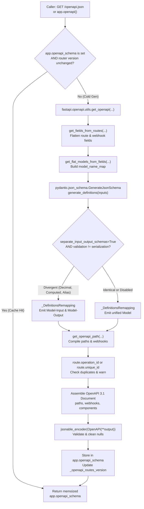

# Inside fastapi.openapi.utils.get_openapi(): Operation IDs, separate_input_output_schemas, Webhook Docs, and Customizing Schema Output

> [!summary] Claim
> FastAPI generates an OpenAPI 3.1 specification by walking route and webhook dependency trees, extracting Pydantic core schemas, splitting divergent models into `-Input` and `-Output` definitions via Pydantic definition remapping, assigning operation IDs, and caching the serialized dictionary on `app.openapi_schema`.

Part of [FastAPI Internals and Patterns](README.md) in [API Engineering](../README.md).

## TL;DR

- The `fastapi.openapi.utils.get_openapi()` function compiles routes, webhooks, parameters, and Pydantic schemas into an OpenAPI 3.1.0 document.
- In Pydantic v2, `separate_input_output_schemas=True` emits distinct `-Input` and `-Output` schemas only when validation and serialization JSON schemas diverge (such as with `Decimal`, `@computed_field`, or serialization aliases), not for basic field defaults.
- Custom `app.openapi` handlers must check and populate `app.openapi_schema` to prevent CPU-intensive schema recompilation on every documentation request.
- Default `operationId` strings concatenate endpoint names, path formats, and HTTP methods, which produces unwieldy client SDK method names unless overridden with `generate_unique_id_function`.
- Do not rely on setting `app.openapi_version = "3.0.3"` to achieve OpenAPI 3.0 compatibility, because FastAPI still emits JSON Schema 2020-12 constructs such as `anyOf` with null.

## Mental model

The diagram below traces how a call to `app.openapi()` orchestrates schema generation, routes inspection, Pydantic schema generation, and memoized caching.



When `app.openapi()` executes, it checks whether `self.openapi_schema` is populated and verifies that `self._openapi_routes_version` matches the router version `(fastapi 0.162.0 fastapi/applications.py, FastAPI.openapi)`.
On a cache miss, execution enters `get_openapi()`, which extracts every request body, response field, query parameter, and callback from regular routes and `app.webhooks` routes.
Pydantic's `GenerateJsonSchema` generates a validation-mode or serialization-mode JSON schema from each field's core schema, resolving naming collisions into `-Input` and `-Output` suffixes when the two representations of a model differ `(pydantic 2.14.3 pydantic/json_schema.py, GenerateJsonSchema.generate_definitions)`.
Each route then has its path item compiled, parameters categorized, status codes mapped, and operation ID assigned.
The assembled dictionary is validated against the `OpenAPI` Pydantic model, serialized via `jsonable_encoder`, stored in `app.openapi_schema`, and returned to the caller.

## How it works

### The caller hierarchy and cache invalidation

FastAPI serves OpenAPI documentation dynamically through `/openapi.json`, which is consumed by interactive documentation endpoints such as Swagger UI (`/docs`) and ReDoc (`/redoc`).
The `/openapi.json` route is an `async def openapi(req)` closure registered in `FastAPI.setup()`; it calls `self.openapi()` and wraps the result in a `JSONResponse` `(fastapi 0.162.0 fastapi/applications.py, FastAPI.setup)`.
Because that closure is `async def`, a cold schema build runs on the event loop thread, not in the threadpool.
The `FastAPI.openapi()` method implements a memoization pattern governed by router versioning (simplified excerpt: signature and docstring removed):

```python
# (fastapi 0.162.0 fastapi/applications.py, FastAPI.openapi)
routes_version = self.router._get_routes_version()
if not self.openapi_schema or self._openapi_routes_version != routes_version:
    self.openapi_schema = get_openapi(
        title=self.title,
        version=self.version,
        openapi_version=self.openapi_version,
        summary=self.summary,
        description=self.description,
        terms_of_service=self.terms_of_service,
        contact=self.contact,
        license_info=self.license_info,
        routes=self.routes,
        webhooks=self.webhooks.routes,
        tags=self.openapi_tags,
        servers=self.servers,
        separate_input_output_schemas=self.separate_input_output_schemas,
        external_docs=self.openapi_external_docs,
    )
    self._openapi_routes_version = routes_version
return self.openapi_schema
```

Every `APIRouter` maintains an internal `_routes_version` counter, initialized to `0` in `APIRouter.__init__`, that `_mark_routes_changed()` increments from `add_route`, `add_api_route`, `add_api_websocket_route`, and `include_router` `(fastapi 0.162.0 fastapi/routing.py, APIRouter._mark_routes_changed)`.
`_get_routes_version()` returns the router's own counter plus, recursively, the counters of every included router, guarding against cycles with a `seen` set of router ids `(fastapi 0.162.0 fastapi/routing.py, APIRouter._get_routes_version)`.
If routes are added at runtime, `self.router._get_routes_version()` returns an updated integer, triggering automated schema recalculation.
`app.webhooks` is a separate `APIRouter` that is never included into `app.router`, so registering a webhook after the first `app.openapi()` call does not invalidate the cache; the late webhook appears only after some main-router change, which the lab test `test_webhook_added_after_cache_is_invisible_until_routes_change` demonstrates.
In steady state, subsequent requests bypass schema compilation, but the cache check is not free: `_get_routes_version()` walks `self.routes` on every call, so a cached call measured about 2 us at 10 routes and about 9 us at 100 routes (see Numbers and limits).

### Route flattening and field extraction

To construct definitions for OpenAPI `components.schemas`, `get_openapi()` collects all Pydantic fields across the entire application using `get_fields_from_routes(list(routes) + list(webhooks or []))` `(fastapi 0.162.0 fastapi/openapi/utils.py, get_fields_from_routes)`.
Only `APIRoute` instances with `include_in_schema` true are visited; Starlette `Route` and `Mount` objects are skipped by `_get_api_route_for_openapi()`.
This traversal scans:
1. `api_route.body_field` (parsed request body models);
2. `api_route.response_field` and all entries in `api_route.response_fields` (declared return types and additional response models);
3. `api_route.stream_item_field` (types yielded by generator endpoints for Server-Sent Events or JSON Lines);
4. `api_route.callbacks` (nested route definitions for asynchronous callbacks);
5. Flat parameters extracted from `api_route.dependant` by `get_flat_params()` (path, query, header, and cookie parameter models).

The resulting list of `ModelField` objects is passed to `get_flat_models_from_fields()` `(fastapi 0.162.0 fastapi/_compat/v2.py, get_flat_models_from_fields)`, which traverses nested models, unions, and container generics to construct `flat_models`.
FastAPI then calls `get_model_name_map(flat_models)`, which maps each model class to its string name for OpenAPI references.

### Schema generation and separate_input_output_schemas mechanics

Once fields are discovered, FastAPI delegates schema generation to `get_definitions()`, defined in `fastapi/_compat/v2.py` and re-exported from the `fastapi._compat` package (simplified excerpt):

```python
# (fastapi 0.162.0 fastapi/_compat/v2.py, get_definitions)
def get_definitions(
    *,
    fields: Sequence[ModelField],
    model_name_map: ModelNameMap,
    separate_input_output_schemas: bool = True,
) -> tuple[
    dict[tuple[ModelField, Literal["validation", "serialization"]], JsonSchemaValue],
    dict[str, dict[str, Any]],
]:
    schema_generator = GenerateJsonSchema(ref_template=REF_TEMPLATE)
    # ... builds flat_validation_model_fields and flat_serialization_model_fields ...
    inputs = [
        (
            field,
            (
                field.mode
                if (separate_input_output_schemas or _has_computed_fields(field))
                else "validation"
            ),
            field._type_adapter.core_schema,
        )
        for field in list(fields) + list(unique_flat_model_fields)
    ]
    field_mapping, definitions = schema_generator.generate_definitions(inputs=inputs)
    # ... truncates each definition's "description" at the first "\f" ...
    return field_mapping, cast(dict[str, dict[str, Any]], definitions)
```

In Pydantic v2, each model has one core schema, built at class definition time, that carries both validation rules and serialization rules; `GenerateJsonSchema` reads it in `mode="validation"` (what the model accepts) or `mode="serialization"` (what it emits), and the two JSON schemas can differ.
When `GenerateJsonSchema.generate_definitions()` processes `inputs`, it tracks every encountered model reference under `self._prioritized_defsref_choices` `(pydantic 2.14.3 pydantic/json_schema.py, GenerateJsonSchema.get_defs_ref)`.
For each model, Pydantic constructs a priority list of candidate definition reference names, keyed by the most specific choice, `module_qualname_occurrence_mode`:
`[name, name_mode, module_qualname, module_qualname_mode, module_qualname_occurrence, module_qualname_occurrence_mode]`
The variable `mode_title` is resolved via `_MODE_TITLE_MAPPING: dict[JsonSchemaMode, str] = {'validation': 'Input', 'serialization': 'Output'}` `(pydantic 2.14.3 pydantic/json_schema.py, _MODE_TITLE_MAPPING)`.

During definition remapping in `_DefinitionsRemapping.from_prioritized_choices()` `(pydantic 2.14.3 pydantic/json_schema.py, _DefinitionsRemapping.from_prioritized_choices)`:
1. Pydantic iterates up to 100 times (`for _iter in range(100)`, commented in source as a guard against an infinite loop "in the case of a bug") to simplify definition references across the schema graph.
2. For each alternative name, it collects all generated schemas that would share that name.
3. It deduplicates schemas using `_deduplicate_schemas()`.
4. It picks, for each definition, the first alternative with exactly one distinct schema: `next(x for x in alternatives if len(schemas_for_alternatives[x]) == 1)`.
If a model generates identical schemas in validation mode and serialization mode, `len(schemas_for_alternatives[name]) == 1`.
Because there is no ambiguity, the remapper chooses the first candidate: `name` (e.g. `Item`).
The `-Input` and `-Output` suffixes are discarded.
5. If the validation schema and serialization schema differ, `schemas_for_alternatives[name]` contains two distinct schema dictionaries.
A naming collision occurs.
The remapper rejects `name` and advances to `name_mode`, which resolves to `Item-Input` for the request body schema and `Item-Output` for the response schema.

#### The field default misconception

A widespread misconception in the FastAPI ecosystem (present even in the `separate_input_output_schemas` docstring of `FastAPI.__init__`, which uses exactly `tags: list[str] = []` as its example) is that defining a field with a default value splits a model into `Item-Input` and `Item-Output` `(fastapi 0.162.0 fastapi/applications.py, FastAPI.__init__)`.
With Pydantic 2.14.3 and the default model config, standard field defaults produce identical JSON schemas in both `mode="validation"` and `mode="serialization"`; this was checked with `Item.model_json_schema(mode="validation") == Item.model_json_schema(mode="serialization")`, which returns `True`, and with an `Item` model of `name: str` and `description: str | None = None`, which also stays unified.
In both modes, the property is marked as optional in `required` and carries `"default": []`.
Because the generated schemas are identical, Pydantic deduplicates them to a single definition named `Item`.

A model splits into `Model-Input` and `Model-Output` if and only if its validation and serialization representations diverge.
Common triggers include:
- `ConfigDict(json_schema_serialization_defaults_required=True)`: this Pydantic config option marks defaulted fields as required in serialization mode, which is the setting that makes the docstring example split (checked: `Item2-Output` has `required: ["name", "tags"]`) `(pydantic 2.14.3 pydantic/config.py, ConfigDict.json_schema_serialization_defaults_required)`.
- `decimal.Decimal`: Validation schema accepts `{"anyOf": [{"type": "number"}, {"type": "string"}]}`, whereas serialization schema specifies `{"type": "string"}` (both checked with `model_json_schema` in Pydantic 2.14.3), because Pydantic serializes `Decimal` to a JSON string to avoid floating-point precision loss.
- `@computed_field`: Included exclusively in serialization schemas, absent from validation schemas.
- `Field(exclude=True)`: Included in validation schemas, omitted from serialization schemas.
- `Field(serialization_alias="out_name")` or `Field(validation_alias="in_name")`: Property names differ between input and output.
- `typing.Annotated` with `PlainSerializer` or `WrapSerializer` declaring a `return_type` distinct from the input annotation (checked: `Annotated[int, PlainSerializer(str, return_type=str)]` diverges).

When `separate_input_output_schemas=False` is set on `FastAPI()`, `get_definitions()` forces `field.mode` to `"validation"` for all fields that lack computed fields.
This forces serialization fields to use their validation schema, collapsing divergent models (such as those using `Decimal` or `serialization_alias`) back into a single unified schema.
However, if a model contains a `@computed_field`, FastAPI's `_has_computed_fields(field)` check keeps the field's own mode (so `"serialization"` for response fields), compelling schema separation even when `separate_input_output_schemas=False` is requested `(fastapi 0.162.0 fastapi/_compat/v2.py, _has_computed_fields)`.
`_has_computed_fields()` reads only `field._type_adapter.core_schema["schema"]["computed_fields"]`, the top-level model of that field.
For a `Parent` model whose nested `Child` has a `@computed_field`, `separate_input_output_schemas=False` leaves `Parent` unified while the flattened `Child` model field still emits `Child-Input` and `Child-Output`, as the lab test `test_nested_computed_field_splits_child_even_when_separation_disabled` shows.
The flag itself arrived in FastAPI 0.102.0 (2023-08-25, PR 10145), and computed-field handling under `separate_input_output_schemas=False` was patched in 0.123.4 (PR 13207) and 0.123.10 (PR 14453) `(fastapi 0.162.0 docs/en/docs/release-notes.md)`.
A direct run in verification (CPython 3.14.6, Darwin 27.3.0, FastAPI 0.162.0) of a top-level model with a `@computed_field` under `separate_input_output_schemas=False` still produced `M-Input` and `M-Output`, so those patches did not remove the split.

### Operation ID compilation and duplicate detection

OpenAPI operations represent individual HTTP method invocations on a path.
OpenAPI Specification 3.1.0 Section 4.8.10.1 (Operation Object fixed fields, `operationId`) dictates:
"Unique string used to identify the operation.
The id MUST be unique among all operations described in the API.
The operationId value is case-sensitive.
Tools and libraries MAY use the operationId to uniquely identify an operation, therefore, it is RECOMMENDED to follow common programming naming conventions."

In FastAPI, each `APIRoute` compiles its identifier during initialization, in `_populate_api_route_state()`, by calling `route.operation_id or current_generate_unique_id(route)` `(fastapi 0.162.0 fastapi/routing.py, _populate_api_route_state)`.
The default callable lives in `fastapi/utils.py` and is imported into `fastapi.routing`:

```python
# (fastapi 0.162.0 fastapi/utils.py, generate_unique_id)
def generate_unique_id(route: "APIRoute") -> str:
    operation_id = f"{route.name}{route.path_format}"
    operation_id = re.sub(r"\W", "_", operation_id)
    assert route.methods
    operation_id = f"{operation_id}_{list(route.methods)[0].lower()}"
    return operation_id
```

If an endpoint is named `def get_item():` on route `/items/{item_id}` for HTTP method `GET`, `route.unique_id` compiles to `get_item_items__item_id__get` (asserted by the lab).
`unique_id` is computed once per route, not once per method, from `list(route.methods)[0]`, where `route.methods` is a `set`.
A route declared with `@app.api_route("/m", methods=["GET", "POST", "PUT"])` on an endpoint named `multi` therefore gives every method the same `operationId` and triggers the duplicate warning below, and which method name ends up in the id depends on string hash order: the same app produced `multi_m_get` under `PYTHONHASHSEED=1` and `multi_m_post` under `PYTHONHASHSEED=2`.
The default ids are deterministic only for single-method routes.
When `get_openapi_operation_metadata()` processes a route, it extracts `operation_id = route.operation_id or route.unique_id` `(fastapi 0.162.0 fastapi/openapi/utils.py, get_openapi_operation_metadata)`.

The legacy utility function `fastapi.openapi.utils.generate_operation_id()` is deprecated: it emits `FastAPIDeprecationWarning` with the message "fastapi.openapi.utils.generate_operation_id() was deprecated, it is not used internally, and will be removed soon" `(fastapi 0.162.0 fastapi/openapi/utils.py, generate_operation_id)`.
Instead, applications customize operation ID generation by supplying a callable to `generate_unique_id_function` on `FastAPI()` or `APIRouter()`:

```python
def custom_operation_id(route: APIRoute) -> str:
    if route.tags:
        return f"{route.tags[0]}_{route.name}"
    return route.name

app = FastAPI(generate_unique_id_function=custom_operation_id)
```

During OpenAPI compilation, `get_openapi()` maintains an `operation_ids: set[str]` accumulator shared by paths and webhooks.
If an operation ID is encountered more than once, `get_openapi_operation_metadata()` triggers a warning; `warnings.warn()` is called without a category, so it is a `UserWarning`:

```python
# (fastapi 0.162.0 fastapi/openapi/utils.py, get_openapi_operation_metadata)
if operation_id in operation_ids:
    endpoint_name = getattr(route.endpoint, "__name__", "<unnamed_endpoint>")
    message = f"Duplicate Operation ID {operation_id} for function {endpoint_name}"
    file_name = getattr(route.endpoint, "__globals__", {}).get("__file__")
    if file_name:
        message += f" at {file_name}"
    warnings.warn(message, stacklevel=1)
operation_ids.add(operation_id)
operation["operationId"] = operation_id
```

FastAPI does not raise an exception on duplicates; it emits a warning and permits the duplicate `operationId` into the output document, leaving downstream client generators vulnerable to method collisions.

### OpenAPI 3.1 webhooks documentation

OpenAPI 3.1.0 added the top-level `webhooks` map alongside `paths` in the OpenAPI Object fixed fields (Section 4.8.1.1); the OpenAPI 3.0.3 specification has no `webhooks` field.
The 3.1.0 text defines it as "The incoming webhooks that MAY be received as part of this API and that the API consumer MAY choose to implement", describing "requests initiated other than by an API call, for example by an out of band registration".
`callbacks` (Section 4.8.18, Callback Object) are instead "A map of possible out-of band callbacks related to the parent operation", so they are tied to one operation, typically one that receives the callback URL in its request.

FastAPI exposes this capability via the `app.webhooks` attribute, which is an instance of `APIRouter` `(fastapi 0.162.0 fastapi/applications.py, FastAPI.__init__)`:

```python
app = FastAPI()

@app.webhooks.post("subscription-created")
def on_subscription_created(event: SubscriptionEvent) -> None:
    """Invoked when a customer subscription is activated."""
```

In `get_openapi()`, FastAPI processes `webhooks` through the same pipeline as regular routes (simplified excerpt: the `security_schemes` and `path_definitions` merges are omitted):

```python
# (fastapi 0.162.0 fastapi/openapi/utils.py, get_openapi)
for webhook_context in routing.iter_route_contexts(webhooks or []):
    api_webhook = _get_api_route_for_openapi(webhook_context)
    if api_webhook is not None:
        result = get_openapi_path(
            route=api_webhook,
            operation_ids=operation_ids,
            model_name_map=model_name_map,
            field_mapping=field_mapping,
            separate_input_output_schemas=separate_input_output_schemas,
        )
        if result:
            path, security_schemes, path_definitions = result
            if path:
                webhook_paths.setdefault(api_webhook.path_format, {}).update(path)
```

The route's `path_format` (e.g. `"subscription-created"`) serves as the unique key in `output["webhooks"]`.
The request body parameter `event: SubscriptionEvent` is extracted and compiled into `webhooks["subscription-created"]["post"]["requestBody"]`, documenting the exact schema third-party webhook receivers must expect.

### Customizing schema output

The supported pattern for extending or customizing OpenAPI output in FastAPI involves overriding the `app.openapi` callable:

```python
def custom_openapi():
    if app.openapi_schema:
        return app.openapi_schema
    schema = get_openapi(
        title="Payment Platform API",
        version="2.0.0",
        openapi_version=app.openapi_version,
        description="Core transaction processing gateway.",
        routes=app.routes,
        webhooks=app.webhooks.routes,
        tags=app.openapi_tags,
        servers=app.servers,
        separate_input_output_schemas=app.separate_input_output_schemas,
    )
    # Apply post-processing transformations
    schema["info"]["x-logo"] = {"url": "https://cdn.example.com/logo.png"}
    app.openapi_schema = schema
    return app.openapi_schema

app.openapi = custom_openapi
```

Before returning, `get_openapi()` validates the final specification dictionary by instantiating `fastapi.openapi.models.OpenAPI(**output)` and serializing it through `jsonable_encoder(..., by_alias=True, exclude_none=True)` `(fastapi 0.162.0 fastapi/openapi/utils.py, get_openapi)`.
This validation pass covers only what `get_openapi()` assembled: `OpenAPI.model_config` is `{"extra": "allow"}`, so unknown keys pass through, and post-processing done after `get_openapi()` returns (such as the `x-logo` line above) is never validated.
Run an external validator in CI if the customized document must be proven valid.

## Numbers and limits

The performance of `get_openapi()` is bounded by Pydantic JSON schema generation, route traversal, and dictionary assembly and encoding.
The latency and size rows were measured on 2026-11-15 on macOS 27.3 arm64 (`uname -r` = `27.3.0`) with CPython 3.14.6 from uv, FastAPI 0.162.0, and Pydantic 2.14.3, by running from `labs/`: `uv run --frozen python -c "from api_labs.f11_fastapi_internals_and_patterns.openapi_generation_internals import measure_openapi_generation as m; [print(n, *(round(v, 2) for v in m(n))) for n in (10, 50, 100)]"`.
`measure_openapi_generation()` builds a fresh app of N `POST` routes sharing a `BenchPayload` model with a nested `list[BenchLine]`, and reports the median of 30 repeats; cached timings varied between runs (a second run gave 1.3, 2.5, and 6.2 us).

| Parameter or Metric | Value or Limit | Mechanism or Source |
|---|---|---|
| Cold generation latency (10 routes) | 2.28 ms | Measured in lab (median of 30) |
| Cold generation latency (50 routes) | 4.71 ms | Measured in lab |
| Cold generation latency (100 routes) | 7.84 ms | Measured in lab |
| Cached `app.openapi()` latency (10, 50, 100 routes) | 2.1 us, 5.2 us, 9.0 us | Measured in lab; grows with route count because `_get_routes_version()` walks `self.routes` |
| Output schema size (10 routes) | 6,213 bytes | Measured in lab (`json.dumps`, uncompressed) |
| Output schema size (50 routes) | 26,013 bytes | Measured in lab |
| Output schema size (100 routes) | 50,763 bytes | Measured in lab |
| Default OpenAPI Specification version | `3.1.0` | `fastapi 0.162.0 fastapi/applications.py, FastAPI.openapi_version` |
| Default Schema Object dialect | `https://spec.openapis.org/oas/3.1/dialect/base` | OpenAPI 3.1.0 Section 4.8.24 (Schema Object); FastAPI never sets the optional `jsonSchemaDialect` field (Section 4.8.1.1) |
| Schema reference prefix | `#/components/schemas/` | `fastapi 0.162.0 fastapi/openapi/constants.py, REF_PREFIX` |
| Schema remapping iteration limit | 100 iterations, then `PydanticInvalidForJsonSchema` | `(pydantic 2.14.3 pydantic/json_schema.py, _DefinitionsRemapping.from_prioritized_choices)` |
| Default validation error response | `422` with description `Validation Error`, added when a route has parameters or a body and no `422`, `4XX`, or `default` response | (RFC 9110 Section 15.5.21) and `(fastapi 0.162.0 fastapi/openapi/utils.py, get_openapi_path)` |
| Route version counter initialization | `0` | `(fastapi 0.162.0 fastapi/routing.py, APIRouter.__init__)` |

## Portability

OpenAPI generation occurs entirely in Python user space within the FastAPI and Pydantic frameworks, independent of the underlying ASGI server or HTTP transport version.
However, downstream tools exhibit major compatibility fractures regarding OpenAPI 3.1.0 support.

| Runtime / Tool / Subsystem | Support Status | Compatibility Details and Behavior |
|---|---|---|
| CPython 3.12.13 | Supported | Drafter's matrix run reported 6 of 6 passing; not re-run in verification (lab matrix checks paused 2026-11-11). |
| CPython 3.13.18 | Supported | Drafter's matrix run reported 6 of 6 passing; not re-run in verification. |
| CPython 3.14.6 | Supported | Default workspace interpreter; re-run in verification on 2026-11-15: 10 passed in 0.23s. |
| CPython 3.15.0b3 | Blocked (prerelease) | Drafter reported collection blocked by `hypothesis._native` not built for the prerelease ABI; not re-run. The pinned 3.15.2 leg was not run. |
| CPython 3.15.0b3+freethreaded | Blocked (missing wheel) | Drafter reported install blocked by no `psycopg-binary` 3.3.8 wheel; not re-run. The pinned 3.15.2t leg was not run. |
| Uvicorn 0.54.0, Hypercorn 0.18.0, Granian 2.8.7 | Server-independent | Installed in the lab workspace but not exercised by this lab; the schema is built by `app.openapi()` in Python before any bytes reach the server, so the server only transports the `JSONResponse` body. |
| HTTP/1.1, HTTP/2, HTTP/3 | Agnostic | The document is an ordinary JSON response body; framing differs per protocol, the payload does not. |
| Swagger UI 5.x | Supported | FastAPI 0.162.0 loads `swagger-ui-dist@5` by default (`get_swagger_ui_html`); Swagger announced OpenAPI 3.1 rendering in the 5.x line via ApiDOM. |
| ReDoc 2.x | Basic 3.1 support | FastAPI 0.162.0 loads `redoc@2` by default (`get_redoc_html`); the ReDoc 2.x README lists OpenAPI 3.1 support as "basic" (as of 2026-11). |
| AWS API Gateway | Incompatible without conversion | Imports "most of" OpenAPI 2.0 and 3.0 only, models use JSON Schema draft 4, and "The `nullable` field is not supported" (as of 2026-11). |
| Azure API Management | Import only | Supports OpenAPI 2, 3.0.x up to 3.0.3, and 3.1 "import only"; most 3.1-specific constructs are ignored, downgraded, or removed (as of 2026-11). |
| OpenAPI Generator | Beta 3.1 support | README lists "3.1 (beta support)" (as of 2026-11); with `separate_input_output_schemas=True` divergent models become two classes per model. |

## Worked example

The complete implementation module is located at [implementation](../labs/src/api_labs/f11_fastapi_internals_and_patterns/openapi_generation_internals.py) and verified by unit tests at [test](../labs/tests/f11_fastapi_internals_and_patterns/test_openapi_generation_internals_in_fastapi_get_openapi_and_separate_schemas.py).

Below is the lab implementation demonstrating model schema separation, clean operation ID derivation, OpenAPI 3.1 webhooks, and cached schema post-processing (simplified excerpt: docstrings, the `json`, `statistics`, and `time` imports, and the `measure_openapi_generation()` benchmark helpers are omitted):

```python
"""FastAPI OpenAPI generation internals, schema splitting, operation IDs, and webhooks."""

from decimal import Decimal
from enum import Enum
from typing import Any

from fastapi import APIRouter, FastAPI
from fastapi.openapi.utils import get_openapi
from fastapi.routing import APIRoute
from pydantic import BaseModel, Field, computed_field


class ItemWithDefault(BaseModel):
    name: str
    count: int = 1


class ProductWithDecimal(BaseModel):
    name: str
    price: Decimal


class UserWithComputed(BaseModel):
    name: str
    raw_password: str = Field(exclude=True)

    @computed_field
    def display_name(self) -> str:
        return f"User: {self.name}"


class SubscriptionEvent(BaseModel):
    event_id: str
    customer_id: str
    amount: Decimal


def create_schema_app(*, separate_input_output_schemas: bool = True) -> FastAPI:
    app = FastAPI(
        title="Schema Splitting Inspection App",
        version="1.0.0",
        separate_input_output_schemas=separate_input_output_schemas,
    )

    @app.post("/items")
    def create_item(item: ItemWithDefault) -> ItemWithDefault:
        return item

    @app.post("/products")
    def create_product(product: ProductWithDecimal) -> ProductWithDecimal:
        return product

    @app.post("/users")
    def create_user(user: UserWithComputed) -> UserWithComputed:
        return user

    return app


def generate_clean_operation_id(route: APIRoute) -> str:
    if route.tags:
        raw_tag = route.tags[0]
        tag_val: object = raw_tag.value if isinstance(raw_tag, Enum) else raw_tag
        clean_tag = str(tag_val).lower().replace(" ", "_").replace("-", "_")
        return f"{clean_tag}_{route.name}"
    return route.name


def create_operation_id_app(*, use_custom_ids: bool = False) -> FastAPI:
    if use_custom_ids:
        app = FastAPI(
            title="Operation ID Inspection App",
            version="1.0.0",
            generate_unique_id_function=generate_clean_operation_id,
        )
    else:
        app = FastAPI(
            title="Operation ID Inspection App",
            version="1.0.0",
        )

    items_router = APIRouter(prefix="/items", tags=["items"])

    @items_router.get("/{item_id}")
    def get_item(item_id: int) -> dict[str, int]:
        return {"item_id": item_id}

    @items_router.post("/")
    def create_item(item_name: str) -> dict[str, str]:
        return {"item_name": item_name}

    app.include_router(items_router)
    return app


def create_webhook_app() -> FastAPI:
    app = FastAPI(
        title="Webhook Docs App",
        version="1.0.0",
    )

    @app.post("/subscribe")
    def subscribe(target_url: str) -> dict[str, str]:
        return {"status": "subscribed", "target_url": target_url}

    @app.webhooks.post("subscription-created")
    def on_subscription_created(event: SubscriptionEvent) -> None:
        """Invoked by our billing system when a new subscription is activated."""

    return app


def install_cached_custom_openapi(
    app: FastAPI,
    *,
    internal_prefix: str = "/internal/",
    api_title: str = "Enterprise Gateway",
) -> None:
    def custom_openapi() -> dict[str, Any]:
        if app.openapi_schema:
            return app.openapi_schema

        schema = get_openapi(
            title=api_title,
            version=app.version,
            openapi_version=app.openapi_version,
            summary=app.summary,
            description=app.description,
            routes=app.routes,
            webhooks=app.webhooks.routes,
            tags=app.openapi_tags,
            servers=app.servers,
            terms_of_service=app.terms_of_service,
            contact=app.contact,
            license_info=app.license_info,
            separate_input_output_schemas=app.separate_input_output_schemas,
        )

        filtered_paths = {
            path: path_item
            for path, path_item in schema.get("paths", {}).items()
            if not path.startswith(internal_prefix)
        }
        schema["paths"] = filtered_paths

        schema["info"]["x-api-governance"] = {
            "tier": "tier-1-mission-critical",
            "managed-by": "api-platform-team",
        }

        app.openapi_schema = schema
        return app.openapi_schema

    app.openapi = custom_openapi  # type: ignore[method-assign]
```

The pytest suite verifies that models split only upon schema divergence, that computed fields force separation regardless of configuration, that operation IDs and webhooks compile accurately, that a multi-method route shares one operation ID, and that late webhooks stay invisible until the router version changes; the first test is shown (simplified excerpt):

```python
# (labs/tests/f11_fastapi_internals_and_patterns/test_openapi_generation_internals_in_fastapi_get_openapi_and_separate_schemas.py)
import warnings

import pytest

from api_labs.f11_fastapi_internals_and_patterns.openapi_generation_internals import (
    create_operation_id_app,
    create_schema_app,
    create_webhook_app,
    install_cached_custom_openapi,
    measure_openapi_generation,
)


@pytest.mark.unit
def test_separate_schemas_enabled_splits_divergent_models_only() -> None:
    app = create_schema_app(separate_input_output_schemas=True)
    schema = app.openapi()
    schemas = schema["components"]["schemas"]

    assert "ProductWithDecimal-Input" in schemas
    assert "ProductWithDecimal-Output" in schemas
    assert "UserWithComputed-Input" in schemas
    assert "UserWithComputed-Output" in schemas

    # Models whose validation and serialization schemas are identical remain unified
    assert "ItemWithDefault" in schemas
    assert "ItemWithDefault-Input" not in schemas
    assert "ItemWithDefault-Output" not in schemas

    product_path = schema["paths"]["/products"]["post"]
    req_ref = product_path["requestBody"]["content"]["application/json"]["schema"]["$ref"]
    res_ref = product_path["responses"]["200"]["content"]["application/json"]["schema"]["$ref"]

    assert req_ref == "#/components/schemas/ProductWithDecimal-Input"
    assert res_ref == "#/components/schemas/ProductWithDecimal-Output"
```

Output captured on 2026-11-15 by running `uv run --frozen pytest tests/f11_fastapi_internals_and_patterns/test_openapi_generation_internals_in_fastapi_get_openapi_and_separate_schemas.py` from `labs/` on macOS 27.3 arm64 with CPython 3.14.6:

```text
============================= test session starts ==============================
platform darwin -- Python 3.14.6, pytest-9.2.0, pluggy-1.7.0
rootdir: /Users/shreejitverma/github/The-Distinguished-Engineer/build/api_notes/jobs/OpenAPI-Generation-Internals-in-FastAPI-Get-OpenAPI-and-Separate-Schemas/labs
configfile: pyproject.toml
plugins: platformdirs-4.14.5, schemathesis-4.33.1, cov-7.1.0, hypothesis-6.170.14, inline-snapshot-0.36.1, Faker-40.44.0, locust-2.47.0, typeguard-4.6.0, anyio-4.16.0, asyncio-1.4.1.post1, respx-0.23.1
asyncio: mode=Mode.STRICT, debug=False, asyncio_default_fixture_loop_scope=function, asyncio_default_test_loop_scope=function
collected 10 items

tests/f11_fastapi_internals_and_patterns/test_openapi_generation_internals_in_fastapi_get_openapi_and_separate_schemas.py . [ 10%]
.........                                                                [100%]

============================== 10 passed in 0.23s ==============================
```

## Pitfalls

> [!warning] Pitfall 1: Omission of `app.openapi_schema` caching in custom schema generators
> **Trigger**: Overriding `app.openapi` with a custom function that invokes `get_openapi(...)` directly without guarding with `if app.openapi_schema: return app.openapi_schema`.
> **Symptom**: CPU spikes and event loop blocking whenever API consumers, health checkers, or documentation UIs request `/openapi.json`.
> On the lab's 100-route application, cold schema generation took 7.84 ms of synchronous CPU time, compared to about 9 us for a cached call.
> Because the `/openapi.json` handler is `async def`, that work runs on the event loop thread, so scanners scraping documentation stall every concurrent request on the same worker process.
> **Fix**: Guard the generator with `if app.openapi_schema: return app.openapi_schema` and assign the generated dictionary to `app.openapi_schema` before returning.

> [!warning] Pitfall 2: Duplicate `operationId` collisions causing silent client SDK overwrites
> **Trigger**: Manually defining identical `operation_id="create_record"` across multiple endpoints or distinct routers, using a naive `generate_unique_id_function = lambda r: r.name` where multiple routes share the function name `create()`, or declaring one route with several methods via `api_route(..., methods=[...])`, which reuses one default id for every method.
> **Symptom**: FastAPI emits a `UserWarning` during schema compilation but still generates the OpenAPI document containing duplicated `operationId` fields.
> OpenAPI Generator renames a collision within one tag group to `<id>_0`, `<id>_1`, and so on, logging only "generated unique operationId" `(openapi-generator 1d942536 DefaultCodegen.java, addOperationToGroup)`, so SDK method names depend on route registration order and change when routes are reordered.
> **Fix**: Format custom operation IDs with tags or path prefixes (e.g. `f"{route.tags[0]}_{route.name}"`), and add an automated CI assertion that `len(operation_ids) == len(set(operation_ids))`.

> [!warning] Pitfall 3: Client SDK code explosion from `separate_input_output_schemas=True`
> **Trigger**: Leaving `separate_input_output_schemas=True` enabled on applications utilizing `Decimal`, serialization aliases, or excluded fields, and generating client libraries with OpenAPI Generator.
> **Symptom**: The client library generates two classes for every divergent entity (e.g. `UserDTOInput` and `UserDTOOutput`).
> Frontend engineers cannot pass a model fetched from a `GET` endpoint directly into a `PUT` or `PATCH` request without manual mapping across duplicate classes, creating developer friction and increasing bundle sizes.
> **Fix**: Evaluate whether the schema divergence is intentional.
> If client consumers require unified types, configure `FastAPI(separate_input_output_schemas=False)` and handle output coercions (such as Decimal string formatting) using middleware or explicit serializers rather than schema-level diverging types.

> [!warning] Pitfall 4: Naive `app.openapi_version = "3.0.3"` attribute patching
> **Trigger**: Attempting to feed FastAPI schemas into legacy gateways (such as AWS API Gateway) by setting `app.openapi_version = "3.0.3"`.
> **Symptom**: Upstream API gateways reject the uploaded schema with schema validation errors.
> FastAPI's `openapi_version` attribute docstring calls the override "a hack" that "might work" only if you avoid features added in OpenAPI 3.1.0 `(fastapi 0.162.0 fastapi/applications.py, FastAPI.__init__)`: setting it changes only the top-level `"openapi"` string.
> Checked in FastAPI 0.162.0: with `app.openapi_version = "3.0.3"`, an `str | None` field is still emitted as `anyOf: [{"type": "string"}, {"type": "null"}]`, which OpenAPI 3.0.3 expresses instead with `nullable: true` on a typed schema, and top-level `webhooks`, a field that does not exist in 3.0.3, is still emitted.
> **Fix**: Use a dedicated downgrade post-processor that rewrites `anyOf` null unions (to `nullable: true` for 3.0 tools, or by dropping the null branch for AWS API Gateway, which documents that `nullable` is not supported) and removes or moves `webhooks` into vendor extensions, then validate the result against the target tool before export.

> [!warning] Pitfall 5: Passing `generate_unique_id_function=None` to `FastAPI()`
> **Trigger**: Passing `generate_unique_id_function=None` to `FastAPI(generate_unique_id_function=None)` in an attempt to disable custom generation.
> **Symptom**: When the first route without an explicit `operation_id` is registered, FastAPI raises `TypeError: 'NoneType' object is not callable` at `route.unique_id = route.operation_id or current_generate_unique_id(route)` `(fastapi 0.162.0 fastapi/routing.py, _populate_api_route_state)`; reproduced in verification.
> **Fix**: Do not pass `None`.
> To preserve default behavior, omit the argument or pass `fastapi.utils.generate_unique_id` explicitly.

## Security and robustness

### Information disclosure and endpoint pruning (OWASP API9:2023)

By default, `get_openapi()` includes every route whose `include_in_schema` attribute evaluates to `True`.
In enterprise deployments, administrative endpoints, debugging panels, health metrics (`/internal/metrics`), and canary routes can inadvertently leak internal architecture, data contracts, and attack surfaces through `/openapi.json`.
OWASP API Security Top 10 2023, API9:2023 Improper Inventory Management, lists "Make API documentation available only to those authorized to use the API" under How To Prevent; API8:2023 Security Misconfiguration does not mention documentation endpoints.

To harden production deployments, implement route pruning directly within the customized `app.openapi` pipeline:

```python
def production_openapi():
    if app.openapi_schema:
        return app.openapi_schema
    schema = get_openapi(...)
    # Prune internal and administrative paths before publication
    schema["paths"] = {
        path: item for path, item in schema["paths"].items()
        if not path.startswith(("/internal/", "/admin/", "/debug/"))
    }
    app.openapi_schema = schema
    return app.openapi_schema
```

Alternatively, set `include_in_schema=False` on administrative routers:
`admin_router = APIRouter(prefix="/admin", include_in_schema=False)`.

### Securing documentation endpoints in production

Exposing Swagger UI and ReDoc in production environments introduces unnecessary security risks.
Disable public documentation endpoints in production environments by binding them to environment variables:

```python
import os
from fastapi import FastAPI

is_prod = os.getenv("ENVIRONMENT") == "production"

app = FastAPI(
    docs_url=None if is_prod else "/docs",
    redoc_url=None if is_prod else "/redoc",
    openapi_url=None if is_prod else "/openapi.json",
)
```

If internal teams require access to production documentation, protect `/openapi.json` behind authentication dependencies using Starlette middleware or reverse proxy identity verification (e.g. OAuth2 Proxy or Cloudflare Access).

### Denial of service via deeply recursive models

Pydantic v2 resolves recursive and self-referential models (such as tree nodes or nested categories) using `DefsRef` pointers.
During schema generation in `_DefinitionsRemapping.from_prioritized_choices()`, Pydantic simplifies definitions in a fixed-point loop bounded by 100 iterations, and each iteration deep-compares every definition, so cost grows with the size of the definition graph.
The source treats reaching the bound as a bug guard and raises `PydanticInvalidForJsonSchema('Failed to simplify the JSON schema definitions')`.
If untrusted input can shape the models compiled into the document (for example, a multi-tenant system that builds user-defined models with `create_model()` and publishes them through OpenAPI), large or degenerate model graphs turn every cache miss into a CPU cost the tenant controls, and a failed simplification turns `/openapi.json` into a `500`.
Ensure all models compiled into `get_openapi()` are statically defined and reviewed at build time.

## The principal's view

At the staff-plus level, OpenAPI generation represents the boundary between Code-First and Contract-First API architectures.
FastAPI is fundamentally a Code-First framework: the Python code is the single source of truth, and the OpenAPI document is an emitted artifact.

### Architectural trade-offs: Code-First vs. Contract-First

1. **Code-First (FastAPI default)**:
   - *Velocity*: Eliminates manual YAML authoring; signatures, validation rules, and documentation stay synchronized automatically.
   - *Risk*: Implementation details leak into API contracts.
   A refactor in Python (such as introducing a `@computed_field` or changing a Pydantic field type) can silently split an OpenAPI schema into `-Input` and `-Output` components, breaking external SDK consumers without triggering Python type errors.
2. **Contract-First (Design-First)**:
   - *Governance*: OpenAPI specifications are authored, reviewed by API design councils, and committed to git repositories before code is written.
   Code generators create server stubs and client libraries.
   - *Trade-off*: Higher initial authoring friction and potential drift if server implementations deviate from generated interfaces.

### Strategic recommendations for platform teams

To achieve enterprise governance with FastAPI's Code-First engine:
1. **Enforce deterministic Operation IDs**:
   Never allow default operation IDs (`{name}{path}_{method}`) to reach client generators.
   Standardize a company-wide `generate_unique_id_function` (such as `{domain}_{resource}_{action}`) to ensure clean, predictable method names across generated TypeScript, Java, and Go clients.
2. **Standardize Schema Separation Policy**:
   If your organization maintains polyglot client SDKs, standardize on `separate_input_output_schemas=False` unless distinct input/output semantics are strictly required.
   When distinct models are required, define explicit, separate Pydantic models (e.g. `UserCreateRequest` and `UserResponse`) rather than relying on Pydantic's automatic `-Input` and `-Output` splitting.
   Explicit models make API contract boundaries visible in code reviews.
3. **Automate Contract Drift and Breaking Change Detection in CI**:
   Export the OpenAPI specification during CI using a build script (`python -c "import json; from my_app import app; print(json.dumps(app.openapi()))" > openapi.json`).
   Validate the export with `openapi-spec-validator` and diff it against the canonical production specification with a breaking-change detector such as `oasdiff`.
   Fail pull requests that introduce breaking contract modifications, such as removed fields, renamed operation IDs, or altered status code schemas.

## Interview questions

> [!question] L5: What happens when two route functions in FastAPI define identical `operation_id` attributes, and how does FastAPI handle this?
>
> > [!success]- Answer
> > During OpenAPI compilation in `get_openapi()`, FastAPI tracks all assigned operation IDs inside a set named `operation_ids`.
> > If an operation ID already exists in the set, FastAPI emits a `UserWarning` indicating a duplicate operation ID for the endpoint function and file location.
> > However, FastAPI does not raise an exception; it writes the duplicate operation ID into the final OpenAPI document.
> > Downstream client SDK generators must rename one of the colliding operations; OpenAPI Generator appends `_0`, `_1` within a tag group, so generated method names depend on route order.
> >
> > Follow-up: How can you write an automated test in pytest to fail if duplicate operation IDs exist in your application?

> [!question] L6: Predict the output: A model `Item` with `name: str` and `tags: list[str] = []` is used as both request body and return type on a route in an app with `separate_input_output_schemas=True`. What schema names appear under `components["schemas"]` in OpenAPI 3.1?
>
> > [!success]- Answer
> > The `components["schemas"]` dictionary contains `Item`, `HTTPValidationError`, and `ValidationError`.
> > It does NOT contain `Item-Input` and `Item-Output`.
> > In Pydantic v2, standard field defaults produce identical JSON schemas in validation mode and serialization mode (in both, `tags` is optional with default `[]`).
> > Because the generated schemas are identical, Pydantic's `_DefinitionsRemapping.from_prioritized_choices()` deduplicates them and selects the unified `Item` definition name.
> >
> > Follow-up: What Pydantic field types or configurations would cause `Item` to split into `Item-Input` and `Item-Output`?

> [!question] L6: How does FastAPI's `get_openapi()` implement schema separation for a model that contains a `@computed_field` when `separate_input_output_schemas=False` is set?
>
> > [!success]- Answer
> > The model STILL splits into `Model-Input` and `Model-Output`.
> > In `fastapi._compat.py`, `get_definitions()` evaluates `(separate_input_output_schemas or _has_computed_fields(field))`.
> > If a field has computed fields, FastAPI forces its mode to `"serialization"` rather than forcing `"validation"`.
> > Because validation schemas exclude computed fields and serialization schemas include them, the schemas diverge, and Pydantic emits separated `-Input` and `-Output` definitions regardless of the global flag.
> >
> > Follow-up: Why must FastAPI force serialization mode for models with computed fields?

> [!question] L6: Explain the difference between route-level `callbacks` and top-level `webhooks` in FastAPI and OpenAPI 3.1.0.
>
> > [!success]- Answer
> > Route-level `callbacks` represent out-of-band requests that are initiated as a direct consequence of an incoming API request, such as an event subscription call that provides a webhook callback URL.
> > Top-level `webhooks` (introduced in OpenAPI 3.1.0, Section 4.8.1.1) represent autonomous out-of-band requests initiated by the API provider independently of any incoming request.
> > In FastAPI, `webhooks` are defined on the `app.webhooks` APIRouter, and `get_openapi()` compiles them directly into the root `output["webhooks"]` specification dictionary.
> >
> > Follow-up: Where do route callbacks appear in the OpenAPI document structure?

> [!question] L7: Debug this API: A team overrides `app.openapi` to inject an enterprise security scheme, but during a load test, the application suffers severe event loop latency and CPU exhaustion whenever `/docs` is accessed. What is the root cause and the fix?
>
> > [!success]- Answer
> > The custom `app.openapi` implementation invokes `get_openapi(...)` on every call without checking or setting `app.openapi_schema`.
> > Default `FastAPI.openapi()` caches the generated dictionary on `app.openapi_schema`, returning in microseconds on subsequent calls.
> > Without caching, every request to `/openapi.json` (which `/docs` fetches from the browser) triggers full route tree traversal, Pydantic JSON schema generation, and dictionary encoding on the event loop thread; the lab measured 2.3 ms at 10 routes and 7.8 ms at 100 routes per cold build.
> > The fix is to add `if app.openapi_schema: return app.openapi_schema` at the beginning of the custom function, and store the result in `app.openapi_schema = schema` before returning.
> >
> > Follow-up: How does FastAPI detect if routes were added dynamically after `app.openapi_schema` was cached?

> [!question] L7: Why is setting `app.openapi_version = "3.0.3"` considered an unsafe hack when deploying FastAPI services behind AWS API Gateway?
>
> > [!success]- Answer
> > Modifying `app.openapi_version` only changes the top-level `"openapi": "3.0.3"` string in the emitted document.
> > FastAPI still relies on Pydantic v2's `GenerateJsonSchema`, which emits JSON Schema 2020-12 structures conforming to OpenAPI 3.1.
> > In particular, nullable fields are emitted as `{"anyOf": [{"type": "string"}, {"type": "null"}]}` instead of OpenAPI 3.0's `{"type": "string", "nullable": true}`.
> > OpenAPI 3.0.3 has no `null` type and no top-level `webhooks`, so strict 3.0 validators reject the document, and AWS API Gateway, which imports only OpenAPI 2.0 and 3.0 with JSON Schema draft 4 models and does not support `nullable`, cannot represent the nullability correctly either.
> >
> > Follow-up: How would you design an automated pipeline to produce a valid OpenAPI 3.0.3 schema from a FastAPI application?

> [!question] L7: How does Pydantic v2's `_DefinitionsRemapping` ensure that definition names do not collide when simplifying schemas across a cyclic model graph?
>
> > [!success]- Answer
> > Pydantic uses a fixed-point iteration algorithm that executes up to 100 iterations.
> > For each candidate reference name in `_prioritized_defsref_choices`, it groups all definitions that would map to that name and deduplicates them using structural schema comparison.
> > A reference is only remapped to a simpler candidate name if that candidate name maps to exactly one distinct schema across the entire document.
> > Because outer definitions may reference inner definitions that are undergoing simplification, the loop repeats until the entire definitions dictionary reaches a fixed point.
> >
> > Follow-up: What happens if the definitions dictionary fails to reach a fixed point within 100 iterations?

> [!question] L6: Why did FastAPI deprecate `fastapi.openapi.utils.generate_operation_id()` and how should operation ID generation be customized in modern FastAPI applications?
>
> > [!success]- Answer
> > Its deprecation warning states the reason: "it is not used internally, and will be removed soon"; route compilation uses `generate_unique_id()` from `fastapi/utils.py` through each route's `generate_unique_id_function` instead.
> > Modern FastAPI compiles each route's unique identifier during route initialization via `route.generate_unique_id_function`.
> > Applications should customize operation ID generation by passing a callable `generate_unique_id_function: Callable[[APIRoute], str]` to `FastAPI()` or `APIRouter()`.
> > This callable receives the compiled `APIRoute` instance and can access `route.tags`, `route.name`, and `route.path_format` to construct clean, domain-scoped operation IDs.
> >
> > Follow-up: What error occurs if you pass `generate_unique_id_function=None` to `FastAPI()`?

## Related

Prerequisites: [[Exception-Handling-in-FastAPI-HTTPException-vs-RequestValidationError]]

Next: [[BackgroundTasks-vs-Durable-Task-Queues-Celery-and-Dramatiq]]

See also: [[02-Programming-Languages/Python/Python-Backend-Interview-Prep/04-FastAPI]], [[02-Programming-Languages/Python/Python-Backend-Interview-Prep/05-REST-API-Design]], [[Response-Serialization-Pipeline-Response-Model-and-Double-Validation-Cost]], [[FastAPI-Architecture-What-FastAPI-Adds-Over-Starlette-and-Pydantic]], [[FastAPI-Security-Utilities-OAuth2-SecurityScopes-and-OpenAPI-Wiring]]

- Lab: `labs/tests/f11_fastapi_internals_and_patterns/test_openapi_generation_internals_in_fastapi_get_openapi_and_separate_schemas.py`

## Further reading

- OpenAPI Specification v3.1.0 (OpenAPI Initiative, Feb 2021): https://spec.openapis.org/oas/v3.1.0.html
  Defines root document structure, the top-level webhooks map, operationId uniqueness constraints, and JSON Schema 2020-12 integration.
- RFC 9110: HTTP Semantics (IETF, Jun 2022): https://www.rfc-editor.org/rfc/rfc9110.html
  Defines standard HTTP method semantics and status code 422 Unprocessable Content in Section 15.5.21.
- FastAPI Source Code (`fastapi.openapi.utils`): https://github.com/fastapi/fastapi/blob/0.162.0/fastapi/openapi/utils.py
  Primary source for route introspection, parameter mapping, security definitions aggregation, and document assembly.
- Pydantic Source Code (`pydantic.json_schema`): https://github.com/pydantic/pydantic/blob/v2.14.3/pydantic/json_schema.py
  Implements `GenerateJsonSchema`, `_DefinitionsRemapping`, and definition deduplication for validation and serialization modes.
- FastAPI release notes (FastAPI maintainers): https://github.com/fastapi/fastapi/blob/0.162.0/docs/en/docs/release-notes.md
  Dates the introduction of `separate_input_output_schemas` (0.102.0) and the later computed-field fixes (0.123.4, 0.123.10).
- FastAPI OpenAPI Documentation Guide: https://fastapi.tiangolo.com/how-to/extending-openapi/
  Official maintainer documentation for customizing schema output, operation IDs, and webhooks.
