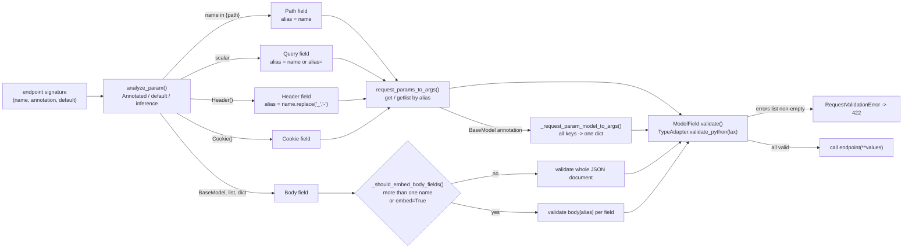

# Parameter Validation Mechanics: Path(), Query(), Header(), Cookie(), Body(), Embed, and Parameter Model Models

> [!summary] Claim
> `Path()`, `Query()`, `Header()`, `Cookie()`, and `Body()` are Pydantic `FieldInfo` subclasses that only choose which Starlette mapping a value is pulled from and under which key, after which every value is validated by one per-field `TypeAdapter` in lax Python mode, and nearly every production surprise (a list that became a body, a header that silently became `None`, a body that needs a wrapping key) is a consequence of that key-selection step rather than of Pydantic.

Part of [FastAPI Internals and Patterns](README.md) in [API Engineering](../README.md).

## TL;DR

- Mechanism: at route compile time `analyze_param()` turns each signature parameter into a `ModelField` tagged with a source (`path`, `query`, `header`, `cookie`, `body`); per request `request_params_to_args()` reads `request.path_params`, `request.query_params`, `request.headers`, or `request.cookies` under the field's alias and calls `TypeAdapter.validate_python()` on the extracted string or list.
- Contract rule: a bare scalar is a query parameter, a bare `BaseModel`, `list`, `dict`, or dataclass is a body parameter, and a name that appears in the path template is a path parameter; a `Query()`, `Header()`, or `Cookie()` wrapping a `BaseModel` turns the model's fields into individual parameters of that source (FastAPI `>= 0.115.0`).
- The trap: `Header()` rewrites `x_trace_id` to the header name `x-trace-id`, and an optional header model whose own headers are all absent becomes `None` without any error, so a client sending `x_trace_id` gets silently ignored.
- Portability: the behavior is pure Python in `fastapi/dependencies/utils.py` and independent of the HTTP version once the server has built the ASGI scope, but header lookup assumes the ASGI server lowercased header names, which Uvicorn, Hypercorn, and h11 do and the ASGI spec only recommends.
- When not to use it: do not put `strict=True` on a query, header, path, or cookie scalar (wire values are always `str`, so it rejects everything), and do not use `Body(embed=True)` or multi-body signatures for public APIs whose JSON shape must stay stable when someone adds a second body parameter.

## Mental model



Reading left to right: the signature is analyzed once, when `APIRoute` is constructed, and each parameter is routed by `analyze_param()` to exactly one source list on the `Dependant` (`path_params`, `query_params`, `header_params`, `cookie_params`, `body_params`).
The alias attached in that step is the only thing that ties a Python name to a wire key, and `Header()` is the only source that rewrites it by default.
Per request, the four non-body sources go through `request_params_to_args()`, which either extracts one value under one alias or, when the annotation is a `BaseModel`, collects every key of that source into a dict for the model.
Body fields go through `request_body_to_args()`, whose shape depends on a boolean computed at compile time: one non-embedded field means the whole JSON document is that field; otherwise each field is looked up as a top-level key.
Every leaf ends in the same `ModelField.validate()` call, errors from every source are concatenated rather than short-circuited, and a non-empty error list becomes one `422` response.

## How it works

### The parameter classes are FieldInfo with a source tag

`Param` subclasses Pydantic's `FieldInfo` and adds one class attribute, `in_`, typed as the `ParamTypes` enum whose members are `query`, `header`, `path`, and `cookie` (fastapi 0.162.0 fastapi/params.py, ParamTypes and Param).
`Path`, `Query`, `Header`, and `Cookie` set `in_` to their member and otherwise forward every keyword (`gt`, `ge`, `lt`, `le`, `min_length`, `max_length`, `pattern`, `strict`, `alias`, `validation_alias`, `deprecated`, `include_in_schema`, `openapi_examples`) to `Param.__init__`, which keeps `include_in_schema`, `openapi_examples`, and `example` as instance attributes and passes the rest to `FieldInfo.__init__` (fastapi 0.162.0 fastapi/params.py, Path.__init__ and Param.__init__).
`Path.__init__` starts with `assert default is ..., "Path parameters cannot have a default value"`, so a path parameter is always required.
`Header` adds one attribute, `convert_underscores: bool = True` (fastapi 0.162.0 fastapi/params.py, Header.__init__).
`Body` subclasses `FieldInfo` directly, not `Param`, and adds `embed: bool | None = None` and `media_type: str = "application/json"`; `Form` subclasses `Body` with `media_type="application/x-www-form-urlencoded"` and `File` subclasses `Form` with `"multipart/form-data"` (fastapi 0.162.0 fastapi/params.py, Body, Form, File).
`Param.__init__` and `Body.__init__` copy `alias` into `validation_alias` when the latter is unset, and into `serialization_alias` when `alias` is a string.
`Body.media_type` does not affect parsing: it is read only by `_get_body_field()`, to choose the media type of the synthesized body field, and by `get_openapi_operation_request_body()`, to name the `requestBody.content` key (fastapi 0.162.0 fastapi/dependencies/utils.py, _get_body_field; fastapi/openapi/utils.py, get_openapi_operation_request_body).
The request handler picks form or JSON parsing with `isinstance(body_field.field_info, params.Form)`, not from `media_type` (fastapi 0.162.0 fastapi/routing.py, get_request_handler).

### Compile time: analyze_param() picks one source per parameter

`get_dependant()` computes `path_param_names` with `re.findall("{(.*?)}", path)` on the route's path format and calls `analyze_param()` for each signature parameter (fastapi 0.162.0 fastapi/utils.py, get_path_param_names; fastapi/dependencies/utils.py, get_dependant).
`analyze_param()` resolves the field in this order (fastapi 0.162.0 fastapi/dependencies/utils.py, analyze_param):

1. A PEP 695 `type` alias is unwrapped through `__value__`.
2. For `Annotated[T, ...]`, the last metadata item that is a `Param`, `Body`, or `Depends` wins; a plain Pydantic `Field()` in the metadata does not count as a FastAPI annotation.
   The `FieldInfo` is copied with `copy_field_info()` because the next step mutates `default`, and the code asserts that no default was set inside `Annotated` ("Set the default value with `=` instead").
3. A `FieldInfo` used as the default value (`q: str = Query()`) is the legacy form and is rejected if combined with an `Annotated` FastAPI annotation.
4. If neither form is present, inference runs: a name in `path_param_names` becomes `params.Path`; an `UploadFile` annotation becomes `params.File`; an annotation for which `field_annotation_is_scalar()` is false becomes `params.Body`; everything else becomes `params.Query`.
5. `field_annotation_is_scalar()` is `annotation is Ellipsis or not field_annotation_is_complex(annotation)`; a union is complex if any member is, and complex means a subclass of `BaseModel`, `Mapping`, or `UploadFile`, a sequence type other than `str` and `bytes`, or a dataclass (fastapi 0.162.0 fastapi/_compat/shared.py, field_annotation_is_scalar, field_annotation_is_complex, and _annotation_is_complex).

Step 5 is why `ids: list[int]` with no `Query()` becomes a body parameter, which the FastAPI documentation states directly: a list query parameter needs an explicit `Query`, "otherwise it would be interpreted as a request body" (FastAPI docs, Query Parameters and String Validations).
The lab proves the classification: `infer(item_id: int, q: str, ids: list[int], item: Item, flag: bool = False)` on `/infer/{item_id}` compiles to `{"item_id": "path", "q": "query", "flag": "query", "ids": "body", "item": "body"}`.

After the source is chosen, the alias is fixed by this code, quoted from fastapi 0.162.0 `analyze_param()` (simplified excerpt, indentation reduced):

```python
if not field_info.alias and getattr(field_info, "convert_underscores", None):
    alias = param_name.replace("_", "-")
else:
    alias = field_info.alias or param_name
```

This is the whole header-name rule (fastapi 0.162.0 fastapi/dependencies/utils.py, analyze_param).
It only replaces underscores; it never lowercases, because lookup lowercases later.
An explicit `alias=` disables the rewrite, so `Header(alias="X_Legacy")` looks up the literal name.
Then `create_model_field()` builds a `ModelField`, and the function asserts that a path field is scalar and that a query field is scalar, a scalar sequence, or a `BaseModel` (`"Query parameter ... must be one of the supported types"`).
A header or cookie annotated `dict[str, str]` therefore passes compilation but has no wire representation; that combination is not exercised in the lab.

### One TypeAdapter per field, validated in lax Python mode

`ModelField.__post_init__` builds `TypeAdapter(Annotated[annotation, *metadata, Field(**attributes)])` once per field, and `ModelField.validate()` calls `self._type_adapter.validate_python(value, from_attributes=True)` and rewrites each error's `loc` with the source prefix (fastapi 0.162.0 fastapi/_compat/v2.py, ModelField.validate).
`validate_python`, not `validate_json`, is used for every source, including the JSON body, because the body has already been decoded by `json.loads`.
Lax mode is what turns wire strings into typed values: per the Pydantic conversion table, `str -> bool` accepts `'1'`, `'on'`, `'t'`, `'true'`, `'y'`, `'yes'` and `'0'`, `'off'`, `'f'`, `'false'`, `'n'`, `'no'` case-insensitively, and `str -> int` allows leading and trailing whitespace, underscores, and a zero fractional part (Pydantic docs, Conversion Table, as of 2026-11).
The Strict column has no check mark for `str -> int` or `str -> bool`, so `Query(strict=True)` on an `int` rejects every possible query value; the lab gets `int_type` at `["query", "n"]` for `?n=5`.
The same table is the source of `?verbose=yes` producing `True` in the lab.
The full coercion story is in [[Lax-vs-Strict-Validation-Modes-and-Coercion-Tables]].

### Request time: where each source reads from

`solve_dependencies()` first solves every sub-dependency, then runs four calls in fixed order and concatenates their errors: `request_params_to_args(dependant.path_params, request.path_params)`, then query against `request.query_params`, header against `request.headers`, and cookie against `request.cookies`, then `request_body_to_args()` if there are body params (fastapi 0.162.0 fastapi/dependencies/utils.py, solve_dependencies).
Because sub-dependencies run first and only a sub-dependency's own errors stop it (`if solved_result.errors: errors.extend(...); continue`), a dependency whose inputs are valid executes even when the endpoint's own query parameter then fails.
The lab's `audit` dependency appends to a list on `/audited?n=abc` and the response is still `422` with `int_parsing` at `["query", "n"]`.
Ordering and caching of that DAG belong to [[Dependency-Injection-Engine-DAG-Resolution-and-Use-Cache-Mechanics]].

The four Starlette mappings behave differently, and those differences are the source of most bugs:

| Source | Starlette object | Built from | Repeated key | Lookup |
| --- | --- | --- | --- | --- |
| Path | `dict[str, Any]` | route regex match on `scope["path"]` | impossible | exact |
| Query | `QueryParams` (`ImmutableMultiDict`) | `parse_qsl(query_string.decode("latin-1"), keep_blank_values=True)` | kept, `getlist()` | exact, case-sensitive |
| Header | `Headers` | `scope["headers"]` list of byte pairs, as given | kept, `getlist()` | `key.lower().encode("latin-1")` compared to stored bytes |
| Cookie | `dict[str, str]` | `cookie_parser()` over every `cookie` header line | last wins | exact |

Sources: (starlette 1.10.0 starlette/datastructures.py, QueryParams.__init__ and Headers.getlist), (starlette 1.10.0 starlette/requests.py, cookie_parser and HTTPConnection.cookies).

`_get_multidict_value()` uses `values.getlist(alias)` only when the field is not a `Json` field, the annotation is a sequence, and the mapping is an `ImmutableMultiDict` or `Headers`; otherwise it uses `values.get(alias)` (fastapi 0.162.0 fastapi/dependencies/utils.py, _get_multidict_value).
It returns `Undefined` when the value is `None` or, for a sequence field, empty, so an absent `?tags` falls through to `_validate_value_with_model_field()`, which deep-copies `field.default` and skips validation unless `validate_default` is set (a required field gets a `missing` error instead).
Because `request.cookies` is a plain `dict`, a `list[str]` cookie parameter receives a single `str` and fails with `list_type` at `["cookie", "c"]` for `Cookie: c=a; c=b` (verifier probe, CPython 3.14.6, macOS 27.3); the cookie mapping cannot carry repeats.

### Path parameters: matched before FastAPI sees them

Starlette's default `StringConvertor.regex` is `[^/]+`, `IntegerConvertor` is `[0-9]+`, and `PathConvertor` is `.*` (starlette 1.10.0 starlette/convertors.py).
The regex runs against `scope["path"]`, which the ASGI spec defines as the path "with percent-encoded sequences and UTF-8 byte sequences decoded into characters" (ASGI HTTP Connection Scope, spec version 2.5).
So `/items/a%2Fb` reaches routing as `/items/a/b`, no route matches, and the response is `404`, not a `422`; the lab proves it under httpx's ASGI transport, which sets `"path": request.url.path` and `httpx.URL.path` returns the unquoted path (httpx 0.28.1 httpx/_transports/asgi.py, ASGITransport.handle_async_request; httpx/_urls.py, URL.path).
Hypercorn does the same with `"path": unquote(path.decode("ascii"))` (hypercorn 0.18.0 hypercorn/protocol/http_stream.py).
RFC 3986 Section 2.4 says components "must be parsed and separated before the percent-encoded octets within those components can be safely decoded", and decoding before routing is exactly the order it warns about.
Path parameter strings then go through the same lax `TypeAdapter`, which is why the lab's `422` for `/items/0` shows `"input": "0"` as a string.

### Query parameters: a multidict with no count limit

RFC 3986 Section 3.4 defines the query as `*( pchar / "/" / "?" )` and only remarks that it often carries `key=value` pairs; repeated keys are an application convention, not a standard.
Starlette parses it with `parse_qsl(..., keep_blank_values=True)` and no `max_num_fields` (CPython's default is `None`), so `?q=` yields `""` (an `int` field then fails with `int_parsing`) and the number of pairs is bounded only by the server's request-line limit.
A `list[str]` query field gets every repeat in order: `?tags=a&tags=b` becomes `["a", "b"]`.
FastAPI has no native `tags=a,b` or `tags[]=a` splitting; a comma-separated or bracket syntax has to be parsed by a validator or a custom dependency, which [[Query-Parameter-Filtering-Brackets-RHS-Colon-and-Validation]] covers.

### Headers: case-insensitive only if the server lowercased them

RFC 9110 Section 5.1 says "Field names are case-insensitive".
Starlette implements that by lowercasing the key at lookup time and comparing it byte-for-byte to the stored names, which it takes from `scope["headers"]` without lowercasing (starlette 1.10.0 starlette/datastructures.py, Headers.__init__ and Headers.__contains__).
The ASGI spec says "Header names should be lowercased, but it is not required", so the case-insensitivity is a joint property of Starlette and the server.
Uvicorn lowercases in both parsers (uvicorn 0.54.0 uvicorn/protocols/http/h11_impl.py, `self.headers = [(key.lower(), value) ...]`; uvicorn/protocols/http/httptools_impl.py, on_header), h11 lowercases in `normalize_and_validate` (h11 0.16.0 h11/_headers.py), and HTTP/2 requires it on the wire: "Field names MUST be converted to lowercase when constructing an HTTP/2 message" (RFC 9113 Section 8.2), with uppercase names making the message malformed (RFC 9113 Section 8.2.1).
The lab calls the ASGI app directly with `(b"X-Request-ID", b"r1")` and gets `422`, while the lowercase scope gets `200`, so a custom server, test harness, or middleware that rebuilds `scope["headers"]` with mixed case breaks every `Header()` lookup.

`list[str]` headers use `Headers.getlist()`, which returns one item per field line.
RFC 9110 Section 5.3 allows a recipient to combine field lines into one comma-separated line "without changing the semantics", so `X-Hop: a, b` and two `X-Hop` lines mean the same thing to HTTP, but to FastAPI the first is `["a, b"]` and the second is `["edge", "mesh"]`; the lab asserts both.
Any proxy that folds repeated lines changes what your endpoint receives, so split on commas yourself, ideally with an RFC 9651 parser ([[Structured-Field-Values-for-HTTP-RFC-9651]]).

The underscore rewrite exists because RFC 9110 Section 5.6.2 does allow `_` in a `tchar`, yet common intermediaries reject it: nginx's `underscores_in_headers` defaults to `off`, which marks such fields invalid, and `ignore_invalid_headers` defaults to `on`, which drops them (nginx docs, ngx_http_core_module).
`Header(convert_underscores=False)` reads the literal underscore name; the lab sends both `legacy_key: k1` and `legacy-key: k2` and receives `k1`.
FastAPI's own docs warn that "some HTTP proxies and servers disallow the usage of headers with underscores" (FastAPI docs, Header Parameter Models).

### Cookies: one dict, last duplicate wins

RFC 6265 Section 4.2.1 defines `cookie-string = cookie-pair *( ";" SP cookie-pair )`, Section 5.4 says a user agent "MUST NOT attach more than one Cookie header field", and Section 4.2.2 says servers "SHOULD NOT rely upon the serialization order".
HTTP/2 relaxes the single-header rule: the `Cookie` field "MAY be split into separate header fields" for compression and must be concatenated with `"; "` on decompression (RFC 9113 Section 8.2.3).
Starlette's `HTTPConnection.cookies` iterates `self.headers.getlist("cookie")` and calls `cookies.update(cookie_parser(header))` for each, so split HTTP/2 cookies work whether or not the server rejoined them (starlette 1.10.0 starlette/requests.py, HTTPConnection.cookies).
`cookie_parser()` splits on `;`, splits each chunk on the first `=`, strips, keeps a chunk without `=` under the empty name, and unquotes with `http.cookies._unquote`; its docstring says it is adapted from Django 3.1.0 and deliberately does not use `SimpleCookie.load`.
Because the result is a `dict`, `session_id=s1; session_id=s2` yields `s2`; browsers send the longer-path cookie first (RFC 6265 Section 5.4, a SHOULD), so the more specific cookie is the one Starlette discards.
The lab asserts `{"session_id": "s2", "theme": "light"}`.

### Parameter models: Query(), Header(), Cookie() around a BaseModel

Since FastAPI `0.115.0` a `BaseModel` annotated with `Query()`, `Header()`, or `Cookie()` is a set of parameters, not a body (FastAPI docs, Query Parameter Models and Header Parameter Models).
`_get_param_model()` unwraps `Model | None` for those three classes and returns the model unless the field carries `Json` metadata, and `get_flat_params()` expands its fields for OpenAPI (fastapi 0.162.0 fastapi/dependencies/utils.py, _get_param_model and _get_flat_fields_from_params).
At request time `_request_param_model_to_args()` does the following (fastapi 0.162.0 fastapi/dependencies/utils.py, _request_param_model_to_args):

1. For each model field it computes `(validation alias, request key)` pairs with `_get_param_aliases()`; for headers, `convert_underscores` comes from the field or else from the wrapping `Header()`, and a field named `x_trace_id` without an alias maps to the request key `x-trace-id`.
2. It extracts the first pair whose request key is present, with `getlist()` for sequence fields, into a dict keyed by the validation alias.
3. Every other key in the mapping is added to the same dict (lists of length one collapsed to the scalar), so the model's own `extra` policy decides: `extra="forbid"` produces `extra_forbidden` errors with `loc` `["query", "tool"]` or `["cookie", "tracker"]`, exactly as in the lab and the FastAPI docs example.
   For headers, the unconverted names (`x_trace_id`) are recorded as processed so they are not reported as extras.
4. If the annotation is not exactly the model (for example `TraceHeaders | None`) and none of the model's own names are present, and the model does not set `extra` to `allow` or `forbid` with extras present, the value becomes `Undefined`, so the default `None` applies.
5. For header models, error locations are rewritten from the field alias to the header name when the model's `loc_by_alias` config is not `False`.

Step 4 is the silent failure: the lab's `/trace` returns `{"headers": null}` both when no header is sent and when the client sends `x_trace_id: t1`, because the underscore name is not one of the model's own request keys.
With extras forbidden, a misspelled single parameter fails loudly; with the default `extra="ignore"` and an optional model, it vanishes.
Note also that with `extra="forbid"` on a header model, every header the client or proxy adds (`user-agent`, `accept`, `x-forwarded-for`) is an extra, which is why the FastAPI docs call that "probably not very common".

### Body: one field is the document, two fields are keys

`APIRoute` computes `embed_body_fields = _should_embed_body_fields(body_params)` from the flattened body params of the endpoint and all its dependencies (fastapi 0.162.0 fastapi/routing.py, _build_dependant_with_parameterless_dependencies).
`_should_embed_body_fields()` returns `True` when there is more than one distinct body parameter name, when one name maps to differing form models across dependencies, when the first field has `embed=True`, or when it is a non-model `Form` field, and `False` otherwise (fastapi 0.162.0 fastapi/dependencies/utils.py, _should_embed_body_fields).
`request_body_to_args()` then has two paths (fastapi 0.162.0 fastapi/dependencies/utils.py, request_body_to_args):

- Single and not embedded: the entire decoded body is validated against the one field with `loc=("body",)`.
  `item: Item` accepts `{"name": "a", "price": 1}`, and a lone `count: Annotated[int, Body()]` accepts the JSON document `5` and rejects `{"count": 5}` with `int_type` at `["body"]`, which the lab asserts.
- Embedded: each field is looked up as `body_to_process.get(alias)` with `loc=("body", alias)`; if the body is a list, scalar, or `null`, the resulting `AttributeError` is turned into a `missing` error.
  `item: Annotated[Item, Body(embed=True)]` therefore rejects a bare item with `missing` at `["body", "item"]` and accepts `{"item": {...}}`.

The FastAPI docs show the multi-body shape `{"item": {...}, "user": {...}, "importance": 5}`, keyed by parameter name (FastAPI docs, Body - Multiple Parameters).
`_get_body_field()` synthesizes a `Body_<route name>` model for OpenAPI when embedding, and its docstring says it is used to detect form data and to generate the JSON Schema but is not used to validate or parse the request body; validation always goes field by field.

Before any of that, `get_request_handler()` decides whether to call `json.loads` at all (fastapi 0.162.0 fastapi/routing.py, get_request_handler):

- the body is read with `await request.body()`, which concatenates every chunk with no size cap (starlette 1.10.0 starlette/requests.py, Request.body);
- an empty body stays `Undefined`, so a required body field yields `missing`;
- with a `Content-Type`, the value is parsed with `email.message.Message`, and JSON decoding happens only for main type `application` with subtype `json` or a subtype ending in `+json`, so `application/vnd.api+json; charset=utf-8` works (lab-verified);
- without a `Content-Type`, JSON is decoded only when `strict_content_type=False`; the default has been strict since FastAPI `0.132.0`, as CSRF protection against scripts that send bodies without a preflight (FastAPI docs, Strict `Content-Type` Checking);
- any other media type leaves the raw `bytes` as the body, so a model field fails with `model_attributes_type` at `["body"]`, which the lab reproduces for a missing `Content-Type`;
- a `json.JSONDecodeError` becomes `json_invalid` with `loc` `["body", e.pos]` (the lab gets position `8` for `{"name":`), and any other parsing exception becomes `HTTPException(400, "There was an error parsing the body")`.

## Numbers and limits

| Quantity | Value | Source |
| --- | --- | --- |
| Path segment convertor (`str`) | regex `[^/]+` | starlette 1.10.0 starlette/convertors.py, StringConvertor |
| `int` convertor | regex `[0-9]+` | starlette 1.10.0 starlette/convertors.py, IntegerConvertor |
| Query pair count limit | none (`parse_qsl` `max_num_fields=None`) | starlette 1.10.0 QueryParams.__init__; CPython 3.14.6 urllib/parse.py, parse_qsl |
| Request line plus headers on h11 | `16 * 1024` bytes default | h11 0.16.0 h11/_connection.py, DEFAULT_MAX_INCOMPLETE_EVENT_SIZE; tunable via Uvicorn `h11_max_incomplete_event_size` (uvicorn 0.54.0 uvicorn/config.py) |
| nginx header buffers | `large_client_header_buffers 4 8k` default | nginx docs, ngx_http_core_module (as of 2026-11) |
| Oversized headers status | `431 Request Header Fields Too Large` | RFC 6585 Section 5 |
| Cookie capacity browsers SHOULD support | 4096 bytes per cookie, 50 per domain, 3000 total | RFC 6265 Section 6.1 |
| JSON body size cap in `Request.body()` | none | starlette 1.10.0 starlette/requests.py, Request.body |
| Form parser defaults | `max_files=1000`, `max_fields=1000`, `max_part_size=1024 * 1024` | starlette 1.10.0 starlette/requests.py, Request._get_form |
| Parameter models available | FastAPI `>= 0.115.0` | FastAPI docs, Query Parameter Models |
| Strict `Content-Type` default | FastAPI `>= 0.132.0` | FastAPI docs, Strict `Content-Type` Checking |
| `TypeAdapter` builds per field | one, at route compile time | fastapi 0.162.0 fastapi/_compat/v2.py, ModelField.__post_init__ |
| Lab suite | 17 tests, `17 passed in 2.58s` | measured by the verifier on 2026-11-14: `uv run --frozen pytest ... -q` from `labs/`, CPython 3.14.6, macOS 27.3 (`uname -r` = `27.3.0`), Apple Silicon arm64 |

The lab time is wall time for the whole module including app construction, not a per-request cost; this note makes no per-request latency claim.

## Portability

| Dimension | Behavior | Evidence |
| --- | --- | --- |
| CPython 3.14.6 | all 17 lab assertions hold | ran the lab once on macOS 27.3 |
| CPython 3.12.16, 3.13.18, 3.15.2, 3.15.2t | not run | lab matrix runs paused on 2026-11-11 by the user; the mechanism is pure Python in FastAPI and Starlette with no version branches in the functions cited, but that is an inference, not a test |
| FastAPI `< 0.115.0` | a `BaseModel` under `Query()` is not a parameter model | FastAPI docs, Query Parameter Models |
| FastAPI `< 0.132.0` | missing `Content-Type` body parsed as JSON | FastAPI docs, Strict `Content-Type` Checking |
| Uvicorn h11 and httptools | lowercases header names, decodes path | uvicorn 0.54.0 h11_impl.py and httptools_impl.py source read |
| Hypercorn | lowercases on h11, `unquote()` path | hypercorn 0.18.0 hypercorn/protocol/h11.py and http_stream.py source read |
| Granian | percent-decodes `path` with `percent_decode_str`, keeps `raw_path` undecoded, and takes header names from `http::HeaderName::as_str()`, which is "always lower case"; source read, not run (Granian is not in the lab lock) | granian `master` src/asgi/utils.rs, build_scope_common (as of 2026-11); http 1.5.0 docs, HeaderName::as_str |
| HTTP/1.1 | header case arbitrary on the wire, server must lowercase | RFC 9110 Section 5.1; ASGI spec 2.5 |
| HTTP/2 | lowercase names required; `Cookie` may arrive split | RFC 9113 Sections 8.2, 8.2.1, 8.2.3 |
| HTTP/3 | lowercase names required, uppercase is malformed; `Cookie` may be split and is rejoined with `"; "` | RFC 9114 Sections 4.2 and 4.2.1 |

## Worked example

The lab builds one app with an endpoint per mechanism: [implementation](../labs/src/api_labs/f11_fastapi_internals_and_patterns/param_validation.py) and [test](../labs/tests/f11_fastapi_internals_and_patterns/test_request_parameter_validation_path_query_header_cookie_and_body_models.py).

Simplified excerpt of `param_validation.py` (models and four of the endpoints):

```python
class FilterParams(BaseModel):
    """Query parameter model: every field is read from the query string."""

    model_config = ConfigDict(extra="forbid")

    limit: int = Field(default=10, gt=0, le=100)
    order_by: Literal["created_at", "updated_at"] = "created_at"
    tags: list[str] = []


class TraceHeaders(BaseModel):
    """Header parameter model: field `x_trace_id` is read from header `x-trace-id`."""

    x_trace_id: str
    x_hop: list[str] = []


def build_param_app(dependency_calls: list[str] | None = None) -> FastAPI:
    app = FastAPI()

    @app.get("/headers")
    async def read_headers(
        x_request_id: Annotated[str, Header()],
        x_hop: Annotated[list[str], Header()],
        legacy_key: Annotated[str | None, Header(convert_underscores=False)] = None,
    ) -> dict[str, object]:
        return {"x_request_id": x_request_id, "x_hop": x_hop, "legacy_key": legacy_key}

    @app.get("/search")
    async def search(filters: Annotated[FilterParams, Query()]) -> FilterParams:
        return filters

    @app.get("/trace")
    async def trace(
        headers: Annotated[TraceHeaders | None, Header()] = None,
    ) -> dict[str, object]:
        return {"headers": None if headers is None else headers.model_dump()}

    @app.post("/embedded")
    async def embedded(item: Annotated[Item, Body(embed=True)]) -> Item:
        return item

    return app
```

Two of the tests, verbatim from the test module:

```python
@pytest.mark.unit
@pytest.mark.asyncio
async def test_optional_header_model_is_none_unless_one_of_its_headers_arrives(
    client: httpx.AsyncClient,
) -> None:
    absent = await client.get("/trace")
    hyphen = await client.get("/trace", headers=[("x-trace-id", "t1"), ("x-hop", "a")])
    underscore = await client.get("/trace", headers={"x_trace_id": "t1"})

    assert absent.json() == {"headers": None}
    assert hyphen.json() == {"headers": {"x_trace_id": "t1", "x_hop": ["a"]}}
    assert underscore.json() == {"headers": None}
```

```python
@pytest.mark.unit
@pytest.mark.asyncio
async def test_single_model_body_is_bare_but_embed_requires_a_wrapping_key(
    client: httpx.AsyncClient,
) -> None:
    item = {"name": "a", "price": 1}

    bare = await client.post("/single", json=item)
    embedded_bare = await client.post("/embedded", json=item)
    embedded_wrapped = await client.post("/embedded", json={"item": item})

    assert bare.json() == {"name": "a", "price": 1.0}
    assert _errors(embedded_bare) == [("missing", ["body", "item"])]
    assert embedded_wrapped.json() == {"name": "a", "price": 1.0}
```

Captured run, from `labs/`, CPython 3.14.6 (`uv run --frozen python -VV` prints `Python 3.14.6 (main, Jun 23 2026, 15:46:31) [Clang 22.1.3 ]`), macOS 27.3:

```text
$ uv run --frozen pytest tests/f11_fastapi_internals_and_patterns/test_request_parameter_validation_path_query_header_cookie_and_body_models.py -q
.................                                                        [100%]
17 passed in 2.58s
```

Responses captured by the verifier from an in-process probe (httpx `ASGITransport`) against `build_param_app()` under the same interpreter; the `no-ct` and `bad` lines are `POST /single` with `json.dumps({"name": "a", "price": 1}).encode()` and no `Content-Type`, and with `{"name":` as `application/json`:

```text
GET /items/0?verbose=maybe 422 {"detail":[{"type":"greater_than_equal","loc":["path","item_id"],"msg":"Input should be greater than or equal to 1","input":"0","ctx":{"ge":1}},{"type":"bool_parsing","loc":["query","verbose"],"msg":"Input should be a valid boolean, unable to interpret input","input":"maybe"}]}
GET /search?limit=5&tags=x&tags=y&tool=plumbus 422 {"detail":[{"type":"extra_forbidden","loc":["query","tool"],"msg":"Extra inputs are not permitted","input":"plumbus"}]}
GET /session {'cookie': 'session_id=s1; session_id=s2'} 200 {"session_id":"s2","theme":"light"}
no-ct 422 {"detail":[{"type":"model_attributes_type","loc":["body"],"msg":"Input should be a valid dictionary or object to extract fields from","input":"{\"name\": \"a\", \"price\": 1}"}]}
bad 422 {"detail":[{"type":"json_invalid","loc":["body",8],"msg":"JSON decode error","input":{},"ctx":{"error":"Expecting value"}}]}
```

The test module covers seventeen behaviors: signature inference, repeated query keys and lax `bool`, error aggregation across sources, dependency execution before endpoint validation, `%2F` routing, underscore-to-hyphen conversion, unsplit comma values, repeated header lines, `convert_underscores=False`, server-side lowercasing, query models with `extra="forbid"`, optional header models, cookie duplicates and extras, `strict=True` on a query `int`, single versus embedded bodies, multi-body keys, single scalar bodies, and `Content-Type` gating.

## Pitfalls

> [!warning] A list parameter without Query() becomes the request body
> Trigger: `ids: list[int] = []` on a `GET` endpoint.
> Symptom: OpenAPI shows a `requestBody` on a `GET` (`GET` is in `METHODS_WITH_BODY` in fastapi 0.162.0 fastapi/openapi/constants.py), and clients sending `?ids=1&ids=2` see the default or a `422` with `loc` `["body"]`.
> Fix: `ids: Annotated[list[int], Query()] = []`; the rule is in `analyze_param()` step 4 and the FastAPI docs.

> [!warning] Optional header model silently becomes None
> Trigger: `headers: Annotated[TraceHeaders | None, Header()] = None` and a client or proxy sends `x_trace_id` (underscore) or a misspelled header.
> Symptom: the endpoint sees `None` and skips tracing or tenant checks with no `422`.
> Fix: make the model required, or set `extra="forbid"` only if you control every header, or validate presence explicitly; never gate authorization on an optional header model.

> [!warning] strict=True on a non-body scalar rejects every request
> Trigger: `Query(strict=True)` or `Header(strict=True)` on `int`, `bool`, `float`, or `UUID`.
> Symptom: `422` `int_type` for `?n=5`.
> Fix: keep wire sources lax and tighten with `pattern=`, `ge=`, or an `AfterValidator`; use strict mode only for JSON body fields.

> [!warning] Adding a second body parameter changes the JSON contract
> Trigger: an endpoint takes `item: Item`, and someone adds `note: Annotated[str, Body()]` or a dependency that declares a body field.
> Symptom: every existing client that sent a bare item now receives `missing` at `["body", "item"]`, because `_should_embed_body_fields()` counts body names across the whole dependency tree.
> Fix: decide the wire shape explicitly with `Body(embed=True)` from day one, or wrap everything in one request model; add a contract test that posts the old shape.

> [!warning] Comma-joined headers arrive as one list item
> Trigger: `x_forwarded_for: Annotated[list[str], Header()]` behind a proxy that folds repeated lines.
> Symptom: `["10.0.0.1, 10.0.0.2"]` instead of two items, so "take the last hop" logic picks the wrong value.
> Fix: split on commas with a structured-field parser and decide trust from the proxy configuration, not from list position.

> [!warning] Missing `Content-Type` produces a confusing `422`
> Trigger: a client posts JSON with no `Content-Type` (for example `fetch()` with a `Blob` body) or with a non-JSON one such as `text/plain`, against FastAPI `>= 0.132.0`.
> Symptom: `model_attributes_type` "Input should be a valid dictionary or object" with the raw JSON text as `input`.
> Fix: send `Content-Type: application/json`; set `strict_content_type=False` only for trusted non-browser clients, since the default exists as CSRF protection.

> [!warning] Form parsing ReDoS (CVE-2024-24762)
> Trigger: an app that declares `Form()` or `File()` parameters on FastAPI `<= 0.109.0` with a vulnerable `python-multipart`.
> Symptom: a crafted `Content-Type` option string makes the parser regex take minutes and blocks the event loop; JSON-only endpoints are unaffected.
> Fix: FastAPI `0.109.1` and `python-multipart` `0.0.7` or later (vulnerable `<= 0.0.6`) (GitHub advisory GHSA-qf9m-vfgh-m389, withdrawn on 2024-02-16 as a duplicate of GHSA-2jv5-9r88-3w3p; CVSS 3.1 base 7.5, `AV:N/AC:L/PR:N/UI:N/S:U/C:N/I:N/A:H`).

## Security and robustness

- Mass assignment (OWASP API3:2023 Broken Object Property Level Authorization): a body model with the default `extra="ignore"` drops unknown fields, which is safe for writes only if the model itself excludes server-owned fields such as `role` or `price`; OWASP's guidance is to "avoid using functions that automatically bind a client's input" into internal objects and to allowlist writable properties, which means separate input models, not reuse of the ORM model ([[Defeating-BOPLA-and-Mass-Assignment-API3-2023-Strict-Input-Output-Schemas]]).
- `extra="forbid"` on query and cookie models turns unexpected input into a `422`, which is useful for catching typos and parameter-pollution probes, but on header models it rejects ordinary browser and proxy headers.
- Duplicate-key ambiguity: cookies resolve last-wins in Starlette, while browsers SHOULD list longer paths first, so a same-name cookie set on a broader path (for example `Path=/` by a sibling subdomain or an injected script) is serialized last and wins over the application's own path-scoped cookie.
  RFC 6265 Section 4.2.2 says servers "SHOULD NOT rely upon the serialization order", so do not authenticate from a cookie name that another origin can set, prefer `__Host-` prefixed names, and treat a repeated name as suspicious rather than resolving it ([[CSRF-in-Cookie-Authenticated-APIs-SameSite-Double-Submit-and-Fetch-Metadata]]).
  A `__Host-` cookie must have been set with `Secure`, `Path=/`, and no `Domain` attribute, so a sibling subdomain cannot plant one (draft-ietf-httpbis-rfc6265bis-22 Section 4.1.3.2, an Internet-Draft rather than an RFC, as of 2026-11).
- Header normalization differences between tiers (nginx dropping `_` names, proxies folding lines, servers lowercasing) are a desync surface: two hops may disagree on whether `X_Auth_User` exists, so strip identity headers at the edge and re-add them ([[HTTP-Desync-and-Header-Normalization-Across-Multi-Tier-Proxies]]).
- Resource bounds: FastAPI adds no query-count, header-count, or JSON-size limit; `Request.body()` buffers the whole body before `json.loads`, so the limits are the server's (`h11` 16 KiB for headers by default) and the proxy's body-size limit (OWASP API4:2023 Unrestricted Resource Consumption).
  `max_length` on a `list` query field bounds the number of items only after parsing.
- Validation errors echo `input` back to the caller, including header and cookie values; if a `Cookie()` field holds a session token, a malformed token is reflected in the `422` body and in any log that records responses, so override the `RequestValidationError` handler to redact ([[Exception-Handling-in-FastAPI-HTTPException-vs-RequestValidationError]]).
- Side effects before validation: a dependency with valid inputs runs even when an endpoint parameter then fails, so rate-limit counters, audit writes, and lock acquisition in dependencies happen for requests that end in `422`; put cheap shape validation first or make such dependencies depend on the validated parameters.

## The principal's view

The decision is where the wire contract lives.
FastAPI's inference makes the Python signature the contract, which is fast to write and drifts silently: adding a dependency with a body field, changing `item: Item` to two parameters, or renaming a header parameter all change the HTTP interface without a diff in any schema file.
For internal services with one owning team, accept inference but pin the shapes with parameter models and contract tests that post the exact JSON and header names.
For public or multi-team APIs, make the OpenAPI document the reviewed artifact ([[OpenAPI-Generation-Internals-in-FastAPI-Get-OpenAPI-and-Separate-Schemas]]), forbid implicit body inference by convention (always `Annotated[..., Body()]`, `Query()`, `Header()` explicitly), use one request model per endpoint so embedding never flips, and lint for `Header()` fields that rely on underscore conversion.
The organizational trade-off is velocity for new endpoints versus the cost of breaking clients; the second is paid by other teams, which is why it should win once there is more than one consumer.
Choose a different tool when the cost of per-field `TypeAdapter` dispatch and multidict extraction matters or when you want the schema to be the source of truth: gRPC or a schema-first OpenAPI code generator removes signature inference from the contract entirely, and the framework comparison, including Litestar, is in [[FastAPI-Architectural-Limits-and-Comparison-with-Litestar-and-Raw-Starlette]].
Also decide, once and centrally, the status-code policy: FastAPI returns `422` for malformed JSON and for an unsupported or missing media type, while RFC 9110 Section 15.5.21 defines `422` for content whose type is understood and syntax correct, and Section 15.5.16 defines `415 Unsupported Media Type`; a gateway or custom handler that maps those cases to `400` and `415` is closer to the RFC, at the cost of diverging from FastAPI defaults that clients may already parse.

## Interview questions

> [!question] L5: Why does `def f(ids: list[int] = []): ...` on a `GET` route not read `?ids=1&ids=2`?
>
> > [!success]- Answer
> > `analyze_param()` infers the source when no `Query()`, `Body()`, or `Path()` is given.
> > A `list` annotation is complex by `field_annotation_is_scalar()`, so the parameter becomes `params.Body`.
> > The query string is never consulted for it.
> > Declare it as `Annotated[list[int], Query()]`.
> >
> > Follow-up: What does OpenAPI show for that endpoint before the fix?

> [!question] L5: What header name does `x_request_id: Annotated[str, Header()]` read, and is the lookup case-sensitive?
>
> > [!success]- Answer
> > The alias becomes `x-request-id` because `convert_underscores` defaults to `True` and `analyze_param()` replaces `_` with `-`.
> > Lookup lowercases the key and compares bytes with the stored names, so `X-Request-ID` matches as long as the server stored names in lowercase.
> > Uvicorn, Hypercorn on h11, and HTTP/2 framing all guarantee lowercase names.
> >
> > Follow-up: How do you read a header whose real name contains an underscore?

> [!question] L5: Predict the output: with `@app.post("/scalar") async def scalar(count: Annotated[int, Body()])`, what do `POST /scalar` with JSON `5` and with JSON `{"count": 5}` return?
>
> > [!success]- Answer
> > JSON `5` returns `200` with `{"count": 5}`.
> > JSON `{"count": 5}` returns `422` with `int_type` at `["body"]`.
> > A single body parameter without `embed=True` is validated against the whole document, so the scalar itself is the body.
> > Adding a second body parameter, or `embed=True`, flips both results.
> >
> > Follow-up: Which function decides that, and does it look at dependencies' body parameters?

> [!question] L6: Debug this API: after a client library upgrade, tracing stopped on an endpoint that takes `headers: Annotated[TraceHeaders | None, Header()] = None` with field `x_trace_id`, logs show the client now sends `x_trace_id: abc`, and no `422` appears, so why?
>
> > [!success]- Answer
> > The header model's request key for `x_trace_id` is `x-trace-id`.
> > `_request_param_model_to_args()` finds none of the model's own names in `request.headers` and the model does not forbid extras, so it returns `Undefined`.
> > Because the annotation is `TraceHeaders | None` with default `None`, the default applies silently.
> > Fix the client, or accept both names with `validation_alias=AliasChoices("x-trace-id", "x_trace_id")`, and make the model required if tracing is mandatory.
> > Check the edge as well, since nginx drops underscore headers by default.
> >
> > Follow-up: What would change if the model set `extra="forbid"`?

> [!question] L6: Two hops send `X-Hop: edge` and `X-Hop: mesh` as separate lines; a third proxy folds them into `X-Hop: edge, mesh`. What does `x_hop: Annotated[list[str], Header()]` receive in each case, and what does RFC 9110 say?
>
> > [!success]- Answer
> > Separate lines produce `["edge", "mesh"]` through `Headers.getlist()`.
> > The folded line produces `["edge, mesh"]`, one item.
> > RFC 9110 Section 5.3 allows a recipient to combine lines with commas without changing semantics, so both forms mean the same thing in HTTP.
> > FastAPI does not split on commas, so the endpoint must normalize, ideally with a structured-field parser.
> >
> > Follow-up: Why is `Set-Cookie` the classic exception to combining?

> [!question] L6: A request to `/items/0?verbose=maybe` on `item_id: Annotated[int, Path(ge=1)]`, `verbose: bool = False` returns how many errors, in what order, and why is the path `input` a string?
>
> > [!success]- Answer
> > Two errors: `greater_than_equal` at `["path", "item_id"]`, then `bool_parsing` at `["query", "verbose"]`.
> > `solve_dependencies()` validates path, query, header, and cookie in that fixed order and concatenates errors instead of stopping at the first.
> > The input is `"0"` because Starlette's route match yields strings and FastAPI validates them in lax mode, converting only on success.
> >
> > Follow-up: Does a dependency of that endpoint run before those errors are reported?

> [!question] L7+: A team wants every endpoint to reject unknown query parameters to catch client typos; how would you implement it, and what are the operational costs?
>
> > [!success]- Answer
> > Use a query parameter model per endpoint with `extra="forbid"`, which makes `_request_param_model_to_args()` pass every unconsumed key to the model and produce `extra_forbidden` at `["query", key]`.
> > The cost is that adding any query parameter on the client before the server ships is now a breaking change, which inverts the usual tolerant-reader evolution rule.
> > Cache-busting parameters, tracking parameters appended by marketing tools, and gateway-added keys all become `422`s.
> > I would apply it to internal and admin APIs, emit a metric instead of failing on public APIs during rollout, and document the policy in the API guidelines so it is a deliberate contract choice.
> >
> > Follow-up: Would you also forbid extras on header models, and why not?

> [!question] L7+: Your platform maps FastAPI's `422` for malformed JSON to `400` and for a missing or non-JSON `Content-Type` to `415`; justify that with RFC sections and describe how you would keep it consistent across services.
>
> > [!success]- Answer
> > RFC 9110 Section 15.5.21 defines `422` for content whose type the server understands and whose syntax is correct, which malformed JSON and an unknown media type are not.
> > Section 15.5.16 defines `415` for content in a format the method does not support for the resource.
> > FastAPI produces `model_attributes_type` at `["body"]` for a non-JSON media type and `json_invalid` for decode errors, so a shared `RequestValidationError` handler can map those two error types to `415` and `400` without touching the other `422`s.
> > Ship it in a platform library used by every service, cover it with contract tests, and record it in the OpenAPI responses so clients are not surprised.
> >
> > Follow-up: What breaks for existing clients that parse `detail` from every `422`?

> [!question] L7+: Explain why a rate-limiting dependency can count requests that later fail with `422`, and how you would restructure it.
>
> > [!success]- Answer
> > `solve_dependencies()` solves and calls every sub-dependency first, and only skips a sub-dependency if its own inputs fail.
> > The endpoint's own path, query, header, cookie, and body parameters are validated afterwards, so a valid `x-tenant` header lets the limiter run even when `?n=abc` then fails.
> > If counting malformed requests is undesirable, move the parameters the limiter cares about into a dependency that the limiter depends on, or validate shape in middleware first.
> > Often counting them is correct, because malformed floods are exactly what a limiter should see.
> >
> > Follow-up: How does `use_cache` interact with a limiter declared twice in the tree?

## Related

Prerequisites: [[APIRoute-Compilation-Signature-Inspection-and-Dependant-Construction]]

Next: [[Dependency-Injection-Engine-DAG-Resolution-and-Use-Cache-Mechanics]]

See also: [[02-Programming-Languages/Python/Python-Backend-Interview-Prep/04-FastAPI]], [[Lax-vs-Strict-Validation-Modes-and-Coercion-Tables]], [[Exception-Handling-in-FastAPI-HTTPException-vs-RequestValidationError]], [[OpenAPI-Generation-Internals-in-FastAPI-Get-OpenAPI-and-Separate-Schemas]], [[Starlette-Request-Internals-Stream-Consumption-and-Body-Caching]], [[ASGI-3-0-Callable-Contract-Scope-Receive-and-Send]], [[Query-Parameter-Filtering-Brackets-RHS-Colon-and-Validation]], [[Structured-Field-Values-for-HTTP-RFC-9651]], [[HTTP-Desync-and-Header-Normalization-Across-Multi-Tier-Proxies]], [[Defeating-BOPLA-and-Mass-Assignment-API3-2023-Strict-Input-Output-Schemas]], [[CSRF-in-Cookie-Authenticated-APIs-SameSite-Double-Submit-and-Fetch-Metadata]], [[FastAPI-Architectural-Limits-and-Comparison-with-Litestar-and-Raw-Starlette]]

- Lab: `labs/tests/f11_fastapi_internals_and_patterns/test_request_parameter_validation_path_query_header_cookie_and_body_models.py`

## Further reading

- [fastapi 0.162.0 fastapi/dependencies/utils.py](https://raw.githubusercontent.com/fastapi/fastapi/0.162.0/fastapi/dependencies/utils.py): `analyze_param`, `request_params_to_args`, `_request_param_model_to_args`, and `_should_embed_body_fields`, the whole mechanism in one file.
- [starlette 1.10.0 starlette/requests.py](https://raw.githubusercontent.com/Kludex/starlette/1.10.0/starlette/requests.py): `cookie_parser` and `HTTPConnection.cookies`, the last-wins cookie mapping.
- [RFC 9110 HTTP Semantics](https://www.rfc-editor.org/rfc/rfc9110.html): Sections 5.1, 5.3, and 5.6.2 for field-name case, line combining, and `tchar`; Sections 15.5.16 and 15.5.21 for `415` and `422`.
- [RFC 9113 HTTP/2](https://www.rfc-editor.org/rfc/rfc9113.html): Sections 8.2, 8.2.1, and 8.2.3 for lowercase names and split `Cookie` fields.
- [RFC 6265 HTTP State Management](https://www.rfc-editor.org/rfc/rfc6265.html): Sections 4.2, 5.4, and 6.1 for cookie syntax, ordering, and size limits.
- [RFC 3986 URI Generic Syntax](https://www.rfc-editor.org/rfc/rfc3986.html): Sections 2.4 and 3.4 for decode-after-split and the query component.
- [RFC 6585](https://www.rfc-editor.org/rfc/rfc6585.html): Section 5 defines `431` for oversized header sections.
- [ASGI HTTP and WebSocket specification](https://asgi.readthedocs.io/en/latest/specs/www.html): the `path`, `query_string`, and `headers` scope keys whose decoding and case rules Starlette inherits.
- [FastAPI Query Parameter Models](https://fastapi.tiangolo.com/tutorial/query-param-models/) and [Header Parameter Models](https://fastapi.tiangolo.com/tutorial/header-param-models/): maintainer documentation for `0.115.0` parameter models and `extra="forbid"`.
- [FastAPI Strict `Content-Type` Checking](https://fastapi.tiangolo.com/advanced/strict-content-type/): the `0.132.0` default and its CSRF rationale.
- [Pydantic conversion table](https://pydantic.dev/docs/validation/latest/concepts/conversion_table/): the lax and strict coercions that every non-body parameter depends on.
- [GHSA-qf9m-vfgh-m389](https://github.com/advisories/GHSA-qf9m-vfgh-m389): the form-parsing ReDoS that made `Form()` endpoints a DoS surface.
