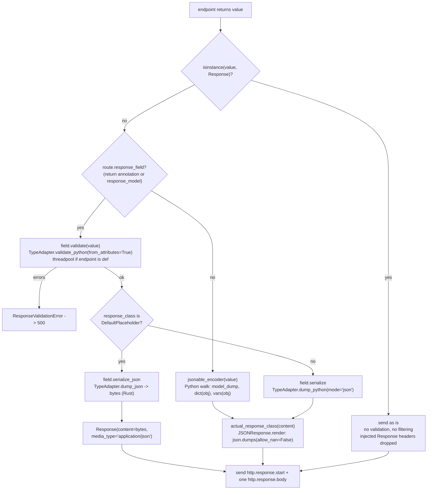

# The FastAPI Response Pipeline: serialize_response(), response_model Validation, jsonable_encoder(), and Avoiding Double Serialization

> [!summary] Claim
> In FastAPI `0.162.0` a route with a Pydantic return type and no `response_class` takes a Rust fast path (`TypeAdapter.validate_python(from_attributes=True)` then `TypeAdapter.dump_json()`), every other branch pays for an intermediate Python object tree and `json.dumps`, and the remaining "double" cost is validation - including `model_validator(mode="after")` re-running on instances you already built - not serialization.

Part of [FastAPI Internals and Patterns](README.md) in [API Engineering](../README.md).

## TL;DR

- Mechanism: `get_request_handler()` hands the endpoint's return value to `serialize_response()`, which validates it against the route's `response_field` `TypeAdapter` and then serializes it - straight to bytes with `dump_json()` when no `response_class` was declared (FastAPI `>= 0.130.0`), otherwise to a JSON-ready Python tree that `JSONResponse.render()` feeds to `json.dumps`.
- Contract rule: the declared return type or `response_model` is both the output filter and the wire format, so `Decimal`, `datetime`, `NaN`, and subclass fields come out differently depending on which branch ran; pick the branch deliberately and pin it with a test.
- The trap: setting any `response_class` - including `JSONResponse` itself, or `FastAPI(default_response_class=...)` - silently disables the fast path, turns `NaN` from `null` into a `500`, and costs about 1.8x more serializer CPU at 1000 items in the lab.
- Portability: the pipeline is pure Python and Rust inside the app, so it is identical across Uvicorn, Hypercorn, Granian, and HTTP/1.1, HTTP/2, HTTP/3; the version that matters is FastAPI (`0.130.0` added the fast path, `0.131.0` deprecated `ORJSONResponse`).
- When not to use it: return a pre-serialized `Response` only for payloads you have already validated and filtered (cached bytes, proxied upstream JSON), because a returned `Response` bypasses `response_model` filtering, the injected `Response` headers, and `ResponseValidationError` entirely.

## Mental model



The endpoint's return value meets three decisions in order.
First, a `Response` instance short-circuits everything: FastAPI only attaches the request's `BackgroundTasks` (when the response has none of its own) and sends it.
Second, if the route has no `response_field` (no return annotation, a `Response` annotation, or `response_model=None`), FastAPI falls back to the pure-Python `jsonable_encoder()` walk and then lets the response class call `json.dumps`.
Third, with a `response_field`, FastAPI validates the value through the route's `TypeAdapter`, raising `ResponseValidationError` on failure, and then the presence or absence of an explicitly declared `response_class` decides whether the Rust serializer writes bytes directly or whether a Python dict tree is built and handed to `json.dumps`.
All three branches converge on Starlette's `Response.__call__`, which sends one `http.response.start` and one `http.response.body` holding the entire buffered body.

## How it works

### Route compilation: where `response_field` comes from

At route registration `_populate_api_route_state()` resolves the response model (fastapi 0.162.0 fastapi/routing.py, _populate_api_route_state).
If `response_model` was left at its `Default(None)` placeholder, FastAPI reads the return annotation with `get_typed_return_annotation()` (fastapi 0.162.0 fastapi/dependencies/utils.py, get_typed_return_annotation); a `Response` subclass annotation means "no model", and any other annotation becomes the model.
An explicit `response_model=None` disables the model even when a return annotation exists, which is the documented way to annotate `-> Item` for type checkers while opting out.
A truthy model becomes `route.response_field = create_model_field(name="Response_" + route.unique_id, type_=..., mode="serialization")` (fastapi 0.162.0 fastapi/utils.py, create_model_field).
`ModelField.__post_init__` builds one `TypeAdapter(Annotated[annotation, *metadata, Field(...)])` per route at startup (fastapi 0.162.0 fastapi/_compat/v2.py, ModelField.__post_init__), so the CoreSchema compile cost is paid once at import, not per request.
`-> Any` is a truthy annotation: it produces a `TypeAdapter(Any)` response field, which takes the fast path with Pydantic's type-inferring serializer and fails with `PydanticSerializationError: Unable to serialize unknown type` on an arbitrary object, where a missing annotation would have used `jsonable_encoder()` (lab `test_annotation_choice_changes_decimal_and_datetime_wire_format`; the `Any` failure, `Unable to serialize unknown type: <class '__main__.Obj'>`, was reproduced by the verifier in a one-off probe on CPython 3.14.6, not in the lab).
See [[APIRoute-Compilation-Signature-Inspection-and-Dependant-Construction]] for the rest of the route compile.

### The request handler: four exits

Inside `get_request_handler()` the non-streaming branch calls `run_endpoint_function()` and then dispatches on the result (fastapi 0.162.0 fastapi/routing.py, get_request_handler):

```python
# simplified excerpt of fastapi 0.162.0 fastapi/routing.py, get_request_handler
if isinstance(raw_response, Response):
    if raw_response.background is None:
        raw_response.background = solved_result.background_tasks
    response = raw_response
else:
    use_dump_json = response_field is not None and isinstance(
        response_class, DefaultPlaceholder
    )
    content = await serialize_response(field=response_field, response_content=raw_response,
                                       ..., is_coroutine=is_coroutine, dump_json=use_dump_json)
    if use_dump_json:
        response = Response(content=content, media_type="application/json", **response_args)
    else:
        response = actual_response_class(content, **response_args)
    if not is_body_allowed_for_status_code(response.status_code):
        response.body = b""
    response.headers.raw.extend(solved_result.response.headers.raw)
```

Three consequences follow directly from this code.
The fast-path test is `isinstance(response_class, DefaultPlaceholder)`, an identity test on "did anybody declare a class", not on which class: `response_class=JSONResponse` disables it even though it is the default class.
`APIRouter.add_api_route()` resolves `get_value_or_default(response_class, self.default_response_class)` (fastapi 0.162.0 fastapi/routing.py, APIRouter.add_api_route; fastapi 0.162.0 fastapi/utils.py, get_value_or_default), and `FastAPI(default_response_class=JSONResponse)` passes a bare class, not a `Default(...)` placeholder, so an app-wide default response class also disables the fast path for every route (lab `test_app_level_default_response_class_disables_fast_path`).
The headers and status code set on an injected `response: Response` parameter are merged only in the non-`Response` branch; returning your own `Response` drops them (reproduced by the verifier in a one-off probe on CPython 3.14.6, not in the lab: `x-trace` set on the parameter was absent when the endpoint returned `Response(...)`, present when it returned a model).

### `serialize_response()`: validate, then one of two serializers

```python
# simplified excerpt of fastapi 0.162.0 fastapi/routing.py, serialize_response
if field:
    if is_coroutine:
        value, errors = field.validate(response_content, {}, loc=("response",))
    else:
        value, errors = await run_in_threadpool(
            field.validate, response_content, {}, loc=("response",)
        )
    if errors:
        raise ResponseValidationError(errors=errors, body=response_content, endpoint_ctx=ctx)
    serializer = field.serialize_json if dump_json else field.serialize
    return serializer(value, include=include, exclude=exclude, by_alias=by_alias,
                      exclude_unset=exclude_unset, exclude_defaults=exclude_defaults,
                      exclude_none=exclude_none)
else:
    return jsonable_encoder(response_content)
```

`ModelField.validate()` calls `self._type_adapter.validate_python(value, from_attributes=True)` (fastapi 0.162.0 fastapi/_compat/v2.py, ModelField.validate).
`from_attributes=True` is passed unconditionally, so an ORM row or any attribute bag validates against a response model whose `model_config` never enabled `from_attributes` (lab `test_response_model_filters_subclass_and_reads_orm_attributes`; the same row fails `TypeAdapter.validate_python()` without the flag).
`ModelField.serialize_json()` calls `TypeAdapter.dump_json()`, which calls `self.serializer.to_json(...)` on pydantic-core's `SchemaSerializer` (pydantic 2.14.3 pydantic/type_adapter.py, TypeAdapter.dump_json) and returns `bytes` written by Rust in one pass.
`ModelField.serialize()` calls `TypeAdapter.dump_python(mode="json")` (pydantic 2.14.3 pydantic/type_adapter.py, TypeAdapter.dump_python), which builds a full tree of Python `dict`, `list`, `str`, `int`, and `float` objects that `JSONResponse.render()` then re-walks.
The FastAPI documentation says this explicit-class branch converts "with the `jsonable_encoder`"; the `0.162.0` source calls `field.serialize()`, that is `dump_python(mode="json")`, not `jsonable_encoder()`, so the documentation is describing the effect, not the call.
The thread placement is asymmetric: for a `def` endpoint validation runs in the AnyIO threadpool, but `serialize_json()` or `serialize()` runs on the event loop thread either way (lab `test_sync_endpoint_validates_in_threadpool_but_serializes_on_loop`), and so do `jsonable_encoder()` and `JSONResponse.render()`.
For an `async def` endpoint every step runs on the loop, so a 1000-item response blocks every other request on that worker for the whole validate-plus-serialize time measured below; see [[Async-Def-vs-Def-Endpoints-and-AnyIO-Threadpool-Limiter-Semantics]].

### Where "double validation" actually happens

Pydantic's default `revalidate_instances='never'` (pydantic 2.14.3 pydantic/config.py, ConfigDict.revalidate_instances) means an instance of the declared model, or of a subclass, passes `validate_python()` without its fields being validated again, and the returned object is the same object (`TypeAdapter(U).validate_python(u, from_attributes=True) is u` was `True` in a verifier probe on CPython 3.14.6).
That is not the whole story.
`GenerateSchema._model_schema()` builds the `model` core schema and then calls `apply_model_validators(schema, model_validators, 'outer')`, which wraps every `mode="after"` model validator around the model schema as `with_info_after_validator_function` or `no_info_after_validator_function`, and every `mode="wrap"` one as `with_info_wrap_validator_function` or `no_info_wrap_validator_function` (pydantic 2.14.3 pydantic/_internal/_generate_schema.py, GenerateSchema._model_schema and apply_model_validators).
The wrapper runs whatever the inner model validator returned, including an instance it passed through untouched, so a `model_validator(mode="after")` executes once when the endpoint constructs the model and again in `serialize_response()`.
The lab counts it: returning `Item(...)` from an endpoint costs one field validation and two after-model validations; returning the equivalent `dict` costs one of each (lab `test_validation_and_serialization_counts_per_branch`).
With `revalidate_instances="always"` the field validators run twice as well.
So the expensive pattern is the common one: build models in the endpoint (`[Item.model_validate(row) for row in rows]`), then return them through a response model, paying construction once and the outer validators and the per-item instance walk again.

### `jsonable_encoder()`: the no-model branch

`jsonable_encoder()` is a recursive Python function with an `isinstance` ladder (fastapi 0.162.0 fastapi/encoders.py, jsonable_encoder).
A `BaseModel` is dumped with `obj.model_dump(mode="json", ...)` and the resulting dict is walked again recursively.
Dataclasses go through `dataclasses.asdict()`, `Enum` to `.value`, `PurePath` to `str`, and primitives pass through.
A `dict` is rebuilt key by key, dropping string keys that start with `_sa` when `sqlalchemy_safe=True` (the default).
Other types are looked up in `ENCODERS_BY_TYPE`: `datetime` and `date` via `isoformat()`, `timedelta` via `total_seconds()`, `UUID` and IP types via `str`, `bytes` via `.decode()`, and `Decimal` via `decimal_encoder()`, which returns `int(dec)` when the exponent is `>= 0` and `float(dec)` otherwise (fastapi 0.162.0 fastapi/encoders.py, ENCODERS_BY_TYPE and decimal_encoder).
The last resort is `dict(obj)` and then `vars(obj)`, which serializes every instance attribute of an arbitrary object, underscore-prefixed ones included, except keys starting with `_sa`, so attributes no schema ever declared reach the wire.
Every one of those steps allocates a new Python object, which is why this branch is the slowest in every measurement below.

### Starlette's last mile

`JSONResponse.render()` is `json.dumps(content, ensure_ascii=False, allow_nan=False, indent=None, separators=(",", ":")).encode("utf-8")` (starlette 1.10.0 starlette/responses.py, JSONResponse.render), so a `NaN` or `inf` reaching it raises `ValueError: Out of range float values are not JSON compliant`, which is correct per (RFC 8259 Section 6), where "Numeric values that cannot be represented in the grammar below (such as Infinity and NaN) are not permitted."
The fast path never reaches `json.dumps`; Pydantic's `ser_json_inf_nan` defaults to `'null'` (pydantic 2.14.3 pydantic/config.py, ConfigDict.ser_json_inf_nan), so the same `NaN` becomes `null` with a `200` (lab `test_fast_path_writes_nan_as_null_and_skips_json_dumps` and `test_explicit_response_class_falls_back_to_json_dumps_and_rejects_nan`).
`ser_json_inf_nan='constants'` emits the bare tokens `NaN` and `Infinity`, which are not valid JSON under (RFC 8259 Section 6) and break strict parsers.
`Response.init_headers()` computes `content-length` from `len(body)` unless the status is below `200`, `204`, or `304`, and appends `content-type: application/json` without a `charset` parameter because Starlette adds `charset` only to `text/*` types (starlette 1.10.0 starlette/responses.py, Response.init_headers); that matches (RFC 8259 Section 11), which defines no `charset` parameter for `application/json`, and (RFC 8259 Section 8.1), which requires UTF-8 between systems that are not part of a closed ecosystem.
Knowing the length up front is what (RFC 9110 Section 8.6) asks for: "an origin server SHOULD send a Content-Length header field when the content size is known prior to sending the complete header section."
`Response.__call__` then sends exactly one `http.response.start` and one `http.response.body` with the full body (starlette 1.10.0 starlette/responses.py, Response.__call__), the ASGI "Response Body" event whose `body` is a byte string and whose `more_body` defaults to `False` (ASGI HTTP and WebSocket specification, Response Body - send event).
The entire body is therefore buffered in memory before the first byte leaves the worker: the fast path holds one `bytes`, the slow paths additionally hold the Python tree, the `str` from `json.dumps`, and the encoded `bytes` copy at the same moment (mechanism from the source above; peak memory was not measured here).
For a body too large to buffer, stream it; JSON Lines from a generator has its own per-item path through `stream_item_field.serialize_json()` (fastapi 0.162.0 fastapi/routing.py, get_request_handler).

### Wire differences you can see

| Value | Fast path (`-> Model` or `-> Any`) | No model (`jsonable_encoder` + `json.dumps`) |
|---|---|---|
| `Decimal("12345678901234567.89")` | `"12345678901234567.89"` (string, exact) | `1.2345678901234568e+16` (binary64 float, cents lost) |
| `datetime(..., tzinfo=UTC)` | `"2026-11-01T12:00:00Z"` | `"2026-11-01T12:00:00+00:00"` |
| `float("nan")` | `null`, status `200` | `ValueError`, status `500` |
| Subclass instance with extra field | declared fields only | every field of the runtime class (`model_dump`) |
| Object with `hashed_password` attribute | declared fields only | every attribute from `vars(obj)` except `_sa*` |

Rows one, two, and three are asserted byte for byte in the lab; the `Decimal` float follows (RFC 8259 Section 6), which notes that interoperability is good only for implementations that "expect no more precision or range than" IEEE 754 binary64 provides.
A `BaseModel` returned with no model still gets Pydantic's formats, because `jsonable_encoder()` calls `model_dump(mode="json")` first; only raw `dict`, dataclass, and attribute-bag values get `jsonable_encoder()`'s own `isoformat()` and `decimal_encoder()`.

### Version history that changes the answer

| FastAPI release | Change | Source |
|---|---|---|
| `0.30.0` (2019-06-20) | `response_model` cloned so a returned subclass such as `UserInDB` could not pass validation as-is and leak `hashed_password` | release notes |
| `0.123.1` (2025-12-02) | `TypeError` when encoding a `Decimal` `NaN` or `Infinity` fixed (PR `#12935`) | release notes |
| `0.128.4` (2026-02-07) | Pydantic v1-only internals removed (PR `#14857`) | release notes |
| `0.130.0` (2026-02-22) | "Serialize JSON response with Pydantic (in Rust), when there's a Pydantic return type or response model" (PR `#14962`), release-noted as "2x (or more)" faster | release notes |
| `0.131.0` (2026-02-22) | `ORJSONResponse` and `UJSONResponse` deprecated (PR `#14964`); both now emit `FastAPIDeprecationWarning` | release notes, fastapi/responses.py |
| `0.143.3` (2026-10-16) | Non-finite floats fixed in JSONL and SSE streams (PR `#16509`) | release notes |

Before `0.130.0` every non-`Response` branch ended in `json.dumps` (or `orjson.dumps` with `ORJSONResponse`), which is why years of advice say "use `ORJSONResponse` for speed"; on `0.162.0` (as of 2026-11) that advice is backwards, because declaring any `response_class` is what turns the Rust path off.
The `0.30.0` cloning is gone in Pydantic v2 FastAPI; the same protection now comes from Pydantic v2 serializing a model-like value "as though it was an instance of the class used as the annotation, even if it is a subclass" (pydantic 2.14.3 docs/concepts/serialization.md, Subclasses of model-like types).

## Numbers and limits

Measured with `uv run --frozen python -m api_labs.f11_fastapi_internals_and_patterns.response_pipeline` from `labs/`, once, by the verifier on 2026-11-14, on an Apple M3 Pro (12 cores), macOS 27.3 (`arm64`, `uname -r` `27.3.0`), CPython 3.14.6, FastAPI 0.162.0, Pydantic 2.14.3, pydantic-core 2.50.4, Starlette 1.10.0.
The machine was loaded during the run (`uptime` load averages `17.33 36.11 52.31` before and `19.50 33.92 50.66` after), so absolute times are inflated and the 1-item row is noise; treat ratios at 100 and 1000 items as the signal and rerun on a quiet machine before quoting them.
The drafter's earlier run on a more heavily loaded machine (load average about 86) gave absolute times 2x to 5x higher and larger ratios; those numbers were replaced by this run.
Each figure is the median of 7 rounds of 200 sequential in-process ASGI calls (`call_asgi()`, no client library, no socket); every branch was first checked to emit byte-identical bodies.

| Branch (route in the lab) | 100 items, 9371 B | x vs prebuilt | 1000 items, 96671 B | x vs prebuilt |
|---|---:|---:|---:|---:|
| `Response(adapter.dump_json(models))`, models built once (`/prebuilt-response`) | 56.3 us | 1.00 | 348.3 us | 1.00 |
| `-> list[BenchItem]` returning prebuilt models (`/fast-from-models`) | 61.6 us | 1.09 | 373.6 us | 1.07 |
| `response_model=list[BenchItem]` returning dicts (`/fast-from-dicts`) | 104.5 us | 1.86 | 1043.2 us | 2.99 |
| models built per request, then returned (`/double-validation`) | 146.3 us | 2.60 | 1214.5 us | 3.49 |
| same as `/fast-from-dicts` plus `response_class=JSONResponse` (`/explicit-json-response`) | 173.4 us | 3.08 | 1816.3 us | 5.21 |
| `response_model=None` returning dicts (`/no-model-dicts`) | 690.4 us | 12.26 | 6406.6 us | 18.39 |
| `response_model=None` returning models (`/no-model-models`) | 725.6 us | 12.89 | 7240.5 us | 20.79 |

Serializer work alone, outside FastAPI, same run (median of 7 rounds of 200 calls):

| Serializer chain | 100 items | 1000 items |
|---|---:|---:|
| `dump_json(models)` | 40.5 us | 331.6 us |
| `validate_python(from_attributes=True)` + `dump_json` (the fast path) | 86.8 us | 957.0 us |
| `validate_python` + `dump_python(mode="json")` + `json.dumps` (explicit `response_class`) | 157.0 us | 1757.8 us |
| `jsonable_encoder` + `json.dumps` (no model) | 668.5 us | 6683.9 us |

What the numbers say, within the noise caveat:
- At 1000 items the explicit-`response_class` chain costs 1.8x the fast path's serializer CPU (1757.8 / 957.0) and `jsonable_encoder()` costs 7.0x; at 100 items the ratios are 1.8x and 7.7x.
- The fast path's remaining cost over a pure dump is validation: 957.0 - 331.6 = about 0.6 ms of the 1.0 ms at 1000 items is `validate_python()` of dicts.
- Building models in the endpoint does not avoid that cost; it adds to it: `/double-validation` was 1.40x `/fast-from-dicts` at 100 items (146.3 / 104.5) and 1.16x at 1000 items (1214.5 / 1043.2), the per-row `model_validate()` loop plus the outer validators and instance walk on the response side.
- Returning models that already exist is close to the pre-serialized `Response` (1.09x and 1.07x); the gap is the instance walk and outer validators.
- The seed's "2x-4x" between `response_model` and a pre-serialized `Response` is just under range at 100 items (1.86x) and in range at 1000 items (2.99x), but the comparison is between "validate plus dump" and "dump only"; the second number is only honest if the bytes were validated somewhere else.
- `/explicit-json-response` versus `/fast-from-dicts` isolates exactly the change FastAPI `0.130.0` made: 1.66x end to end at 100 items (173.4 / 104.5) and 1.74x at 1000 items (1816.3 / 1043.2), against 1.81x and 1.84x for the serializer work alone; on this payload the release note's "2x (or more)" was not reached even at the serializer level, and routing, dependency resolution, and ASGI overhead dilute the gain further end to end.

Fixed limits that bound the pipeline:
- One `TypeAdapter` per route, compiled at startup; response-model count drives import time, not request time (fastapi 0.162.0 fastapi/_compat/v2.py, ModelField.__post_init__).
- The body is fully materialized before `http.response.start` is sent; there is no size limit in FastAPI or Starlette, so memory per in-flight response is at least the body size (starlette 1.10.0 starlette/responses.py, Response.__init__).
- `is_body_allowed_for_status_code()` blanks the body for `1xx`, `204`, `205`, and `304` after serialization has already been paid for (fastapi 0.162.0 fastapi/utils.py, is_body_allowed_for_status_code), matching (RFC 9110 Section 15.3.5), where `204` means "there is no additional content to send".

## Portability

| Dimension | Behavior | Evidence |
|---|---|---|
| CPython 3.14.6 | All 18 lab tests pass | lab run, this note |
| CPython 3.12.16, 3.13.18 | Not run here; no `sys.version_info` branch exists in `fastapi/routing.py`, `encoders.py`, `_compat/v2.py`, `utils.py`, `responses.py`, `starlette/responses.py`, or `pydantic/type_adapter.py` (grep, 2026-11-14; the only hit is the `set_cookie(partitioned=...)` guard in Starlette), and FastAPI 0.162.0 and pydantic-core 2.50.4 classifiers list 3.12 and 3.13 | source grep in `labs/.venv`; package `METADATA` (lab matrix paused on 2026-11-11) |
| CPython 3.15.2 and 3.15.2t | Not run here, so no behavior is claimed from a run; the inputs exist: `3.15.2` was released 2026-10-26, and pydantic-core 2.50.4 publishes `cp315` and `cp315t` wheels on PyPI (its trove classifiers still stop at 3.14, as do FastAPI 0.162.0's) | PEP 790 release schedule; PyPI JSON for pydantic-core 2.50.4 and fastapi 0.162.0 |
| Thread placement | Validation in threadpool for `def`, serialization on the loop for both kinds | lab, CPython 3.14.6 |
| FastAPI `< 0.130.0` | No `dump_json` fast path; every branch ends in `json.dumps` or the custom class | release notes `0.130.0` |
| FastAPI `>= 0.131.0` | `ORJSONResponse`, `UJSONResponse` emit `FastAPIDeprecationWarning` | release notes `0.131.0`, fastapi/responses.py |
| Pydantic `< 2.13` | No `polymorphic_serialization`; `SerializeAsAny` is the only way to dump subclass fields | Pydantic serialization docs, "version-added v2.13" |
| Uvicorn, Hypercorn, Granian | Same bytes: serialization finishes inside the app before the first ASGI `send` | ASGI HTTP spec, Response Body event; starlette 1.10.0 Response.__call__ |
| HTTP/1.1, HTTP/2, HTTP/3 | Same body and `content-length`; framing is the server's job | ASGI HTTP spec: the format "covers HTTP/1.0, HTTP/1.1, HTTP/2 and HTTP/3" |

## Worked example

The [implementation](../labs/src/api_labs/f11_fastapi_internals_and_patterns/response_pipeline.py) builds one app per question: a counting app whose model reports every validation and serialization, a wire app whose bytes differ only by branch, an exposure app for filtering and leaks, and a benchmark app.
The [test](../labs/tests/f11_fastapi_internals_and_patterns/test_response_serialization_pipeline_response_model_and_double_validation_cost.py) asserts each claim in this note.

The probe model counts field validators, after-model validators, and serializer calls separately, because those are the three things that run a different number of times per branch:

```python
class Item(BaseModel):
    """A response model whose validators and serializer report every call to PROBE."""

    id: int
    name: str
    price: float

    @field_validator("price")
    @classmethod
    def _count_field_validation(cls, value: float) -> float:
        PROBE.field_validations += 1
        PROBE.validator_threads.append(threading.get_ident())
        return value

    @model_validator(mode="after")
    def _count_model_validation(self) -> Self:
        PROBE.model_validations += 1
        return self

    @model_serializer(mode="wrap")
    def _count_serialization(self, handler: SerializerFunctionWrapHandler) -> dict[str, Any]:
        PROBE.serializations += 1
        PROBE.serializer_threads.append(threading.get_ident())
        dumped: dict[str, Any] = handler(self)
        return dumped


class RevalidatingItem(Item):
    """Same fields, but Pydantic re-runs validation on instances it is handed."""

    model_config = ConfigDict(revalidate_instances="always")
```

The counts per branch, with the endpoint's own construction included:

```python
@pytest.mark.unit
@pytest.mark.asyncio
@pytest.mark.parametrize(
    ("path", "expected"),
    [
        # (field validations, after-model validations, serializations)
        ("/dict", (1, 1, 1)),
        ("/model", (1, 2, 1)),
        ("/revalidate", (2, 2, 1)),
        ("/no-model", (1, 1, 1)),
        ("/prebuilt", (1, 1, 1)),
    ],
)
async def test_validation_and_serialization_counts_per_branch(
    path: str, expected: tuple[int, int, int]
) -> None:
    app = build_counting_app()
    async with client_for(app) as client:
        PROBE.reset()
        response = await client.get(path)
    assert response.status_code == 200
    assert response.json() == {"id": 7, "name": "widget", "price": 9.5}
    assert PROBE.counts() == expected
```

Read the rows as follows.
`/dict` validates the dict once inside `serialize_response()`.
`/model` constructs once in the endpoint (field 1, after 1) and the response `TypeAdapter` re-runs only the outer after-validator (after 2).
`/revalidate` re-runs everything because of `revalidate_instances="always"`.
`/no-model` and `/prebuilt` construct once and never validate again, because `jsonable_encoder()` and a returned `Response` do not validate.

The wire and exposure assertions, as a simplified excerpt of the test module:

```python
# simplified excerpt
assert response.content == b'{"sensor":"t1","value":null}'                        # fast path NaN
with pytest.raises(ValueError, match="Out of range float values are not JSON compliant"):
    await client.get("/reading-explicit-json")                                    # json.dumps
assert none_ann.content == b'{"amount":1.2345678901234568e+16,"at":"2026-11-01T12:00:00+00:00"}'
assert body["hashed_password"] == SECRET    # for /orm-no-model, /bypass, /polymorphic
assert [(e["type"], e["loc"]) for e in errors] == [("missing", ("response", "email"))]
assert SECRET in str(excinfo.value)         # ResponseValidationError text carries the input
```

Captured run by the verifier on 2026-11-14, from `labs/`, CPython 3.14.6 on macOS 27.3 `arm64`:

```text
$ uv run --frozen pytest tests/f11_fastapi_internals_and_patterns/test_response_serialization_pipeline_response_model_and_double_validation_cost.py -q
..................                                                       [100%]
18 passed in 0.85s
```

Static checks, run once on 2026-11-14 from `labs/` on the same interpreter: `ruff format --check`, `ruff check`, `mypy`, and `pyright` pass on this note's two files (`response_pipeline.py` and the test module), while the whole-workspace `src tests` invocation reports errors only in other notes' files under `f08_` and `f10_`, which this note does not own.
No mutation runs were performed (lab checks paused on 2026-11-11), so test discrimination rests on exact counts, exact bytes, and exact exception messages rather than on killed mutants.

## Pitfalls

> [!warning] Declaring `response_class=JSONResponse` "to be explicit"
> Trigger: a style rule or an app-wide `FastAPI(default_response_class=JSONResponse)` or `default_response_class=ORJSONResponse` carried over from pre-`0.130.0` performance advice.
> Symptom: serializer CPU about 1.8x higher at 1000 items in the lab, and a sensor that reports `NaN` turns every response into `500` with `ValueError: Out of range float values are not JSON compliant` in the logs.
> Fix: leave `response_class` unset on JSON routes; FastAPI `0.131.0` deprecated `ORJSONResponse` with the message that the Pydantic path "is faster and doesn't need a custom response class" (fastapi 0.162.0 fastapi/responses.py, ORJSONResponse).
> If you need `NaN` to fail loudly, validate it (`allow_inf_nan=False` on the field) rather than relying on which serializer happens to run.

> [!warning] `model_validator(mode="after")` runs twice
> Trigger: an after-validator that does real work (cross-field checks over a large list, a regex over a blob, a lookup) on a model that the endpoint constructs and then returns through `response_model`.
> Symptom: the validator's cost appears twice per response in a profile; side-effecting validators (metrics, audit writes) double-count.
> Fix: keep after-validators pure and cheap, return dicts or ORM rows and let the response field do the single validation, or split input and output models so the output model carries no expensive validators.

> [!warning] Returning ORM objects with no response model
> Trigger: `def get_user(...): return db.get(User, id)` with no return annotation, or `response_model=None`.
> Symptom: `jsonable_encoder()` falls through to `vars(obj)` and serializes every column, including `hashed_password` and internal flags; only `_sa`-prefixed keys are dropped (lab `test_paths_that_leak_fields_response_model_was_meant_to_hide[/orm-no-model]`).
> It is the no-model sibling of the subclass leak that the FastAPI `0.30.0` release notes call "a potential security issue", and the class of bug OWASP API3:2023 calls excessive data exposure.
> Fix: always declare an output model; it filters by schema and reads attributes via `from_attributes=True`.

> [!warning] Polymorphic serialization re-opens the subclass leak
> Trigger: `model_config = ConfigDict(polymorphic_serialization=True)` (Pydantic `>= 2.13`) or `SerializeAsAny[User]` on an output model, often added for a discriminated "event" hierarchy.
> Symptom: returning `UserInDB` through `-> User` ships `hashed_password` (lab `/polymorphic`; `-> SerializeAsAny[U]` returning a subclass emitted its extra field in a verifier one-off probe on CPython 3.14.6).
> Fix: never enable polymorphic serialization on a model used as an API output; use an explicit discriminated union of the concrete output types.

> [!warning] Pre-serialized `Response` as a speed hack
> Trigger: `return Response(content=user.model_dump_json(), media_type="application/json")` on a route that declares `-> User` or `response_model=User`.
> Symptom: no filtering (`/bypass` leaks `hashed_password` in the lab), no `ResponseValidationError`, headers and status set on the injected `response: Response` parameter silently dropped, and the OpenAPI schema still advertises the model.
> Fix: use it only for bytes you validated elsewhere (a cache entry, a proxied upstream body), and build those bytes from the output model, not the internal one.

> [!warning] `-> Any` versus no annotation changes the wire format
> Trigger: "fixing" a type-checker complaint by annotating `-> Any` on a route that returns dicts with `Decimal` or aware `datetime`.
> Symptom: `amount` flips from a JSON number to a JSON string and `+00:00` becomes `Z`, breaking clients that parse either strictly; arbitrary objects start failing with `PydanticSerializationError`.
> Fix: annotate with the real output model; if a route must stay schemaless, use `response_model=None` explicitly and test the bytes.

## Security and robustness

- Output filtering is OWASP API3:2023 Broken Object Property Level Authorization defense: OWASP's guidance is to "Avoid using generic methods such as `to_json()` and `to_string()`" and to "cherry-pick specific object properties you specifically want to return"; `response_model` is that cherry-pick, and `jsonable_encoder()` on an ORM object is the generic method.
  See [[Defeating-BOPLA-and-Mass-Assignment-API3-2023-Strict-Input-Output-Schemas]].
- Filtering is a property of the serializer, not of validation: `revalidate_instances='never'` hands a `UserInDB` through validation unchanged, and only Pydantic's annotation-driven serialization drops `hashed_password`, so anything that switches serialization to runtime types (`SerializeAsAny`, the `polymorphic_serialization` config, or the `serialize_as_any` and `polymorphic_serialization` arguments of `TypeAdapter.dump_json()`, which FastAPI does not pass) removes the protection.
- `ResponseValidationError` has no default handler (`FastAPI.__init__` registers defaults only for `HTTPException`, `RequestValidationError`, and `WebSocketRequestValidationError`; fastapi 0.162.0 fastapi/applications.py, FastAPI.__init__), so Starlette's `ServerErrorMiddleware` returns a plain `500` `Internal Server Error` body (lab `test_invalid_return_value_is_an_opaque_500_to_the_client`); that is safe for the client.
- The server log is not safe: `ValidationException.__str__` prints every error dict, and a `missing` error's `input` is the whole parent object, so `str(exc)` contains `hashed_password` (lab `test_invalid_return_value_raises_response_validation_error_with_input`; fastapi 0.162.0 fastapi/exceptions.py, ValidationException.__str__); `exc.body` also holds the full returned value.
  Redact in a handler or log formatter; see [[Structured-Log-Redaction-and-Preventing-PII-and-Token-Leaks]].
- Availability: on `async def` routes validation and serialization run on the event loop, so one large response stalls every concurrent request on that worker; on `def` routes only validation moves to the AnyIO default thread limiter (`CapacityLimiter(40)`; anyio 4.16.0 anyio/_backends/_asyncio.py, AsyncIOBackend.current_default_thread_limiter), serialization does not.
  Bound list sizes with pagination rather than trusting the serializer to be fast.
- Memory: every branch buffers the whole body; an unbounded list endpoint is an OWASP API4:2023 Unrestricted Resource Consumption risk in both CPU and RAM. See [[Unrestricted-Resource-Consumption-API4-2023-Payload-Depth-and-Limit-Guards]].
- Precision: `decimal_encoder()` turns money into binary64 floats on the no-model branch; for currency, declare `Decimal` in an output model (string on the wire) or integer minor units.

## The principal's view

The decision is not "which JSON library", it is "who owns the output contract": on FastAPI `>= 0.130.0` the output model is simultaneously the security filter, the wire format, the OpenAPI schema, and the fastest serializer, so a codebase-wide rule of "every JSON route declares an output model and no `response_class`" buys correctness and speed together.
The organizational trade-off is that output models duplicate the domain or ORM models and drift; the cost is reviewer attention and a contract test per route, and the payoff is that a new column never reaches the wire by accident.
Make the branch observable: a lint that rejects `response_class=JSONResponse`, `ORJSONResponse`, `response_model=None` on JSON routes, and `-> Any` turns the slow and leaky branches into deliberate exceptions with a comment.
Spend validation budget once, at the boundary that needs it: data from your own database through your own models rarely needs field revalidation, and the remaining per-response validation (about 0.6 ms of 1.0 ms at 1000 items in the noisy lab run) is the honest price of the filter; if a profile shows it dominating, cache the serialized bytes of hot read models keyed by version, rather than bypassing the model per request.
Choose a different tool when the response is huge or the hot path is serialization-bound: stream JSON Lines, move to `msgspec` structs behind a custom response class (see [[Custom-Response-Classes-ORJSONResponse-and-MsgSpec-Integration]]), or move the endpoint to a framework whose handler path is lighter; see [[FastAPI-Architectural-Limits-and-Comparison-with-Litestar-and-Raw-Starlette]].
For public financial or scientific APIs, make number semantics explicit in the schema (`Decimal` as string, `NaN` forbidden) rather than letting a serializer default define them.

## Interview questions

> [!question] L5: When a route declares `-> UserOut` and returns a `UserInDB` instance with a `hashed_password` field, what is on the wire and which mechanism decides it?
>
> > [!success]- Answer
> > The body has only the `UserOut` fields.
> > Validation does not remove anything: with `revalidate_instances='never'` the subclass instance passes `validate_python()` unchanged.
> > The response `TypeAdapter`'s serializer is built from `UserOut`'s schema and dumps only the declared fields, as Pydantic v2 documents for subclasses of model-like types.
> > The protection disappears if the output model enables `polymorphic_serialization` or is wrapped in `SerializeAsAny`.
> >
> > Follow-up: what did FastAPI do in 2019 to get the same effect under Pydantic v1, and why is it no longer needed?

> [!question] L5: What is the difference between `response_model=None` and leaving `response_model` unset on a route annotated `-> Item`?
>
> > [!success]- Answer
> > Unset means `Default(None)`, so FastAPI reads the return annotation and builds a response field from `Item`.
> > `response_model=None` is an explicit value, so no response field is built even though the annotation exists.
> > With no field, `serialize_response()` calls `jsonable_encoder()` and the response class calls `json.dumps`, with no validation or filtering.
> >
> > Follow-up: why might a team annotate `-> Item` and still pass `response_model=None`?

> [!question] L6: Predict the output - an endpoint `async def r() -> Reading: return Reading(sensor="t1", value=float("nan"))` is registered once plain and once with `response_class=JSONResponse`; what does each return on FastAPI 0.162.0?
>
> > [!success]- Answer
> > The plain route returns `200` with `{"sensor":"t1","value":null}`, because the fast path uses `TypeAdapter.dump_json()` and `ser_json_inf_nan` defaults to `'null'`.
> > The `JSONResponse` route returns `500`, because declaring any `response_class` selects `dump_python(mode="json")` plus `JSONResponse.render()`, whose `json.dumps(allow_nan=False)` raises `ValueError`.
> > Both bodies claim `application/json`; only one is valid per RFC 8259 Section 6 and actually reaches the client.
> >
> > Follow-up: what single setting would make both routes fail the same way, and is that the right default for a sensor API?

> [!question] L6: Where does "double validation" really occur in FastAPI 0.162.0, and how would you prove it?
>
> > [!success]- Answer
> > Fields are not revalidated when the endpoint returns an instance of the declared model, because `revalidate_instances` defaults to `'never'`.
> > Pydantic wraps `mode="after"` and `mode="wrap"` model validators around the model schema, so they run again when the instance passes the response `TypeAdapter`.
> > Prove it by counting: a field validator and an after-validator that increment counters show one field validation and two after-validations for a constructed-and-returned model, and one of each for a returned dict.
> >
> > Follow-up: what changes with `revalidate_instances="always"`, and when would you want it on an output model?

> [!question] L6: Debug this API - after upgrading from FastAPI 0.115 to 0.162 a service created as `FastAPI(default_response_class=ORJSONResponse)` shows no speedup on JSON endpoints and logs a `FastAPIDeprecationWarning` on the first request; explain both observations and the fix.
>
> > [!success]- Answer
> > The warning is `ORJSONResponse`'s deprecation, added in FastAPI 0.131.0 with `typing_extensions.deprecated`, which warns when the class is instantiated, so it fires when the first response is built rather than when the app is created.
> > The missing speedup is because the fast path requires `response_class` to still be a `DefaultPlaceholder`, and an app-wide `default_response_class` is a real class that `APIRouter.add_api_route()` resolves for every route.
> > Every route therefore still does `dump_python(mode="json")` and then `orjson.dumps`, and never reaches `dump_json()`.
> > Remove `default_response_class`, keep return annotations, and check `NaN` and non-`str` key behavior, since `ORJSONResponse` used `OPT_NON_STR_KEYS` and the Pydantic path follows the schema.
> >
> > Follow-up: how would you write a test that fails if someone reintroduces a default response class?

> [!question] L6: When a `def` endpoint returns 5,000 dicts through `response_model=list[Order]`, which parts of the work run off the event loop?
>
> > [!success]- Answer
> > The endpoint body and the `field.validate()` call run in the AnyIO threadpool, because `serialize_response()` uses `run_in_threadpool()` when `is_coroutine` is false.
> > `field.serialize_json()` runs on the event loop thread, as does building the `Response`, so the Rust dump blocks the loop for its full duration.
> > For an `async def` endpoint both validation and serialization run on the loop.
> >
> > Follow-up: what would you change first if p99 latency of unrelated small endpoints rises when this endpoint is hit?

> [!question] L7+: How would you evaluate a platform-team proposal to return `Response(content=model.model_dump_json())` everywhere "to skip FastAPI's double serialization"?
>
> > [!success]- Answer
> > On FastAPI >= 0.130.0 there is no double serialization on the declared-model path; the measured gap between a returned `Response` and the model path is validation, not a second dump.
> > The proposal removes the output filter, `ResponseValidationError`, and the merge of headers set on the injected `Response`, while OpenAPI keeps advertising a contract nothing enforces.
> > Where the gap matters, the better levers are returning existing model instances or rows instead of rebuilding models, caching serialized bytes for hot read models, paginating, and streaming large results.
> > A blanket rule also makes leak review impossible, because every route becomes hand-built bytes.
> >
> > Follow-up: design a contract test that proves every route's actual bytes match its OpenAPI schema even when some routes legitimately return a raw `Response`.

> [!question] L7+: A payments API returns `{"amount": Decimal(...)}` dicts from 200 routes with no output models and a client reports cents disappearing on large balances; what is the root cause and the migration plan?
>
> > [!success]- Answer
> > With no response field, `jsonable_encoder()` applies `decimal_encoder()`, which returns `float(dec)` for any `Decimal` with a negative exponent, so values beyond binary64 precision lose digits.
> > RFC 8259 Section 6 warns that interoperability is only good up to IEEE 754 binary64 precision, so the bug is in the contract, not the client.
> > Declaring output models with `Decimal` fields switches those routes to the Pydantic path, which emits a JSON string, a breaking wire change from number to string.
> > Migrate per route behind a versioned contract or a new field, ship integer minor units or decimal strings, and add byte-level contract tests before flipping each route.
> >
> > Follow-up: how do you find all 200 routes mechanically, including ones that return dataclasses or ORM objects?

> [!question] L7+: When would you deliberately choose a branch other than the fast path?
>
> > [!success]- Answer
> > Proxying or cache-serving pre-validated bytes, where re-validating would be pure waste and the bytes were produced from the output model.
> > Non-JSON media types (`text/csv`, `application/x-ndjson` via streaming) that need their own response class.
> > Payloads too large to buffer, where a streaming response bounds memory at the cost of losing `content-length` and response validation of the whole document.
> > In each case the choice is documented, tested at the byte level, and excluded from the lint that otherwise enforces the default.
> >
> > Follow-up: what do you lose in the OpenAPI document when a route returns a custom `Response`, and how do you restore it?

## Related

Prerequisites: [[Async-Def-vs-Def-Endpoints-and-AnyIO-Threadpool-Limiter-Semantics]]

Next: [[Custom-Response-Classes-ORJSONResponse-and-MsgSpec-Integration]]

See also: [[02-Programming-Languages/Python/Python-Backend-Interview-Prep/04-FastAPI]], [[APIRoute-Compilation-Signature-Inspection-and-Dependant-Construction]], [[Exception-Handling-in-FastAPI-HTTPException-vs-RequestValidationError]], [[OpenAPI-Generation-Internals-in-FastAPI-Get-OpenAPI-and-Separate-Schemas]], [[TypeAdapter-for-Validating-and-Serializing-Arbitrary-Types]], [[Custom-Serialization-Field-Model-and-Wrap-Serializers]], [[Model-Validators-ValidationInfo-Context-and-Cross-Field-Invariants]], [[ORM-Mode-From-Attributes-and-Preventing-Accidental-Lazy-Loads]], [[Pydantic-v2-Performance-Engineering-vs-MsgSpec-and-ORJSON]], [[Starlette-Responses-StreamingResponse-FileResponse-and-Background-Execution]], [[Starlette-Exception-Hierarchy-ServerErrorMiddleware-vs-ExceptionMiddleware]], [[Defeating-BOPLA-and-Mass-Assignment-API3-2023-Strict-Input-Output-Schemas]], [[Structured-Log-Redaction-and-Preventing-PII-and-Token-Leaks]]

- Lab: `labs/tests/f11_fastapi_internals_and_patterns/test_response_serialization_pipeline_response_model_and_double_validation_cost.py`

## Further reading

- [FastAPI 0.162.0 `fastapi/routing.py`](https://github.com/fastapi/fastapi/blob/0.162.0/fastapi/routing.py): `get_request_handler()` and `serialize_response()`, the branch logic this note traces.
- [FastAPI 0.162.0 `fastapi/_compat/v2.py`](https://github.com/fastapi/fastapi/blob/0.162.0/fastapi/_compat/v2.py): `ModelField.validate()`, `serialize()`, and `serialize_json()`, the thin layer over `TypeAdapter`.
- [FastAPI 0.162.0 `fastapi/encoders.py`](https://github.com/fastapi/fastapi/blob/0.162.0/fastapi/encoders.py): `jsonable_encoder()`, `ENCODERS_BY_TYPE`, and `decimal_encoder()`.
- [FastAPI PR #14962](https://github.com/fastapi/fastapi/pull/14962): the `0.130.0` change that added the `dump_json` fast path and its docs.
- [FastAPI release notes at 0.162.0](https://raw.githubusercontent.com/fastapi/fastapi/0.162.0/docs/en/docs/release-notes.md): the `0.30.0` subclass-leak fix, `0.130.0`, `0.131.0`, and `0.143.3` entries.
- [FastAPI docs, Custom Response - JSON Performance](https://fastapi.tiangolo.com/advanced/custom-response/): maintainer guidance to use a response model and no `response_class`.
- [Starlette 1.10.0 `starlette/responses.py`](https://github.com/encode/starlette/blob/1.10.0/starlette/responses.py): `JSONResponse.render()`, `Response.init_headers()`, and `Response.__call__`.
- [Pydantic 2.14.3 serialization concepts](https://raw.githubusercontent.com/pydantic/pydantic/v2.14.3/docs/concepts/serialization.md): subclass serialization, `polymorphic_serialization`, and `SerializeAsAny`.
- [Pydantic 2.14.3 `_generate_schema.py`](https://github.com/pydantic/pydantic/blob/v2.14.3/pydantic/_internal/_generate_schema.py): `apply_model_validators()` and why after-validators rerun on instances.
- [RFC 8259](https://www.rfc-editor.org/rfc/rfc8259.html): JSON numbers (Section 6), UTF-8 (Section 8.1), and the `application/json` registration (Section 11).
- [RFC 9110](https://www.rfc-editor.org/rfc/rfc9110.html): `Content-Length` (Section 8.6) and `204 No Content` (Section 15.3.5).
- [ASGI HTTP and WebSocket specification](https://asgi.readthedocs.io/en/latest/specs/www.html): the `http.response.start` and `http.response.body` events every branch ends in.
- [PEP 790](https://peps.python.org/pep-0790/): the CPython 3.15 release schedule that dates `3.15.2` for the Portability row.
- [OWASP API3:2023 Broken Object Property Level Authorization](https://api-security.owasp.org/editions/2023/en/0xa3-broken-object-property-level-authorization): the threat model output filtering answers.
