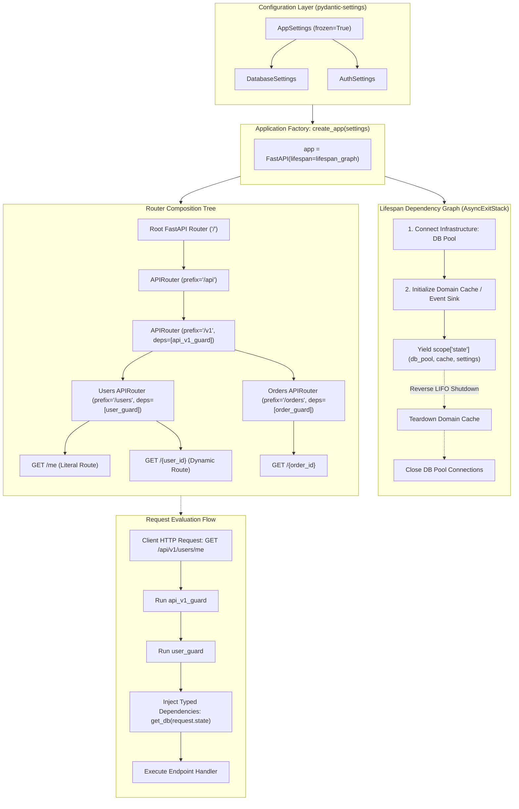

# Structuring Multi-Team FastAPI Services: Domain-Driven Package Layout, Router Composition, Lifespan Dependency Graphs, and Settings

> [!summary] Claim
> Scaling FastAPI across autonomous engineering teams requires decoupling domain logic into self-contained vertical feature slices assembled via an application factory, where hierarchical `APIRouter` composition strictly enforces boundary guards, an explicit `AsyncExitStack` lifespan graph guarantees deterministic reverse-order resource disposal without module-level globals, and immutable, layered `pydantic-settings` isolate environment configurations across processes and test fixtures.

Part of [FastAPI Internals and Patterns](README.md) in [API Engineering](../README.md).

## TL;DR

Domain-driven package layouts organize code into vertical slices containing domain-specific routes, schemas, and dependencies, composed via `APIRouter.include_router()` and orchestrated by an application factory `create_app(settings)`.
Never instantiate stateful clients, database connection pools, or `Settings()` as module-level global singletons; allocate them during the ASGI lifespan context and pass them downward via `request.state` or typed dependency injection.
Defining dynamic parameterized routes like `/{user_id}` before static literal routes like `/me` in an `APIRouter` lets FastAPI's sequential route matcher shadow the static endpoint: a `user_id: int` parameter returns `422 Unprocessable Entity`, and a `user_id: str` parameter silently serves `200 OK` from the wrong handler.
ASGI 3.0 Lifespan state in `scope["state"]` is shallow-copied by Uvicorn into each incoming HTTP request scope via `self.app_state.copy()`, but raw `httpx.ASGITransport` calls bypass server lifespan execution unless explicitly wrapped in `app.router.lifespan_context(app)`.
Do not adopt multi-domain router trees or layered settings for single-file prototypes or micro-utilities with fewer than three endpoints, where direct `FastAPI()` declaration introduces needless indirection.

## Mental model



The application factory `create_app()` serves as the central assembly point, consuming an immutable `AppSettings` hierarchy and instantiating a clean `FastAPI` application.
During the ASGI startup handshake, the server enters the `AsyncExitStack` lifespan graph, acquiring foundational infrastructure resources like database pools before booting domain-level caches, subsequently exposing them via `scope["state"]`.
Simultaneously, the router composition tree wraps each nested `APIRouter` in a lazily resolved `_IncludedRouter` entry of the parent's route list, propagating path prefixes, OpenAPI tags, and security dependencies down to every path operation when the effective routes are first computed.
Incoming client HTTP requests traverse this compiled tree, executing outer router dependencies before inner domain dependencies, and retrieving lifespan-managed singletons from `request.state` via typed dependency providers.
Upon application termination, the lifespan context unwinds in strict Last-In-First-Out (LIFO) order, ensuring domain consumers flush buffers and disconnect before underlying database pools terminate sockets.

## How it works

### Domain-driven package layout vs technical layers

In naive FastAPI codebases, developers group modules by technical concern: `routers/`, `models/`, `schemas/`, and `services/`.
As engineering teams grow beyond ten contributors, this horizontal layering causes severe architectural failure modes:
First, circular imports inevitably emerge between cross-domain services and models (for instance, `routers.users` imports `services.orders`, which in turn imports `models.users`).
Second, multiple feature teams constantly collide on shared files such as `routers/__init__.py` or `models.py`, producing frequent merge conflicts and deployment friction.
Third, horizontal slicing obscures domain boundaries; developers accidentally couple billing logic to internal user persistence models instead of operating through a well-defined public domain contract.

A domain-driven, vertically sliced architecture organizes files by bounded context:

```text
src/
  api_service/
    core/
      config.py           # AppSettings, DatabaseSettings, AuthSettings
      lifespan.py         # AsyncExitStack multi-resource orchestration
      factory.py          # create_app(settings) application factory
      database.py         # Database pool provider and engine abstraction
    domains/
      users/
        __init__.py       # Exports public domain interface only
        router.py         # APIRouter(prefix="/users", tags=["users"])
        schemas.py        # Pydantic input/output validation models
        service.py        # Domain business logic and domain exceptions
        dependencies.py   # Domain security guards and state extractors
      orders/
        __init__.py       # Public domain interface
        router.py         # APIRouter(prefix="/orders", tags=["orders"])
        schemas.py        # Domain Pydantic schemas
        service.py        # Domain transaction processing
        dependencies.py   # Order authorization guards
```

Under this layout, each domain functions as an autonomous package.
Domain A interacts with Domain B exclusively through Domain B's public exports defined in `domains/b/__init__.py`, rather than reaching into private persistence modules; Python's import system does not enforce this, so it holds only as far as the CI import checks described under Security and robustness enforce it.
The root application factory imports each domain's top-level router and binds them into the central routing graph.

### APIRouter composition internals

In `fastapi 0.162.0` (`fastapi/routing.py`), `APIRouter.include_router()` does not simply mount an isolated sub-application; it dynamically integrates routes into the parent routing structure.
When `parent_router.include_router(child_router, prefix="/v1", dependencies=[Depends(parent_guard)])` is invoked, the internal engine executes the following steps:

1. Prefix validation:
   FastAPI asserts `prefix.startswith("/")` and `not prefix.endswith("/")`, with the message `"A path prefix must not end with '/', as the routes will start with '/'"` (fastapi 0.162.0 fastapi/routing.py, APIRouter.include_router, lines 3382-3384; the same asserts guard `APIRouter.__init__` at lines 2611-2614).
   This is a FastAPI convention, not an RFC 3986 rule: RFC 3986 Section 3.3 permits empty path segments, so `/v1//users` is a syntactically valid path, but it would never match the route a developer intended.

2. Context creation and route encapsulation:
   FastAPI builds a `_RouterIncludeContext` via `_RouterIncludeContext.for_include` and appends an `_IncludedRouter(original_router=router, include_context=include_context)` to `parent_router.routes` (fastapi 0.162.0 fastapi/routing.py, APIRouter.include_router, line 3414).
   Rather than copying routes eagerly, FastAPI 0.162.0 resolves them lazily in `_IncludedRouter.effective_candidates`, which rebuilds its `_EffectiveRouteContext` list only when the included router's routes version changes, under the per-entry `threading.Lock` `_effective_routes_lock` (fastapi 0.162.0 fastapi/routing.py, _IncludedRouter).
   Nested includes are combined via `child_context = self.include_context.combine(route.include_context)`, which concatenates prefixes, tags, and dependencies outer-first (fastapi 0.162.0 fastapi/routing.py, _RouterIncludeContext.combine).

3. Dependency concatenation and execution ordering:
   A router's own `dependencies=` are prepended to each route at registration time (`current_dependencies = self.dependencies.copy()` in fastapi 0.162.0 fastapi/routing.py, APIRouter.add_api_route).
   At inclusion, the effective route dependencies are then built as `dependencies=[*include_context.dependencies, *route.dependencies]` (fastapi 0.162.0 fastapi/routing.py, _EffectiveRouteContext.from_api_route, line 1491).
   The dependencies defined on the parent router or the `include_router()` call are therefore prepended to the child route's existing dependencies.
   During request handling, `solve_dependencies` awaits `dependant.dependencies` one at a time in list order (`for sub_dependant in dependant.dependencies:` in fastapi 0.162.0 fastapi/dependencies/utils.py, solve_dependencies): top-level API guards execute first, followed by domain-level router guards, followed by endpoint-level dependencies; the lab's `test_router_composition_and_dependency_execution_order` asserts exactly this order.
   If an outer guard raises an `HTTPException(status_code=401)` or `HTTPException(status_code=403)`, execution halts immediately, and inner domain dependencies never execute.

4. OpenAPI tag and metadata inheritance:
   Tags are merged via `tags=[*include_context.tags, *route.tags]` (fastapi 0.162.0 fastapi/routing.py, _EffectiveRouteContext.from_api_route, line 1490).
   Responses declared at the router level are combined via `responses={**include_context.responses, **route.responses}` (line 1495), allowing route-specific error schemas to override general router error schemas.

5. Route registration order and shadowing:
   FastAPI's `APIRouter` overrides Starlette's dispatcher: `APIRouter.app` iterates `self.routes` in order, calls `route.matches(scope)`, and dispatches the first `Match.FULL` (fastapi 0.162.0 fastapi/routing.py, APIRouter.app, line 2791); an `_IncludedRouter` entry scans its own effective candidates the same way (fastapi 0.162.0 fastapi/routing.py, _IncludedRouter._match).
   Starlette's `Router.app` uses the same first-full-match loop (starlette 1.10.0 starlette/routing.py, Router.app, lines 685-717).
   If a dynamic parameter route `@router.get("/{user_id}")` is defined before a static literal route `@router.get("/me")`, any request to `/users/me` matches the dynamic route with `path_params={"user_id": "me"}`.
   With `user_id: int` or `UUID`, validation fails and FastAPI returns `422 Unprocessable Entity` with error type `int_parsing` (verified with a throwaway script against fastapi 0.162.0 on CPython 3.14.6).
   With `user_id: str`, validation succeeds and the request returns `200 OK` with `{"user_id":"me"}` from the wrong handler, which is the more dangerous outcome because nothing fails.
   Literal routes must strictly precede parameterized routes within the router declaration.

6. Trailing slash redirection and RFC 9110 semantics:
   FastAPI's `APIRouter.__init__` and Starlette's `Router.__init__` both default to `redirect_slashes=True` (fastapi 0.162.0 fastapi/routing.py, APIRouter.__init__; starlette 1.10.0 starlette/routing.py, Router.__init__, line 590).
   If no route matches fully or partially and a client requests `POST /api/v1/users` while the endpoint is registered as `/api/v1/users/`, `APIRouter.app` retries the toggled path and returns `RedirectResponse(url=str(redirect_url))`, whose default status is `status_code: int = 307` (fastapi 0.162.0 fastapi/routing.py, APIRouter.app; starlette 1.10.0 starlette/responses.py, RedirectResponse, line 213).
   The `Location` is absolute and built from the request scope (`URL(scope=redirect_scope)`), so behind a TLS-terminating proxy without forwarded-header handling it carries the scope's scheme and host rather than the public ones.
   Per RFC 9110 Section 15.4.8, the user agent "MUST NOT change the request method if it performs an automatic redirection to that URI."
   While a `307` preserves POST and PUT request bodies, forcing a redirect introduces an extra network round-trip and forces the client to re-transmit the payload, degrading write performance.

### Contrasting include_router with mount

Multi-team architectures must distinguish between `APIRouter.include_router()` and Starlette's `app.mount()`:

| Architectural Property | `APIRouter.include_router()` | `app.mount()` (Sub-Application) |
|---|---|---|
| OpenAPI Schema | Unified single document at `/openapi.json` | Isolated documents (sub-app hosts its own `/sub/docs`) |
| Dependency Injection | Shared DAG; parent router dependencies apply to all routes | Isolated; parent dependencies do not cross ASGI boundary |
| Middleware Stack | Single global ASGI middleware pipeline | Nested ASGI apps can execute distinct middleware chains |
| Exception Handling | Global exception handlers capture domain errors | Sub-app exception handlers capture errors before parent |
| Lifespan Management | Automatically merged via `_merge_lifespan_context()` at the end of `APIRouter.include_router` | Sub-app lifespans are not run by the parent router and require manual propagation |

`include_router()` is the standard mechanism for modular domain composition within a unified service.
`mount()` is reserved for hosting independent sub-applications, such as legacy WSGI/ASGI strangler proxies, static documentation trees, or administrative portals requiring completely isolated authentication middleware.

### Lifespan dependency graphs and ASGI state propagation

Legacy FastAPI applications relied on `on_event("startup")` and `on_event("shutdown")`.
FastAPI 0.162.0 still accepts them but marks `on_event` with `@deprecated("on_event is deprecated, use lifespan event handlers instead. ...")` (fastapi 0.162.0 fastapi/routing.py, APIRouter.on_event, line 6520); Starlette 1.10.0 has removed `on_startup`, `on_shutdown`, and `on_event` entirely, and FastAPI keeps a private copy of the old runner, `_DefaultLifespan`, for compatibility (fastapi 0.162.0 fastapi/routing.py, _DefaultLifespan, citing Starlette PR 3117).
The handlers are separate callback lists with no shared scope, so a resource opened in a startup handler can reach the shutdown handler only through a global or `app.state`.
`_DefaultLifespan.__aenter__` runs all startup handlers and `__aexit__` runs all shutdown handlers, so if any startup handler raises, `__aexit__` never runs and resources opened by the earlier startup handlers are never closed.
FastAPI and Starlette adopt the ASGI Lifespan Protocol (`lifespan.rst`, "Version: 2.0 (2019-03-20)").

#### The ASGI 3.0 lifespan lifecycle

When an ASGI server such as Uvicorn 0.54.0 boots (uvicorn 0.54.0 uvicorn/lifespan/on.py, LifespanOn.main and LifespanOn.send, lines 78-134):
1. The server creates an initial lifespan scope:
   `{"type": "lifespan", "asgi": {"version": self.config.asgi_version, "spec_version": "2.0"}, "state": self.state}`, where `self.state` starts as `{}`.
2. The server sends `{"type": "lifespan.startup"}` to the application.
3. The application enters its lifespan context manager, and Starlette's `Router.lifespan` copies any yielded mapping into the scope with `scope["state"].update(maybe_state)` (starlette 1.10.0 starlette/routing.py, Router.lifespan).
4. Upon successful initialization, the application sends `{"type": "lifespan.startup.complete"}`.
5. If initialization raises an exception, the application sends `{"type": "lifespan.startup.failed", "message": exc_text}`; Uvicorn logs `"Application startup failed. Exiting."` and sets `should_exit = True`, matching the spec's "it should log/print the message provided and then exit".
6. When the process receives `SIGTERM` or `SIGINT`, the server sends `{"type": "lifespan.shutdown"}`.
7. The application executes code following `yield`, teardowns resources, and sends `{"type": "lifespan.shutdown.complete"}`.

#### Multi-resource composition via AsyncExitStack

In a multi-team service, distinct domains require separate lifecycle resources (e.g. database pools, distributed caches, event bus consumers).
Using `contextlib.AsyncExitStack` enables clean topological assembly and deterministic LIFO cleanup.
Simplified excerpt, not lab code (`create_database_pool`, `create_user_cache`, and `create_order_sink` are placeholders; the lab's runnable version is `create_lifespan_graph` below):

```python
from collections.abc import AsyncIterator
from contextlib import AsyncExitStack, asynccontextmanager
from typing import Any
from fastapi import FastAPI

@asynccontextmanager
async def lifespan_graph(app: FastAPI) -> AsyncIterator[dict[str, Any]]:
    async with AsyncExitStack() as stack:
        # Tier 1: Foundational Infrastructure (Database Pool)
        db_pool = await stack.enter_async_context(create_database_pool())

        # Tier 2: Domain Resources dependent on Infrastructure (Cache, Event Sink)
        user_cache = await stack.enter_async_context(create_user_cache(db_pool))
        order_sink = await stack.enter_async_context(create_order_sink(db_pool))

        # Populate app.state for in-process access
        app.state.db_pool = db_pool
        app.state.user_cache = user_cache
        app.state.order_sink = order_sink

        # Yield dictionary for ASGI 3.0 server state propagation
        yield {
            "db_pool": db_pool,
            "user_cache": user_cache,
            "order_sink": order_sink,
        }
    # Stack exits here: order_sink closes -> user_cache closes -> db_pool closes
```

#### State propagation mechanism

The ASGI lifespan protocol specifies:
"The server will ensure that a *shallow copy* of the namespace is passed into each subsequent request/response call into the application."
In Uvicorn, every HTTP request (not every connection) gets a fresh copy when the parser starts a new message: the scope literal contains `"state": self.app_state.copy()` (uvicorn 0.54.0 uvicorn/protocols/http/httptools_impl.py, HttpToolsProtocol.on_message_begin, line 235; the h11 backend does the same in uvicorn/protocols/http/h11_impl.py, line 221).
In Starlette, `request.state` is `State(self.scope["state"])` (starlette 1.10.0 starlette/requests.py, Request.state, line 196).
Because `self.app_state.copy()` is a shallow dictionary copy, references to connection pools and service clients are shared across all requests by reference.
Assigning a new attribute on `request.state` writes only into that request's copy of the dictionary, but mutating a shared object reached through it (appending to a shared list, changing a client's settings) is visible to every request.

### Settings architecture with pydantic-settings

Configuring enterprise services requires strict layering, type validation, and environment isolation.
Module-level configuration singletons (`settings = Settings()`) introduce severe anti-patterns:
- Missing environment variables cause import-time crashes, breaking CLI commands, linting passes, and database migrations (`alembic`).
- Tests cannot safely override settings without mutating shared state across test threads.
- Multiple application instances with differing configurations cannot co-exist in the same Python process.

Using `pydantic-settings 2.16.2` (`BaseSettings`), settings should be decomposed hierarchically and passed into `create_app()`.
Simplified excerpt, not lab code; it was executed once by the verifier with pydantic-settings 2.16.2 on CPython 3.14.6:

```python
from pydantic import BaseModel, ConfigDict, Field
from pydantic_settings import BaseSettings, SettingsConfigDict

class DatabaseSettings(BaseModel):
    model_config = ConfigDict(frozen=True, extra="forbid")
    url: str = "postgresql+asyncpg://app@localhost:5432/production"
    pool_size: int = 20
    max_overflow: int = 10

class AuthSettings(BaseModel):
    model_config = ConfigDict(frozen=True, extra="forbid")
    secret_key: str = Field(min_length=32)
    token_ttl_seconds: int = 3600

class AppSettings(BaseSettings):
    model_config = SettingsConfigDict(
        frozen=True,
        extra="forbid",
        env_prefix="APP_",
        env_nested_delimiter="__",  # Maps APP_DATABASE__URL -> database.url
    )
    environment: str = "production"
    service_name: str = "order-platform"
    database: DatabaseSettings = Field(default_factory=DatabaseSettings)
    auth: AuthSettings  # required: boot fails without APP_AUTH__SECRET_KEY
```

Only the root is a `BaseSettings`, as in the lab; nested sections are plain `BaseModel`s filled from the root's environment source.
A nested `BaseSettings` built through `default_factory` runs its own environment lookup with its own (empty) prefix, so a stray `URL` variable in the process environment silently becomes `database.url`; this was reproduced with pydantic-settings 2.16.2 (the lab's nested sections are therefore plain `BaseModel`s, and `test_stray_environment_variable_does_not_leak_into_nested_settings` pins this).
`env_prefix="APP_"` is what makes the `APP_` names work: without it, the nested variable is `DATABASE__URL` and `APP_DATABASE__URL` is ignored (verified with pydantic-settings 2.16.2).
Setting `frozen=True` makes field assignment raise a `ValidationError` of type `frozen_instance`; it is shallow, so a mutable `list` or `dict` field can still be mutated in place.
Setting `env_nested_delimiter="__"` allows environment variables like `APP_DATABASE__POOL_SIZE=50` to map into nested configuration structures; the snippet above was executed with `APP_AUTH__SECRET_KEY` and `APP_DATABASE__POOL_SIZE=50` set and produced `pool_size == 50`.
The default source order is `init_settings, env_settings, dotenv_settings, file_secret_settings`, highest priority first, then field defaults (pydantic-settings 2.16.2 pydantic_settings/main.py, BaseSettings.settings_customise_sources).

## Numbers and limits

The following table provides verified operational limits, measured parameters, and configuration bounds governing FastAPI applications, Starlette routing, and Uvicorn process management (as of 2026-11).

| Metric / Parameter | Value / Upper Bound | Architectural Mechanism | Source / Verification Method |
|---|---|---|---|
| Route matching complexity | `O(N)` linear scan per router level | Sequential `route.matches(scope)` over `self.routes`, first `Match.FULL` wins | fastapi 0.162.0 fastapi/routing.py, APIRouter.app (line 2791) and _IncludedRouter._match |
| Trailing slash redirect code | `307 Temporary Redirect` | Method-preserving redirect to the toggled path | RFC 9110 Section 15.4.8; starlette 1.10.0 starlette/responses.py, RedirectResponse (`status_code: int = 307`, line 213) |
| Lifespan startup and shutdown timeout | none | Uvicorn 0.54.0 `Config` has no lifespan timeout parameter; `LifespanOn.startup` waits on `startup_event` without a deadline | uvicorn 0.54.0 uvicorn/config.py, Config.__init__; uvicorn/lifespan/on.py, LifespanOn.startup |
| Graceful shutdown timeout | `timeout_graceful_shutdown: int \| None = None` (no limit) | Seconds to wait for in-flight requests before forcing close | uvicorn 0.54.0 uvicorn/config.py, Config.__init__, line 236 |
| ASGI state shallow copy cost | `28.8 ns` per request for a 3-key state dict | `self.app_state.copy()` in `on_message_begin` | Measured: `min(timeit.repeat(d.copy, number=1_000_000, repeat=7)) / 1e6` via `uv run --frozen python`, macOS 27.3 arm64 (Darwin 27.3.0), CPython 3.14.6, 2026-11-15 |
| Minimum HS256 key length | `256` bits | RFC 7518: "A key of the same size as the hash output (for instance, 256 bits for "HS256") or larger MUST be used" | RFC 7518 Section 3.2; `Field(min_length=32)` checks 32 characters, which is 256 bits only if each character carries a full random byte, so generate the key with `secrets.token_urlsafe(32)` or longer |

## Portability

The table below documents compatibility and behavioral variance across CPython releases, ASGI runtime servers, and protocol versions (as of 2026-11).
Only the CPython 3.14.6 row was executed; the lab matrix is paused by the user's instruction of 2026-11-11, so every other interpreter leg is recorded as "Not run" rather than claimed.
This machine has uv-provided 3.12.13, 3.14.6, and 3.15.0b3, and no 3.13.18, 3.15.2, or 3.15.2t interpreter.
Container legs (Debian Trixie, Alpine musl) were not run.

| Runtime / Specification | Version / Release | Lifespan State (`scope['state']`) | Router Lazy Inclusion | Free-Threaded Concurrency | Upstream Issue / Compatibility Note |
|---|---|---|---|---|---|
| CPython 3.12 | `3.12.13` | Not run | Not run | Not Applicable | A drafter-reported pass is not counted as evidence here |
| CPython 3.13 | `3.13.18` | Not run | Not run | Not run | Interpreter not installed on this machine |
| CPython 3.14 | `3.14.6` | Verified by lab run | Verified by lab run | Not run | 6 passed in 0.31s on macOS 27.3 arm64 (Darwin 27.3.0), output above |
| CPython 3.15 | `3.15.2` | Not run | Not run | Not Applicable | Only `3.15.0b3` is installed on this machine |
| CPython 3.15 Free-Threaded | `3.15.2t` | Not run | Not run | Not run | `_IncludedRouter` guards its lazy route cache with a `threading.Lock` (fastapi 0.162.0 fastapi/routing.py, `_IncludedRouter._effective_routes_lock`); behavior without the GIL was not tested |
| Uvicorn | `0.54.0` | Source-read: `"state": self.app_state.copy()` per request | Not run under a real server | Not tested | uvicorn 0.54.0 uvicorn/protocols/http/httptools_impl.py and h11_impl.py |
| Hypercorn | `0.18.0` | Source-read: `"state": event.state.copy()` per stream | Not run under a real server | Not tested | hypercorn 0.18.0 hypercorn/protocol/http_stream.py; HTTP/3 through the optional `aioquic` dependency (hypercorn/protocol/h3.py) |
| Granian | `2.8.7` | Source-read: lifespan scope carries `'state': self.state`, `spec_version` `2.3` | Not run under a real server | Not tested | granian 2.8.7 granian/asgi.py, line 27; Rust-based server |
| HTTP/1.1 | RFC 9112 | Uvicorn copies state per request (source-read above) | Not applicable: routing happens above the transport | Not Applicable | The lab drives the app in process through `httpx.ASGITransport`, not over a socket |
| HTTP/2 | RFC 9113 | Hypercorn copies state per stream (source-read above) | Not applicable: routing happens above the transport | Not Applicable | Not run over HTTP/2 |
| HTTP/3 over QUIC | RFC 9114 | Not run | Not applicable: routing happens above the transport | Not Applicable | Hypercorn offers it only through the optional `aioquic` dependency; not run |

## Worked example

The worked example demonstrates a modular enterprise application factory compiling versioned domain routers (`users` and `orders`), enforcing hierarchical security guards, and managing multi-resource lifespan disposal in LIFO order without module-level globals.

The full implementation is available at [implementation](../labs/src/api_labs/f11_fastapi_internals_and_patterns/structuring_large_apps.py) and its test suite at [test](../labs/tests/f11_fastapi_internals_and_patterns/test_structuring_large_fastapi_applications_apirouter_lifespan_and_domain_modules.py).

### Implementation

```python
"""Modular application factory composing versioned routers, lifespans, and settings."""

from collections.abc import AsyncGenerator
from contextlib import AsyncExitStack, asynccontextmanager
from dataclasses import dataclass, field
from typing import Annotated, Any

from fastapi import APIRouter, Depends, FastAPI, HTTPException, Request, status
from pydantic import BaseModel, ConfigDict, Field
from pydantic_settings import BaseSettings, SettingsConfigDict


class DatabaseSettings(BaseModel):
    """Database connection and pool settings (a plain model: it never reads the environment)."""

    model_config = ConfigDict(frozen=True, extra="forbid")

    url: str = "sqlite+aiosqlite:///:memory:"
    pool_size: int = 5
    max_overflow: int = 10


class AuthSettings(BaseModel):
    """Authentication and token verification settings."""

    model_config = ConfigDict(frozen=True, extra="forbid")

    secret_key: str = "test-secret-key-32-chars-minimum-len"  # noqa: S105
    token_ttl_seconds: int = 3600


class AppSettings(BaseSettings):
    """Root application configuration composed of domain-level settings."""

    model_config = SettingsConfigDict(frozen=True, extra="forbid")

    environment: str = "test"
    service_name: str = "enterprise-api"
    database: DatabaseSettings = Field(default_factory=DatabaseSettings)
    auth: AuthSettings = Field(default_factory=AuthSettings)


@dataclass
class ExecutionLog:
    """Deterministic event recorder for router dependencies and lifespans."""

    events: list[str] = field(default_factory=list[str])

    def record(self, event: str) -> None:
        self.events.append(event)


@dataclass
class MockDatabasePool:
    """Mock database pool lifecycle target."""

    url: str
    is_closed: bool = False

    async def close(self) -> None:
        self.is_closed = True


@dataclass
class MockDomainCache:
    """Mock domain-level cache lifecycle target."""

    domain: str
    is_cleared: bool = False

    async def clear(self) -> None:
        self.is_cleared = True


class UserRead(BaseModel):
    """User representation schema."""

    user_id: str
    username: str
    source: str


class OrderRead(BaseModel):
    """Order representation schema."""

    order_id: str
    user_id: str
    amount_cents: int


def get_db(request: Request) -> MockDatabasePool:
    """Extract the database pool from request state or application state."""
    db: MockDatabasePool | None = getattr(request.state, "db_pool", None) or getattr(
        request.app.state, "db_pool", None
    )
    if db is None:
        raise HTTPException(
            status_code=status.HTTP_500_INTERNAL_SERVER_ERROR,
            detail="Database pool not initialized in request state",
        )
    return db


def get_domain_cache(request: Request) -> MockDomainCache:
    """Extract the domain cache from request state or application state."""
    cache: MockDomainCache | None = getattr(request.state, "domain_cache", None) or getattr(
        request.app.state, "domain_cache", None
    )
    if cache is None:
        raise HTTPException(
            status_code=status.HTTP_500_INTERNAL_SERVER_ERROR,
            detail="Domain cache not initialized in request state",
        )
    return cache


def create_user_router(log: ExecutionLog) -> APIRouter:
    """Create the users domain router with dependencies and route ordering."""

    async def user_domain_guard() -> None:
        log.record("guard:user_domain")

    router = APIRouter(
        prefix="/users",
        tags=["users"],
        dependencies=[Depends(user_domain_guard)],
    )

    # Static path must precede dynamic parameterized path to avoid route shadowing.
    @router.get("/me")
    async def get_current_user(
        db: Annotated[MockDatabasePool, Depends(get_db)],
        cache: Annotated[MockDomainCache, Depends(get_domain_cache)],
    ) -> UserRead:
        log.record("endpoint:users_me")
        return UserRead(
            user_id="usr_current",
            username="alice",
            source=f"db={db.url},cache={cache.domain}",
        )

    @router.get("/{user_id}")
    async def get_user_by_id(
        user_id: str,
        db: Annotated[MockDatabasePool, Depends(get_db)],
    ) -> UserRead:
        log.record(f"endpoint:users_by_id:{user_id}")
        return UserRead(
            user_id=user_id,
            username=f"user_{user_id}",
            source=f"db={db.url}",
        )

    return router


def create_order_router(log: ExecutionLog) -> APIRouter:
    """Create the orders domain router with dependencies."""

    async def order_domain_guard() -> None:
        log.record("guard:order_domain")

    router = APIRouter(
        prefix="/orders",
        tags=["orders"],
        dependencies=[Depends(order_domain_guard)],
    )

    @router.get("/{order_id}")
    async def get_order_by_id(
        order_id: str,
        db: Annotated[MockDatabasePool, Depends(get_db)],
    ) -> OrderRead:
        log.record(f"endpoint:orders_by_id:{order_id}")
        return OrderRead(
            order_id=order_id,
            user_id="usr_current",
            amount_cents=4999,
        )

    return router


def create_api_v1_router(log: ExecutionLog) -> APIRouter:
    """Create top-level versioned API router composing domain routers."""

    async def api_v1_guard() -> None:
        log.record("guard:api_v1")

    v1_router = APIRouter(
        prefix="/v1",
        dependencies=[Depends(api_v1_guard)],
    )

    v1_router.include_router(create_user_router(log))
    v1_router.include_router(create_order_router(log))
    return v1_router


def create_lifespan_graph(
    settings: AppSettings,
    log: ExecutionLog,
) -> Any:
    """Compose multi-resource lifespan context using AsyncExitStack."""

    @asynccontextmanager
    async def lifespan(app: FastAPI) -> AsyncGenerator[dict[str, Any]]:
        # Root lifespan orchestrator managing multi-tier dependencies in LIFO order
        log.record("lifespan:enter_root")
        async with AsyncExitStack() as stack:
            # 1. Initialize infra: Database Pool
            db_pool = MockDatabasePool(url=settings.database.url)
            log.record(f"lifespan:startup_db:{settings.database.url}")
            stack.push_async_callback(db_pool.close)
            stack.callback(log.record, "lifespan:shutdown_db")

            # 2. Initialize domain cache (depends on infra)
            domain_cache = MockDomainCache(domain=settings.service_name)
            log.record(f"lifespan:startup_cache:{settings.service_name}")
            stack.push_async_callback(domain_cache.clear)
            stack.callback(log.record, "lifespan:shutdown_cache")

            # Expose initialized resources via ASGI state dict and app.state
            app.state.db_pool = db_pool
            app.state.domain_cache = domain_cache
            app.state.app_settings = settings

            yield {
                "db_pool": db_pool,
                "domain_cache": domain_cache,
                "app_settings": settings,
            }

        log.record("lifespan:exit_root")

    return lifespan


def create_app(
    settings: AppSettings | None = None,
    log: ExecutionLog | None = None,
) -> FastAPI:
    """Application factory for multi-team FastAPI service architecture."""
    active_settings = settings or AppSettings()
    active_log = log or ExecutionLog()

    app = FastAPI(
        title=active_settings.service_name,
        lifespan=create_lifespan_graph(active_settings, active_log),
    )

    # Top-level API router composition
    api_router = APIRouter(prefix="/api")
    api_router.include_router(create_api_v1_router(active_log))
    app.include_router(api_router)

    return app
```

### Execution verification and test output

The following output was captured by the verifier on 2026-11-15, running pytest from `labs/` on macOS 27.3 arm64 (Darwin 27.3.0) under CPython 3.14.6:

```text
$ uv run --frozen pytest tests/f11_fastapi_internals_and_patterns/test_structuring_large_fastapi_applications_apirouter_lifespan_and_domain_modules.py -v
============================= test session starts ==============================
platform darwin -- Python 3.14.6, pytest-9.2.0, pluggy-1.7.0 -- /Users/shreejitverma/github/The-Distinguished-Engineer/build/api_notes/jobs/Structuring-Large-FastAPI-Applications-APIRouter-Lifespan-and-Domain-Modules/verify/labs/.venv/bin/python
cachedir: .pytest_cache
hypothesis profile 'default'
rootdir: /Users/shreejitverma/github/The-Distinguished-Engineer/build/api_notes/jobs/Structuring-Large-FastAPI-Applications-APIRouter-Lifespan-and-Domain-Modules/verify/labs
configfile: pyproject.toml
plugins: platformdirs-4.14.5, schemathesis-4.33.1, cov-7.1.0, hypothesis-6.170.14, inline-snapshot-0.36.1, Faker-40.44.0, locust-2.47.0, typeguard-4.6.0, anyio-4.16.0, asyncio-1.4.1.post1, respx-0.23.1
asyncio: mode=Mode.STRICT, debug=False, asyncio_default_fixture_loop_scope=function, asyncio_default_test_loop_scope=function
collecting ... collected 6 items

tests/f11_fastapi_internals_and_patterns/test_structuring_large_fastapi_applications_apirouter_lifespan_and_domain_modules.py::test_router_composition_and_dependency_execution_order PASSED [ 16%]
tests/f11_fastapi_internals_and_patterns/test_structuring_large_fastapi_applications_apirouter_lifespan_and_domain_modules.py::test_route_ordering_prevents_parameter_shadowing PASSED [ 33%]
tests/f11_fastapi_internals_and_patterns/test_structuring_large_fastapi_applications_apirouter_lifespan_and_domain_modules.py::test_lifespan_lifo_teardown_and_state_propagation PASSED [ 50%]
tests/f11_fastapi_internals_and_patterns/test_structuring_large_fastapi_applications_apirouter_lifespan_and_domain_modules.py::test_application_factory_settings_isolation PASSED [ 66%]
tests/f11_fastapi_internals_and_patterns/test_structuring_large_fastapi_applications_apirouter_lifespan_and_domain_modules.py::test_router_tag_and_prefix_inheritance_in_openapi PASSED [ 83%]
tests/f11_fastapi_internals_and_patterns/test_structuring_large_fastapi_applications_apirouter_lifespan_and_domain_modules.py::test_stray_environment_variable_does_not_leak_into_nested_settings PASSED [100%]

============================== 6 passed in 0.31s ===============================
```

## Pitfalls

> [!warning] Parameterized Route Shadowing (`/{user_id}` before `/me`)
> **Trigger:** Declaring a parameterized path route before a static literal path route in an `APIRouter`.
> **Symptom:** FastAPI's linear route matching (fastapi 0.162.0 fastapi/routing.py, APIRouter.app) binds `"me"` to `user_id`; with `user_id: int` or `UUID` requests to `/users/me` fail with `422 Unprocessable Entity`, and with `user_id: str` they return `200 OK` from the wrong handler with no error at all.
> **Fix:** Enforce static route declaration strictly before dynamic parameterized routes, and write automated contract tests verifying literal route matching.

> [!warning] Module-Level Async Resource Singletons and Pre-Fork Memory Corruptions
> **Trigger:** Instantiating `asyncpg.create_pool()`, `httpx.AsyncClient()`, or `asyncio.Lock()` as global variables at module import time.
> **Symptom:** Under Gunicorn `--preload`, the app module is imported in the master before `fork()`, so any socket opened at import time is inherited by every worker and its byte stream is interleaved across processes; without `--preload` each worker imports separately and this specific failure does not occur.
> Separately, an object that binds to the event loop on first use (an `asyncio.Lock` since CPython 3.10, a connected pool or client) fails with `RuntimeError: ... attached to a different loop` when a second loop uses it, which is common in test suites that create a loop per test.
> **Fix:** Strictly allocate all asynchronous connection pools and HTTP clients inside the application's ASGI lifespan context manager, binding them to the running event loop of each individual worker process.

> [!warning] Trailing Slash 307 Redirection Penalties on Write Endpoints
> **Trigger:** Configuring routes with a trailing slash (such as `/api/v1/orders/`) while API clients send requests without a trailing slash (`/api/v1/orders`), under default Starlette `redirect_slashes=True`.
> **Symptom:** Clients receive `307 Temporary Redirect` and are forced to re-upload the entire HTTP request payload; clients that do not follow redirects for unsafe methods fail outright, and because the absolute `Location` is built from the request scope, a TLS-terminating proxy without forwarded-header handling can redirect `https` traffic to an `http` URL, a different origin on which clients drop the `Authorization` header (for example `headers.pop("Authorization", None)` when `not _same_origin(url, request.url)` in httpx 0.28.1 httpx/_client.py, BaseClient._redirect_headers).
> **Fix:** Standardize on non-trailing slash routes across all domain routers, reject trailing slashes in path prefixes, and validate URI canonicalization in CI linting gates.

> [!warning] Lifespan State Collision in Nested Router Composition
> **Trigger:** Multiple included domain routers defining distinct lifespan context managers that yield dictionary mappings sharing identical top-level keys (such as `{"client": ...}`).
> **Symptom:** FastAPI's `_merge_lifespan_context()` combines states using `{**(maybe_nested_state or {}), **(maybe_original_state or {})}` (fastapi 0.162.0 fastapi/routing.py, _merge_lifespan_context, line 253), silently overwriting the nested router's state with the parent router's state; a throwaway check with parent `{"client": "parent"}` and child `{"client": "child"}` yielded `{'client': 'parent', ...}`.
> **Fix:** Enforce strict domain-namespaced keys for all lifespan state objects (such as `user_domain_cache` and `billing_db_pool`).

> [!warning] Silent Lifespan Bypass in AsyncClient Integration Tests
> **Trigger:** Running asynchronous integration tests with `httpx.AsyncClient(transport=ASGITransport(app=app))` without an explicit lifespan wrapper.
> **Symptom:** Test requests fail with `500 Internal Server Error` (or raise the `AttributeError` into the test when `raise_app_exceptions=True`, the default) because `httpx.ASGITransport` only ever builds `"type": "http"` scopes (httpx 0.28.1 httpx/_transports/asgi.py, ASGITransport.handle_async_request) and never runs the lifespan protocol, leaving `request.state` uninitialized.
> **Fix:** Wrap test client invocations inside `async with app.router.lifespan_context(app):` to ensure deterministic execution of startup and shutdown hooks during testing.

## Security and robustness

A robust multi-team architecture defends against common vulnerabilities categorized under the OWASP API Security Top 10 (2023):

### Broken Object Level Authorization (OWASP API1:2023)

In decentralized engineering organizations, individual developers frequently forget to enforce tenancy or ownership checks inside endpoint functions.
Domain-driven router composition mitigates this risk by mounting parameterized domain guards directly on the router (simplified excerpt, not lab code; `verify_tenant_membership` is a placeholder):

```python
def create_tenant_router() -> APIRouter:
    router = APIRouter(
        prefix="/tenants/{tenant_id}",
        dependencies=[Depends(verify_tenant_membership)],
    )
    return router
```

Because FastAPI prepends router-level dependencies to every compiled path operation, `verify_tenant_membership` executes before any endpoint logic or database query runs.
Developers adding new endpoints to this router cannot skip the guard, because it is prepended at registration; the pattern does not stop someone registering a tenant-scoped endpoint on a different router, which is what the import and route-inventory checks below must catch.

### Broken Function Level Authorization (OWASP API5:2023)

Administrative or internal capabilities must never rely solely on endpoint-level decorators.
By isolating administrative operations into dedicated domain routers mounted under protected paths (such as `/internal/v1` or `/admin/v1`) with mandatory role-based access control (RBAC) dependencies, access boundaries are enforced structurally at the router compilation layer.

### Settings immutability and credential defense

Production credentials, cryptographic keys, and database connection strings managed via `pydantic-settings` must use `frozen=True`.
An un-frozen settings object can be reassigned at runtime by any code holding a reference, including third-party packages or faulty middleware during request processing; `frozen=True` blocks field assignment but not in-place mutation of mutable field values.
Defining `extra="forbid"` rejects unknown keyword arguments and unknown keys in a dotenv file (pydantic-settings 2.16.2 pydantic_settings/sources/providers/dotenv.py, `is_extra_allowed = self.config.get('extra') != 'forbid'`), but it does not reject a misspelled process environment variable: with pydantic-settings 2.16.2, `APP_DATABSE__URL` set in the environment was silently ignored and boot succeeded.
To catch environment typos, make security-critical fields required (no default) so a misspelled name fails validation at boot.

### Domain import boundary enforcement

To prevent structural erosion in large monoliths, teams must enforce architectural boundaries via static analysis.
Tools like `import-linter` or custom AST linters should be integrated into CI to enforce the following contract:
1. Modules in `app.domains.users` may never import private modules from `app.domains.orders` (such as `from app.domains.orders.service import ...`).
2. Cross-domain interactions must pass through explicit domain interfaces or shared application core events.
3. Domain routers must never import database configuration or credentials directly; all infrastructure dependencies must be injected via `Request.state` or typed FastAPI dependency providers.

## The principal's view

Staff-plus engineers evaluate multi-team service design through the lens of Conway's Law: system architectures inevitably mirror the communication structures of the organizations that build them.
FastAPI applications that begin as single-file scripts frequently degenerate into tangled monoliths when multiple teams commit to a shared repository without clear structural boundaries.

When structuring enterprise services, the principal engineer must evaluate the fundamental trade-off: modular monolith versus distributed microservices.
Distributing domain modules into separate microservices prematurely introduces massive operational tax: distributed tracing overhead, network serialization latency, eventual consistency complexities, dual-write failure modes, and continuous deployment synchronization burdens.
A well-architected modular monolith built on domain-driven package layouts and hierarchical `APIRouter` trees provides identical organizational decoupling while preserving in-process call performance, transactional guarantees, and atomic CI testing.

The principal engineer establishes three mandatory platform rules:
1. The Application Factory Invariant: No module may instantiate a global `FastAPI()` application or global `Settings()` instance.
   Every service must be constructable via `create_app(settings)`, enabling hermetic testing and isolated multi-tenant execution.
2. The Lifespan Boundary Invariant: All I/O resources, network clients, and stateful connections must be acquired and released exclusively through the ASGI lifespan graph.
   Module-level connection pools and un-scoped background tasks are strictly rejected in code review.
3. Automated Architecture Verification: Architectural constraints must not rely on human vigilance.
   CI pipelines must execute architectural linting rules that fail the build if a domain breaches another domain's private namespace.

FastAPI serves well as a modular monolith backbone for dozens of contributing engineers, with throughput scaled horizontally by worker processes and replicas; this note measured no throughput ceiling, so size it with a load test of your own endpoints.
However, teams should recognize when to graduate away from FastAPI:
If domain boundaries require strictly independent deployment cadences and distinct scaling factors (e.g. video processing workers versus lightweight metadata lookups), or if throughput requirements necessitate microsecond-level serialization where Python's runtime overhead dominates, extract those bounded contexts into dedicated Go or Rust microservices communicating via gRPC.

## Interview questions

> [!question] L5: In what sequence does FastAPI execute dependencies when an `APIRouter` with dependencies is included in another `APIRouter` with dependencies?
>
> > [!success]- Answer
> > FastAPI executes dependencies in top-down hierarchical order from the outermost router to the innermost endpoint.
> > When `parent_router.include_router(child_router, dependencies=[Depends(parent_guard)])` is invoked, `parent_guard` is prepended to the child route dependencies list.
> > During request dispatch, FastAPI resolves the dependency directed acyclic graph (DAG) such that parent router dependencies execute first, child router dependencies execute second, and endpoint-specific dependencies execute last.
> > If any outer dependency raises an `HTTPException`, execution terminates immediately and inner dependencies are never called.
> >
> > Follow-up: What happens if both parent and child routers define a dependency that resolves the same sub-dependency with `use_cache=True`?

> [!question] L5: Predict the output when an incoming request hits `/items/me` given the following router definitions:
> ```python
> @router.get("/items/{item_id}")
> def get_item(item_id: int):
>     return {"item_id": item_id}
> 
> @router.get("/items/me")
> def get_current_user_item():
>     return {"item": "me"}
> ```
>
> > [!success]- Answer
> > The server returns HTTP status code `422 Unprocessable Entity`.
> > FastAPI's `APIRouter.app` (like Starlette's `Router.app`) matches incoming request paths sequentially against `router.routes` in the exact order they were registered.
> > Because `/items/{item_id}` is declared first, the path `/items/me` matches the parameterized route with `item_id="me"`.
> > FastAPI then attempts to cast the string `"me"` into an integer per the `item_id: int` type annotation, which fails validation and generates a `422` error response with error type `int_parsing` (reproduced against fastapi 0.162.0).
> > Had the parameter been `item_id: str`, the response would be `200 OK` with `{"item_id": "me"}` from the wrong handler.
> >
> > Follow-up: How would you fix this route declaration without changing the URL path design?

> [!question] L6: Debug this API failure where a Gunicorn deployment with Uvicorn workers crashes with cross-loop errors on global connection pools
>
> A FastAPI application running under Gunicorn with 8 Uvicorn worker processes occasionally deadlocks or crashes with `RuntimeError: Task attached to a different loop` on database queries.
> The database pool is declared as `db_pool = asyncpg.create_pool(...)` at the top level of `database.py`.
>
> > [!success]- Answer
> > The database pool is instantiated as a module-level global singleton during Python module import.
> > When Gunicorn boots with `--preload`, the module is imported in the master process, so anything created at import time exists before `fork()`; without `--preload` each worker imports the module itself after forking.
> > POSIX `fork()` copies memory and inherits open file descriptors but duplicates only the calling thread, so the child gets copies of loop and pool objects whose sockets are shared with every sibling and whose background threads no longer exist.
> > Worse, `asyncpg.Pool.__init__` captures `loop = asyncio.get_event_loop()` at construction (asyncpg 0.32.0 asyncpg/pool.py, Pool.__init__, lines 412-414), so a pool created at import time is bound to whatever loop was current then, and a worker or test running a different loop fails with `RuntimeError: ... attached to a different loop`.
> > On CPython 3.14 the same import-time call fails even earlier: run outside any loop with asyncpg 0.32.0, it raised `RuntimeError: There is no current event loop in thread 'MainThread'.` at import.
> > The fix is to move `create_pool()` inside the FastAPI ASGI `lifespan` context manager, ensuring each child worker initializes its own connection pool on its own active event loop after forking.
> >
> > Follow-up: Why does running the same codebase under single-process Uvicorn in local development mask this critical bug?

> [!question] L6: Why did Starlette and FastAPI deprecate `on_event("startup")` and `on_event("shutdown")` in favor of ASGI lifespan context managers, and what architectural guarantees does `scope["state"]` provide?
>
> > [!success]- Answer
> > Event handlers (`startup` and `shutdown`) operated as unlinked, separate callback lists without a unified exception boundary.
> > In FastAPI 0.162.0's compatibility runner `_DefaultLifespan`, startup handlers run in `__aenter__` and shutdown handlers in `__aexit__`, so a raising startup handler means no shutdown handler runs, leaking whatever earlier handlers opened.
> > Starlette 1.10.0 has removed the handler API entirely, and FastAPI 0.162.0 marks `on_event` as `@deprecated`.
> > A lifespan context manager by itself does not run the code after `yield` when startup raises; the reverse-order cleanup of partially initialized resources comes from entering each one into an `AsyncExitStack` (or `try...finally`), which unwinds whatever was entered before the failure.
> > Furthermore, lifespan context managers yield a state mapping that Starlette's `Router.lifespan` merges into `scope["state"]`, and ASGI servers shallow-copy it into every incoming HTTP request.
> > This eliminates the need for global variables; it does not make the shared objects themselves thread-safe or loop-safe, which remains the job of each client library.
> >
> > Follow-up: How does FastAPI's `_merge_lifespan_context()` combine lifespans from multiple nested routers?

> [!question] L6: Explain how `pydantic-settings` resolves configuration values across defaults, `.env` files, and environment variables, and why module-level instantiation is considered an anti-pattern.
>
> > [!success]- Answer
> > `pydantic-settings` uses a deterministic priority cascade returned by `settings_customise_sources` as `init_settings, env_settings, dotenv_settings, file_secret_settings`: explicit constructor arguments take highest precedence, followed by process environment variables, then dotenv files, then the secrets directory, and finally model default values.
> > When configured with `env_prefix="APP_"` and `env_nested_delimiter="__"`, it parses hierarchical environment variables like `APP_DATABASE__URL` into nested model fields; without the prefix the variable name is `DATABASE__URL`.
> > Instantiating `settings = Settings()` at module import time is an anti-pattern because missing environment variables cause import-time crashes during test discovery, linting, or database migrations.
> > Furthermore, global settings prevent test fixtures from injecting custom configurations and stop multiple application instances with differing environments from running concurrently in the same process.
> >
> > Follow-up: How do you configure `pydantic-settings` to reject unknown environment variables and guarantee runtime immutability?

> [!question] L7: In high-throughput distributed systems, why can Starlette's `redirect_slashes=True` (307 redirect) severely degrade latency and throughput on write endpoints, and how should an API platform team resolve it?
>
> > [!success]- Answer
> > When an API route is registered as `/orders/` and a client requests `/orders`, Starlette's `redirect_slashes=True` intercepts the request and issues a `307 Temporary Redirect` response.
> > While RFC 9110 Section 15.4.8 guarantees that 307 preserves the HTTP method and request body, following the redirect requires an entire extra network round-trip between client and edge.
> > For large JSON or multipart payloads, the client must re-transmit the body data over the wire, doubling ingress bandwidth and adding significant tail latency.
> > Furthermore, buggy intermediary proxies or client libraries may drop authorization headers or timeout on redirected write requests.
> > An API platform team should resolve this by enforcing a strict non-trailing-slash policy across all route paths (FastAPI already asserts `not prefix.endswith("/")` for prefixes, but nothing stops a route path like `/orders/`), canonicalizing URLs at the API gateway layer, and disabling `redirect_slashes` on high-throughput microservices.
> >
> > Follow-up: What architectural considerations dictate choosing `308 Permanent Redirect` versus `307 Temporary Redirect` for URI normalization?

> [!question] L7: How do you design an automated boundary enforcement architecture for a large, multi-team FastAPI monolith to prevent domain boundary erosion without degrading CI throughput?
>
> > [!success]- Answer
> > Automated boundary enforcement requires a three-tier governance architecture:
> > First, establish package-level public contracts where each domain exposes only `__init__.py` and internal submodules (`service.py`, `models.py`) are marked internal by convention.
> > Second, implement static abstract syntax tree (AST) analysis or import linting rules (`import-linter` or `pytest-archon`) in CI that enforce contracts such that `app.domains.domain_a` can never import from `app.domains.domain_b.*` except through `app.domains.domain_b`.
> > Third, ensure that shared database models or entities are accessed through domain service interfaces or event-driven messages rather than raw foreign-key ORM cross-joins.
> > To avoid slowing down CI, run these AST checks as pre-commit hooks and dedicated lint stages that evaluate only changed files against a cached dependency graph.
> >
> > Follow-up: How do you handle cross-domain database transactions in a modular monolith without violating boundary isolation?

> [!question] L7: Under what operational and architectural conditions should a staff engineer choose `app.mount()` over `APIRouter.include_router()`?
>
> > [!success]- Answer
> > `APIRouter.include_router()` compiles routes, tags, and dependencies directly into the host application's routing graph, producing a unified OpenAPI document and sharing a common dependency injection DAG and middleware pipeline.
> > In contrast, `app.mount()` mounts an entirely independent ASGI application at a path prefix, maintaining an isolated ASGI pipeline, separate OpenAPI documentation, independent middleware stacks, and isolated exception handlers.
> > A staff engineer chooses `mount()` under three specific conditions:
> > 1. Strangler Fig migration patterns, where a legacy WSGI/ASGI service is mounted alongside a new FastAPI service under a unified domain.
> > 2. Complete middleware isolation, such as mounting an internal metrics or administration dashboard requiring dedicated IP-whitelisting middleware that must not evaluate on public API traffic.
> > 3. Serving static asset directories or third-party web applications that do not participate in FastAPI parameter validation or OpenAPI schemas.
> >
> > Follow-up: What are the lifespan handling gotchas when mounting an ASGI application inside another ASGI application?

## Related

Prerequisites: [[BackgroundTasks-vs-Durable-Task-Queues-Celery-and-Dramatiq]]

Next: [[Testing-FastAPI-Applications-AsyncClient-Lifespan-and-Dependency-Overrides]]

See also: [[02-Programming-Languages/Python/Python-Backend-Interview-Prep/04-FastAPI]]
- [[APIRoute-Compilation-Signature-Inspection-and-Dependant-Construction]]
- [[Dependency-Injection-Engine-DAG-Resolution-and-Use-Cache-Mechanics]]
- [[Mounting-Sub-Applications-WSGI-Legacy-Strangler-and-Static-Assets]]
- [[OpenAPI-Generation-Internals-in-FastAPI-Get-OpenAPI-and-Separate-Schemas]]
- [[FastAPI-Architecture-What-FastAPI-Adds-Over-Starlette-and-Pydantic]]
- Lab: `labs/tests/f11_fastapi_internals_and_patterns/test_structuring_large_fastapi_applications_apirouter_lifespan_and_domain_modules.py`

## Further reading

- [RFC 9110: HTTP Semantics](https://www.rfc-editor.org/rfc/rfc9110.html): Defines canonical HTTP methods, path routing expectations, and redirection status codes (Section 15.4.8 for 307 Temporary Redirect and Section 15.4.9 for 308 Permanent Redirect).
- [RFC 3986: Uniform Resource Identifier (URI): Generic Syntax](https://www.rfc-editor.org/rfc/rfc3986.html): Specifies URI path segmentation rules, normalization, and comparison semantics (Section 3.3 and Section 6.2).
- [ASGI 3.0 Lifespan Protocol Specification](https://asgi.readthedocs.io/en/latest/specs/lifespan.html): Authoritative specification for startup and shutdown event loops, state namespace sharing, and structured exception propagation in ASGI applications.
- [FastAPI Routing Source Code (`fastapi/routing.py`)](https://github.com/fastapi/fastapi/tree/0.162.0): Upstream implementation of `APIRouter.include_router()`, `_RouterIncludeContext`, and `_merge_lifespan_context()`.
- [Starlette Routing Source Code (`starlette/routing.py`)](https://github.com/encode/starlette/tree/1.10.0): Core routing mechanics, `redirect_slashes` logic, and ASGI lifespan protocol integration.
- [Uvicorn Lifespan Implementation (`uvicorn/lifespan/on.py`)](https://github.com/encode/uvicorn/tree/0.54.0): Server-level lifespan runner, state dictionary instantiation, and signal handling.
- [Pydantic-Settings Documentation and Source](https://github.com/pydantic/pydantic-settings/tree/2.16.2): Comprehensive reference for `BaseSettings`, hierarchical environment variable parsing, and immutable settings models.
