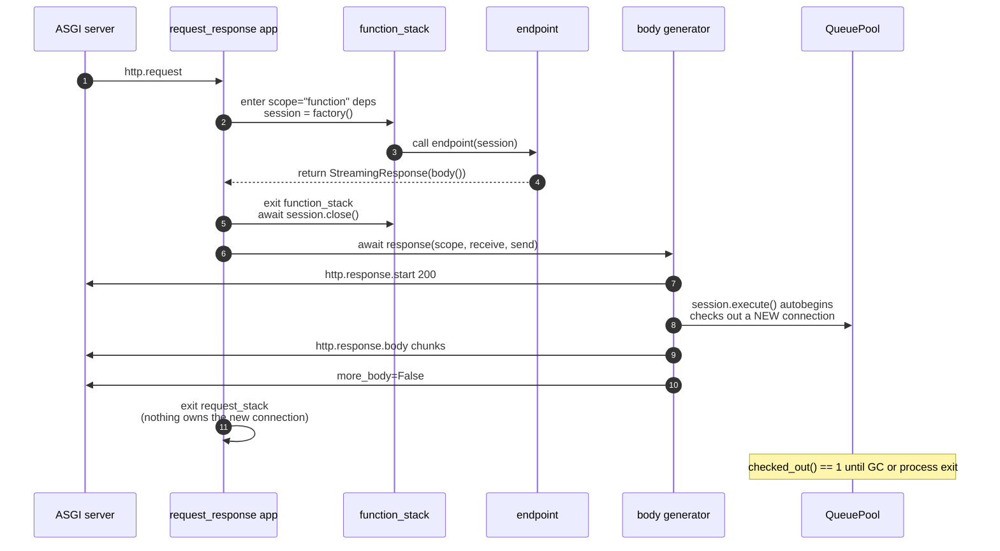

# Why a Database Session Closed Before Streaming Starts Breaks StreamingResponse and How to Scope Resources Correctly

> [!summary] Claim
> A `StreamingResponse` body runs after the endpoint returns, so any resource it touches must be owned by something that outlives `await response(scope, receive, send)`: a `scope="request"` yield dependency, or the body generator itself, never a `scope="function"` dependency, whose cleanup in FastAPI 0.162.0 has already run before the first byte is sent.

Part of [FastAPI Internals and Patterns](README.md) in [API Engineering](../README.md).

## TL;DR

- Mechanism: FastAPI 0.162.0 wraps every endpoint in two nested `AsyncExitStack`s; the inner `fastapi_function_astack` closes when the endpoint returns, the outer `fastapi_inner_astack` closes only after `await response(...)` has streamed the last chunk (fastapi 0.162.0 fastapi/routing.py, request_response).
- Contract rule: a resource read by a streaming body must be request-scoped (the default for yield dependencies since 0.121.0) or opened inside the body generator with `async with`, and nothing yielded by a `scope="function"` dependency may be captured by the body.
- Trap: with SQLAlchemy 2.1's default `close_resets_only=True`, a closed `AsyncSession` is silently reusable, so the stream returns `200 OK` with correct rows while checking out a pooled connection that nobody returns; writes in the stream are never committed, and lazy loads raise `DetachedInstanceError` after the status line is already on the wire.
- Portability: the trap is a FastAPI version fact, not a server fact; 0.106.0 through 0.117.x closed every yield dependency before streaming, 0.118.0 restored after-response cleanup, and 0.121.0 made the early close opt-in as `scope="function"`.
- When not to: do not hold a request-scoped session across a long-lived stream (SSE, LLM token streams, exports that take minutes); materialize the rows first, or open short sessions per batch inside the generator, because a request-scoped session pins one pool slot for the whole stream.

## Mental model



The server delivers `http.request`, and FastAPI's `request_response` opens the request stack and then the function stack (arrows 1 and 2).
The endpoint receives the session, builds a `StreamingResponse` around a generator that closes over that session, and returns it without iterating it (arrows 3 and 4).
The function stack's `async with` block ends at the `return`, so the dependency's `finally` runs `await session.close()` before the response object is even called (arrow 5).
Only then does `await response(scope, receive, send)` start pulling the generator (arrow 6), which sends the status line first (arrow 7) and then executes SQL on a session that has already been reset (arrow 8).
SQLAlchemy treats a reset session like a new one: it autobegins a transaction and checks out a fresh pooled connection, the chunks flow (arrows 9 and 10), and when the request stack unwinds nobody calls `close()` again (arrow 11), so the connection stays checked out until the garbage collector finds the session.

## How it works

### The two exit stacks and where `await response(...)` sits

FastAPI does not use Starlette's `request_response`; it vendors a copy whose inner ASGI app is:

```python
# simplified excerpt (fastapi 0.162.0 fastapi/routing.py, request_response)
async with AsyncExitStack() as request_stack:
    scope["fastapi_inner_astack"] = request_stack
    async with AsyncExitStack() as function_stack:
        scope["fastapi_function_astack"] = function_stack
        response = await f(request)
    await response(scope, receive, send)
    response_awaited = True
```

`f(request)` is the handler built by `get_request_handler` (fastapi 0.162.0 fastapi/routing.py, get_request_handler), which reads the body, calls `solve_dependencies`, runs the endpoint, and serializes the result into a `Response`.
For a `StreamingResponse` "serializing" means nothing: the object holds `body_iterator` and has not consumed a single item when `f` returns.
The dedent between `response = await f(request)` and `await response(...)` is the whole bug: everything registered on `function_stack` is unwound at that line.
A third stack, `fastapi_middleware_astack`, is created by `AsyncExitStackMiddleware` (fastapi 0.162.0 fastapi/middleware/asyncexitstack.py, AsyncExitStackMiddleware) and is used for closing uploaded files from `request.form()`; its comment says "dependencies are closed in their own AsyncExitStack".

### How a dependency lands on one stack or the other

`solve_dependencies` reads both stacks out of `request.scope` and, for every generator dependency that is not served from the per-request cache, picks the stack by the declared scope:

```python
# simplified excerpt (fastapi 0.162.0 fastapi/dependencies/utils.py, solve_dependencies)
use_astack = request_astack
if sub_dependant.scope == "function":
    use_astack = function_astack
solved = await _solve_generator(dependant=use_sub_dependant, stack=use_astack, sub_values=...)
```

`_solve_generator` wraps an async generator with `contextlib.asynccontextmanager` and a sync generator with `contextmanager` plus `contextmanager_in_threadpool`, then calls `stack.enter_async_context(cm)` (fastapi 0.162.0 fastapi/dependencies/utils.py, _solve_generator).
Note the test is `== "function"` on the declared value: `scope=None` (not written) goes to the request stack, which is how "request is the default" is implemented.
`Depends(..., scope=...)` is typed `Literal["function", "request"] | None` and its docstring states that `"function"` ends the dependency "before the response is sent back to the client" while `"request"` ends it "after the response is sent back to the client" (fastapi 0.162.0 fastapi/param_functions.py, Depends).
At route compilation, `get_dependant` raises `DependencyScopeError` when a generator dependency with computed scope `"request"` declares a sub-dependency with `scope="function"` (fastapi 0.162.0 fastapi/dependencies/utils.py, get_dependant), so a request-scoped repository cannot accidentally wrap a function-scoped session; the inverse, a function-scoped dependency consuming a request-scoped session, is legal and is the safe way to release early-only work.
Cache keys, override resolution, and the full exit ordering are covered in [[Yield-Dependencies-AsyncExitStack-Cleanup-Timing-and-Scope]] and [[Dependency-Injection-Engine-DAG-Resolution-and-Use-Cache-Mechanics]].

### Why the body runs late: Starlette's `StreamingResponse.__call__`

`StreamingResponse.__init__` stores an async iterable as `body_iterator` directly and wraps a sync iterable in `iterate_in_threadpool`, which calls `anyio.to_thread.run_sync(_next, as_iterator)` once per chunk (starlette 1.10.0 starlette/responses.py, StreamingResponse.__init__; starlette 1.10.0 starlette/concurrency.py, iterate_in_threadpool).
`stream_response` sends `http.response.start` with the status and headers before it pulls the first item, then one `http.response.body` with `more_body: True` per chunk, then an empty body with `more_body: False` (starlette 1.10.0 starlette/responses.py, StreamingResponse.stream_response).
So the status line is committed before the generator has executed its first statement, and any exception raised inside the generator can only truncate the body.
`StreamingResponse.__call__` branches on the server's declared `scope["asgi"]["spec_version"]`: for `>= (2, 4)` it just awaits `stream_response` and maps `OSError` to `ClientDisconnect`; below that it runs `stream_response` and `listen_for_disconnect` in a collapsing task group, and whichever finishes first cancels the other (starlette 1.10.0 starlette/responses.py, StreamingResponse.__call__).
ASGI spec version `2.4` is the one where "Calling `send()` on a closed connection should raise an error", specifically "a server-specific subclass of `OSError`" (ASGI HTTP spec, Spec Versions and Disconnected Client - `send` exception).
Uvicorn 0.54.0 declares `"spec_version": "2.3"` in all four of its HTTP protocol scopes, h11, httptools, zttp, and zttp HTTP/2 (uvicorn 0.54.0 uvicorn/protocols/http/h11_impl.py, H11Protocol.handle_events; uvicorn 0.54.0 uvicorn/protocols/http/zttp_h2_impl.py, ZttpH2Protocol.handle_request), Hypercorn 0.18.0 declares `"2.1"` for HTTP (hypercorn 0.18.0 hypercorn/protocol/http_stream.py, HTTPStream.handle), and the compiled Granian 2.8.7 module embeds `spec_version` `2.3`, so on every pinned server Starlette uses the task-group path and a disconnect cancels the body task.
Starlette never calls `aclose()` on `body_iterator`; a generator that is abandoned while suspended at `yield` is finalized by the event loop's async generator finalizer, which under asyncio schedules `agen.aclose()` as a new task (CPython 3.14.6 Lib/asyncio/base_events.py, BaseEventLoop._asyncgen_finalizer_hook; PEP 525, Finalization).

### What "closed" means to SQLAlchemy 2.1

`Session.close()` calls `_close_impl`, which runs `expunge_all()` (every loaded object becomes detached) and closes the transaction chain, returning the connection to the pool (sqlalchemy 2.1.8 lib/sqlalchemy/orm/session.py, Session._close_impl).
With the default `close_resets_only=True` (added in 2.0.22, "A future SQLAlchemy version may change the default value of this flag to ``False``"), the session's `_close_state` is `CLOSE_IS_RESET`, and the docstring says plainly that `close()` "does not prevent the Session from being used again" (sqlalchemy 2.1.8 lib/sqlalchemy/orm/session.py, Session.__init__ and Session.close).
The next `execute()` therefore autobegins a new `SessionTransaction` and checks out a new connection, and since the dependency's cleanup has already run, no code path will close it.
With `close_resets_only=False`, `close()` sets `_SessionCloseState.CLOSED` and the next `SessionTransaction.__init__` raises `InvalidRequestError("This Session has been permanently closed and is unable to handle any more transaction requests.")` (sqlalchemy 2.1.8 lib/sqlalchemy/orm/session.py, SessionTransaction.__init__).
The SQLAlchemy documentation frames the design: the session "may be used again" after close, and applications should "keep the lifecycle of the session separate and external" from functions that access data (SQLAlchemy 2.1 Session Basics, Closing; When do I construct a Session).
`AsyncSession.__aexit__` runs `close()` through `_run_to_completion`, which runs the coroutine in its own task behind `asyncio.shield` and re-raises a received cancellation only after the close finished (sqlalchemy 2.1.8 lib/sqlalchemy/ext/asyncio/base.py, _run_to_completion), which is why `async with factory() as session:` inside a generator survives a client disconnect cleanly.
When an unreturned connection is finally garbage collected, `_finalize_fairy` logs and warns "The garbage collector is trying to clean up non-checked-in connection ..., which will be terminated." (sqlalchemy 2.1.8 lib/sqlalchemy/pool/base.py, _finalize_fairy); that warning in production logs is the fingerprint of this bug.
The tail of the message is computed: it says "terminated" when the pool can close or terminate the connection, which is what the lab captured for `aiosqlite`, and "dropped, as it cannot be safely terminated" otherwise, so alert on the stable prefix "The garbage collector is trying to clean up non-checked-in connection".

### The failure modes, by what the body does with the closed session

| Body does | `close_resets_only=True` (default) | `close_resets_only=False` |
|---|---|---|
| New `SELECT` | Succeeds, leaks one pooled connection until GC | `InvalidRequestError` after `200` is sent |
| Lazy load on an object loaded by the endpoint | `DetachedInstanceError` after `200` is sent | Same |
| `add()` plus `flush()` | Rows flushed into a transaction that is never committed; lost on GC | `InvalidRequestError` after `200` is sent |
| Reads only pre-loaded column attributes | Works; nothing touches the session | Works |

The last row is why the bug survives code review: an endpoint that preloads everything and a body that formats it is correct, and the same file with one extra query in the body is not.

### Version history: the same code meant three different things

| FastAPI | Yield dependency exit code runs | Source |
|---|---|---|
| < 0.106.0 | After the response is sent | advanced-dependencies.md, Background Tasks and Dependencies with `yield` |
| 0.106.0 (2023-12-25) to 0.117.x | After the endpoint returns, before the response is sent, for every yield dependency | release notes 0.106.0, PR #10831; advanced-dependencies.md, Dependencies with `yield` and `StreamingResponse` |
| 0.118.0 (2025-09-29) | After the response is sent again | release notes 0.118.0, PR #14099 |
| 0.121.0 (2025-11-03) to 0.162.0 | `scope="request"` (default): after the response; `scope="function"`: before the response | release notes 0.121.0, PR #14262 |

The 0.106.0 change was made "with the intention to not hold resources while waiting for the response to travel through the network" (FastAPI advanced-dependencies.md, Background Tasks and Dependencies with `yield`, Technical Details), and the 0.106.0 release notes name the resource: "unnecessarily holding a resource in a dependency with yield (for example a database connection)".
The 0.118.0 revert notes that with the earlier behavior "if you returned a `StreamingResponse`, the exit code of the dependency with `yield` would have been already run" (FastAPI release notes 0.118.0; advanced-dependencies.md, Dependencies with `yield` and `StreamingResponse`, Technical Details).
FastAPI discussion #11444 (2024-04-16, FastAPI 0.110.0) is the canonical user report: the dependency's "Finally block has been executed before the streaming completed", with no exception, and a FastAPI collaborator's advice (2025-05-19, relaying a maintainer comment) was to "avoid using the results of dependencies with `yield` in streaming response generators"; the accepted answer (2025-10-07) points to 0.118.0.
FastAPI's own regression test for the fix, `tests/test_dependency_after_yield_streaming.py`, asserts that a stream from a broken session still returns `status_code == 200` with `text == ""` when server exceptions are not raised, which is exactly the "status already committed" symptom (fastapi 0.162.0 tests/test_dependency_after_yield_streaming.py, test_broken_session_stream_no_raise).
`scope="function"` reintroduced the 0.106.0 behavior as an explicit opt-in; the docs' motivating case is a session used "only to verify a user", where closing early means "the session would release the database connection, so other requests could use it" (FastAPI advanced-dependencies.md, Use Cases with Early Exit Code, which shows an explicit `session.close()`; the `scope` parameter itself is documented in dependencies-with-yield.md, Early exit and `scope`).

### Generator endpoints (JSONL, SSE, raw) follow the same rule

Since 0.134.0 (JSON Lines, PR #15022) and 0.135.0 (Server-Sent Events, PR #15030) an endpoint may itself be a generator; `get_request_handler` calls `dependant.call(**solved_result.values)` to create the generator object and wraps it in a `StreamingResponse` (JSONL and SSE) or in the declared `response_class` (raw streams) inside `f(request)` (fastapi 0.162.0 fastapi/routing.py, get_request_handler).
The generator body runs later, during `await response(...)`, so a `scope="function"` dependency injected into a generator endpoint is equally closed before the first item.
The SSE path deliberately enters its producer task group on the request-scoped stack, with a comment that its `__aexit__` "is called by the exit stack after the streaming response completes - not by async generator finalization via GeneratorExit" (the source uses an em dash, rendered here as `-`), citing PEP 789 (fastapi 0.162.0 fastapi/routing.py, get_request_handler `_sse_producer_cm`; PEP 789, which proposes `sys.prevent_yields()` and is Draft as of 2026-11).
The async JSONL and async raw generator wrappers insert `await anyio.sleep(0)` after each item "To allow for cancellation to trigger" (FastAPI issue 14680, referenced in the source), and the SSE wrapper does the same so "cancellation can be delivered even when the producer is faster than the consumer"; sync generator endpoints (iterated through the threadpool) and a hand-written `StreamingResponse` get no such checkpoint.

### What the wire sees when the body fails

Uvicorn's `run_asgi` catches the exception, logs "Exception in ASGI application", and if `response_started` is true calls `self.transport.close()` instead of sending a `500` (uvicorn 0.54.0 uvicorn/protocols/http/h11_impl.py, RequestResponseCycle.run_asgi).
Starlette's `ServerErrorMiddleware` likewise only renders the error page "if not response_started" and always re-raises (starlette 1.10.0 starlette/middleware/errors.py, ServerErrorMiddleware.__call__).
On HTTP/1.1 with chunked coding the client therefore never receives the `last-chunk` (`1*("0") [ chunk-ext ] CRLF`, RFC 9112 Section 7.1) and a conforming client must treat the body as incomplete (RFC 9112 Section 8); a close-delimited body without `Content-Length` is indistinguishable from success, because such a response "is terminated by closure of the connection" (RFC 9112 Section 8).
On HTTP/2, Uvicorn 0.54.0 calls `abort_stream()`, whose docstring reads "Reset only this stream so sibling streams on the connection survive." (uvicorn 0.54.0 uvicorn/protocols/http/zttp_h2_impl.py, RequestResponseCycle.run_asgi and abort_stream), so the stream ends with `RST_STREAM`, which "is sent to request cancellation of a stream or to indicate that an error condition has occurred" (RFC 9113 Section 6.4), instead of a DATA frame with `END_STREAM` (RFC 9113 Section 6.1).

## Numbers and limits

| Quantity | Value | Source or measurement |
|---|---|---|
| Default `QueuePool` size and overflow | `pool_size=5`, `max_overflow=10`, `timeout=30.0` s, so 15 concurrent checkouts per engine per process | sqlalchemy 2.1.8 lib/sqlalchemy/pool/impl.py, QueuePool.__init__ |
| Leaked connections per function-scoped streaming request that queries | 1 (the pool reports `checkedout() == 1` after the response completed) | Lab, `test_function_scope_closes_session_before_stream_and_leaks_reacquired_connection`, CPython 3.14.6, macOS 27.3 arm64 |
| Requests to exhaust a 1-slot pool | 1; the next `engine.connect()` raises `TimeoutError: QueuePool limit of size 1 overflow 0 reached` after `pool_timeout=0.05` | Same lab test |
| Rows lost when a function-scoped `session.begin()` dependency is written to by the body | 3 of 3 (`audit_count() == 0`) | Lab, `test_function_scope_stream_writes_are_never_committed` |
| Connections held by a request-scoped session during a stream | 1 for the stream's whole duration (`stream:end(checked_out=1)`) | Lab, `test_request_scope_keeps_session_open_until_response_is_sent` |
| Reclamation of an unpinned leaked connection | Not by refcount alone; only after `gc.collect()`, with `SAWarning` "garbage collector is trying to clean up" | Lab, `test_unpinned_leaked_connection_returns_only_through_garbage_collector` |
| Thread hops for a sync body | One `anyio.to_thread.run_sync` per chunk through the default `CapacityLimiter(40)` | starlette 1.10.0 starlette/concurrency.py, iterate_in_threadpool; anyio 4.16.0 anyio/_backends/_asyncio.py, current_default_thread_limiter |
| FastAPI SSE keepalive interval | `_PING_INTERVAL = 15.0` s, comment `: ping` | fastapi 0.162.0 fastapi/sse.py |
| PostgreSQL `idle_in_transaction_session_timeout` default | `0` (disabled); an idle open transaction "prevents vacuuming away recently-dead tuples" | PostgreSQL 18 documentation, Client Connection Defaults (as of 2026-11) |
| ASGI `spec_version` of pinned servers | Uvicorn 0.54.0: `2.3`; Hypercorn 0.18.0 HTTP: `2.1`; Granian 2.8.7: `2.3` | Server source and binary strings, as cited in How it works |
| Lab runtime | 9 tests in 0.78 s (verifier rerun, 2026-11) | `uv run --frozen pytest ... -q`, CPython 3.14.6, macOS 27.3 arm64 (`uname -r` = `27.3.0`) |

Pool math: a service with 4 worker processes and the default pool can serve at most 60 concurrent request-scoped streams before the 61st request waits up to `pool_timeout` (30 s) and then fails with `TimeoutError`; a long-lived SSE endpoint with request-scoped sessions converts "concurrent viewers" directly into "pool slots", see [[Sizing-Connection-Pools-Across-Workers-Pods-and-PgBouncer-Transaction-Mode]].

## Portability

| Axis | Behavior | Evidence |
|---|---|---|
| CPython 3.14.6 | All 9 lab tests pass | Ran here: `uv run --frozen pytest`, macOS 27.3 arm64 |
| CPython 3.12, 3.13, 3.15, 3.15t | Not run, so no claim is made for these legs; the lab matrix was paused by the user on 2026-11-11 | The cited source was read only for CPython 3.14.6; `test_unpinned_leaked_connection_returns_only_through_garbage_collector` depends on garbage collection timing, so it is the test to watch on other builds |
| Debian Trixie and Alpine musl containers | Not run, so no claim is made for these legs | Same pause |
| FastAPI < 0.106.0 | Session alive during streaming (exit after response) | FastAPI advanced-dependencies.md |
| FastAPI 0.106.0 to 0.117.x | Every yield dependency closed before streaming; no opt-out | Release notes 0.106.0 and 0.118.0 |
| FastAPI 0.118.0 to 0.120.x | Every yield dependency closed after streaming; no early-close opt-in | Release notes 0.118.0 and 0.121.0 |
| FastAPI 0.121.0 to 0.162.0 | Default `request`, opt-in `function` | Release notes 0.121.0; fastapi 0.162.0 fastapi/dependencies/utils.py |
| SQLAlchemy 2.0 < 2.0.22 | No `close_resets_only`; close always resets | sqlalchemy 2.1.8 docstring "versionadded:: 2.0.22" |
| SQLAlchemy 2.0.22+ and 2.1.8 | `close_resets_only=True` default; `False` makes use-after-close loud | sqlalchemy 2.1.8 lib/sqlalchemy/orm/session.py |
| Uvicorn 0.54.0 | `spec_version` `2.3`: disconnect cancels the body task; mid-stream error closes the transport | uvicorn 0.54.0 source |
| Hypercorn 0.18.0 | `spec_version` `2.1`: same Starlette task-group path | hypercorn 0.18.0 hypercorn/protocol/http_stream.py |
| Granian 2.8.7 | `spec_version` `2.3` embedded in the compiled module | String inspection of the macOS wheel; behavior not run |
| httpx 0.28.1 `ASGITransport` | Omits `spec_version`, so Starlette assumes `2.0` and uses the task-group path | httpx 0.28.1 httpx/_transports/asgi.py, ASGITransport.handle_async_request |
| HTTP/1.1 | Mid-stream failure leaves a chunked body without `last-chunk` | RFC 9112 Sections 7.1 and 8 |
| HTTP/2 | Mid-stream failure becomes `RST_STREAM` instead of `END_STREAM` | RFC 9113 Sections 6.1 and 6.4 |
| HTTP/3 | A clean body ends when the server closes the stream for sending; a server that "abandons a response after partial processing" SHOULD abort the stream with `H3_REQUEST_CANCELLED` (`0x010c`); no pinned server's HTTP/3 path was run for this note | RFC 9114 Sections 4.1, 4.1.1, and 8.1 |

## Worked example

The [implementation](../labs/src/api_labs/f11_fastapi_internals_and_patterns/streaming_session_scope.py) builds one FastAPI app over a file-backed SQLite database with `pool_size=1, max_overflow=0, pool_timeout=0.05`, so a leak of one connection is observable as an exact count and as a pool timeout.
The [test](../labs/tests/f11_fastapi_internals_and_patterns/test_yield_dependencies_inside_streamingresponse_and_resource_lifecycle_traps.py) drives it through `httpx.ASGITransport` and through a raw ASGI driver that records every `send()` message and can inject `http.disconnect`.

The dependency and the trap endpoint, registered once per scope:

```python
# simplified excerpt of streaming_session_scope.py, build_streaming_app
async def get_session() -> AsyncIterator[AsyncSession]:
    session = lab.factory()
    lab.sessions.append(session)  # pinned so the test can count and then clean up
    lab.record("session:open")
    try:
        yield session
    finally:
        await session.close()
        lab.record("session:closed")

@app.get(f"/{scope}/titles")
async def titles(
    session: Annotated[AsyncSession, Depends(get_session, scope=scope)],
) -> StreamingResponse:
    lab.record("endpoint:return")

    async def body() -> AsyncIterator[bytes]:
        lab.record(f"stream:start(checked_out={lab.checked_out()})")
        result = await session.stream_scalars(select(Book.title).order_by(Book.id))
        async for title in result:
            yield f"{title}\n".encode()
        lab.record(f"stream:end(checked_out={lab.checked_out()})")

    return StreamingResponse(body(), media_type="text/plain")
```

The event log for `scope="function"` proves the order, and the pool proves the leak:

```python
# simplified excerpt of the test module
response = await get(build_streaming_app(lab), "/function/titles")
assert response.text == TITLES_BODY          # the bug is invisible to the client
assert lab.events == [
    "session:open",
    "endpoint:return",
    "session:closed",                        # cleanup ran before the first chunk
    "stream:start(checked_out=0)",
    "stream:end(checked_out=1)",             # the closed session re-checked out
]
assert lab.checked_out() == 1                # and nobody returned it
with pytest.raises(TimeoutError, match=r"QueuePool limit of size 1 overflow 0 reached"):
    async with lab.engine.connect():
        pass
```

The same endpoint under `scope="request"` records `stream:end(checked_out=1)` followed by `session:closed`, and the pool is back to `0`.
The three fixes are each a test: request scope (`test_request_scope_keeps_session_open_until_response_is_sent`, which also proves 3 of 3 streamed writes commit), materializing rows in the endpoint so a function-scoped session can close early (`test_materialized_rows_release_the_connection_before_streaming`), and a generator that owns its session (`/owned/stall`):

```python
# simplified excerpt of streaming_session_scope.py, owned_stall
async def body() -> AsyncIterator[bytes]:
    async with lab.factory() as session:      # owner == the code that uses it
        try:
            first = await session.scalar(select(Book.title).order_by(Book.id))
            yield f"{first}\n".encode()
            await lab.stall.wait()            # client disconnects here
        finally:
            lab.record("owned:exiting")
```

`test_client_disconnect_mid_stream_still_releases_the_connection` sends `http.disconnect` after the first chunk with `spec_version` `2.3`, as Uvicorn does, and proves that both the request-scoped dependency and the generator-owned `async with` return the connection (`checked_out() == 0`).

Captured run (CPython 3.14.6, macOS 27.3 arm64, from `labs/`):

```text
$ uv run --frozen pytest tests/f11_fastapi_internals_and_patterns/test_yield_dependencies_inside_streamingresponse_and_resource_lifecycle_traps.py -q
.........                                                                [100%]
9 passed in 0.78s
```

## Pitfalls

> [!warning] Function-scoped session captured by a stream
> Trigger: `Depends(get_db, scope="function")` (or FastAPI 0.106.0 to 0.117.x with any yield dependency) and a `StreamingResponse` body that queries.
> Symptom: `200 OK` with correct data, rising pool checkouts, `QueuePool limit ... connection timed out` under load, and `SAWarning` "garbage collector is trying to clean up non-checked-in connection" in logs; FastAPI discussion #11444 reports the dependency's finally running "before the streaming completed".
> Fix: keep the default request scope for any dependency whose value the body touches, or open the session inside the body.

> [!warning] Writes in the stream after the dependency committed
> Trigger: a `async with session.begin(): yield session` dependency with `scope="function"`, and a body that records progress, audit rows, or cursor positions.
> Symptom: the response says "logged" for every item, and the rows never exist; the lab measured 3 of 3 lost.
> Fix: commit inside the body with its own transaction, or use request scope; never rely on a dependency's commit for writes that happen during streaming.

> [!warning] Lazy loads and expired attributes in the body
> Trigger: the endpoint loads ORM objects and the body reads a relationship or an expired column.
> Symptom: `DetachedInstanceError: Parent instance <Author ...> is not bound to a Session; lazy load operation of attribute 'books' cannot proceed` after `200` and the first chunk were sent; with request scope, plain attribute access instead of `awaitable_attrs` fails differently, as `MissingGreenlet`, because the lazy load needs IO outside a `greenlet_spawn` context (sqlalchemy 2.1.8 lib/sqlalchemy/util/concurrency.py, await_; SQLAlchemy 2.1 Errors, MissingGreenlet: "nearly always due to the use of lazy loading"), see [[Async-SQLAlchemy-Under-the-Hood-Greenlet-Bridge-and-MissingGreenlet]]; the lab exercises only the `awaitable_attrs` path.
> Fix: eager load (`selectinload`) in the endpoint, or convert to plain DTOs before returning; set `lazy="raise"` on relationships used by streaming code, see [[Eliminating-N-Plus-1-Queries-Selectinload-Joinedload-Subqueryload-and-Raiseload]].

> [!warning] Request-scoped session held for a long stream
> Trigger: SSE, LLM token streaming, or a multi-minute export behind a request-scoped session that opened a transaction.
> Symptom: pool slots equal to concurrent viewers; on PostgreSQL an "idle in transaction" backend that holds locks and "prevents vacuuming away recently-dead tuples" (PostgreSQL 18 documentation), with `idle_in_transaction_session_timeout` disabled by default.
> Fix: materialize, or open a short session per batch inside the generator; the FastAPI docs' own example for `scope="function"` is releasing a session used only for authentication.

> [!warning] Explicit `close()` in a cancelled generator
> Trigger: a body that does `session = factory()` and `finally: await session.close()` instead of `async with`, inside an AnyIO cancel scope that is already cancelled (client disconnect).
> Symptom: tasks in an AnyIO cancel scope or task group "get hit with a cancellation exception any time [they hit] a yield point" (AnyIO cancellation docs, level cancellation), and `AsyncSession.close()` is an unshielded `await greenlet_spawn(self.sync_session.close)` (sqlalchemy 2.1.8 lib/sqlalchemy/ext/asyncio/session.py, AsyncSession.close), so the driver awaits inside it are checkpoints where `CancelledError` can interrupt the close; whether the connection is returned then depends on the driver, and the lab does not exercise this form; see [[Cancellation-Semantics-CancelledError-Swallowing-and-Shielded-Cleanup]].
> Fix: use `async with factory() as session`, whose `__aexit__` runs `close()` through `_run_to_completion` in its own task behind `asyncio.shield` and re-raises the cancellation only after the close finished (sqlalchemy 2.1.8 lib/sqlalchemy/ext/asyncio/base.py, _run_to_completion).

> [!warning] The test client hides the timing
> Trigger: asserting only `response.status_code == 200` and `response.text` in tests.
> Symptom: the function-scope leak passes every test; `TestClient` and `ASGITransport` buffer the whole body, and FastAPI's own regression test shows a broken stream still reports `200` with an empty body.
> Fix: assert pool `checkedout()` after the request and record cleanup order, as the lab does; see [[Testing-FastAPI-Applications-AsyncClient-Lifespan-and-Dependency-Overrides]].

## Security and robustness

- Resource exhaustion (OWASP API4:2023 Unrestricted Resource Consumption): every function-scoped streaming request that queries leaks one pooled connection until a GC cycle runs, so an unauthenticated client that can hit such an endpoint can drain the pool and stall every other route that needs the database; the lab shows one request is enough for a 1-slot pool.
- Slow-client amplification: with request scope, a client that reads one byte per second holds a pool slot and possibly an open transaction for the whole stream; cap stream duration, apply per-client concurrency limits, and do not hold a transaction across `send()`, see [[End-to-End-Backpressure-TCP-Windows-ASGI-Send-Await-and-Bounded-Queues]].
- Integrity: silently uncommitted writes are worse than a crash, because callers act on a `200` stream that claims success; streaming endpoints that write must commit per batch inside the body and report the committed cursor.
- Error disclosure: once headers are sent, no error body can be delivered, so clients must validate completeness by framing (chunked `last-chunk`, HTTP/2 `END_STREAM`), a trailing sentinel record, or a final count, see [[Streaming-Exports-and-NDJSON-for-Unbounded-Collections]].
- Cross-request isolation: an `AsyncSession` is "not safe to use a single instance" across concurrent tasks (SQLAlchemy Session Basics FAQ); a body that spawns tasks sharing the request's session corrupts state, see [[Why-Sharing-an-AsyncSession-Across-Concurrent-Tasks-Corrupts-State]].
- Defense in depth: create engines with `close_resets_only=False` session factories so use-after-close raises; alert on the `SAWarning` text and on `pool.checkedout()` staying above zero between requests; set `idle_in_transaction_session_timeout` on the PostgreSQL role used by the API.

## The principal's view

The architectural decision is who owns a resource whose use outlives the function that acquired it, and the answer is "the code that uses it last".
For a normal JSON endpoint the endpoint is the last user, so `scope="function"` is a free win: the connection goes back to the pool before the response bytes cross the network, which is the reason 0.106.0 made it the only behavior.
For a streaming endpoint the body generator is the last user, so either the request (via `scope="request"`) or the generator itself must own the session; FastAPI's history (0.106.0 broke it for nearly two years, 0.118.0 reverted, 0.121.0 made it opt-in) is the cost of choosing one global answer for two different ownership graphs.
At organization scale, codify the rule in a shared `get_db` that is request-scoped, a separate `get_auth_db` that is function-scoped and used only for lookups, `close_resets_only=False` on every factory, and a lint or review rule that a `StreamingResponse` body may close over only plain data or a factory, never a session.
Prefer materializing when the result fits in memory and latency to first byte does not matter; prefer a generator-owned session with short per-batch transactions for exports and feeds; and when a stream must run for minutes and survive disconnects or retries, move it off the request path entirely, to a durable job that writes to object storage and a download URL, see [[BackgroundTasks-vs-Durable-Task-Queues-Celery-and-Dramatiq]].
Any framework that injects per-request resources, and raw Starlette with manual `async with`, faces the same ownership choice; the framework can only pick a default, see [[FastAPI-Architectural-Limits-and-Comparison-with-Litestar-and-Raw-Starlette]].

## Interview questions

> [!question] L5: In FastAPI 0.162.0, when does the code after `yield` run for a dependency declared with `scope="function"`, and when for the default?
>
> > [!success]- Answer
> > With `scope="function"` it runs when the endpoint function returns, before `await response(scope, receive, send)`, because the dependency was entered on `fastapi_function_astack`.
> > With no scope (the default for yield dependencies) it runs after the response has been fully sent, because it was entered on `fastapi_inner_astack`, which encloses the `await response(...)` call.
> >
> > Follow-up: which one is safe for a session used only to authenticate the caller of a large streaming download, and why?

> [!question] L5: Predict the output: with `scope="function"`, SQLAlchemy 2.1 defaults, and the body running `await session.stream_scalars(select(Book.title))`, what does the client receive, and what is `engine.pool.checkedout()` after the response?
>
> > [!success]- Answer
> > The client receives `200 OK` and all three titles, because a closed session with `close_resets_only=True` is reset rather than dead and autobegins a new transaction.
> > `checkedout()` is `1`, because that new transaction checked out a connection after the dependency's cleanup had already run, and nothing closes the session again.
> > The lab records `session:closed` before `stream:start(checked_out=0)` and then `stream:end(checked_out=1)`.
> >
> > Follow-up: what changes if the session factory uses `close_resets_only=False`?

> [!question] L5: Why does an exception inside a `StreamingResponse` generator not produce a `500`?
>
> > [!success]- Answer
> > `stream_response` sends `http.response.start` with the status before it pulls the first chunk, so the status is committed before the generator runs.
> > Starlette's `ServerErrorMiddleware` renders an error only if the response has not started, and Uvicorn closes the transport when `response_started` is true.
> > The client sees a truncated chunked body without the zero-size `last-chunk` (RFC 9112 Section 7.1), or an HTTP/2 `RST_STREAM`.
> >
> > Follow-up: how should a client of an NDJSON export detect that it received a truncated stream?

> [!question] L6: Debug this API: after upgrading FastAPI from 0.105 to 0.110 with nothing else changed, a CSV export endpoint still returns correct files, but the service starts logging `QueuePool limit of size 5 overflow 10 reached` under load and `The garbage collector is trying to clean up non-checked-in connection` warnings; what happened?
>
> > [!success]- Answer
> > FastAPI 0.106.0 moved yield dependency cleanup to before the response is sent, so the `get_db` session is closed before the export generator runs.
> > The generator's queries reuse the reset session, which checks out a fresh connection that no code returns, so each export leaks one connection until a GC cycle finalizes it with that warning.
> > Fix by upgrading to 0.118.0 or later (cleanup after response), or on the pinned version by opening the session inside the generator with `async with`.
> >
> > Follow-up: which single metric would have caught this in a canary before users noticed?

> [!question] L6: An audit-logging stream writes one row per emitted item through a dependency `async with session.begin(): yield session`, responses look perfect, and the audit table is empty; explain the mechanism and two fixes.
>
> > [!success]- Answer
> > With `scope="function"` the `session.begin()` block commits an empty transaction when the endpoint returns, before the body runs.
> > The body's `flush()` autobegins a second transaction that is never committed, and when the session is eventually closed or collected it rolls back; the lab measured 3 of 3 rows lost.
> > Fix one: use request scope so the commit runs after the stream, accepting that a mid-stream failure rolls back everything.
> > Fix two: commit per batch inside the generator with its own session, which makes progress durable and bounds transaction length.
> >
> > Follow-up: which fix gives at-least-once audit semantics if the client disconnects halfway?

> [!question] L6: What happens to a request-scoped session when the client disconnects mid-stream under Uvicorn, and why does the ASGI `spec_version` matter?
>
> > [!success]- Answer
> > Uvicorn 0.54.0 declares `spec_version` `2.3`, so Starlette runs `stream_response` next to `listen_for_disconnect` in a task group, and `http.disconnect` cancels the body task.
> > `StreamingResponse.__call__` then returns normally, the request stack unwinds outside the cancelled scope, and the dependency's `finally` closes the session; the lab proves `checked_out() == 0` after the disconnect.
> > Under `spec_version` `2.4` Starlette would not listen for disconnects and would only notice when `send()` raises `OSError`, so a body that never sends could keep running.
> >
> > Follow-up: why does FastAPI's SSE wrapper add `await anyio.sleep(0)` after every item?

> [!question] L7+: Your platform team must choose one default for the shared `get_db` dependency across 200 services, many of which stream: request scope or function scope, and what guardrails?
>
> > [!success]- Answer
> > Request scope is the safe default, because the failure mode of holding a connection a little longer is pool pressure that is visible in metrics, while the failure mode of early close is silent leaks, lost writes, and truncated `200` responses.
> > Pair it with a separate function-scoped dependency for lookup-only use, `close_resets_only=False` so misuse is loud, an alert on the SAWarning text, and pool sizing that accounts for stream concurrency.
> > For long-lived streams require generator-owned short sessions, enforced by review or a lint that rejects sessions captured by streaming bodies.
> >
> > Follow-up: how would you migrate 200 services safely if some of them depend on early release for pool headroom today?

> [!question] L7+: A product team proposes an SSE endpoint that pushes database changes to 10,000 concurrent dashboards with a request-scoped `AsyncSession`; review the design.
>
> > [!success]- Answer
> > Each open stream pins one pool slot for its lifetime, so 10,000 viewers need 10,000 connections, far beyond a default pool of 15 per process and beyond what PostgreSQL backends or PgBouncer transaction mode will tolerate.
> > If the session holds a transaction, each viewer is also an idle-in-transaction backend that blocks vacuum, and `idle_in_transaction_session_timeout` is disabled by default.
> > Redesign so one producer per process reads changes (LISTEN/NOTIFY, logical decoding, or a broker) and fans out from memory, and any per-viewer read uses a short session per event opened inside the generator.
> >
> > Follow-up: where would you enforce a maximum stream duration, and what should the client do when it is reached?

> [!question] L7+: Why did FastAPI flip this behavior twice, and what does that history teach about framework defaults for resource lifetime?
>
> > [!success]- Answer
> > 0.106.0 optimized for the common JSON case by releasing resources before network I/O, which broke every consumer whose last use was after the endpoint returned (streams and background tasks).
> > 0.118.0 restored after-response cleanup because silent breakage of streaming was worse, and 0.121.0 exposed the choice per dependency as `scope`, so ownership is declared at the injection site instead of guessed globally.
> > The lesson is that lifetime is a property of the consumer, not the provider, and a framework should make the provider declare it rather than change one global default.
> >
> > Follow-up: how would you design a dependency API that makes a function-scoped value impossible to capture in a streaming body?

## Related

Prerequisites: [[Yield-Dependencies-AsyncExitStack-Cleanup-Timing-and-Scope]]

Next: [[Async-Def-vs-Def-Endpoints-and-AnyIO-Threadpool-Limiter-Semantics]]

See also: [[02-Programming-Languages/Python/Python-Backend-Interview-Prep/04-FastAPI]], [[02-Programming-Languages/Python/Python-Backend-Interview-Prep/06-SQL-and-SQLAlchemy]], [[Starlette-Responses-StreamingResponse-FileResponse-and-Background-Execution]], [[ASGI-HTTP-and-Disconnect-Event-Lifecycle]], [[Server-Sent-Events-SSE-Protocol-Last-Event-ID-and-SSE-Starlette]], [[Request-Scoped-Transaction-Patterns-Commit-As-You-Go-vs-Unit-of-Work]], [[Connection-Pooling-Internals-QueuePool-AsyncAdaptedQueuePool-and-Pre-Ping]], [[Session-Internals-Identity-Map-Unit-of-Work-Flush-and-Expire-On-Commit]], [[Case-Study-Connection-Pool-Exhaustion-from-Holding-DB-Sessions-Across-Slow-Outbound-HTTP-Calls]], [[Memory-Leaks-in-Long-Running-Python-API-Workers]], [[AnyIO-Structured-Concurrency-TaskGroups-CancelScopes-and-ExceptionGroups]]

- Lab: `labs/tests/f11_fastapi_internals_and_patterns/test_yield_dependencies_inside_streamingresponse_and_resource_lifecycle_traps.py`

## Further reading

- [FastAPI release notes at 0.162.0](https://github.com/fastapi/fastapi/blob/0.162.0/docs/en/docs/release-notes.md): the 0.106.0, 0.118.0, and 0.121.0 entries are the authoritative timeline of when yield dependency cleanup moved.
- [FastAPI Advanced Dependencies, Technical Details](https://github.com/fastapi/fastapi/blob/0.162.0/docs/en/docs/advanced/advanced-dependencies.md): the maintainers' own explanation of why each change was made and the intended use of `scope="function"`.
- [fastapi 0.162.0 fastapi/routing.py](https://github.com/fastapi/fastapi/blob/0.162.0/fastapi/routing.py): `request_response` shows the two nested exit stacks around `await response(...)`.
- [fastapi 0.162.0 tests/test_dependency_after_yield_streaming.py](https://github.com/fastapi/fastapi/blob/0.162.0/tests/test_dependency_after_yield_streaming.py): the upstream regression test, including the "200 with empty body" case.
- [FastAPI discussion #11444](https://github.com/fastapi/fastapi/discussions/11444): the user report and maintainer workaround from the 0.106.0 to 0.117.x era.
- [starlette 1.10.0 starlette/responses.py](https://github.com/encode/starlette/blob/1.10.0/starlette/responses.py): `StreamingResponse.__call__` and its `spec_version` branch.
- [ASGI HTTP and WebSocket specification](https://asgi.readthedocs.io/en/latest/specs/www.html): `http.disconnect`, `more_body`, and the 2.4 `send()` error rule.
- [SQLAlchemy 2.1 Session Basics](https://docs.sqlalchemy.org/en/21/orm/session_basics.html): close semantics, `close_resets_only`, and the session-per-task rule.
- [RFC 9112](https://www.rfc-editor.org/rfc/rfc9112.html): Section 7.1 chunked coding and Section 8 incomplete messages, which define what a truncated stream looks like on HTTP/1.1.
- [RFC 9113](https://www.rfc-editor.org/rfc/rfc9113.html): Sections 6.1 and 6.4 for `END_STREAM` versus `RST_STREAM` on HTTP/2.
- [PEP 525](https://peps.python.org/pep-0525/): async generator finalization and why abandoned bodies are closed by a loop-scheduled `aclose()`.
- [PEP 789](https://peps.python.org/pep-0789/): why yielding inside a cancel scope breaks structured concurrency, cited by FastAPI's SSE implementation.
- [PostgreSQL 18 Client Connection Defaults](https://www.postgresql.org/docs/current/runtime-config-client.html): `idle_in_transaction_session_timeout` and the vacuum cost of long-open transactions.
