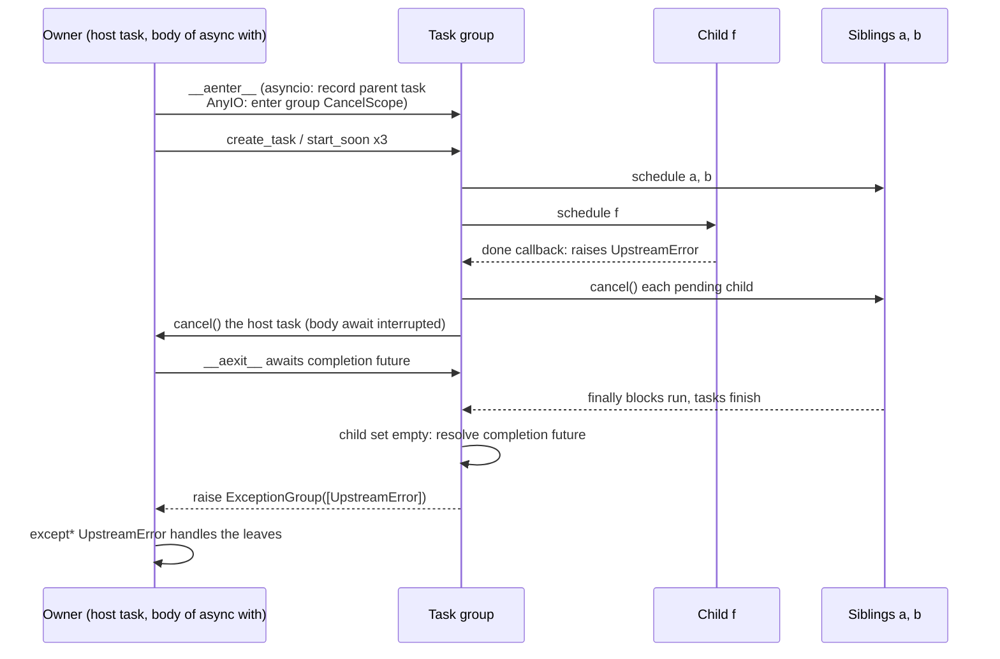

# Structured Concurrency with AnyIO (4.16.0) and asyncio.TaskGroup: CancelScopes, Sibling Cancellation, and except* ExceptionGroup Handling

> [!summary] Claim
> A task group turns "one child failed" into "every sibling and the body are cancelled, the owner waits for all their cleanup, then receives one `ExceptionGroup` it must split with `except*`", but AnyIO and `asyncio.TaskGroup` deliver that cancellation differently (level versus edge), and a native `Task.cancel()` that races a child failure is lost on CPython 3.12 and on AnyIO 4.16.0 on every CPython, as the lab shows.

Part of [ASGI Servers and Async Runtime](README.md) in [API Engineering](../README.md).

## TL;DR

Mechanism: a child's failure calls back into the group, which cancels every sibling and the body's host task, awaits a completion future until the child set is empty, then raises `BaseExceptionGroup("unhandled errors in a TaskGroup", errors)` `(CPython 3.14.10 Lib/asyncio/taskgroups.py, TaskGroup._aexit)` `(anyio 4.16.0 anyio/_backends/_asyncio.py, TaskGroup.__aexit__)`.
Contract rule: no child outlives the `async with` block, and every failure reaches the owner wrapped in a group, so the owner handles leaves with `except*`, never with a plain `except UpstreamError`.
Trap: AnyIO cancellation is level-triggered, so an unshielded `await` in a `finally` block is cancelled again, while asyncio cancellation is edge-triggered and lets that `await` run; and an outside `Task.cancel()` that lands in the same loop iteration as a child failure is swallowed on CPython 3.12.13 and on AnyIO 4.16.0 (measured below).
Portability: `asyncio.TaskGroup` gained correct cancel-count handling in 3.13 (gh-116720), `**kwargs` forwarding in 3.14, and `TaskGroup.cancel()` plus a `GeneratorExit` special case in 3.15; AnyIO has always raised groups since 4.0 and added `TaskHandle` and `TaskGroup.cancel()` in 4.14.0.
When not to use this: do not open a task group for work that must outlive the request (use a lifespan-scoped group or a durable queue), and do not yield from an async generator while inside a task group or cancel scope (PEP 789).

## Mental model



The owner enters the group, spawns three children, and parks in its own body.
When `f` raises, its done callback (`_on_task_done` in asyncio, the `task_done` closure in AnyIO) records the exception and cancels everything else in the group, including the owner's host task, so the body's `await` is interrupted rather than left running.
The interrupted body falls into `__aexit__`, which does not return until every child has finished its cleanup; it waits on `_on_completed_fut`, a plain future that the last done callback resolves.
Only then does the group raise one exception group, and the owner's `except*` clauses split it by leaf type.
The siblings' cleanup always happens before the owner resumes: that ordering is the structured concurrency guarantee, and the lab asserts it event by event.

## How it works

### The contract: a nursery cannot be outlived

Nathaniel J. Smith's 2018 essay argues that a bare spawn ("go statement") is a form of `goto`, because the function returns while the work it started continues somewhere else, and proposes the nursery: a block that "can't return until they've all finished", which also makes `with` blocks safe again because no background task can outlive the resource they close.
A function that needs a task to outlive it must be handed a nursery explicitly, so the escape is visible at the call site.
Trio implemented this first; AnyIO brings the Trio model to asyncio; CPython 3.11 added `asyncio.TaskGroup` (adapted from EdgeDB, per the file header of `Lib/asyncio/taskgroups.py`) together with `ExceptionGroup` and `except*` (PEP 654), because a group with several children can fail several ways at once.
Bare `asyncio.create_task()` and its garbage-collection hazards are the subject of [[Fire-and-Forget-Task-Hazards-GC-Disappearance-and-Managed-Task-Nurseries]].

### asyncio.TaskGroup, step by step (CPython 3.14.10)

State lives in ten attributes set in `TaskGroup.__init__`: `_entered`, `_exiting`, `_aborting`, `_loop`, `_parent_task`, `_parent_cancel_requested`, `_tasks` (a `set`), `_errors` (a `list`), `_base_error`, and `_on_completed_fut` `(CPython 3.14.10 Lib/asyncio/taskgroups.py, TaskGroup.__init__)`.

1. `__aenter__` records `tasks.current_task(self._loop)` as `_parent_task` and raises `RuntimeError` if there is none or if the group was already entered.
2. `create_task(coro, **kwargs)` refuses (and, since 3.13, closes `coro`) when the group is not entered, is finished, or is `_aborting`; otherwise it calls `self._loop.create_task(coro, **kwargs)`, adds the task to `_tasks`, and registers `_on_task_done` as a done callback.
   The comment in that method notes the callback is added even when an eager task is already done (gh-128550, gh-128588); eager execution is covered in [[Eager-Task-Factory-in-Python-3-12-to-3-15-and-Execution-Order-Shifts]].
3. `_on_task_done` discards the task, resolves `_on_completed_fut` if the set is now empty, returns early for a cancelled task, and otherwise appends `task.exception()` to `_errors`.
   On the first error, if the group is not already aborting and the parent has not been cancelled by the group, it calls `_abort()` (which calls `cancel()` on every child not yet done), sets `_parent_cancel_requested = True`, and calls `self._parent_task.cancel()`.
   That last call is how the body's `await` gets interrupted.
4. `_aexit` sets `_exiting`, calls `_abort()` if the body raised, then loops `while self._tasks: await self._on_completed_fut`; a `CancelledError` caught there while not yet aborting means the owner was cancelled from outside, so it records the error for propagation and aborts.
5. After the loop, if `_parent_cancel_requested`, it calls `self._parent_task.uncancel()`; if that returns `0` the `CancelledError` the group itself caused is dropped.
6. A `KeyboardInterrupt` or `SystemExit` (`_is_base_error`) is re-raised bare, not grouped.
   This matters because `Task.__step_run_and_handle_result` re-raises those two out of the event loop itself after setting them on the task `(CPython 3.14.10 Lib/asyncio/tasks.py, Task.__step_run_and_handle_result)`.
7. If there are errors and the parent still has a pending outside cancellation (`cancelling() > 0`), the group calls `uncancel()` then `cancel()` on the parent to keep the count stable and re-arm the cancellation for the next `await`, then raises `BaseExceptionGroup('unhandled errors in a TaskGroup', self._errors) from None`.
   `BaseExceptionGroup(...)` returns an `ExceptionGroup` when every member is an `Exception` (PEP 654, "ExceptionGroup and BaseExceptionGroup").
8. `__aexit__` clears `_parent_task`, `_errors`, and `_base_error` in a `finally` to break exception reference cycles (gh-98543, gh-124958 in the commit log of the file).

The body's own exception joins `_errors` (step 7 appends `exc` when `et` is not a `CancelledError`), so a body failure and a child failure arrive in the same group, which the lab's `test_asyncio_body_exception_is_grouped_and_child_is_cancelled` shows.

### What changed between 3.12, 3.13, 3.14, and 3.15

These deltas come from diffing the installed `Lib/asyncio/taskgroups.py` of each interpreter used in the lab.

| Version | Change in `taskgroups.py` | Upstream reference |
|---|---|---|
| 3.12.13 | `uncancel()` runs at the top of `_aexit`, before the wait loop; no re-arm of outside cancellation | Lab: leak and swallow tests |
| 3.13.18 | `uncancel()` moved after the wait loop; parent `uncancel(); cancel()` re-arm when errors and an outside cancel coexist; `issubclass` checks for `CancelledError` subclasses; `coro.close()` when the group is inactive | gh-116720 (PR #117407, commit `fa58e75a8`, 2024-04-09), gh-113848 (`CancelledError` subclasses), gh-115957 (`coro.close()`) |
| 3.14.10 | `create_task(coro, **kwargs)` forwards everything, including `eager_start`; `futures.future_add_to_awaited_by` and `future_discard_from_awaited_by` register the parent for task-graph introspection | gh-128307 (PR #128306), gh-91048 (PR #124640); docs: "Changed in version 3.14: Passes on all kwargs to loop.create_task()" |
| 3.15.2 | `TaskGroup.cancel()` (also usable before entry via `_cancel_on_enter`); `GeneratorExit` from the body re-raised bare when it is the only error; `_aexit` returns `True`; eager-task cancel fix (gh-155418) and outside-cancel preservation (gh-155433) cited in source comments | `cancel()`: gh-108951 (PR #127214, John Belmonte; What's New cites it as gh-127214), docs "Added in version 3.15"; `GeneratorExit`: gh-135736 (PR #154649), docs "Changed in version 3.15: Addition of the special case for GeneratorExit" |

CPython 3.14.6 and 3.14.10 ship byte-identical `taskgroups.py` files (checked with `diff`).
The free-threaded 3.15.0b3 build already has `cancel()`, `_cancel_on_enter`, `**kwargs` forwarding, and `return True`, but lacks the `GeneratorExit` special case and the gh-155418 and gh-155433 fixes, whose commits are dated 2026-07-29 to 2026-08-31 in the file's history (checked with `diff` against 3.15.2).

The 3.12 behavior is the one with production consequences.
When the body has already reached `__aexit__` and is waiting when a child fails, 3.12 has already run its one `uncancel()` check, so the `cancel()` that `_on_task_done` issues to the parent is never undone and the parent's `cancelling()` stays at `1` after the group exits (measured; `test_asyncio_parent_cancel_count_leaks_on_3_12_when_child_fails_after_body`).
Worse, when an outside actor cancels the same task in the same loop iteration as a child failure, 3.12 hands the owner an `ExceptionGroup`, never re-arms the outside cancellation, and the task keeps running past the point where it should have died (measured; `test_asyncio_outside_cancel_racing_child_failure_survives_from_3_13`).
The gh-116720 discussion names the root constraint: "we can't add the `CancelledError` to the exception group without huge backwards compatibility issues" (Guido van Rossum), so the group must choose between raising the group and raising the cancellation, and 3.13 resolves it by raising the group and re-cancelling the parent so the next `await` raises `CancelledError`.

### AnyIO: cancel scopes as a tree over tasks

AnyIO on asyncio cannot add fields to `asyncio.Task`, so it keeps a `WeakKeyDictionary[asyncio.Task, TaskState]` named `_task_states`, where each `TaskState` holds the task's innermost `cancel_scope` and a `parent_id` `(anyio 4.16.0 anyio/_backends/_asyncio.py, TaskState)`.
A `CancelScope` (asyncio backend) has 14 slots, including `_host_task`, `_parent_scope`, `_child_scopes`, `_tasks`, `_deadline`, `_shield`, `_cancel_called`, `_cancel_handle`, `_cancelling_at_enter`, and `_pending_uncancellations`.

- `__enter__` makes the current task the host, pushes the scope onto that task's state, moves the host from the parent scope's `_tasks` to this scope, links the scope into `_parent_scope._child_scopes`, arms the deadline with `loop.call_at`, and records `host_task.cancelling()` in `_cancelling_at_enter`.
  Entering a scope that is already active raises `RuntimeError("Each CancelScope may only be used for a single 'with' block")`; despite the message, 4.16.0 checks only `_active`, so a second `with` after the first has exited is accepted (a scratch script run for this check entered one scope twice in sequence without error), and code should still treat scopes as single-use.
- `cancel(reason)` sets `_cancel_called` and builds the message `"Cancelled via cancel scope {id:x}"`, plus `" by {task}"` and `"; reason: ..."` when available, then calls `_deliver_cancellation(self)` if the scope has a host task (a scope cancelled before entry starts delivery in `__enter__`).
- `_deliver_cancellation(origin)` walks the scope's `_tasks` and calls `task.cancel(origin._cancel_reason)` on each one that is not done, not already `_must_cancel`, not the currently running task, has started (its coroutine is `CORO_RUNNING` or `CORO_SUSPENDED`), and is not resuming from an already-finished waiter future; it recurses into child scopes that are neither shielded nor cancelled themselves.
  If any task in the scope tree is not yet done, it reschedules itself with `loop.call_soon`, so delivery repeats once per event loop iteration until every task in the scope has exited.
  That retry loop is what makes cancellation level-triggered, and it has been the source of CPU-spin bugs fixed in 4.6.0 (#695, "Fixed 100% CPU use on asyncio while waiting for an exiting task group to finish") and 4.14.2 (#1111, "Fixed unnecessary CPU spin when delivering cancellation from `CancelScope` on asyncio under certain conditions") per the AnyIO changelog.
- `__exit__` refuses to exit from a different task than the host (`"Attempted to exit cancel scope in a different task than it was entered in"`) or out of order, cancels the timer, re-parents the host, and restarts delivery in the nearest cancelled ancestor.
  It swallows the exception only when the scope's own cancellation is the cause and no cancelled ancestor is visible through a non-shielded path: a `CancelledError` qualifies if `is_anyio_cancellation` finds the `"Cancelled via cancel scope "` prefix on it or anywhere in its `__context__` chain, and for an exception group it uses `split()` to drop the AnyIO cancellations and re-raise the remainder with `__context__` preserved.
- Before swallowing, it calls `uncancel()` once for each `cancel()` it issued to the host (`_pending_uncancellations`), and since 4.16.0 it refuses to swallow when `host_task.cancelling() > _cancelling_at_enter`, because a native `Task.cancel()` arrived while the scope was active (#1214).

`shield=True` makes `_effectively_cancelled` stop walking upward, so a shielded scope sees no ancestor cancellation and its tasks are skipped by delivery.
`move_on_after(delay)` returns a scope with a deadline; `fail_after(delay)` (via `fail_at`, added in 4.15.0) wraps one and raises `TimeoutError` only if `cancelled_caught` is true and the clock has passed the deadline `(anyio 4.16.0 anyio/_core/_tasks.py, fail_at)`.
The docstring of `move_on_after` warns that its timer starts when the function is called, not when the scope is entered, and that this changes in 5.0.

### AnyIO TaskGroup on top of the scope tree

An AnyIO `TaskGroup` is a `CancelScope` plus a set of tasks `(anyio 4.16.0 anyio/_backends/_asyncio.py, TaskGroup)`.

- `_spawn` creates the asyncio task, stores `TaskState(parent_id, cancel_scope=initial_scope)`, adds the task to the scope's `_tasks`, and registers a `task_done` closure.
  `task_done` removes the task, resolves `_on_completed_fut` when the set empties, appends any non-cancellation exception to `_exceptions`, and calls `self.cancel_scope.cancel()` unless the scope is already effectively cancelled.
- `__aexit__` cancels the scope if the body raised, then waits inside an inner `CancelScope` (`wait_scope`); if the wait itself is cancelled, it shields `wait_scope` "as they're not productive (#695)" and cancels the group, so a repeatedly cancelled owner does not spin.
  With no children it still runs `cancel_shielded_checkpoint()`, so exiting a group is always a yield point (4.0.0 changelog).
  Any collected exception is raised as `BaseExceptionGroup("unhandled errors in a TaskGroup", self._exceptions) from None`, the same message asyncio uses; since 4.0.0 "Any exceptions raising out of a task groups are now nested inside an `ExceptionGroup`", even a single one.
- If a loop's task factory is `asyncio.eager_task_factory`, `_spawn` extracts the wrapped constructor from the factory's closure and calls it without `eager_start`, so AnyIO children start lazily (`_eager_task_factory_code` check); the base class docstring calls eager factory support "experimental".
- `create_task(coro)` (added 4.14.0 "for easier asyncio migration") and `start_soon(func, *args)` (returns a handle since 4.14.0) return a `TaskHandle`, whose `status` is one of `PENDING`, `CANCELLING`, `FINISHED`, `CANCELLED`, `FAILED`; awaiting a failed handle raises `TaskFailed` chained from the child's exception, and a cancelled one raises `TaskCancelled` `(anyio 4.16.0 anyio/_core/_tasks.py, TaskHandle)`.
  Each handle owns its own `CancelScope`, so `handle.cancel()` cancels one child without touching the group.
- `TaskGroup.cancel(reason)` (4.14.0) is shorthand for `self.cancel_scope.cancel(reason)`.
- `start(func, *args)` passes a `task_status`; until the child calls `task_status.started(value)`, the child sits in the caller's cancel scope, and `started()` re-parents it into the group's scope (`_reparent`).
  A child that fails before `started()` sets the exception on the start future, not on the group, so `await tg.start(...)` raises the bare exception in the caller and the group is not cancelled; a child that returns without calling `started()` produces `RuntimeError("Child exited without calling task_status.started()")`.

### Level versus edge cancellation

The AnyIO docs state that tasks spawned from an AnyIO task group "use level cancellation": they are cancelled again at every yield point for as long as the scope stays cancelled.
asyncio's `Task.cancel()` is edge-triggered: it schedules one `CancelledError`, and once the task has caught it the next `await` runs normally unless someone cancels again.
The lab shows the consequence in the same three-child tree.
Under AnyIO an unshielded `await` in a sibling's `finally` raises `CancelledError` immediately, so `"a:cleanup-done"` never appears; under `asyncio.TaskGroup` the same `await` completes.
The AnyIO rule is therefore to put every cleanup `await` inside `CancelScope(shield=True)`, bounded by `move_on_after()` so a stuck peer cannot hang shutdown.
The asyncio rule is the reverse risk: a child that catches `CancelledError` and keeps working is never cancelled again, and the group waits for it indefinitely (gh-116720 deferred this case: "If one of the child tasks ignores cancellation, the whole task group will wait until that task voluntarily exits ... I propose to leave this for another time").
Swallowing and `uncancel()` discipline are covered in [[Cancellation-Semantics-CancelledError-Swallowing-and-Shielded-Cleanup]].

### ExceptionGroup and except* (PEP 654, Python 3.11+)

- `ExceptionGroup` wraps only `Exception` instances and its constructor raises `TypeError` otherwise; `BaseExceptionGroup` wraps any `BaseException` and returns an `ExceptionGroup` when every member is an `Exception`.
- `split(condition)` returns `(match, rest)` with `None` for an empty side; `subgroup(condition)` returns only the match; both recurse into nested groups, keep the nesting structure, and build new groups through `derive()`, and copy `__cause__`, `__context__`, `__traceback__`, and `__notes__` onto the new group themselves (checked on 3.14.6: a note added to the original appears on the `split()` match, and `__cause__` is the same object).
- `except* T` clauses run in order against the still-unhandled part of the group; each clause runs at most once with a group of all its matches, and unmatched leaves propagate as a group.
- A naked (non-group) exception caught by `except*` is wrapped in an `ExceptionGroup` with an empty message (`test_except_star_wraps_a_naked_exception_in_an_exception_group`).
- `SyntaxError`: mixing `except` and `except*` in one `try` (`cannot have both 'except' and 'except*' on the same 'try'`), a bare `except*:` (`expected one or more exception types`), and `return`, `break`, or `continue` inside an `except*` block (`'break', 'continue' and 'return' cannot appear in an except* block`); all three messages captured by compiling each form on CPython 3.14.6.
  `except* ExceptionGroup` is a runtime `TypeError` (`catching ExceptionGroup with except* is not allowed. Use except instead.`); to catch the group object itself, use a plain `except BaseExceptionGroup` in an outer `try`.
- A failure inside an inner task group reaches the outer owner as a group inside a group; `except* UpstreamError` still matches the leaf at depth 2 (`test_nested_group_is_two_levels_deep_and_except_star_still_matches`).

### Where this surfaces in the ASGI stack

Starlette 1.10.0 wraps AnyIO groups in `create_collapsing_task_group`, which catches `BaseExceptionGroup` and, only when it holds exactly one exception, re-raises that exception with its original cause or context `(starlette 1.10.0 starlette/_utils.py, create_collapsing_task_group)`.
`StreamingResponse.__call__` uses it for ASGI `spec_version` below `2.4`: one child streams the body and the body of the group listens for `http.disconnect`, and whichever finishes first calls `task_group.cancel_scope.cancel()`, the canonical first-completed race `(starlette 1.10.0 starlette/responses.py, StreamingResponse.__call__)`.
For `spec_version >= (2, 4)` it skips the group and relies on `send` raising `OSError` on disconnect.
`BaseHTTPMiddleware` and the deprecated `run_until_first_complete` also open AnyIO groups; the middleware's cost is analyzed in [[Why-BaseHTTPMiddleware-Hurts-Performance-Streaming-and-ContextVars]].
Hypercorn can run its workers on Trio, where nurseries are native; see [[Hypercorn-Internals-HTTP-2-HTTP-3-QUIC-and-AnyIO-Trio-Workers]].

### A race the lab found: outside cancel plus child failure in one iteration

The lab's `_race_victim` has a child queue `parent.cancel()` with `call_soon` and then raise, so the outside cancellation and the group's failure handling run in the same loop iteration.
Under AnyIO 4.16.0 the native `cancel()` runs first and cancels the host's waiter future; then `task_done` calls `cancel_scope.cancel()`, whose delivery skips the host because its waiter is already done, so AnyIO issues no `cancel()` of its own and `_pending_uncancellations` stays `0`.
The host wakes with the native `CancelledError`, `__aexit__` raises the child's group in its place, `CancelScope.__exit__` correctly declines to swallow it (the #1214 check), and the owner's `except*` handles the group; but nothing re-arms the native cancellation, so the task continues with `cancelling() == 1`.
This is the mirror image of issue #1214 (scope cancel first, native cancel second), which 4.16.0 does fix: the same lab environment shows the #1214 ordering now propagates `CancelledError` with `task.cancelled() == True`.
An instrumented rerun on 3.14.6 confirms the mechanism: after the group exits, the group scope's `_pending_uncancellations` is `0` and the task's `cancelling()` is `1`.
Issue #1214 and its fix (PR #1330) discuss only the scope-first ordering, and a search of the AnyIO tracker found no report of the native-first ordering (as of 2026-11).

## Numbers and limits

| Quantity | Value | Source or measurement |
|---|---|---|
| Group error message | `"unhandled errors in a TaskGroup"` (both runtimes) | `Lib/asyncio/taskgroups.py` 3.12-3.15, `anyio/_backends/_asyncio.py` 4.16.0 |
| `CancelledError` deliveries per asyncio `Task.cancel()` | 1 | `Lib/asyncio/tasks.py` 3.14.10 `Task.cancel` and `__step`; lab cleanup test |
| AnyIO cancellation re-delivery period | once per loop iteration while any task in the scope is pending | `CancelScope._deliver_cancellation` reschedules via `call_soon` |
| AnyIO `CancelScope` slots (asyncio backend) | 14 | `CancelScope.__slots__`, anyio 4.16.0 |
| `TaskHandle.Status` members | 5 (`PENDING`, `FINISHED`, `CANCELLING`, `CANCELLED`, `FAILED`) | `anyio/_core/_tasks.py` 4.16.0 |
| Parent `cancelling()` after body-exited child failure | 3.12.13: `1`; 3.13.18, 3.14.6, 3.14.10, 3.15.2, 3.15.0b3t: `0` | Measured: `asyncio_first_result_wins()` from the lab module, called once per interpreter by a scratch script with anyio 4.16.0 on `sys.path`, macOS 27.3 arm64 (`uname -r` 27.3.0) |
| Parent `cancelling()` after outside-cancel race, AnyIO 4.16.0 | `1` and `task.cancelled()` is `False` on 3.12.13, 3.13.18, 3.14.6, 3.14.10, 3.15.2, and 3.15.0b3t | Measured: `outside_cancel_racing_child_failure("anyio")`, same script and machine |
| Lab runtime, 18 tests | `18 passed in 0.19s` (single run) | Measured: `uv run --frozen pytest <test file> -q` from `labs/`, CPython 3.14.6, macOS 27.3 arm64, 2026-11-15 |
| AnyIO versions with task group changes | 4.0.0 (always groups), 4.6.0 (#695), 4.14.0 (`TaskHandle`, `create_task`, `cancel`), 4.14.2 (#1111), 4.15.0 (`fail_at`, `move_on_at`, `reason`), 4.16.0 (#1214) | AnyIO version history (as of 2026-11) |
| `move_on_after` timer start | at call time, not at `__enter__` (planned change in 5.0) | `move_on_after` docstring, anyio 4.16.0 |

Sibling cancellation order is not a number you can rely on: both runtimes iterate a `set` of tasks, and in the captured traces below the shielded and unshielded AnyIO runs, made in the same process on 3.14.6, cancelled `a` and `b` in different orders.

## Portability

| Behavior | 3.12.13 | 3.13.18 | 3.14.6 / 3.14.10 | 3.15.2 | 3.15.0b3t (GIL off) | Proof |
|---|---|---|---|---|---|---|
| AnyIO 4.16.0 child failure cancels siblings and body, owner resumes after all cleanup | yes | yes | yes | yes | yes | lab probes, all legs |
| AnyIO unshielded cleanup `await` cancelled again (level) | yes | yes | yes | yes | yes | lab probes, all legs |
| `asyncio.TaskGroup` cleanup `await` completes (edge) | yes | yes | yes | yes | yes | lab probes, all legs |
| Parent `cancelling()` leak when child fails after body exited | leaks `1` | `0` | `0` | `0` | `0` | lab probes; gh-116720 |
| Outside cancel racing child failure, `asyncio.TaskGroup` | swallowed | re-raised at next `await` | re-raised | re-raised | re-raised | lab probes; gh-116720 |
| Outside cancel racing child failure, AnyIO 4.16.0 | swallowed | swallowed | swallowed | swallowed | swallowed | lab probes |
| Expired outer deadline surfaces as bare `TimeoutError` | yes | yes | yes | yes | yes | lab probes (`fail_after(0)`, `asyncio.timeout(0)`) |
| `asyncio.TaskGroup.cancel()` | absent | absent | absent | present | present | `hasattr` on each leg; 3.15 docs |
| `create_task(**kwargs)` forwarding (`eager_start`) | `name`, `context` only | `name`, `context` only | yes | yes | yes | source diff |
| Body `GeneratorExit` re-raised bare | no | no | no | yes | no (predates gh-135736) | source diff; 3.15 docs |
| Trio backend | not run | not run | not run | not run | not run | `trio` is not pinned in `labs/pyproject.toml` |

"Lab probes" means the probe functions of the lab module, called once per interpreter by a verification script that put `labs/src` and the workspace's pure-Python anyio 4.16.0 on `sys.path`; the full pytest file was run only on the workspace interpreter, 3.14.6.
The 3.15t leg ran on the CPython 3.15.0b3 free-threading build with `PYTHON_GIL=0` (`sys._is_gil_enabled()` returned `False`), not 3.15.2t, because that is the only free-threaded 3.15 interpreter installed here; the locked workspace cannot install on it, because `labs/pyproject.toml` pins `psycopg[binary]==3.3.8` and the PyPI release JSON for `psycopg-binary` 3.3.8 lists macOS wheels only for `cp310` to `cp315` and none tagged `cp315t` or `cp314t` (checked 2026-11-15).
The 3.12 leg ran on 3.12.13 rather than the matrix's 3.12.16, which is not installed here; the `v3.12.13` and `v3.12.16` tags carry byte-identical `Lib/asyncio/taskgroups.py`, `tasks.py`, and `timeouts.py` (fetched from raw.githubusercontent.com and compared with `diff`, 2026-11-15), and the `3.12` branch history of `taskgroups.py` ends at gh-128588 (2025-01-21) with no gh-116720 backport, so the 3.12 cells apply to 3.12.16 by source identity, not by a run.
Servers (Uvicorn, Hypercorn, Granian) and HTTP versions do not change this mechanism, which runs entirely inside the application's tasks; no server-specific cell is claimed.
Debian and Alpine container legs were not run (lab checks paused).

## Worked example

The [implementation](../labs/src/api_labs/f12_asgi_servers_and_async_runtime/structured_concurrency.py) holds one probe per behavior, and the [test](../labs/tests/f12_asgi_servers_and_async_runtime/test_anyio_structured_concurrency_taskgroups_cancelscopes_and_exceptiongroups.py) asserts each probe's event trace.
Every probe is deterministic: children advance with zero-length checkpoints, never with wall-clock sleeps, and tests assert relative order per sibling rather than order between siblings.

The AnyIO three-child tree, verbatim from the lab file:

```python
async def _anyio_sibling(trace: Trace, name: str, shielded_cleanup: bool) -> None:
    trace.add(f"{name}:start")
    try:
        await anyio.sleep_forever()
    finally:
        trace.add(f"{name}:cancelled")
        if shielded_cleanup:
            with anyio.CancelScope(shield=True):
                await anyio.lowlevel.checkpoint()  # e.g. flush a buffer, release a lease
        else:
            await anyio.lowlevel.checkpoint()  # level cancellation: raises again right here
        trace.add(f"{name}:cleanup-done")


async def _anyio_failer(trace: Trace, name: str, exc: Exception) -> None:
    trace.add(f"{name}:start")
    await anyio.lowlevel.checkpoint()  # let every sibling reach its first await
    trace.add(f"{name}:raise")
    raise exc


async def anyio_sibling_cancellation(*, shielded_cleanup: bool) -> GroupReport:
    """One child fails; AnyIO cancels the siblings and the body, then raises a group."""
    trace = Trace()
    handled: list[str] = []
    try:
        async with anyio.create_task_group() as tg:
            tg.start_soon(_anyio_sibling, trace, "a", shielded_cleanup)
            tg.start_soon(_anyio_sibling, trace, "b", shielded_cleanup)
            tg.start_soon(_anyio_failer, trace, "f", UpstreamError("upstream 503"))
            try:
                await anyio.sleep_forever()
            finally:
                trace.add("body:cancelled")
    except* UpstreamError as group:
        handled.extend(type(e).__name__ for e in leaves(group))
    trace.add("owner:after-group")
    return GroupReport(tuple(trace.events), tuple(sorted(handled)), _current_cancelling())
```

The race probe, verbatim from the lab file:

```python
async def _race_victim(runtime: Literal["anyio", "asyncio"], log: list[str]) -> None:
    parent = asyncio.current_task()
    if parent is None:
        raise RuntimeError("probes must run inside an asyncio task")

    async def boom() -> None:
        await asyncio.sleep(0)
        # An outside actor (watchdog, shutdown hook) cancels the request task; the
        # callback runs in the same loop iteration as the group's own failure handling.
        asyncio.get_running_loop().call_soon(parent.cancel)
        raise UpstreamError("upstream 503")

    try:
        if runtime == "anyio":
            async with anyio.create_task_group() as atg:
                atg.start_soon(boom)
                await anyio.sleep_forever()
        else:
            async with asyncio.TaskGroup() as tg:
                tg.create_task(boom())
                await asyncio.Event().wait()
    except* UpstreamError:
        log.append("handled")
    try:
        await asyncio.sleep(0)
    except asyncio.CancelledError:
        log.append("cancelled-at-next-await")
        raise
    log.append(f"continued with cancelling()={parent.cancelling()}")
```

The version-dependent assertions, verbatim from the test file:

```python
@pytest.mark.unit
@pytest.mark.asyncio
async def test_asyncio_outside_cancel_racing_child_failure_survives_from_3_13() -> None:
    log, cancelled = await outside_cancel_racing_child_failure("asyncio")
    if sys.version_info >= (3, 13):
        assert log == ("handled", "cancelled-at-next-await", "owner:victim-cancelled")
        assert cancelled is True
    else:
        assert log == ("handled", "continued with cancelling()=1")
        assert cancelled is False


@pytest.mark.unit
@pytest.mark.asyncio
async def test_anyio_4_16_drops_outside_cancel_racing_child_failure() -> None:
    # AnyIO skips delivering to a host whose waiter is already cancelled, then raises the
    # child's ExceptionGroup in place of the native CancelledError and never re-arms it.
    log, cancelled = await outside_cancel_racing_child_failure("anyio")
    assert log == ("handled", "continued with cancelling()=1")
    assert cancelled is False
```

Captured run (2026-11-15), from `labs/`, CPython 3.14.6, macOS 27.3 arm64 (`macOS-27.3-arm64-arm-64bit-Mach-O`), pytest 9.2.0, pytest-asyncio 1.4.1.post1, anyio 4.16.0:

```text
$ uv run --frozen pytest tests/f12_asgi_servers_and_async_runtime/test_anyio_structured_concurrency_taskgroups_cancelscopes_and_exceptiongroups.py -q
..................                                                       [100%]
18 passed in 0.19s
```

Event traces printed by a one-off script that called the three probes once on the same interpreter (script not kept in the lab; three separate runs printed identical traces):

```text
anyio shielded    ('a:start', 'b:start', 'f:start', 'f:raise', 'body:cancelled', 'a:cancelled', 'b:cancelled', 'a:cleanup-done', 'b:cleanup-done', 'owner:after-group')
anyio unshielded  ('a:start', 'b:start', 'f:start', 'f:raise', 'body:cancelled', 'b:cancelled', 'a:cancelled', 'owner:after-group')
asyncio           ('a:start', 'b:start', 'f:start', 'f:raise', 'b:cancelled', 'a:cancelled', 'body:cancelled', 'b:cleanup-done', 'a:cleanup-done', 'owner:after-group')
```

Read the traces against the mechanism: in all three, every sibling's `cancelled` event follows `f:raise` and precedes `owner:after-group`; the unshielded AnyIO run has no `cleanup-done` at all; and the order of `a` and `b` differs between the shielded and unshielded runs because both runtimes iterate a `set`.

## Pitfalls

> [!warning] Cleanup `await` without a shield under AnyIO
> Trigger: a `finally` block in an AnyIO child awaits `conn.aclose()`, a flush, or a lease release after the group was cancelled.
> Symptom: the `await` raises `CancelledError` immediately, the connection is never closed, and pools leak slowly; the lab's unshielded trace has no `cleanup-done`.
> Fix: `with anyio.move_on_after(2, shield=True): await conn.aclose()`; AnyIO's cancellation guide says any `await` during cleanup must be inside a shielded scope.

> [!warning] Catching the leaf type around a task group
> Trigger: `try: async with tg: ... except httpx.HTTPError:` written against AnyIO before 4.0 or ported from `asyncio.gather`.
> Symptom: the handler never runs, because the group raises `ExceptionGroup([HTTPError])` (AnyIO 4.0.0: "Any exceptions raising out of a task groups are now nested inside an `ExceptionGroup`"); the request turns into a 500.
> Fix: `except* httpx.HTTPError`, or Starlette-style collapsing only where a single-exception group is guaranteed.

> [!warning] Lost outside cancellation on CPython 3.12
> Trigger: an `asyncio.TaskGroup` whose child fails in the same loop iteration that a timeout, watchdog, or shutdown hook cancels the owning task.
> Symptom: the owner handles the group with `except*` and keeps running past its deadline with `cancelling() == 1`; after a body-exited failure the count leaks even without an outside cancel (both measured on 3.12.13).
> Fix: run 3.13 or later (gh-116720); on 3.12, check `asyncio.current_task().cancelling()` after the group and re-raise `CancelledError` yourself.

> [!warning] AnyIO 4.16.0 drops a native cancel that races a child failure
> Trigger: mixed code where something calls native `Task.cancel()` on a task that hosts an AnyIO group, in the same iteration as a child failure.
> Symptom: the native `CancelledError` is replaced by the child's `ExceptionGroup` and never re-armed; the task continues (measured on every leg).
> Fix: cancel AnyIO-hosted work through its `CancelScope` or `TaskGroup.cancel()`, not native `Task.cancel()`; if you must mix, check `cancelling()` after the group exits.

> [!warning] A child that swallows `CancelledError` under asyncio
> Trigger: `except BaseException: log(); continue` inside a retry loop in a group child.
> Symptom: the group's single `cancel()` is consumed, the child keeps retrying, and `__aexit__` waits forever; the request hangs until the client gives up.
> Fix: re-raise `CancelledError` (AnyIO docs: "Always reraise the cancellation exception if you catch it"), or catch `Exception` only.

> [!warning] Yielding inside a task group from an async generator
> Trigger: `async def stream(): async with anyio.create_task_group() as tg: ... yield chunk`.
> Symptom: while the generator is suspended at `yield`, cancellation and child errors are delivered to whichever task iterates it, or dropped (PEP 789, status Draft); AnyIO docs say this "violates structural concurrency".
> Fix: move the group into an async context manager or a producer task that feeds a memory object stream.

> [!warning] Exiting a cancel scope in another task
> Trigger: entering a `CancelScope` in a lifespan startup hook and exiting it in the shutdown hook, which some servers run in a different task.
> Symptom: `RuntimeError: Attempted to exit cancel scope in a different task than it was entered in`.
> Fix: keep each scope inside one coroutine, for example one long-lived task that owns the group for the whole lifespan.

> [!warning] Starlette collapsing hides multi-error groups only half the time
> Trigger: two children of a `create_collapsing_task_group` fail together.
> Symptom: with one error the bare exception reaches your handlers; with two the `BaseExceptionGroup` escapes, bypasses type-based exception handlers, and becomes a 500 from `ServerErrorMiddleware`.
> Fix: register handling for `ExceptionGroup` or avoid spawning more than one failing child per response.

No CVE or GitHub security advisory covers task group semantics: the three AnyIO advisories (GHSA-5p39-cfhj-2xmp, GHSA-82r6-8w77-94w6, GHSA-3w57-8xmc-8v26, as of 2026-11) concern process pools, TLS host name encoding, and subprocess groups; the incident records for this topic are the upstream issues cited above.

## Security and robustness

- OWASP API4:2023 Unrestricted Resource Consumption lists missing "Execution timeouts" and limits on operations per request; a per-request task group with an outer `fail_after` is the enforcement point, because cancellation reaches every fan-out child and the group does not return until they have stopped.
- A lost cancellation (3.12, or the AnyIO race) is a resource-consumption bug: the request keeps calling upstreams after its deadline, so a client that triggers failures at the right moment can amplify load.
  Defense in depth: bound fan-out with a semaphore ([[Async-Synchronization-Primitives-Locks-Semaphores-and-Reentrant-Deadlocks]]), keep upstream client timeouts independent of task cancellation, and alert on tasks whose `cancelling()` is non-zero after a group exits.
- Shielded cleanup is an uncancellable region; always bound it with a deadline (`move_on_after(..., shield=True)`), or a slow peer turns graceful shutdown into a hang ([[Graceful-Shutdown-SIGTERM-Drain-Windows-and-Kubernetes-PreStop-Hooks]]).
- OWASP API8:2023 Security Misconfiguration includes "Error messages include stack traces, or expose other sensitive information"; an exception group's `repr` lists every child's exception and message, and AnyIO cancel reasons include the cancelling task's `repr`, so never render them into a response body.
- Do not let untrusted input choose how many children a group spawns; each child costs a task, a frame, and a slot in the cancellation walk that runs once per iteration while the group is cancelling.

## The principal's view

The decision is not "AnyIO or asyncio" but "who owns every task's lifetime".
Ban bare `asyncio.create_task()` in request code by lint, require every concurrent fan-out to sit in a task group scoped to the request, and give long-lived background work a group owned by the lifespan, so shutdown has one place to cancel and wait.
Pick AnyIO where the code must run under Trio as well, or where you want level cancellation, deadlines that nest (`current_effective_deadline()`), `start()` readiness handshakes, and per-child handles; pay for it with a cancellation model that surprises asyncio-native libraries (the AnyIO docs warn that `asyncio.Condition` can busy-wait under level cancellation) and with the race above when native `Task.cancel()` is mixed in.
Pick `asyncio.TaskGroup` for pure-asyncio services on 3.13 or later; refuse it on 3.12 for request paths that also use outside cancellation, or wrap it with an explicit `cancelling()` check.
Standardize error policy across teams: handlers use `except*`, the edge maps each leaf to a problem type, and nobody collapses groups by taking `exceptions[0]`.
Choose a different paradigm when the work must survive a process restart (a durable queue), when the fan-out is CPU-bound ([[Offloading-CPU-Bound-Work-ProcessPoolExecutor-vs-Free-Threaded-Python-3-15t]]), or when a language with structured concurrency built into its runtime (Kotlin `coroutineScope`, Go `errgroup` with context cancellation, Trio) is already the team's stack.

## Interview questions

> [!question] L5: In an `asyncio.TaskGroup` with three children where the second raises `ValueError`, what happens to the other two and to the code after `async with`?
>
> > [!success]- Answer
> > The group's done callback appends the error, calls `cancel()` on every child not yet done, and cancels the parent task so the body's current `await` is interrupted.
> > `__aexit__` then waits for all children to finish their `finally` blocks.
> > It raises `ExceptionGroup("unhandled errors in a TaskGroup", [ValueError(...)])`, so the code after `async with` runs only if an `except*` or `except ExceptionGroup` handles it.
> >
> > Follow-up: What changes if the child raised `KeyboardInterrupt` instead?

> [!question] L5: Why does `except ValueError:` around an AnyIO 4 task group never fire, and what should you write?
>
> > [!success]- Answer
> > Since AnyIO 4.0.0 every exception out of a task group is wrapped in an `ExceptionGroup`, even a single one.
> > A plain `except ValueError` does not match the group type.
> > Write `except* ValueError as eg:` and iterate `eg.exceptions`, remembering they may themselves be nested groups.
> >
> > Follow-up: Why is `return` inside that `except*` block a `SyntaxError`?

> [!question] L5: Predict the output: a cancelled sibling whose `finally` does `await sleep(0)` then `print("cleanup-done")` runs once in an AnyIO task group and once in an `asyncio.TaskGroup`, so which runs print it?
>
> > [!success]- Answer
> > Only `asyncio.TaskGroup` prints `cleanup-done`.
> > asyncio delivers one `CancelledError` per `cancel()`, which the `finally` is already handling, so the next `await` succeeds.
> > AnyIO re-delivers cancellation on every loop iteration while the scope is cancelled, so the unshielded `await` raises again and the print never runs; the lab traces show exactly this.
> >
> > Follow-up: How do you make the AnyIO cleanup run, and how do you stop it hanging forever?

> [!question] L6: Explain how AnyIO's `CancelScope.__exit__` decides whether to swallow a `CancelledError`.
>
> > [!success]- Answer
> > It swallows only if this scope was cancelled and no cancelled ancestor is visible through a non-shielded path.
> > The exception must be an AnyIO cancellation, recognized by the `"Cancelled via cancel scope "` message prefix on it or in its `__context__` chain; groups are split and only AnyIO cancellations removed.
> > It first calls `uncancel()` once per `cancel()` it sent the host, and since 4.16.0 it refuses to swallow if `cancelling()` is still above the value recorded at `__enter__`, which means a native cancel arrived.
> >
> > Follow-up: Why does AnyIO identify its cancellations by message text instead of by type?

> [!question] L6: `tg.start(service)` versus `tg.start_soon(service)`: what does each guarantee, and what does the caller see if the service fails during startup?
>
> > [!success]- Answer
> > `start_soon` only schedules the child and returns a `TaskHandle` immediately.
> > `start` waits until the child calls `task_status.started(value)` and returns that value, and until then the child lives in the caller's cancel scope.
> > A failure before `started()` is set on the start future, so `await tg.start(...)` raises the bare exception in the caller and the group is not cancelled; exiting without `started()` raises `RuntimeError`.
> >
> > Follow-up: Why does AnyIO wait for the child inside a shielded scope when `start()` itself is cancelled?

> [!question] L6: Debug this API: a FastAPI service on CPython 3.12 fans out to three upstreams in an `asyncio.TaskGroup` under `asyncio.timeout(2)`, and under load some requests log a handled upstream error and then keep calling a fourth upstream for seconds after the deadline, so why, and what is the fix?
>
> > [!success]- Answer
> > When a child failure and the outer cancellation land in the same loop iteration, 3.12's `TaskGroup._aexit` raises the `ExceptionGroup` and never re-arms the outside cancellation, so after `except*` the task continues with `cancelling() == 1`.
> > The lab reproduces it deterministically: 3.12.13 logs `continued`, while 3.13 and later raise `CancelledError` at the next `await`.
> > Fix by upgrading to 3.13 or later (gh-116720), or on 3.12 by checking `asyncio.current_task().cancelling()` after the group and raising `CancelledError`.
> >
> > Follow-up: Would wrapping the group in AnyIO instead fix it on 3.12?

> [!question] L7+: Why can `CancelledError` not simply be added to the exception group, and how does each library's `__aexit__` cope with that constraint?
>
> > [!success]- Answer
> > Callers catch `CancelledError` by type everywhere (timeouts, servers, `asyncio.run`), so hiding it inside a group would break the cancellation protocol; gh-116720 states this explicitly.
> > CPython 3.13 and later raise the group and, if an outside cancellation is pending, call `uncancel(); cancel()` on the parent so the next `await` raises it.
> > AnyIO splits AnyIO-originated cancellations out of groups by message and, since 4.16.0, declines to swallow when a native cancel is pending, but it does not re-arm one that its own delivery skipped, which is the race the lab records.
> >
> > Follow-up: Design a test that proves a cancellation is never lost, without sleeps.

> [!question] L7+: As owner of the async platform for 40 services, what policy do you set for task groups, cancellation, and error mapping?
>
> > [!success]- Answer
> > Ban bare `create_task` in request code by lint, require a request-scoped task group for fan-out and a lifespan-owned group for background work.
> > Standardize on one runtime per service: AnyIO where Trio compatibility or nested deadlines matter, `asyncio.TaskGroup` on 3.13 or later otherwise, never native `Task.cancel()` on AnyIO-hosted tasks.
> > Require `except*` handlers that map each leaf to a problem type, shielded and time-bounded cleanup, and a metric for tasks whose `cancelling()` is non-zero after a group exits.
> >
> > Follow-up: What would make you move a fan-out from a task group to a durable queue?

> [!question] L7+: When a nested AnyIO group fails inside Starlette's `create_collapsing_task_group`, what exception reaches your FastAPI exception handler, and why might it differ between requests?
>
> > [!success]- Answer
> > The outer group raises `ExceptionGroup([ExceptionGroup([UpstreamError])])`, two levels deep, as the lab's nested-group test shows.
> > Starlette's collapse unwraps only one level and only when exactly one exception is present, so the handler sees the inner `ExceptionGroup`, not `UpstreamError`.
> > If a second child also fails in the same iteration, the outer group holds two members, collapsing is skipped, and the handler sees the full group, so the response depends on timing.
> >
> > Follow-up: How would you flatten safely without losing tracebacks and notes?

## Related

Prerequisites: [[Multi-Process-Worker-Topologies-Gunicorn-Uvicorn-Workers-vs-Kubernetes-Replicas]]

Next: [[Cancellation-Semantics-CancelledError-Swallowing-and-Shielded-Cleanup]]

See also: [[02-Programming-Languages/Python/Python-Backend-Interview-Prep/16-Asyncio-Deep-Dive]], [[CPython-Asyncio-Event-Loop-Internals-Selectors-Ready-Queue-and-Timers]], [[Eager-Task-Factory-in-Python-3-12-to-3-15-and-Execution-Order-Shifts]], [[Fire-and-Forget-Task-Hazards-GC-Disappearance-and-Managed-Task-Nurseries]], [[Async-Synchronization-Primitives-Locks-Semaphores-and-Reentrant-Deadlocks]], [[Graceful-Shutdown-SIGTERM-Drain-Windows-and-Kubernetes-PreStop-Hooks]], [[Hypercorn-Internals-HTTP-2-HTTP-3-QUIC-and-AnyIO-Trio-Workers]], [[Why-BaseHTTPMiddleware-Hurts-Performance-Streaming-and-ContextVars]], [[Offloading-CPU-Bound-Work-ProcessPoolExecutor-vs-Free-Threaded-Python-3-15t]]

- Lab: `labs/tests/f12_asgi_servers_and_async_runtime/test_anyio_structured_concurrency_taskgroups_cancelscopes_and_exceptiongroups.py`

## Further reading

- [PEP 654: Exception Groups and except*](https://peps.python.org/pep-0654/) - the specification of `ExceptionGroup`, `split`, `derive`, and every `except*` rule used here.
- [PEP 789: Preventing task-cancellation bugs by limiting yield in async generators](https://peps.python.org/pep-0789/) - the draft fix for yielding inside task groups and cancel scopes.
- [CPython gh-116720](https://github.com/python/cpython/issues/116720) - the 3.13 fix for lost cancellations and cancel-count leaks in `TaskGroup`.
- [CPython asyncio Task and TaskGroup documentation (3.15)](https://docs.python.org/3.15/library/asyncio-task.html) - the normative behavior, including `TaskGroup.cancel()` and the base-exception special cases.
- [CPython 3.15 What's New](https://docs.python.org/3.15/whatsnew/3.15.html) - gh-127214, the `TaskGroup.cancel()` addition and the boilerplate it replaces.
- [AnyIO cancellation and timeouts](https://anyio.readthedocs.io/en/stable/cancellation.html) - level cancellation, shielding, and cancel scope stack rules from the maintainer.
- [AnyIO tasks](https://anyio.readthedocs.io/en/stable/tasks.html) - `start()`, `TaskHandle`, `except*`, and the differences from `asyncio.TaskGroup`.
- [AnyIO version history](https://anyio.readthedocs.io/en/stable/versionhistory.html) - the dated record of every task group and cancel scope change from 4.0.0 to 4.16.0.
- [AnyIO issue #1214](https://github.com/agronholm/anyio/issues/1214) - the native-cancel race fixed in 4.16.0, the mirror of the one this lab records.
- [Notes on structured concurrency, or: Go statement considered harmful](https://vorpus.org/blog/notes-on-structured-concurrency-or-go-statement-considered-harmful/) - Nathaniel J. Smith's original argument for nurseries.
