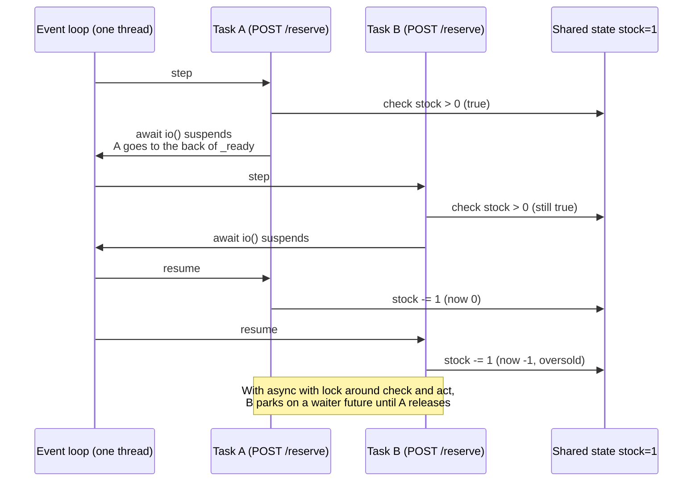

# Why Single-Threaded Asyncio Still Needs Locks: Yield-Point Interleaving Races, Semaphore Concurrency Caps, and Non-Reentrant Lock Deadlocks

> [!summary] Claim
> One thread does not mean one actor: every `await` that suspends hands the loop to every other task, so a check-then-act sequence with an `await` in the middle races exactly like threaded code (the lab sells one unit five times over HTTP), and the fixes, `asyncio.Lock`, keyed locks, and semaphores, carry their own traps, because `asyncio.Lock` has no owner, deadlocks silently on re-entry, and a stray `Semaphore.release()` quietly raises the cap.

Part of [ASGI Servers and Async Runtime](README.md) in [API Engineering](../README.md).

## TL;DR

Mechanism: a coroutine is preempted only at an `await` that actually suspends (a pending future, `asyncio.sleep(0)`, real I/O), and between that suspension and its resumption the loop runs every other ready task, so any invariant spanning the `await` is unprotected.
Contract rule: hold one `asyncio.Lock` (or one lock per entity key) across the whole check-then-act span, cap fan-out with `asyncio.Semaphore` or `BoundedSemaphore`, and never call a lock-taking method from code that already holds that lock.
Trap: `asyncio.Lock` records no owner, so the same task re-acquiring it waits on itself forever with no error, and any task may `release()` it; AnyIO's `Lock` raises `RuntimeError("Attempted to acquire an already held Lock")` instead, and asyncio ships no `RLock`.
Portability: `Lock` logic is identical from 3.12.13 to 3.15.2, but 3.13 changed `Condition.wait` (a cancelled, already-notified waiter now passes the notification on, gh-112202) and `Semaphore.acquire` wake-up accounting (gh-111693); the lab shows the lost notification on 3.12.13 and its absence on 3.13.18, 3.14.10, 3.15.2, and 3.15.0b3t.
When not to use this: an in-process lock protects one event loop in one process; across Gunicorn workers, Kubernetes replicas, or threads it protects nothing, so cross-request invariants on shared data belong in the database (`UPDATE ... WHERE stock > 0`, `SELECT ... FOR UPDATE`, unique constraints) or a distributed lease.

## Mental model



The loop runs one task step at a time, and a step ends only when the task's coroutine suspends on a future.
Task A checks the stock and then suspends at its simulated database call, which puts A at the back of the ready queue.
Task B was already in the ready queue, so it runs next and performs the same check against the same unchanged state.
Both tasks then resume and decrement, and the stock goes negative even though no two lines of Python ever ran at the same instant.
Wrapping the check and the act in one `async with lock` turns B's step into "append a waiter future and suspend", and B's check runs only after A's `release()` resolves that future.

## How it works

### Where a coroutine can be interrupted

An `await` is not automatically a yield point.
`await coro()` runs the callee inline in the same task step; the task suspends only when something down the chain yields a pending future to `Task.__step`, or `asyncio.sleep(0)` yields bare (the scheduling details are in [[CPython-Asyncio-Event-Loop-Internals-Selectors-Ready-Queue-and-Timers]]).
So the race window is precisely the code between a check and its dependent act whenever a suspending `await` sits between them.
The lab's `test_without_await_between_check_and_act_there_is_no_race` swaps the simulated I/O for a coroutine that returns immediately, and five concurrent reservations of one unit then produce exactly one success: without a suspension there is no interleaving.
The converse is the trap: a refactor that adds a cache lookup, a log shipper call, or an `await` on a metrics client inside a formerly synchronous block silently opens a window.
Starlette, FastAPI, and Uvicorn run every request of one worker as tasks on one loop, so two requests for the same resource interleave at each other's `await` points by construction.

The `asyncio` primitives are pure Python in `Lib/asyncio/locks.py`, built on loop futures, and the documentation states two caveats: they are not thread-safe, and their methods take no `timeout` argument, so a bounded wait is `asyncio.wait_for()` or `asyncio.timeout()` around `acquire()` (asyncio-sync documentation, 3.14.10).

### `asyncio.Lock`: state, fairness, and the cancellation invariant

`Lock.__init__` stores two fields, `_locked = False` and `_waiters = None`, and the deque of waiter futures is created lazily on first contention `(CPython 3.14.10 Lib/asyncio/locks.py, Lock.__init__)`.
`acquire()` has a fast path: if the lock is free and there are no waiters, or all waiters are cancelled, it sets `_locked = True` and returns `True` without suspending `(CPython 3.14.10 Lib/asyncio/locks.py, Lock.acquire)`.
An uncontended `async with lock` is therefore not a yield point, which is why it costs about 193 ns in the measurement below while an `asyncio.sleep(0)` costs about 13 us.
On contention it creates a future through `self._get_loop().create_future()`, appends it to `_waiters`, and awaits it; on wake-up it removes the future in a `finally` and sets `_locked = True`.
`release()` raises `RuntimeError('Lock is not acquired.')` on an unlocked lock; otherwise it clears `_locked` and calls `_wake_up_first()`, which resolves only the head future and only if it is not already done `(CPython 3.14.10 Lib/asyncio/locks.py, Lock.release, Lock._wake_up_first)`.

Fairness is FIFO, and the fast-path condition enforces it: after `release()` the head waiter's future is done but not cancelled, so a task that calls `acquire()` again before the woken waiter runs fails the `all(w.cancelled() ...)` test and queues behind it.
The lab's `test_lock_is_fifo_and_releaser_cannot_barge` proves the releaser cannot barge: the order is `["b", "a"]`.
The cost of fairness is a lock convoy: every handoff needs one loop iteration for the woken waiter to run, so under contention throughput is bounded by loop iterations, not by the critical section.

Cancellation is where most hand-rolled locks break, and CPython guards one invariant explicitly.
If a waiter is cancelled after `release()` already resolved its future, it would otherwise own nothing while every other waiter sleeps on futures nobody will resolve.
The `except exceptions.CancelledError` branch in `acquire()` checks `if not self._locked: self._wake_up_first()` before re-raising, so the next waiter is woken instead `(CPython 3.14.10 Lib/asyncio/locks.py, Lock.acquire)`.
`test_cancelled_woken_waiter_passes_lock_to_next_waiter` sets up holder, `b`, `c`; releases (resolving `b`'s future); cancels `b` before it runs; and observes that `c` acquires and the lock ends unlocked.
Cancellation of a holder inside `async with` is safe because `_ContextManagerMixin.__aexit__` calls `release()` unconditionally.
The history shows how subtle this is: bpo-32734 (fixed in 3.6.5 and 3.7.0, per the changelog entries under 3.6.5rc1 and 3.7.0b2) allowed "acquiring and locking the same lock multiple times, without it being free", per the CPython changelog.

### No owner, no re-entry: the self-deadlock

`asyncio.Lock` stores no owning task, only a boolean.
Two consequences follow, and both are tested.
First, a task that holds the lock and calls a method which also does `async with self._lock` appends a waiter future that only a `release()` by itself could resolve, and it is suspended inside the very block that would release; it hangs forever without raising, without logging, and without a deadlock detector.
`test_reacquiring_asyncio_lock_in_same_task_hangs_forever` shows the task still pending after 100 loop iterations, the balance already incremented, and the audit entry never written: a half-applied update that will never complete.
Second, `release()` checks only `_locked`, so any task can release a lock another task holds; `test_asyncio_lock_has_no_owner_so_any_task_can_release_it` does exactly that without an error, which is how a buggy error path silently breaks mutual exclusion for everyone.

asyncio exports `Lock`, `Event`, `Condition`, `Semaphore`, `BoundedSemaphore`, and `Barrier` (the `__all__` of `locks.py`) but no `RLock` (checked with `hasattr(asyncio, "RLock")` on 3.14.10, which is `False`).
The upstream rationale is Guido van Rossum's reply in python/asyncio issue 439 ("Reentrant locks in asyncio", 2016-09-30), closed without an `RLock`: "I doubt there will be much use for it", because the usual reason for a lock "is usually addressed quite simply by not using `await` while you are making the update", and a later commenter in the thread proposed the same locking and non-locking method split this note recommends.
AnyIO takes the opposite stance: its asyncio backend `Lock` records `_owner_task`, raises `RuntimeError("Attempted to acquire an already held Lock")` when the owner re-acquires, and raises `RuntimeError("The current task is not holding this lock")` when a non-owner releases `(anyio 4.16.0 anyio/_backends/_asyncio.py, Lock.acquire, Lock.release)`.
Turning a silent hang into an exception at the faulty call site is the single best property a lock can have in a large codebase, and the lab's `test_anyio_lock_raises_on_reentry_instead_of_hanging` confirms it under asyncio.

There are three fixes, in order of preference.
The structural fix splits each locked operation into a public method that acquires and a private `_locked` helper that assumes the lock is held and never acquires it; the lab's `Account._record_locked` additionally asserts `self._lock.locked()` so a call from outside the lock fails loudly.
The detection fix is an owner-checking lock (AnyIO `Lock`, or a wrapper) so re-entry raises.
The last resort is a task-scoped reentrant lock; the lab's `TaskRLock` tracks `asyncio.current_task()` and a depth counter, and it rejects release by a non-owner.
Its limit is the important lesson: reentrancy is keyed by task, and `asyncio.create_task()` and `TaskGroup.create_task()` start a different task, so a parent holding the lock that awaits a child which acquires it still deadlocks (`test_task_rlock_reentrancy_does_not_cross_into_child_task`).
A reentrant lock also hides the real problem, which is that the inner method cannot know whether the outer caller left the protected state consistent before the nested call.

### Two locks: the ABBA deadlock and lock ordering

Re-entry is the one-lock deadlock; the two-lock form needs two tasks.
If task 1 takes lock A then B while task 2 takes B then A, and each suspends between its two acquires, each ends up holding one lock and queued on the other, and neither `release()` can ever run.
The lab's `transfer(first, second)` yields once between its acquires, and `test_opposite_lock_order_deadlocks_and_one_global_order_does_not` shows both tasks still pending after 20 loop iterations with both locks held, then cancels them (releasing both through `async with`) and shows that `transfer_ordered`, which sorts the two locks by one global key (`id` here, a stable id or a hierarchy level in real code) before acquiring, completes for both argument orders.
Without the suspension between the acquires the interleaving cannot happen on one loop, which is why this bug appears only after a refactor adds an `await` inside the first critical section.
asyncio has no deadlock detector, so the same discipline applies as for threads: one documented global acquisition order, and a bounded wait (`asyncio.timeout`) around the second acquire so a cycle surfaces as `TimeoutError` instead of a hang.

### Keyed locks: serialize per entity, not per process

A single global lock serializes unrelated orders and turns the worker into a single-file queue.
A dictionary of locks keyed by entity id serializes only conflicting requests, but naive `defaultdict(asyncio.Lock)` grows without bound, one lock per id ever seen, which is a memory leak in a long-running worker (see [[Memory-Leaks-in-Long-Running-Python-API-Workers]]).
The lab's `KeyedLocks` keeps a reference count of holders plus waiters and deletes the entry when it reaches zero.
The count is incremented before `async with entry.lock`, with no `await` between the dictionary lookup and the increment, so the lookup-and-claim is atomic on the loop and a waiter can never find its entry deleted under it.
The decrement is in a `finally`, so a waiter cancelled while queued still drops its reference (`test_keyed_locks_drop_entry_when_queued_waiter_is_cancelled`), and three same-key callers show a peak concurrency of `1` while three different keys show `3`.
Deleting the entry while a waiter is still queued would be a correctness bug, not a leak: the next arrival would create a fresh lock and run concurrently with the queued waiter.

### Semaphores: concurrency caps and their accounting

`Semaphore.__init__` rejects negative values with `ValueError("Semaphore initial value must be >= 0")` and stores `_value` and lazy `_waiters` `(CPython 3.14.10 Lib/asyncio/locks.py, Semaphore.__init__)`.
`locked()` returns true when `_value == 0` or when any non-cancelled waiter exists, so a newcomer cannot jump the FIFO queue even if a permit is momentarily free.
`acquire()` decrements on the fast path; on the slow path it awaits a waiter future, and `_wake_up_next()` performs the decrement on the waiter's behalf at wake-up time, so a cancelled-after-wake waiter must give the permit back: `if fut.done() and not fut.cancelled(): self._value += 1` `(CPython 3.14.10 Lib/asyncio/locks.py, Semaphore.acquire, Semaphore._wake_up_next)`.
Since 3.13 a `finally` in `acquire()` loops `while self._value > 0: if not self._wake_up_next(): break`, waking as many queued waiters as free permits allow; 3.12.13 instead does a single `if self._value > 0: self._wake_up_next()` and re-wakes inside the cancel branch (source diff of 3.12.13 against 3.13.18; changelog gh-111693 "Fixed race condition in asyncio.Semaphore.acquire() when interrupted with a CancelledError").
Earlier fixes in the same function came from one issue, gh-90155 (migrated from bpo-45997, "asyncio.Semaphore waiters deque doesn't work"), which has two changelog entries: "Fix asyncio.Semaphore re-aquiring FIFO order" (bpo-45997, 3.11.0) and "Fix broken asyncio.Semaphore when acquire is cancelled" (gh-90155, 3.12.0), a fair warning about hand-rolling a counting semaphore.

`release()` increments unconditionally: the documentation says that "Unlike BoundedSemaphore, Semaphore allows making more release() calls than acquire() calls".
The lab's `test_extra_release_silently_raises_semaphore_cap` releases a `Semaphore(4)` once without acquiring, and 20 jobs then run with a peak concurrency of `5`; the downstream cap is silently wrong forever.
`BoundedSemaphore.release()` raises `ValueError('BoundedSemaphore released too many times')` when `_value >= _bound_value`, which catches the bug at its source; use it for every cap.
A semaphore is not owner-tracked either: one task may acquire several permits and another may release them, which is legitimate for producer-consumer handoff and a bug everywhere else.
AnyIO's `CapacityLimiter` is the owner-tracked alternative: each borrower (the current task by default) can hold one token, and a second acquire raises `RuntimeError("this borrower is already holding one of this CapacityLimiter's tokens")` `(anyio 4.16.0 anyio/_backends/_asyncio.py, CapacityLimiter.acquire_on_behalf_of_nowait)`.

Real libraries use exactly these primitives.
httpcore 1.0.9 sizes an `AsyncSemaphore(100)` from `MAX_CONCURRENT_STREAMS`, immediately acquires 99 permits so only one stream may open before the server's `SETTINGS` frame arrives, then releases or acquires permits as `SETTINGS_MAX_CONCURRENT_STREAMS` changes, never above its own local value of 100 `(httpcore 1.0.9 httpcore/_async/http2.py, AsyncHTTP2Connection._send_connection_init, AsyncHTTP2Connection.handle_async_request, AsyncHTTP2Connection._receive_remote_settings_change)`; the setting itself is defined in (RFC 9113 Section 6.5.2), which recommends a value no smaller than 100.
Starlette's `run_in_threadpool` uses AnyIO's default thread limiter, a `CapacityLimiter(40)` per event loop `(anyio 4.16.0 anyio/_backends/_asyncio.py, AsyncIOBackend.current_default_thread_limiter)`, and Starlette 1.10.0's `GZipMiddleware` keeps its own separate `CapacityLimiter(40)` in a `RunVar` `(starlette 1.10.0 starlette/middleware/gzip.py, _get_gzip_capacity_limiter)`.
FastAPI 0.162.0's `contextmanager_in_threadpool` runs a dependency's `__exit__` on a fresh `CapacityLimiter(1)` precisely so cleanup cannot wait behind the exhausted default limiter and deadlock a pool whose connections it is trying to return `(fastapi 0.162.0 fastapi/concurrency.py, contextmanager_in_threadpool)`.

### `Condition`: the lost wakeup fixed in 3.13

`Condition.wait()` releases the lock, awaits a waiter future, then must re-acquire the lock even if cancelled, looping on `CancelledError` until it does `(CPython 3.14.10 Lib/asyncio/locks.py, Condition.wait)`.
The bug fixed by gh-112202: if `notify(1)` resolves waiter W1's future and W1 is then cancelled before it runs, W1 raises `CancelledError` and the notification dies with it while W2 sleeps.
Since 3.13 an outer `except BaseException: self._notify(1); raise` re-notifies another waiter, accepting a possible spurious wakeup, which the 3.13+ docstring now documents ("This method may return spuriously").
The same 3.13 change (gh-111693) re-raises the original `CancelledError` instance instead of a fresh one.
`test_condition_notify_lost_when_woken_waiter_is_cancelled_before_3_13` encodes both behaviors: on 3.12.13 W2 is still stuck after 20 loop iterations, and on 3.13.18 and later W2 wakes.
Because a wakeup can be spurious or stolen, always loop on the predicate with `wait_for(predicate)` rather than a bare `wait()`.

### Loop binding: why the "bound to a different event loop" error is intermittent

Every primitive inherits `mixins._LoopBoundMixin`, whose `_get_loop()` records the running loop on first call, under a module-level `threading.Lock` with double-checked locking, and raises `RuntimeError(f'{self!r} is bound to a different event loop')` on any later call from another loop `(CPython 3.14.10 Lib/asyncio/mixins.py, _LoopBoundMixin._get_loop)`.
`Lock.acquire` calls `_get_loop()` only on the contended path, so a module-level lock used uncontended in several `asyncio.run()` calls, as in a test suite, never binds, and the first contended use binds it.
`test_lock_binds_to_first_loop_only_when_contended` runs two uncontended loops without error, then a contended loop, then fails on the next contended loop.
That is why this error appears only under load or only in some tests: create primitives inside the lifespan or the running loop, not at import time.
The mixin's `threading.Lock` makes the binding race-free on free-threaded builds, but nothing else in `locks.py` is thread-safe, on any build.

## Numbers and limits

| Quantity | Value | Source |
|---|---|---|
| Uncontended `async with asyncio.Lock()` | 193 ns per pair | measured 2026-11-15, best of 5 x 200,000 `time.perf_counter_ns()` loops, `python3.14 -I bench.py` on CPython 3.14.10, macOS 27.3 (Darwin 27.3.0) arm64, Apple M3 Pro (script deleted after the run) |
| Uncontended `async with asyncio.Semaphore(10)` | 360 ns per pair | same run |
| Uncontended `async with anyio.Lock()` (default, yields a checkpoint) | 14,809 ns per pair | same run, AnyIO 4.16.0, best of 5 x 50,000 |
| Uncontended `async with anyio.Lock(fast_acquire=True)` | 455 ns per pair | same run, best of 5 x 50,000 |
| `await asyncio.sleep(0)` (one loop iteration) | 13,210 ns | same run, best of 5 x 50,000 |
| Contended `asyncio.Lock` handoff, 2 tasks, `sleep(0)` inside | 27,685 ns per critical section | same run, best of 5 x 50,000 sections |
| Five concurrent `POST /reserve` against stock 1, no lock | 5 x `200`, final stock `-4` | lab, 3.12.13 to 3.15.2 and 3.15.0b3t |
| Same with `asyncio.Lock` | 1 x `200`, 4 x `409`, final stock `0` | lab, same legs |
| Peak concurrency, 20 jobs, `Semaphore(4)` after one stray `release()` | 5 | lab, same legs |
| AnyIO default worker-thread limiter (`run_in_threadpool`) | 40 tokens per loop | anyio 4.16.0 source |
| httpcore HTTP/2 stream semaphore before server `SETTINGS` | 1 of 100 permits | httpcore 1.0.9 source |
| `SETTINGS_MAX_CONCURRENT_STREAMS` recommended floor | 100 | RFC 9113 Section 6.5.2 |
| Requests the single-packet attack lands in one race window | 20-30, sub-1 ms | PortSwigger research (James Kettle, published 2023-08-09) |

The AnyIO default lock is about 77 times the cost of the asyncio lock in this run because its uncontended `acquire()` deliberately calls `cancel_shielded_checkpoint()`, a full loop iteration, so that a loop that only takes locks still lets other tasks run; `fast_acquire=True` skips it, and the AnyIO documentation warns that this can starve the loop.
The contended handoff costs roughly two loop iterations per critical section, which is the convoy cost: a hot lock caps one key at about `1 / (critical section + 2 loop iterations)` operations per second per process, independent of core count.
A lock held across a 5 ms database round trip caps that key at 200 operations per second per worker by the same arithmetic (derived, not measured).

## Portability

| Behavior | 3.12.13 | 3.13.18 | 3.14.10 | 3.15.2 | 3.15.0b3t (GIL off) | Proof |
|---|---|---|---|---|---|---|
| Check-then-act across `await` oversells; `Lock` fixes it | yes | yes | yes | yes | yes | lab, all legs |
| Re-entering `asyncio.Lock` in the same task hangs silently | yes | yes | yes | yes | yes | lab, all legs |
| Any task can `release()` an `asyncio.Lock` | yes | yes | yes | yes | yes | lab, all legs |
| `Lock` FIFO, releaser cannot barge, cancelled-woken waiter hands off | yes | yes | yes | yes | yes | lab, all legs; `Lock` code identical except comments (diff) |
| Stray `Semaphore.release()` raises the cap; `BoundedSemaphore` raises `ValueError` | yes | yes | yes | yes | yes | lab, all legs |
| `Condition.notify(1)` lost when the woken waiter is cancelled | lost | re-notified | re-notified | re-notified | re-notified | lab, all legs; gh-112202 |
| `Semaphore.acquire` wakes every waiter a free permit allows (`while` loop) | no (single `if`) | yes | yes | yes | yes | source diff; gh-111693 |
| Loop binding only on contended path | yes | yes | yes | yes | yes | lab, all legs |
| AnyIO 4.16.0 `Lock` raises on re-entry under asyncio | yes | yes | yes | yes | yes | lab, all legs |
| Opposite lock order (ABBA) deadlocks; one global order does not | yes | yes | yes | yes | yes | lab on 3.14.6 only; `Lock` logic identical across legs (diff) |
| `asyncio.RLock` exists | no | no | no | no | no | `dir(asyncio)` on 3.14.10; `__all__` of `locks.py` identical in all five |

`Lib/asyncio/locks.py` is byte-identical between 3.14.10 and 3.15.2, and between 3.15.2 and 3.15.0b3t; 3.13.18 differs from 3.14.10 only in the `notify_all` docstring; 3.12.13 differs from 3.13.18 in `Lock` comments only, in docstrings across the module ("coroutine" became "task"), and in logic in `Condition.wait`, `Condition.notify` (split into a private `_notify`), `Semaphore.acquire`, and `Semaphore._wake_up_next` (now returns a bool) (diffs run locally).
The 3.15t leg ran on CPython 3.15.0b3 free-threading build, not 3.15.2t, because that is the only free-threaded 3.15 interpreter `uv` can provide here, in a minimal virtual environment (`starlette==1.10.0`, `anyio==4.16.0`, `httpx==0.28.1`, `httpcore==1.0.9`, `pytest==9.2.0`, `pytest-asyncio==1.4.1.post1`, `PYTHONPATH=src`).
The 3.12 leg used 3.12.13 rather than the matrix's 3.12.16, which is not installed here.
Free threading does not make these primitives safe across threads: they are documented as not thread-safe, and using one from two threads' loops either raises the loop-binding error or, on the uncontended path, races on the plain `_locked` attribute; use `threading.Lock` or `loop.call_soon_threadsafe()` for cross-thread handoff (see [[Offloading-CPU-Bound-Work-ProcessPoolExecutor-vs-Free-Threaded-Python-3-15t]]).
Uvicorn (`uvicorn 0.54.0 uvicorn/server.py, Server.run` calls `asyncio_run` once per process), Hypercorn (`hypercorn 0.18.0 hypercorn/asyncio/run.py`, asyncio worker), and Granian's ASGI mode (`granian 2.8.7 granian/server/mp.py, _spawn_asgi_worker`, which takes one asyncio `loop` per worker and calls `loop.run_until_complete`; Granian's Rust runtime threads only schedule callbacks onto that loop) all run application code on one loop per worker process, so the races and fixes are identical under each; Hypercorn's Trio worker would need Trio primitives, which were not tested (`trio` is not pinned).
HTTP/1.1 versus HTTP/2 or HTTP/3 changes only how many requests a single client can make concurrent: multiplexing lets one connection open many streams at once, which the single-packet attack exploits.
Debian and Alpine container legs were not run (lab checks paused).

## Worked example

The [implementation](../labs/src/api_labs/f12_asgi_servers_and_async_runtime/async_sync_primitives.py) holds the race, the fixes, and the deadlock; the [test](../labs/tests/f12_asgi_servers_and_async_runtime/test_async_synchronization_primitives_locks_semaphores_and_reentrant_deadlocks.py) has 20 tests, each marked `@pytest.mark.unit`.

The race and its fix (simplified excerpt of `async_sync_primitives.py`, lines verbatim):

```python
async def yield_once() -> None:
    """Stand-in for a database round trip: one real suspension of the task."""
    await asyncio.sleep(0)


class Inventory:
    """A stock counter whose reserve path awaits between the check and the act."""

    def __init__(self, stock: int, io: IoHook = yield_once) -> None:
        self.stock = stock
        self._io = io
        self._lock = asyncio.Lock()

    async def reserve_unsafe(self) -> bool:
        if self.stock <= 0:  # check
            return False
        await self._io()  # yield point: every other task may run here
        self.stock -= 1  # act on a stale check
        return True

    async def reserve_locked(self) -> bool:
        async with self._lock:
            return await self.reserve_unsafe()


def build_app(inventory: Inventory, *, locked: bool) -> Starlette:
    """`POST /reserve` returns `200` on success and `409` when sold out."""

    async def reserve(request: Request) -> JSONResponse:
        ok = await (inventory.reserve_locked() if locked else inventory.reserve_unsafe())
        body = {"reserved": ok, "stock": inventory.stock}
        return JSONResponse(body, status_code=200 if ok else 409)

    return Starlette(routes=[Route("/reserve", reserve, methods=["POST"])])
```

The HTTP-level test (simplified excerpt of the test module, lines verbatim):

```python
async def _five_reservations(locked: bool) -> tuple[list[int], int]:
    inventory = Inventory(stock=1)
    transport = httpx.ASGITransport(app=build_app(inventory, locked=locked))
    async with httpx.AsyncClient(transport=transport, base_url="http://test") as client:
        responses = await asyncio.gather(*(client.post("/reserve") for _ in range(5)))
    return sorted(r.status_code for r in responses), inventory.stock


@pytest.mark.unit
@pytest.mark.asyncio
async def test_check_then_act_across_await_oversells_one_unit_five_times() -> None:
    statuses, stock = await _five_reservations(locked=False)
    assert statuses == [200, 200, 200, 200, 200]
    assert stock == -4


@pytest.mark.unit
@pytest.mark.asyncio
async def test_lock_around_check_and_act_sells_exactly_one() -> None:
    statuses, stock = await _five_reservations(locked=True)
    assert statuses == [200, 409, 409, 409, 409]
    assert stock == 0
```

The keyed lock with reference-counted cleanup (simplified excerpt, lines verbatim):

```python
class KeyedLocks:
    """One lock per key, deleted when its last holder or waiter leaves."""

    def __init__(self) -> None:
        self._entries: dict[str, _KeyEntry] = {}

    def __len__(self) -> int:
        return len(self._entries)

    @asynccontextmanager
    async def hold(self, key: str) -> AsyncGenerator[None]:
        # No await between lookup and increment, so this is atomic on the loop.
        entry = self._entries.get(key)
        if entry is None:
            entry = self._entries[key] = _KeyEntry(asyncio.Lock())
        entry.users += 1
        try:
            async with entry.lock:
                yield
        finally:
            entry.users -= 1
            if entry.users == 0:
                del self._entries[key]
```

The self-deadlock and its structural fix (simplified excerpt, lines verbatim):

```python
class Account:
    """`deposit_reentrant` re-acquires its own lock; `deposit` does not."""

    def __init__(self) -> None:
        self._lock = asyncio.Lock()
        self.balance = 0
        self.audit: list[int] = []

    async def deposit_reentrant(self, amount: int) -> None:
        async with self._lock:
            self.balance += amount
            await self.record(amount)  # deadlock: record() waits on our own lock

    async def record(self, amount: int) -> None:
        async with self._lock:
            self._record_locked(amount)

    async def deposit(self, amount: int) -> None:
        async with self._lock:
            self.balance += amount
            self._record_locked(amount)

    def _record_locked(self, amount: int) -> None:
        """Caller must hold `self._lock`; never acquires it."""
        if not self._lock.locked():
            raise RuntimeError("_record_locked called without holding the lock")
        self.audit.append(amount)
```

The two-lock deadlock and its ordering fix (simplified excerpt, lines verbatim):

```python
async def transfer(first: asyncio.Lock, second: asyncio.Lock) -> str:
    """Take two locks in the given order; the yield between them opens the ABBA window."""
    async with first:
        await yield_once()
        async with second:
            return "done"


async def transfer_ordered(a: asyncio.Lock, b: asyncio.Lock) -> str:
    """Fix: acquire in one global order (here `id`), whatever order the caller named them."""
    first, second = sorted((a, b), key=id)
    return await transfer(first, second)
```

Hangs are detected deterministically, with no wall clock: `is_stuck(task, spins)` runs `asyncio.sleep(0)` `spins` times and reports whether the task is still pending, which is valid because nothing else in the test is scheduled.

Captured run, from `labs/`, on CPython 3.14.6 (the workspace interpreter), macOS 27.3 on Apple M3 Pro:

```text
$ uv run --frozen pytest tests/f12_asgi_servers_and_async_runtime/test_async_synchronization_primitives_locks_semaphores_and_reentrant_deadlocks.py -q
...................                                                      [100%]
20 passed in 0.16s
```

In the drafting run, the 19-test version of the module, run once per interpreter, printed `19 passed` on 3.12.13, 3.13.18, 3.14.10, 3.15.2, and 3.15.0b3 free-threading with the GIL disabled; the finishing pass added the lock-ordering test and ran only the workspace interpreter (lab checks paused), so that test has no per-leg run, and the version-dependent `Condition` and `Semaphore` behavior is confirmed by the source diff above.

## Pitfalls

> [!warning] Check-then-act across an `await`
> Trigger: `if await repo.get_balance(u) >= amount: await repo.debit(u, amount)`, or any read, `await`, write sequence on shared state, including module-level caches and in-memory rate-limit counters.
> Symptom: double spends, oversold stock, duplicated side effects, appearing only under concurrent load and never in unit tests that send one request at a time.
> Fix: hold one lock (keyed by entity) across the entire span, or better, push the invariant into one atomic statement in the store (`UPDATE ... SET stock = stock - 1 WHERE id = $1 AND stock > 0` and check the row count); test with `asyncio.gather` over the real ASGI app, as the lab does.

> [!warning] Re-entering a non-reentrant lock
> Trigger: a locked public method calls another public method that takes the same `asyncio.Lock`, often after a refactor that extracted a helper.
> Symptom: the request hangs until the client or the server's timeout fires; the worker stays healthy, and the half-applied update never completes.
> Fix: split public acquiring methods from private `_locked` helpers that assert `lock.locked()`; use an owner-checking lock (AnyIO `Lock`) so re-entry raises; httpcore #996 is a real report of the same shape with threads: its stack, reported on httpcore 1.0.7, shows a response stream's `PoolByteStream.close()` entering the pool's `_optional_thread_lock` while the same thread was still inside `ConnectionPool.handle_request` holding it, the lock being `ThreadLock` over a plain `threading.Lock` (unchanged in 1.0.9, `httpcore/_synchronization.py, ThreadLock`), and the reporter proposed `threading.RLock`; the maintainers closed it without a change (encode/httpcore issue 996, closed 2025-03-20).

> [!warning] Unbalanced semaphore accounting
> Trigger: a `release()` on a path that never acquired (an `except` branch, a cancellation handler, a double-close), or an acquire that a cancellation path never releases.
> Symptom: the cap drifts up (overload of the downstream) or down (permits leak until every request blocks).
> Fix: use `BoundedSemaphore` so over-release raises; acquire and release only through `async with`; httpcore #1022 reports the drift in production, where a cancellation path released the HTTP/2 stream semaphore before `h2` recorded the stream as closed, ending in `httpcore.LocalProtocolError: Max outbound streams is 100, 100 open`, and httpcore #1093 reports cancellation under pool contention permanently leaking connection slots until every request fails with `PoolTimeout` (both open as of 2026-11).

> [!warning] Lock created at import time
> Trigger: `_lock = asyncio.Lock()` at module scope, reused across `asyncio.run()` calls in tests, or touched from a second loop in a thread.
> Symptom: `RuntimeError: <asyncio.locks.Lock ...> is bound to a different event loop`, only under contention, so it looks intermittent.
> Fix: create primitives in the lifespan or in a dependency bound to `app.state`, so each loop gets its own.

> [!warning] Lock held across slow I/O
> Trigger: an `await httpx_client.post(...)` or a database transaction inside `async with lock`.
> Symptom: p99 latency of every request on that key equals the queue length times the I/O time, and a timeout of the holder stalls all waiters.
> Fix: hold the lock only for in-memory state transitions, take snapshots under the lock and do I/O outside it, and bound waits with `async with asyncio.timeout(t): await lock.acquire()` followed by `try`/`finally` release.

> [!warning] Reentrancy that does not cross task boundaries
> Trigger: a parent holding a task-scoped reentrant lock awaits `create_task()` or a `TaskGroup` child that takes the same lock.
> Symptom: a deadlock that the reentrant lock was supposed to prevent; the lab reproduces it.
> Fix: pass the protected state into the child instead of re-locking, or let only the parent touch the state.

## Security and robustness

Threat model: an attacker fires many identical requests at a limit-checked business flow (redeem a coupon once, withdraw up to the balance, claim the last seat) to land several inside the race window.
PortSwigger's "Smashing the state machine" research introduced the single-packet attack, which completes 20-30 HTTP/2 requests with one TCP packet so they arrive together regardless of network jitter, and describes race windows "often around 1ms"; an `await` on a database round trip is a window of that size.
This maps to OWASP API6:2023 Unrestricted Access to Sensitive Business Flows when the flow is abused at scale, and to OWASP API4:2023 Unrestricted Resource Consumption when the missing control is a concurrency cap on an expensive downstream.
Defense in depth, from strongest to weakest: an atomic conditional write or unique constraint in the database, an idempotency key stored with the result, a distributed lease with a fencing token for cross-process work, a per-entity `asyncio.Lock` for in-process state only, and rate limits as a blunt outer layer.
An in-process lock is never a security control for data shared across workers: Gunicorn with four Uvicorn workers has four independent locks, and each Kubernetes replica has its own (see [[Multi-Process-Worker-Topologies-Gunicorn-Uvicorn-Workers-vs-Kubernetes-Replicas]]).
Bound every unbounded structure an attacker can grow: keyed-lock maps must evict on zero users, and waiter queues behind a semaphore need a bounded wait (`asyncio.timeout`) and a `503 Service Unavailable` or `429 Too Many Requests` response rather than an unbounded pile of suspended tasks (see [[End-to-End-Backpressure-TCP-Windows-ASGI-Send-Await-and-Bounded-Queues]]).
A silent self-deadlock is also an availability bug: requests that never complete hold connections, memory, and semaphore permits, so a single code path an attacker can trigger repeatedly can exhaust a worker without consuming CPU, and only an owner-checking lock or a timeout surfaces it.

## The principal's view

The architectural decision is where each invariant lives.
Invariants about shared business data (stock, balances, quotas, uniqueness) belong in the system of record, because the API tier is horizontally scaled and every in-process lock is local to one loop in one process; a code review that sees `asyncio.Lock` guarding a database row should ask why the database is not enforcing it.
In-process primitives are for in-process state: a single-flight cache fill, a connection's write path (httpcore serializes HTTP/2 writes behind `_write_lock`), a per-process cap on an expensive downstream, or ordering within one WebSocket connection.
Standardize on owner-checking primitives where the codebase is large: AnyIO's `Lock` and `CapacityLimiter` turn the two worst asyncio failure modes, silent re-entry hangs and stray releases, into exceptions at the faulty line, at the cost of one loop iteration per uncontended acquire unless `fast_acquire=True` is set.
Ban `Semaphore` in favor of `BoundedSemaphore` or `CapacityLimiter` in lint rules or review checklists; the unbounded form is correct only for producer-consumer signalling.
Make lock ordering and lock scope part of the design document for any component that holds more than one lock, because asyncio has no deadlock detector and a hang looks like a slow dependency in every dashboard.
Choose a different paradigm when the shared state is the point: an actor (one task owning the state and a bounded queue of commands) removes locks entirely and makes ordering explicit, and when work must span processes, a queue with a single consumer per partition key gives the same guarantee across replicas.

## Interview questions

> [!question] L5: Asyncio runs on one thread, so why can two requests corrupt a shared counter?
>
> > [!success]- Answer
> > A task can be suspended at any `await` that yields a pending future, and the loop then runs other tasks.
> > If a read of the counter and the write that depends on it are separated by such an `await`, another task can read the same old value in between.
> > Both then write, and one update is lost or an invariant like `stock >= 0` is broken.
> > Atomicity in asyncio means "no suspending `await` between check and act", or one lock held across both.
> >
> > Follow-up: Is `async with asyncio.Lock()` itself a yield point when uncontended?

> [!question] L5: Predict the output.
>
> ```python
> import asyncio
>
> async def main():
>     lock = asyncio.Lock()
>     async def inner():
>         async with lock:
>             return "inner"
>     async with lock:
>         try:
>             print(await asyncio.wait_for(inner(), 0.1))
>         except TimeoutError:
>             print("timeout")
>     print(lock.locked())
>
> asyncio.run(main())
> ```
>
> > [!success]- Answer
> > It prints `timeout` and then `False`.
> > `inner()` runs in the same task that already holds the non-reentrant lock, so its `acquire()` queues a waiter that only that task could release, and it waits forever.
> > `wait_for` cancels it after 0.1 s; the cancelled waiter is removed from `_waiters` and the lock is still held by the outer block, which then releases it on exit.
> > Without the timeout the program would hang with no error.
> >
> > Follow-up: What would AnyIO's `Lock` do at the inner `acquire()`?

> [!question] L5: What is the difference between `Semaphore` and `BoundedSemaphore`, and which should guard a downstream concurrency cap?
>
> > [!success]- Answer
> > `Semaphore.release()` always increments, so an extra release silently raises the cap.
> > `BoundedSemaphore.release()` raises `ValueError` when the value would exceed the initial value.
> > A cap should use `BoundedSemaphore` (or AnyIO `CapacityLimiter`) so accounting bugs fail loudly.
> > The lab shows a `Semaphore(4)` running 5 jobs concurrently after one stray release.
> >
> > Follow-up: Why does neither asyncio semaphore track which task holds a permit?

> [!question] L6: Debug this API. Under load, `POST /orders/{id}/confirm` occasionally hangs until the client times out, but CPU is idle and nothing is logged.
>
> ```python
> class OrderService:
>     def __init__(self):
>         self._lock = asyncio.Lock()
>     async def confirm(self, oid):
>         async with self._lock:
>             order = await self.repo.get(oid)
>             if order.needs_reprice:
>                 await self.reprice(oid)
>             await self.repo.mark_confirmed(oid)
>     async def reprice(self, oid):
>         async with self._lock:
>             ...
> ```
>
> > [!success]- Answer
> > `confirm` holds `self._lock` and calls `reprice`, which tries to take the same non-reentrant `asyncio.Lock` in the same task.
> > The waiter future can only be resolved by the task that is now suspended on it, so the request never completes, and every later request queues behind the stuck holder.
> > It looks intermittent because only orders with `needs_reprice` take the nested path.
> > Fix: split `reprice` into an acquiring public method and a `_reprice_locked` helper that asserts the lock is held, and switch to an owner-checking lock so re-entry raises.
> > Also, a single service-wide lock serializes all orders; key it by `oid`, and enforce confirmation idempotency in the database.
> >
> > Follow-up: How would you find this from a production hang without a reproducer?

> [!question] L6: Design a per-key lock map for a long-running worker; what goes wrong with `defaultdict(asyncio.Lock)`?
>
> > [!success]- Answer
> > The map grows by one lock per key ever seen, a slow memory leak.
> > Deleting the lock when the holder exits is wrong if a waiter is queued, because the next arrival creates a new lock and runs concurrently with that waiter.
> > Keep a reference count of holders plus waiters, increment it before acquiring with no `await` between lookup and increment, decrement in `finally`, and delete only at zero.
> > Cancellation of a queued waiter must still decrement, which the `finally` guarantees.
> >
> > Follow-up: How would you shard or bound the map if keys are attacker-controlled?

> [!question] L6: Why does "`Lock` is bound to a different event loop" appear only sometimes?
>
> > [!success]- Answer
> > `_LoopBoundMixin._get_loop()` binds the primitive on its first call and raises on a later call from a different loop.
> > `Lock.acquire` calls it only when it must create a waiter future, that is, under contention.
> > A module-level lock therefore works across many `asyncio.run()` calls until the first contended use binds it, after which contended use in another loop fails.
> > Create primitives inside the running loop, for example in the lifespan.
> >
> > Follow-up: Does the free-threaded build change this?

> [!question] L6: What changed in `asyncio.Condition.wait()` in Python 3.13, and why does it matter for a worker pool?
>
> > [!success]- Answer
> > Before 3.13, if `notify(1)` woke a waiter that was cancelled before it ran, the notification was lost and the other waiters slept on (gh-112202).
> > Since 3.13 the failing waiter calls `_notify(1)` before re-raising, so another waiter wakes, at the cost of possible spurious wakeups.
> > A pool that hands one job per `notify(1)` and cancels idle workers could strand jobs on 3.12.
> > Always loop with `wait_for(predicate)`, which is correct under both behaviors.
> >
> > Follow-up: What other bug in the same function did gh-111693 fix?

> [!question] L7+: Your team guards coupon redemption with an `asyncio.Lock` keyed by coupon id and a penetration test still redeems one coupon three times; explain and redesign.
>
> > [!success]- Answer
> > The service runs several worker processes and replicas, and each has its own lock map, so concurrent requests routed to different workers never contend.
> > Techniques like the single-packet attack land 20-30 requests within about a millisecond, so the window is easy to hit.
> > Move the invariant to the store: a conditional `UPDATE coupons SET used = true WHERE id = $1 AND used = false` with a row-count check, or a unique constraint on redemptions, plus an idempotency key per client request.
> > Keep the in-process lock only if it reduces database contention, never as the correctness mechanism.
> >
> > Follow-up: When would you reach for a distributed lease, and why does it need a fencing token?

> [!question] L7+: Would you allow a reentrant async lock in your organization's codebase?
>
> > [!success]- Answer
> > I would default to no: reentrancy hides that a nested call runs while the outer caller's invariants may be temporarily broken.
> > Task-keyed reentrancy also fails across `create_task` and `TaskGroup` children, so it does not even remove the deadlock class it promises to remove.
> > I would instead standardize on owner-checking non-reentrant locks that raise on re-entry, the public-acquires, private-assumes-held convention, and actors for complex shared state.
> > The cost is refactoring helpers into `_locked` variants, which is cheaper than diagnosing silent hangs.
> >
> > Follow-up: How would you enforce the convention with static analysis or review tooling?

## Related

Prerequisites: [[Fire-and-Forget-Task-Hazards-GC-Disappearance-and-Managed-Task-Nurseries]]

Next: [[Graceful-Shutdown-SIGTERM-Drain-Windows-and-Kubernetes-PreStop-Hooks]]

See also: [[02-Programming-Languages/Python/Python-Backend-Interview-Prep/16-Asyncio-Deep-Dive]], [[02-Programming-Languages/Python/Python-Backend-Interview-Prep/17-Concurrency-in-Web-Services-and-Coding]], [[CPython-Asyncio-Event-Loop-Internals-Selectors-Ready-Queue-and-Timers]], [[Cancellation-Semantics-CancelledError-Swallowing-and-Shielded-Cleanup]], [[AnyIO-Structured-Concurrency-TaskGroups-CancelScopes-and-ExceptionGroups]], [[Eager-Task-Factory-in-Python-3-12-to-3-15-and-Execution-Order-Shifts]], [[End-to-End-Backpressure-TCP-Windows-ASGI-Send-Await-and-Bounded-Queues]], [[Detecting-Event-Loop-Blocking-Loop-Lag-Monitors-and-Debug-Callbacks]], [[Memory-Leaks-in-Long-Running-Python-API-Workers]], [[Multi-Process-Worker-Topologies-Gunicorn-Uvicorn-Workers-vs-Kubernetes-Replicas]], [[Offloading-CPU-Bound-Work-ProcessPoolExecutor-vs-Free-Threaded-Python-3-15t]]

- Lab: `labs/tests/f12_asgi_servers_and_async_runtime/test_async_synchronization_primitives_locks_semaphores_and_reentrant_deadlocks.py`

## Further reading

- [asyncio Synchronization Primitives (Python 3.14 docs)](https://docs.python.org/3.14/library/asyncio-sync.html): the contract, including "not thread-safe", no `timeout` argument, and FIFO fairness of `Lock`.
- [CPython `Lib/asyncio/locks.py`](https://github.com/python/cpython/blob/main/Lib/asyncio/locks.py): about 600 lines; read `Lock.acquire`, `Semaphore.acquire`, and `Condition.wait` for the cancellation invariants.
- [gh-112202](https://github.com/python/cpython/issues/112202): the `Condition.notify()` lost-wakeup race fixed in 3.13.
- [gh-111693](https://github.com/python/cpython/issues/111693): `Condition.wait()` re-raising the original `CancelledError`, shipped with the `Semaphore.acquire()` cancellation race fix.
- [gh-90155](https://github.com/python/cpython/issues/90155): the earlier broken-`Semaphore`-on-cancel bug and its FIFO history.
- [AnyIO: Using synchronization primitives](https://anyio.readthedocs.io/en/stable/synchronization.html): owner-checking `Lock`, `CapacityLimiter`, and the `fast_acquire` trade-off.
- [encode/httpcore issue 1022](https://github.com/encode/httpcore/issues/1022): a production semaphore-accounting drift between httpcore and `h2`.
- [encode/httpcore issue 1093](https://github.com/encode/httpcore/issues/1093): cancellation under contention leaking pool slots until `PoolTimeout`.
- [RFC 9113 Section 6.5.2](https://www.rfc-editor.org/rfc/rfc9113.html#section-6.5.2): `SETTINGS_MAX_CONCURRENT_STREAMS`, the protocol-level cap httpcore mirrors with a semaphore.
- [Smashing the state machine (PortSwigger Research)](https://portswigger.net/research/smashing-the-state-machine): race windows, limit-overrun attacks, and the single-packet attack.
- [OWASP API6:2023](https://owasp.org/API-Security/editions/2023/en/0xa6-unrestricted-access-to-sensitive-business-flows/): business-flow abuse, the risk category race conditions feed.
