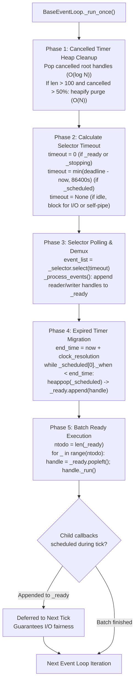

# CPython asyncio Event Loop Internals: BaseEventLoop._run_once, epoll/kqueue Selector Polling, _ready Deque, and _scheduled Min-Heap

> [!summary] Claim
> At the core of the CPython asynchronous runtime, `BaseEventLoop._run_once` executes a strict five-phase tick: it lazily amortizes cancelled timers, polls the OS selector (`epoll`/`kqueue`) with a dynamically bounded timeout, registers I/O readiness handles into the `_ready` deque, moves expired deadlines from the `_scheduled` min-heap into `_ready`, and drains a frozen snapshot `ntodo = len(_ready)` to guarantee I/O fairness and prevent infinite callback starvation.

Part of [ASGI Servers and Async Runtime](README.md) in [API Engineering](../README.md).

## TL;DR

`BaseEventLoop._run_once` drives the single-threaded event loop by interleaving OS socket polling via `selectors.DefaultSelector` with two internal queues: a FIFO `collections.deque` (`_ready`) for immediate callbacks and a binary min-heap `list` (`_scheduled`) for timed callbacks.
The execution batch size in each tick is frozen via `ntodo = len(self._ready)` before running callbacks, guaranteeing that newly scheduled `call_soon` callbacks are deferred to the next tick to prevent I/O starvation.
Cancelling a timer via `TimerHandle.cancel()` drops its callback and arguments at once but does not remove the handle from `_scheduled`; the empty shell (still holding its copied `contextvars.Context`) lingers until it reaches the heap root or more than 100 timers are scheduled with over 50% cancelled.
Linux uses level-triggered `epoll` with 1 ms timeout quantization, macOS and BSD use `kqueue` with a nanosecond `struct timespec` timeout, Windows defaults to `ProactorEventLoop` (IOCP) rather than selectors, and Python 3.15.0 adds `math.ulp(now)` (gh-145703) so the timer cutoff keeps advancing after about 194 days of Linux uptime.
Do not rely on CPython `BaseEventLoop` when serving tens of thousands of concurrent connections with microsecond tail-latency requirements; use `uvloop` (libuv) or Rust-backed runtimes (Granian) to bypass Python object allocation per socket readiness event.

## Mental model



Every pass through `BaseEventLoop._run_once` represents a single discrete event loop iteration or tick.
Execution flows unidirectionally through five synchronized stages designed to balance timer precision, I/O throughput, and execution fairness.
In Phase 1, the event loop cleans cancelled timers from the heap root to avoid waking on dead deadlines, falling back to a full heap rebuild only when cancelled handles exceed half of a sizeable queue.
Phase 2 computes the exact maximum duration the thread may block in the operating system kernel: immediate return (`0`) if tasks are already waiting, a bounded sleep if a timer is pending, or infinite sleep (`None`) if the system is completely quiescent.
Phase 3 invokes the operating system kernel (`epoll_wait` on Linux or `kevent` on macOS/BSD), looks up the reader or writer `Handle` that was created once at `add_reader`/`add_writer` time for each ready descriptor, and appends it to `_ready`.
Phase 4 evaluates the monotonic clock and transfers all expired `TimerHandle` instances from `_scheduled` to the tail of `_ready`.
Finally, Phase 5 freezes the processing queue size by evaluating `ntodo = len(self._ready)` and executes that exact number of handles sequentially; any callback that invokes `call_soon` during execution is appended behind `ntodo` and must wait for the subsequent loop iteration.

## How it works

### The Event Loop Driving Engine: run_forever and run_until_complete

CPython implements the cooperative multitasking reactor pattern inside `Lib/asyncio/base_events.py`.
The abstract interface defined in PEP 3156 specifies that an event loop must provide scheduling primitives for immediate callbacks (`call_soon`), delayed callbacks (`call_later`, `call_at`), I/O watchers (`add_reader`, `add_writer`), and execution runners (`run_forever`, `run_until_complete`).
The central lifecycle driver is `BaseEventLoop.run_forever()`.
Its core loop is deceptively simple:

```python
# Excerpt from cpython 3.14.6 Lib/asyncio/base_events.py, BaseEventLoop.run_forever
def run_forever(self):
    """Run until stop() is called."""
    self._run_forever_setup()
    try:
        while True:
            self._run_once()
            if self._stopping:
                break
    finally:
        self._run_forever_cleanup()
```

Since 3.13, the setup and teardown live in `_run_forever_setup` (thread id, async generator hooks, `events._set_running_loop(self)`) and `_run_forever_cleanup` (resets `_stopping`, `_thread_id`, and the hooks), so GUI-integrating subclasses can reuse them (`cpython 3.14.6 Lib/asyncio/base_events.py, BaseEventLoop._run_forever_setup`).
The method `run_until_complete(future)` wraps `run_forever()`.
It wraps the input with `tasks.ensure_future(future, loop=self)`, adds a completion callback via `future.add_done_callback(_run_until_complete_cb)`, and starts `run_forever()`.
When the future completes, `_run_until_complete_cb` calls `self.stop()`, which only sets `self._stopping = True` ("informs run_forever to stop looping after a complete iteration", per its docstring).
Because that callback itself runs inside Phase 5, the current batch of `ntodo` callbacks finishes, `_run_once()` returns, and `run_forever()` breaks out of `while True` without another tick.
The Phase 2 rule that forces the timeout to `0` when `_stopping` is set matters when `stop()` is called before `run_forever()`: the loop then polls the selector once with a zero timeout, runs what is ready, and exits (docs.python.org `asyncio-eventloop`, `loop.stop`).

### Phase 1: Cancelled Timer Heap Cleanup and Amortized Purge

Timer callbacks scheduled via `loop.call_later(delay, cb)` or `loop.call_at(when, cb)` return a `TimerHandle` instance and push it onto `self._scheduled` using `heapq.heappush`.
When application code cancels a timer by invoking `handle.cancel()`, removing that element immediately from the arbitrary interior position of a binary heap would require an `O(N)` linear search followed by an `O(N)` re-heapify operation.
In high-throughput ASGI applications running thousands of request timeouts per second, immediate heap removal would degrade scheduling throughput from `O(log N)` to `O(N)`.

CPython resolves this by implementing a lazy cancellation strategy with amortized threshold cleanup (`cpython 3.14.6 Lib/asyncio/base_events.py, BaseEventLoop._run_once`).
When `handle.cancel()` is called on a not-yet-cancelled `TimerHandle`, it notifies the loop via `self._loop._timer_handle_cancelled(self)` (`cpython 3.14.6 Lib/asyncio/events.py, TimerHandle.cancel`).
If the handle is still in the heap (`handle._scheduled` is true), the loop increments an integer counter: `self._timer_cancelled_count += 1` (`cpython 3.14.6 Lib/asyncio/base_events.py, BaseEventLoop._timer_handle_cancelled`).
`Handle.cancel()` then sets `self._callback = None` and `self._args = None`, so the callback closure and its arguments are released immediately (in debug mode a `repr` string is kept in `_repr`).
The cancelled handle shell, including its `_context`, remains physically inside the `self._scheduled` list.

At the beginning of Phase 1 in `_run_once()`, the loop evaluates whether to perform a full heap cleanup:

```python
# Excerpt from cpython 3.14.6 Lib/asyncio/base_events.py, BaseEventLoop._run_once
sched_count = len(self._scheduled)
if (sched_count > _MIN_SCHEDULED_TIMER_HANDLES and
    self._timer_cancelled_count / sched_count >
        _MIN_CANCELLED_TIMER_HANDLES_FRACTION):
    # Remove delayed calls that were cancelled if their number
    # is too high
    new_scheduled = []
    for handle in self._scheduled:
        if handle._cancelled:
            handle._scheduled = False
        else:
            new_scheduled.append(handle)

    heapq.heapify(new_scheduled)
    self._scheduled = new_scheduled
    self._timer_cancelled_count = 0
else:
    # Remove delayed calls that were cancelled from head of queue.
    while self._scheduled and self._scheduled[0]._cancelled:
        self._timer_cancelled_count -= 1
        handle = heapq.heappop(self._scheduled)
        handle._scheduled = False
```

Two module-level constants govern this threshold:
`_MIN_SCHEDULED_TIMER_HANDLES = 100` and `_MIN_CANCELLED_TIMER_HANDLES_FRACTION = 0.5`.
If `len(self._scheduled)` is 100 or fewer, or if cancelled handles represent 50% or less of the heap, the full rebuild is skipped.
Instead, the fast path simply inspects the root of the min-heap (`self._scheduled[0]`).
If the root handle is cancelled, it is popped via `heapq.heappop` in `O(log N)` time.
The loop repeats this pop until the root is an uncancelled handle or the heap is empty.
However, if cancelled handles are buried in deeper nodes of the heap, they remain allocated until either the threshold is crossed or they rise to the root (at the latest when their deadline becomes the earliest one).
The lab shows both sides: with 99 timers and 90 cancelled behind an uncancelled head, all 99 stay in the heap after a tick; with 102 timers and 52 cancelled, one tick rebuilds the heap to 50.

### Phase 2: Dynamic Selector Timeout Calculation

Before querying the operating system for network readiness, the event loop must decide how long the current thread can afford to sleep.
The selector timeout is dynamically computed according to three precedence rules (`cpython 3.14.6 Lib/asyncio/base_events.py, BaseEventLoop._run_once`):

```python
# Excerpt from cpython 3.14.6 Lib/asyncio/base_events.py, BaseEventLoop._run_once
timeout = None
if self._ready or self._stopping:
    timeout = 0
elif self._scheduled:
    # Compute the desired timeout.
    timeout = self._scheduled[0]._when - self.time()
    if timeout > MAXIMUM_SELECT_TIMEOUT:
        timeout = MAXIMUM_SELECT_TIMEOUT
    elif timeout < 0:
        timeout = 0
```

Rule 1 (Immediate Non-Blocking Poll): If `self._ready` is non-empty or `self._stopping` is true, `timeout = 0`.
The loop passes `0` to the selector, requesting an immediate kernel check for ready file descriptors without blocking.
This ensures ready application tasks execute without artificial sleep latency while still allowing pending socket events to register.

Rule 2 (Deadline-Bounded Sleep): If `self._ready` is empty but timers exist in `self._scheduled`, the loop calculates the delta between the earliest deadline (`self._scheduled[0]._when`) and the monotonic clock (`self.time()`).
If the deadline has already passed (`timeout < 0`), the timeout is clamped to `0`.
If the deadline is far in the future, it is clamped to `MAXIMUM_SELECT_TIMEOUT = 24 * 3600` (86,400 seconds or 24 hours), which the source comment justifies only as "to avoid OS limitations" on the timeout argument.

Rule 3 (Quiescent Infinite Block): If both `self._ready` and `self._scheduled` are empty, `timeout = None`.
The selector blocks indefinitely in the kernel until either an I/O event arrives on a registered descriptor or an inter-thread wakeup occurs on the loop's self-pipe.

In Python 3.12 (checked at tag `v3.12.16`), the timeout is computed as `timeout = min(max(0, when - self.time()), MAXIMUM_SELECT_TIMEOUT)`.
From `v3.13.0` onward (checked at `v3.13.18`, `v3.14.10`, and `v3.15.2`), the same clamp is written as explicit `if/elif` branches, which avoids two builtin calls per tick.

### Phase 3: Selector Polling and Event Demultiplexing

Phase 3 executes the operating system polling call: `event_list = self._selector.select(timeout)`.
CPython delegates this to `selectors.DefaultSelector`, chosen at import time in the order kqueue, epoll, devpoll, poll, select (`cpython 3.14.6 Lib/selectors.py, DefaultSelector`):
On macOS, FreeBSD, and OpenBSD, `selectors.KqueueSelector` wraps `select.kqueue` (`kevent(2)`); this host reports `KqueueSelector`.
On Linux, `selectors.EpollSelector` wraps `select.epoll` (`epoll_wait(2)`), registering `EPOLLIN`/`EPOLLOUT` without `EPOLLET`, so it is level-triggered.
On Solaris it uses `DevpollSelector`, and elsewhere it falls back to `PollSelector` (`poll(2)`) or `SelectSelector` (`select(2)`).

```python
# Excerpt from cpython 3.14.6 Lib/asyncio/selector_events.py, BaseSelectorEventLoop._process_events
def _process_events(self, event_list):
    for key, mask in event_list:
        fileobj, (reader, writer) = key.fileobj, key.data
        if mask & selectors.EVENT_READ and reader is not None:
            if reader._cancelled:
                self._remove_reader(fileobj)
            else:
                self._add_callback(reader)
        if mask & selectors.EVENT_WRITE and writer is not None:
            if writer._cancelled:
                self._remove_writer(fileobj)
            else:
                self._add_callback(writer)
```

When sockets are registered via `loop.add_reader(fd, callback, *args)` or `loop.add_writer(fd, callback, *args)`, `BaseSelectorEventLoop` stores a `Handle` inside a 2-tuple `(reader, writer)` attached to `SelectorKey.data`.
When `_selector.select(timeout)` returns a list of `(key, mask)` tuples:
If the bitmask indicates read readiness (`mask & selectors.EVENT_READ`), the loop extracts `reader`.
If the reader handle has been cancelled, `self._remove_reader(fileobj)` removes the descriptor from the selector interest list.
Otherwise, `self._add_callback(reader)` appends the handle to `self._ready`:

```python
# Excerpt from cpython 3.14.6 Lib/asyncio/base_events.py, BaseEventLoop._add_callback
def _add_callback(self, handle):
    """Add a Handle to _ready."""
    if not handle._cancelled:
        self._ready.append(handle)
```

Immediately after `self._process_events(event_list)` completes, `_run_once` sets `event_list = None`.
This explicit assignment breaks reference cycles between frame tracebacks and socket objects in the event of an unhandled exception.

### Phase 4: Timer Expiration and Clock Resolution Adjustments

Once I/O callbacks are staged in `_ready`, the loop checks for timers in `self._scheduled` whose deadlines have elapsed:

```python
# Excerpt from cpython 3.14.6 Lib/asyncio/base_events.py, BaseEventLoop._run_once
end_time = self.time() + self._clock_resolution
while self._scheduled:
    handle = self._scheduled[0]
    if handle._when >= end_time:
        break
    handle = heapq.heappop(self._scheduled)
    handle._scheduled = False
    self._ready.append(handle)
```

The loop computes `end_time = self.time() + self._clock_resolution`.
Here, `self._clock_resolution` is cached during loop initialization from `time.get_clock_info('monotonic').resolution`.
On this macOS 27.3 arm64 host, `time.get_clock_info('monotonic')` reports `implementation='mach_absolute_time()'` and `resolution=4.166666666666666e-08` (41.7 ns, a 24 MHz timebase), and `loop._clock_resolution` holds the same value (measured with CPython 3.14.6, and asserted by the lab).
On Linux the resolution is 1 ns: the gh-145703 reporter states "The clock resolution in my test environment was equal to 1e-09" (Linux, CPython 3.12), which is a reported value, not one measured on this macOS host.
Adding the clock resolution prevents timer stuttering caused by clock quantization: a timer whose deadline lies within one clock tick of the current reading is treated as expired now rather than costing another loop iteration.

In Python 3.15.0 (gh-145703, PR gh-145706, merged 2026-03-14), this became:

```python
# Excerpt from cpython 3.15.2 Lib/asyncio/base_events.py, BaseEventLoop._run_once
now = self.time()
# Ensure that `end_time` is strictly increasing
# when the clock resolution is too small.
end_time = now + max(self._clock_resolution, math.ulp(now))
```

The fix is absent from `v3.13.18` and `v3.14.10`, which still compute `self.time() + self._clock_resolution`.
It accounts for IEEE 754 binary64 precision limits.
When `now = time.monotonic()` becomes large, half the distance to the next representable float (`math.ulp(now) / 2`) exceeds the clock resolution, and `now + self._clock_resolution` rounds back to exactly `now`.
With a 1 ns resolution this happens from `now >= 2**24` s (16,777,216 s, about 194.2 days of Linux uptime, where `math.ulp(now)` is about `3.7e-09`), matching the issue report; with this Mac's 41.7 ns resolution it happens only from `2**29` s (about 17 years), computed with `(x + res) == x` in CPython 3.14.6.
Once `end_time == now`, a timer whose `_when` equals the current reading fails `_when < end_time` and waits for the clock to move, so deadlines fire late.

Expired timers are removed from `self._scheduled` via `heapq.heappop` and appended to the back of `self._ready`.
Notice that in any tick containing both I/O readiness and expired timers, Phase 3 appends I/O callbacks first, and Phase 4 appends timer callbacks second.

### Phase 5: Batch Ready Execution and Starvation Prevention

Phase 5 executes the callbacks staged in `self._ready`.
The source comment calls this "the only place where callbacks are actually *called*"; the one exception is an eager task (3.12+), whose first step runs synchronously inside `create_task` (see [[Eager-Task-Factory-in-Python-3-12-to-3-15-and-Execution-Order-Shifts]]):

```python
# Excerpt from cpython 3.14.6 Lib/asyncio/base_events.py, BaseEventLoop._run_once
ntodo = len(self._ready)
for i in range(ntodo):
    handle = self._ready.popleft()
    if handle._cancelled:
        continue
    if self._debug:
        try:
            self._current_handle = handle
            t0 = self.time()
            handle._run()
            dt = self.time() - t0
            if dt >= self.slow_callback_duration:
                logger.warning('Executing %s took %.3f seconds',
                               _format_handle(handle), dt)
        finally:
            self._current_handle = None
    else:
        handle._run()
handle = None  # Needed to break cycles when an exception occurs.
```

The variable `ntodo = len(self._ready)` takes an immutable snapshot of the ready queue length before the execution loop begins.
The loop iterates exactly `ntodo` times using `self._ready.popleft()`.
If a callback invokes `loop.call_soon(next_cb)`, `next_cb` is appended to `self._ready`.
However, because the `for` loop bounds its iterations to `ntodo`, `next_cb` is not executed during the current tick.
Instead, it sits in `self._ready` until the next iteration of `_run_once()`.

This snapshot mechanism is fundamental to the stability of the reactor.
Without `ntodo`, a recursive or high-volume callback loop using `call_soon` would cause Phase 5 to run indefinitely, completely starving socket selector polling (Phase 3) and timer evaluation (Phase 4).
By enforcing `ntodo`, CPython guarantees that after at most `ntodo` callback invocations, the event loop returns to Phase 1, refreshes timers, and polls the operating system selector.

### Data Structures: deque, min-heap, and Handle slots

CPython selects specialized data structures optimized for the performance characteristics of each phase.

`_ready` is implemented as `collections.deque`.
In CPython (`cpython 3.14.6 Modules/_collectionsmodule.c, BLOCKLEN`), `deque` is a doubly linked list of fixed-size memory blocks, where each block holds 64 object pointers (`#define BLOCKLEN 64`).
Both `append()` and `popleft()` operate in `O(1)` time without shifting elements; a block is allocated only once per 64 appends, and up to 16 emptied blocks are cached for reuse (`#define MAXFREEBLOCKS 16`).
In contrast, a Python `list` has an `O(N)` cost for `pop(0)` because all remaining pointers must be shifted in memory.

`_scheduled` is implemented as a standard Python `list` maintained as a binary min-heap via the `heapq` module (`Modules/_heapqmodule.c`).
A binary heap provides `O(log N)` insertion (`heappush`) and `O(log N)` minimum extraction (`heappop`).
Items in the heap are `TimerHandle` instances.
`TimerHandle.__lt__` defines ordering strictly by deadline:

```python
# Excerpt from cpython 3.14.6 Lib/asyncio/events.py, TimerHandle
def __lt__(self, other):
    if isinstance(other, TimerHandle):
        return self._when < other._when
    return NotImplemented
```

Notice that `TimerHandle` does not define a secondary comparison key.
If two timers are scheduled for the exact same monotonic float deadline, `h1 < h2` evaluates to false, and `h2 < h1` evaluates to false.
`heapq` compares items only with `<` and is not a stable sort, so the execution order for identical deadlines is unspecified: deterministic for a given sequence of pushes and pops, but not FIFO.
In CPython 3.14.6 on this host, eight `call_at(when, order.append, i)` calls with one shared past deadline ran in the order `[0, 1, 5, 7, 4, 2, 6, 3]`, and the lab asserts the order is not `[0, 1, ..., 7]`.

Both `Handle` and `TimerHandle` declare `__slots__` to eliminate per-instance `__dict__` overhead:
`Handle.__slots__ = ('_callback', '_args', '_cancelled', '_loop', '_source_traceback', '_repr', '__weakref__', '_context')`
`TimerHandle.__slots__ = ['_scheduled', '_when']`
Measured with `sys.getsizeof` on CPython 3.14.6 (macOS 27.3 arm64), a `Handle` is 104 bytes and a `TimerHandle` 120 bytes, while an unslotted class with the same seven attributes is 48 bytes plus a 296-byte `__dict__`.
Furthermore, PEP 567 context variables are captured at handle construction via `context = contextvars.copy_context()` whenever the caller passes no `context=` (`cpython 3.14.6 Lib/asyncio/events.py, Handle.__init__`).
When `handle._run()` executes, it invokes `self._context.run(self._callback, *self._args)`, ensuring asynchronous context (such as request IDs and OpenTelemetry traces) propagates reliably across ticks.

### Inter-Thread Wakeup via Self-Pipe

Because `BaseEventLoop` is not thread-safe, external threads cannot directly modify `_ready` or `_scheduled`.
When an asynchronous worker offloads computation to a threadpool via `loop.run_in_executor()` or receives a cross-thread message, it must use `loop.call_soon_threadsafe(callback, *args)`.

`call_soon_threadsafe` pushes a `_ThreadSafeHandle` (a `Handle` subclass with an `RLock` around `cancel()`, added in 3.14; earlier releases use a plain `Handle`) onto `_ready` and invokes `self._write_to_self()` (`cpython 3.14.6 Lib/asyncio/base_events.py, BaseEventLoop.call_soon_threadsafe`):

```python
# Excerpt from cpython 3.14.6 Lib/asyncio/selector_events.py, BaseSelectorEventLoop._write_to_self
def _write_to_self(self):
    # This may be called from a different thread, possibly after
    # _close_self_pipe() has been called or even while it is
    # running.  Guard for self._csock being None or closed.  When
    # a socket is closed, send() raises OSError (with errno set to
    # EBADF, but let's not rely on the exact error code).
    csock = self._csock
    if csock is None:
        return

    try:
        csock.send(b'\0')
    except OSError:
        if self._debug:
            logger.debug("Fail to write a null byte into the "
                         "self-pipe socket",
                         exc_info=True)
```

During initialization, `BaseSelectorEventLoop._make_self_pipe` creates an internal socket pair, `self._ssock, self._csock = socket.socketpair()`, and sets both ends non-blocking.
It registers `self._ssock.fileno()` in the selector interest list via `self._add_reader(self._ssock.fileno(), self._read_from_self)`.
If the event loop thread is sleeping in the kernel inside `self._selector.select(timeout)` (Phase 3), the writing of `b'\0'` to `self._csock` marks `self._ssock` readable.
The kernel wakes up `epoll_wait` or `kevent`, returning control to `_run_once()`.
The `_read_from_self` handle is appended to `_ready` and, in Phase 5, drains the socket by calling `self._ssock.recv(4096)` in a loop until it raises `BlockingIOError` or returns empty; the thread-safe callback, already in `_ready`, runs in the same batch.
If the self-pipe buffer is ever full, `send()` raises `BlockingIOError`, an `OSError`, which `_write_to_self` swallows (logging only in debug mode); that is safe because the reader is already guaranteed a wakeup.

### Architectural Differences from uvloop

High-performance ASGI production deployments often substitute CPython's default event loop with `uvloop`.
`uvloop` is a drop-in replacement implemented in Cython that wraps Node.js's C networking engine, `libuv`.
While CPython `BaseEventLoop` executes `_run_once` in pure Python, `uvloop` delegates polling and timers to C:
`uvloop` keeps a Python `collections.deque` named `_ready` for `call_soon` callbacks and drains it from a libuv idle handle with the same `ntodo = len(self._ready)` snapshot idiom (`uvloop 0.23.0 uvloop/loop.pyx, Loop._on_idle`).
The `_scheduled` heap is replaced by one libuv `uv_timer_t` per `call_later`, kept in libuv's pointer-based binary min-heap with `uint64_t` millisecond timeouts (libuv 1.52.1, vendored by uvloop 0.23.0, `src/heap-inl.h` and `src/timer.c`).
When `epoll_wait` or `kevent` returns, `libuv` invokes Cython transport callbacks directly, so stream reads reach `Protocol.data_received` without the selector's per-event `(key, mask)` tuples or a trip through `_ready`.
For comprehensive architectural benchmarks, C extension wrapping, and HTTP parsing pipelines, see [[Uvloop-and-Httptools-Internals-Libuv-and-C-HTTP-Parsing]].

## Numbers and limits

The operational behavior and memory characteristics of `BaseEventLoop._run_once` are bounded by explicit engine constants, system call structures, and measured hardware timings:

| Parameter or Mechanism | Value or Bound | Source or Derivation | Operational Consequence |
|---|---|---|---|
| `_MIN_SCHEDULED_TIMER_HANDLES` | `100` | `base_events.py:58` | Minimum heap size required before bulk cancellation sweep triggers. |
| `_MIN_CANCELLED_TIMER_HANDLES_FRACTION` | `0.50` (50%) | `base_events.py:62` | Minimum fraction of cancelled timers required to trigger `heapq.heapify()`. |
| `MAXIMUM_SELECT_TIMEOUT` | `86400` s (24 h) | `base_events.py:68` | Maximum duration selector can sleep to avoid OS kernel timer overflow. |
| `slow_callback_duration` | `0.100` s (100 ms) | `base_events.py:437` | Execution duration threshold for slow callback logging in debug mode. |
| `_clock_resolution` (macOS) | `4.166666666666666e-08` s (41.7 ns) | Measured, `time.get_clock_info('monotonic')` | Monotonic clock precision added to `end_time` in Phase 4 on this host. |
| `_clock_resolution` (Linux) | `1e-09` s (1 ns) | Reported in gh-145703 (Linux, CPython 3.12), not measured here | Float absorption of `now + 1e-09` starts at `2**24` s (about 194.2 days) uptime. |
| `collections.deque` block length | `64` pointers | `Modules/_collectionsmodule.c:78` (`BLOCKLEN`) | Number of `Handle` pointers allocated per contiguous memory chunk. |
| Self-pipe read chunk | `4096` bytes per `recv` | `selector_events.py:132` | `_read_from_self` loops over 4096-byte reads until `BlockingIOError`. |
| Linux `epoll_wait` resolution | `1` ms | `epoll_wait(2)` / `selectors.py:443` (`math.ceil(timeout * 1e3) * 1e-3`) | Millisecond ceiling rounding applied to Linux selector timeouts. |
| BSD/macOS `kevent` resolution | `1` ns (`struct timespec`) | `kevent(2)` / `selectmodule.c` `_PyTime_AsTimespec` | Nanosecond timeout representation passed to the kernel; actual wakeup precision depends on the kernel. |
| POSIX `select` maximum fd | `FD_SETSIZE`, usually `1024` | `selectors.py:593` comment; `select(2)` | File descriptor ceiling when using `SelectSelector`. |
| `Handle` memory footprint | `104` bytes | Measured `sys.getsizeof` | Shallow size of a slotted `Handle` (callback, args, and `Context` not included). |
| `TimerHandle` memory footprint | `120` bytes | Measured `sys.getsizeof` | Shallow size of a slotted `TimerHandle`. |
| One `_run_once` tick with one `call_soon` callback | `12.98` us (min of 5 x 100,000) | Measured with `timeit.repeat` | Includes `call_soon`, one zero-timeout `kevent`, and one callback run. |

All measurements were captured on macOS 27.3 (Darwin 27.3.0) arm64 under CPython 3.14.6 (uv build, Clang 22.1.3), with `labs/.venv/bin/python -I` running a scratch script that called `sys.getsizeof` on fresh handles and timed `loop.call_soon(cb); loop._run_once()` with `timeit.repeat(number=100000, repeat=5)` (other runs: 13.13, 13.12, 13.24, 13.10 us).

## Portability

The table below contrasts selector behavior, timer precision, and concurrency semantics across runtime environments:

| Runtime / OS Platform | Default Selector Engine | Timeout Syscall Precision | Timer Precision Lockup Fix (`math.ulp`) | Thread-Safety of `_ready` Deque | Sibling Architecture Reference |
|---|---|---|---|---|---|
| CPython 3.12.16 (Linux) | `EpollSelector` | 1 ms (`epoll_wait`) | No (`now + resolution`) | GIL-guaranteed atomic `append`/`popleft` | [[Uvicorn-Internals-Server-Lifecycle-Protocols-and-Flow-Control]] |
| CPython 3.13.18 (Linux) | `EpollSelector` | 1 ms (`epoll_wait`) | No (`now + resolution`) | GIL-guaranteed atomic `append`/`popleft` | [[Uvicorn-Internals-Server-Lifecycle-Protocols-and-Flow-Control]] |
| CPython 3.14.10 (macOS/BSD) | `KqueueSelector` | 1 ns (`kevent` timespec) | No (`now + resolution`) | GIL-guaranteed atomic `append`/`popleft` | [[Uvicorn-Internals-Server-Lifecycle-Protocols-and-Flow-Control]] |
| CPython 3.15.2 (All POSIX) | Platform default | Platform specific | Yes (`math.ulp(now)`) | GIL-guaranteed atomic `append`/`popleft` | [[Eager-Task-Factory-in-Python-3-12-to-3-15-and-Execution-Order-Shifts]] |
| CPython 3.15.2t (Free-Threaded) | Platform default | Platform specific | Yes (`math.ulp(now)`) | Per-object critical section on each `deque` method (since 3.13t) | [[Offloading-CPU-Bound-Work-ProcessPoolExecutor-vs-Free-Threaded-Python-3-15t]] |
| Windows (All CPython 3.12+) | `ProactorEventLoop` (IOCP) | 1 ms (`GetQueuedCompletionStatus`, `windows_events.py` rounds with `math.ceil(timeout * 1e3)`) | Same as the CPython release (shared `base_events.py`) | GIL-guaranteed | [[Graceful-Shutdown-SIGTERM-Drain-Windows-and-Kubernetes-PreStop-Hooks]] |
| uvloop 0.23.0 (Linux/macOS) | Custom `libuv` 1.52.1 loop | 1 ms (libuv `uint64_t` ms timeouts) | Not applicable (C `uint64_t` ms) | Python `deque` `_ready` in Cython; not thread-safe, use `call_soon_threadsafe` | [[Uvloop-and-Httptools-Internals-Libuv-and-C-HTTP-Parsing]] |
| Granian 2.8.7 (Rust runtime) | Tokio for network I/O; app code on a Python loop chosen by `--loop [auto\|asyncio\|rloop\|uvloop\|winloop]` | 1 ms (Tokio time driver "operates at millisecond granularity") | Depends on the chosen Python loop | Governed by the chosen Python loop for application code; Granian's Rust-side scheduling is outside this note | [[Granian-Internals-Rust-Tokio-Hyper-Engine-and-RSGI-vs-ASGI]] |

The CPython rows were checked against `Lib/asyncio/base_events.py` at tags `v3.12.16`, `v3.13.18`, `v3.14.10`, and `v3.15.2` and against the local 3.14.6 and 3.14.6t builds; the lab itself ran only on CPython 3.14.6 (the container and version matrix was not run, per the 2026-11-11 pause on lab checks).
Under free-threaded builds (PEP 703), every `deque` method in `Modules/_collectionsmodule.c` is declared with Argument Clinic `@critical_section` (from `v3.13.0`), and the `heapq` functions take `@critical_section heap` on the list from 3.14 (present at `v3.14.6`, absent at `v3.13.18`).
That makes each individual `heappush` or `heappop` atomic, but `BaseEventLoop._scheduled` is still manipulated by multi-step sequences (`self._scheduled[0]` check, then `heappop`; `_timer_cancelled_count` updates; the bulk rebuild that rebinds `self._scheduled`) that no lock covers.
Calling `call_later` from a foreign thread is therefore unsupported in every build; in debug mode `call_at` raises `RuntimeError` from `_check_thread()`.

## Worked example

The test harness instruments `BaseEventLoop._run_once` directly to inspect queue state, verify Phase 5 starvation prevention, and confirm the Phase 1 timer cancellation threshold.
Review the complete [implementation](../labs/src/api_labs/f12_asgi_servers_and_async_runtime/event_loop_inspector.py) and the accompanying [test](../labs/tests/f12_asgi_servers_and_async_runtime/test_cpython_asyncio_event_loop_internals_selectors_ready_queue_and_timers.py).

```python
# Simplified excerpt from labs/src/api_labs/f12_asgi_servers_and_async_runtime/event_loop_inspector.py,
# simulate_tick_ordering with every has_* flag fixed to True
def simulate_tick_ordering() -> list[str]:
    loop = asyncio.new_event_loop()
    try:
        execution_order: list[str] = []
        rsock, wsock = socket.socketpair()
        rsock.setblocking(False)
        wsock.setblocking(False)

        def io_callback() -> None:
            execution_order.append("phase3:io_read")
            with contextlib.suppress(BlockingIOError):
                rsock.recv(1024)
            loop.call_soon(lambda: execution_order.append("phase5_child:call_soon_from_io"))

        loop.add_reader(rsock.fileno(), io_callback)
        wsock.send(b"1")
        loop.call_soon(lambda: execution_order.append("phase5_init:call_soon_1"))
        # Timer scheduled at current loop time (expires in Phase 4)
        loop.call_later(0.0, lambda: execution_order.append("phase4:timer_expired"))

        # Run exactly one tick
        loop._run_once()  # type: ignore[attr-defined]

        loop.remove_reader(rsock.fileno())
        rsock.close()
        wsock.close()
        return execution_order
    finally:
        loop.close()
```

The test asserts the one-tick trace is `["phase5_init:call_soon_1", "phase3:io_read", "phase4:timer_expired"]`: the pre-existing `call_soon` handle is already at the front of `_ready`, Phase 3 appends the reader, Phase 4 appends the timer, and the child scheduled from `io_callback` lands behind the `ntodo` boundary.
Other tests in the module pin the Phase 1 thresholds (including that the lab constants equal `asyncio.base_events._MIN_SCHEDULED_TIMER_HANDLES` and `_MIN_CANCELLED_TIMER_HANDLES_FRACTION`), the Phase 2 timeout rules, the self-pipe null byte, exception isolation in `Handle._run`, that `cancel()` frees the callback's captured objects while the `TimerHandle` stays in `_scheduled`, and that equal-deadline timers do not run FIFO.

```text
$ cd labs && uv run --frozen pytest tests/f12_asgi_servers_and_async_runtime/test_cpython_asyncio_event_loop_internals_selectors_ready_queue_and_timers.py -q
............                                                             [100%]
12 passed in 0.12s
```

Captured on CPython 3.14.6 (macOS 27.3, Darwin 27.3.0 arm64) on 2026-11-15.

## Pitfalls

> [!warning] Cancelled Timer Heap Retention in Low-Volume Workloads
> **Trigger**: An API worker schedules long request timeouts using `loop.call_later(timeout, on_timeout)` and cancels them upon successful response, with a few dozen concurrent in-flight requests and context variables that hold large objects.
> **Symptom**: `len(loop._scheduled)` sits well above the number of live timers, and objects referenced from context variables stay alive after their requests finish.
> **Fix**: Understand what is and is not retained: `Handle.cancel()` sets `_callback` and `_args` to `None`, so closures and their payloads are freed at once (the lab asserts this with a `weakref`), but the `TimerHandle` shell and its copied `contextvars.Context` stay in the heap.
> CPython will not trigger a bulk heap rebuild until `len(self._scheduled) > 100` AND cancelled handles exceed 50%, so up to about 100 dead shells, or roughly as many dead as live ones above that, can linger until they reach the root; the retention is bounded, not a continual leak.
> Keep large objects out of context variables (store an ID, not the request body), or pass `context=contextvars.Context()` to `call_later` when `on_timeout` does not need the request context.
> Incident: bpo-22448 (now gh-66638), "call_at/call_later with Timer cancellation can result in (practically) unbounded memory usage", opened 2014-09-20 by a user who traced a memory leak to `asyncio.wait_for` timers: with at least one earlier uncancelled timer always scheduled, cancelled long timeouts were never removed from `_scheduled`.
> The fix (status closed, resolution fixed) is the amortized bulk purge described above, which bounds the retention rather than removing it.

> [!warning] I/O Starvation and Latency Spikes from Synchronous Ready Callbacks
> **Trigger**: A ready callback or coroutine step performs synchronous compute, regex parsing on large payloads, or calls a blocking standard library function (such as `json.loads` or `socket.gethostbyname`).
> **Symptom**: Event loop lag increases sharply; incoming TCP handshakes and data reads wait in operating system socket buffers; p99 latency spikes across all concurrent endpoints.
> **Fix**: Because CPython's reactor is single-threaded, `BaseEventLoop._run_once` cannot enter Phase 3 (selector polling) until all `ntodo` callbacks in Phase 5 finish executing.
> Never execute blocking operations in the loop thread; offload blocking I/O with `asyncio.to_thread`, and CPU-bound work to a `concurrent.futures.ProcessPoolExecutor` (a thread does not help pure-Python CPU work on a GIL build).
> Detect offenders with debug mode (`loop.set_debug(True)` or `PYTHONASYNCIODEBUG=1`) and a lower `loop.slow_callback_duration` such as `0.05`; the Phase 5 timing branch runs only when `self._debug` is true, and consult [[Detecting-Event-Loop-Blocking-Loop-Lag-Monitors-and-Debug-Callbacks]].
> Source: the asyncio "Running Blocking Code" documentation states that a function doing a 1 second CPU-intensive calculation delays all concurrent Tasks and I/O by 1 second (docs.python.org `asyncio-dev`).

> [!warning] Undefined Execution Order on Duplicate Timer Deadlines
> **Trigger**: Multiple tasks schedule timers for the exact same absolute timestamp (`loop.call_at(fixed_time, cb)`).
> **Symptom**: Callbacks execute in an order unrelated to scheduling order (eight equal-deadline timers ran as `[0, 1, 5, 7, 4, 2, 6, 3]` on CPython 3.14.6), violating application assumptions regarding chronological priority.
> **Fix**: `TimerHandle` implements `__lt__` comparing only `self._when < other._when`.
> When deadlines are identical, the comparison yields false both ways.
> `heapq` uses only `<` and is not stable, so the binary min-heap does not maintain FIFO ordering for equal keys.
> If strict chronological ordering of identical timer deadlines is required, wrap callbacks in an application-level priority queue with an incrementing integer tie-breaker: `(deadline, sequence_id, callback)`.
> Source: the `heapq` documentation's priority-queue notes prescribe exactly this entry count, "a tie-breaker so that two tasks with the same priority are returned in the order they were added" (docs.python.org `heapq`).

> [!warning] Deadlock from Direct Cross-Thread Scheduling
> **Trigger**: A background thread invokes `loop.call_soon(callback)` instead of `loop.call_soon_threadsafe(callback)`.
> **Symptom**: The callback is appended to `self._ready`, but it does not execute; the event loop thread sleeps indefinitely in `epoll_wait` or `kevent` until an unrelated network packet arrives.
> **Fix**: `loop.call_soon` only appends to `self._ready`; it does not write to the internal self-pipe socket.
> If the event loop is blocked in Phase 3 awaiting I/O, it has no knowledge that a new handle was queued.
> Debug mode catches this: `call_soon` and `call_at` call `self._check_thread()` when `self._debug` is true and raise `RuntimeError("Non-thread-safe operation invoked on an event loop other than the current one")`.
> Always use `loop.call_soon_threadsafe()`, which writes `b'\0'` to `self._csock`, immediately waking the sleeping selector.
> Source: "To schedule a callback from another OS thread, the `loop.call_soon_threadsafe()` method should be used" (docs.python.org `asyncio-dev`, Concurrency and Multithreading).

## Security and robustness

### Denial of Service via Ready Queue Flooding

The FIFO architecture of `_ready` presents an asymmetry that attackers can exploit to degrade API availability.
Because `BaseEventLoop._run_once` guarantees execution of `ntodo` handles in Phase 5, an unauthenticated client that sends a flood of malformed HTTP requests can saturate `_ready` with parser error callbacks and connection teardown routines.
If these error callbacks consume substantial CPU time, Phase 3 selector polling is delayed, preventing healthy connections from completing TLS handshakes.
Mitigate this at the transport boundary by setting strict per-client connection and request-rate limits at reverse proxies (such as Envoy or Cloudflare), capping concurrency in the ASGI server, and bounding per-connection parse work before handing bytes to the application; SYN cookies (`net.ipv4.tcp_syncookies = 1`) defend only against SYN floods, not against established connections sending malformed requests (OWASP API4:2023 Unrestricted Resource Consumption).

### ContextVar Isolation Across Callback Chains

Every `Handle` created by `call_soon`, `call_later`, or `call_at` captures the current execution context via `contextvars.copy_context()` (PEP 567).
This prevents cross-tenant state pollution in ASGI applications where authentication tokens or request identifiers are stored in context variables.
However, if an application developer uses `loop.call_soon_threadsafe()` from a background thread to update an existing session, `Handle.__init__` copies the background thread's current context, so the callback runs with that context rather than the originating coroutine's.
When coordinating state between threads, capture `ctx = contextvars.copy_context()` on the loop side and pass it explicitly with `loop.call_soon_threadsafe(callback, context=ctx)`; plain `call_soon` must not be called from another thread at all.

### File Descriptor Exhaustion and Broken Selector State

When a Linux server runs out of open file descriptors (`EMFILE` or `ENFILE`), `socket.accept()` fails.
If a hand-written listener callback registered with `loop.add_reader` does not catch `OSError`, the exception propagates out of the callback.
`Handle._run()` catches it, routes it to `loop.call_exception_handler()`, and keeps the event loop alive.
However, because the pending connection stays in the kernel backlog, the level-triggered selector keeps reporting read readiness on every tick, and the loop busy-spins through Phase 3 and Phase 5 without accepting anything.
`loop.create_server()` already handles this: `BaseSelectorEventLoop._accept_connection` catches `EMFILE`, `ENFILE`, `ENOBUFS`, and `ENOMEM`, reports "socket.accept() out of system resource", calls `self._remove_reader(sock.fileno())`, and re-arms with `self.call_later(constants.ACCEPT_RETRY_DELAY, self._start_serving, ...)`, where `ACCEPT_RETRY_DELAY = 1` second (`cpython 3.14.6 Lib/asyncio/selector_events.py, BaseSelectorEventLoop._accept_connection`).
Custom listeners must copy that pattern: unregister the descriptor, re-register after a delay, and alert on the exception handler message.

## The principal's view

From a staff-plus architectural perspective, CPython's `BaseEventLoop` represents an explicit engineering trade-off: accessibility, debuggability, and maintainability over absolute throughput.
Because `_run_once` is written in readable, pure Python, any senior engineer can inspect, monkeypatch, and debug the reactor using standard CPython profiling tools without compiling C extensions.
The amortized timer heap cleanup and `ntodo` batching demonstrate masterful software design: simple mechanisms that guarantee predictable worst-case bounds without introducing complex locking primitives.

However, in massive API microservice meshes handling tens of thousands of requests per second per node, the per-callback overhead of CPython's reactor becomes the primary CPU bottleneck.
Every I/O readiness event allocates a `(key, mask)` tuple in the selector, looks up the descriptor in `_fd_to_key`, appends the pre-registered `Handle` to a deque, and runs it through the Python evaluation loop, so a bare one-callback tick costs about 13 us on this Apple-silicon host (see Numbers and limits).
When profiling shows that `_run_once`, `_process_events`, and `Handle._run` dominate a service's CPU profile, architectural intervention is warranted; the threshold is a judgment call, not a measured constant.

The recommended architectural progression is:
First, switch the ASGI worker runtime from default asyncio to `uvloop`.
`uvloop` preserves the standard library asyncio API while moving polling, timers, and transports into Cython over `libuv`; its README claims it "makes asyncio 2-4x faster" (`uvloop 0.23.0 README.rst`, a maintainer claim from its own benchmarks, not measured here), and the gain shrinks when application code, not the loop, dominates CPU.
Second, if throughput requirements exceed CPython's interpreter boundaries entirely, migrate edge proxying and high-concurrency gateway workloads to compiled async runtimes such as Granian (Rust Tokio) or Go reverse proxies, reserving CPython workers for business logic execution behind bounded worker pools.
For worker scaling patterns and multi-process topologies, see [[Multi-Process-Worker-Topologies-Gunicorn-Uvicorn-Workers-vs-Kubernetes-Replicas]].

## Interview questions

> [!question] L5: Explain the execution order of callbacks scheduled with `loop.call_soon()` versus `loop.call_later(0, ...)` within an event loop tick.
>
> > [!success]- Answer
> > Callbacks registered with `loop.call_soon()` execute before `loop.call_later(0, ...)` even though both are ready to run in the current iteration.
> > `call_soon` places callbacks directly into the `self._ready` deque.
> > In contrast, `call_later(0, ...)` pushes a `TimerHandle` onto the `self._scheduled` min-heap.
> > During `BaseEventLoop._run_once`, expired timers in `self._scheduled` are evaluated in Phase 4 and appended to the back of `self._ready` after pre-existing ready handles.
> > Consequently, Phase 5 executes the initial `call_soon` callbacks first, followed by the expired timer callbacks.
> >
> > Follow-up: What happens if a `call_later` callback is scheduled with a negative delay, such as `loop.call_later(-5.0, cb)`?

> [!question] L6: How does `BaseEventLoop._run_once` prevent infinite callback loops from starving network socket I/O?
>
> > [!success]- Answer
> > At the beginning of Phase 5 in `_run_once`, the event loop takes a snapshot of the ready queue length: `ntodo = len(self._ready)`.
> > The callback execution loop is strictly bounded: `for i in range(ntodo): handle = self._ready.popleft(); handle._run()`.
> > If any executed callback calls `loop.call_soon(child_cb)`, the new handle is appended to `self._ready`.
> > Because the loop only processes `ntodo` items, `child_cb` is not executed in the current tick.
> > Once the `ntodo` batch completes, Phase 5 finishes, and the loop loops back to Phase 1, Phase 2, and Phase 3, guaranteeing that `self._selector.select(timeout)` is polled before any newly scheduled callbacks can run.
> >
> > Follow-up: If a coroutine enters a CPU-bound `while True: pass` loop without `await`, does `ntodo` prevent the event loop from hanging?

> [!question] L6: Predict the output: What exact sequence of labels is printed by the following code snippet?
>
> ```python
> import asyncio
> 
> async def main():
>     loop = asyncio.get_running_loop()
>     trace = []
>     
>     loop.call_soon(lambda: trace.append("soon1"))
>     loop.call_later(0, lambda: trace.append("timer1"))
>     
>     def soon2():
>         trace.append("soon2")
>         loop.call_soon(lambda: trace.append("soon3"))
>     
>     loop.call_soon(soon2)
>     await asyncio.sleep(0)
>     trace.append("resumed")
>     print(", ".join(trace))
> 
> asyncio.run(main())
> ```
>
> > [!success]- Answer
> > The output is: `soon1, soon2, resumed` (run on CPython 3.12.13, 3.14.6, and 3.15.0b3 on macOS 27.3 arm64; all three print the same line).
> > When `await asyncio.sleep(0)` executes, it yields a bare `None`, and `Task.__step` reschedules the task's next step with `call_soon`.
> > At this point, `_ready` contains `soon1`, `soon2`, and the `main` step, while `timer1` sits in `_scheduled`.
> > In the next tick, Phase 4 finds `timer1` expired and appends it behind the `main` step, so the batch is `soon1`, `soon2`, `main`, `timer1`.
> > `soon1` runs, `soon2` runs (appending `soon3` behind the `ntodo` boundary), and `main` resumes and prints before `timer1` has run.
> > `timer1` runs later in the same tick, and `soon3` runs in the following tick, so neither appears in the printed line.
> >
> > Follow-up: How does the printed line change if the timer is created with `loop.call_soon` instead of `loop.call_later(0, ...)`, and why is `call_later(0)` never earlier than an already-queued `call_soon`?

> [!question] L6: Under what exact conditions does `BaseEventLoop._run_once` perform a full `O(N)` heapify rebuild of `self._scheduled`?
>
> > [!success]- Answer
> > A full rebuild of `self._scheduled` occurs if and only if two conditions are met simultaneously: `len(self._scheduled) > 100` and `self._timer_cancelled_count / len(self._scheduled) > 0.5`.
> > If total scheduled timers are 100 or fewer, or if the cancelled fraction is 50% or less, CPython skips the full rebuild.
> > Instead, it only pops cancelled handles from the root of the heap using `while self._scheduled and self._scheduled[0]._cancelled: heapq.heappop(self._scheduled)`.
> >
> > Follow-up: What memory leak hazard arises if an application regularly schedules 90 timers and cancels 89 of them repeatedly?

> [!question] L7: Debug this API: An asynchronous microservice reports occasional 5-second latency spikes on a background worker thread coordinating with the event loop as implemented below.
>
> ```python
> def on_external_message(loop: asyncio.AbstractEventLoop, data: dict):
>     # Executed in a background thread
>     loop.call_soon(process_message, data)
> ```
>
> Why does `process_message` experience non-deterministic delays, and how do you fix it?
>
> > [!success]- Answer
> > The background thread invokes `loop.call_soon` instead of `loop.call_soon_threadsafe`.
> > `loop.call_soon` is not thread-safe and only appends the handle to `self._ready`.
> > If the event loop thread is currently blocked inside Phase 3 (`self._selector.select(timeout)`), it is sleeping in the kernel with no active timeout or a timeout matching a distant timer.
> > Because `call_soon` does not ping the loop's self-pipe socket, the operating system does not wake the event loop.
> > The callback sits unexecuted in `_ready` until either an unrelated network packet arrives or an existing timer expires.
> > The fix is to call `loop.call_soon_threadsafe(process_message, data)`, which sends a null byte `b'\0'` through `self._csock` to interrupt the selector immediately.
> >
> > Follow-up: What happens when thousands of worker threads call `call_soon_threadsafe` faster than the loop drains the self-pipe, and why is the swallowed `BlockingIOError` in `_write_to_self` harmless?

> [!question] L7: How does operating system selector timeout granularity differ between Linux `epoll` and macOS `kqueue`, and how does CPython adapt to them?
>
> > [!success]- Answer
> > Linux `epoll_wait(2)` accepts a timeout parameter specified in integer milliseconds.
> > In `selectors.EpollSelector.select(timeout)`, CPython explicitly rounds the timeout away from zero using `math.ceil(timeout * 1e3) * 1e-3` to ensure the kernel waits at least the requested duration, and `select.epoll.poll` passes integer milliseconds to `epoll_wait` (`cpython 3.14.6 Modules/selectmodule.c, select_epoll_poll_impl`).
> > In contrast, macOS and BSD `kevent(2)` accept a `struct timespec` with nanosecond fields.
> > `selectors.KqueueSelector.select(timeout)` clamps negatives with `max(timeout, 0)` and passes the float to `self._selector.control(None, max_ev, timeout)`, which converts it with `_PyTime_AsTimespec`.
> > Consequently, a Linux selector wakeup can be up to 1 ms later than the requested deadline from rounding alone, whereas on macOS the request is not quantized by Python; the epoll_wait(2) manual page adds that "the timeout interval will be rounded up to the system clock granularity, and kernel scheduling delays mean that the blocking interval may overrun by a small amount", and wakeup lateness was not measured in this lab.
> >
> > Follow-up: Why does `selectors.KqueueSelector` enforce `max_ev = self._max_events or 1` when calling `kevent`?

> [!question] L7: Why did Python 3.15 modify the Phase 4 timer expiration calculation from `now + resolution` to `now + max(resolution, math.ulp(now))`?
>
> > [!success]- Answer
> > `time.monotonic()` returns a 64-bit IEEE 754 float; on Linux its `CLOCK_MONOTONIC` origin is system boot, so the value grows with uptime.
> > As the float value grows, the spacing between representable floating-point numbers (the unit in the last place, or `math.ulp`) increases.
> > From `2**24` s (about 194.2 days) of uptime, half an ulp exceeds the typical Linux clock resolution of `1e-09` seconds, which is the threshold gh-145703 reported.
> > In earlier Python versions, `now + self._clock_resolution` then suffers floating-point absorption: the sum rounds back to `now`, so a timer whose `_when` equals the current reading is not treated as expired.
> > Python 3.15.0 (PR gh-145706) adds `max(self._clock_resolution, math.ulp(now))`, guaranteeing that `end_time` is strictly greater than `now`; the fix is not in 3.13.18 or 3.14.10.
> > On macOS arm64 the resolution is 41.7 ns, so the same absorption would need about 17 years of uptime.
> >
> > Follow-up: What alternative time representation could CPython adopt to avoid floating-point precision loss entirely?

> [!question] L7: In free-threaded Python 3.13t/3.14t/3.15t (PEP 703), what thread-safety guarantees exist for `BaseEventLoop` internal queues, and where does race condition vulnerability remain?
>
> > [!success]- Answer
> > In free-threaded builds without the Global Interpreter Lock, every `collections.deque` method takes a per-object critical section (`@critical_section` in `Modules/_collectionsmodule.c` since 3.13), making individual `append()` and `popleft()` calls on `_ready` thread-safe at the data structure level.
> > `BaseEventLoop._scheduled` is a standard Python `list`; from 3.14 each `heapq` call takes `@critical_section heap`, so a single `heappush` or `heappop` cannot tear the list, but 3.13t has no such lock.
> > Either way, `_run_once` uses multi-step sequences (peek at `_scheduled[0]`, then `heappop`; adjust `_timer_cancelled_count`; rebind `self._scheduled` after a bulk rebuild) that no lock covers, so a foreign-thread `call_later` can lose a timer, pop the wrong handle, or skew the cancelled count.
> > `_run_once` also assumes single-threaded ownership of the selector state, so all cross-thread scheduling must route through `call_soon_threadsafe()`; debug mode enforces this with `_check_thread()`.
> >
> > Follow-up: How would you architect an async worker pool in free-threaded Python to maximize multi-core CPU utilization without cross-thread event loop contention?

## Related

Prerequisites: [[FastAPI-Architectural-Limits-and-Comparison-with-Litestar-and-Raw-Starlette]]

Next: [[Eager-Task-Factory-in-Python-3-12-to-3-15-and-Execution-Order-Shifts]]

See also: [[02-Programming-Languages/Python/Python-Backend-Interview-Prep/16-Asyncio-Deep-Dive]]

- [[Detecting-Event-Loop-Blocking-Loop-Lag-Monitors-and-Debug-Callbacks]]
- [[Cancellation-Semantics-CancelledError-Swallowing-and-Shielded-Cleanup]]
- [[Uvloop-and-Httptools-Internals-Libuv-and-C-HTTP-Parsing]]
- [[Uvicorn-Internals-Server-Lifecycle-Protocols-and-Flow-Control]]
- [[Offloading-CPU-Bound-Work-ProcessPoolExecutor-vs-Free-Threaded-Python-3-15t]]
- [[Multi-Process-Worker-Topologies-Gunicorn-Uvicorn-Workers-vs-Kubernetes-Replicas]]
- [[Memory-Leaks-in-Long-Running-Python-API-Workers]]
- [[End-to-End-Backpressure-TCP-Windows-ASGI-Send-Await-and-Bounded-Queues]]
- Lab: `labs/tests/f12_asgi_servers_and_async_runtime/test_cpython_asyncio_event_loop_internals_selectors_ready_queue_and_timers.py`

## Further reading

- PEP 3156 (Asynchronous IO Support Rebooted: the "asyncio" Module): The foundational design document by Guido van Rossum specifying the reactor pattern, `Handle`, and callback execution rules.
- PEP 567 (Context Variables): Defines the execution context abstraction and explains why `Handle` copies context upon creation to prevent asynchronous state leakage.
- PEP 703 (Making the Global Interpreter Lock Optional in CPython): Details the internal synchronization and data structure locking changes implemented in free-threaded Python runtimes.
- CPython `Lib/asyncio/base_events.py`: Primary source code containing the five-phase implementation of `BaseEventLoop._run_once`.
- CPython `Lib/selectors.py`: Primary source code implementing platform selector adapters across `epoll`, `kqueue`, `devpoll`, `poll`, and `select`.
- Linux Programmer's Manual `epoll(7)` and `epoll_wait(2)`: Authoritative specification of Linux kernel I/O readiness notifications and timeout quantization.
- FreeBSD Kernel Interfaces Manual `kqueue(2)`: Authoritative specification of BSD and Darwin filter-based kernel event notification mechanisms.
