# Cancellation Mechanics in Python APIs: Task.cancel(), Task.cancelling(), Why BaseException Includes CancelledError, and Shielded Finalizers

> [!summary] Claim
> `Task.cancel()` is a request, not a kill: it increments a counter and throws one `CancelledError` into the coroutine at its next suspension point, so any handler that catches `BaseException` without re-raising silently defeats `asyncio.timeout()`, leaks the counter until a later `TaskGroup` resurrects the cancellation (CPython 3.13+), and the only finalizer that survives a second cancel during a rollback is one that runs the cleanup in its own task and re-raises afterwards, because an AnyIO shield does not stop a native `Task.cancel()` and a bare `asyncio.shield()` returns before the cleanup finishes.

Part of [ASGI Servers and Async Runtime](README.md) in [API Engineering](../README.md).

## TL;DR

Mechanism: `Task.cancel(msg)` adds 1 to `_num_cancels_requested`, cancels the future the task is parked on (or sets `_must_cancel` if there is none), and the next `__step` calls `coro.throw(CancelledError)`, so cancellation is cooperative and lands only at an `await` `(CPython 3.14.10 Lib/asyncio/tasks.py, Task.cancel)`.
Contract rule: catch `CancelledError` only to clean up, then re-raise; if you truly suppress it, call `Task.uncancel()` (asyncio docs, "Task Cancellation"), and never let `except BaseException` or a bare `except:` sit around an `await`.
Trap: a swallowed cancel makes `asyncio.timeout(0)` return normally after three upstream calls instead of raising `TimeoutError` (measured), and a cancel that arrives during your cleanup interrupts the rollback unless the cleanup runs in a separate task that the caller waits for (measured for four finalizer strategies).
Portability: `CancelledError` has subclassed `BaseException` since 3.8 (bpo-32528); `cancelling()`/`uncancel()` exist since 3.11; `uncancel()` rescinds a pending throw from 3.13 (gh-116720); a swallowed outside cancel resurfaces at a failing `TaskGroup` only from 3.13; the logging of a shielded task's late failure became eager in 3.14.0 (gh-86802) and went back to garbage-collection time in 3.14.9 and 3.15.1 (gh-156321).
When not to use this: do not rely on cancellation to stop CPU-bound or thread-offloaded work (it only lands at `await`), and do not use shields to make business logic uncancellable; bound every shield with a deadline.

## Mental model

```mermaid
stateDiagram-v2
    [*] --> Parked: task awaits a future
    Parked --> ThrowScheduled: cancel(msg)<br/>count += 1, waiter.cancel(msg)
    ThrowScheduled --> ThrowScheduled: second cancel()<br/>count += 1, _must_cancel = True
    ThrowScheduled --> Handling: __wakeup -> __step<br/>coro.throw(CancelledError)
    Handling --> Cancelled: re-raised<br/>Future.cancel(self)
    Handling --> Running: swallowed<br/>count stays > 0
    Running --> Parked: next await runs normally<br/>(edge-triggered)
    Running --> Resurrected: TaskGroup with errors sees cancelling() > 0<br/>uncancel(); cancel() (3.13+)
    Resurrected --> Cancelled: coroutine returns while _must_cancel<br/>return value discarded
    Handling --> Running: swallowed + uncancel()<br/>count back to 0
```



A task that is parked on a future is cancelled by cancelling that future, which schedules the task's `__wakeup`; a second `cancel()` in the same iteration finds the waiter already cancelled, so it only sets `_must_cancel`, and `__step` folds both into the single `CancelledError` it throws.
The coroutine then decides: re-raising lets the exception escape the coroutine, and `__step_run_and_handle_result` marks the task cancelled.
Swallowing returns the task to `Running`, and because asyncio cancellation is edge-triggered the next `await` succeeds, but `cancelling()` still reports the request.
That residue is not inert: from CPython 3.13 a `TaskGroup` that exits with errors while `cancelling()` is non-zero calls `uncancel()` then `cancel()` on its parent to re-arm the outside cancellation, and if the coroutine then returns, the task is marked cancelled and its return value is thrown away.
Only `uncancel()` after the swallow takes the task back to a clean state.

## How it works

### Why CancelledError is a BaseException

Before Python 3.8 `asyncio.CancelledError` inherited from `concurrent.futures.CancelledError`, an `Exception` subclass, so every `except Exception:` around an `await` caught the cancellation.
The bug report bpo-32528 (GitHub #76709, opened 2018-01-10) said cancellation was "unintentionally also suppressed in that code" and proposed `BaseException`, "Just like `SystemExit` and other SPECIAL exceptions".
Yury Selivanov first opposed it as backward-incompatible, then reversed after at least eight people reported "really hard to debug problems caused by "except Exception" code blocking cancellation", and merged GH-13528 on 2019-05-27.
The Python 3.8 What's New records it: "asyncio.CancelledError now inherits from BaseException rather than Exception and no longer inherits from concurrent.futures.CancelledError."
In 3.14.10 the class body is a docstring only, `class CancelledError(BaseException)` `(CPython 3.14.10 Lib/asyncio/exceptions.py, CancelledError)`, and `TimeoutError = TimeoutError` makes `asyncio.TimeoutError` the builtin since 3.11.
`concurrent.futures.CancelledError` is still an `Exception`, so code that bridges thread pools and asyncio has two unrelated cancellation types (`test_cancelled_error_is_a_base_exception_not_an_exception`).

The design choice says what cancellation is: not an error in the operation but a request from outside it, which generic error handling must not absorb.
The rule "catch `Exception`, never `BaseException`" is therefore the whole first line of defense, and it fails in three common shapes: a bare `except:` (the language reference: an expression-less `except` clause "matches any exception"), `except BaseException:` used for logging, and `contextlib.suppress(BaseException)` or `except (Exception, asyncio.CancelledError)`.

### Task.cancel(): a counter, a waiter, and a flag

The C `TaskObj` used by default carries `unsigned task_must_cancel: 1` and `int task_num_cancels_requested` next to `task_fut_waiter` `(CPython 3.14.10 Modules/_asynciomodule.c, TaskObj)`; the pure-Python `Task` mirrors them as `_must_cancel`, `_num_cancels_requested`, and `_fut_waiter`, and a comment in `Task.cancel` says "remember that this is duplicated in _asynciomodule.c".
`Task.cancel(msg=None)` does, in order `(CPython 3.14.10 Lib/asyncio/tasks.py, Task.cancel)`:

1. Clear `_log_traceback`; return `False` if the task is already done.
2. Increment `_num_cancels_requested` unconditionally; two commented-out lines that would have made a second `cancel()` return `False` are marked "controversial" with a link to the discussion on PR 31394.
3. If the task is parked on `_fut_waiter` and `_fut_waiter.cancel(msg=msg)` succeeds, return `True` and leave the waiter in place, because "it may be a Task that catches and ignores the cancellation so we may have to cancel it again later".
   This is how cancellation propagates down an `await` chain: cancelling a task cancels the task or future it awaits.
4. Otherwise set `_must_cancel = True` and `_cancel_message = msg`; the comment says "It must be the case that self.__step is already scheduled."

`__step(exc)` converts the flag into an exception: if `_must_cancel` is set and `exc` is not already a `CancelledError`, it builds one with `_make_cancelled_error()` and clears the flag `(CPython 3.14.10 Lib/asyncio/tasks.py, Task.__step)`.
`__step_run_and_handle_result` then calls `coro.throw(exc)` and classifies the outcome: `StopIteration` with `_must_cancel` set marks the task cancelled even though the coroutine returned, a `CancelledError` escaping marks it cancelled and saves the exception for chaining, `KeyboardInterrupt` and `SystemExit` are stored and re-raised out of the loop, and any other `BaseException` is stored as the task's exception.
After a successful `send`, if the coroutine parked on a new future while `_must_cancel` was set, that future is cancelled immediately, so a cancel that raced a resume still lands at the next suspension.

Three consequences the lab pins down:

- Two `cancel()` calls in one iteration both return `True` and leave `cancelling() == 2`, but the coroutine sees exactly one `CancelledError`, carrying the first message (`"deadline"`, not `"shutdown"`), because the first call cancelled the waiter with that message and the second only set the flag (`test_two_cancels_count_twice_but_deliver_one_error_with_the_first_message`).
- A task cancelled before its first step never runs its body or its `finally`: `throw()` into an unstarted coroutine raises at the very top (`test_cancel_before_first_step_skips_the_body_and_its_finally`).
  Cleanup that must run for every accepted request cannot live only in the request coroutine's `finally`.
- A coroutine that catches the error and returns produces a task with `cancelled() == False`, the return value set, and `cancelling() == 1` forever (`test_swallowed_cancel_completes_the_task_and_leaks_the_counter`).

The message argument was added in 3.9, and since 3.11 "the `msg` parameter is propagated from cancelled task to its awaiter" (asyncio docs, `Task.cancel`).

### cancelling() and uncancel(): structured concurrency on a shared channel

`cancelling()` and `uncancel()` arrived in 3.11 as a boolean flag in the `TaskGroup` PR (bpo-46752, GH-31270, merged 2022-02-15), and bpo-46771 (Tin Tvrtkovic, GH-31513, merged 2022-02-24 UTC) "changes cancelling() and uncancel() to return the count of pending cancellations" so that, for example, two timeouts going off at the same time do not confuse each other.
The problem they solve is that asyncio has one cancellation channel per task, shared by every timeout, task group, server, and signal handler that might cancel it.
Each structured construct records the count when it starts and, when it sees a `CancelledError`, calls `uncancel()` for the one cancel it issued; if the remaining count is still above its recorded baseline, someone else also wants the task dead and the construct must let `CancelledError` propagate instead of converting it.

`asyncio.timeout()` is the reference implementation `(CPython 3.14.10 Lib/asyncio/timeouts.py, Timeout)`:

- `__aenter__` stores `self._cancelling = self._task.cancelling()` and schedules `_on_timeout` with `loop.call_at`, or with `loop.call_soon` if the deadline is already due, so `asyncio.timeout(0)` fires on the next loop iteration (`Timeout.reschedule`).
- `_on_timeout` calls `self._task.cancel()` and moves to `EXPIRING`.
- `__aexit__` in the `EXPIRING` state evaluates `if self._task.uncancel() <= self._cancelling and exc_type is not None:` and raises `TimeoutError from exc_val` when the exception is a `CancelledError`.

The asyncio docs state the consequence directly: "The asyncio components that enable structured concurrency, like asyncio.TaskGroup and asyncio.timeout(), are implemented using cancellation internally and might misbehave if a coroutine swallows asyncio.CancelledError."

### How a swallow defeats asyncio.timeout()

Trace the lab's `except-baseexception` handler under `asyncio.timeout(0)`:

1. The timer fires and cancels the task while it awaits the first upstream call.
2. The `except BaseException:` swallows the `CancelledError`; the loop moves on to attempts 1 and 2, whose `await`s are not cancelled again because asyncio delivers one error per request.
3. The body finishes normally, so `__aexit__` sees `exc_type is None`: it still calls `uncancel()` (so `cancelling()` returns to `0`), but the `exc_type is not None` guard means no `TimeoutError` is raised.
4. The caller receives a normal return after a deadline it set was ignored, and the upstream received two extra calls (`calls == ("swallowed:0", "ok:1", "ok:2")`).

The `except Exception:` handler never sees the `CancelledError`, records nothing, and the caller gets `TimeoutError`; an `except BaseException:` that re-raises also gets `TimeoutError`, after running its cleanup once.
In an API, the difference is a status code: the lab's Starlette route maps `TimeoutError` to `504` and returns `200` with three upstream calls when the handler swallows (`test_asgi_endpoint_turns_a_swallowed_deadline_into_200`).

Before gh-102780 (fixed by PR #102815, merged 2023-03-22, backported to 3.11 as PR #102923) the guard was `uncancel() == 0`, so a timeout used inside cleanup code of an already-cancelled task raised `CancelledError` instead of `TimeoutError`; the fix introduced the recorded baseline and the NEWS entry says the context manager "now works reliably even when performing cleanup due to task cancellation".
CPython 3.13 widened the guard from `exc_type is exceptions.CancelledError` to any exception, and added `_insert_timeout_error`, which threads a `TimeoutError` into the `__context__` chain of a non-cancellation exception (including each member of an `ExceptionGroup`) raised while the timeout was expiring (diff of `Lib/asyncio/timeouts.py` 3.12.13 vs 3.13.18; 3.13.18 differs from 3.14.10 only in typing, its `Optional` annotations and `@final` class decorator, and 3.14.10 and 3.15.2 are identical).

### How a swallowed cancel comes back: TaskGroup re-arming

`TaskGroup._aexit` in 3.13+ ends with `if self._errors: if self._parent_task.cancelling(): self._parent_task.uncancel(); self._parent_task.cancel()` before raising `BaseExceptionGroup('unhandled errors in a TaskGroup', ...)`, with the comment "If the parent task is being cancelled from the outside of the taskgroup, un-cancel and re-cancel the parent task, which will keep the cancel count stable" `(CPython 3.14.10 Lib/asyncio/taskgroups.py, TaskGroup._aexit)`.
That logic cannot tell a live outside cancellation from one that your code swallowed earlier, because both are just `cancelling() > 0`.
In the lab, a request task swallows a server cancel without `uncancel()` (`cancelling=1`), later runs a `TaskGroup` whose child raises `UpstreamError`, handles the group with `except*`, and returns `"fallback-response"`.
On 3.13.18, 3.14.6, 3.14.10, 3.15.2, and the free-threaded legs, the re-armed `cancel()` sets `_must_cancel`, the coroutine's `return` arrives as `StopIteration` with the flag set, and `__step_run_and_handle_result` calls `super().cancel()`: the awaiting caller gets `CancelledError` and the fallback response is lost.
On 3.12.13 the task returns the value, because 3.12's `TaskGroup` has no re-arm step (gh-116720 added it in 3.13 through PR #117407, merged 2024-04-09; the TaskGroup side of that change belongs to [[AnyIO-Structured-Concurrency-TaskGroups-CancelScopes-and-ExceptionGroups]]).
With `uncancel()` after the swallow, every version returns the value (`test_uncancel_after_swallowing_keeps_the_task_group_isolated`).
The same PR changed `uncancel()` to clear `_must_cancel` when the count reaches zero (docs: "Changed in version 3.13: Changed to rescind pending cancellation requests upon reaching zero"), which the lab observes as a task cancelled and uncancelled before its first step running its body on 3.13+ and being cancelled anyway on 3.12 (`test_uncancel_to_zero_rescinds_the_pending_throw_from_3_13`); the C implementation has the same reset in `_asyncio_Task_uncancel_impl`.

### Who sends cancellations in an API process

- Timeouts: `asyncio.timeout()`, and `asyncio.wait_for()`, which since 3.12 is `async with timeouts.timeout(timeout): return await fut` (gh-96764, PR #98518) and so inherits the counter discipline; that rewrite also closed bpo-42130 (gh-86296), where `wait_for` "can hide cancellation in a rare race condition" when the inner task finished just as the caller was cancelled, a fix deliberately not backported to 3.10 or 3.11.
- Task groups: `asyncio.TaskGroup` cancels siblings and the parent on a child failure; AnyIO cancel scopes cancel through `CancelScope._deliver_cancellation`, which calls `task.cancel(origin._cancel_reason)` at most once per loop iteration on each started task that has no cancel already pending, and reschedules itself with `call_soon` while any task remains (level-triggered) `(anyio 4.16.0 anyio/_backends/_asyncio.py, CancelScope._deliver_cancellation)`.
- Servers: Uvicorn 0.54.0 `Server.shutdown` waits for in-flight tasks with `asyncio.wait_for(self._wait_tasks_to_complete(), timeout=self.config.timeout_graceful_shutdown)` and, on timeout, calls `t.cancel(msg="Task cancelled, timeout graceful shutdown exceeded")` on each task in `server_state.tasks` `(uvicorn 0.54.0 uvicorn/server.py, Server.shutdown)`; `--timeout-graceful-shutdown` defaults to `None` (wait forever) in `uvicorn/main.py`; drain policy is covered in [[Graceful-Shutdown-SIGTERM-Drain-Windows-and-Kubernetes-PreStop-Hooks]].
- The runner: `asyncio.Runner` installs a `SIGINT` handler that cancels the main task on the first `Ctrl-C` and raises `KeyboardInterrupt` on the second; if the main task ends cancelled after a `SIGINT` was received, `Runner.run` raises `KeyboardInterrupt` only if `task.uncancel() == 0`, and otherwise re-raises the `CancelledError` `(CPython 3.14.10 Lib/asyncio/runners.py, Runner.run, Runner._on_sigint)`.
  `Runner.close` runs `_cancel_all_tasks`, which calls `cancel()` once on every remaining task and then `run_until_complete(gather(*to_cancel, return_exceptions=True))`, so a task that swallows that single cancel and keeps looping hangs interpreter shutdown.

### Finalizers under a second cancel

A rollback in a `finally` is the moment a request is most likely to receive a second cancel: the deadline fired the first, and a graceful-shutdown timeout, a client disconnect handled by a task group, or an AnyIO scope fires the next.
The lab parks a request in a slow query, cancels it with `"request deadline"`, waits until the rollback is in flight, then sends Uvicorn's exact shutdown message as a second native cancel, and records the order of `rollback:done` and `release:<state>`:

| Finalizer | Trace | Connection returned to pool as | Caller sees |
|---|---|---|---|
| `await conn.rollback()` | `begin, rollback:start, release:rolling-back` | `rolling-back` (dirty) | `CancelledError` |
| `with anyio.CancelScope(shield=True): await conn.rollback()` | `begin, rollback:start, release:rolling-back` | `rolling-back` (dirty) | `CancelledError` |
| `await asyncio.shield(task)` | `begin, rollback:start, release:rolling-back, rollback:done` | `rolling-back`, rollback finishes later in the background | `CancelledError` |
| `await run_to_completion(conn.rollback())` | `begin, rollback:start, rollback:done, release:clean` | `clean` | `CancelledError`, after cleanup |

The AnyIO row is the surprise.
An AnyIO shield works by making `_deliver_cancellation` skip shielded child scopes (and so the tasks inside them) and by stopping `_effectively_cancelled` from walking upward; it never intercepts `asyncio.Task.cancel()`, which writes directly into the task.
A native cancel from `asyncio.timeout()`, `asyncio.TaskGroup`, Uvicorn's shutdown, or `asyncio.Runner` goes straight through it (`test_anyio_shield_does_not_stop_a_native_task_cancel`, every leg).
The AnyIO cancellation guide describes shielding only in terms of cancel scopes and does not claim protection from native cancellation; shields are a contract inside the AnyIO scope tree only.

`asyncio.shield(inner)` returns an `outer` future: cancelling the caller cancels `outer`, whose done callback removes `_inner_done_callback` from `inner`, and the caller's `await` raises at once while `inner` keeps running `(CPython 3.14.10 Lib/asyncio/tasks.py, shield)`.
The docstring says it plainly: "its caller is still cancelled, so the yield-from expression still raises CancelledError".
So the `finally` around the shield releases the connection while the rollback is still talking to the database, and the pool can hand a connection with an open transaction to the next request.
The docs also warn to "Save a reference to tasks passed to this function", because the loop keeps only weak references (see [[Fire-and-Forget-Task-Hazards-GC-Disappearance-and-Managed-Task-Nurseries]]).

The pattern that works with native cancellation is the one SQLAlchemy 2.1.8 ships as `_run_to_completion`: run the cleanup in its own task, loop on `await asyncio.shield(task)`, remember any `CancelledError` while the task is not done, and re-raise it after the task completes `(sqlalchemy 2.1.8 sqlalchemy/ext/asyncio/base.py, _run_to_completion)`.
Its docstring gives the production reason: "were it to return early, the cleanup would carry on in the background, where for example it could return a connection into a pool that the application has meanwhile disposed of."
`AsyncSession.__aexit__` and the `async with async_sessionmaker.begin()` context manager (`_AsyncSessionContextManager.__aexit__`) both route their close through it (`sqlalchemy/ext/asyncio/session.py`), and `AsyncConnection.__aexit__` and `AsyncConnection.stream` use it in `sqlalchemy/ext/asyncio/engine.py`.
Re-raising the saved exception object keeps the counter intact (the two `cancel()` calls are still counted), so outer timeouts and task groups make the right decision.
Other pinned libraries take narrower approaches: asyncpg 0.32.0 `Pool.release` returns `await asyncio.shield(ch.release(timeout))` "to guarantee that task cancellation does not prevent the connection from being returned to the pool properly" `(asyncpg 0.32.0 asyncpg/pool.py, Pool.release)`, which protects the release but has the early-return property above; SQLAlchemy's `AsyncAdapt_terminate.terminate` shields a graceful close and, if that is cancelled, force-closes the connection and re-raises the `CancelledError` `(sqlalchemy 2.1.8 sqlalchemy/connectors/asyncio.py, AsyncAdapt_terminate.terminate)`.

### Finalizers under AnyIO level cancellation

Inside an AnyIO task group, cancellation is re-delivered every iteration, so an unshielded `await conn.rollback()` in a `finally` is interrupted at its first suspension even with no second actor (`test_anyio_level_cancel_interrupts_an_unshielded_rollback`); the AnyIO guide: "If you need to use `await` during finalization, you need to enclose it in a shielded cancel scope".
`with anyio.CancelScope(shield=True):` lets the rollback finish because the cancellation comes from the AnyIO scope tree, which the shield does control (`test_anyio_shielded_scope_lets_rollback_finish`).
A shield is an uncancellable region, so bound it: `with anyio.move_on_after(0.05, shield=True) as scope:` abandons a rollback whose peer never answers, and `scope.cancelled_caught` tells the code to invalidate the connection rather than release it dirty (`test_bounded_shield_abandons_a_hung_rollback_and_invalidates`).
Real code does this: httpcore 1.0.9 wraps connection closing in `AsyncShieldCancellation`, which enters `anyio.CancelScope(shield=True)` on asyncio and `trio.CancelScope(shield=True)` on Trio `(httpcore 1.0.9 httpcore/_synchronization.py, AsyncShieldCancellation)`, used by `AsyncConnectionPool._close_connections` and `PoolByteStream.aclose`; Starlette 1.10.0 closes the file of a `FileResponse` under `anyio.CancelScope(shield=True)` with the comment "Closing must finish even when the transfer is cancelled" `(starlette 1.10.0 starlette/responses.py, FileResponse._open_file)`.
Starlette also uses cancellation as a non-blocking poll: `Request.is_disconnected` enters a `CancelScope`, cancels it immediately, and awaits `receive()`, so the call returns at once unless a message is already queued `(starlette 1.10.0 starlette/requests.py, Request.is_disconnected)`.
AnyIO recognizes its own cancellations by the message prefix `"Cancelled via cancel scope "` on the exception or its `__context__` chain (`is_anyio_cancellation`), which is why re-raising a new `CancelledError()` instead of the caught one can break AnyIO's scope accounting; re-raise the original with bare `raise`.

### A shielded task's late failure: three logging regimes

If the shielded cleanup fails after its caller was cancelled, nobody awaits `inner`, and the error's visibility depends on the patch release (`test_shielded_failure_after_caller_cancel_is_reported_per_version`):

| Interpreter | Reported | Message |
|---|---|---|
| 3.12.x, 3.13.x (measured 3.12.13, 3.13.18) | at garbage collection | `Task exception was never retrieved` |
| 3.14.0 to 3.14.8, 3.15.0 and its prereleases (measured 3.14.6, 3.15.0b3, 3.14.6t, 3.15.0b3t) | eagerly, when `inner` fails | `RuntimeError exception in shielded future` |
| 3.14.9+, 3.15.1+ (measured 3.14.10, 3.15.2) | at garbage collection | `Task exception was never retrieved` |

PR #134331 (gh-86802, "shielded task exception never retrieved when outer task cancelled", merged to main 2025-05-20, backported to 3.14 as PR #134343 before 3.14.0) added `_log_on_exception`, a done callback that reports the failure through the loop's exception handler; `v3.13.5` and the 3.13.18 install have no such callback.
Issue gh-156321 (opened 2026-08-24) showed it fired even when the program later awaited and handled the task ("unavoidable spurious ... logged"), and PR #158590 removed it, with backports #158599 (3.14, merged 2026-10-02) and #158598 (3.15, merged 2026-10-10); a new test asserts the handler is called once, at garbage collection, if nobody retrieves the exception.
The first releases with the revert are `v3.14.9` and `v3.15.1` (both tagged 2026-10-21): the GitHub compare API puts each backport commit inside those tags and outside `v3.14.8` and `v3.15.0`, and `Lib/asyncio/tasks.py` at `v3.14.8` and `v3.15.0` still defines `_log_on_exception` while `v3.14.9` and `v3.15.1` do not.
Alerting that keys on either message must accept both, and a test suite that sets a strict exception handler can pass on one patch release and fail on the next.

## Numbers and limits

| Quantity | Value | Source or measurement |
|---|---|---|
| `CancelledError` base class | `BaseException` since 3.8 | bpo-32528, merged 2019-05-27; lab hierarchy test |
| Reports that motivated the change | at least 8 users | Yury Selivanov's comment on GitHub #76709 |
| Cancel request counter type | C `int` (`task_num_cancels_requested`), so at most `INT_MAX` = 2147483647 on the LP64 targets here | `Modules/_asynciomodule.c` at `v3.14.10`, `TaskObj` |
| `_must_cancel` storage | 1-bit field (`unsigned task_must_cancel: 1`) | same |
| `CancelledError` throws per wake, for N `cancel()` calls in one iteration | 1, carrying the first message; `cancelling() == N` | measured, N = 2, all legs |
| `asyncio.timeout(0)` firing point | next loop iteration (`call_soon`) | `Timeout.reschedule`, 3.14.10 |
| Upstream calls after an already-due deadline, `except BaseException` vs `except Exception` | 3 vs 0 (`200` vs `504` over ASGI) | measured, lab |
| AnyIO re-delivery period | once per loop iteration while the scope is cancelled | `CancelScope._deliver_cancellation` reschedules with `call_soon`, anyio 4.16.0 |
| Uvicorn graceful drain | polls every `0.1` s; `--timeout-graceful-shutdown` default `None`; then one native `cancel()` per task | `uvicorn/server.py`, `uvicorn/main.py`, 0.54.0 |
| `Runner` shutdown cancellation | one `cancel()` per remaining task, then an unbounded `gather` | `_cancel_all_tasks`, 3.14.10 |
| Lab bounded-shield deadline | `0.05` s | lab constant, chosen for test speed, not a recommendation |
| Lab runtime, 21 tests | 3.14.6 `0.32s` | measured once by the verifier, `uv run --frozen pytest ... -q` from `labs/`, Apple Silicon arm64, macOS 27.3 (`uname -r` = `27.3.0`); import costs dominate, so this is not a performance number |

A production rollback bound is a policy number: size it from the database's p99 rollback latency plus one network round trip, and keep the sum of request deadline and cleanup bound below the server's drain window.

## Portability

| Behavior | 3.12.13 | 3.13.18 | 3.14.6 / 3.14.10 | 3.15.2 | 3.15.0b3t / 3.14.6t (GIL off) | Proof |
|---|---|---|---|---|---|---|
| `CancelledError` is not an `Exception`; distinct from `concurrent.futures.CancelledError` | yes | yes | yes | yes | yes | lab |
| N cancels -> 1 throw, first message, `cancelling() == N` | yes | yes | yes | yes | yes | lab |
| Cancel before first step skips `finally` | yes | yes | yes | yes | yes | lab |
| `uncancel()` to 0 rescinds pending throw | no | yes | yes | yes | yes | lab; docs "Changed in version 3.13" |
| `except BaseException` defeats `asyncio.timeout()` | yes | yes | yes | yes | yes | lab |
| Swallowed cancel resurfaces at a failing `TaskGroup` | no (value returned) | yes | yes | yes | yes | lab; gh-116720 |
| AnyIO 4.16.0 shield pierced by native `cancel()` | yes | yes | yes | yes | yes | lab |
| `asyncio.shield` caller returns before cleanup | yes | yes | yes | yes | yes | lab |
| `run_to_completion` finishes cleanup, then re-raises | yes | yes | yes | yes | yes | lab |
| Late shielded failure reported | at GC | at GC | eager (3.14.6) / at GC (3.14.10) | at GC | eager | lab; boundaries 3.14.9 and 3.15.1 from the release tags (gh-156321) |
| `wait_for` built on `timeout()` | yes | yes | yes | yes | not diffed | docs "Changed in version 3.12"; source |
| `TimeoutError` threaded into non-cancel exception context | no | yes | yes | yes | not diffed | `timeouts.py` diff |

The 3.12 leg used 3.12.13, not the matrix's 3.12.16, which is not installed here.
The independent fact-check reran only the 3.14.6 workspace leg (lab checks paused); the other "lab" cells come from the drafter's runs, and every cell whose value differs by version was rechecked in the installed or tagged CPython source instead (`TaskGroup._aexit` re-arm absent in 3.12.13, `uncancel()` reset added by PR #117407, `_log_on_exception` present from 3.14.0 to 3.14.8 and in 3.15.0).
The 3.15t leg ran on 3.15.0b3 free-threading (the only free-threaded 3.15 `uv` provides here), and the 3.14.6t leg was added; both ran in minimal virtual environments (`anyio==4.16.0`, `starlette==1.10.0`, `httpx==0.28.1`, `httpcore==1.0.9`, `pytest==9.2.0`, `pytest-asyncio==1.4.1.post1`, installed offline, `PYTHONPATH=src`) because the locked workspace does not install on them, and `sys._is_gil_enabled()` returned `False` on both.
The C `Task` was used on every leg (the default); the pure-Python `_PyTask` was not exercised separately.
Servers: only Uvicorn's shutdown cancel was read in source; Hypercorn and Granian cancellation paths were not read, so no cell is claimed for them, and HTTP/1.1, HTTP/2, and HTTP/3 do not change a mechanism that runs inside the application's task.
Trio is not pinned in `labs/pyproject.toml`, so the Trio side of httpcore's shield was not run.
Debian and Alpine container legs were not run (lab checks paused).

## Worked example

The [implementation](../labs/src/api_labs/f12_asgi_servers_and_async_runtime/cancellation_semantics.py) holds one probe per mechanism, and the [test](../labs/tests/f12_asgi_servers_and_async_runtime/test_cancellation_semantics_cancellederror_swallowing_and_shielded_cleanup.py) asserts each probe's trace, with per-version expectations where CPython changed.
Probes advance the loop with `asyncio.sleep(0)` and poll state with a bounded `_until()` helper, so no assertion depends on wall-clock time except the bounded-shield probe, whose rollback never completes.

The swallow, verbatim from the lab file:

```python
async def retry_loop(handler: Handler, log: list[str], attempts: int = 3) -> None:
    """A retry loop whose error handler is the variable under test."""
    for i in range(attempts):
        if handler == "except-exception":
            try:
                await _upstream_call()
                log.append(f"ok:{i}")
            except Exception:
                log.append(f"error:{i}")  # CancelledError is not an Exception: never here
        elif handler == "except-baseexception":
            try:
                await _upstream_call()
                log.append(f"ok:{i}")
            except BaseException:  # the bug; a bare `except:` behaves identically
                log.append(f"swallowed:{i}")
        else:
            try:
                await _upstream_call()
                log.append(f"ok:{i}")
            except BaseException:
                log.append(f"cleanup:{i}")
                raise


@dataclass(frozen=True)
class DeadlineReport:
    outcome: Literal["timeout", "completed"]
    calls: tuple[str, ...]
    cancelling_after: int


async def call_with_deadline(handler: Handler) -> DeadlineReport:
    """Run the retry loop under an already-due `asyncio.timeout(0)`."""
    log: list[str] = []
    outcome: Literal["timeout", "completed"] = "completed"
    try:
        async with asyncio.timeout(0):  # fires on the next loop iteration
            await retry_loop(handler, log)
    except TimeoutError:
        outcome = "timeout"
    return DeadlineReport(outcome, tuple(log), _current().cancelling())
```

The correct finalizer and the request that uses each strategy, verbatim from the lab file:

```python
async def run_to_completion[T](coro: Coroutine[Any, Any, T]) -> T:
    """Finish `coro` even if the caller is cancelled meanwhile, then re-raise.

    Same shape as SQLAlchemy 2.1.8 `sqlalchemy/ext/asyncio/base.py`, `_run_to_completion`.
    """
    task = asyncio.create_task(coro)
    cancelled: asyncio.CancelledError | None = None
    while True:
        try:
            result = await asyncio.shield(task)
        except asyncio.CancelledError as err:
            if task.done():
                raise
            cancelled = err  # remember it, keep waiting for the cleanup
        else:
            break
    if cancelled is not None:
        raise cancelled
    return result


Finalizer = Literal["bare-await", "asyncio-shield", "run-to-completion", "anyio-shield"]


async def _handle_request(conn: FakeConnection, pool: FakePool, finalizer: Finalizer) -> None:
    await conn.begin()
    try:
        await asyncio.sleep(3600)  # a slow query, interrupted by the request deadline
    finally:
        try:
            if finalizer == "bare-await":
                await conn.rollback()
            elif finalizer == "asyncio-shield":
                conn.background = asyncio.create_task(conn.rollback())  # keep a reference
                await asyncio.shield(conn.background)
            elif finalizer == "run-to-completion":
                await run_to_completion(conn.rollback())
            else:
                with anyio.CancelScope(shield=True):
                    await conn.rollback()
        finally:
            pool.release(conn)
```

Three of the assertions, verbatim from the test file:

```python
@pytest.mark.unit
@pytest.mark.asyncio
async def test_swallowed_outside_cancel_resurfaces_at_a_failing_task_group_from_3_13() -> None:
    report = await swallowed_cancel_then_task_group(uncancel=False)
    assert report.log == ("swallowed", "cancelling=1", "group-handled", "returning")
    if sys.version_info >= (3, 13):
        # TaskGroup re-arms the leaked request with uncancel(); cancel(), so the
        # coroutine's return value is discarded and the task ends cancelled.
        assert (report.task_cancelled, report.result) == (True, None)
    else:
        assert (report.task_cancelled, report.result) == (False, "fallback-response")
```

```python
@pytest.mark.unit
@pytest.mark.asyncio
async def test_anyio_shield_does_not_stop_a_native_task_cancel() -> None:
    report = await double_cancel_during_cleanup("anyio-shield")
    assert report.trace == ("begin", "rollback:start", "release:rolling-back")
    assert report.final_state == "rolling-back"
```

```python
@pytest.mark.unit
@pytest.mark.asyncio
async def test_run_to_completion_finishes_rollback_then_reraises_cancel() -> None:
    report = await double_cancel_during_cleanup("run-to-completion")
    assert report.trace == ("begin", "rollback:start", "rollback:done", "release:clean")
    assert report.released == ("clean",)
    assert report.task_cancelled is True
```

Captured run, from `labs/`, CPython 3.14.6, macOS 27.3 arm64, pytest 9.2.0, pytest-asyncio 1.4.1.post1, anyio 4.16.0, starlette 1.10.0, httpx 0.28.1:

```text
$ uv run --frozen pytest tests/f12_asgi_servers_and_async_runtime/test_cancellation_semantics_cancellederror_swallowing_and_shielded_cleanup.py -q
.....................                                                    [100%]
21 passed in 0.32s
```

The drafter reported the same 21 tests passing on 3.12.13, 3.13.18, 3.14.10, 3.15.2, 3.15.0b3t, and 3.14.6t; the version-split assertions are what changed between legs, not the test count.

## Pitfalls

> [!warning] `except BaseException` or bare `except:` around an `await`
> Trigger: a retry decorator, a logging wrapper, or a "never crash the worker" loop catches `BaseException`.
> Symptom: deadlines are ignored without a trace, `asyncio.timeout()` returns normally, and the request keeps calling upstreams; the lab's endpoint returns `200` after three calls instead of `504` after none.
> Fix: catch `Exception`; where `BaseException` is needed for cleanup, end the handler with a bare `raise`; add a lint rule for bare `except:` (`E722`) and review every `except BaseException`.

> [!warning] Suppressing `CancelledError` without `uncancel()`
> Trigger: code decides a cancellation should not end the request ("finish the write, then respond") and simply catches it.
> Symptom: `cancelling()` stays at `1`; on 3.13+ the next failing `TaskGroup` re-arms it and the task ends cancelled with its response discarded (measured), and after a `Ctrl-C` `asyncio.Runner` reports a `KeyboardInterrupt` only if `uncancel()` reaches `0`.
> Fix: call `asyncio.current_task().uncancel()` in the same handler that suppresses, as the asyncio docs require, or better, restructure so the protected work runs under `run_to_completion`.

> [!warning] Trusting an AnyIO shield against native cancellation
> Trigger: `with anyio.CancelScope(shield=True): await session.rollback()` in an app served by Uvicorn, under `asyncio.timeout()`, or inside `asyncio.TaskGroup`.
> Symptom: the rollback is interrupted by a second native `cancel()` (for example Uvicorn's `"Task cancelled, timeout graceful shutdown exceeded"`), and the connection goes back to the pool mid-transaction (measured on every leg).
> Fix: use the AnyIO shield only for AnyIO-originated cancellation, and use a separate task plus re-raise (`run_to_completion`, or SQLAlchemy's `AsyncSession` context manager, which already does it) when native cancellation is possible.

> [!warning] `asyncio.shield()` returns before the cleanup is done
> Trigger: `finally: await asyncio.shield(conn.rollback()); pool.release(conn)`.
> Symptom: the caller's `await` raises at the second cancel, `release()` runs while the rollback is still in flight, and the next request can receive a connection with an open transaction; the unreferenced inner task can also be collected mid-flight.
> Fix: hold a reference and keep awaiting the shielded task until it is done, then re-raise, which is exactly SQLAlchemy 2.1.8 `_run_to_completion`.

> [!warning] `asyncio.wait_for` before 3.12 can return a value after its caller was cancelled
> Trigger: the awaited operation completes in the same iteration that the caller is cancelled (bpo-42130, gh-86296).
> Symptom: "wait_for ignored the request to cancellation and returned instead", reported after upgrading to 3.8.6; the task continues past a shutdown or a timeout.
> Fix: 3.12 or later, where `wait_for` is implemented with `asyncio.timeout()` (gh-96764); the fix was not backported to 3.11 or 3.10.

> [!warning] Unbounded shielded cleanup turns shutdown into a hang
> Trigger: a shield around a rollback or a flush to a peer that is gone.
> Symptom: the pod never exits within its termination grace period and is killed, losing whatever the other in-flight requests were doing.
> Fix: `with anyio.move_on_after(t, shield=True) as scope:` or `async with asyncio.timeout(t):` inside the cleanup task, and invalidate the resource when the bound fires (measured: `invalidate` then `release:invalidated`).

> [!warning] Per-request cleanup only in the coroutine's `finally`
> Trigger: a task is cancelled before its first step, for example by a task group that fails while children are still being scheduled.
> Symptom: neither the body nor the `finally` runs (measured), so a slot, lease, or counter acquired by the spawner before `create_task` is never released.
> Fix: acquire and release in the same coroutine, or register a done callback on the task for resources the spawner acquired.

> [!warning] Alerting on one exact shielded-failure message
> Trigger: an alert or test that matches `"exception in shielded future"`.
> Symptom: the alert goes silent after a patch upgrade (3.14.8 or earlier -> 3.14.9 or later, 3.15.0 -> 3.15.1), because the failure is now reported only at garbage collection as `"Task exception was never retrieved"`.
> Fix: match both, and better, await the shielded task (as `run_to_completion` does) so the exception propagates instead of being logged.

No CVE or GitHub security advisory covers these mechanics as of 2026-11; the incident records are the CPython issues cited above (#76709, gh-86296, gh-102780, gh-116720, gh-86802, gh-156321).

## Security and robustness

- OWASP API4:2023 Unrestricted Resource Consumption lists "Execution timeouts" among the limits that make an API vulnerable when they are "lacking or set inappropriately"; a swallowed cancellation silently removes that control, so a timeout configured in code is not evidence of a timeout enforced at runtime.
- A swallowed deadline is load amplification: each request that arrives after the deadline still performs every retry, so an attacker who can slow one dependency multiplies traffic to it; cap retries independently of cancellation and keep client-level timeouts (`httpx.Timeout`) so a lost cancellation is still bounded.
- Dirty connections returned by an early-release finalizer are a confidentiality and integrity risk, not only a correctness bug: the next request can run inside a transaction it did not open, see uncommitted rows, or commit another request's writes; keep reset-on-return enabled in the pool as defense in depth (SQLAlchemy 2.1.8 `Pool.__init__` defaults to `reset_on_return=True`, which maps to `ResetStyle.reset_rollback` in `sqlalchemy/pool/base.py`).
- Shielded regions are uncancellable by design; an attacker who can make the cleanup slow (a peer that stops reading) can pin workers during shutdown, so every shield needs a deadline.
- Cancellation messages are operator text; AnyIO's include the cancelling task's `repr` and Uvicorn's name the shutdown reason, so log them but never render `CancelledError.args` into a response body.
- Do not let request input decide whether code suppresses cancellation (for example a "best effort" flag that switches to a swallowing handler); it hands the client control over the server's deadline policy.

## The principal's view

The decision is to treat cancellation as a protocol with owners, not as an exception type.
Every cancel has an issuer (a timeout, a task group, the server, the runner), and the issuer alone decides whether to convert it, using `cancelling()` against the baseline it recorded; everything else in the stack must let it through.
Enforce that by lint (no bare `except:`, every `except BaseException` re-raises, no `contextlib.suppress(BaseException)`), and by one sanctioned helper for uncancellable cleanup, shaped like `run_to_completion`, owned by the platform team and used for rollback, lease release, and stream close.
Choose the runtime per service and design shields for it: on pure asyncio, shields must be task-based because native cancellation is the only kind; on AnyIO, `CancelScope(shield=True)` is correct only if nothing native cancels the task, which is rarely true behind Uvicorn, so either keep the task-based helper or ban native `Task.cancel()` on AnyIO-hosted work.
Accept the trade-off explicitly: task-based cleanup delays the propagation of a shutdown by the cleanup bound, so the drain budget must include it; the alternative, prompt cancellation with dirty resources, costs more in incidents.
Pick a different paradigm when the work must complete regardless of the request (an outbox or a durable queue), when it is CPU-bound and will not observe cancellation at all ([[Offloading-CPU-Bound-Work-ProcessPoolExecutor-vs-Free-Threaded-Python-3-15t]]), or when the team already runs on a runtime with level-triggered, scope-based cancellation by default (Trio, Kotlin coroutines with `NonCancellable`, Go `context` with explicit checks).

## Interview questions

> [!question] L5: Why does `except Exception:` not catch `asyncio.CancelledError`, and since which version?
>
> > [!success]- Answer
> > Since Python 3.8 `asyncio.CancelledError` subclasses `BaseException`, like `KeyboardInterrupt` and `SystemExit`.
> > The change (bpo-32528) was made because generic `except Exception` handlers were swallowing cancellation and causing hard-to-debug hangs.
> > A bare `except:` or `except BaseException:` still catches it.
> >
> > Follow-up: Is `concurrent.futures.CancelledError` the same class, and does it matter when you bridge a thread pool?

> [!question] L5: What exactly does `Task.cancel()` do, and when does the coroutine notice?
>
> > [!success]- Answer
> > It increments the task's cancellation counter and cancels the future the task is waiting on, or sets `_must_cancel` if it is not waiting.
> > On the next step the task throws `CancelledError` into the coroutine at the `await` where it is suspended.
> > Code between `await`s, and blocking calls, are not interrupted; the coroutine can clean up, re-raise, or suppress.
> >
> > Follow-up: What do `cancel()` and `cancelled()` return immediately after the call?

> [!question] L5: Predict the output: a task parked on `asyncio.sleep(3600)` gets `cancel("deadline")` and `cancel("shutdown")` in the same iteration; it catches the `CancelledError`, prints `exc.args`, awaits `sleep(0)`, and prints `cancelling()`.
>
> > [!success]- Answer
> > It prints `('deadline',)` and then `2`.
> > The first call cancelled the waiter with `"deadline"`; the second found it already cancelled and only set `_must_cancel`, which `__step` folds into the same exception.
> > The `sleep(0)` succeeds because asyncio is edge-triggered, and the counter records both requests; the lab measures this on every leg.
> >
> > Follow-up: What would AnyIO do to that `sleep(0)` inside a cancelled scope?

> [!question] L6: Debug this API: a FastAPI endpoint wraps its upstream calls in `asyncio.timeout(2)`, yet traces show requests taking 9 seconds and returning `200`; the retry helper is `try: return await call() except BaseException: log(); continue`, so explain and fix it.
>
> > [!success]- Answer
> > The timeout cancels the task, the helper swallows the `CancelledError`, and the next attempts run uncancelled because asyncio delivers one error per request.
> > The block exits normally, so `Timeout.__aexit__` uncancels but raises no `TimeoutError`, and the handler returns `200` after all retries.
> > Fix by catching `Exception` (or re-raising after logging), bound retries independently, and add a test that runs the handler under an already-due `asyncio.timeout(0)` and expects `504`, as the lab does.
> >
> > Follow-up: Why does the leaked state not show up in `cancelling()` in this specific case?

> [!question] L6: Why does `asyncio.timeout()` record `cancelling()` on entry, and what bug did that fix?
>
> > [!success]- Answer
> > The task has one cancellation channel shared by every timeout and task group, so the timeout must tell its own cancel from someone else's.
> > On exit it calls `uncancel()` and converts to `TimeoutError` only if the remaining count is at or below the recorded baseline; otherwise an outer cancel is pending and `CancelledError` must propagate.
> > Before gh-102780 the check was `uncancel() == 0`, so a timeout used during cleanup of an already-cancelled task raised `CancelledError` instead of `TimeoutError`.
> >
> > Follow-up: How does `TaskGroup` on 3.13+ use the same counter, and how can a swallowed cancel fool it?

> [!question] L6: Your `finally` does `with anyio.CancelScope(shield=True): await session.rollback()` and production still shows connections returned mid-transaction during deploys: why?
>
> > [!success]- Answer
> > AnyIO shields only stop cancellation delivered by AnyIO's scope tree; they do not intercept `asyncio.Task.cancel()`.
> > During a deploy Uvicorn's `Server.shutdown` calls `t.cancel(...)` on in-flight tasks after `timeout_graceful_shutdown`, which raises inside the shield and interrupts the rollback (the lab reproduces this on every CPython leg).
> > Run the rollback in its own task and wait for it before re-raising (SQLAlchemy's `_run_to_completion` pattern), and bound it.
> >
> > Follow-up: What does `asyncio.shield()` alone get wrong in the same situation?

> [!question] L7+: Design the platform's standard for uncancellable cleanup across 40 asyncio and AnyIO services.
>
> > [!success]- Answer
> > Provide one helper that runs cleanup in a separate referenced task, awaits it through `asyncio.shield` until done, re-raises the saved `CancelledError`, and applies a time bound that invalidates the resource on expiry.
> > Ban bare `except:`, non-re-raising `except BaseException`, and suppression without `uncancel()` by lint, and test every handler under an already-due deadline.
> > Size drain windows as request deadline plus cleanup bound plus margin, and alert on tasks whose `cancelling()` is non-zero at completion and on both shielded-failure log messages.
> >
> > Follow-up: Where would you still allow `anyio.CancelScope(shield=True)`, and what invariant makes it safe there?

> [!question] L7+: Why can a request task that handled its errors and executed `return response` still end as cancelled on CPython 3.13 but not on 3.12?
>
> > [!success]- Answer
> > Earlier in the request, code swallowed an outside cancellation without `uncancel()`, leaving `cancelling() == 1`.
> > A later `asyncio.TaskGroup` with a failing child sees a non-zero count and, from 3.13, calls `uncancel(); cancel()` to re-arm what it believes is a live outside cancellation, which sets `_must_cancel`.
> > When the coroutine returns, `__step_run_and_handle_result` sees `_must_cancel` with `StopIteration` and marks the task cancelled, discarding the value; 3.12's `TaskGroup` has no re-arm step.
> >
> > Follow-up: Is the 3.13 behavior a regression or a fix, and how would you argue it in a code review?

> [!question] L7+: When a shielded cleanup fails after its caller was cancelled, where does the error go on 3.13.18, 3.14.6, and 3.14.10, and what does that teach about relying on log messages?
>
> > [!success]- Answer
> > On 3.13.18 and 3.14.10 nothing is reported until the inner task is garbage collected, as `Task exception was never retrieved`.
> > On 3.14.6 a done callback added by gh-86802 reported it eagerly as `RuntimeError exception in shielded future`, which gh-156321 removed because it fired even when the program later handled the task.
> > Observability that depends on a specific asyncio log line is coupled to patch releases; await the task so the exception propagates.
> >
> > Follow-up: How would you write a test that is stable across both behaviors?

## Related

Prerequisites: [[AnyIO-Structured-Concurrency-TaskGroups-CancelScopes-and-ExceptionGroups]]

Next: [[End-to-End-Backpressure-TCP-Windows-ASGI-Send-Await-and-Bounded-Queues]]

See also: [[02-Programming-Languages/Python/Python-Backend-Interview-Prep/16-Asyncio-Deep-Dive]], [[CPython-Asyncio-Event-Loop-Internals-Selectors-Ready-Queue-and-Timers]], [[Graceful-Shutdown-SIGTERM-Drain-Windows-and-Kubernetes-PreStop-Hooks]], [[Fire-and-Forget-Task-Hazards-GC-Disappearance-and-Managed-Task-Nurseries]], [[Uvicorn-Internals-Server-Lifecycle-Protocols-and-Flow-Control]], [[Eager-Task-Factory-in-Python-3-12-to-3-15-and-Execution-Order-Shifts]], [[Offloading-CPU-Bound-Work-ProcessPoolExecutor-vs-Free-Threaded-Python-3-15t]]

- Lab: `labs/tests/f12_asgi_servers_and_async_runtime/test_cancellation_semantics_cancellederror_swallowing_and_shielded_cleanup.py`

## Further reading

- [asyncio Coroutines and Tasks (3.14)](https://docs.python.org/3.14/library/asyncio-task.html) - the normative "Task Cancellation" rules, `cancelling()`, `uncancel()`, `shield()`, `timeout()`, and the `wait_for` version notes.
- [CPython #76709 (bpo-32528)](https://github.com/python/cpython/issues/76709) - the discussion and reversal that made `CancelledError` a `BaseException` in 3.8.
- [bpo-46771 commit message (GH-31513)](https://mail.python.org/pipermail/python-checkins/2022-February/174882.html) - the introduction of the cancellation request counter behind `cancelling()` and `uncancel()`.
- [CPython gh-102780](https://github.com/python/cpython/issues/102780) and [PR #102815](https://github.com/python/cpython/pull/102815) - why `asyncio.timeout()` compares against a recorded baseline.
- [CPython gh-86296 (bpo-42130)](https://github.com/python/cpython/issues/86296) - the `wait_for` lost-cancellation race and its 3.12-only fix.
- [CPython gh-156321](https://github.com/python/cpython/issues/156321) and [PR #158590](https://github.com/python/cpython/pull/158590) - the revert of eager shielded-failure logging introduced by PR #134331.
- [CPython Modules/_asynciomodule.c at v3.14.10](https://github.com/python/cpython/blob/v3.14.10/Modules/_asynciomodule.c) - the C `TaskObj` fields and `_asyncio_Task_cancel_impl` that production code actually runs.
- [AnyIO cancellation and timeouts](https://anyio.readthedocs.io/en/stable/cancellation.html) - shielding, finalization, and the rule to always re-raise the cancellation exception.
