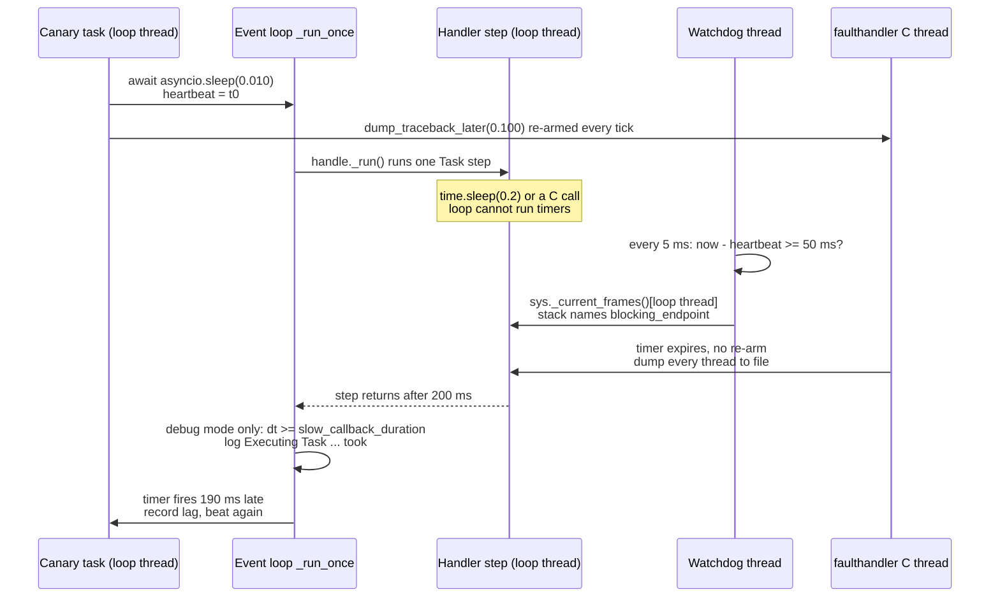

# Detecting Event-Loop Blocking in Production: Loop-Lag Canary Tasks, loop.slow_callback_duration, and Stack-Sampling Watchdogs

> [!summary] Claim
> A blocked asyncio loop is invisible from inside the blocked code, so detection needs a clock that keeps running while the loop does not: a canary task measures how late the loop is, a watchdog thread or faulthandler's C thread names the stack while the stall is still happening, and debug mode's `slow_callback_duration` only tells you after the fact which task step was slow, never which line.

Part of [ASGI Servers and Async Runtime](README.md) in [API Engineering](../README.md).

## TL;DR

Mechanism: `BaseEventLoop._run_once` runs every ready callback back to back on one thread, so any callback that does not return quickly delays every timer, socket read, and request on that loop; a canary task that sleeps 10 ms and measures how late it wakes turns that delay into a number, and a separate thread that sees the canary's heartbeat go stale can snapshot the loop thread's stack with `sys._current_frames()`.
Contract rule: in-loop detection (`loop.slow_callback_duration`, the canary) runs only when the loop gets control back, so it reports after the stall; only an out-of-loop observer (a Python watchdog thread, `faulthandler.dump_traceback_later`, `python -m asyncio ps`, or `profiling.sampling` in 3.15) can see the blocking line while it blocks.
Trap: the debug-mode warning `Executing <Task ... running at file.py:N> took 0.124 seconds` names line `N` where the task is parked after the slow step, not the line that blocked (lab-proven), and the warning exists only in debug mode, which cut callback throughput to about a third (2.9x) in the lab measurement.
Portability: the canary, the watchdog, and faulthandler pass on CPython 3.12.13, 3.13.18, 3.14.6, 3.14.10, 3.15.2, and 3.14.6 free-threaded; under a GIL a C call that never yields starves the Python watchdog until it returns, and on free-threaded builds `sys._current_frames()` itself blocks until the C call ends because it stops the world, while faulthandler names the right line on every build.
When not to use it: do not ship asyncio debug mode to production, do not page on raw canary lag without coordinated-omission correction, and do not use an in-process watchdog as the only signal on a worker whose loop thread spends long stretches inside C extensions; there, an external sampler or faulthandler is the reliable instrument.

## Mental model



The canary awaits a 10 ms sleep and writes a heartbeat every time it wakes; that is the only code on the loop thread that the detection path needs.
When a handler step blocks, `_run_once` is stuck inside `handle._run()`, so the canary's timer cannot fire and the heartbeat stops moving.
The watchdog thread polls the heartbeat every 5 ms and, once it is 50 ms stale, reads the loop thread's current Python frame from outside; that is the only moment the stack still points at the blocking line.
The faulthandler thread is a C thread with its own timer; the canary re-arms it on every tick, so a stall longer than its timeout lets it fire and dump every thread.
When the step finally returns, debug mode compares the step's wall time with `slow_callback_duration` and logs a warning, and the canary wakes late and records the lag, both after the damage is done.

## How it works

### Why one slow step stalls everything

`_run_once` computes a poll timeout from the earliest timer, calls `self._selector.select(timeout)`, moves expired timers to the `_ready` deque, and then pops and runs exactly the callbacks that were ready at the start of the drain: `ntodo = len(self._ready)` followed by `handle._run()` for each `(CPython 3.14.6 Lib/asyncio/base_events.py, BaseEventLoop._run_once)`.
There is no preemption anywhere in that loop: a Task step is one `handle._run()` that executes the coroutine from one `await` to the next, and nothing else on that thread runs until it returns.
So a 200 ms synchronous call inside an `async def` handler delays every other request's next step, every timer (including the server's keep-alive and timeout timers), and every socket read on that loop by up to 200 ms; the lab's `test_request_timer_inside_the_app_hides_the_stall` shows a concurrent `/fast` request finishing at least `BLOCK_SECONDS` after the shared start.
The internals of `_run_once`, the selector, and the timer heap are covered in [[CPython-Asyncio-Event-Loop-Internals-Selectors-Ready-Queue-and-Timers]]; this note only uses the fact that a step is atomic with respect to the loop.

Starlette and FastAPI make the choice for you based on the endpoint's type.
`request_response` wraps a non-coroutine endpoint in `functools.partial(run_in_threadpool, func)` `(starlette 1.10.0 starlette/routing.py, request_response)`, `run_in_threadpool` calls `anyio.to_thread.run_sync` `(starlette 1.10.0 starlette/concurrency.py, run_in_threadpool)`, and FastAPI does the same for `def` path operations `(fastapi 0.162.0 fastapi/routing.py, run_endpoint_function)`.
An `async def` endpoint runs on the loop thread, so a blocking call inside it is the canonical bug, and a `def` endpoint runs in a worker thread drawn from AnyIO's default `CapacityLimiter(40)` `(anyio 4.16.0 anyio/_backends/_asyncio.py, AsyncIOBackend.current_default_thread_limiter)`.

### Instrument 1: debug mode and `loop.slow_callback_duration`

Debug mode is on when any of these holds: `PYTHONASYNCIODEBUG` set to any non-empty value (ignored under `-E`) or `-X dev`, which are the two inputs of the default `(CPython 3.14.6 Lib/asyncio/coroutines.py, _is_debug_mode)`, or an explicit `asyncio.run(debug=True)` or `loop.set_debug(True)` (asyncio-dev docs).
`asyncio.Runner(debug=False)` calls `loop.set_debug(False)` even when the environment asks for debug, because `Runner` applies `debug` whenever it is not `None` `(CPython 3.14.6 Lib/asyncio/runners.py, Runner._lazy_init)`.
The default threshold is set in the loop constructor: `self.slow_callback_duration = 0.1` in every CPython from 3.12.13 to 3.15.2, and the same `0.1` in `uvloop 0.23.0` `(uvloop 0.23.0 uvloop/loop.pyx, Loop.__cinit__)`.

The timing code is a branch of the drain loop, so it costs nothing when debug is off and measures only one thing when it is on:

```python
# simplified excerpt of CPython 3.14.6 Lib/asyncio/base_events.py, BaseEventLoop._run_once
if self._debug:
    self._current_handle = handle
    t0 = self.time()
    handle._run()
    dt = self.time() - t0
    if dt >= self.slow_callback_duration:
        logger.warning('Executing %s took %.3f seconds', _format_handle(handle), dt)
else:
    handle._run()
```

`_format_handle` prints `repr(task)` when the callback is a bound method of a `Task`, which is the case for every Task step, and `str(handle)` otherwise `(CPython 3.14.6 Lib/asyncio/base_events.py, _format_handle)`.
The repr is taken after the step returned, so the coroutine's frame is already parked at its next `await`; the lab pins the consequence in `test_slow_callback_names_the_next_await_line_not_the_blocking_line`: the message for `step_that_blocks` points at the `await asyncio.sleep(0)` line, one line after the `time.sleep` that caused it.
If the step finished the coroutine, the repr says `done` and carries no line at all.

What debug mode adds beyond the timing, all read in the 3.14.6 source:
- Every `Handle` captures `format_helpers.extract_stack(sys._getframe(1))` at creation `(CPython 3.14.6 Lib/asyncio/events.py, Handle.__init__)`, and coroutine origin tracking is set to `DEBUG_STACK_DEPTH = 10` frames `(CPython 3.14.6 Lib/asyncio/constants.py)`; that per-callback stack walk is the main cost.
- `call_soon`, `call_at`, and friends call `_check_thread` and raise `RuntimeError("Non-thread-safe operation invoked on an event loop other than the current one")` from a foreign thread `(CPython 3.14.6 Lib/asyncio/base_events.py, BaseEventLoop._check_thread)`.
- `loop._current_handle` is only maintained in debug mode, so code that wants "which callback is running" outside debug mode gets `None`.
- `getaddrinfo` timings are logged at `INFO` when they exceed `slow_callback_duration` `(CPython 3.14.6 Lib/asyncio/base_events.py, BaseEventLoop._getaddrinfo_debug)`.

The asyncio development guide still says "The execution time of the I/O selector is logged if it takes too long" (asyncio-dev, as of 2026-11), but `_run_once` in 3.12.13, 3.14.6, and 3.15.2 contains no selector timing at all; trust the source, not that bullet.

`uvloop` re-implements the same contract in Cython with two small differences: it times with `time_monotonic()` and compares with `>` rather than `>=`, in both the ready-queue drain `(uvloop 0.23.0 uvloop/loop.pyx, Loop._on_idle)` and timer callbacks `(uvloop 0.23.0 uvloop/cbhandles.pyx, TimerHandle._run)`; the lab runs the debug-mode tests on both loops.

Because the check wraps `handle._run()`, its unit of blame is the scheduled callback, not the coroutine and not the request.
Under `asyncio.eager_task_factory` a child task's first step runs synchronously inside `create_task`, so its time is charged to the parent's handle; see [[Eager-Task-Factory-in-Python-3-12-to-3-15-and-Execution-Order-Shifts]] (this attribution is derived from the code path above and is not exercised in this lab).
A storm of many short callbacks, each under the threshold, produces no warning at all while the loop is saturated; only lag measurement sees that.

### Instrument 2: the loop-lag canary

The canary is a task that records `woke - due` after every `await asyncio.sleep(interval)`; the lab's `LoopLagMonitor.run` is eleven lines.
The 10 ms period matches the default `resolution` of Node.js `perf_hooks.monitorEventLoopDelay`, which "samples and reports the event loop delay over time" in nanoseconds and notes that with interval-based sampling "every sample includes the `resolution`" (Node.js perf_hooks docs, as of 2026-11).
Design choices that matter:
- It must sleep a nonzero interval: `asyncio.sleep(0)` yields without arming a timer, so it measures nothing about timer latency.
- It uses `time.monotonic()` rather than `loop.time()` so the same clock serves the watchdog thread; on CPython `loop.time()` is `time.monotonic()` anyway, while uvloop's `time()` is libuv's millisecond `uv_now` after `uv_update_time` `(uvloop 0.23.0 uvloop/loop.pyx, Loop._time)` and it rounds `call_later` delays to whole milliseconds `(uvloop 0.23.0 uvloop/loop.pyx, Loop.call_later)`.
- Its idle floor is not zero: on this machine an idle 10 ms sleep woke about 2.05 ms late at the median on both loops in the verification run (the drafter's earlier run measured 1.08 ms; Numbers table), so alert thresholds belong in tens of milliseconds, not single digits.
- It measures every source of delay at once: a blocking step, a long ready queue, a stop-the-world GC pass, and the OS waking the process late; that is a feature for alerting and a limitation for diagnosis.

A canary samples only when it runs, so one 500 ms stall at a 10 ms period yields one sample of about 490 ms instead of the 49 samples a free-running clock would have taken, which is coordinated omission.
HdrHistogram's `recordValueWithExpectedInterval` corrects this at recording time: when a value exceeds the expected interval it "will auto-generate an additional series of decreasingly-smaller (down to the expectedIntervalBetweenValueSamples) value records" (HdrHistogram `AbstractHistogram` Javadoc).
The lab's `corrected_lag_samples` implements exactly that in integer nanoseconds, and `test_one_long_stall_hides_from_raw_p99_but_not_from_corrected_p99` shows a single 500 ms stall in 100 samples leaving the raw p99 at 1 ms while the corrected p99 is 490 ms.

### Instrument 3: the stack-sampling watchdog thread

`sys._current_frames()` returns "a dictionary mapping each thread's identifier to the topmost stack frame currently active in that thread", without the thread's cooperation (sys docs), and raises the `sys._current_frames` audit event.
The watchdog in the lab is a daemon thread that wakes every `poll_interval` (5 ms), computes `now - last_beat`, and on the first poll past `threshold` (50 ms) walks the loop thread's frame with `traceback.extract_stack` and stores a `BlockingEvent`; it reports once per stale heartbeat value, so a long stall yields one event and the next beat re-arms it.
Turning it into a sampling profiler is a one-line change (capture on every poll while stale), at the cost of one stack walk per poll.

Three properties decide whether you can trust it:
- It needs the interpreter to run Python code on the watchdog thread.
  Under the GIL that means the loop thread must release the GIL; pure-Python code and `time.sleep` do (the switch interval is `sys.getswitchinterval()` = `0.005` s here, and the sys docs warn the real slice "can be higher, especially if long-running internal functions or methods are used").
  A C call that never reaches an eval-breaker check, like the lab's `hold_the_gil_in_c` (`sum(range(50_000_000))`), keeps the watchdog from running at all until it returns; the lab asserts `stalled_for >= c_call` on GIL builds.
- On the free-threaded build the watchdog thread runs in parallel and notices the stall on time, but `_PyThread_CurrentFrames` calls `_PyEval_StopTheWorldAll` before walking thread states `(CPython v3.14.0 Python/pystate.c, _PyThread_CurrentFrames)`, and stopping the world waits for the loop thread to reach a safe point, which the C call never offers; the lab asserts `capture_seconds > 0.05` on free-threaded builds, and a standalone probe of the same mechanism (a thread calling `sys._current_frames()` 50 ms into `sum(range(50_000_000))`) measured 239 ms (3.14.6t) and 337 ms (3.15.0b3t) for one call versus under 1 ms under the GIL, where the thread first ran at 314 ms, when the 315 ms call ended.
- A capture whose innermost frame is `select` in `selectors.py` means the loop was idle inside `selector.select()` and the OS woke it late; the lab classifies those as `wakeup_delays()` instead of blocking code after a real false positive during drafting (`stalled_for=0.0536`, innermost `selectors.py:548 select`) on an idle loop; that one-off was not reproduced in verification, but line 548 of `Lib/selectors.py` in 3.14.6 is the blocking `self._selector.control(None, max_ev, timeout)` call inside `KqueueSelector.select`, the macOS default selector, which matches the captured frame.
  On uvloop the poll happens inside libuv in C, so there is no Python frame to recognise and this classification is unavailable (from source; not exercised).

The watchdog also caught a real cold-start stall in a probe run: the first `def` endpoint call in a fresh process stalled the loop thread (canary max lag 52 ms, watchdog event at 53 ms) importing AnyIO's asyncio backend, because `get_async_backend` imports `anyio._backends._asyncio` on first use `(anyio 4.16.0 anyio/_core/_eventloop.py, get_async_backend)`; the captured stack ran through `run_in_threadpool -> run_sync -> get_async_backend -> import_module`.
That figure is with an empty bytecode cache (`PYTHONPYCACHEPREFIX` pointed at a fresh directory); with the `.pyc` files already written, the same probe stayed below the 50 ms threshold (max lag 10.5 ms), so most of the cost is compiling source, and images that ship precompiled bytecode avoid most of it (the drafter's probe measured about 63 ms).
That is why `test_sync_endpoint_runs_in_a_worker_thread_and_leaves_the_loop_free` warms the endpoint once before it starts measuring, and why Home Assistant's detector also wraps `importlib.import_module`.

### Instrument 4: faulthandler as a dead man's switch

`faulthandler.dump_traceback_later(timeout, repeat=False, file=sys.stderr, exit=False)` dumps "the tracebacks of all threads, after a timeout of timeout seconds"; "If the function is called twice, the new call replaces previous parameters and resets the timeout", and it "is implemented using a watchdog thread" (faulthandler docs).
Re-arming it on every canary tick turns it into a dead man's switch: as long as the loop ticks, the timer never fires.
The thread is plain C: it waits with `PyThread_acquire_lock_timed(thread.cancel_event, thread.timeout_us, 0)`, writes a header built by `format_timeout` as `Timeout (%lu:%02lu:%02lu.%06u)!`, and calls `_Py_DumpTracebackThreads(thread.fd, thread.interp, NULL)` `(CPython v3.14.0 Modules/faulthandler.c, faulthandler_thread)`.
Because it does not go through the eval loop or stop the world, it named `line N in hold_the_gil_in_c` during the C call on the GIL build, which the lab asserts, and a standalone `dump_traceback_later(0.1)` plus `sum(range(50_000_000))` probe named the summing line on 3.14.6t and 3.15.0b3t as well.
The price is the format: "Only ASCII is supported", "Each string is limited to 500 characters", only file, function, and line are shown, and "It is limited to 100 frames per thread, and 100 threads" (configurable through `max_threads` since 3.15) (faulthandler docs); and there is one timer per process, so pytest's `faulthandler_timeout`, which arms and cancels the same timer around each test `(pytest 9.2.0 _pytest/faulthandler.py, pytest_runtest_protocol)`, and any library calling `cancel_dump_traceback_later()` silently disarms yours.

### Instrument 5: out-of-process inspection (3.14 and 3.15)

Python 3.14 added `python -m asyncio ps PID` and `python -m asyncio pstree PID`, which "read the target process state without executing any code in it" and print every task with its coroutine stack and awaiter chain (asyncio-tools docs); `--retries N` arrived in 3.15.
In-process, `asyncio.capture_call_graph()`, `format_call_graph()`, and `print_call_graph()` (3.14) return the await chain of a task, which a watchdog can use to add "who is awaiting the blocked task" to its report (asyncio-graph docs).
Python 3.15 ships the `profiling.sampling` package from PEP 799 (Final): `python -m profiling.sampling attach PID` samples at 1 kHz by default, supports `--async-aware`, and reads the stack from the target's memory "while it continues to run", with `--blocking` to pause threads during each read (profiling.sampling docs, as of 2026-11; the same page's `--blocking` warning still speaks of "The default 100 microsecond interval", which contradicts its own 1 kHz defaults table).
All of these use the remote debugging protocol: the reader locates `_Py_DebugOffsets` in the target, the target must be the same minor version, and they need ptrace rights on Linux, the `get-task-allow` entitlement or `sudo` on macOS, and can be refused with `PYTHON_DISABLE_REMOTE_DEBUG=1` or `-X disable-remote-debug` (remote debugging howto).

## Numbers and limits

| Parameter | Value | Source or measurement context |
|---|---|---|
| Default `slow_callback_duration` | `0.1` s | CPython 3.12.13 to 3.15.2 `BaseEventLoop.__init__`; `uvloop 0.23.0` `Loop.__cinit__` |
| Slow-step comparison | CPython `dt >= threshold` on `loop.time()`; uvloop `delta > threshold` on `time.monotonic()` | Source read, both releases above |
| Debug-mode origin stack depth | `10` frames (`DEBUG_STACK_DEPTH`) | `Lib/asyncio/constants.py` 3.12.13 to 3.15.2 |
| Debug-mode cost, self-rescheduling `call_soon` chain | `74,744/s` off, `25,835/s` on (2.9x) | `python -m api_labs.f12_asgi_servers_and_async_runtime.loop_lag_monitor` (`measure_overheads()`, median of 3), CPython 3.14.6, macOS 27.3 (Darwin 27.3.0) arm64, Apple M3 Pro, 2026-11-15 |
| Idle canary lag, 10 ms period, 2 s, asyncio | `n=170`, p50 `2.053 ms`, p99 `2.112 ms`, max `2.150 ms` | Same run |
| Idle canary lag, same, uvloop 0.23.0 | `n=171`, p50 `2.049 ms`, p99 `2.134 ms`, max `2.145 ms` | Same run; the drafter's earlier run on the same machine measured p50 about `1.08 ms`, so the floor moves between runs |
| `capture_thread_stack` on the calling thread | `15.2 us` per call | Same run, shallow stack |
| `dump_traceback_later` re-arm | `12.54 us` per call, so `0.13%` of a 10 ms tick | Same run |
| `sys._current_frames()` during a GIL-holding `sum(range(50_000_000))` (297 to 397 ms) | under `1 ms` (3.14.6, thread first ran at 314 ms, after the call ended), `239 ms` (3.14.6t), `337 ms` (3.15.0b3t) | One standalone probe per interpreter, thread calling it 50 ms into the call; the lab test asserts only `> 50 ms` on free-threaded builds |
| `monotonic` clock on this machine | `mach_absolute_time()`, resolution `4.17e-08` s | `time.get_clock_info("monotonic")`, CPython 3.14.6 |
| GIL switch interval | `0.005` s | `sys.getswitchinterval()`, CPython 3.14.6 |
| uvloop timer granularity | 1 ms (`round(delay * 1000)`) | `uvloop 0.23.0 uvloop/loop.pyx, Loop.call_later` |
| faulthandler dump limits | 100 frames per thread, 100 threads, 500 chars per string, ASCII only | faulthandler docs; `max_threads` since 3.15 |
| AnyIO default worker threads for `def` endpoints | `40` | `anyio 4.16.0 AsyncIOBackend.current_default_thread_limiter` |
| Node.js comparison | `monitorEventLoopDelay` default `resolution` `10` ms, values in ns | Node.js perf_hooks docs, as of 2026-11 |
| `profiling.sampling` default rate | 1 kHz | Python 3.15 docs, as of 2026-11 |
| Lab suite runtime | `18 passed in 3.98s` | `uv run --frozen pytest <module> -v`, CPython 3.14.6, macOS 27.3 arm64, verification run 2026-11-15 |

The idle-lag and overhead figures come from one run of `python -m api_labs.f12_asgi_servers_and_async_runtime.loop_lag_monitor` on a laptop with other work running; treat them as orders of magnitude, not a benchmark.
GC pauses also show up as canary lag; 3.14.0 to 3.14.4 shipped an incremental collector with "maximum pause times ... reduced by an order of magnitude or more for larger heaps", and 3.14.5 reverted to the 3.13 generational collector (What's New in 3.14, as of 2026-11); this lab does not measure GC pauses.

## Portability

| Runtime, library, or server | Behavior | Evidence |
|---|---|---|
| CPython 3.12.13, 3.13.18, 3.14.6, 3.14.10, 3.15.2 | All 18 lab tests pass, including both uvloop parameters | `UV_PROJECT_ENVIRONMENT=<tmp> uv run --frozen --python <v> pytest <module> -q`, macOS 27.3 arm64 (drafter's matrix run; the verifier re-ran 3.14.6 only, lab matrix paused since 2026-11-11) |
| CPython 3.14.6t (GIL disabled) | All 18 pass; the C-call test takes its free-threaded branch (`capture_seconds > 0.05`) | Drafter's run: venv with the 16 lock-pinned packages the module needs plus the project `--no-deps`; `sys._is_gil_enabled()` is `False`; the verifier's standalone probes reproduced the slow capture and the faulthandler line |
| CPython 3.15.0b3t (GIL disabled) | `uvloop 0.23.0` built from source (the lock has no `cp315t` wheel) segfaults in `test_slow_callback_warning_needs_debug_mode[uvloop]`; the other 16 pass with `-k "not uvloop"` | Drafter's run, same venv approach; crash reported as `Fatal Python error: Segmentation fault` in `uvloop.loop`; not re-run in verification |
| CPython 3.12.16, 3.15.2t | Not run | Not installable through `uv` here |
| `_run_once` timing branch | Identical in 3.13.18 and 3.14.x; 3.12.13 differs only in the timeout clamp; 3.15.2 adds `max(self._clock_resolution, math.ulp(now))` to the timer cutoff | Diff of `inspect.getsource(BaseEventLoop._run_once)` across 3.12.13, 3.13.18, 3.14.6, 3.14.10, 3.15.2, re-run in verification |
| `uvloop 0.23.0` | Debug-mode slow-step warning with the same message shape; canary and watchdog work; selector-parked classification unavailable (poll in C) | Lab tests for the first two; source for the third |
| Uvicorn `0.54.0` | Runs the app on `--loop auto`, `asyncio`, `uvloop`, `zuvloop`, or `none`; the canary belongs in the lifespan, one per worker process | `(uvicorn 0.54.0 uvicorn/config.py, LOOP_FACTORIES)`; not run under Uvicorn in this lab |
| Hypercorn `0.18.0` | Worker classes `asyncio`, `uvloop`, and `trio`; on `trio` an `asyncio.sleep` canary does not run, so use an AnyIO or Trio sleep | `(hypercorn 0.18.0 hypercorn/run.py, run)`; trio path not run |
| Granian `2.8.7` | `--loop auto` prefers `rloop` when installed, then `uvloop`, then `winloop`, then `asyncio`; the `rloop` extra is `rloop~=0.1`, and `rloop 0.5.0` has no debug mode: `RLoop.get_debug()` always returns `False`, `RLoop.set_debug()` is a no-op marked `# TODO`, the source contains no `slow_callback_duration` and no handle timing, and its README lists "debugging" among the stdlib features it does not support, so the slow-callback warning can never fire under it and the canary, watchdog, and faulthandler switch are the only detectors | `(granian 2.8.7 granian/_loops.py, build_auto_loop)`; `(rloop 0.5.0 rloop/loop.py, RLoop.get_debug, RLoop.set_debug)`; rloop README "Differences from stdlib"; sdist read from PyPI, not executed, as of 2026-11 |
| HTTP/1.1, HTTP/2, HTTP/3 | Protocol-independent: a blocked step delays every connection and every multiplexed stream served by that loop | Follows from the single-threaded drain in `_run_once`; not measured per protocol |
| `python -m asyncio ps` and `pstree` | 3.14 and later (`--retries` 3.15); same minor version as the target, exact version for pre-releases | asyncio-tools docs; version rule from the remote debugging howto (`_Py_DebugOffsets` version field) |
| `profiling.sampling` | 3.15 and later; same minor version as the target, exact version for pre-releases | profiling.sampling docs, "Version compatibility" |

Container legs (Debian Trixie, Alpine musl) were not run for this draft.

## Worked example

The [implementation](../labs/src/api_labs/f12_asgi_servers_and_async_runtime/loop_lag_monitor.py) holds the canary, the coordinated-omission correction, the watchdog, a debug-mode warning collector, the faulthandler switch, and a three-route Starlette app.
The [test](../labs/tests/f12_asgi_servers_and_async_runtime/test_detecting_event_loop_blocking_loop_lag_monitors_and_debug_callbacks.py) blocks the loop for 200 ms against a 50 ms threshold (a 4x margin), drives the app through `httpx.ASGITransport`, and pins the debug-mode message format on asyncio and uvloop.

The canary, verbatim from `loop_lag_monitor.py`:

```python
class LoopLagMonitor:
    """Canary task: sleep ``interval``, record how late the wake-up was, beat."""

    def __init__(
        self,
        interval: float = DEFAULT_INTERVAL,
        *,
        max_samples: int = 10_000,
        clock: Callable[[], float] = time.monotonic,
    ) -> None:
        if interval <= 0:
            raise ValueError("interval must be positive")
        self.interval = interval
        self._clock = clock
        self._lock = threading.Lock()  # the heartbeat is read from the watchdog thread
        self._last_beat = clock()
        self.raw: deque[float] = deque(maxlen=max_samples)
        self.corrected: deque[float] = deque(maxlen=max_samples)

    def last_beat(self) -> float:
        with self._lock:
            return self._last_beat

    def _beat(self, now: float) -> None:
        with self._lock:
            self._last_beat = now

    async def run(self) -> None:
        self._beat(self._clock())
        while True:
            due = self._clock() + self.interval
            await asyncio.sleep(self.interval)
            woke = self._clock()
            lag = max(0.0, woke - due)
            self.raw.append(lag)
            self.corrected.extend(corrected_lag_samples(lag, self.interval))
            self._beat(woke)
```

The watchdog and its event type, verbatim:

```python
@dataclass(frozen=True, slots=True)
class StackFrame:
    filename: str
    lineno: int
    function: str


@dataclass(frozen=True, slots=True)
class BlockingEvent:
    stalled_for: float  # heartbeat age when the capture started, in seconds
    stack: tuple[StackFrame, ...]  # outermost first; the blocking line is last
    capture_seconds: float = 0.0  # how long sys._current_frames() and the walk took

    @property
    def innermost(self) -> StackFrame:
        return self.stack[-1]

    @property
    def parked_in_selector(self) -> bool:
        """The loop thread was inside ``selector.select()``: it was idle and the OS
        woke it late, so no Python code on the loop is to blame.  Only detectable on
        the pure-Python selector loop; uvloop polls inside C with no Python frame."""
        if not self.stack:
            return False
        top = self.stack[-1]
        return top.function == "select" and top.filename.endswith("selectors.py")


def capture_thread_stack(thread_id: int) -> tuple[StackFrame, ...]:
    """Snapshot another thread's Python stack without its cooperation."""
    frame = sys._current_frames().get(thread_id)  # pyright: ignore[reportPrivateUsage]
    if frame is None:
        return ()
    try:
        summary = traceback.extract_stack(frame)
    finally:
        del frame  # do not keep the blocked thread's frames alive
    return tuple(StackFrame(f.filename, f.lineno or 0, f.name) for f in summary)


class StackSamplingWatchdog:
    """OS thread that captures the loop thread's stack once per stall episode."""

    def __init__(
        self,
        monitor: LoopLagMonitor,
        *,
        loop_thread_id: int,
        threshold: float = DEFAULT_BLOCK_THRESHOLD,
        poll_interval: float = DEFAULT_POLL_INTERVAL,
        clock: Callable[[], float] = time.monotonic,
        on_event: Callable[[BlockingEvent], None] | None = None,
    ) -> None:
        self._monitor = monitor
        self._loop_thread_id = loop_thread_id
        self._threshold = threshold
        self._poll_interval = poll_interval
        self._clock = clock
        self._on_event = on_event  # runs in the watchdog thread, never on the loop
        self._events: list[BlockingEvent] = []
        self._lock = threading.Lock()
        self._stop = threading.Event()
        self._thread = threading.Thread(target=self._run, name="loop-watchdog", daemon=True)

    def start(self) -> None:
        self._thread.start()

    def stop(self) -> None:
        self._stop.set()
        self._thread.join()

    def events(self) -> list[BlockingEvent]:
        with self._lock:
            return list(self._events)

    def _run(self) -> None:
        reported_beat: float | None = None
        while not self._stop.wait(self._poll_interval):
            beat = self._monitor.last_beat()
            stalled = self._clock() - beat
            if stalled < self._threshold or beat == reported_beat:
                continue
            reported_beat = beat  # one capture per stall; the next beat re-arms
            began = self._clock()
            stack = capture_thread_stack(self._loop_thread_id)
            event = BlockingEvent(stalled, stack, self._clock() - began)
            with self._lock:
                self._events.append(event)
            if self._on_event is not None:
                self._on_event(event)
```

Wiring both to the running loop, verbatim; note that the watchdog stops before the canary is cancelled, and that a cancel aimed at the caller during teardown is re-raised (see [[Cancellation-Semantics-CancelledError-Swallowing-and-Shielded-Cleanup]]):

```python
@contextlib.asynccontextmanager
async def monitor_event_loop(
    *,
    interval: float = DEFAULT_INTERVAL,
    block_threshold: float = DEFAULT_BLOCK_THRESHOLD,
    poll_interval: float = DEFAULT_POLL_INTERVAL,
) -> AsyncGenerator[LoopHealth]:
    """Run the canary on the current loop and the watchdog on its own thread."""
    monitor = LoopLagMonitor(interval)
    watchdog = StackSamplingWatchdog(
        monitor,
        loop_thread_id=threading.get_ident(),
        threshold=block_threshold,
        poll_interval=poll_interval,
    )
    canary = asyncio.create_task(monitor.run(), name="loop-lag-canary")
    watchdog.start()
    try:
        yield LoopHealth(monitor, watchdog)
    finally:
        watchdog.stop()  # stop first: a cancelled canary must not look like a stall
        canary.cancel()
        try:
            await canary
        except asyncio.CancelledError:
            current = asyncio.current_task()
            if current is not None and current.cancelling():
                raise  # we are being cancelled too; do not swallow it
```

The slow step, the GIL-holding C call, and the faulthandler switch, verbatim:

```python
async def step_that_blocks(duration: float) -> None:
    time.sleep(duration)  # noqa: ASYNC251 - the blocking call under test
    await asyncio.sleep(0)  # the task is parked here when the slow step is logged


def hold_the_gil_in_c(n: int = 50_000_000) -> None:
    """A long C call that never reaches an eval-breaker check (builtin ``sum``)."""
    sum(range(n))


async def faulthandler_dead_mans_switch(
    file: IO[str], *, dump_after: float, interval: float
) -> None:
    """Re-arm faulthandler's C watchdog thread every ``interval`` seconds.

    If the loop stalls longer than ``dump_after`` the re-arm does not happen and the
    C thread dumps every Python thread's stack to ``file`` without needing the GIL.
    """
    try:
        while True:
            faulthandler.dump_traceback_later(dump_after, repeat=False, file=file, exit=False)
            await asyncio.sleep(interval)
    finally:
        faulthandler.cancel_dump_traceback_later()
```

The app, verbatim; `ruff`'s `ASYNC251` rule flags the `time.sleep` inside `async def`, which is why the deliberate bug carries a `noqa`:

```python
async def blocking_endpoint(request: Request) -> PlainTextResponse:
    time.sleep(BLOCK_SECONDS)  # noqa: ASYNC251 - the bug: a sync call on the loop thread
    return PlainTextResponse("blocked the loop")


def offloaded_endpoint(request: Request) -> PlainTextResponse:
    time.sleep(BLOCK_SECONDS)  # Starlette runs a sync endpoint in anyio's thread pool
    return PlainTextResponse("ran in a worker thread")


async def fast_endpoint(request: Request) -> PlainTextResponse:
    return PlainTextResponse("fast")


def build_app() -> Starlette:
    return Starlette(
        routes=[
            Route("/block", blocking_endpoint),
            Route("/offload", offloaded_endpoint),
            Route("/fast", fast_endpoint),
        ]
    )
```

Five of the tests, verbatim:

```python
@pytest.mark.unit
@pytest.mark.asyncio
async def test_watchdog_names_the_blocking_line_while_it_blocks() -> None:
    async with monitor_event_loop() as health:
        await asyncio.sleep(0.05)
        _block_here(STALL)
        await asyncio.sleep(0.05)
    assert health.max_lag() >= STALL - DEFAULT_BLOCK_THRESHOLD
    (event,) = health.blocking_events()
    assert event.innermost.function == "_block_here"
    assert DEFAULT_BLOCK_THRESHOLD <= event.stalled_for < STALL
    assert "_run_once" in [frame.function for frame in event.stack]
```

```python
@pytest.mark.unit
@pytest.mark.asyncio
async def test_blocking_async_endpoint_is_caught_with_its_stack() -> None:
    async with _client() as client, monitor_event_loop() as health:
        await asyncio.sleep(0.05)
        response = await client.get("/block")
        await asyncio.sleep(0.05)
    assert response.text == "blocked the loop"
    (event,) = health.blocking_events()
    assert event.innermost.function == "blocking_endpoint"
    assert health.max_lag() >= BLOCK_SECONDS - DEFAULT_BLOCK_THRESHOLD


@pytest.mark.unit
@pytest.mark.asyncio
async def test_sync_endpoint_runs_in_a_worker_thread_and_leaves_the_loop_free() -> None:
    async with _client() as client:
        await client.get("/offload")  # warm-up: anyio imports its backend on first use
        async with monitor_event_loop() as health:
            await asyncio.sleep(0.05)
            response = await client.get("/offload")
            await asyncio.sleep(0.05)
    assert response.text == "ran in a worker thread"
    assert health.blocking_events() == []


@pytest.mark.unit
@pytest.mark.asyncio
async def test_request_timer_inside_the_app_hides_the_stall() -> None:
    async with _client() as client:
        start = time.monotonic()

        async def timed(path: str) -> tuple[float, float]:
            began = time.monotonic()
            await client.get(path)
            done = time.monotonic()
            return done - began, done - start

        (_, _), (fast_own, fast_from_start) = await asyncio.gather(timed("/block"), timed("/fast"))
    assert fast_own < DEFAULT_BLOCK_THRESHOLD  # what an in-handler timer would record
    assert fast_from_start >= BLOCK_SECONDS  # what the client waited
```

```python
@pytest.mark.unit
@pytest.mark.asyncio
async def test_a_c_call_that_never_yields_defeats_the_python_watchdog_not_faulthandler(
    tmp_path: Path,
) -> None:
    lines, first = inspect.getsourcelines(hold_the_gil_in_c)
    c_line = first + next(i for i, ln in enumerate(lines) if "sum(range" in ln)
    path = tmp_path / "dump.txt"
    with path.open("w+") as sink:
        switch = asyncio.create_task(
            faulthandler_dead_mans_switch(sink, dump_after=0.100, interval=0.010)
        )
        async with monitor_event_loop() as health:
            await asyncio.sleep(0.05)
            began = time.monotonic()
            hold_the_gil_in_c()
            c_call = time.monotonic() - began
            await asyncio.sleep(0.05)
        switch.cancel()
        with pytest.raises(asyncio.CancelledError):
            await switch
    assert c_call > 2 * DEFAULT_BLOCK_THRESHOLD
    assert f"line {c_line} in hold_the_gil_in_c" in path.read_text()  # C thread sees inside
    event = health.watchdog.events()[0]
    if gil_enabled():
        assert event.stalled_for >= c_call  # the watchdog could not run until the call ended
        assert event.capture_seconds < DEFAULT_BLOCK_THRESHOLD
    else:
        # Noticed on time, but sys._current_frames() stops the world, and that waits
        # for the C call to reach a safe point, so the snapshot itself blocks.
        assert event.stalled_for < c_call
        assert event.capture_seconds > DEFAULT_BLOCK_THRESHOLD
```

Captured output, CPython 3.14.6, macOS 27.3 arm64, from `labs/` (verification run 2026-11-15; the session header is omitted and each node id's `tests/.../test_detecting_event_loop_blocking_loop_lag_monitors_and_debug_callbacks.py` prefix is shortened to `::`):

```text
$ uv run --frozen pytest tests/f12_asgi_servers_and_async_runtime/test_detecting_event_loop_blocking_loop_lag_monitors_and_debug_callbacks.py -v
::test_corrected_lag_backfills_one_sample_per_missed_wakeup PASSED [  5%]
::test_percentile_is_nearest_rank PASSED [ 11%]
::test_one_long_stall_hides_from_raw_p99_but_not_from_corrected_p99 PASSED [ 16%]
::test_slow_callback_warning_needs_debug_mode[asyncio] PASSED [ 22%]
::test_slow_callback_warning_needs_debug_mode[uvloop] PASSED [ 27%]
::test_slow_callback_threshold_is_respected[asyncio] PASSED [ 33%]
::test_slow_callback_threshold_is_respected[uvloop] PASSED [ 38%]
::test_slow_callback_names_the_next_await_line_not_the_blocking_line PASSED [ 44%]
::test_a_capture_parked_in_select_is_a_wakeup_delay_not_blocking_code PASSED [ 50%]
::test_watchdog_names_the_blocking_line_while_it_blocks PASSED [ 55%]
::test_idle_loop_reports_nothing PASSED [ 61%]
::test_watchdog_reports_each_stall_once PASSED [ 66%]
::test_blocking_async_endpoint_is_caught_with_its_stack PASSED [ 72%]
::test_sync_endpoint_runs_in_a_worker_thread_and_leaves_the_loop_free PASSED [ 77%]
::test_request_timer_inside_the_app_hides_the_stall PASSED [ 83%]
::test_faulthandler_switch_dumps_the_blocked_stack PASSED [ 88%]
::test_a_c_call_that_never_yields_defeats_the_python_watchdog_not_faulthandler PASSED [ 94%]
::test_monitor_teardown_does_not_swallow_a_cancel_aimed_at_its_caller PASSED [100%]
============================== 18 passed in 3.98s ==============================
```

What a real debug-mode warning looks like (captured in a probe of `capture_slow_callback_warnings(lambda: step_that_blocks(0.12), debug=True, slow_callback_duration=0.05)`, CPython 3.14.6, paths shortened to `.../`):

```text
Executing <Task pending name='Task-1' coro=<step_that_blocks() running at .../loop_lag_monitor.py:288> cb=[_run_until_complete_cb() at .../asyncio/base_events.py:181] created at .../asyncio/runners.py:110> took 0.129 seconds
```

In the current `loop_lag_monitor.py`, line 288 is `await asyncio.sleep(0)` and line 287 is the `time.sleep`; the test locates both lines with `inspect.getsourcelines` instead of hard-coding them, so it survives edits to the module.
And the head of a faulthandler dump from a probe that ran `faulthandler_dead_mans_switch(sink, dump_after=0.100, interval=0.010)` and then `hold_the_gil_in_c()` inside a coroutine `fh` (same interpreter, paths shortened):

```text
Timeout (0:00:00.100000)!
Thread 0x00000001fafb0f40 (most recent call first):
  File ".../loop_lag_monitor.py", line 293 in hold_the_gil_in_c
  File ".../lab_probe.py", line 14 in fh
  File ".../asyncio/events.py", line 94 in _run
  File ".../asyncio/base_events.py", line 2056 in _run_once
```

## Pitfalls

> [!warning] A ReDoS or parser loop in a dependency holds the loop
> - **Trigger**: a crafted `Content-Type` header hits `python-multipart <= 0.0.6`, which Starlette and FastAPI use for form parsing (CVE-2024-24762, GHSA-2jv5-9r88-3w3p, fixed in `0.0.7`).
> - **Symptom**: the advisory describes the server "consuming CPU resources and stalling indefinitely (minutes or more) while holding the main event loop", so "process can't handle any more requests"; aiohttp `< 3.9.4` had the same class of failure from a malformed multipart `POST` that sends the server into "an infinite loop" (CVE-2024-30251, GHSA-5m98-qgg9-wh84).
> - **Fix**: upgrade, and keep a watchdog in production so the next one is reported with a stack instead of as "the pod stopped answering"; the stack points at the parser frame, which a liveness probe never will.

> [!warning] Trusting the slow-callback line number
> - **Trigger**: reading `Executing <Task ... running at handlers.py:88> took 0.4 seconds` and opening line 88.
> - **Symptom**: line 88 is an innocent `await`; the blocking call is somewhere between the previous `await` and line 88, possibly several calls deep.
> - **Fix**: treat the warning as "this task's step between two awaits was slow" and use a watchdog or faulthandler dump for the line.

> [!warning] Debug mode left on in production
> - **Trigger**: `PYTHONASYNCIODEBUG=1` or `-X dev` copied from a debugging session into a deployment manifest.
> - **Symptom**: every `call_soon` walks the caller's stack; the lab measured 2.9x lower callback throughput, and `-X dev` also turns on other development-mode checks.
> - **Fix**: production uses the canary plus watchdog; debug mode is for tests and staging, where `asyncio.Runner(debug=True)` scopes it to one loop.

> [!warning] An in-process watchdog that goes quiet exactly when you need it
> - **Trigger**: the loop thread is inside a C extension call that does not release the GIL (or, free-threaded, does not reach a safe point): a huge `json` or regex operation, `sum` over a large range, a compression call that keeps the GIL.
> - **Symptom**: GIL build: the watchdog cannot run until the call ends, so the report is late; free-threaded: it notices on time but `sys._current_frames()` blocks inside stop-the-world until the call ends; both are lab-proven.
> - **Fix**: pair the Python watchdog with a faulthandler switch, which named the right line on every build tested, or with an external sampler (`py-spy`, `python -m profiling.sampling attach` on 3.15).

> [!warning] Cold imports and first-call initialisation on the loop thread
> - **Trigger**: the first request after deploy hits code that imports a module, compiles a regex, loads TLS certificates, or initialises a client.
> - **Symptom**: a one-off stall per worker after every deploy or autoscale event; in the lab's probe the first `def` endpoint call stalled the loop thread for about 52 ms importing AnyIO's backend with an empty bytecode cache, and stayed under the 50 ms threshold once the `.pyc` files existed.
> - **Fix**: warm up in the lifespan startup, before the worker reports ready, and ship precompiled bytecode in the image; Home Assistant's `block_async_io` treats `importlib.import_module`, `open`, `time.sleep`, `os.listdir`, and `SSLContext.load_verify_locations` among its 18 blocking calls for this reason (`homeassistant/block_async_io.py` on the `dev` branch, as of 2026-11).

> [!warning] Alerting on raw p99 canary lag
> - **Trigger**: a dashboard of canary lag percentiles fed with one sample per wake-up.
> - **Symptom**: rare long stalls barely move p99, because the stalled canary takes one sample per stall; the lab shows a 500 ms stall leaving raw p99 at 1 ms.
> - **Fix**: record with the expected-interval correction, or alert on max per window and on the count of stalls over threshold.

> [!warning] Another component owns the faulthandler timer
> - **Trigger**: two libraries, or the app and pytest's `faulthandler_timeout`, both call `dump_traceback_later` or `cancel_dump_traceback_later`.
> - **Symptom**: the switch silently stops protecting you; there is only one timer per process and the last caller wins.
> - **Fix**: own the timer in one place (the canary), and do not run it under test runners that use it.

## Security and robustness

Threat model: any input that makes a handler spend CPU on the loop thread is a denial of service amplifier, because one request's cost is paid by every concurrent request on the worker; ReDoS, decompression of attacker-supplied payloads, deeply nested JSON, and huge multipart forms are the usual vectors, which OWASP files under `API4:2023 Unrestricted Resource Consumption` ("Exploitation can lead to DoS due to resource starvation").
Defense in depth, from the inside out:
- Bound the work per request before it reaches the parser: body size limits at the proxy and server, header size limits, and timeouts at the edge, so the worst case is a known number of milliseconds.
- Run CPU-heavy or untrusted-input parsing off the loop; see [[Offloading-CPU-Bound-Work-ProcessPoolExecutor-vs-Free-Threaded-Python-3-15t]].
- Detect: the canary gives a metric, the watchdog gives a stack, faulthandler gives a stack even when the GIL is held.
- Recover: a liveness probe must fail when the loop is stalled for longer than your budget; a probe served by the same loop does fail when it is blocked, but a probe served by a sidecar or another thread does not, so make sure the probe path goes through the loop.

The watchdog itself must be safe to run in production:
- It runs `on_event` on its own thread, so the callback must never touch loop objects directly; hand results back with `loop.call_soon_threadsafe`.
- Stack frames contain local variables; the lab keeps only `(filename, lineno, function)` and deletes the frame reference immediately, so no request data, tokens, or bodies end up in logs and the blocked thread's frames are not kept alive.
- `sys._current_frames` raises an audit event, and the remote debugging protocol that `asyncio ps`, `pstree`, and `profiling.sampling` use can be disabled with `PYTHON_DISABLE_REMOTE_DEBUG=1`; a hardened image that disables it also disables your own external sampler, so decide that on purpose.
- Rate-limit reports: one per stall episode (the lab's design) and a cap per minute, so a pathological request cannot turn the watchdog into a logging flood.

## The principal's view

The decision is not "which detector" but "which signals are part of the platform contract for every async service".
The recommendation is three layers, always on: a canary metric (coordinated-omission corrected, max and count over threshold per window) for alerting and SLOs, a stack-capturing watchdog plus faulthandler switch for diagnosis, and a test-time guard (`blockbuster`, which raises `BlockingError` for patched blocking calls inside a running loop, or Home Assistant's `protect_loop` pattern) so most blocking calls never ship.
The organizational trade-off is ownership: putting these into a shared ASGI lifespan component means one team carries the false-positive tuning (the 1 to 2 ms idle floor, OS wake-up delays, GC pauses) so that product teams get one actionable stack per incident instead of each inventing a threshold.
The cost is small and measured: about 13 us per 10 ms tick for the faulthandler re-arm and one thread waking every 5 ms.
When the service's work is genuinely CPU-bound per request, no detector fixes the architecture; move the work to processes or a free-threaded worker pool, or choose a runtime that preempts request handlers or a thread-per-request server that confines a slow request to its own thread, and accept their memory and coordination costs.
Free-threaded CPython changes the detector's failure mode rather than removing it: the watchdog wakes on time but its snapshot can block on stop-the-world, so faulthandler and external samplers remain the ground truth.

## Interview questions

> [!question] L5: Why does one slow `async def` handler slow down every other request on the same Uvicorn worker?
>
> > [!success]- Answer
> > The event loop runs all ready callbacks one after another on one thread, and a Task step runs from one `await` to the next without preemption.
> > While the slow handler's step runs, no timer fires, no socket is read, and no other task advances.
> > Every request on that worker waits for the step to return, so its latency is added to theirs.
> >
> > Follow-up: Why does the same blocking call inside a `def` endpoint not have this effect in Starlette or FastAPI?

> [!question] L5: What does `loop.slow_callback_duration` do, and when does it do nothing?
>
> > [!success]- Answer
> > In debug mode the loop times every `handle._run()` and logs `Executing <handle> took N seconds` when the time is at least the threshold, which defaults to `0.1` s.
> > Outside debug mode the branch is skipped entirely, so setting the attribute alone does nothing.
> > It also says nothing about many short callbacks that saturate the loop, and it reports only after the step returns.
> >
> > Follow-up: Which four ways enable debug mode, and which one can a `Runner` override?

> [!question] L6: Predict the output: `step_that_blocks` is `time.sleep(0.12)` on line 287 and `await asyncio.sleep(0)` on line 288; it runs as the main task with debug on and `slow_callback_duration = 0.05`; what line does the warning name?
>
> > [!success]- Answer
> > It names line 288, the `await`, as `coro=<step_that_blocks() running at .../loop_lag_monitor.py:288>`, with `took 0.12x seconds` (`0.129` in the captured run).
> > The task's repr is formatted after the step returned, when the coroutine is parked at its next `await`.
> > The lab asserts the parked line is present and the blocking line is absent.
> >
> > Follow-up: What would the repr say if the slow step were the coroutine's last one?

> [!question] L6: Debug this API: after a deploy, p99 latency on a FastAPI service doubles, CPU is flat, debug-mode logs in staging show nothing over 100 ms, and the canary shows max lag of 300 ms a few times a minute; what do you do?
>
> > [!success]- Answer
> > Flat CPU with lag spikes and no single slow step suggests either a saturated ready queue of short callbacks or stalls the debug check cannot see, such as stalls in timers and GC, or a different production code path.
> > Turn on the stack-sampling watchdog and the faulthandler switch in production at a 50 to 100 ms threshold, and collect stacks for the spikes.
> > Check for a cold-start or periodic path (an import, a cache rebuild, a sync client call in an `async def`), and for a C call that holds the GIL, which the Python watchdog only reports after it ends.
> >
> > Follow-up: How would you tell a GC pause from a blocking call in the captured stacks?

> [!question] L6: Why must a loop-lag histogram be corrected for coordinated omission, and how?
>
> > [!success]- Answer
> > A canary samples only when it gets to run, so a 500 ms stall produces one sample instead of fifty, and the tail is under-represented.
> > HdrHistogram's at-recording correction adds the samples the canary would have taken: `lag - interval`, `lag - 2*interval`, down to `interval`.
> > The lab shows raw p99 at 1 ms and corrected p99 at 490 ms for one 500 ms stall in 100 samples.
> >
> > Follow-up: Why must you not also apply `copyCorrectedForCoordinatedOmission` to the same data?

> [!question] L6: A watchdog thread calls `sys._current_frames()` when the heartbeat is stale; under the GIL, when can it fail to report on time, and what do you add?
>
> > [!success]- Answer
> > The watchdog needs the GIL to run; if the loop thread is inside a C call that never drops the GIL, the watchdog runs only after the call ends.
> > The lab measures `stalled_for >= c_call` for `sum(range(50_000_000))` on GIL builds.
> > Add a faulthandler dead man's switch, whose C thread dumps without running Python code and named the right line in the lab.
> >
> > Follow-up: What changes on the free-threaded build, and why does the capture itself become slow?

> [!question] L7+: Design the event-loop health component every async service in your company ships with.
>
> > [!success]- Answer
> > A lifespan-started canary per worker that exports corrected lag as a histogram plus max and stall count per window.
> > A watchdog thread with a threshold set from the service's latency budget, one report per stall with filename, line, function, and the await chain, rate-limited, never with local variables.
> > A faulthandler switch re-armed by the canary at a higher threshold for the stalls the watchdog cannot see, and a liveness probe that is served by the loop.
> > A test-time blocking-call guard in CI, and an on-call runbook for `py-spy dump`, `python -m asyncio pstree`, or `profiling.sampling attach`.
> >
> > Follow-up: Which parts break under the Trio worker in Hypercorn, or under Granian with `rloop`?

> [!question] L7+: When is in-process detection the wrong investment, and what do you choose instead?
>
> > [!success]- Answer
> > When the work is intrinsically CPU-bound per request, detection will just confirm the obvious; the fix is moving that work to processes, a free-threaded pool, or another service.
> > When the hot path lives mostly in C extensions, external sampling is more reliable than an in-process Python thread.
> > When latency isolation per request matters more than memory, a runtime with preemptive scheduling or thread-per-request isolation can be the better architecture.
> >
> > Follow-up: What would make you keep asyncio anyway?

> [!question] L7+: An idle service's watchdog reports a 54 ms stall whose innermost frame is `selectors.py select`; is it a bug in the service?
>
> > [!success]- Answer
> > No: the loop thread was inside `selector.select()` waiting for a 10 ms timer, so it was idle and the OS woke it late.
> > The lab classifies such captures as wake-up delays, after exactly this false positive happened during development.
> > It still matters for latency, so it belongs in the lag metric, but the fix is in the host (CPU limits, throttling, noisy neighbours), not the code.
> >
> > Follow-up: Why can uvloop not make this distinction from a Python stack?

## Related

Prerequisites: [[End-to-End-Backpressure-TCP-Windows-ASGI-Send-Await-and-Bounded-Queues]]

Next: [[Offloading-CPU-Bound-Work-ProcessPoolExecutor-vs-Free-Threaded-Python-3-15t]]

See also: [[02-Programming-Languages/Python/Python-Backend-Interview-Prep/16-Asyncio-Deep-Dive]], [[CPython-Asyncio-Event-Loop-Internals-Selectors-Ready-Queue-and-Timers]], [[Eager-Task-Factory-in-Python-3-12-to-3-15-and-Execution-Order-Shifts]], [[Uvloop-and-Httptools-Internals-Libuv-and-C-HTTP-Parsing]], [[Uvicorn-Internals-Server-Lifecycle-Protocols-and-Flow-Control]], [[Hypercorn-Internals-HTTP-2-HTTP-3-QUIC-and-AnyIO-Trio-Workers]], [[Granian-Internals-Rust-Tokio-Hyper-Engine-and-RSGI-vs-ASGI]], [[Cancellation-Semantics-CancelledError-Swallowing-and-Shielded-Cleanup]], [[Graceful-Shutdown-SIGTERM-Drain-Windows-and-Kubernetes-PreStop-Hooks]], [[Memory-Leaks-in-Long-Running-Python-API-Workers]]

- Lab: `labs/tests/f12_asgi_servers_and_async_runtime/test_detecting_event_loop_blocking_loop_lag_monitors_and_debug_callbacks.py`

## Further reading

- [asyncio development guide](https://docs.python.org/3/library/asyncio-dev.html): how to enable debug mode and what it promises, including the 100 ms slow-callback default.
- [faulthandler](https://docs.python.org/3/library/faulthandler.html): `dump_traceback_later`, the single-timer rule, and the dump limits.
- [CPython faulthandler.c at v3.14.0](https://raw.githubusercontent.com/python/cpython/v3.14.0/Modules/faulthandler.c): `faulthandler_thread`, the C watchdog that dumps without the eval loop.
- [CPython pystate.c at v3.14.0](https://raw.githubusercontent.com/python/cpython/v3.14.0/Python/pystate.c): `_PyThread_CurrentFrames` and its stop-the-world call.
- [sys](https://docs.python.org/3/library/sys.html): `_current_frames`, `setswitchinterval`, and `remote_exec`.
- [asyncio call graph introspection](https://docs.python.org/3/library/asyncio-graph.html) and [asyncio command-line tools](https://docs.python.org/3/library/asyncio-tools.html): `capture_call_graph`, `ps`, and `pstree` in 3.14.
- [Remote debugging attachment protocol](https://docs.python.org/3/howto/remote_debugging.html): permissions and how to disable external attachment.
- [PEP 799](https://peps.python.org/pep-0799/) and [profiling.sampling](https://docs.python.org/3.15/library/profiling.sampling.html): the 3.15 statistical sampler that attaches to a running process.
- [HdrHistogram AbstractHistogram](https://hdrhistogram.github.io/HdrHistogram/JavaDoc/org/HdrHistogram/AbstractHistogram.html): `recordValueWithExpectedInterval` and coordinated omission.
- [Node.js perf_hooks](https://nodejs.org/api/perf_hooks.html): `monitorEventLoopDelay` and event loop utilization, the same canary idea in another runtime.
- [GHSA-2jv5-9r88-3w3p](https://github.com/advisories/GHSA-2jv5-9r88-3w3p): CVE-2024-24762, a ReDoS that holds the event loop in python-multipart.
- [GHSA-5m98-qgg9-wh84](https://github.com/advisories/GHSA-5m98-qgg9-wh84): CVE-2024-30251, an aiohttp multipart parser infinite loop.
- [Home Assistant block_async_io.py](https://raw.githubusercontent.com/home-assistant/core/dev/homeassistant/block_async_io.py) and [util/loop.py](https://raw.githubusercontent.com/home-assistant/core/dev/homeassistant/util/loop.py): a production blocking-call detector that patches 18 calls and checks the loop thread id.
- [blockbuster README](https://raw.githubusercontent.com/cbornet/blockbuster/main/README.md): a test-time detector that raises `BlockingError`.
- [rloop README](https://github.com/gi0baro/rloop): the Rust event loop Granian can select, and its stated lack of debugging support.
- [OWASP API4:2023 Unrestricted Resource Consumption](https://api-security.owasp.org/editions/2023/en/0xa4-unrestricted-resource-consumption): the API risk category that loop-blocking inputs fall under.
