# asyncio.eager_task_factory (Python 3.12-3.15): Synchronous First-Step Coroutine Execution, Throughput Gains, and Ordering Surprises

> [!summary] Claim
> Enabling `loop.set_task_factory(asyncio.eager_task_factory)` executes coroutines synchronously on the caller stack until their first suspension, cutting `create_task` plus `await` of a non-suspending coroutine from 26.9 us to 0.51 us (52x, lab microbenchmark on CPython 3.14.6, macOS 27.3 arm64) by skipping the `call_soon` `Handle` and the event loop iteration it waits for, but inverting caller-task execution order, defeating cancel-after-create, and risking `RecursionError` on deep synchronous task chains.

Part of [ASGI Servers and Async Runtime](README.md) in [API Engineering](../README.md).

## TL;DR

Mechanism: `loop.set_task_factory(asyncio.eager_task_factory)` makes the `Task` constructor run the coroutine's first step synchronously on the caller stack; if the coroutine returns without suspending, the `Task` is already done when the constructor returns, with no `Handle` allocated and no entry on the loop ready deque `(CPython 3.14.6 Lib/asyncio/tasks.py, Task.__eager_start)` and `(CPython 3.14.6 Modules/_asynciomodule.c, task_eager_start)`.
Contract rule: Task constructors under eager execution run the coroutine body immediately, so side effects, lock acquisitions, and synchronous validations execute before `asyncio.create_task()` returns to the calling frame.
Trap: Eager execution inverts interleaving order, turns `task.cancel()` into a no-op returning `False` on coroutines that already finished, and turns recursive task spawning into stack recursion bounded by `sys.getrecursionlimit()` that fails with `RecursionError`.
Portability: Introduced in Python 3.12 via `gh-97696` (the factory and the `Task(..., eager_start=...)` parameter); `loop.create_task` forwards extra keyword arguments since 3.13.3; 3.14 (`gh-128307`) adds `eager_start` to `asyncio.create_task`, `TaskGroup.create_task`, and eager factories; uvloop 0.23.0 passes `eager_start=None`, which raises `TypeError` with the 3.13 factory and silently disables eager start on 3.14; AnyIO (since 4.8.0) always spawns its `TaskGroup` tasks non-eagerly.
When not to use this: Do not enable `asyncio.eager_task_factory` globally in codebases where tasks assume lazy scheduling, where recursive task creation chains exceed `sys.getrecursionlimit()`, or where third-party frameworks rely on post-spawn setup before coroutine step 0.

## Mental model

```mermaid
flowchart TD
    subgraph Default ["Default Lazy Task Factory"]
        A1["asyncio.create_task(coro)"] --> B1["Allocate Task & Handle"]
        B1 --> C1["loop._ready.append(handle)"]
        C1 --> D1["Return pending Task to caller"]
        D1 --> E1["Caller resumes immediately"]
        E1 --> F1["Event loop tick: pop handle"]
        F1 --> G1["coro.send(None) executes step 0"]
    end

    subgraph Eager ["asyncio.eager_task_factory"]
        A2["asyncio.create_task(coro)"] --> B2["Task.__init__ with eager_start=True"]
        B2 --> C2["Swap current_task to child"]
        C2 --> D2["coro.send(None) runs on caller stack"]
        D2 --> E2{"Blocks on await?"}
        E2 -- "No (Cache Hit / Sync)" --> F2["Task marked _FINISHED<br/>Result set directly"]
        F2 --> G2["Swap current_task to caller<br/>Return completed Task"]
        G2 --> H2["Zero loop hops, Zero Handles"]
        E2 -- "Yes (I/O Waiter)" --> I2["Attach __wakeup to waiter<br/>Stay registered as a normal task"]
        I2 --> J2["Swap current_task to caller<br/>Return pending Task"]
        J2 --> K2["Waiter resolves -> loop._ready"]
    end
```



Under the default factory, `asyncio.create_task` instantiates `asyncio.Task` (the C `_asyncio.Task` when the accelerator is present, else the pure-Python `_PyTask`), schedules its step with `loop.call_soon`, which wraps it in an `asyncio.Handle` appended to `loop._ready`; control returns to the caller, and the coroutine only advances on a later event loop iteration.
Under `asyncio.eager_task_factory`, the task constructor swaps the loop's current task to the new task, registers it as live, and immediately runs its first step (`coro.send(None)`).
If the coroutine finishes without suspending, the result is set, the task is unregistered, and the constructor returns a completed Task (`done() == True`) without allocating a `Handle` or touching `loop._ready`.
If the coroutine suspends on an unresolved `Future`, it attaches its `__wakeup` callback, stays registered as a normal task, and reverts to standard event loop scheduling for subsequent resumes.

## How it works

### CPython Task Lifecycle: Lazy Scheduling vs Synchronous Execution

In default CPython `asyncio`, creating a task does not start executing the underlying coroutine.
When an application calls `asyncio.create_task(coro)`, the default task factory delegates to `Task(coro, loop=loop)`.
In `Lib/asyncio/tasks.py` (and the C `task_call_step_soon` in `Modules/_asynciomodule.c`) the constructor invokes:

```python
self._loop.call_soon(self.__step, context=self._context)
```

and then registers the task as live: in `_scheduled_tasks` (a `weakref.WeakSet`) for the pure-Python `Task` and for every task on 3.12 and 3.13, and in a per-thread linked list for the C `Task` on 3.14+ (see the next subsection).
`loop.call_soon` allocates an `asyncio.Handle` object, wraps the bound method `self.__step`, and appends the handle to the loop ready queue `self._ready` `(CPython 3.14.6 Lib/asyncio/base_events.py, BaseEventLoop._call_soon)`.
The task constructor then returns the pending `Task` instance to the calling frame.
The newly created coroutine remains unexecuted until the current task yields control to the event loop, the event loop runs its selector tick, and the ready deque pops the handle.

Python 3.12 introduced `asyncio.eager_task_factory`, `asyncio.create_eager_task_factory`, and the `eager_start` parameter of `asyncio.Task` through `gh-97696` (issue opened by Jacob Bower; PR #102853 by Itamar Oren, merged 2023-05-01).
When an event loop is configured with `loop.set_task_factory(asyncio.eager_task_factory)`, the task creation pathway alters its fundamental execution sequence.
On 3.12 and 3.13 the factory calls `custom_task_constructor(coro, loop=loop, name=name, context=context, eager_start=True)`; on 3.14+ it calls `custom_task_constructor(coro, loop=loop, eager_start=eager_start, **kwargs)` with `eager_start=True` as the default `(CPython 3.14.6 Lib/asyncio/tasks.py, create_eager_task_factory)`.
Inside `Task.__init__`, CPython evaluates the flag:

```python
if eager_start and self._loop.is_running():
    self.__eager_start()
else:
    self._loop.call_soon(self.__step, context=self._context)
    _py_register_task(self)
```

Inside `__eager_start()`, CPython performs an in-place context switch:

```python
def __eager_start(self):
    prev_task = _py_swap_current_task(self._loop, self)
    try:
        _py_register_eager_task(self)
        try:
            self._context.run(self.__step_run_and_handle_result, None)
        finally:
            _py_unregister_eager_task(self)
    finally:
        try:
            curtask = _py_swap_current_task(self._loop, prev_task)
            assert curtask is self
        finally:
            if self.done():
                self._coro = None
                self = None  # Needed to break cycles when an exception occurs.
            else:
                _py_register_task(self)
```

In the C extension, `_asyncio_Task___init___impl` calls `task_eager_start` when `eager_start` is true and `loop.is_running()` returns `True` `(CPython 3.14.6 Modules/_asynciomodule.c, task_eager_start)`.
`task_eager_start` swaps the loop's current task with `swap_current_task`, calls `register_task` (on 3.14+ an insert into the current thread's linked list `asyncio_tasks_head`; on 3.12 and 3.13 an add to the `_eager_tasks` set), enters the task context with `PyContext_Enter`, and runs `task_step_impl` inside `Py_BEGIN_CRITICAL_SECTION(task)`.
In the pure-Python path the task is added to `_eager_tasks`, a plain `set`, and the step runs inside `self._context.run(...)`.
Either way, `coro.send(None)` executes synchronously on the current thread stack.

If the coroutine executes to completion without encountering an unresolved awaitable (for example, reading an in-memory dictionary, validating fields, or returning a static response):
1. `coro.send(None)` raises `StopIteration(value)`.
2. The task implementation intercepts `StopIteration` and calls `set_result(value)`, which marks the task `_FINISHED` and schedules (with `call_soon`, not inline) any done callbacks already registered.
3. In the `finally` block, `_py_unregister_eager_task(self)` discards the task from `_eager_tasks`; the C task on 3.14+ instead unlinks itself from the per-thread list when it finishes (comment in `task_eager_start`).
4. `_py_swap_current_task` restores `prev_task` as the loop current task.
5. Because `self.done()` is `True`, CPython releases the coroutine frame reference (`self._coro = None`) and skips `_py_register_task(self)`.
6. The task constructor returns to the caller.
The task is returned with `task.done() == True`, having never allocated an `asyncio.Handle` and having never touched `loop._ready`.

If the coroutine hits an unresolved awaitable (for example, `await reader.read()` or `await asyncio.sleep(0.01)`):
1. The inner expression yields a pending `Future` or `Task` waiter `fut`.
2. `__step_run_and_handle_result` sets `self._fut_waiter = fut`.
3. `fut.add_done_callback(self.__wakeup, context=self._context)` is attached to the blocker.
4. `_py_unregister_eager_task(self)` discards the task from `_eager_tasks`.
5. `_py_swap_current_task` restores `prev_task`.
6. Because `self.done()` is `False`, the task "graduates" into a normal scheduled task: `_py_register_task(self)` inserts it into `_scheduled_tasks`.
When the blocking I/O waiter later completes, its callback schedules `self.__step` to resume execution through the normal event loop ready queue.
`await asyncio.sleep(0)` is the special case with no waiter: it awaits the private `__sleep0()` generator, a bare `yield`, and `__step_run_and_handle_result` reacts to the yielded `None` by rescheduling `self.__step` with `call_soon` `(CPython 3.14.6 Lib/asyncio/tasks.py, sleep)`.

### Why `_eager_tasks` Uses a Set While `_scheduled_tasks` Uses a WeakSet

A subtle architectural detail in CPython `Lib/asyncio/tasks.py` is the data structure selection for active tasks.
Regular tasks are tracked in `_scheduled_tasks = weakref.WeakSet()`.
A `WeakSet` is necessary for long-running asynchronous tasks because tasks can become unreferenced if callers discard the `Task` handle, allowing the garbage collector to reclaim them and trigger the `Task was destroyed but it is pending!` diagnostic `(CPython 3.14.6 Lib/asyncio/tasks.py, Task.__del__)`.
However, `WeakSet` operations cost more than plain `set` operations: every `add()` creates a `weakref.ref` with a removal callback, and iteration goes through an `_IterationGuard`.

Because eager tasks execute synchronously within the immediate stack frame of `Task.__init__`, their lifetime during step 0 is bounded by the C call stack.
CPython tracks them in `_eager_tasks = set()`.
A standard Python `set` provides fast `add()` and `discard()` operations without weak reference wrapping.
If the eager task completes synchronously, it is discarded from `_eager_tasks` and freed without ever touching `WeakSet`.
Only if the eager task blocks on an unresolved future does it transition into `_scheduled_tasks.add(self)`.

On 3.14+ this pair only covers the pure-Python `Task` and task objects that do not subclass `asyncio.Task` (the C module keeps them in `non_asyncio_tasks` and `non_asyncio_eager_tasks`).
Native C tasks are linked into a per-thread doubly linked list (`register_task` inserts into `tstate->asyncio_tasks_head`), which the 3.14 release notes credit with a 10-20% gain on standard benchmarks and lower memory use `(CPython 3.14.6 Modules/_asynciomodule.c, register_task)`.

The set duality requires special handling in the pure-Python `asyncio.all_tasks(loop)` (on 3.14+ the C `_asyncio.all_tasks` replaces it and walks the linked lists plus both fallback sets):

```python
def all_tasks(loop=None):
    """Return a set of all tasks for the loop."""
    if loop is None:
        loop = events.get_running_loop()
    # capturing the set of eager tasks first, so if an eager task "graduates"
    # to a regular task in another thread, we don't risk missing it.
    eager_tasks = list(_eager_tasks)

    return {t for t in itertools.chain(_scheduled_tasks, eager_tasks)
            if futures._get_loop(t) is loop and not t.done()}
```

`all_tasks` snapshots `_eager_tasks` into a list before chaining with `_scheduled_tasks`.
The source comment gives the reason: an eager task that graduates to a regular task in another thread while `all_tasks` runs cannot be missed.

### Optimization in `asyncio.gather` and `asyncio.TaskGroup`

The throughput benefits of `asyncio.eager_task_factory` compound when orchestrating concurrent child tasks.
Consider `asyncio.gather(*coros)`:
In `Lib/asyncio/tasks.py`, `gather` wraps each coroutine argument using `ensure_future(arg, loop=loop)`.
`ensure_future` invokes `loop.create_task(arg)`.
When `eager_task_factory` is active, each coroutine executes its first step immediately upon creation.

If every coroutine passed to `gather` completes synchronously (e.g. multi-field in-memory validation, cached sub-queries, or parallel header checks), every generated `Task` finishes inside the setup loop:

```python
nfuts += 1
arg_to_fut[arg] = fut
if fut.done():
    done_futs.append(fut)
else:
    if cur_task is not None:
        futures.future_add_to_awaited_by(fut, cur_task)
    fut.add_done_callback(_done_callback)
```

In `CPython 3.14.6 Lib/asyncio/tasks.py` lines 902-910 (`gather`), the function implements a dedicated eager fast path:

```python
outer = _GatheringFuture(children, loop=loop)
# Run done callbacks after GatheringFuture created so any post-processing
# can be performed at this point
# optimization: in the special case that *all* futures finished eagerly,
# this will effectively complete the gather eagerly, with the last
# callback setting the result (or exception) on outer before returning it
for fut in done_futs:
    _done_callback(fut)
return outer
```

Because all child futures are already marked done, `_done_callback` runs immediately for each child.
The final callback execution decrements the pending counter to zero and sets the resolved list of results on `outer`.
Consequently, `outer.done()` is `True` before `gather()` returns to the caller.
The subsequent `await asyncio.gather(...)` does not yield to the event loop ready queue; it extracts the result list directly from `outer` in O(1) time.

In `asyncio.TaskGroup`, `tg.create_task(coro, **kwargs)` delegates to `self._loop.create_task(coro, **kwargs)` `(CPython 3.14.6 Lib/asyncio/taskgroups.py, TaskGroup.create_task)`.
Under `eager_task_factory`, the coroutine begins immediately.
If it raises an exception synchronously during step 0, the exception is captured on the `Task` object (`task.exception()`), the task is marked done, and the task group handles the failure through `_on_task_done`.
That guarantee needed an upstream fix: `gh-128588` ("Cancellation leaks out of asyncio.TaskGroup on 3.12 when using eager tasks") and `gh-128550`, both closed 2025-01-21, made `TaskGroup.create_task` always add its done callback, "even if the task is already done (e.g. if the coro was able to complete eagerly)"; the fix is present in 3.12.13, 3.13.18, and 3.14.6 `taskgroups.py`.

### Evolution Across CPython 3.12, 3.13, 3.14, and 3.15

The eager task mechanism evolved across four Python minor versions:

1. **Python 3.12 (Initial API via `gh-97696`)**:
   `asyncio.eager_task_factory`, `asyncio.create_eager_task_factory`, and the `eager_start` parameter of `asyncio.Task` were introduced (docs: "Changed in version 3.12: Added the eager_start parameter").
   The factory wrapper had a rigid signature: `factory(loop, coro, *, name=None, context=None)` `(CPython 3.12.13 Lib/asyncio/tasks.py, create_eager_task_factory)`.
   `asyncio.create_task` and `loop.create_task` accepted only `name` and `context`, so `create_task(coro, eager_start=True)` raised `TypeError`; the only per-task opt-in was constructing `asyncio.Task(coro, loop=loop, eager_start=True)` directly (all three checked on 3.12.13 in this review).

2. **Python 3.13**:
   The factory signature stayed `(loop, coro, *, name=None, context=None)` and still passes `eager_start=True` unconditionally `(CPython 3.13.18 Lib/asyncio/tasks.py, create_eager_task_factory)`.
   `loop.create_task` gained `**kwargs` forwarding in 3.13.3, adjusted in 3.13.4 to stop forwarding `name` and `context` while still forwarding other keywords (event loop docs), so `loop.create_task(coro, eager_start=True)` reaches `Task` when no factory is installed, but raises `TypeError` against the eager factory; `asyncio.create_task` and `TaskGroup.create_task` still accept only `name` and `context` `(CPython 3.13.18 Lib/asyncio/base_events.py, BaseEventLoop.create_task)`.

3. **Python 3.14 (Per-Task Control via `gh-128307`)**:
   Issue `gh-128307` ("add eager_start parameter to loop.create_task") and PR #128306, both by Thomas Grainger and merged 2025-05-05, reworked the task creation APIs.
   `create_eager_task_factory` was updated to forward arbitrary keyword arguments:
   ```python
   def factory(loop, coro, *, eager_start=True, **kwargs):
       return custom_task_constructor(
           coro, loop=loop, eager_start=eager_start, **kwargs)
   ```
   `asyncio.create_task`, `loop.create_task`, and `TaskGroup.create_task` now pass all keyword arguments through, so `eager_start` works with and without a factory:
   `asyncio.create_task(coro(), eager_start=True)` enables eager execution on an individual task without changing the loop-wide task factory.
   Conversely, when `eager_task_factory` is active on the loop, passing `eager_start=False` selectively opts out a specific coroutine (both checked on 3.14.6 in this review).

4. **Python 3.15 and Free-Threaded 3.15t**:
   Python 3.15 keeps the 3.14 factory signature `(CPython 3.15.2 Lib/asyncio/tasks.py, create_eager_task_factory)`, and 3.15.0b3 and 3.15.0b3t behave like 3.14.6 for the factory, `create_task(..., eager_start=...)`, and `gather` (checked in this review; `sys._is_gil_enabled()` returned `False` on 3.15.0b3t).
   Under free-threading the C implementation does not rely on a global set: a native task registers in the creating thread's linked list, `task_eager_start` runs the step inside `Py_BEGIN_CRITICAL_SECTION(task)`, and `unregister_task` unlinks without locking only when called from the owning thread (`task_tid == _Py_ThreadId()`), otherwise it stops the world (`_PyEval_StopTheWorld`) around the unlink `(CPython 3.14.6 Modules/_asynciomodule.c, unregister_task)`.

### Edge cases of the eager first step

Four behaviors follow from the constructor running the first step inline, and each was run in this review rather than assumed.
The throwaway probe below is not part of the lab; it was run as `labs/.venv/bin/python -I probe_edge.py` on CPython 3.14.6, Darwin 27.3.0 (macOS 27.3, arm64).

```python
import asyncio
import sys


async def noop() -> int:
    return 1


async def boom() -> None:
    raise ValueError("step0")


async def whoami() -> asyncio.Task[object] | None:
    return asyncio.current_task()


async def eager_checks() -> None:
    asyncio.get_running_loop().set_task_factory(asyncio.eager_task_factory)
    t = asyncio.create_task(boom())
    print(f"step-0 raise: done={t.done()} exception={t.exception()!r}")
    t = asyncio.create_task(whoami())
    print(f"current_task inside step 0 is the new task: {t.result() is t}")
    log: list[str] = []
    t = asyncio.create_task(noop())
    t.add_done_callback(lambda _f: log.append("cb"))
    print(f"done callback ran inline: {bool(log)}")
    await asyncio.sleep(0)
    print(f"done callback ran after one loop turn: {bool(log)}")


loop = asyncio.new_event_loop()
t = asyncio.Task(noop(), loop=loop, eager_start=True)
print(f"loop not running: done={t.done()}")
loop.run_until_complete(t)
loop.close()
asyncio.run(eager_checks())
print(sys.version.split()[0])
```

```text
loop not running: done=False
step-0 raise: done=True exception=ValueError('step0')
current_task inside step 0 is the new task: True
done callback ran inline: False
done callback ran after one loop turn: True
3.14.6
```

- **Loop not running**: the constructor starts eagerly only when `self._loop.is_running()` is true (see `Task.__init__` above), so a task built on an idle loop falls back to `call_soon` and is pending (`loop not running: done=False`).
- **Exceptions in step 0**: a raise before the first suspension does not propagate out of `create_task`; it is stored on the task, which is already done when `create_task` returns (`step-0 raise`).
  Because nobody has awaited it yet, an unretrieved exception is reported by the `Task exception was never retrieved` handler when the task is garbage collected, exactly as for a lazy task.
- **`asyncio.current_task()`**: inside step 0 it returns the new task, because the constructor swaps the loop's current task before running the step and restores the caller's afterwards (`swap_current_task` in `task_eager_start`).
- **Done callbacks**: callbacks added after `create_task` returns on an already-finished task are scheduled with `call_soon`, so they do not run inline; they run on the next loop turn (`done callback ran inline: False`).
  This matches the `Future.add_done_callback` contract for a finished future in `Lib/asyncio/futures.py`.

### ASGI Server Request Lifecycle: Uvicorn, Hypercorn, and Granian

The interaction between `eager_task_factory` and ASGI application servers determines whether an API benefits from synchronous execution.

In Uvicorn `0.54.0`, the httptools protocol calls `_start_asgi_task` from `on_headers_complete`, that is, as soon as the request head is parsed and before the body arrives (and from `on_response_complete` for the next pipelined request); the h11 protocol inlines the same `self.loop.create_task(self.cycle.run_asgi(app))` call in `handle_events` on the `h11.Request` event `(uvicorn 0.54.0 uvicorn/protocols/http/httptools_impl.py, HttpToolsProtocol._start_asgi_task)`.
Simplified excerpt (the source comment and the pre-3.11 branch are omitted):

```python
def _start_asgi_task(self, cycle: RequestResponseCycle, app: ASGI3Application) -> None:
    if self.config.reset_contextvars:
        task = self.loop.create_task(cycle.run_asgi(app), context=contextvars.Context())
    else:
        task = self.loop.create_task(cycle.run_asgi(app))
    task.add_done_callback(self.tasks.discard)
    self.tasks.add(task)
```

Notice that Uvicorn calls `self.loop.create_task(...)`.
If the event loop has `asyncio.eager_task_factory` installed, `cycle.run_asgi(app)` begins executing immediately inside `_start_asgi_task`, which runs inside the httptools parser callback within `data_received`.

Now examine the ASGI application path:
In Starlette `1.10.0` or FastAPI `0.162.0`, consider an endpoint serving an in-memory cache hit:
1. `cycle.run_asgi(app)` enters the Starlette middleware stack and router.
2. The endpoint handler executes, finds the item in cache, and constructs a `Response` (or `JSONResponse`).
3. The response handler calls `await send({"type": "http.response.start", ...})`.
4. In Uvicorn `RequestResponseCycle.send` (`httptools_impl.py`), sending headers does not await I/O unless the transport has paused writing (`self.flow.write_paused`); it formats bytes into a list and calls `self.transport.write(b"".join(content))`.
   In `asyncio`, `transport.write` is a non-blocking buffer write.
5. The response handler calls `await send({"type": "http.response.body", ...})`.
6. Uvicorn writes the body bytes via `self.transport.write(body)` and marks `self.response_complete = True`.
7. The application coroutine returns, provided it never called `receive()`: `RequestResponseCycle.receive` always awaits `self.message_event.wait()` while the response is incomplete, and the task was started before the body was parsed, so any `receive()` call suspends the eager task.
The entire request-response cycle completes synchronously inside `self.loop.create_task()`.
When `_start_asgi_task` resumes, `task.done()` is already `True`.
Zero event loop hops were incurred.

### Framework Interference: uvloop and AnyIO

Despite the performance gains, two major runtime libraries exhibit severe friction with `asyncio.eager_task_factory`:

#### 1. uvloop 0.23.0 Incompatibilities
In `uvloop` 0.23.0, the Cython implementation of `Loop.create_task` has signature `(uvloop 0.23.0 uvloop/loop.pyx, Loop.create_task)`:
`create_task(self, coro, *, name=None, context=None, eager_start=None)`
When a task factory is installed and the interpreter is 3.13+ (`PY313 = PY_VERSION_HEX >= 0x030d0000`), uvloop invokes (line 1424):
`self._task_factory(self, coro, context=context, eager_start=eager_start)`
On 3.12 the `PY311` branch calls `self._task_factory(self, coro, context=context)` instead, which the 3.12 factory accepts, so eager start works there.

This produces two distinct failure modes on 3.13 and 3.14:
- **On Python 3.13**: CPython 3.13's `eager_task_factory` wrapper expects `(loop, coro, *, name=None, context=None)`.
  When uvloop passes `eager_start=None`, Python raises:
  `TypeError: create_eager_task_factory.<locals>.factory() got an unexpected keyword argument 'eager_start'`
  Every `create_task` call fails on Python 3.13 under uvloop with the eager factory installed.
  No CPython 3.13 interpreter was available for this review, so the error was reproduced by making uvloop's exact call, `factory(loop, coro, context=None, eager_start=None)`, against the 3.12.13 factory, whose code is identical to v3.13.18 apart from its docstring; it raised the `TypeError` above verbatim.
- **On Python 3.14**: CPython 3.14's factory accepts `eager_start=True, **kwargs`.
  However, when `loop.create_task(coro)` is called without an explicit parameter, uvloop passes `eager_start=None`.
  This `None` argument overrides the factory default `eager_start=True`.
  The C `Task.__init__` declares `eager_start: bool`, so `None` converts to false and the task is scheduled lazily with no error.
  To enable eager execution on uvloop in Python 3.14, callers must explicitly pass `asyncio.create_task(coro, eager_start=True)`.
  The lab test `test_uvloop_eager_start_none_disables_eager_factory` proves both halves on 3.14.6 with uvloop 0.23.0: the implicit task is not done after `create_task`, the explicit `eager_start=True` task is, and the stock asyncio loop runs both eagerly.

#### 2. AnyIO 4.16.0 Deliberate Suppression
AnyIO `4.16.0` supplies the task groups Starlette and FastAPI use (for example in `starlette/middleware/base.py`, `starlette/concurrency.py`, and `fastapi/routing.py`).
In `anyio/_backends/_asyncio.py`, `TaskGroup._spawn` contains explicit code to neutralize `eager_task_factory` `(anyio 4.16.0 anyio/_backends/_asyncio.py, TaskGroup._spawn)`:

```python
try:
    if (
        (factory := loop.get_task_factory())
        and getattr(factory, "__code__", None) is _eager_task_factory_code
        and (closure := getattr(factory, "__closure__", None))
    ):
        custom_task_constructor = closure[0].cell_contents
        task = custom_task_constructor(
            wrapper_coro, loop=loop, name=handle.name
        )
    else:
        task = loop.create_task(wrapper_coro, name=handle.name)
```

Why does AnyIO deliberately bypass eager execution?
The AnyIO 4.8.0 changelog states the reason: "Changed `TaskGroup` on asyncio to always spawn tasks non-eagerly, even if using a task factory created via `asyncio.create_eager_task_factory()`, to preserve expected Trio-like task scheduling semantics" (AnyIO `docs/versionhistory.rst`).
The code order shows the hazard it avoids: `_spawn` records `_task_states[task] = TaskState(parent_id=parent_id, cancel_scope=initial_scope)`, adds the task to `initial_scope._tasks`, and attaches `task_done` only after the constructor returns, so an eagerly started child would run its first step before AnyIO knows its cancel scope.
AnyIO detects factories built by `create_eager_task_factory` by comparing `factory.__code__` with `_eager_task_factory_code` (the `__code__` of `asyncio.eager_task_factory`), pulls the task constructor out of the closure, and calls it without `eager_start`, so it defaults to `False`.
A hand-written eager factory with different bytecode is not detected and still runs AnyIO children eagerly.
AnyIO 4.7.0 had earlier fixed `TaskGroup` to work with eager factories at all (issue #764, a missing `None` check on `get_coro()`, which returns `None` for an eagerly completed task).

## Numbers and limits

The following benchmarks and operational metrics compare default lazy task scheduling against `asyncio.eager_task_factory`.
Timings were measured in this review on Apple Silicon arm64, macOS 27.3 (`uname -r` = `27.3.0`), CPython 3.14.6 from uv, default `asyncio` selector loop (as of 2026-11), with `measure_create_task_await_ns` from the lab module, best of 5 fresh event loops, 100,000 iterations each, run from `labs/`:
`uv run --frozen python -c "from api_labs.f12_asgi_servers_and_async_runtime.eager_task_execution import measure_create_task_await_ns as m; print(m(100_000, use_eager=False, yield_in_coro=False))"` (and the other three flag combinations).
They are single-machine microbenchmark results, not production latencies.
The lazy figure includes one full `BaseEventLoop._run_once` iteration per task, which always calls `self._selector.select(timeout)` (a `kqueue` syscall on macOS) even when the timeout is 0 `(CPython 3.14.6 Lib/asyncio/base_events.py, BaseEventLoop._run_once)`.
The eager `sleep(0)` row pays exactly one such iteration and costs 27.1 us, so on this machine nearly all of the 26.9 us lazy cost is the loop iteration, not the 104-byte `Handle`.

| Metric / Parameter | Default Lazy Factory | asyncio.eager_task_factory | Delta / Impact | Provenance & Measurement Conditions |
|---|---|---|---|---|
| Synchronous Coroutine Latency | `26,878.7 ns/op` | `514.2 ns/op` | **52.3x faster (98.1% drop)** | Measured: `create_task` + `await` of a coroutine that returns without suspending |
| Throughput (Synchronous Ops) | `37,204 ops/sec` | `1,944,769 ops/sec` | **52.3x** | Derived: `1e9 / ns_per_op` from the row above |
| Semi-Blocking Latency (`sleep 0`) | `40,328.3 ns/op` | `27,144.3 ns/op` | **1.49x faster (32.7% drop)** | Measured: coroutine awaits `asyncio.sleep(0)` once, so the eager path still pays one loop iteration |
| Event Loop Handle Allocation | `1 Handle` (`sys.getsizeof` = `104` bytes, shallow) | `0 Handles` | **Eliminates Handle overhead** | Measured `sys.getsizeof(asyncio.Handle(...))` on 3.12.13, 3.14.6, and 3.15.0b3; C `task_eager_start` skips `task_call_step_soon` |
| Ready Queue Push/Pop Operations | `2 operations` | `0 operations` | **Zero ready-deque churn** | `_call_soon` appends to `_ready`; `_run_once` pops it; the eager path never calls `call_soon` for step 0 |
| Active Tasks Tracking | `WeakSet` (`_scheduled_tasks`) | `set` (`_eager_tasks`) | Cheaper eager registration | Pure-Python `Task`, and every task on 3.12-3.13; native C tasks on 3.14+ use a per-thread linked list for both paths |
| Maximum Synchronous Stack Depth | Unbounded | `sys.getrecursionlimit()` | **Fails with `RecursionError`** | Lazy resets stack to loop; Eager stacks frames on caller; proven by `test_recursion_limit_exhaustion_under_eager_chain` (limit 200, depth 250) |
| Default Python Recursion Limit | `1,000 frames` | `1,000 frames` | Hard limit on synchronous chain | Measured `sys.getrecursionlimit()` on 3.12.13, 3.14.6, 3.15.0b3, and 3.15.0b3t |
| `asyncio.gather` Future State | `_PENDING` (Done: `False`) | `_FINISHED` (Done: `True`) | **Synchronously resolved** | `Lib/asyncio/tasks.py:gather` eager callback loop; proven by `test_asyncio_gather_eager_completion` |
| Cancellation Return Code | `True` (Task cancelled) | `False` (Cancellation ignored) | **Semantic ordering shift** | Cancel on finished task is a no-op; proven by `test_cancellation_semantics_difference` |

## Portability

The table below documents compatibility and behavioral shifts across CPython releases, alternative event loops, and ASGI servers.
"Checked" cells were executed in this review with a probe script on the named interpreter; the rest cite the release source.
The pinned matrix legs `3.12.16`, `3.13.18`, `3.14.10`, `3.15.2`, and `3.15.2t` were not run: the machine has `3.12.13`, `3.14.6`, `3.15.0b3`, and `3.15.0b3t`, and no 3.13 interpreter; Debian and Alpine container legs were not run.
"AnyIO" means AnyIO 4.16.0 `TaskGroup` children, which are never eager on any version.

| Runtime / Component | Global Eager Factory | Per-Task `eager_start` Flag | `asyncio.gather` Eager Resolution | uvloop Interoperability | AnyIO Integration | Source Citation & Verified Notes |
|---|---|---|---|---|---|---|
| CPython `3.12.13` | Supported (checked) | Only via `asyncio.Task(coro, loop=loop, eager_start=True)`; `create_task(..., eager_start=True)` raises `TypeError` (checked) | Supported (checked) | Eager works: uvloop's 3.12 branch omits `eager_start` (source) | Suppressed | `gh-97696` (PR #102853); factory signature lacks `**kwargs` |
| CPython `3.13.18` | Supported (source) | `loop.create_task(coro, eager_start=True)` without a factory since 3.13.3; `TypeError` against the eager factory and from `asyncio.create_task` (source) | Supported (source) | Broken: `TypeError` on every `create_task` | Suppressed | v3.13.18 `tasks.py` and `base_events.py`; `TypeError` reproduced against the identical 3.12.13 factory |
| CPython `3.14.6` | Supported (checked) | Supported in `asyncio.create_task`, `loop.create_task`, `TaskGroup.create_task`; `eager_start=False` opts out under the factory (checked) | Supported (checked) | Silently ignored: tasks run lazily (lab test) | Suppressed | `gh-128307` / PR #128306 |
| CPython `3.15.0b3` (source of `3.15.2` read) | Supported (checked) | Supported (checked) | Supported (checked) | Not run (uvloop 0.23.0 installed only for 3.14) | Suppressed | v3.15.2 `tasks.py` keeps the 3.14 factory signature |
| CPython `3.15.0b3t` (free-threaded) | Supported (checked, `sys._is_gil_enabled()` is `False`) | Supported (checked) | Supported (checked) | Not run | Suppressed | Native tasks use per-thread linked lists; see Evolution item 4 |
| uvloop `0.23.0` | Ignored on 3.14, `TypeError` on 3.13, works on 3.12 | Explicit `eager_start=True` works on 3.14 (lab test) | Lazy on 3.14 unless each child passes `eager_start=True` (checked: `gather(...).done()` is `False`) | Native runtime | N/A | `uvloop/loop.pyx` line 1424 passes `eager_start=eager_start` (default `None`) |
| Uvicorn `0.54.0` | Applies: inherits the loop factory | Not exposed: Uvicorn calls `loop.create_task(cycle.run_asgi(app))` without `eager_start` | N/A | Default `--loop auto` picks uvloop when installed, which then ignores the factory on 3.14 | N/A | `httptools_impl.py` `_start_asgi_task`; `h11_impl.py` `handle_events` |
| Hypercorn `0.18.0` | Applies on the asyncio worker: `TaskGroup.spawn` calls stdlib `asyncio.TaskGroup.create_task` | Not exposed | N/A | Follows uvloop behavior with `--worker-class uvloop` | AnyIO is not used by the asyncio worker | `hypercorn/asyncio/task_group.py` imports `asyncio.TaskGroup` |
| Granian `2.8.7` | Applies with the default `--task-impl asyncio`: `_cbsched_aioschedule` calls `loop.create_task(coro)` from a `call_soon_threadsafe` callback | Not exposed | N/A | Follows the chosen `--loop` | N/A | `granian/_futures.py`; the Rust task impl falls back to asyncio on Python >= 3.12 (`granian/server/common.py`) |
| HTTP/1.1 (Uvicorn) | Applies per request | N/A | N/A | N/A | N/A | Pipelined requests are serialized: the next cycle's task starts from `on_response_complete` |
| HTTP/2 and HTTP/3 (source only, not run) | Applies per stream: Uvicorn 0.54.0 `zttp_h2_impl.py` `handle_request` calls `self.loop.create_task(cycle.run_asgi(app))`; Hypercorn `http_stream.py` (used by `h2.py` and `h3.py`) calls `task_group.spawn_app` | N/A | N/A | N/A | N/A | Each stream's first step can run inside the protocol's frame-handling callback |

## Worked example

The implementation below demonstrates the API cache gateway and execution tracer tested in the lab.
The code is drawn from [implementation](../labs/src/api_labs/f12_asgi_servers_and_async_runtime/eager_task_execution.py) and verified by [test](../labs/tests/f12_asgi_servers_and_async_runtime/test_eager_task_factory_in_python_3_12_to_3_15_and_execution_order_shifts.py).

### Implementation (simplified excerpt)

```python
"""Execution tracer and ASGI cache gateway for asyncio.eager_task_factory."""

from __future__ import annotations

import asyncio
import contextvars
from dataclasses import dataclass, field
from typing import TYPE_CHECKING, Any

if TYPE_CHECKING:
    from starlette.types import Receive, Scope, Send


request_id_var: contextvars.ContextVar[str] = contextvars.ContextVar(
    "request_id_var", default="anonymous"
)


class ExecutionTracer:
    """Traces interleaving order between caller execution and coroutine bodies."""

    def __init__(self) -> None:
        self.events: list[str] = []

    def record(self, event: str) -> None:
        self.events.append(event)

    async def run_synchronous_coro(self, name: str) -> str:
        self.record(f"{name}:start")
        self.record(f"{name}:end")
        return f"{name}:result"

    async def run_yielding_coro(self, name: str) -> str:
        self.record(f"{name}:start")
        await asyncio.sleep(0)
        self.record(f"{name}:end")
        return f"{name}:result"

    async def trace_lazy_vs_eager(
        self, *, use_eager: bool, yield_in_coro: bool
    ) -> list[str]:
        self.events.clear()
        loop = asyncio.get_running_loop()
        old_factory = loop.get_task_factory()
        if use_eager:
            loop.set_task_factory(asyncio.eager_task_factory)
        else:
            loop.set_task_factory(None)

        try:
            self.record("caller:before_create")
            coro = (
                self.run_yielding_coro("task1")
                if yield_in_coro
                else self.run_synchronous_coro("task1")
            )
            task = asyncio.create_task(coro)
            self.record(f"caller:after_create:done={task.done()}")
            self.record("caller:before_await")
            await task
            self.record("caller:after_await")
            return list(self.events)
        finally:
            loop.set_task_factory(old_factory)


class EagerCacheGateway:
    """In-memory cached ASGI gateway evaluating synchronous vs asynchronous response paths."""

    def __init__(self) -> None:
        self.cache: dict[str, bytes] = {}
        self.cache_hits: int = 0
        self.cache_misses: int = 0
        self.created_tasks: list[asyncio.Task[Any]] = []

    def set_cache(self, path: str, payload: bytes) -> None:
        self.cache[path] = payload

    async def fetch_upstream(self, path: str) -> bytes:
        await asyncio.sleep(0.001)
        data = f"upstream_data_for_{path}".encode()
        self.cache[path] = data
        return data

    async def __call__(self, scope: Scope, receive: Receive, send: Send) -> None:
        if scope["type"] != "http":
            return

        path = scope.get("path", "/")
        if path in self.cache:
            self.cache_hits += 1
            body = self.cache[path]
            status = 200
        else:
            self.cache_misses += 1
            body = await self.fetch_upstream(path)
            status = 200

        await send(
            {
                "type": "http.response.start",
                "status": status,
                "headers": [
                    (b"content-type", b"application/json"),
                    (b"content-length", str(len(body)).encode("ascii")),
                    (
                        b"x-cache",
                        b"HIT" if self.cache_hits > self.cache_misses else b"MISS",
                    ),
                ],
            }
        )
        await send(
            {
                "type": "http.response.body",
                "body": body,
                "more_body": False,
            }
        )

    async def handle_request_with_probe(
        self, scope: Scope, receive: Receive, send: Send, *, use_eager: bool
    ) -> tuple[asyncio.Task[None], bool]:
        """Dispatches request via create_task, recording whether it completed eagerly."""
        loop = asyncio.get_running_loop()
        old_factory = loop.get_task_factory()
        if use_eager:
            loop.set_task_factory(asyncio.eager_task_factory)
        else:
            loop.set_task_factory(None)

        try:
            task: asyncio.Task[None] = asyncio.create_task(self(scope, receive, send))
            was_eager_done = task.done()
            self.created_tasks.append(task)
            await task
            return task, was_eager_done
        finally:
            loop.set_task_factory(old_factory)
```

### Pytest Execution Output

The test suite executes 9 deterministic unit tests verifying the ordering shift, lock acquisition, cancellation semantics, recursion limits, ContextVar isolation, uvloop's `eager_start=None` override, `gather` eager completion, and ASGI transport behavior.
Captured in this review from `labs/` on CPython 3.14.6, macOS 27.3 arm64:

```text
$ uv run --frozen pytest tests/f12_asgi_servers_and_async_runtime/test_eager_task_factory_in_python_3_12_to_3_15_and_execution_order_shifts.py -v
============================= test session starts ==============================
platform darwin -- Python 3.14.6, pytest-9.2.0, pluggy-1.7.0 -- /Users/shreejitverma/github/The-Distinguished-Engineer/build/api_notes/jobs/Eager-Task-Factory-in-Python-3-12-to-3-15-and-Execution-Order-Shifts/verify/labs/.venv/bin/python
cachedir: .pytest_cache
hypothesis profile 'default'
rootdir: /Users/shreejitverma/github/The-Distinguished-Engineer/build/api_notes/jobs/Eager-Task-Factory-in-Python-3-12-to-3-15-and-Execution-Order-Shifts/verify/labs
configfile: pyproject.toml
plugins: platformdirs-4.14.5, schemathesis-4.33.1, cov-7.1.0, hypothesis-6.170.14, inline-snapshot-0.36.1, Faker-40.44.0, locust-2.47.0, typeguard-4.6.0, anyio-4.16.0, asyncio-1.4.1.post1, respx-0.23.1
asyncio: mode=Mode.STRICT, debug=False, asyncio_default_fixture_loop_scope=function, asyncio_default_test_loop_scope=function
collecting ... collected 9 items

tests/f12_asgi_servers_and_async_runtime/test_eager_task_factory_in_python_3_12_to_3_15_and_execution_order_shifts.py::test_lazy_vs_eager_execution_order_shift PASSED [ 11%]
tests/f12_asgi_servers_and_async_runtime/test_eager_task_factory_in_python_3_12_to_3_15_and_execution_order_shifts.py::test_eager_task_yielding_falls_back_to_loop_ready_queue PASSED [ 22%]
tests/f12_asgi_servers_and_async_runtime/test_eager_task_factory_in_python_3_12_to_3_15_and_execution_order_shifts.py::test_eager_asgi_cache_gateway_hit_vs_miss PASSED [ 33%]
tests/f12_asgi_servers_and_async_runtime/test_eager_task_factory_in_python_3_12_to_3_15_and_execution_order_shifts.py::test_lock_interleaving_shift_under_eager_factory PASSED [ 44%]
tests/f12_asgi_servers_and_async_runtime/test_eager_task_factory_in_python_3_12_to_3_15_and_execution_order_shifts.py::test_cancellation_semantics_difference PASSED [ 55%]
tests/f12_asgi_servers_and_async_runtime/test_eager_task_factory_in_python_3_12_to_3_15_and_execution_order_shifts.py::test_recursion_limit_exhaustion_under_eager_chain PASSED [ 66%]
tests/f12_asgi_servers_and_async_runtime/test_eager_task_factory_in_python_3_12_to_3_15_and_execution_order_shifts.py::test_context_var_isolation_preserved PASSED [ 77%]
tests/f12_asgi_servers_and_async_runtime/test_eager_task_factory_in_python_3_12_to_3_15_and_execution_order_shifts.py::test_uvloop_eager_start_none_disables_eager_factory PASSED [ 88%]
tests/f12_asgi_servers_and_async_runtime/test_eager_task_factory_in_python_3_12_to_3_15_and_execution_order_shifts.py::test_asyncio_gather_eager_completion PASSED [100%]

============================== 9 passed in 0.21s ===============================
```

## Pitfalls

> [!warning] Pitfall 1: Post-Creation Registration Race and Missing Callbacks
> **Trigger**: Creating a task and attempting to register it in an active task set or telemetry dictionary immediately after `asyncio.create_task(coro)`.
> **Symptom**: If the coroutine executes synchronously without yielding, it runs to completion before `active_tasks.add(task)` executes; if the coroutine notifies an external listener or emits a metric referencing its registration, lookups fail with `KeyError` or tasks are left unregistered in tracking registries.
> The standard library and AnyIO both shipped this bug class: CPython `gh-128588` ("Cancellation leaks out of asyncio.TaskGroup on 3.12 when using eager tasks") and `gh-128550` were fixed by always attaching `TaskGroup`'s done callback even to an already-done task, and AnyIO issue #764 was a missing `None` check on `get_coro()`, which returns `None` for an eagerly completed task.
> **Fix**: Register task identifiers before calling `create_task`, or pass tracking registries into the coroutine as dependencies rather than relying on post-creation registration in the parent frame.

> [!warning] Pitfall 2: Silent Failure of Pre-Execution Cancellation
> **Trigger**: Spawning a background task and subsequently calling `task.cancel()` based on an authorization check or rate-limiting decision made immediately following creation.
> **Symptom**: In default asyncio, `task.cancel()` succeeds because the task is pending in `loop._ready`.
> Under `eager_task_factory`, a fast-path coroutine has already executed to completion; `task.cancel()` returns `False`, `task.cancelled()` returns `False`, and unwanted side effects (e.g. database writes or metric increments) have already committed.
> **Fix**: Perform all precondition, admission, and permission checks before instantiating the coroutine or calling `create_task`.

> [!warning] Pitfall 3: Process Crash via Stack Depth Exhaustion (`RecursionError`)
> **Trigger**: Chaining coroutine task creation recursively (e.g. recursive tree walks, pagination crawlers, or actor-style message passing) where child tasks complete synchronously.
> **Symptom**: In default asyncio, task scheduling hops through `loop.call_soon`, unwinding the Python call stack to the event loop frame on every step.
> Under `eager_task_factory`, each child task executes inline inside `Task.__init__` on the caller stack frame, so every level adds the `create_task`, `loop.create_task`, factory, and coroutine frames, and the chain fails with `RecursionError: maximum recursion depth exceeded`, which propagates out of the outermost `create_task` into the request handler.
> **Fix**: Refactor recursive task spawning into iterative loops using bounded queues, or explicitly yield control to the loop using `await asyncio.sleep(0)` before creating subsequent recursive tasks.

> [!warning] Pitfall 4: Mutex Inversion and Re-Entrancy Surprises
> **Trigger**: Spawning tasks that acquire an uncontended `asyncio.Lock` while expecting other previously scheduled tasks in the event loop ready queue to run first.
> **Symptom**: In default asyncio, tasks enter the lock in FIFO order according to ready queue insertion.
> Under `eager_task_factory`, a newly spawned task acquires the uncontended lock, executes its critical section, and releases the lock synchronously inside `create_task`, cutting ahead of tasks waiting in the ready queue.
> **Fix**: Do not rely on event loop scheduling latency for mutual exclusion order; model state dependencies explicitly using queues or condition variables.

> [!warning] Pitfall 5: Ready Queue Starvation by Pre-Await Synchronous Work
> **Trigger**: Placing heavy CPU work (JSON parsing, regex compilation, compression, or cryptographic hashing) before the first `await` in an eager coroutine.
> **Symptom**: Under lazy scheduling, tasks yield cooperative ticks.
> Under eager scheduling, the synchronous block runs immediately inside the caller frame, preempting and starving all I/O events, timers, and network socket reads queued in `loop._ready`.
> **Fix**: Offload CPU-bound pre-await operations to worker threads via `asyncio.to_thread` or `concurrent.futures.ProcessPoolExecutor`.

> [!warning] Pitfall 6: Silent Eager Disabling in uvloop 0.23.0 on Python 3.14
> **Trigger**: Deploying an ASGI service on Python 3.14 using `uvicorn app:app --loop uvloop` with `loop.set_task_factory(asyncio.eager_task_factory)`.
> **Symptom**: No errors are raised, but tasks execute lazily without throughput gains.
> In `uvloop/loop.pyx`, `Loop.create_task` passes `eager_start=None` to the factory, which overwrites CPython 3.14's default `eager_start=True` and falls back to lazy scheduling (proven by the lab test `test_uvloop_eager_start_none_disables_eager_factory`).
> Uvicorn's default `--loop auto` selects uvloop whenever it is installed (`uvicorn/loops/auto.py`, `auto_loop_factory`), so any install with uvloop present gets the silent fallback by default.
> **Fix**: When using uvloop on Python 3.14, explicitly pass `asyncio.create_task(coro, eager_start=True)` on performance-critical paths instead of relying on the global task factory.

## Security and robustness

### Threat Modeling: API4:2023 Unrestricted Resource Consumption

Enabling `asyncio.eager_task_factory` significantly alters the denial-of-service attack surface defined in OWASP API Security Top 10 (2023) API4:2023 Unrestricted Resource Consumption.

In a default asyncio event loop, cooperative multitasking acts as a coarse rate-limiter against thread stack exhaustion:
Every task instantiation returns a `Task` handle without running the coroutine, so a task's first step always starts from the shallow stack of the event loop runner (`_run_once`).
When `eager_task_factory` is enabled globally, an attacker who supplies deeply nested inputs (for example, nested JSON documents, recursive graph relations, or multipart file trees) to code that spawns one task per level can trigger recursive task creation chains that execute synchronously on a single thread stack.
A deep synchronous chain raises `RecursionError` once the Python frame count passes `sys.getrecursionlimit()` (default 1000); handlers that catch broad exceptions can turn it into a `500` storm, and any C extension in the chain that recurses without CPython's stack checks risks a native stack overflow that kills the worker process.

### ContextVar Isolation and Leakage Audit

A critical security requirement in multi-tenant API servers is ensuring that request-scoped credentials, tenant IDs, and bearer tokens stored in `contextvars.ContextVar` do not leak across concurrent requests.
Because eager tasks run synchronously on the caller thread stack, engineers frequently fear that `contextvars` modifications inside an eager task will mutate the caller's context.

CPython's implementation strictly prevents this vulnerability:
In `Lib/asyncio/tasks.py`, `Task.__init__` executes:

```python
if context is None:
    self._context = contextvars.copy_context()
else:
    self._context = context

if eager_start and self._loop.is_running():
    self.__eager_start()
```

Inside `__eager_start()`, the coroutine first step executes inside `self._context.run(self.__step_run_and_handle_result, None)`; the C `task_eager_start` does the same with `PyContext_Enter(task->task_context)` and `PyContext_Exit`.
`Context.run` creates a localized execution scope.
Any calls to `ContextVar.set()` inside the child coroutine mutate only the cloned child context.
When `create_task()` returns to the caller, the parent thread retains its original context state intact.
This behavior was verified deterministically in the lab test `test_context_var_isolation_preserved`.

### Defense in Depth: Bounding Synchronous Execution

To harden an ASGI server utilizing eager task factories:
1. **Enforce Input Nesting Depth**: Reject request payloads whose JSON or object nesting depth exceeds a small fixed bound (for example 32 levels) before any code walks them with one task per level; enforce it in the parser or validation layer that actually decodes the body.
2. **Explicit Thread Offloading**: If an endpoint must perform cryptographic verification (e.g. RSA or ECDSA signature verification) or schema validation, do not run it in the coroutine head; offload it via `asyncio.to_thread`.
3. **Audit Third-Party Middleware**: Audit all ASGI middleware for assumptions regarding execution order; ensure no middleware assumes that `create_task` defers execution until after the middleware returns.

## The principal's view

Adopting `asyncio.eager_task_factory` represents a classic systems engineering trade-off: trading strict cooperative scheduling latency for raw cache-hit throughput.

In high-scale microservices, API gateways, and BFF (Backend-for-Frontend) architectures, cache hit ratios frequently exceed 90%.
Under default asyncio, a cache hit must traverse the entire event loop ready queue: allocating a `Handle`, setting up future callbacks, pausing the caller, waiting for the event loop selector tick, popping the handle, and waking the caller.
At 50,000 requests per second, this "event loop tax" introduces measurable latency jitter and consumes significant CPU cycles in queue management.
Enabling `eager_task_factory` removes this overhead for tasks that finish without suspending: 52x on the lab microbenchmark (26.9 us -> 0.51 us per `create_task` plus `await`), a per-task saving that matters only when task creation is a visible share of request cost.

However, a Principal Engineer must evaluate the organizational blast radius:
1. **Implicit Ordering Dependencies**: Python async codebases written over the past decade frequently rely on the implicit assumption that `asyncio.create_task()` is lazy.
   Developers write code that creates a task, registers it in an internal dictionary, and expects the task to run later.
   Enabling `eager_task_factory` globally across a large monorepo or legacy service will silently invert execution order and trigger intermittent, race-condition bugs that are notoriously difficult to reproduce under test.
2. **Framework Fragility**: As demonstrated in the portability analysis, core ecosystem libraries like AnyIO and uvloop maintain brittle relationships with eager task execution.
   AnyIO actively suppresses it; uvloop on Python 3.13 crashes and on 3.14 silently disables it.
   Enabling the global factory creates an illusion of optimization that may be neutralized or broken by an underlying dependency update.

### Decision Framework

- **For New Green-Field Services on CPython 3.14+**:
  Do NOT set `loop.set_task_factory(asyncio.eager_task_factory)` globally.
  Instead, leverage Python 3.14's per-task `eager_start=True` parameter on specific, highly optimized fast paths (e.g. in-memory cache lookups, routing dispatchers, and memoized permissions checks):
  `task = asyncio.create_task(fetch_cached_metadata(key), eager_start=True)`
  This delivers maximum throughput on critical hot paths without violating scheduling invariants across third-party libraries.
- **For CPU-Bound or Multi-Core API Workers**:
  If the API tier is bottlenecked by Python serialization and async scheduling, do not expect `eager_task_factory` to solve architectural scaling issues.
  Evaluate free-threaded Python 3.15t with multiple worker threads, or migrate performance-critical gateway routing to Rust-native engines like Granian or Envoy.

## Interview questions

> [!question] L5: How does `asyncio.eager_task_factory` differ from default task scheduling in Python?
>
> > [!success]- Answer
> > Default `asyncio.create_task()` wraps the coroutine in a `Task`, schedules its first step onto the event loop ready queue via `loop.call_soon`, and returns control to the caller immediately without executing any coroutine code.
> > In contrast, `asyncio.eager_task_factory` executes the coroutine's first step synchronously on the caller's stack frame inside the task constructor.
> > If the coroutine completes without hitting an unresolved `await`, it finishes immediately, returning a completed Task (`done() == True`) without allocating an `asyncio.Handle` or queuing on the event loop.
> > If the coroutine blocks on I/O, it registers with the blocking future, suspends, and falls back to standard event loop scheduling for subsequent steps.
> >
> > Follow-up: What happens to `asyncio.all_tasks()` while an eager task is executing its first step?

> [!question] L5: Predict the output of the following code snippet under Python 3.14 with `eager_task_factory`:
> ```python
> async def demo():
>     print("A")
>     await asyncio.sleep(0)
>     print("B")
> loop.set_task_factory(asyncio.eager_task_factory)
> t = asyncio.create_task(demo())
> print("C")
> await t
> ```
>
> > [!success]- Answer
> > The output is `A`, followed by `C`, followed by `B`.
> > When `create_task(demo())` is called, `demo()` starts synchronously on the caller stack, executing `print("A")`.
> > It then hits `await asyncio.sleep(0)`, which suspends the task without any timer: `sleep(0)` awaits a bare `yield` (`__sleep0`), and the task reacts by rescheduling its own step with `call_soon`.
> > `create_task()` returns the pending task `t` to the caller, which executes `print("C")`.
> > Finally, `await t` yields control to the event loop, which processes the ready queue and executes the remainder of `demo()`, printing `B`.
> >
> > Follow-up: What would the exact output be under default lazy task scheduling?

> [!question] L6: Debug this API failure: An engineer enables `asyncio.eager_task_factory` on a FastAPI service, and a background task meant to record analytics if an upload succeeds begins recording analytics even when uploads are rejected. Why?
>
> > [!success]- Answer
> > The endpoint code was written with the pattern `task = asyncio.create_task(record_analytics()); if not valid: task.cancel()`.
> > Under default lazy scheduling, `task.cancel()` succeeds because the task is pending in the ready queue, causing the task to raise `CancelledError` before executing.
> > Under `eager_task_factory`, because `record_analytics()` begins synchronously and has a fast path (e.g. an in-memory buffer append), it finishes completely before `create_task()` returns.
> > Calling `task.cancel()` on an already completed task returns `False` and is a no-op, leaving the analytics recorded.
> > The fix is to perform validation before task creation or guard task spawning behind successful upload completion.
> >
> > Follow-up: How does `task.cancel()` behave on an eager task that blocked on its first step versus one that finished synchronously?

> [!question] L6: How does `asyncio.gather` optimize execution when all supplied coroutines complete eagerly?
>
> > [!success]- Answer
> > In CPython's `Lib/asyncio/tasks.py`, `gather` wraps each coroutine using `ensure_future`, which calls the loop task factory.
> > If all child coroutines complete synchronously during creation, each resulting task is already marked done.
> > `gather` detects that all child futures are done and immediately executes their completion callbacks inside a setup loop before returning the `_GatheringFuture`.
> > The gathering future transitions to done immediately, so `await asyncio.gather(...)` extracts results directly without yielding to the event loop.
> >
> > Follow-up: What happens if one of the eager child tasks raises an unhandled exception during its synchronous step inside `gather`?

> [!question] L6: Why can deep recursive coroutine task creation cause a `RecursionError` under `eager_task_factory` but succeed under the default task factory?
>
> > [!success]- Answer
> > In the default task factory, each call to `create_task()` schedules `__step` via `loop.call_soon` and returns, unwinding the call stack back to the event loop on every iteration.
> > Under `eager_task_factory`, each child task is executed immediately inside `Task.__init__` on the current thread's stack frame.
> > If tasks chain recursively without yielding to an unresolved awaitable, stack frames accumulate synchronously on the Python C stack.
> > When the depth exceeds `sys.getrecursionlimit()` (default 1000), CPython raises `RecursionError` to prevent stack overflow.
> >
> > Follow-up: How would you refactor a recursive coroutine crawler to run safely under `eager_task_factory`?

> [!question] L7: Explain how `asyncio.eager_task_factory` maintains `contextvars.ContextVar` isolation despite running synchronously on the caller's call stack.
>
> > [!success]- Answer
> > Inside `Task.__init__`, CPython creates a shallow copy of the active context using `contextvars.copy_context()` if no explicit context was provided.
> > Inside `__eager_start()`, the first step executes via `self._context.run(self.__step_run_and_handle_result, None)`.
> > `Context.run` enters a scoped context environment where any modifications made via `ContextVar.set()` apply strictly to the child context copy.
> > When the synchronous execution completes and `__eager_start()` exits, the thread returns to the caller's context, leaving all parent context variables unmodified.
> >
> > Follow-up: Does an eager task inherit context changes made by an earlier eager sibling task spawned in the same parent function?

> [!question] L7: Why does AnyIO 4.16.0 deliberately inspect and suppress `asyncio.eager_task_factory` in its `TaskGroup._spawn` implementation?
>
> > [!success]- Answer
> > AnyIO manages structured concurrency and cancellation hierarchies through custom `CancelScope` and `TaskState` objects.
> > In AnyIO's task spawning lifecycle, AnyIO creates the task, then associates it with `_task_states[task]`, inserts it into the active cancel scope's task set, and attaches a `task_done` callback.
> > If a task ran eagerly inside the task constructor, its first step would execute before AnyIO had recorded its cancel scope, and its relative order with the spawner would differ from Trio, which never runs a child before the spawner yields.
> > The AnyIO 4.8.0 changelog gives the stated reason, "to preserve expected Trio-like task scheduling semantics", and the code detects factories whose `__code__` is `_eager_task_factory_code`, extracts the constructor from the closure, and calls it without `eager_start`, which defaults to `False`.
> >
> > Follow-up: How does AnyIO's design philosophy on structured concurrency differ from CPython's native `TaskGroup` regarding eager execution?

> [!question] L7+: You are architecting an ASGI API gateway serving 60,000 req/sec where 95% of requests hit an in-memory cache. Evaluate the trade-offs of enabling `eager_task_factory` globally on Uvicorn versus adopting Python 3.14 per-task eager creation.
>
> > [!success]- Answer
> > Global enablement on Uvicorn eliminates the step-0 ready queue hop for every request task that finishes without suspending; the lab microbenchmark puts that hop at about 26 us of the 26.9 us lazy cost on macOS 27.3 arm64, so the gain is per-task overhead, not a multiplier on whole-request latency.
> > However, global enablement risks breaking third-party middleware that assumes lazy execution and risks `RecursionError` on deep task chains; under uvloop 0.23.0 it is silently ignored on 3.14 and raises `TypeError` on 3.13, and AnyIO task groups never run eagerly.
> > Adopting Python 3.14 per-task `eager_start=True` allows the gateway to surgically enable eager execution on the routing lookup and in-memory cache endpoints while leaving background tasks, external database calls, and third-party libraries under standard lazy scheduling.
> > This selective approach captures the throughput gains while insulating the production service from ordering bugs and ecosystem incompatibilities.
> >
> > Follow-up: How would you monitor event loop lag and stack depth in production to verify that eager execution is not causing ready-queue starvation?

## Related

Prerequisites: [[CPython-Asyncio-Event-Loop-Internals-Selectors-Ready-Queue-and-Timers]]

Next: [[Uvloop-and-Httptools-Internals-Libuv-and-C-HTTP-Parsing]]

See also: [[02-Programming-Languages/Python/Python-Backend-Interview-Prep/16-Asyncio-Deep-Dive]]

Vault siblings:
- [[AnyIO-Structured-Concurrency-TaskGroups-CancelScopes-and-ExceptionGroups]]
- [[Async-Synchronization-Primitives-Locks-Semaphores-and-Reentrant-Deadlocks]]
- [[Cancellation-Semantics-CancelledError-Swallowing-and-Shielded-Cleanup]]
- [[Detecting-Event-Loop-Blocking-Loop-Lag-Monitors-and-Debug-Callbacks]]
- [[End-to-End-Backpressure-TCP-Windows-ASGI-Send-Await-and-Bounded-Queues]]
- [[Fire-and-Forget-Task-Hazards-GC-Disappearance-and-Managed-Task-Nurseries]]
- [[Granian-Internals-Rust-Tokio-Hyper-Engine-and-RSGI-vs-ASGI]]
- [[Hypercorn-Internals-HTTP-2-HTTP-3-QUIC-and-AnyIO-Trio-Workers]]
- [[Memory-Leaks-in-Long-Running-Python-API-Workers]]
- [[Multi-Process-Worker-Topologies-Gunicorn-Uvicorn-Workers-vs-Kubernetes-Replicas]]
- [[Offloading-CPU-Bound-Work-ProcessPoolExecutor-vs-Free-Threaded-Python-3-15t]]
- [[Uvicorn-Internals-Server-Lifecycle-Protocols-and-Flow-Control]]

- Lab: `labs/tests/f12_asgi_servers_and_async_runtime/test_eager_task_factory_in_python_3_12_to_3_15_and_execution_order_shifts.py`

## Further reading

- [CPython Issue gh-97696: Add eager task creation API to asyncio](https://github.com/python/cpython/issues/97696)
  The primary upstream issue proposing synchronous first-step coroutine execution to optimize async throughput.
- [CPython PR #102853: asyncio eager tasks factory](https://github.com/python/cpython/pull/102853)
  The original CPython pull request by Itamar Oren (for the issue opened by Jacob Bower) introducing `eager_task_factory` in Python 3.12.
- [CPython Issue gh-128307: add eager_start parameter to loop.create_task](https://github.com/python/cpython/issues/128307)
  The enhancement request adding per-task `eager_start` control and keyword argument forwarding in Python 3.14.
- [CPython PR #128306: support eager_start kwarg in create_eager_task_factory, and pass kwargs from asyncio.create_task and TaskGroup.create_task](https://github.com/python/cpython/pull/128306)
  The implementation enabling granular eager task execution across standard library task constructors.
- [CPython asyncio tasks source (Lib/asyncio/tasks.py)](https://raw.githubusercontent.com/python/cpython/v3.14.6/Lib/asyncio/tasks.py)
  The authoritative Python standard library implementation of `Task.__eager_start`, `_eager_tasks`, and `gather`.
- [CPython asyncio C extension source (Modules/_asynciomodule.c)](https://raw.githubusercontent.com/python/cpython/v3.14.6/Modules/_asynciomodule.c)
  The C-accelerated task implementation handling fast context swapping and synchronous step dispatch.
- [Uvicorn HTTP protocols implementation (uvicorn/protocols/http/httptools_impl.py)](https://raw.githubusercontent.com/encode/uvicorn/0.54.0/uvicorn/protocols/http/httptools_impl.py)
  Production ASGI server request task creation and transport write mechanics under standard event loops.
- [AnyIO asyncio backend implementation (anyio/_backends/_asyncio.py)](https://raw.githubusercontent.com/agronholm/anyio/4.16.0/src/anyio/_backends/_asyncio.py)
  Source proof of AnyIO's deliberate detection and neutralization of eager task factories in task groups.
- [ASGI 3.0 Protocol Specification](https://asgi.readthedocs.io/en/latest/specs/main.html)
  The asynchronous server gateway interface standard governing scope, receive, and send message contracts.
- [OWASP API Security Top 10 (2023) - API4: Unrestricted Resource Consumption](https://owasp.org/API-Security/editions/2023/en/0xa4-unrestricted-resource-consumption/)
  Security standard detailing thread and resource exhaustion vectors relevant to synchronous coroutine recursion.
