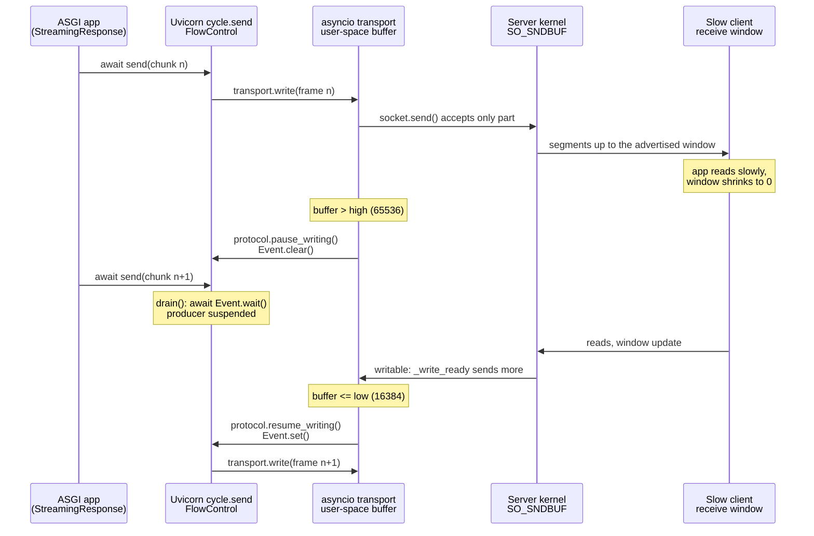

# Backpressure Across the Stack: How a Slow Client Stalls TCP Send Buffers, Pauses Uvicorn Transport Writing, and Suspends ASGI send()

> [!summary] Claim
> A client that reads slowly closes its TCP receive window, the server's kernel send buffer fills, the event loop's transport buffer crosses 64 KiB and calls `pause_writing()`, and Uvicorn then suspends the next `await send()` until the buffer drains to the low watermark, so a producer that does its work inside the `send()` loop is throttled to the client's read rate with a bounded amount of memory, while any unbounded buffer you put between the producer and `send()` breaks the chain.

Part of [ASGI Servers and Async Runtime](README.md) in [API Engineering](../README.md).

## TL;DR

- Mechanism: TCP's advertised receive window (RFC 9293 Section 3.8.6) stops the server kernel from draining its send buffer, `socket.send` starts returning short, the asyncio transport buffers the rest and calls `protocol.pause_writing()` once that buffer is strictly greater than the high watermark (64 KiB by default), and Uvicorn 0.54.0 clears an `asyncio.Event` that the next `send()` awaits (uvicorn 0.54.0 uvicorn/protocols/http/flow_control.py, FlowControl).
- Contract rule: Uvicorn checks the pause flag before it writes, so backpressure acts between `send()` calls, never inside one: a single `send()` of 1 MiB put 1,040,428 bytes into the transport buffer in the lab, while chunked 1 KiB sends stalled with 66,127 bytes buffered, within one 1,031-byte frame of the 65,536 mark.
- Trap: anything that decouples the producer from `await send()`, such as an unbounded `asyncio.Queue`, a background task, an in-process test client, or a buffering reverse proxy, absorbs the stall; the lab's unbounded relay queued 4,928 chunks (5,045,248 bytes) while the socket was paused at 64 KiB, and `httpx.ASGITransport` produced all 10,000 chunks before the test read the first byte.
- Portability: the watermarks are a property of the event loop, not of Uvicorn: CPython asyncio defaults to `(16384, 65536)` and uvloop 0.23.0 to `(16, 65536)` (lab, both on CPython 3.14.6); the in-process lab passed 16 of 16 on CPython 3.12.13, 3.13.18, 3.14.6, 3.14.10, and 3.15.2, and 13 of 16 on free-threaded 3.15.0b3t, where uvloop 0.23.0 and httptools 0.9.0 crashed.
- When not to rely on it: transport backpressure bounds memory per connection, not the number of connections, the time a stalled client holds a task, or the work done before the first `send()`; pair it with admission control, write deadlines, and bounded queues, and do not expect it to reach your code through nginx with `proxy_buffering on` (the default).

## Mental model



The app awaits `send()` for chunk `n`, and Uvicorn turns it into an HTTP/1.1 chunk and calls `transport.write`, which first tries `socket.send` directly and buffers whatever the kernel refused.
The kernel can only push segments as far as the client's advertised window, so a client that stops reading drives that window to zero and the kernel send buffer stops draining.
Every refused byte lands in the transport's user-space buffer; when its size goes strictly above the high watermark the transport calls `pause_writing()` on the protocol, and Uvicorn clears the event its `send()` waits on.
Because Uvicorn checks that flag at the top of `send()`, chunk `n` is already written and the producer is suspended on chunk `n+1`, holding exactly one chunk it has generated but not written.
When the client reads, the kernel frees space, the loop's writable callback sends more from the buffer, and only when the buffer is at or below the low watermark does `resume_writing()` fire and the suspended `send()` continue.
The lab proves each arrow: `test_stalled_client_pauses_writing_and_suspends_send`, `test_one_kib_per_tick_reader_throttles_the_producer_with_hysteresis`, and the loopback test `test_loopback_reader_that_stops_reading_stalls_uvicorn_then_drains`.

## How it works

### Layer 1: the TCP receive window is the only signal the client sends

TCP has no "slow down" message; the receiver's advertised window is the whole mechanism.
The 16-bit `Window` field carries "the number of data octets beginning with the one indicated in the acknowledgment field" that the receiver will accept, shifted when window scaling is in use (RFC 9293 Section 3.1).
The window is assumed to be "related to the data buffer space currently available for this connection" (RFC 9293 Section 3.8.6), and the receive-side SWS avoidance text models it as `RCV.WND = RCV.BUFF - RCV.USER`, buffer space minus bytes the application has not yet read (RFC 9293 Section 3.8.6.2.2).
So an application that does not call `recv()` grows `RCV.USER`, shrinks the window, and eventually advertises zero.
A receiver "MAY keep its offered receive window closed indefinitely" (MAY-8), the sender must support zero-window probing (MUST-36), and while the receiver keeps answering probes the sender "MUST allow the connection to stay open" (MUST-37) (RFC 9293 Section 3.8.6.1).
That last rule is why a non-reading client is not a TCP error: nothing at the TCP layer will ever time out a client that keeps acknowledging probes with a zero window.

Without window scaling the field caps the window at 2^16 = 64 KiB (RFC 7323 Section 1.1); the Window Scale option (kind 3, length 3) is sent only in a `SYN` and its shift count is limited to 14, for windows up to 2^30 = 1 GiB (RFC 7323 Sections 2.1, 2.2, and 2.3).
Because the scale is negotiated once in the handshake, a client that wants a small window must set `SO_RCVBUF` before `connect()`, which is what `measure_loopback_stall` does.
Both ends also run silly window syndrome avoidance, so a nearly closed window reopens in useful steps, not byte by byte: the receiver advances its window only by at least `min(Fr * RCV.BUFF, Eff.snd.MSS)` with a recommended `Fr` of 1/2 (RFC 9293 Section 3.8.6.2.2), and the sender has a matching rule with `Fs` = 1/2 (RFC 9293 Section 3.8.6.2.1).

### Layer 2: the kernel send buffer absorbs the first few hundred KiB

On the server, `socket.send()` on a non-blocking socket copies into the kernel send buffer and returns the count it accepted; once the buffer is full it raises `BlockingIOError` (`EAGAIN`).
How much the kernel holds before that is operating-system policy:
- Linux sizes the send buffer from `net.ipv4.tcp_wmem` (min, default, max), documented as 4K, 16K, and "between 64K and 4MB, depending on RAM size", and autotunes within that range; "Calling setsockopt() with SO_SNDBUF disables automatic tuning of that socket's send buffer size" (kernel ip-sysctl documentation).
- `SO_SNDBUF` set by the application is doubled by Linux "to allow space for bookkeeping overhead", has a minimum of 2048 after doubling, and is capped by `net.core.wmem_max` (socket(7)).
- On Linux, `SIOCOUTQ` "Returns the amount of unsent data in the socket send queue" (tcp(7)), which is how an operator sees bytes stuck in the kernel for a connection.
- `tcp_notsent_lowat` limits how much not-yet-sent data the kernel lets an application queue; its default is `UINT_MAX` (kernel ip-sysctl documentation), so by default it does not shrink the send buffer.
- This macOS 27.3 machine reports `net.inet.tcp.sendspace` 131072, `net.inet.tcp.autosndbufmax` 4194304, and `kern.ipc.maxsockbuf` 8388608 (`sysctl`, 2026-11-15), and the server socket's `SO_SNDBUF` read 146,988 to 384,556 bytes at the moment of the stall in six lab runs (four by the drafter, two re-run by the verifier on 2026-11-15 that read 368,172 and 343,596), which is autotuning at work.

The bytes "beyond the user buffer" in the loopback lab, between 490,888 and 727,736 bytes over the same six runs, are the server send buffer plus the client's receive buffer: in-flight data the application has already given away and cannot recall.

### Layer 3: the asyncio transport turns `EAGAIN` into `pause_writing()`

`_SelectorSocketTransport.write` tries `self._sock.send(data)` immediately when its buffer is empty, keeps the unsent tail, registers a writer callback with the selector, appends the tail to `self._buffer`, and calls `_maybe_pause_protocol()` (CPython 3.14.6 Lib/asyncio/selector_events.py, _SelectorSocketTransport.write).
The writable callback (`_write_sendmsg` when `sendmsg` is available, otherwise `_write_send`) sends what it can, trims the buffer, and calls `_maybe_resume_protocol()` (same file, _SelectorSocketTransport._write_sendmsg and _write_send).
The thresholds live in `_FlowControlMixin`: with no arguments `_set_write_buffer_limits` sets `high = 64 * 1024` and `low = high // 4`, and rejects anything that is not `high >= low >= 0` with `ValueError` (CPython 3.14.6 Lib/asyncio/transports.py, _FlowControlMixin._set_write_buffer_limits).
`_maybe_pause_protocol` returns early `if size <= self._high_water`, so a buffer of exactly 65,536 bytes does not pause; it pauses only above (same file, _FlowControlMixin._maybe_pause_protocol), and `_maybe_resume_protocol` resumes when the size is `<= self._low_water`.
The `BaseProtocol.pause_writing` documentation agrees ("the buffer size must go strictly over"), while the `set_write_buffer_limits` documentation says "greater than or equal to the high value"; the source is strict, and so is the lab transport, which reproduces those two comparisons.
The same 64 KiB default and `low = high // 4` rule appear in the CPython 3.12.13, 3.13.14t, and 3.15.2 standard libraries on this machine (local source read).
The gap between 64 KiB and 16 KiB is hysteresis: it stops the protocol flapping on every write, at the cost of letting the buffer drain about 48 KiB before the producer runs again, which the lab measures as 48 consecutive one-kibibyte ticks with no production.

uvloop 0.23.0 implements the same contract in Cython, but its `UVBaseTransport.__cinit__` sets `self._high_water = FLOW_CONTROL_HIGH_WATER * 1024` and `self._low_water = FLOW_CONTROL_HIGH_WATER // 4`, with `FLOW_CONTROL_HIGH_WATER = 64` declared as KiB (uvloop 0.23.0 uvloop/handles/basetransport.pyx, UVBaseTransport.__cinit__; uvloop/includes/consts.pxi).
So a fresh uvloop TCP transport reports `get_write_buffer_limits()` of `(16, 65536)`, a 16-byte low watermark, which `test_default_tcp_write_buffer_limits[uvloop]` asserts.
The practical effect is that under uvloop a paused Uvicorn connection resumes only when its user-space buffer is almost empty; the kernel buffer still holds hundreds of KiB, so the wire does not go idle, but the producer's bursts are about 64 KiB instead of 48 KiB.
The 16 bytes are inconsistent with uvloop's own defaulting helper: `set_write_buffer_limits()` with no arguments goes through `add_flowcontrol_defaults(high, low, FLOW_CONTROL_HIGH_WATER)`, which computes `h = kb * 1024` and `l = h // 4`, so the same transport reports `(16384, 65536)` after that call (uvloop 0.23.0 uvloop/includes/flowcontrol.pxd, add_flowcontrol_defaults; uvloop/handles/basetransport.pyx, UVBaseTransport.set_write_buffer_limits; verifier run on CPython 3.14.6, 2026-11-15).
The git history shows where the 16 came from: before commit 9cba7493 ("Fixed #158: new SSL implementation (#176)", 2018-09-18) `uvloop/includes/consts.pxi` declared `DEF FLOW_CONTROL_HIGH_WATER = 65536` and `DEF FLOW_CONTROL_LOW_WATER = 16384` in bytes, and `__cinit__` assigned them directly.
That commit redefined `FLOW_CONTROL_HIGH_WATER` as `64  # KiB`, dropped `FLOW_CONTROL_LOW_WATER`, and wrote `self._low_water = FLOW_CONTROL_HIGH_WATER // 4` without the `* 1024`, so the default low watermark went from 16,384 bytes to 16 bytes with no mention in the commit title.
The lines are unchanged on uvloop's `master` branch on 2026-11-15, and a search of MagicStack/uvloop issues and pull requests for `write_buffer_limits` (2026-11-15) returned 0 results, so no report or fix exists.
In the v0.23.0 `tests/test_tcp.py` and `tests/test_base.py`, the only `get_write_buffer_limits()` assertions are for explicit limits (`(16385, 65540)`, `(128, 1024)`, and `(128, 256)`), so no test pins the default.
Read this as a regression from a unit change, not a documented design: the maintainers have not stated an intent, but the prior value, the sibling helper, and the CPython default (`high // 4`) all say 16,384.
uvloop counts libuv's queued bytes plus its own buffer as the write buffer size (uvloop 0.23.0 uvloop/handles/stream.pyx, UVStream._get_write_buffer_size).

### Layer 4: Uvicorn's `FlowControl` and the check-before-write `send()`

Every Uvicorn HTTP/1.1 connection creates one `FlowControl(transport)` in `connection_made` (uvicorn 0.54.0 uvicorn/protocols/http/h11_impl.py, H11Protocol.connection_made; httptools_impl.py, HttpToolsProtocol.connection_made).
The protocol's `pause_writing` and `resume_writing` callbacks forward to `FlowControl.pause_writing` and `FlowControl.resume_writing`, which clear and set an `asyncio.Event` named `_is_writable_event`; `drain()` is just `await self._is_writable_event.wait()` (uvicorn 0.54.0 uvicorn/protocols/http/flow_control.py, FlowControl).
The ASGI `send` callable is `RequestResponseCycle.send`, and its first two statements are the whole server-side backpressure contract:

Source excerpt (uvicorn 0.54.0 uvicorn/protocols/http/h11_impl.py, RequestResponseCycle.send; `httptools_impl.py` has the same lines):

```python
    async def send(self, message: ASGISendEvent) -> None:
        if self.flow.write_paused and not self.disconnected:
            await self.flow.drain()  # pragma: full coverage

        if self.disconnected:
            return  # pragma: full coverage
```

Four consequences follow directly from those lines, and each has a test:
- The check runs before `transport.write`, so the message that crossed the watermark is always written in full, and the buffer at a stall is in `(high, high + one framed message]`: with 1 KiB chunks, each 1,031 bytes on the wire as `400\r\n` + data + `\r\n` (RFC 9112 Section 7.1), the lab stalls with 66,127 bytes buffered (`test_stalled_client_pauses_writing_and_suspends_send`).
- One `send()` with a large body is never split or delayed: a 1 MiB `http.response.body` left 1,040,428 bytes in the transport buffer and the app returned immediately (`test_one_large_send_overshoots_the_high_watermark_by_the_whole_message`).
- When the transport is not paused, `send()` contains no `await` that suspends, so a producer that never awaits anything else runs without yielding to the loop; the lab streamed 1,000 chunks while a sibling task that yields on every iteration did not run once (`test_send_does_not_yield_while_the_transport_accepts_everything`).
- After a disconnect, `send()` returns `None` without writing and without raising, so an app that only awaits `send()` cannot tell that the client is gone (`test_raw_app_without_receive_gets_silent_successful_sends_after_disconnect`).

`connection_lost` sets `cycle.disconnected = True`, sets `cycle.message_event` so a pending `receive()` returns `http.disconnect`, and calls `self.flow.resume_writing()` so a `send()` parked in `drain()` wakes up instead of waiting forever (uvicorn 0.54.0 uvicorn/protocols/http/h11_impl.py, H11Protocol.connection_lost).
The read side uses the same object in the other direction: the body buffer `cycle.body` pauses socket reads when it exceeds `HIGH_WATER_LIMIT` = 65,536 bytes and `receive()` resumes them (same file, H11Protocol.handle_events and RequestResponseCycle.receive); that is request-body backpressure and is owned by [[Uvicorn-Internals-Server-Lifecycle-Protocols-and-Flow-Control]].
Uvicorn 0.54.0 `Config` has `timeout_keep_alive`, `timeout_notify`, `timeout_graceful_shutdown`, and `timeout_worker_healthcheck`, but no per-write or send timeout (uvicorn 0.54.0 uvicorn/config.py, Config.__init__), so a `send()` parked in `drain()` waits as long as the client keeps the TCP connection alive.

### Layer 5: the ASGI contract and Starlette's `StreamingResponse`

The ASGI HTTP specification says nothing about backpressure; its only buffering rule is that "Protocol servers must flush any data passed to them into the send buffer before returning from a send call" (ASGI HTTP and WebSocket specification, www.rst).
Suspending `send()` while paused is therefore server behavior, not a spec guarantee, and an ASGI server may legally return from `send()` with the bytes in an unbounded buffer.
`http.disconnect` is "Sent to the application if receive is called after a response has been sent or after the HTTP connection has been closed", and since spec version `2.4` "If `send()` is called on a closed connection the server should raise a server-specific subclass of `OSError`", with the caveat that this "is not guaranteed" on older servers (www.rst).
Uvicorn 0.54.0 advertises `"spec_version": "2.3"` for HTTP in both `h11_impl.py` and `httptools_impl.py`, which matches its silent `return` after disconnect; Hypercorn 0.18.0 advertises `"2.1"` (hypercorn 0.18.0 src/hypercorn/protocol/http_stream.py, HTTPStream.handle, from the installed package).

Starlette 1.10.0 branches on that value: for `spec_version >= (2, 4)` it calls `stream_response(send)` and converts `OSError` into `ClientDisconnect`; below 2.4 it runs `stream_response` and `listen_for_disconnect` in a `create_collapsing_task_group()` and cancels the group when either finishes (starlette 1.10.0 starlette/responses.py, StreamingResponse.__call__).
`stream_response` is a plain `async for chunk in self.body_iterator: await send(...)` loop, so the generator is pulled exactly as fast as `send()` returns, and a sync iterator is wrapped in `iterate_in_threadpool` (same file, StreamingResponse.stream_response and __init__).
That design makes backpressure free for a generator that does its own I/O, because the generator is suspended inside `send()`.
It also creates the sharpest trap in this note: cancellation is delivered only at an `await` that actually suspends.
Under Uvicorn, after a disconnect `send()` returns immediately, so a generator that never awaits anything (it formats rows from memory, slices a large `bytes`, or reads an in-memory cache) runs to exhaustion in one loop step before the disconnect listener's cancellation can land.
The lab shows both sides on the same stalled connection: an awaiting generator stops at the 73 chunks it had produced (`test_disconnect_while_paused_cancels_a_generator_that_awaits`), and a non-awaiting one runs all 10,000 chunks into a dead socket, writing nothing (`test_disconnect_while_paused_runs_a_non_yielding_generator_to_exhaustion`).
With an infinite non-awaiting generator, that is a worker whose event loop never runs again.

### Layer 6: where the chain breaks - queues, tasks, test clients, and proxies

Backpressure only propagates through code that waits on the thing below it.
`asyncio.Queue(maxsize=0)` is infinite: "If maxsize is less than or equal to zero, the queue size is infinite", and only for `maxsize > 0` does "`await put()`" block "when the queue reaches maxsize until an item is removed by `get()`" (Python 3.14 asyncio-queue documentation).
A producer task that feeds a `send()` loop through an unbounded queue keeps running when `send()` is suspended; in the lab it produced all 2,000 chunks and left 1,928 queued (the test asserts at least 1,900) while the transport sat paused (`test_unbounded_queue_keeps_producing_while_send_is_suspended`), and an exploratory run with 5,000 chunks queued 4,928 (5,045,248 bytes) on CPython 3.14.6.
The same relay with `maxsize=8` held exactly 8 chunks (8,192 bytes) and produced 81 in total, so the end-to-end bound became "kernel + 64 KiB + one frame + 8 chunks" (`test_bounded_queue_holds_at_most_maxsize_chunks`).
`put()` on a non-full queue does not suspend, so a producer that only calls `put()` also starves the loop; the lab producer adds `await asyncio.sleep(0)` to stand in for real I/O.
Since Python 3.13, `Queue.shutdown()` unblocks producers parked in `put()` with `QueueShutDown`, which is the clean way to stop a bounded producer when the client disconnects (Python 3.14 asyncio-queue documentation).

`httpx.ASGITransport` 0.28.1 collects every body message into a `body_parts` list and only builds the response stream after `response_complete` is set (httpx 0.28.1 httpx/_transports/asgi.py, ASGITransport.handle_async_request), so its `send()` never blocks and the in-process test client cannot observe backpressure at all: the lab's 10,000-chunk generator had finished before the test read the first raw chunk (`test_httpx_asgitransport_buffers_the_whole_body_before_the_first_read`).
That is why the loopback test exists: only a real socket and a real event loop exercise layers 1 to 4.

A reverse proxy is a second, independent backpressure domain.
nginx's `proxy_buffering` defaults to `on`, in which case "nginx receives a response from the proxied server as soon as possible", keeps it in `proxy_buffers` (default `8 4k|8k`), and spills to a temporary file up to `proxy_max_temp_file_size`, default `1024m`; with buffering off the response "is passed to a client synchronously", and the `X-Accel-Buffering: no` response header switches it per response (nginx ngx_http_proxy_module documentation).
So behind default nginx, a slow end client throttles nginx, not Uvicorn, until nginx has buffered up to about 1 GiB of that response on disk.
HTTP/2 adds a window per stream and per connection on top of TCP's, and it is hop by hop: "HTTP/2 flow control operates between the endpoints of a single hop and not over the entire end-to-end path" (RFC 9113 Section 5.2.1); see [[HTTP-2-Flow-Control-and-Window-Update-Mechanics]].
QUIC moves flow control into the transport with `MAX_STREAM_DATA` and `MAX_DATA` absolute byte offsets, and a sender that hits the limit "is considered blocked" and SHOULD send `STREAM_DATA_BLOCKED` or `DATA_BLOCKED` (RFC 9000 Section 4.1).

## Numbers and limits

| Quantity | Value | Source |
| --- | --- | --- |
| TCP `Window` field without scaling | 16 bits, maximum 2^16 = 64 KiB | RFC 9293 Section 3.1; RFC 7323 Section 1.1 |
| Window scale maximum shift and window | 14, so 2^30 = 1 GiB | RFC 7323 Sections 2.2 and 2.3 |
| Receiver may keep a zero window | indefinitely (MAY-8); sender must keep the connection open while probes are answered (MUST-37) | RFC 9293 Section 3.8.6.1 |
| Linux `tcp_wmem` defaults | 4K min, 16K default, max between 64K and 4MB depending on RAM | kernel ip-sysctl documentation (as of 2026-11) |
| Linux `tcp_rmem` default | 131072 bytes ("results in initial window of 65535") | kernel ip-sysctl documentation (as of 2026-11) |
| Linux `tcp_notsent_lowat` default | `UINT_MAX` | kernel ip-sysctl documentation (as of 2026-11) |
| macOS send buffer settings here | `sendspace` 131072, `autosndbufmax` 4194304, `maxsockbuf` 8388608 | `sysctl` on macOS 27.3 arm64, 2026-11-15 |
| CPython asyncio default watermarks | high 65,536, low 16,384 (`high // 4`) | CPython 3.14.6 Lib/asyncio/transports.py; lab on 3.14.6 |
| uvloop 0.23.0 default watermarks | high 65,536, low 16 | uvloop 0.23.0 handles/basetransport.pyx; lab on 3.14.6 |
| Uvicorn request-body pause threshold | `HIGH_WATER_LIMIT` = 65,536 bytes | uvicorn 0.54.0 protocols/http/flow_control.py |
| Bytes on the wire per 1 KiB chunked frame | 1,031 (`400\r\n` + 1,024 + `\r\n`) | RFC 9112 Section 7.1; lab |
| In-process stall, 8 KiB kernel model, 1 KiB chunks | 73 chunks produced, 74,319 bytes written (87-byte head + 72 x 1,031), 66,127 buffered, 8,192 in kernel, 1 pause; identical for `h11` and `httptools` | lab, CPython 3.14.6 |
| Hysteresis at 1 KiB per tick (1 KB/s) | resumes at tick 49 when the buffer reaches 15,951 bytes, then refills to 66,470 in one burst of 49 chunks; 48 idle ticks per cycle; 5 pauses and 4 resumes in 200 ticks; 274,432 produced vs 204,800 delivered | lab, CPython 3.14.6 |
| One 1 MiB `send()` | 1,040,428 bytes in the transport buffer (1,048,576 + 44-byte head - 8,192 in kernel) | lab, CPython 3.14.6 |
| Unbounded relay queue while paused | 4,928 of 5,000 chunks queued, peak 5,045,248 bytes | exploratory run with the lab module, CPython 3.14.6 |
| Bounded relay queue `maxsize=8` | 8 queued (8,192 bytes), 81 produced | lab, CPython 3.14.6 |
| Loopback stall, 16 KiB chunks, client `SO_RCVBUF` set to 65,536 | produced at stall 557,056 to 802,816 bytes; user buffer 66,168 to 75,080; beyond the user buffer 490,888 to 727,736; server `SO_SNDBUF` 146,988 to 384,556; client `SO_RCVBUF` read back 342,972 | 6 runs (3 asyncio, 3 uvloop; 2 of them re-run by the verifier on 2026-11-15, all inside these ranges), CPython 3.14.6, macOS 27.3 arm64; values vary per run with autotuning |
| Loopback drain of 64 MiB | 67,141,724 bytes received = 67,108,864 body + 4,096 x 8 framing + 87 head + 5 terminator | lab, same runs |
| Lab runtime | 16 tests in 1.29 s to 3.09 s (verifier re-run: 1.63 s) | `uv run --frozen pytest tests/f12_asgi_servers_and_async_runtime/test_end_to_end_backpressure_tcp_windows_asgi_send_await_and_bounded_queues.py -q`, macOS 27.3 arm64, CPython versions in Portability |

The in-process numbers are deterministic: the lab's transport opens no socket and the counts do not change between runs.
The loopback numbers are measurements of one machine and are not portable; only the inequalities the test asserts are.

## Portability

| Dimension | Behavior | Evidence |
| --- | --- | --- |
| CPython 3.12.13 | 16 passed | lab, `uv run --isolated --frozen --python 3.12`; 3.12.16 is not installable here, so that exact leg was not run |
| CPython 3.13.18 | 16 passed | lab, `uv run --isolated --frozen --python 3.13` |
| CPython 3.14.6 and 3.14.10 | 16 passed on each | lab, workspace `.venv` (3.14.6) and `uv run --isolated --frozen --python 3.14.10` |
| CPython 3.15.2 | 16 passed | lab, `uv run --isolated --frozen --python 3.15.2` (plain `--python 3.15` picked 3.15.0b3, where the locked `hypothesis` failed to import `hypothesis._native`) |
| CPython 3.15 free-threaded | 13 passed on 3.15.0b3t with the GIL disabled; `uvloop` 0.23.0 segfaulted (even a bare `Runner(loop_factory=uvloop.new_event_loop).run(asyncio.sleep(0))`) and `httptools` 0.9.0 segfaulted in the `httptools` protocol test, so those 3 cases were deselected; 3.15.2t is not installable here | lab, reduced venv with the locked `uvicorn`, `starlette`, `httptools`, `uvloop`, `h11`, `httpx`, `httpcore`, `anyio`, `pytest`, and `pytest-asyncio` pins, because the full lock fails on 3.15t (`psycopg-binary` 3.3.8 has no wheel); a beta-ABI mismatch was not ruled out |
| asyncio watermarks across 3.12 to 3.15 | 64 KiB high, `high // 4` low | source read of Lib/asyncio/transports.py in 3.12.13, 3.13.14t, 3.14.6, and 3.15.2 on this machine; lab on every leg above |
| Uvicorn 0.54.0 `h11` vs `httptools` | Same check-before-write `send()`, same `FlowControl`, same stall numbers; header case differs (`Transfer-Encoding` vs `transfer-encoding`) | lab (`test_stalled_client_pauses_writing_and_suspends_send[h11]` and `[httptools]`); source read of both modules |
| Event loop: asyncio vs uvloop 0.23.0 | Both pause above 65,536; resume at 16,384 vs 16 bytes | lab (`test_default_tcp_write_buffer_limits`, `test_loopback_reader_that_stops_reading_stalls_uvicorn_then_drains`) |
| Starlette 1.10.0 | Disconnect-listener task group below ASGI spec 2.4, `OSError` -> `ClientDisconnect` at 2.4 and above | source read (starlette/responses.py, StreamingResponse.__call__); the 2.3 branch is exercised by the lab under Uvicorn |
| Hypercorn 0.18.0, HTTP/1.1 | Write then drain: `writer.write(event.data)` followed by `await writer.drain()` under a send lock, so the stall happens after the write rather than before the next one | source read (hypercorn 0.18.0 src/hypercorn/asyncio/tcp_server.py, TCPServer.protocol_send); not run |
| Hypercorn 0.18.0, HTTP/2 | Per-stream `StreamBuffer` blocks the ASGI send once it holds `BUFFER_HIGH_WATER` = 2 x 2^14 = 32,768 bytes | source read (hypercorn 0.18.0 src/hypercorn/protocol/h2.py, StreamBuffer.push); not run |
| Granian 2.8.7 | `--backpressure` is "Maximum number of requests to process concurrently (per worker)", defaulting to `backlog/workers`, which is admission control, not write flow control; `HTTP2Settings` defaults include `max_send_buffer_size` = 409,600 bytes | source read (granian 2.8.7 granian/cli.py; granian/server/common.py; granian/http.py) |
| Granian 2.8.7, ASGI response body | The write path is a bounded Tokio `mpsc` channel of 4 frames (`mpsc::channel(4)`, commented "chan capacity 2 ... * 2 to have some margin") between `send()` and the HTTP server's body polling; `send()` tries `try_send` and returns an already-complete future when there is room, otherwise returns a future that awaits `tx.send(frame)` until a slot frees, so the bound is 4 frames of any size, not a byte count; the application is throttled only as fast as the HTTP library polls the body, and the HTTP library's polling and socket behavior were not read, so this row makes no byte-level claim | source read of the `v2.8.7` tag, not run (granian 2.8.7 src/asgi/io.rs, ResponseBodyStream::new and ASGIHTTPProtocol::send_body; github.com/emmett-framework/granian) |
| HTTP/1.1 | TCP window is the only flow control; RFC 9112 asks servers to "allow the underlying transport's flow-control mechanisms to resolve temporary overloads" rather than terminate connections | RFC 9112 Section 9.5; lab |
| HTTP/2 | Stream and connection windows per hop, layered over TCP | RFC 9113 Section 5.2.1; [[HTTP-2-Flow-Control-and-Window-Update-Mechanics]]; not run here |
| HTTP/3 over QUIC | Transport-level `MAX_STREAM_DATA` and `MAX_DATA`; no TCP window | RFC 9000 Section 4.1; not run |

## Worked example

The [implementation](../labs/src/api_labs/f12_asgi_servers_and_async_runtime/backpressure.py) has two harnesses that drive the real Uvicorn 0.54.0 `H11Protocol` and `HttpToolsProtocol` with a real Starlette 1.10.0 `StreamingResponse`, and the [test](../labs/tests/f12_asgi_servers_and_async_runtime/test_end_to_end_backpressure_tcp_windows_asgi_send_await_and_bounded_queues.py) checks every claim above.
`start_uvicorn` connects the protocol to `SlowClientTransport`, an in-memory transport that models the kernel as a fixed byte capacity and applies the CPython watermark comparisons to the rest, so the test can play a client that reads exactly 1 KiB per tick.
`measure_loopback_stall` does the same over `127.0.0.1:0` with a real transport and kernel.

The transport's write path and the slow client, simplified excerpt (fields and the remaining `asyncio.Transport` methods omitted):

```python
    def write(self, data: bytes | bytearray | memoryview) -> None:
        if self._closing or not data:
            return
        payload = bytes(data)
        self.total_written += len(payload)
        if not self._buffer:
            room = max(self.kernel_capacity - len(self._kernel), 0)
            self._kernel += payload[:room]
            payload = payload[room:]
        self._buffer += payload
        self.max_buffered = max(self.max_buffered, len(self._buffer))
        if len(self._buffer) > self.high and not self.protocol_paused:
            self.protocol_paused = True
            self.pauses += 1
            self._protocol.pause_writing()

    def client_read(self, nbytes: int) -> int:
        """The peer reads up to *nbytes*; the freed window is refilled from the user buffer."""
        taken = bytes(self._kernel[:nbytes])
        del self._kernel[:nbytes]
        self.delivered += taken
        room = self.kernel_capacity - len(self._kernel)
        if room > 0 and self._buffer:
            self._kernel += self._buffer[:room]
            del self._buffer[:room]
        if self.protocol_paused and len(self._buffer) <= self.low:
            self.protocol_paused = False
            self.resumes += 1
            self._protocol.resume_writing()
        return len(taken)
```

The core test, verbatim from the test module:

```python
@pytest.mark.unit
@pytest.mark.asyncio
@pytest.mark.parametrize("http", ["h11", "httptools"])
async def test_stalled_client_pauses_writing_and_suspends_send(http: HttpImpl) -> None:
    probe = StreamProbe(chunk_size=CHUNK)
    harness = start_uvicorn(
        streaming_app(lambda: counting_body(probe, TOTAL)), http=http, kernel_capacity=KERNEL
    )
    await stall(harness, probe)
    transport = harness.transport

    assert harness.write_paused
    assert transport.pauses == 1
    assert transport.in_kernel == KERNEL
    assert ASYNCIO_DEFAULT_HIGH < transport.get_write_buffer_size() <= ASYNCIO_DEFAULT_HIGH + FRAME
    # Every produced chunk but the last is on the wire; the last waits inside send().
    head = transport.total_written - (probe.produced_chunks - 1) * FRAME
    assert 0 < head < FRAME
    assert probe.produced_chunks < TOTAL // 100
    await hang_up(harness, probe)
```

The hysteresis test, verbatim:

```python
@pytest.mark.unit
@pytest.mark.asyncio
async def test_one_kib_per_tick_reader_throttles_the_producer_with_hysteresis() -> None:
    probe = StreamProbe(chunk_size=CHUNK)
    harness = start_uvicorn(
        streaming_app(lambda: counting_body(probe, TOTAL)), http="h11", kernel_capacity=KERNEL
    )
    await stall(harness, probe)
    samples = await simulate_slow_client(harness, probe, read_per_tick=CHUNK, ticks=200)

    assert samples[-1].delivered_bytes == 200 * CHUNK
    in_flight_cap = KERNEL + ASYNCIO_DEFAULT_HIGH + FRAME
    for sample in samples:
        assert sample.produced_bytes - sample.delivered_bytes <= in_flight_cap
    longest_idle = idle = 0
    for before, after in pairwise(samples):
        idle = idle + 1 if after.produced_bytes == before.produced_bytes else 0
        longest_idle = max(longest_idle, idle)
    # Paused above 64 KiB, resumed only at <= 16 KiB: about 48 ticks of silence per cycle.
    assert longest_idle >= (ASYNCIO_DEFAULT_HIGH - ASYNCIO_DEFAULT_LOW) // CHUNK - 1
    assert harness.transport.resumes == 4
    await hang_up(harness, probe)
```

Captured run, from `labs/`, CPython 3.14.6, macOS 27.3 arm64 (`uname -srm`: `Darwin 27.3.0 arm64`), 2026-11-15:

```text
$ uv run --frozen pytest tests/f12_asgi_servers_and_async_runtime/test_end_to_end_backpressure_tcp_windows_asgi_send_await_and_bounded_queues.py -v -p no:cacheprovider
test_stalled_client_pauses_writing_and_suspends_send[h11] PASSED [  6%]
test_stalled_client_pauses_writing_and_suspends_send[httptools] PASSED [ 12%]
test_one_kib_per_tick_reader_throttles_the_producer_with_hysteresis PASSED [ 18%]
test_one_large_send_overshoots_the_high_watermark_by_the_whole_message PASSED [ 25%]
test_unbounded_queue_keeps_producing_while_send_is_suspended PASSED [ 31%]
test_bounded_queue_holds_at_most_maxsize_chunks PASSED [ 37%]
test_disconnect_while_paused_cancels_a_generator_that_awaits PASSED [ 43%]
test_disconnect_while_paused_runs_a_non_yielding_generator_to_exhaustion PASSED [ 50%]
test_raw_app_without_receive_gets_silent_successful_sends_after_disconnect PASSED [ 56%]
test_send_does_not_yield_while_the_transport_accepts_everything PASSED [ 62%]
test_httpx_asgitransport_buffers_the_whole_body_before_the_first_read PASSED [ 68%]
test_uvicorn_flow_control_drain_waits_for_resume_writing PASSED [ 75%]
test_default_tcp_write_buffer_limits[asyncio] PASSED [ 81%]
test_default_tcp_write_buffer_limits[uvloop] PASSED [ 87%]
test_loopback_reader_that_stops_reading_stalls_uvicorn_then_drains[asyncio] PASSED [ 93%]
test_loopback_reader_that_stops_reading_stalls_uvicorn_then_drains[uvloop] PASSED [100%]

============================== 16 passed in 1.63s ==============================
```

The test-ID prefix (the module path before `::`) is trimmed from each line above.
The sawtooth behind the hysteresis test, printed by the verifier's one-off script that calls the same module functions on CPython 3.14.6, 2026-11-15 (the stall line is protocol, produced chunks, total written, user buffer, in kernel, paused, pauses; then `TickSample` reprs, selected ticks):

```text
h11 stall: 73 74319 66127 8192 True 1
TickSample(tick=1, produced_bytes=74752, delivered_bytes=1024, user_buffer=65103, in_kernel=8192, paused=True)
TickSample(tick=48, produced_bytes=74752, delivered_bytes=49152, user_buffer=16975, in_kernel=8192, paused=True)
TickSample(tick=49, produced_bytes=124928, delivered_bytes=50176, user_buffer=66470, in_kernel=8192, paused=True)
TickSample(tick=50, produced_bytes=124928, delivered_bytes=51200, user_buffer=65446, in_kernel=8192, paused=True)
TickSample(tick=97, produced_bytes=124928, delivered_bytes=99328, user_buffer=17318, in_kernel=8192, paused=True)
TickSample(tick=98, produced_bytes=174080, delivered_bytes=100352, user_buffer=65782, in_kernel=8192, paused=True)
TickSample(tick=200, produced_bytes=274432, delivered_bytes=204800, user_buffer=62372, in_kernel=8192, paused=True)
pauses 5 resumes 4
```

The same script's loopback measurement (one of the six runs in Numbers and limits), printing `get_write_buffer_limits()` of a fresh transport, then the `LoopbackStall` repr followed by `beyond_user_buffer_at_stall`, for asyncio and then uvloop:

```text
(16384, 65536)
LoopbackStall(loop_name='asyncio.unix_events._UnixSelectorEventLoop', write_buffer_limits=(16384, 65536), server_sndbuf=368172, client_rcvbuf=342972, produced_at_stall=786432, user_buffer_at_stall=75072, write_paused_at_stall=True, total_bytes=67108864, produced_at_end=67108864, generator_closed=True, received_bytes=67141724, saw_terminator=True) 711360
(16, 65536)
LoopbackStall(loop_name='uvloop.Loop', write_buffer_limits=(16, 65536), server_sndbuf=343596, client_rcvbuf=342972, produced_at_stall=753664, user_buffer_at_stall=66864, write_paused_at_stall=True, total_bytes=67108864, produced_at_end=67108864, generator_closed=True, received_bytes=67141724, saw_terminator=True) 686800
```

Read the loopback numbers as "the kernel took about half a MiB before Python saw any pressure, then Python held 64 to 73 KiB more", not as constants.

## Pitfalls

> [!warning] Unbounded queue between producer and `send()`
> Trigger: a producer task fills `asyncio.Queue()` (default `maxsize=0`) and a consumer loop awaits `send()`, often to "overlap" database reads with network writes.
> Symptom: per-connection memory grows with the response size instead of staying at about 64 KiB plus the kernel buffer; with many slow clients the worker is killed for memory; the lab queued 5,045,248 bytes while the socket was paused.
> Fix: give the queue a small `maxsize` so `await put()` suspends the producer, and call `Queue.shutdown()` (3.13+) or cancel the producer on disconnect; prefer yielding directly from the generator into `StreamingResponse` so there is no queue at all.

> [!warning] One giant `send()`
> Trigger: building a large body in memory and returning it as one `http.response.body` (a `Response(content=...)` of a large export, or a generator that yields one huge chunk).
> Symptom: Uvicorn's check-before-write lets the whole message into the transport buffer, so memory per slow client equals the body size; the lab left 1,040,428 bytes buffered from one 1 MiB `send()`.
> Fix: stream in chunks of 16 to 64 KiB so the pause check runs between them; see [[Streaming-Exports-and-NDJSON-for-Unbounded-Collections]].

> [!warning] A generator that never awaits
> Trigger: a `StreamingResponse` over an async generator that yields from memory without awaiting, served by Uvicorn.
> Symptom: while the client keeps up, the generator monopolizes the event loop (the lab's sibling task did not run once in 1,000 chunks); after a disconnect, `send()` returns silently and Starlette's cancel never lands, so the generator runs to exhaustion or forever (10,000 of 10,000 chunks in the lab, all discarded).
> Fix: await real I/O in the generator, or add `await asyncio.sleep(0)` per chunk, which the asyncio-stream documentation recommends for `write()` plus `drain()` loops because `drain()` below the high watermark "returns immediately without yielding to the event loop"; check `await request.is_disconnected()` periodically in long generators; see [[Detecting-Event-Loop-Blocking-Loop-Lag-Monitors-and-Debug-Callbacks]].

> [!warning] A raw ASGI app that never calls `receive()`
> Trigger: a hand-written ASGI streaming loop that awaits only `send()`.
> Symptom: under Uvicorn 0.54.0 (spec 2.3) every `send()` after a disconnect returns `None`, so the app "succeeds", logs a completed stream, and spends CPU generating bytes nobody receives (`test_raw_app_without_receive_gets_silent_successful_sends_after_disconnect`).
> Fix: run a `receive()` watcher for `http.disconnect` in a task group, as Starlette does below spec 2.4, and on spec 2.4+ servers catch `OSError` from `send()`.

> [!warning] Testing backpressure with `httpx.ASGITransport`
> Trigger: asserting streaming or memory behavior with the in-process test client.
> Symptom: tests pass while production leaks, because `ASGITransport` appends every body part to a list and never blocks `send()`; the lab's generator finished all 10,000 chunks before the first read.
> Fix: test flow control over a real loopback socket with a client that stops reading, as `measure_loopback_stall` does, and keep the in-process client for semantics.

> [!warning] Assuming the proxy passes backpressure through
> Trigger: Uvicorn behind nginx with default `proxy_buffering on`.
> Symptom: the backend sees a fast reader and streams at full speed while nginx spools up to `proxy_max_temp_file_size` (default `1024m`) per response to disk; server-sent events arrive in bursts.
> Fix: for streams that must be paced by the client (SSE, long exports), send `X-Accel-Buffering: no` or set `proxy_buffering off` on that location, and size proxy buffers deliberately; see [[Server-Sent-Events-SSE-Protocol-Last-Event-ID-and-SSE-Starlette]].

> [!warning] Slow-read clients and HTTP/2 internal buffering (CVE-2019-9517)
> Trigger: a client opens its application-layer window but leaves the TCP window closed.
> Symptom: the Netflix advisory describes the attacker who "opens the HTTP/2 window so the peer can send without constraint; however, they leave the TCP window closed", then requests large responses, which "can consume excess memory, CPU, or both" depending on how the server queues them (Netflix security bulletin 2019-002, CVE-2019-9517).
> Fix: make sure every layer that queues response data is bounded by the TCP-level write buffer, as Uvicorn's `drain()` and Hypercorn's 32,768-byte `StreamBuffer` are, and add a write deadline.

## Security and robustness

- Threat model: a client that reads one byte per minute, or none, while keeping the connection alive with ACKs, is legal TCP (RFC 9293 Section 3.8.6.1, MAY-8 and MUST-37), so the server must defend at the application layer.
- Per-connection cost under correct backpressure is bounded but not free: one suspended task, one request's state, about 64 KiB of user-space buffer (plus one message), and the kernel send buffer, which was 147 to 385 KB on this macOS machine and can autotune to megabytes on Linux.
- Because Uvicorn 0.54.0 has no write timeout, a slow-read attacker multiplies that cost by the number of connections they can open; OWASP API4:2023 (Unrestricted Resource Consumption) lists missing "Execution timeouts", "Maximum allocable memory", and "Maximum number of file descriptors" as the vulnerability.
- Defenses, in order: cap connections and in-flight requests (`--limit-concurrency` in Uvicorn returns `503` above the cap; Granian's `--backpressure` caps concurrent requests per worker); put a deadline on the whole response with `asyncio.timeout()` or an AnyIO `CancelScope` around the streaming loop; enforce a minimum transfer rate or total response time at the proxy; see [[Timeout-Taxonomy-Connect-Read-Write-Pool-and-Deadline-Propagation]] and [[Multi-Tier-Rate-Limiting-Quotas-Concurrency-Limits-and-Cost-Budgets]].
- A deadline that fires while `send()` is parked in `drain()` cancels the task there, which is safe; make sure cleanup in the generator's `finally` is shielded if it must await (see [[Cancellation-Semantics-CancelledError-Swallowing-and-Shielded-Cleanup]]).
- Input validation edge case: a query parameter that controls chunk size or page size is a memory knob for the attacker, because the check-before-write rule lets one chunk overshoot the watermark; clamp it server-side.
- Defense in depth for memory: every buffer you add must be bounded and must block, not drop silently; a bounded queue whose producer uses `put_nowait` and swallows `QueueFull` turns backpressure into silent data loss.
- Free-threaded builds do not change this design, but on CPython 3.15.0b3t the locked uvloop and httptools wheels crashed in this lab, so a 3.15t deployment should run with the pure-Python `h11` protocol and the asyncio loop until those extensions are verified on the final ABI.

## The principal's view

The architectural decision is where the backpressure boundary sits, and the right answer is almost always "at the socket, with nothing unbounded above it".
A streaming endpoint is correct when every stage between the data source and `send()` either is pulled by the stage below it (an async generator) or blocks on a bounded buffer; then the slowest client sets the pace for its own request and memory per connection is a constant you can multiply by your connection cap to get a worst case.
The organizational trade-off is that this pull style serializes I/O: the database cursor waits while the socket is paused, which holds a database connection open for as long as the slowest client takes.
For exports that take minutes, decouple deliberately instead of accidentally: write the result to object storage with its own bounded pipeline and give the client a URL, so a slow reader costs bandwidth from a CDN rather than a database connection and an event-loop task.
Treat each proxy hop as its own flow-control domain: nginx, an L7 load balancer, and HTTP/2 each terminate and re-originate backpressure, so decide per route whether the proxy should buffer (protects the backend from slow clients, costs proxy disk) or pass through (lets the client pace the backend, costs backend connections).
Choose a different design when the producer cannot be paused at all, such as a market-data fan-out or a live event stream: there, backpressure from one slow subscriber must not slow the others, so use a bounded per-subscriber buffer with an explicit overflow policy (drop oldest, coalesce, or disconnect) instead of blocking; WebSockets in [[ASGI-WebSockets-Lifecycle-Subprotocols-and-Backpressure]] face the same choice.
Changing the server or the language (Granian's Rust runtime, a Go or Rust service) changes where the buffers live and what they cost, but not the decision about which buffer is bounded and which policy applies on overflow.

## Interview questions

> [!question] L5: What actually suspends `await send()` in a Starlette `StreamingResponse` served by Uvicorn when the client reads slowly?
>
> > [!success]- Answer
> > The client's TCP receive window closes, the server kernel's send buffer fills, and `socket.send` returns short.
> > The asyncio transport buffers the rest and calls the protocol's `pause_writing()` once its buffer is strictly above 64 KiB.
> > Uvicorn's `FlowControl.pause_writing` clears an `asyncio.Event`, and the next `send()` sees `write_paused` and awaits `drain()`, which waits on that event.
> > Starlette's `stream_response` is a plain `async for` loop, so the generator stays suspended until `resume_writing()` fires at or below the 16 KiB low watermark.
> >
> > Follow-up: Why is the producer holding exactly one un-sent chunk at the stall?

> [!question] L5: What is the default write high and low watermark for an asyncio TCP transport, and for uvloop 0.23.0?
>
> > [!success]- Answer
> > CPython asyncio: high 65,536 and low 16,384, from `high = 64 * 1024` and `low = high // 4` in `_FlowControlMixin._set_write_buffer_limits`.
> > uvloop 0.23.0: high 65,536 and low 16, because `__cinit__` multiplies the 64 KiB constant by 1024 for the high mark but not for the low mark.
> > Pause happens strictly above high, resume at or below low.
> >
> > Follow-up: What changes in the producer's burst pattern when the low watermark is 16 bytes?

> [!question] L6: Predict the output: under Uvicorn 0.54.0, with a client that never reads and an 8 KiB kernel model, an app does one `await send({"type": "http.response.body", "body": b"x" * 1048576})`; how many bytes end up in the transport buffer, and does the app return?
>
> > [!success]- Answer
> > The app returns immediately, and about 1 MiB sits in the transport buffer: the lab measured 1,040,428 bytes, which is 1,048,576 body plus a 44-byte response head minus 8,192 bytes accepted by the kernel.
> > Uvicorn checks `write_paused` at the top of `send()`, before writing, so the message that crosses the watermark is written in full.
> > The pause only affects the next `send()`, and there is none.
> >
> > Follow-up: How would you bound memory per connection for a 2 GB export?

> [!question] L6: Debug this API: a Starlette endpoint streams a 500 MB report by spawning a task that reads rows into `asyncio.Queue()` and a generator that yields from the queue, memory per pod climbs to the limit when mobile clients download it, and Uvicorn's flow control "is not working"; what is wrong?
>
> > [!success]- Answer
> > Uvicorn's flow control is working: it suspends the generator inside `send()`.
> > The producer task is not the generator; it fills an unbounded queue (`maxsize=0` means infinite), so it never waits for the socket.
> > Slow mobile clients pause the socket while the producer keeps loading rows, so the whole report ends up in the queue.
> > Fix it with `asyncio.Queue(maxsize=k)` so `await put()` blocks, cancel or `shutdown()` the producer on disconnect, or drop the task and read rows directly in the generator.
> >
> > Follow-up: The fix holds a database connection for as long as the slowest client takes; how do you avoid that?

> [!question] L6: Why can a Starlette `StreamingResponse` under Uvicorn keep running after the client disconnects, even though Starlette listens for `http.disconnect`?
>
> > [!success]- Answer
> > Uvicorn 0.54.0 advertises ASGI spec `2.3`, so Starlette runs the stream and a `listen_for_disconnect` task in a task group and cancels the group when the listener sees `http.disconnect`.
> > Cancellation is delivered only when the stream task reaches an `await` that suspends.
> > After a disconnect Uvicorn's `send()` returns immediately without suspending, so a generator that does not await anything itself never yields, and it runs to exhaustion in one loop step.
> > The lab shows 10,000 of 10,000 chunks produced after the disconnect for a non-awaiting generator, and zero extra chunks for one that awaits.
> >
> > Follow-up: What does spec version `2.4` change about this, and which branch does Starlette take then?

> [!question] L6: Your load test with `httpx.AsyncClient(transport=httpx.ASGITransport(app=app))` shows flat memory for a streaming endpoint while production pods grow; why can the test not catch it?
>
> > [!success]- Answer
> > `httpx.ASGITransport` 0.28.1 appends every body message to a `body_parts` list and returns the response only after `response_complete` is set, so its `send()` never blocks.
> > There is no socket, transport, or watermark, so no backpressure exists in the test, and the whole body is produced before the first read.
> > Memory looked flat because the test client consumed the body quickly, not because the app was bounded.
> > Test flow control over `127.0.0.1:0` with a client that stops reading and assert that the producer stalls.
> >
> > Follow-up: What would you assert in that loopback test to make it robust across operating systems?

> [!question] L7+: Design the backpressure story for a CSV export endpoint that must serve 10,000 concurrent slow mobile clients behind nginx without exhausting backend memory or database connections.
>
> > [!success]- Answer
> > First decide where buffering lives: per-connection memory is about 64 KiB of transport buffer plus one chunk plus the kernel send buffer, so 10,000 paused clients cost roughly 10,000 x (64 KiB + 150 to 380 KB), about 2 to 4.5 GB of kernel and Python memory, and 10,000 tasks on the backend if nothing else intervenes.
> > Holding a database cursor per paused client is the binding constraint, so do not stream from the database to the client; materialize the export through a bounded pipeline to object storage and return a signed URL.
> > If it must stream, use pull-style generators with no unbounded queues, chunks of 16 to 64 KiB, a concurrency cap (`--limit-concurrency` or an admission semaphore that returns `503` with `Retry-After`), and a total-response deadline.
> > At nginx, choose per route: buffering protects backend connections but spools up to `proxy_max_temp_file_size` per response to disk, pass-through lets clients pace the backend.
> > Measure the stall with a loopback test and track per-connection buffered bytes and suspended-send counts in metrics.
> >
> > Follow-up: How does the answer change if the same endpoint is served over HTTP/2 with many streams on one connection?

> [!question] L7+: A slow-read attacker opens 20,000 connections that each request a large streaming response and then never read; walk through what each layer holds and where you would defend.
>
> > [!success]- Answer
> > TCP lets the receiver keep a zero window indefinitely and the sender must keep the connection open while probes are answered (RFC 9293 Section 3.8.6.1), so nothing at the transport times out.
> > Each connection holds a kernel send buffer (hundreds of KB with autotuning), about 64 KiB of transport buffer plus one message, a parked task, and request state, and Uvicorn 0.54.0 has no write timeout.
> > Defend with a cap on connections and concurrent requests, a total-response deadline around the streaming loop, a minimum-rate or total-time limit at the proxy, and per-client connection limits.
> > This is OWASP API4:2023 Unrestricted Resource Consumption, and the HTTP/2 variant is CVE-2019-9517, internal data buffering behind a closed TCP window.
> >
> > Follow-up: Which of these defenses also hurts a legitimate user on a 2G connection, and how do you tell them apart?

> [!question] L7+: When should a streaming system not propagate backpressure to the producer at all?
>
> > [!success]- Answer
> > When one producer feeds many consumers and the producer's pace is set by the outside world, such as a market-data feed, a log tail, or a live event fan-out.
> > Blocking the producer on the slowest consumer turns one slow subscriber into an outage for every subscriber.
> > Use a bounded per-consumer buffer with an explicit overflow policy: drop oldest, coalesce to the latest state, or disconnect the consumer with a reason.
> > Backpressure still applies inside each consumer's path, from its buffer to its socket.
> >
> > Follow-up: How would you surface the overflow policy to clients in the API contract?

## Related

Prerequisites: [[Cancellation-Semantics-CancelledError-Swallowing-and-Shielded-Cleanup]]

Next: [[Detecting-Event-Loop-Blocking-Loop-Lag-Monitors-and-Debug-Callbacks]]

See also: [[02-Programming-Languages/Python/Python-Backend-Interview-Prep/16-Asyncio-Deep-Dive]], [[02-Programming-Languages/Python/Python-Backend-Interview-Prep/17-Concurrency-in-Web-Services-and-Coding]], [[Uvicorn-Internals-Server-Lifecycle-Protocols-and-Flow-Control]], [[Uvloop-and-Httptools-Internals-Libuv-and-C-HTTP-Parsing]], [[CPython-Asyncio-Event-Loop-Internals-Selectors-Ready-Queue-and-Timers]], [[Hypercorn-Internals-HTTP-2-HTTP-3-QUIC-and-AnyIO-Trio-Workers]], [[Granian-Internals-Rust-Tokio-Hyper-Engine-and-RSGI-vs-ASGI]], [[AnyIO-Structured-Concurrency-TaskGroups-CancelScopes-and-ExceptionGroups]], [[Memory-Leaks-in-Long-Running-Python-API-Workers]], [[HTTP-2-Flow-Control-and-Window-Update-Mechanics]], [[HTTP-1-1-Framing-Keep-Alive-and-Chunked-Encoding]], [[QUIC-Transport-Streams-and-Connection-Migration-RFC-9000]], [[Starlette-Responses-StreamingResponse-FileResponse-and-Background-Execution]], [[Streaming-Exports-and-NDJSON-for-Unbounded-Collections]], [[Server-Sent-Events-SSE-Protocol-Last-Event-ID-and-SSE-Starlette]], [[ASGI-WebSockets-Lifecycle-Subprotocols-and-Backpressure]], [[Load-Shedding-Priority-Traffic-Classes-and-LIFO-Queue-Management]], [[Timeout-Taxonomy-Connect-Read-Write-Pool-and-Deadline-Propagation]], [[Multi-Tier-Rate-Limiting-Quotas-Concurrency-Limits-and-Cost-Budgets]]

- Lab: `labs/tests/f12_asgi_servers_and_async_runtime/test_end_to_end_backpressure_tcp_windows_asgi_send_await_and_bounded_queues.py`

## Further reading

- RFC 9293 Sections 3.1, 3.8.6, 3.8.6.1, and 3.8.6.2: the TCP window field, zero-window probing, and SWS avoidance that make a slow reader a legal, indefinite stall.
- RFC 7323 Sections 1.1 and 2: why the window is 64 KiB without scaling and why `SO_RCVBUF` must be set before `connect()`.
- RFC 9112 Sections 7.1 and 9.5: the chunked framing the lab counts and the instruction to let transport flow control absorb temporary overload.
- RFC 9113 Section 5.2: HTTP/2 flow control as a per-hop layer above TCP.
- RFC 9000 Section 4.1: QUIC's credit-based flow control that replaces the TCP window under HTTP/3.
- ASGI HTTP and WebSocket specification (asgiref `specs/www.rst`): the send-buffer rule, `http.disconnect`, and the spec `2.4` `OSError` change.
- CPython `Lib/asyncio/transports.py` and `Lib/asyncio/selector_events.py` at v3.14.6: the watermark defaults and the strict comparisons.
- Uvicorn 0.54.0 `uvicorn/protocols/http/flow_control.py` and `h11_impl.py`: `FlowControl` and the check-before-write `send()`.
- Starlette 1.10.0 `starlette/responses.py`: `StreamingResponse` and its spec-version branch.
- uvloop 0.23.0 `uvloop/handles/basetransport.pyx`: the libuv transport's watermark defaults.
- Netflix security bulletin 2019-002: the HTTP/2 denial-of-service family, including CVE-2019-9517 internal data buffering.
