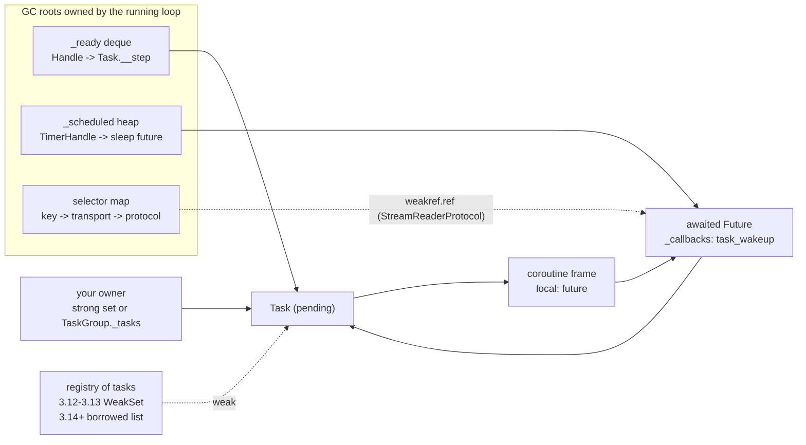

# Why Unreferenced asyncio.create_task() Calls Disappear Under Garbage Collection and How to Build a Lifespan-Scoped Task Pool

> [!summary] Claim
> The event loop never owns a waiting task: a task parked on a future survives only while some strong path from a loop root (ready queue, timer heap, selector map) or from your code reaches that future, so a dangling `create_task()` whose future is held weakly is destroyed by the cycle collector mid-`await`, its `finally` runs under `GeneratorExit`, and the fix is to give every background task an owner whose lifetime is the application's: a lifespan-scoped `TaskGroup` pool that holds references, bounds admission, isolates failures, and drains on shutdown.

Part of [ASGI Servers and Async Runtime](README.md) in [API Engineering](../README.md).

## TL;DR

Mechanism: CPython registers scheduled tasks weakly (a `WeakSet` in 3.12 and 3.13, a per-thread linked list of borrowed pointers since 3.14), so a pending task is kept alive only by the future it awaits, through that future's `task_wakeup` callback, and dies with it when the future is unreachable from any root.
Contract rule: whoever calls `create_task()` owns the task and must keep a strong reference until it finishes and its exception is retrieved; the asyncio documentation says so in an "Important" box, and Ruff rule `RUF006` flags every dangling call.
Trap: most dangling tasks survive (a task in `asyncio.sleep()` is rooted by the timer heap), so the bug appears only when the awaited future hangs off a weak link (the stdlib `StreamReaderProtocol` holds its reader through `weakref.ref`), and the lab measures that the automatic collector destroys such a task after 683 container allocations on 3.12.13 and about 1980 on 3.13 to 3.15.
Portability: the hazard and every fix behave the same on 3.12.13, 3.13.18, 3.14.6, 3.14.10, 3.15.2, and 3.15.0b3 free-threaded in the lab; only the collection trigger differs (about 12,000 allocations on the free-threaded build, 12292 and 12589 in two verifier runs, because its collector also scales with the live heap).
When not to use a pool: work that must survive a crash, a deploy, or a `SIGKILL` (payments, emails with legal weight) belongs in a durable queue with an outbox, not in process memory, see [[BackgroundTasks-vs-Durable-Task-Queues-Celery-and-Dramatiq]].

## Mental model



A pending task sits in a three-object cycle: the task owns its coroutine, the suspended frame owns the future it is awaiting, and the future owns a bound `task_wakeup` method that points back at the task.
Solid arrows are strong references; dotted arrows are weak, and the cycle collector ignores them.
The loop reaches a task strongly only while a step is queued in `_ready` or running, or indirectly when the awaited future is reachable, for example from a `TimerHandle` in `_scheduled` or from a protocol registered in the selector.
If every path into the cycle is weak, as with the stream reader or a weak registry, and you dropped the task object, the whole cycle is garbage: the next collection destroys the task while it is still pending.
An owner arrow from your code (`U`) is the only edge that does not depend on how the awaited future happens to be wired, which is why the fix is ownership, not cleverness about which futures are safe.

## How it works

### What the loop holds, and what it does not

The 3.15 documentation for `asyncio.create_task()` carries an "Important" box that reads:

> Save a reference to the result of this function, to avoid a task disappearing mid-execution.
> The event loop only keeps weak references to tasks.
> A task that isn't referenced elsewhere may get garbage collected at any time, even before it's done.

The same box now adds that a set of tasks "never awaits the tasks, so if a task fails, its exception is never retrieved", and points to `asyncio.TaskGroup`, which "keeps a strong reference to each task".
The warning was requested in CPython gh-88831 (bpo-44665, opened 2021-07-18, closed 2022-06-07), titled "asyncio.create_task() documentation should mention user needs to keep reference to the task".

The registry behind `asyncio.all_tasks()` changed shape in 3.14, and neither shape is an owner:

- 3.12 and 3.13: the C module state holds `scheduled_tasks`, a `WeakSet` ("WeakSet containing all tasks scheduled to run on event loops"), plus `eager_tasks`, a plain `set` that holds a task strongly only while its first step runs eagerly `(CPython 3.12.13 Modules/_asynciomodule.c, asyncio_state)`.
  The pure-Python fallback says the same: `_scheduled_tasks = weakref.WeakSet()` and `_eager_tasks = set()`, with the comment that eager tasks "may graduate to a WeakSet if the task blocks on IO" `(CPython 3.12.13 Lib/asyncio/tasks.py, module globals _scheduled_tasks and _eager_tasks)`.
- 3.14 and 3.15: native tasks embed a `struct llist_node task_node`, and `register_task()` links the task into `tstate->asyncio_tasks_head`, a per-thread doubly linked list `(CPython 3.14.10 Modules/_asynciomodule.c, register_task)`.
  The list "holds borrowed references to task", so `all_tasks()` must `_Py_TryIncref` each node because "it is possible that the task is concurrently deallocated" `(CPython 3.14.10 Modules/_asynciomodule.c, add_tasks_llist)`.
  `TaskObj_dealloc` unlinks the task after finalization, and third-party task classes that do not inherit from the native `Task` still go into a `WeakSet` named `non_asyncio_tasks`.
  What's New in 3.14 credits the list with "10-20%" better standard benchmark results and lower memory (gh-107803, Kumar Aditya); the issue explains that the `WeakSet` and its weakref callbacks were the cost.
- The lab confirms which shape each interpreter runs: `dir(_asyncio)` exposes `_scheduled_tasks` and `_eager_tasks` on 3.12.13 and 3.13.18, and exposes `all_tasks` and neither set on 3.14.10, 3.15.2, and 3.15.0b3t.

The 3.14 rewrite made registration faster but kept the semantics: a borrowed pointer does not keep anything alive, exactly like the weak set before it.

### The strong edges that do keep a pending task alive

When a step returns a future, the task subscribes to it: `wrapper = PyCFunction_New(&TaskWakeupDef, (PyObject *)task)` followed by `future_add_done_callback(..., wrapper, task->task_context)`, commented `/* result.add_done_callback(task._wakeup) */` `(CPython 3.14.10 Modules/_asynciomodule.c, task_step_handle_result_impl)`.
That builtin method object holds the task as `self`, so the edge runs from the future to the task.
The task also holds the future (`task_fut_waiter`), and the suspended frame holds it as a local, which closes the cycle.

Which roots reach a future in practice:

- A step that is queued: `loop.call_soon(self.__step, ...)` puts a `Handle` in `_ready`, and the `Handle` holds the bound method.
- A timer: `asyncio.sleep(delay)` with `delay > 0` calls `loop.call_later(delay, futures._set_result_unless_cancelled, future, result)` `(CPython 3.14.10 Lib/asyncio/tasks.py, sleep)`, and `call_at` does `heapq.heappush(self._scheduled, timer)` `(CPython 3.14.10 Lib/asyncio/base_events.py, BaseEventLoop.call_at)`, so the heap reaches the future and the future reaches the task.
- I/O: `_add_reader` registers a `Handle` in the selector `(CPython 3.14.10 Lib/asyncio/selector_events.py, BaseSelectorEventLoop._add_reader)`, which reaches the transport and the protocol, and from there whatever the protocol holds strongly.
- Your code: any variable, set, or task group that holds the task, or holds an object that holds the future.

This is why the folk version ("any unreferenced task can vanish") is wrong, and why the bug is rare enough to escape tests: the lab's dangling task in `asyncio.sleep(0.01)` survives an explicit `gc.collect()` and finishes on every interpreter.
Guido van Rossum summarized the design on gh-91887: "it was *already* the case that tasks had to be kept alive by their owner -- ISTM a weakset was used specifically to avoid keeping tasks alive longer than necessary."

### Where the strong path breaks

A task dies only when the future it awaits has no strong path from a root, and three real shapes produce that.

1. A weak link from the producer to the consumer.
   `StreamReaderProtocol.__init__` stores `self._stream_reader_wr = weakref.ref(stream_reader)` `(CPython 3.14.10 Lib/asyncio/streams.py, StreamReaderProtocol.__init__)`, a change made in 2018 to "Avoid circular references in asyncio streams" (gh-78819, bpo-34638).
   The selector reaches the transport and the protocol, but the protocol reaches the reader only weakly, so the reader's `_waiter` future and the task parked in `reader.read()` are reachable only from the task itself.
   On gh-91887 a participant (CendioOssman, 2023-10-31) traced the broken chain as `BaseSelectorEventLoop => EPollSelector => SelectorKey => Handle => _SelectorSocketTransport => StreamReaderProtocol =x=> StreamReader => Future => Task` (the original uses a multiplication sign for the broken link), and later posted a reproducer that opens a connection in a dangling task and calls `gc.collect()` every three seconds.
   The server side was fixed earlier by gh-90467 ("Task created by StreamReaderProtocol gets garbage collected", closed 2022-09-09): the protocol now keeps `self._task = self._loop.create_task(res)` and a `_strong_reader` until the connection is made; the client side (`open_connection`) still has the weak link in 3.14.10, and the lab reproduces the loss with a `socket.socketpair()` on every interpreter.
2. A weak registry in your own code.
   A correlation-id map built as `weakref.WeakValueDictionary` to avoid leaking futures of callers that gave up is the same shape as the stream reader; the lab's `ReplyRegistry` is exactly that, and the dispatcher's later `deliver()` finds nothing because the waiter was destroyed.
3. Abandoned siblings.
   `asyncio.gather()` raises on the first child failure and leaves the other children running; for children it created from bare coroutines it sets `fut._log_destroy_pending = False` because "the caller can't control it" `(CPython 3.14.10 Lib/asyncio/tasks.py, gather)`.
   If such a sibling is parked on a weakly held future it is destroyed with no log line at all, which the lab asserts.
   gh-91887 also names `shield()` (the inner task is free-flying once the outer await is cancelled) as a source of unowned tasks.

A subtle timing detail in shape 3: the gathering future stays reachable for as long as the loop `Handle` that delivered the failure is executing, because `_run_once` keeps it in the local variable `handle` until the next `popleft()` and only sets `handle = None` after the loop over `_ready` finishes `(CPython 3.14.10 Lib/asyncio/base_events.py, BaseEventLoop._run_once)`.
The lab's first version called `gc.collect()` right after `except ValueError` and saw the sibling survive; a referrer walk showed a tuple `(task_wakeup, _GatheringFuture)` still alive, and one `await asyncio.sleep(0)` before collecting made the loss reproducible.
So a sibling survives or vanishes depending on whether a collection happens before or after the next loop iteration, which is the textbook shape of a heisenbug.

### What destruction looks like

The collector finalizes every object in the garbage cycle before clearing it.
`TaskObj_finalize` checks `task->task_state != STATE_PENDING || !task->task_log_destroy_pending`, and otherwise calls the loop's `call_exception_handler` with `message` `"Task was destroyed but it is pending!"`, the `task`, and a `source_traceback` when debug mode recorded one `(CPython 3.14.10 Modules/_asynciomodule.c, TaskObj_finalize)`.
The coroutine's own finalizer closes it, which throws `GeneratorExit` into the suspended frame at the `await`, so `except BaseException` and `finally` blocks run; the lab records `unwound:GeneratorExit` for every destroyed task.
Cleanup that needs to suspend cannot run there: in a scratch run on 3.12.13 and 3.14.10, an `await asyncio.sleep(0.01)` inside that `finally` produced the unraisable `RuntimeError: coroutine ignored GeneratorExit`, so the connection release, the metrics flush, or the "mark job failed" write never happens.
The loss itself is silent to the caller: the request that spawned the task already returned `202 Accepted`, and the only trace is one log line, or none for `gather` children.
Running with `PYTHONASYNCIODEBUG=1` or `loop.set_debug(True)` makes futures record `source_traceback`, so the log names the `create_task()` call site.

### When the collector actually runs

Since 3.12 "the Garbage Collector now runs only on the eval breaker mechanism of the Python bytecode evaluation loop instead of object allocations" (What's New in 3.12).
In the generational collector, `_PyObject_GC_Link` increments `generations[0].count` for every new container and, once it exceeds the threshold, calls `_Py_ScheduleGC`, which only sets `_PY_GC_SCHEDULED_BIT`; the collection runs at the next eval-breaker check `(CPython 3.14.10 Python/gc.c, _PyObject_GC_Link)`.
The free-threaded collector adds a heap-proportional guard: `gc_should_collect` returns false while `count < gcstate->long_lived_total / 4`, "Avoid quadratic behavior by scaling threshold to the number of live objects." `(CPython 3.15.0b3 Python/gc_free_threading.c, gc_should_collect)`.
3.14.0 to 3.14.4 shipped an incremental collector with only young and old generations; 3.14.5 reverted it to the 3.13 generational collector "due to a number of reports of significant memory pressure in production environments" (What's New in 3.14, Garbage collection), so 3.14 point releases differ in when an orphan dies.

The lab measures the window without any explicit `gc.collect()`: after one full collection it parks an orphan on a weakly held future and appends empty lists until a weakref callback reports the task's death.
The callback matters: a first version polled `probe()` after every allocation, and in a scratch run on 3.14.6 and 3.14.10 the orphan survived 5,000,000 allocations and ten generation-2 collections (fifteen on 3.12.13), yet one explicit `gc.collect()` destroyed it at once.
A plain two-object cycle showed the same effect in a scratch run: polled after every allocation it survived 300,000 allocations on 3.12.13 and 3.14.10, while polling only every second allocation found it dead after 8408 (3.12.13) and 24008 (3.14.10) in the verifier's rerun; the exact count depends on the loop body, and the drafter's variant saw 782 and 2082.
The bytecode-level cause was not established here, and a reference held by the probe call itself is only a guess; the lesson is measured: observing an object can keep it alive, so a debugger, a log line holding `repr(task)`, or an exception traceback can make the bug disappear.

### The second hazard: exceptions nobody retrieves

A task that fails stores the exception and sets `fut_log_tb`; only `FutureObj_finalize`, at deallocation, reports `"%s exception was never retrieved"` (rendered `Task exception was never retrieved`) through the loop's exception handler `(CPython 3.14.10 Modules/_asynciomodule.c, FutureObj_finalize)`.
The lab shows the consequence: while the failed task is referenced (for example by a "keep a reference" set that never removes failed tasks, or by a list), the exception handler sees nothing; the message appears only after the last reference is dropped.
A strong set with `add_done_callback(background_tasks.discard)` fixes disappearance and moves the error report to the moment the set drops the task, but it still never records the failure in your metrics; the pool below retrieves every exception in the task itself.

### The third hazard: shutdown order

Servers own their request tasks, not yours.
Uvicorn 0.54.0 creates each request task with `self.loop.create_task(self.cycle.run_asgi(app))`, adds it to `server_state.tasks`, and removes it with `task.add_done_callback(self.tasks.discard)` `(uvicorn 0.54.0 uvicorn/protocols/http/h11_impl.py, H11Protocol.handle_events)`; `httptools_impl.py` does the same.
On shutdown `Server.shutdown` closes listeners, calls `connection.shutdown()`, sleeps `0.1` seconds, then runs `Server._wait_tasks_to_complete` (which polls `server_state.connections` and then `server_state.tasks` in `while ...: await asyncio.sleep(0.1)` loops) under `asyncio.wait_for(..., timeout=self.config.timeout_graceful_shutdown)` (default `None`, so unbounded), cancels the remaining tasks with `"Task cancelled, timeout graceful shutdown exceeded"` on timeout, and only then, unless `force_exit` is set, runs `self.lifespan.shutdown()` `(uvicorn 0.54.0 uvicorn/server.py, Server.shutdown)`.
Hypercorn 0.18.0 starts each ASGI app call with `TaskGroup.spawn_app`, which calls `spawn`, which runs `self._task_group.create_task(func(*args))` on an `asyncio.TaskGroup` `(hypercorn 0.18.0 hypercorn/asyncio/task_group.py, TaskGroup.spawn)`.
A task your handler spawned is in neither set, so neither server waits for it: it keeps running while lifespan shutdown closes the database pool it uses, and when `serve()` returns, `asyncio.run` calls `_cancel_all_tasks`, which cancels every task left in `all_tasks()` and reports late failures as `"unhandled exception during asyncio.run() shutdown"` `(CPython 3.14.10 Lib/asyncio/runners.py, _cancel_all_tasks)`.
Uvicorn hit the disappearance bug in its own lifespan code: PR 972 (merged 2021-03-04) "Prevent garbage collection of main lifespan task" reproduced `Task was destroyed but it is pending!` for `LifespanOn.main()` by inserting `gc.collect()` into `_run_once`, and the fix still reads `main_lifespan_task = loop.create_task(self.main())  # noqa: F841` with the comment "Keep a hard reference to prevent garbage collection" `(uvicorn 0.54.0 uvicorn/lifespan/on.py, LifespanOn.startup)`.

Starlette's `BackgroundTask` is not fire-and-forget at all: `Response.__call__` sends `http.response.start` and `http.response.body`, then runs `await self.background()` in the same request task `(starlette 1.10.0 starlette/responses.py, Response.__call__)`, and FastAPI's `BackgroundTasks` subclasses it `(fastapi 0.162.0 fastapi/background.py, BackgroundTasks)`.
That makes background work owned (by Uvicorn's `server_state.tasks`) and drained on shutdown, at two costs: it occupies a request slot (`len(self.tasks) >= self.limit_concurrency` counts it), and it runs serially after the response, with no bound across requests.
Sibling note [[Starlette-Responses-StreamingResponse-FileResponse-and-Background-Execution]] covers that path.

### The fix ladder

1. Keep a reference: the documented `background_tasks.add(task)` plus `task.add_done_callback(background_tasks.discard)`.
   It fixes disappearance and nothing else: no bound, no error capture, no drain.
2. Use a task group for work with a natural scope: `asyncio.TaskGroup` stores every child in `self._tasks` and discards it in `_on_task_done` `(CPython 3.14.10 Lib/asyncio/taskgroups.py, TaskGroup.create_task)`; AnyIO 4.16.0 keeps `self._tasks: set[asyncio.Task]` and adds each spawned task in `_spawn` `(anyio 4.16.0 anyio/_backends/_asyncio.py, TaskGroup._spawn)`.
   The nursery rule ("can't return until they've all finished", Nathaniel J. Smith) makes ownership structural; see [[AnyIO-Structured-Concurrency-TaskGroups-CancelScopes-and-ExceptionGroups]].
3. For work that must outlive the request, move the scope up to the application: one group entered in the lifespan, exposed through lifespan state.
   Starlette's router copies a mapping yielded by the lifespan into the scope with `scope["state"].update(maybe_state)` `(starlette 1.10.0 starlette/routing.py, Router.lifespan)`, and handlers read it as `request.state.pool`; see [[ASGI-Lifespan-Protocol-Startup-Shutdown-and-Scope-State]].
4. For work that must survive the process, use a durable queue; a pool is still useful in front of it, for bounded in-process retries and for publishing to the queue.

### Designing the lifespan-scoped pool

A plain `TaskGroup` is the wrong object to hand to request handlers, for four reasons the pool fixes one by one.

- Sibling cancellation: a group cancels all children and its host task when one child raises; the host here is the lifespan task, so one failed email would cancel every job and abort the application.
  The pool wraps each job in `_run`, which catches `Exception`, records it, and returns `False`; `BaseException` (`KeyboardInterrupt`, `SystemExit`) still aborts the group on purpose.
- No bound: a group admits unlimited children, which is OWASP API4:2023 Unrestricted Resource Consumption with extra steps.
  The pool takes an `asyncio.Semaphore(limit)` slot before creating the task, so the bound covers queued and running jobs, and it releases the slot in a done callback, which runs even if the task is cancelled before its first step.
- Two admission policies: `try_spawn` rejects immediately when `self._slots.locked()` (the handler answers `503` with `Retry-After`, which RFC 9110 Section 15.6.4 allows for "temporary overload" and Section 10.2.3 defines), and `spawn` waits for a slot, which pushes backpressure into the caller; see [[End-to-End-Backpressure-TCP-Windows-ASGI-Send-Await-and-Bounded-Queues]].
- No deadline: a group's `__aexit__` waits forever.
  The pool's `__aexit__` first refuses new work, then `asyncio.wait(..., timeout=drain_timeout)`, cancels stragglers with a message, and only then lets the group await their cleanup; if the lifespan task itself is cancelled during the drain, it forwards that cancellation to the group, which cancels every child.

Coroutine objects are created before admission, so every refusal path calls `job.close()`; otherwise the rejected coroutine would be collected unawaited and warn `coroutine ... was never awaited`.
The done callback also calls `job.close()`, a no-op for a finished coroutine, to cover a job cancelled before its first step.
`asyncio.TaskGroup.__aenter__` records the current task as `_parent_task`, so the pool must be entered and exited in the same task; `create_task` can be called from any task on the loop, which is what lets request tasks spawn into a group owned by the lifespan task.
A spawned task copies the spawning context (`self._context = contextvars.copy_context()` in `Task.__init__` `(CPython 3.14.10 Lib/asyncio/tasks.py, Task.__init__)`), so request-scoped `ContextVar` values such as a request id follow the job, as a snapshot; see [[ASGI-State-Isolation-and-ContextVars-Across-Request-Lifecycle]] and CPython gh-140947 ("context variables can leak out of asyncio.Task", opened 2025-11-03, closed 2026-07-23), which Uvicorn's opt-in `reset_contextvars` works around.

### Linting the call sites

Ruff 0.17.4 rule `RUF006` (`asyncio-dangling-task`, in the `RUF` set this workspace selects) "checks for `asyncio.create_task` and `asyncio.ensure_future` calls that do not store a reference".
Run against a scratch file, it flagged `asyncio.create_task(job())`, `asyncio.ensure_future(job())`, `loop.create_task(job())`, and also `_ = asyncio.create_task(job())`, each as "Store a reference to the return value of ...".
It did not flag `weakref.ref(asyncio.create_task(...))` in the lab, which is the point: a lint catches the syntax, ownership review catches the semantics.

## Numbers and limits

Measured rows ran on an Apple M3 Pro, macOS 27.3, arm64, on 2026-11-15, with the interpreter named in the row.

| Quantity | Value | Source |
|---|---|---|
| `gc.get_threshold()` | `(700, 10, 10)` on 3.12.13; `(2000, 10, 10)` on 3.13.18, 3.14.10, 3.15.2, 3.15.0b3t | measured, `python -c "import gc; print(gc.get_threshold())"` |
| Container allocations until the automatic collector destroys a parked orphan | 683 (3.12.13), 1982 (3.13.18), 1979 (3.14.6 and 3.14.10), 1981 (3.15.2), 12292 and 12589 (3.15.0b3t, GIL off, two runs; the drafter's pytest leg saw 11804) | measured by the verifier, `asyncio.run(allocations_until_orphan_collected(100_000))` with `PYTHONPATH=labs/src` on each interpreter; GIL builds reproduced the drafter's counts exactly |
| Free-threaded collection guard | young count must be `>= long_lived_total / 4` as well as above the threshold | `(CPython 3.15.0b3 Python/gc_free_threading.c, gc_should_collect)` |
| Incremental GC in 3.14 | 3.14.0 to 3.14.4 only; reverted in 3.14.5 | What's New in 3.14 (as of 2026-11) |
| Benchmark gain from the 3.14 task linked list | "10-20%" on standard benchmarks | What's New in 3.14, gh-107803 |
| `all_tasks()` retries on a concurrently mutated `WeakSet` (Python fallback, 3.12/3.13) | up to 1000 | `(CPython 3.12.13 Lib/asyncio/tasks.py, all_tasks)` |
| Uvicorn shutdown polling | `0.1` s after `connection.shutdown()`, then `0.1` s polls; `timeout_graceful_shutdown` default `None` | `(uvicorn 0.54.0 uvicorn/server.py, Server.shutdown)`, `uvicorn/config.py` |
| Pool admission in the lab app | `limit=2`: requests 1 and 2 get `202`, 3 and 4 get `503` with `Retry-After: 1` | lab, `test_lifespan_pool_returns_202_then_503_and_drains_on_shutdown` |
| Drain deadline in the lab | `drain_timeout=0.05`: fast job completes, stuck job cancelled, exit in `[0.05, 1.0)` s | lab, `test_drain_finishes_fast_jobs_and_cancels_stragglers_at_the_deadline` |
| gh-91887 "asyncio: Use strong references for free-flying tasks" | open, 52 comments, last updated 2024-07-02 | GitHub API (as of 2026-11) |

The allocation counts are the window in which a dangling task survives after it parks, in a lab loop that does nothing else.
No server was measured, so the note makes no claim about how often the window closes in production; any handler that allocates containers shortens it, and the only safe reading is that the window can close at any await.

## Portability

| Behavior | 3.12.13 | 3.13.18 | 3.14.6 / 3.14.10 | 3.15.2 | 3.15.0b3t (GIL off) | Proof |
|---|---|---|---|---|---|---|
| Native task registry | `WeakSet` + eager `set` | `WeakSet` + eager `set` | borrowed linked list | borrowed linked list | borrowed linked list (`dir(_asyncio)`) | C source at tags; `dir(_asyncio)` measured on all five |
| Orphan on weakly held future destroyed under `gc.collect()`, `GeneratorExit`, log line | yes | yes | yes | yes | yes | lab |
| Same with `eager_task_factory` (first step runs inside `create_task`) | yes | yes | yes | yes | yes | lab |
| `gather` sibling destroyed with no log line | yes | yes | yes | yes | yes | lab |
| Dangling task in `asyncio.sleep(0.01)` survives and finishes | yes | yes | yes | yes | yes | lab |
| `StreamReader.read()` task lost when unreferenced (`socketpair`) | yes | yes | yes | yes | yes | lab, `socket` tier |
| `Task exception was never retrieved` only at deallocation | yes | yes | yes | yes | yes | lab |
| Automatic collector destroys orphan within 100000 allocations | 683 | 1982 | 1979 / 1979 | 1981 | 12292 / 12589 (two runs) | lab probe, rerun by the verifier |
| `TaskPool`: survives GC, bound, isolation, drain, close, Starlette lifespan | pass | pass | pass | pass | pass | lab, 17 tests per leg |
| Uvicorn 0.54.0 owns request tasks, not app-spawned tasks | n/a | n/a | n/a | n/a | n/a | source, `server_state.tasks` |
| Hypercorn 0.18.0 owns request tasks via `asyncio.TaskGroup` | n/a | n/a | n/a | n/a | n/a | source, `hypercorn/asyncio/task_group.py` |
| Granian 2.8.7 creates each request task with `loop.create_task` (default `task_impl`, forced on Python >= 3.12) and keeps it only in the per-request watcher; app-spawned tasks are not tracked | n/a | n/a | n/a | n/a | n/a | source, `granian/_futures.py` `_cbsched_aioschedule`, `src/asgi/callbacks.rs` `callback_impl_taskref`, `granian/server/common.py`; shutdown draining not checked |

Every lab leg ran once: the workspace interpreter 3.14.6 (`uv run --frozen pytest`), then 3.12.13, 3.13.18, 3.14.10, and 3.15.2 through `uv run --frozen --offline --python <path>` with a separate `UV_PROJECT_ENVIRONMENT` each.
Those four legs and the free-threaded leg ran before the last edit, which deleted one unused attribute (`self._limit`) from `TaskPool.__init__`; the workspace leg ran on the final code, and the verifier reran it once (17 passed) plus the allocation probe on all six interpreters.
The free-threaded leg ran on 3.15.0b3t, not the matrix's 3.15.2t, which is not installed here, in a minimal venv (`starlette==1.10.0`, `httpx==0.28.1`, `anyio==4.16.0`, `asgi-lifespan==2.1.0`, `pytest==9.2.0`, `pytest-asyncio==1.4.1.post1`, `PYTHONPATH=src`); 3.12.13 stands in for the matrix's 3.12.16.
HTTP/1.1, HTTP/2, and HTTP/3 do not change this mechanism, which lives entirely in the application's task graph; no per-protocol cell is claimed.
The Granian row comes from reading the 2.8.7 source distribution from PyPI (`granian/_futures.py`, `granian/server/common.py`, `src/asgi/callbacks.rs`, `src/callbacks.rs`): `TaskImpl.rust` falls back to `TaskImpl.asyncio` on Python 3.12 and later with a warning, `_CBSchedulerAIO` runs `task = loop.create_task(coro)` then `watcher.taskref(task)`, which stores the task in the watcher's `aio_taskref` `OnceLock`.
Granian's lifespan handler is also started with a bare `loop.create_task(self.handle())` bound to a local (`granian/asgi.py`, `LifespanProtocol.startup`); whether that task survives collection was not tested, and its shutdown ordering relative to app-spawned tasks was not read.
No Granian run was made, and Debian and Alpine container legs were not run (lab checks paused).

## Worked example

The [implementation](../labs/src/api_labs/f12_asgi_servers_and_async_runtime/fire_and_forget.py) holds the hazard probes, the `TaskPool`, and a Starlette app; the [test](../labs/tests/f12_asgi_servers_and_async_runtime/test_fire_and_forget_task_hazards_gc_disappearance_and_managed_task_nurseries.py) asserts each probe's event trace and each pool guarantee.
Every hazard is shown as a pair (dropped and kept, weak and strong registry, sleeping and parked), so each test fails if the mechanism it names were absent.

The weak registry and the background job, verbatim from the lab file:

```python
class ReplyRegistry:
    """Correlation-id -> future map that holds futures weakly.

    The weak values look like leak hygiene (a caller that gave up does not pin
    its future), but they also remove the only strong path from the producer
    to the waiting task: the same shape as ``StreamReaderProtocol``, which
    holds its ``StreamReader`` through ``weakref.ref`` (gh-90467).
    """

    def __init__(self, *, weak: bool) -> None:
        self._pending: (
            weakref.WeakValueDictionary[str, asyncio.Future[str]] | dict[str, asyncio.Future[str]]
        ) = weakref.WeakValueDictionary() if weak else {}

    def expect(self, key: str) -> asyncio.Future[str]:
        future: asyncio.Future[str] = asyncio.get_running_loop().create_future()
        self._pending[key] = future
        return future

    def deliver(self, key: str, payload: str) -> bool:
        future = self._pending.pop(key, None)
        if future is None or future.done():
            return False
        future.set_result(payload)
        return True


async def await_reply(registry: ReplyRegistry, key: str, events: list[str]) -> None:
    """Background job: wait for a reply, record how the frame was unwound."""
    future = registry.expect(key)
    events.append("waiting")
    try:
        payload = await future
    except BaseException as exc:  # GeneratorExit when the collector closes the coroutine
        events.append(f"unwound:{type(exc).__name__}")
        raise
    events.append(f"got:{payload}")
```

The pool, verbatim from the lab file:

```python
class TaskPool:
    """A lifespan-scoped nursery for background jobs.

    - Strong references: every job is a child of one ``asyncio.TaskGroup``.
    - Backpressure: at most ``limit`` jobs admitted (queued or running).
    - Isolation: a job's ``Exception`` is recorded, not propagated, so one bad
      job never aborts the group and cancels its siblings.
    - Drain: on exit, refuse new jobs, wait up to ``drain_timeout`` seconds,
      cancel stragglers, and let the group await their cleanup.

    ``__aenter__`` and ``__aexit__`` must run in the same task (the lifespan
    task); spawning may happen from any task on the same loop.
    """

    def __init__(self, *, limit: int, drain_timeout: float) -> None:
        if limit < 1:
            raise ValueError("limit must be >= 1")
        self._drain_timeout = drain_timeout
        self._slots = asyncio.Semaphore(limit)
        self._group = asyncio.TaskGroup()
        self._tasks: set[asyncio.Task[bool]] = set()
        self._closing = False
        self.stats = PoolStats()

    @property
    def in_flight(self) -> int:
        return len(self._tasks)

    async def __aenter__(self) -> Self:
        await self._group.__aenter__()
        return self

    async def __aexit__(
        self,
        exc_type: type[BaseException] | None,
        exc: BaseException | None,
        tb: TracebackType | None,
    ) -> None:
        self._closing = True
        try:
            if exc is None and self._tasks:
                _, late = await asyncio.wait(set(self._tasks), timeout=self._drain_timeout)
                for task in late:
                    task.cancel(msg="drain deadline exceeded")
        except BaseException as drain_exc:  # cancelled while draining: cancel all children
            await self._group.__aexit__(type(drain_exc), drain_exc, drain_exc.__traceback__)
            raise
        await self._group.__aexit__(exc_type, exc, tb)

    async def try_spawn(self, job: Job, *, name: str) -> asyncio.Task[bool] | None:
        """Admit ``job`` if a slot is free right now; otherwise close it and return None."""
        if self._closing:
            job.close()
            raise PoolClosedError("pool is draining")
        if self._slots.locked():
            job.close()
            self.stats.rejected += 1
            return None
        return await self._admit(job, name)

    async def spawn(self, job: Job, *, name: str) -> asyncio.Task[bool]:
        """Admit ``job``, waiting for a slot (caller-side backpressure)."""
        if self._closing:
            job.close()
            raise PoolClosedError("pool is draining")
        return await self._admit(job, name)

    async def _admit(self, job: Job, name: str) -> asyncio.Task[bool]:
        try:
            await self._slots.acquire()  # does not suspend when a slot is free
        except BaseException:
            job.close()
            raise
        if self._closing:  # closed while we waited for a slot
            self._slots.release()
            job.close()
            raise PoolClosedError("pool is draining")
        task = self._group.create_task(self._run(job, name), name=name)
        self._tasks.add(task)
        task.add_done_callback(lambda done: self._on_done(done, job))
        return task

    async def _run(self, job: Job, name: str) -> bool:
        try:
            await job
        except Exception as exc:  # isolate: record, do not abort the group
            self.stats.errors.append(f"{name}: {type(exc).__name__}: {exc}")
            return False
        return True

    def _on_done(self, task: asyncio.Task[bool], job: Job) -> None:
        self._tasks.discard(task)
        self._slots.release()
        job.close()  # no-op if it ran; silences "never awaited" if cancelled before start
        if task.cancelled():
            self.stats.cancelled += 1
        elif task.exception() is None:
            if task.result():
                self.stats.completed += 1
            else:
                self.stats.failed += 1
```

The lifespan wiring and the end-to-end test, verbatim from the lab files:

```python
def build_app(
    *,
    limit: int,
    drain_timeout: float,
    job_factory: Callable[[str], Awaitable[None]],
    pools: list[TaskPool],
) -> Starlette:
    """A Starlette app whose lifespan owns a ``TaskPool``; ``POST /jobs/{id}`` enqueues."""

    @asynccontextmanager
    async def lifespan(_app: Starlette) -> AsyncGenerator[dict[str, TaskPool]]:
        async with TaskPool(limit=limit, drain_timeout=drain_timeout) as pool:
            pools.append(pool)
            yield {"pool": pool}

    async def enqueue(request: Request) -> JSONResponse:
        pool: TaskPool = request.state.pool
        job_id = str(request.path_params["job_id"])

        async def job() -> None:
            await job_factory(job_id)

        try:
            task = await pool.try_spawn(job(), name=f"job-{job_id}")
        except PoolClosedError:
            task = None
        if task is None:
            return JSONResponse({"error": "busy"}, status_code=503, headers={"Retry-After": "1"})
        return JSONResponse({"accepted": job_id}, status_code=202)

    return Starlette(routes=[Route("/jobs/{job_id}", enqueue, methods=["POST"])], lifespan=lifespan)
```

```python
@pytest.mark.unit
@pytest.mark.asyncio
async def test_lifespan_pool_returns_202_then_503_and_drains_on_shutdown() -> None:
    gate = asyncio.Event()
    done: list[str] = []

    async def job_factory(job_id: str) -> None:
        await gate.wait()
        done.append(job_id)

    pools: list[TaskPool] = []
    app = build_app(limit=2, drain_timeout=1.0, job_factory=job_factory, pools=pools)
    async with LifespanManager(app) as manager:
        transport = httpx.ASGITransport(app=manager.app)
        async with httpx.AsyncClient(transport=transport, base_url="http://test") as client:
            codes = [(await client.post(f"/jobs/{i}")).status_code for i in range(3)]
            busy = await client.post("/jobs/9")
            assert pools[0].in_flight == 2  # jobs outlive the requests that spawned them
            gate.set()
    assert codes == [202, 202, 503]
    assert busy.headers["retry-after"] == "1"
    assert sorted(done) == ["0", "1"]  # drained before lifespan shutdown completed
    assert (pools[0].stats.completed, pools[0].stats.rejected) == (2, 2)
```

The disappearance test and its kept twin, verbatim:

```python
@pytest.mark.unit
@pytest.mark.asyncio
@pytest.mark.parametrize("eager", [False, True], ids=["lazy", "eager"])
async def test_unreferenced_task_is_destroyed_mid_await(eager: bool) -> None:
    report = await orphan_on_registry_future(keep_reference=False, weak_registry=True, eager=eager)
    assert report.collected
    assert not report.delivered  # the reply arrives after the waiter is gone
    first = ("waiting", "create_task returned") if eager else ("create_task returned", "waiting")
    assert report.events == (*first, "unwound:GeneratorExit")
    assert report.loop_messages == (DESTROYED,)


@pytest.mark.unit
@pytest.mark.asyncio
async def test_strong_reference_keeps_task_alive_until_reply() -> None:
    report = await orphan_on_registry_future(keep_reference=True, weak_registry=True)
    assert not report.collected
    assert report.delivered
    assert report.events == ("create_task returned", "waiting", "got:pong")
    assert report.loop_messages == ()
```

Captured run, CPython 3.14.6, macOS 27.3 arm64, from `labs/`:

```text
$ uv run --frozen pytest tests/f12_asgi_servers_and_async_runtime/test_fire_and_forget_task_hazards_gc_disappearance_and_managed_task_nurseries.py -v -p no:cacheprovider
collecting ... collected 17 items

::test_unreferenced_task_is_destroyed_mid_await[lazy] PASSED [  5%]
::test_unreferenced_task_is_destroyed_mid_await[eager] PASSED [ 11%]
::test_strong_reference_keeps_task_alive_until_reply PASSED [ 17%]
::test_strong_producer_link_also_roots_an_unreferenced_task PASSED [ 23%]
::test_gather_abandons_a_sibling_that_is_then_destroyed_silently PASSED [ 29%]
::test_sleeping_orphan_is_rooted_by_the_timer_heap PASSED [ 35%]
::test_unretrieved_exception_surfaces_only_at_deallocation PASSED [ 41%]
::test_automatic_gc_destroys_an_orphan_without_explicit_collect PASSED [ 47%]
::test_stdlib_stream_reader_task_needs_a_strong_reference[dropped] PASSED [ 52%]
::test_stdlib_stream_reader_task_needs_a_strong_reference[kept] PASSED [ 58%]
::test_pool_keeps_unreferenced_jobs_alive_under_gc PASSED [ 64%]
::test_pool_rejects_when_full_and_frees_the_slot_on_completion PASSED [ 70%]
::test_spawn_waits_for_a_slot_instead_of_rejecting PASSED [ 76%]
::test_failing_job_is_recorded_and_does_not_cancel_siblings PASSED [ 82%]
::test_drain_finishes_fast_jobs_and_cancels_stragglers_at_the_deadline PASSED [ 88%]
::test_spawn_after_close_is_refused PASSED [ 94%]
::test_lifespan_pool_returns_202_then_503_and_drains_on_shutdown PASSED [100%]

============================== 17 passed in 0.68s ==============================
```

The test path prefix is elided to `::` in the captured lines above; nothing else is edited.

## Pitfalls

> [!warning] Dangling `create_task()` in a request handler
> Trigger: `asyncio.create_task(notify(user))` in an endpoint that returns `202`, where `notify` awaits a client stream or a weakly registered reply.
> Symptom: some notifications never arrive, the only trace is `Task was destroyed but it is pending!`, and the rate changes with traffic because the collector runs every ~700 or ~2000 container allocations (measured above).
> Fix: spawn into a lifespan-owned pool; at minimum keep the task in a set with `add_done_callback(set.discard)`; enable `RUF006`.

> [!warning] Testing for the bug with a debugger or a log line
> Trigger: adding `logger.debug("spawned %r", task)` or a breakpoint to catch the disappearance.
> Symptom: the bug vanishes, because a live reference (a log record, a frame in the debugger, the value stack during a call) pins the task; the lab's first measurement saw an orphan survive five million allocations for this reason.
> Fix: reproduce with an explicit `gc.collect()` at the suspected point, as Uvicorn PR 972 did inside `_run_once`, and observe death with a `weakref.ref(task, callback)`.

> [!warning] `asyncio.gather` used for fan-out without a group
> Trigger: `await asyncio.gather(fetch_a(), fetch_b())` where `fetch_a` raises and `fetch_b` is mid-request.
> Symptom: `fetch_b` keeps running unowned; if it is then collected, no log line is written, because `gather` disabled `_log_destroy_pending` for it (lab).
> Fix: use `asyncio.TaskGroup` or an AnyIO task group, which cancels and awaits the siblings before raising.

> [!warning] A pool that is just a `TaskGroup`
> Trigger: `app.state.tg = tg` from a lifespan `async with asyncio.TaskGroup() as tg`.
> Symptom: the first failing job cancels every other job and the lifespan task, so the server reports lifespan failure or exits; with no bound, a burst spawns thousands of jobs.
> Fix: catch `Exception` per job, bound admission with a semaphore, and drain with a deadline, as `TaskPool` does.

> [!warning] Background work running after lifespan shutdown
> Trigger: unowned tasks still running when `SIGTERM` arrives.
> Symptom: Uvicorn waits only for its own request tasks, runs lifespan shutdown (closing pools), and `asyncio.run` then cancels leftovers, so jobs fail with "pool is closed" errors or `CancelledError` mid-write.
> Fix: own the tasks in the lifespan and drain them before closing resources: in the lab, `TaskPool.__aexit__` runs inside the lifespan, before the code after `yield`; see [[Graceful-Shutdown-SIGTERM-Drain-Windows-and-Kubernetes-PreStop-Hooks]].

> [!warning] Cleanup that needs to `await` in a collected task
> Trigger: `finally: await conn.release()` in a job that is destroyed by the collector.
> Symptom: `RuntimeError: coroutine ignored GeneratorExit` is reported as unraisable and the release never happens (measured on 3.12.13 and 3.14.10 in a scratch run), so the connection pool slowly leaks; see [[Memory-Leaks-in-Long-Running-Python-API-Workers]].
> Fix: prevent the destruction by owning the task; cancellation through the pool delivers `CancelledError`, under which `await` in cleanup works (see [[Cancellation-Semantics-CancelledError-Swallowing-and-Shielded-Cleanup]]).

> [!warning] Rejected coroutines that were never awaited
> Trigger: `pool.try_spawn(job(), ...)` returns `None` and the caller drops the coroutine object.
> Symptom: `RuntimeWarning: coroutine 'job' was never awaited` at collection, which test suites running with `-W error` turn into failures far from the cause.
> Fix: the pool closes the coroutine on every refusal path; a factory-based API (`spawn(fn, *args)`) avoids creating it at all.

## Security and robustness

- Resource exhaustion (OWASP API4:2023 Unrestricted Resource Consumption): any endpoint that spawns work per request is an amplifier; an unbounded set or group lets one client create unlimited tasks, sockets, and memory, so the bound must sit at admission, and refusals must be cheap (`503` before any work, with `Retry-After`).
- Fairness: a single global `limit` lets one tenant fill every slot; partition the semaphore per tenant or per job class when tenants share a process, and see [[Load-Shedding-Priority-Traffic-Classes-and-LIFO-Queue-Management]].
- Silent data loss is a security issue when the background job is an audit write, a revocation, or a webhook: an orphan destroyed by the collector leaves no error to alert on, so audit-grade work must be durable and acknowledged, not spawned.
- Error capture: record each job failure with its name in the task itself; relying on `Task exception was never retrieved` means the report arrives at an arbitrary later time, or never while anything holds the task.
- Context leakage: a spawned task inherits a copy of the request's `contextvars`, including any authenticated principal stored there; jobs that must not act with the caller's identity should be spawned with an explicit fresh `contextvars.Context()`.
- Shutdown as an attack surface: a request that can enqueue long jobs can stretch an unbounded drain; `drain_timeout` must be smaller than the orchestrator's grace period, so the process exits on its own terms rather than by `SIGKILL`.
- Defense in depth: `RUF006` in CI, a pool as the only sanctioned spawn API (grep for `create_task` outside it in review), `PYTHONASYNCIODEBUG=1` in staging for `source_traceback`, and a metric on `in_flight` and `rejected`.

## The principal's view

The decision is about ownership, and it is organizational before it is technical: every unit of background work must have exactly one owner whose lifetime is at least as long as the work, and the platform should make the owned path the easy one.
In a Python API fleet that means one sanctioned primitive (a lifespan-scoped pool like `TaskPool`, or AnyIO's group behind a thin wrapper), a lint rule that rejects the unsanctioned one, and dashboards for its in-flight count, rejections, failures, and drain cancellations.
The trade-off is explicit: a bounded pool sheds load and makes some requests fail fast with `503`, where a dangling task would have "succeeded" and silently lost the work; the first is visible and retryable, the second is not.
Choose by durability: in-process pools for work that is cheap to lose and to recompute (cache warmers, best-effort notifications, telemetry flushes), a durable queue with an outbox for anything with business meaning, and a workflow engine for multi-step work that must survive deploys.
CPython itself has debated owning free-flying tasks since 2022 (gh-91887, still open as of 2026-11), with participants split between "garbage collection can be considered a feature" (a stuck task is a bug worth a warning) and "some extra references to tasks is the lesser evil" (both phrases are from one commenter, CendioOssman, who moved from the first to the second between 2023-09 and 2023-11, while Tornado maintainer Ben Darnell argued for a global strong set); a platform should not bet on that outcome.
Languages with structured concurrency by default (Trio's nurseries, Kotlin's coroutine scopes) make the owner mandatory at the call site, and Go's goroutines are GC roots that leak rather than vanish; when a team cannot enforce ownership in review, picking a runtime where the owner is part of the spawn API is a legitimate architectural choice.

## Interview questions

> [!question] L5: Why does the asyncio documentation tell you to keep a reference to the result of `create_task()`?
>
> > [!success]- Answer
> > The loop registers tasks only weakly: a `WeakSet` in 3.12 and 3.13, a list of borrowed pointers since 3.14.
> > A pending task is kept alive by whatever reaches the future it awaits, through that future's `task_wakeup` callback.
> > If nothing strong reaches that future and you dropped the task, the collector destroys the task mid-`await` and logs `Task was destroyed but it is pending!`.
> >
> > Follow-up: what is the smallest correct fix, and what does it still not handle?

> [!question] L5: Does a dangling task in `await asyncio.sleep(5)` that never disappears in your tests prove the code is safe?
>
> > [!success]- Answer
> > No.
> > A sleeping task is rooted by the loop's timer heap: `TimerHandle` -> future -> `task_wakeup` -> task, so it survives any collection.
> > The same task becomes collectible as soon as it awaits a future that is reachable only weakly, such as a `StreamReader` from `open_connection()`.
> > Safety depends on the wiring of every future the task will ever await, which is not something a caller can know.
> >
> > Follow-up: name a stdlib object whose producer holds its consumer weakly.

> [!question] L6: Predict the output.
>
> ```python
> import asyncio, gc, weakref
>
> async def job(fut_holder, log):
>     fut = asyncio.get_running_loop().create_future()
>     fut_holder.append(weakref.ref(fut))
>     try:
>         await fut
>     finally:
>         log.append("finally")
>
> async def main():
>     log, holder = [], []
>     asyncio.create_task(job(holder, log))
>     t2 = asyncio.create_task(asyncio.sleep(0.01))
>     await asyncio.sleep(0)
>     gc.collect()
>     print(log, holder[0]() is None, t2.done())
>     await t2
>
> asyncio.run(main())
> ```
>
> > [!success]- Answer
> > It prints `['finally'] True False`, with `Task was destroyed but it is pending!` logged by the default exception handler.
> > The first task's future is reachable only from its own frame, so the cycle is garbage and `GeneratorExit` runs the `finally`.
> > `t2` is referenced and also rooted by the timer heap, so it is still pending at the print.
> >
> > Follow-up: what changes if `job` stores `fut` in a module-level list instead of a weakref?

> [!question] L6: Debug this API: `POST /signup` returns `202` and should send a welcome email, but about one email in a few thousand never goes out with nothing in the error tracker, and the handler calls `asyncio.create_task(send_welcome(user))` where `send_welcome` uses a client built on `asyncio.open_connection`.
>
> > [!success]- Answer
> > The task is dangling and awaits a `StreamReader`, which the protocol holds through `weakref.ref`, so when a collection runs while it waits for the SMTP banner the whole cycle is destroyed.
> > Its `finally` runs under `GeneratorExit` and any `await` there fails with `coroutine ignored GeneratorExit`, so there is no retry and no error report, only a `Task was destroyed but it is pending!` log line, often unrouted.
> > Reproduce deterministically by calling `gc.collect()` after the task parks, as Uvicorn PR 972 did.
> > Fix: spawn into a lifespan-scoped pool that holds the task, records failures, bounds concurrency, and drains on shutdown; move the email to a durable queue if loss is unacceptable.
> >
> > Follow-up: why did the failure rate change after a release that only added caching?

> [!question] L6: Why is `asyncio.TaskGroup` entered in the lifespan not, by itself, a good background-job pool?
>
> > [!success]- Answer
> > One child that raises cancels every other child and the group's host task, which is the lifespan task, so one bad job aborts the application.
> > It admits unlimited children, so it is an unbounded resource amplifier.
> > Its `__aexit__` waits forever for children, so shutdown has no deadline.
> > A pool wraps each job to catch `Exception`, bounds admission with a semaphore, and drains with `asyncio.wait(timeout=...)` before cancelling stragglers.
> >
> > Follow-up: where must the semaphore slot be released so that a task cancelled before its first step does not leak it?

> [!question] L6: What does the collector do to a destroyed pending task's coroutine, and what can its cleanup still do?
>
> > [!success]- Answer
> > The task's finalizer logs the destroyed-pending message, and the coroutine's finalizer closes it, throwing `GeneratorExit` at the suspended `await`.
> > `except BaseException` and `finally` blocks run, but any `await` that would suspend raises `RuntimeError: coroutine ignored GeneratorExit`, reported as unraisable.
> > Synchronous cleanup works; async cleanup, such as releasing a pooled connection, does not.
> >
> > Follow-up: how does cancellation through an owner differ for the same cleanup code?

> [!question] L7+: CPython could keep a strong set of pending tasks: argue for and against making that the default.
>
> > [!success]- Answer
> > For: user intent is that a started task runs to completion, the fix is cheap, and Tornado already keeps a strong set per loop (cited on gh-91887).
> > Against: a task stuck on an abandoned future would leak forever instead of being reported, it changes `all_tasks()` and memory behavior for existing code, and third-party loops and task classes would have to cooperate.
> > Either way the strong set only fixes disappearance; error retrieval, bounds, and shutdown ordering still need an owner, which is why a platform should standardize on owned spawning regardless.
> >
> > Follow-up: how would you migrate a large codebase with thousands of dangling `create_task()` calls without a flag day?

> [!question] L7+: Design background work for a payments API that must answer in 50 ms and send a receipt, update analytics, and invalidate a cache after each charge.
>
> > [!success]- Answer
> > Classify by durability: the receipt has business meaning, so it goes into a transactional outbox written with the charge and is delivered by a worker from a durable queue.
> > Analytics and cache invalidation are cheap to lose and to recompute, so they go into a lifespan-scoped pool with a per-class bound, `try_spawn` with a `503` or a drop policy, and a drain deadline below the pod's termination grace period.
> > No code path calls `create_task()` directly; `RUF006` and review enforce it, and dashboards track in-flight, rejected, failed, and drain-cancelled jobs.
> >
> > Follow-up: what happens to in-flight pool jobs during a rolling deploy, and how do you make their loss acceptable?

> [!question] L7+: The free-threaded build destroyed the lab's orphan after about 12,000 allocations instead of about 2000, so what does that tell you about relying on GC timing?
>
> > [!success]- Answer
> > The free-threaded collector also requires the young count to reach a quarter of the long-lived heap, so the window scales with heap size, and 3.14.0 to 3.14.4 used yet another (incremental) collector.
> > Collection timing is an implementation detail that varies by build, point release, heap size, and allocation pattern, so any correctness argument that depends on "the collector probably will not run here" is unsound.
> > Ownership is the only property that holds across all of them.
> >
> > Follow-up: how would you write a test that fails reliably for a dangling task regardless of collector timing?

## Related

Prerequisites: [[Offloading-CPU-Bound-Work-ProcessPoolExecutor-vs-Free-Threaded-Python-3-15t]]

Next: [[Async-Synchronization-Primitives-Locks-Semaphores-and-Reentrant-Deadlocks]]

See also: [[02-Programming-Languages/Python/Python-Backend-Interview-Prep/16-Asyncio-Deep-Dive]], [[CPython-Asyncio-Event-Loop-Internals-Selectors-Ready-Queue-and-Timers]], [[Eager-Task-Factory-in-Python-3-12-to-3-15-and-Execution-Order-Shifts]], [[AnyIO-Structured-Concurrency-TaskGroups-CancelScopes-and-ExceptionGroups]], [[Cancellation-Semantics-CancelledError-Swallowing-and-Shielded-Cleanup]], [[Graceful-Shutdown-SIGTERM-Drain-Windows-and-Kubernetes-PreStop-Hooks]], [[Memory-Leaks-in-Long-Running-Python-API-Workers]], [[End-to-End-Backpressure-TCP-Windows-ASGI-Send-Await-and-Bounded-Queues]], [[Uvicorn-Internals-Server-Lifecycle-Protocols-and-Flow-Control]], [[ASGI-Lifespan-Protocol-Startup-Shutdown-and-Scope-State]], [[ASGI-State-Isolation-and-ContextVars-Across-Request-Lifecycle]], [[Starlette-Responses-StreamingResponse-FileResponse-and-Background-Execution]], [[BackgroundTasks-vs-Durable-Task-Queues-Celery-and-Dramatiq]], [[Load-Shedding-Priority-Traffic-Classes-and-LIFO-Queue-Management]]

- Lab: `labs/tests/f12_asgi_servers_and_async_runtime/test_fire_and_forget_task_hazards_gc_disappearance_and_managed_task_nurseries.py`

## Further reading

- [CPython asyncio Task documentation (3.15)](https://docs.python.org/3.15/library/asyncio-task.html) - the normative "save a reference" rule, the strong-set recipe, and `TaskGroup` as the recommended owner.
- [CPython gh-91887: Use strong references for free-flying tasks](https://github.com/python/cpython/issues/91887) - the open design debate, the `StreamReader` reference chain, and the maintainers' reasoning.
- [CPython gh-88831](https://github.com/python/cpython/issues/88831) - the issue that put the warning into the `create_task()` documentation.
- [CPython gh-107803](https://github.com/python/cpython/issues/107803) - the 3.14 per-thread linked list of tasks that replaced the `WeakSet`.
- [CPython gh-90467](https://github.com/python/cpython/issues/90467) - the server-side `StreamReaderProtocol` task collected by GC, and its fix.
- [CPython Modules/_asynciomodule.c at v3.14.10](https://raw.githubusercontent.com/python/cpython/v3.14.10/Modules/_asynciomodule.c) - `register_task`, `add_tasks_llist`, `TaskObj_finalize`, and `FutureObj_finalize`, the code behind every message in this note.
- [CPython Python/gc_free_threading.c at v3.15.0b3](https://raw.githubusercontent.com/python/cpython/v3.15.0b3/Python/gc_free_threading.c) - `gc_should_collect`, the heap-scaled trigger that explains the free-threaded measurement.
- [What's New in Python 3.14](https://docs.python.org/3.14/whatsnew/3.14.html) - the task linked list and the incremental GC that shipped in 3.14.0 and was reverted in 3.14.5.
- [Uvicorn PR 972](https://github.com/Kludex/uvicorn/pull/972) - a production server's own lifespan task lost to GC, with a deterministic `gc.collect()` reproduction.
- [PEP 3156](https://peps.python.org/pep-3156/) - the original asyncio design: "A Task is an object that manages an independently running coroutine" and "Task is a subclass of Future", driven by callbacks rather than owned by the loop.
- [Notes on structured concurrency](https://vorpus.org/blog/notes-on-structured-concurrency-or-go-statement-considered-harmful/) - Nathaniel J. Smith's argument that every spawned task needs a nursery that outlives it.
- [OWASP API4:2023 Unrestricted Resource Consumption](https://api-security.owasp.org/editions/2023/en/0xa4-unrestricted-resource-consumption) - why per-request spawning needs an admission bound.
