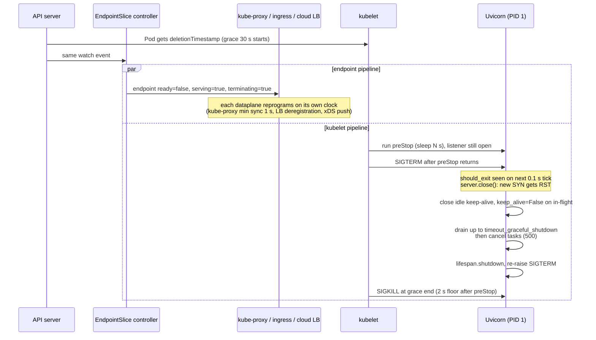

# Zero-Dropped-Request Deploys: SIGTERM Handling in Uvicorn, Kubernetes Endpoint Removal Races, preStop Delays, and In-Flight Drain Timeouts

> [!summary] Claim
> Kubernetes sends `SIGTERM` and removes the Pod from load balancing at the same time and with no ordering guarantee, while Uvicorn closes its listener within about 100 ms of `SIGTERM`, so a rollout drops requests unless a `preStop` delay outlasts endpoint propagation and `preStop + drain timeout + lifespan shutdown` fits inside `terminationGracePeriodSeconds`.

Part of [ASGI Servers and Async Runtime](README.md) in [API Engineering](../README.md).

## TL;DR

- Mechanism: Pod deletion starts two independent pipelines, the kubelet's (`preStop` -> `SIGTERM` -> wait -> `SIGKILL`) and the endpoint pipeline (EndpointSlice `terminating: true` -> kube-proxy, ingress, cloud load balancers, mesh), and Uvicorn reacts to `SIGTERM` by closing its listening socket on the next 0.1 s tick, so anything still routed to the Pod IP after that gets `ECONNREFUSED`.
- Contract rule: `preStop` sleep >= worst-case endpoint propagation, then `--timeout-graceful-shutdown` >= the slowest request you promise to finish, and `terminationGracePeriodSeconds` >= `preStop + 0.2 s + drain timeout + lifespan shutdown`.
- Trap: Uvicorn's default `--timeout-graceful-shutdown` is `None` (drain forever), so one stuck request lets the kubelet's `SIGKILL` end the process and lifespan shutdown never runs; and idle keep-alive connections are closed at `SIGTERM`, so pooled clients that reuse them see a reset or EOF and must retry.
- Portability: the kubelet arithmetic is version-stable (2 s floor, whole-second truncation, `sleep` action GA in Kubernetes 1.34), but servers differ: Hypercorn's `graceful_timeout` defaults to 3 s, Granian's `--workers-kill-timeout` is disabled by default, and HTTP/2 and HTTP/3 drain with `GOAWAY` instead of `Connection: close`.
- When not to use it: a `preStop` sleep is the wrong tool for long-lived WebSocket, SSE, or gRPC streams, which never drain on their own; design client reconnect with backoff and let the server close them with a restart code instead of stretching the grace period to hours.

## Mental model



The two `par` branches are the whole problem.
The API server writes one `deletionTimestamp`, and both the kubelet on the node and the EndpointSlice controller in the control plane react to the same watch event, so neither waits for the other (Kubernetes Pod Lifecycle, Pod Termination Flow step 3: "At the same time as the kubelet is starting graceful shutdown").
The left branch ends when the slowest dataplane stops picking this Pod IP; the right branch closes Uvicorn's listener roughly 100 ms after `SIGTERM`.
If `SIGTERM` arrives before the slowest dataplane converges, every connection routed in that window hits a closed port, which is the "endpoint removal race".
The `preStop` sleep inserts a delay on the right branch only, so the listener stays open and keeps serving normally while the left branch finishes.

## How it works

### 1. Deletion forks into two pipelines

`kubectl delete`, a Deployment rollout, a node drain, or a scale-down all end in the same API write: the Pod gets a `deletionTimestamp` and `deletionGracePeriodSeconds`, by default `30` (Kubernetes Pod Lifecycle, Pod Termination Flow steps 1 and 2).
The kubelet on the node starts local shutdown "as soon as the kubelet sees that a Pod has been marked as terminating".
At the same time, the control plane updates the Service's EndpointSlices; the endpoint is not deleted yet but flips its conditions (Kubernetes EndpointSlices, Conditions):

| Condition | Value while terminating | Meaning |
| --- | --- | --- |
| `ready` | `false` | "essentially a shortcut for checking `serving` and not `terminating`", except that it is always `true` for Services with `spec.publishNotReadyAddresses: true` |
| `serving` | mirrors the Pod's `Ready` condition | the Pod still answers; stable since 1.26 |
| `terminating` | `true` from the moment the Pod gets a deletion timestamp | stable since 1.26 |

The endpoint itself disappears only when the Pod object is deleted after its containers exit (Kubernetes tutorial, Explore Termination Behavior for Pods And Their Endpoints).
Service proxies "will normally ignore endpoints that are `terminating`, but they may route traffic to endpoints that are both `serving` and `terminating` if all available endpoints are `terminating`" (Kubernetes EndpointSlices, Terminating).
That fallback matters for single-replica Services: without it, the last Pod's deletion would blackhole the Service until the replacement became `Ready`.

### 2. Why propagation has no upper bound you can look up

Every consumer of the EndpointSlice reacts on its own schedule, and the Pod is safe to stop listening only after the slowest one has converged:

- The EndpointSlice controller itself can delay processing by `--endpointslice-updates-batch-period` to coalesce updates; the reference documents the trade-off as "Larger number = higher endpoint programming latency" and lists no default (kube-controller-manager reference, as of 2026-11).
- kube-proxy (`--proxy-mode` is `iptables` by default on Linux, or `ipvs` or `nftables`) rate-limits rule rewrites with `--iptables-min-sync-period` / `--ipvs-min-sync-period`, default `1s` (kube-proxy reference, as of 2026-11; the reference documents no separate `nftables` command-line flag), and every node runs its own kube-proxy, so the cluster converges when the slowest node does.
- Ingress controllers and service meshes (NGINX, Envoy via xDS) watch EndpointSlices and push new upstream sets on their own debounce timers.
- Cloud load balancers with IP targets learn through a controller that calls the cloud API; the AWS Load Balancer Controller documents the case where rollout outruns registration and the target group holds only `initial` or `draining` targets, "this results in service outage", which is why it offers Pod readiness gates (AWS Load Balancer Controller, Pod readiness gate).
- Established connections are not re-routed at all: kube-proxy rules select a backend at connection setup (conntrack), and an L7 proxy keeps its pooled upstream connections to the old Pod until they close.

The last point is why rule propagation alone is not enough: even after every dataplane stops picking the Pod for new connections, existing keep-alive connections from proxies keep delivering new requests over the old socket until either side closes it.
The only robust reading is: measure propagation in your cluster at p99.9 (for example, timestamp the deletion and the last request served by the Pod), and size the `preStop` delay from that measurement plus margin.

### 3. The kubelet's clock: preStop, SIGTERM, SIGKILL

The kubelet runs the `preStop` hook first, and the hook "must complete before the TERM signal to stop the container can be sent"; the grace countdown "begins before the `PreStop` hook is executed" (Kubernetes Container Lifecycle Hooks, PreStop).
The exact arithmetic is in `killContainer` (kubernetes v1.37.2 pkg/kubelet/kuberuntime/kuberuntime_container.go, killContainer):

1. `gracePeriod` starts at the Pod's `terminationGracePeriodSeconds` (or an override such as `kubectl delete --grace-period`).
2. If a `preStop` hook exists and `gracePeriod > 0`, it runs `gracePeriod = gracePeriod - m.executePreStopHook(...)`; `executePreStopHook` waits at most `gracePeriod` seconds (`time.After`) and returns `int64(metav1.Now().Sub(start.Time).Seconds())`, so the elapsed time is truncated to whole seconds.
3. `if gracePeriod < minimumGracePeriodInSeconds { gracePeriod = minimumGracePeriodInSeconds }`, where `minimumGracePeriodInSeconds = 2` (kubernetes v1.37.2 pkg/kubelet/kuberuntime/kuberuntime_manager.go).
4. `m.runtimeService.StopContainer(ctx, containerID.ID, gracePeriod)`: the runtime sends the stop signal and, after `gracePeriod` seconds, `SIGKILL`.

Consequences the lab pins down (`test_kubelet_signal_times_follow_truncation_and_two_second_floor`):

- `preStop` 5.9 s with a 30 s grace: elapsed truncates to 5, so `StopContainer` gets 25 s and `SIGKILL` lands at 30.9 s, not 30 s.
- `preStop` 29.5 s: 1 s would remain, the floor raises it to 2 s, `SIGKILL` at 31.5 s.
- `preStop` longer than the grace period: the kubelet stops waiting at 30 s, sends `SIGTERM`, and `SIGKILL`s 2 s later; this is the documented "one-off grace period extension of 2 seconds" (Kubernetes Pod Lifecycle, Pod Termination Flow step 2.1).

The stop signal is `SIGTERM` unless the image sets `STOPSIGNAL`; "SIGTERM for both containerd and CRI-O" is the runtime default, and `lifecycle.stopSignal` overrides both when the `ContainerStopSignals` feature gate (alpha since 1.33, off by default as of 2026-11) is enabled and `spec.os.name` is set (Kubernetes Pod Lifecycle, Stop Signals and Defining custom stop signals).
The signal goes to "process 1 inside each container", and containers in one Pod receive it "at different times and in an arbitrary order", except that native sidecars (init containers with `restartPolicy: Always`, stable since 1.33) get `SIGTERM` only after the last main container has exited, in reverse definition order (Kubernetes Pod Lifecycle, Pod shutdown and sidecar containers).

### 4. preStop handler types

| Handler | Who runs it | Image requirement | Notes |
| --- | --- | --- | --- |
| `sleep: {seconds: N}` | kubelet | none | alpha 1.29, beta 1.30, GA 1.34 (`PodLifecycleSleepAction`); `seconds: 0` allowed since `PodLifecycleSleepActionAllowZero` (alpha 1.32, beta 1.33, GA 1.34) |
| `exec: {command: [...]}` | inside the container's cgroups and namespaces | the binary must exist | fails on distroless images without `sleep`; resources count against the container |
| `httpGet` | kubelet | the app must serve the path | a hook "receiver is down" gets no retry |

(Kubernetes Container Lifecycle Hooks, Hook handler implementations; feature-gates reference, as of 2026-11.)
The KEP motivates `sleep` exactly by the missing-binary problem (its alternatives section: `exec` "requires a sleep binary in the image") and its e2e plan expects the container to be "terminated after the min(sleep, grace)" (KEP-3960).
A failed hook "kills the Container" and emits a `FailedPreStopHook` event, and delivery is "at least once", so a `preStop` that mutates state must be idempotent (Kubernetes Container Lifecycle Hooks, Hook delivery guarantees).

During the `preStop` sleep Uvicorn has not received any signal, so it serves exactly as before: it accepts new connections and runs keep-alive normally.
That is the whole trick, and it costs one grace-period slice per Pod per rollout.

### 5. Uvicorn 0.54.0 from SIGTERM to exit

Signal capture (uvicorn 0.54.0 uvicorn/server.py, Server.capture_signals): on the main thread only, Uvicorn installs `handle_exit` for `SIGINT` and `SIGTERM` (plus `SIGBREAK` on Windows) with `signal.signal`, deliberately not `loop.add_signal_handler`, so the previous handlers can be restored.
CPython runs a Python signal handler not inside the C handler but "at a later point (for example, at the next bytecode instruction)", always "in the main Python thread of the main interpreter" (Python docs, signal, Execution of Python signal handlers).
`handle_exit` only appends the signal to `_captured_signals` and sets `should_exit` (a `SIGINT` while already exiting sets `force_exit` instead; a repeated `SIGTERM` does not force the exit, it only appends another entry, so the signal is later re-raised once per delivery) (uvicorn 0.54.0 uvicorn/server.py, Server.handle_exit).
A handler stuck in a blocking call holds the main thread, so the flag is set only when control returns to the interpreter; see [[Detecting-Event-Loop-Blocking-Loop-Lag-Monitors-and-Debug-Callbacks]].

Detection (Server.main_loop, Server.on_tick): the supervisor coroutine wakes every `0.1` s and returns when `should_exit` is true, so the shutdown starts up to 100 ms after the signal.
The lab measured an idle keep-alive socket receiving EOF 97 ms after `SIGTERM` in one run (`test_sigterm_closes_idle_keepalive_connection_immediately`; CPython 3.14.6, macOS 27.3 arm64, 2026-11-15).

Shutdown (Server.shutdown), in order:

1. `logger.info("Shutting down")`, then `server.close()` on every `asyncio.Server` and `sock.close()` on inherited sockets.
   From this instant a new `SYN` to the port is answered with `RST`, which clients see as `ECONNREFUSED`; the lab proves it with `socket.create_connection` raising `ConnectionRefusedError` while a request is still in flight.
2. `connection.shutdown()` on each connection: idle connections (`cycle is None` or `cycle.response_complete`) close their transport now; in-flight ones get `cycle.keep_alive = False` (uvicorn 0.54.0 uvicorn/protocols/http/h11_impl.py and httptools_impl.py, shutdown).
   With `httptools`, the in-flight response then carries `connection: close`; with `h11` it does not, and the connection is simply closed after the response (lab asserts both).
3. `await asyncio.sleep(0.1)`.
4. `asyncio.wait_for(self._wait_tasks_to_complete(), timeout=self.config.timeout_graceful_shutdown)`: poll `server_state.connections` every 0.1 s until empty (log `Waiting for connections to close.`), then `server_state.tasks` (log `Waiting for background tasks to complete.`), then `server.wait_closed()`.
5. On `asyncio.TimeoutError`: log `Cancel %s running task(s), timeout graceful shutdown exceeded` and `t.cancel(msg="Task cancelled, timeout graceful shutdown exceeded")`; a request whose response had not started gets a `500 Internal Server Error` from `run_asgi`'s `except BaseException` path (lab: `test_drain_timeout_cancels_slow_request_with_500_and_still_runs_lifespan_shutdown`).
6. `await self.lifespan.shutdown()` unless `force_exit`: the app receives `lifespan.shutdown` only now, after the drain.

Then `capture_signals` restores the original handlers and calls `signal.raise_signal` for each captured signal in LIFO order.
With the default `SIGTERM` disposition restored, the process dies by the signal: the lab observed `Popen.returncode == -15` on macOS, which a shell reports as `143` (128 + 15).
Inside a container where Uvicorn is PID 1, the outcome differs, and the kernel source settles it (Linux v6.12 kernel/signal.c, sig_task_ignored and send_signal_locked; kernel/fork.c, copy_process).
`copy_process` sets `SIGNAL_UNKILLABLE` on the first process of a PID namespace.
`sig_task_ignored` drops a signal sent to a `SIGNAL_UNKILLABLE` task whose handler is `SIG_DFL`, unless `force` is set and the signal is `SIGKILL` or `SIGSTOP`.
`send_signal_locked` sets `force` only for kernel-generated signals and for senders in an ancestor PID namespace; a `tgkill` from the process to itself (what `signal.raise_signal` issues through libc) has neither property.
So the re-raised `SIGTERM` is discarded, `raise_signal` returns, `uvicorn.run` falls through (it calls `sys.exit` only when the server never started, uvicorn 0.54.0 uvicorn/main.py, run), and the interpreter exits with status `0`, not `143`.
This is the same rule pid_namespaces(7) states for other senders: "Only signals for which the "init" process has established a signal handler can be sent to the "init" process by other members of the PID namespace".
This path is derived from source and not executed here: the lab runs Uvicorn as a normal process on macOS, where the `-15` result above applies, and a PID 1 run needs a Linux container.

Two design facts fall out of step 6:

- The app never sees `SIGTERM`; it learns about shutdown only after requests are done.
  Anything the app wants to do at the start of a drain (stop a queue consumer, flip a readiness flag) needs a separate trigger such as an `httpGet` `preStop` hook, not the lifespan.
- Database pools and HTTP clients opened in lifespan startup stay usable during the whole drain, which is correct: in-flight requests still need them ([[ASGI-Lifespan-Protocol-Startup-Shutdown-and-Scope-State]]).

What counts as "in flight" is defined by the protocol objects: `server_state.tasks` holds request tasks (including Starlette `BackgroundTasks`, which run inside the request task after the response), but not tasks the app spawned with `asyncio.create_task`; those are cancelled when `asyncio.run` tears the loop down unless the app tracks them ([[Fire-and-Forget-Task-Hazards-GC-Disappearance-and-Managed-Task-Nurseries]]).
The deeper walk through `Server.serve()` and the protocol classes is in [[Uvicorn-Internals-Server-Lifecycle-Protocols-and-Flow-Control]]; cancellation delivery into handlers is in [[Cancellation-Semantics-CancelledError-Swallowing-and-Shielded-Cleanup]].

### 6. Connection-level drain on the wire

HTTP/1.1 has no "please stop sending" message on an idle connection.
A server that wants to stop either sends `Connection: close` on the next response, "a signal that the sender will close this connection after completion of the response", or closes; and RFC 9112 warns that a careless close can produce a TCP reset that "might erase the client's unacknowledged input buffers", so servers "close a connection in stages", half-closing the write side first (RFC 9112 Section 9.6).
A client that finds its pooled connection closed can retry automatically only when the request is idempotent (RFC 9110 Section 9.2.2: "PUT, DELETE, and safe request methods are idempotent"; RFC 9112 Section 9.3.2 lets a pipelining client "retry unanswered requests if the connection closes").
So Uvicorn's step 2 is safe for `GET` behind a retrying client and lossy for a `POST` that races the close: the client cannot know whether the server read it ([[Idempotency-Key-Header-Specification-and-State-Machine-Draft-08]]).

HTTP/2 has an explicit drain: "A server that is attempting to gracefully shut down a connection SHOULD send an initial GOAWAY frame with the last stream identifier set to 2^31-1 and a NO_ERROR code", waits "at least one round-trip time", then MAY send a second `GOAWAY` with the real last stream ID; "Any protocol activity that uses higher-numbered streams can be safely retried using a new connection" (RFC 9113 Section 6.8).
Uvicorn 0.54.0's experimental HTTP/2 class does not do the two-phase dance: after `shutdown()` it answers new streams with `503` (`app = service_unavailable`) and calls `conn.close()` (which emits `GOAWAY`) only when no stream is in flight, either at once if idle or after the last stream finishes (uvicorn 0.54.0 uvicorn/protocols/http/zttp_h2_impl.py, ZttpH2Protocol.shutdown, _close_connection, and the `not self.cycles` branch of the data-received handler); `zttp` is not pinned in this workspace, so this behavior is read from the 0.54.0 source and not run.
HTTP/3 does the same with a stream ID in `GOAWAY`, and "Clients can safely retry unprocessed requests on a different HTTP connection" (RFC 9114 Section 5.2).
WebSockets cannot drain: Uvicorn's WebSocket protocols send close code `1012` on shutdown if the handshake completed, or a `500` if it had not (uvicorn 0.54.0 uvicorn/protocols/websockets/wsproto_impl.py and websockets_impl.py, shutdown).

### 7. The proxy in front changes which failure you see

Behind an L7 proxy, the proxy, not the end client, owns the pooled connection to the Pod, so the client sees whatever the proxy synthesizes:

- AWS ALB: when a target is deregistered it enters `draining` for `deregistration_delay.timeout_seconds` (default `300` s), and "If a deregistering target terminates the connection before the deregistration delay elapses, the client receives a 500-level error response" (AWS ALB target group attributes, Deregistration delay, as of 2026-11).
- AWS ALB idle timeout defaults to `60` s, and AWS recommends the application's idle timeout be larger, because otherwise "the load balancer might send a request to the application before it receives the packet indicating that the connection is closed", which yields `502 Bad Gateway` (AWS ALB load balancer attributes, Connection idle timeout).
  Uvicorn's `--timeout-keep-alive` defaults to `5` s, the opposite of that advice.
- Envoy and NGINX retry policies decide whether a reset on reuse becomes a retry or a `502` / `503`; see [[Proxy-and-Application-Timeout-and-Retry-Interaction-Hazards]].

### 8. The budget equation

Putting the three clocks together, with every term in seconds:

```text
preStop_sleep        >= p99.9(endpoint propagation across all dataplanes) + margin
drain_timeout        >= p99.9(request duration you promise to finish)
grace_period         >= preStop_sleep + 0.2 + drain_timeout + lifespan_shutdown + margin
deregistration_delay  > preStop_sleep + drain_timeout   (external LB with IP targets)
```

The `0.2` is Uvicorn's worst-case tick plus its post-close sleep.
If `preStop_sleep` exceeds `grace_period`, the kubelet's 2 s floor is all that is left for the drain, so the inequality is not cosmetic.
The lab encodes the first three lines as `budget_violations()` so a platform team can check a Deployment's numbers in CI.

## Numbers and limits

| Quantity | Value | Source |
| --- | --- | --- |
| `terminationGracePeriodSeconds` default | `30` s | Kubernetes Pod Lifecycle (as of 2026-11) |
| Minimum stop window after `preStop` | `2` s (`minimumGracePeriodInSeconds`) | kubernetes v1.37.2 kuberuntime_manager.go |
| `preStop` elapsed-time granularity | whole seconds, truncated | kubernetes v1.37.2 kuberuntime_container.go, executePreStopHook |
| `sleep` hook | alpha 1.29, beta 1.30, GA 1.34; zero allowed GA 1.34 | feature-gates reference (as of 2026-11) |
| `ContainerStopSignals` | alpha 1.33, default off | feature-gates reference (as of 2026-11) |
| Native sidecars | GA 1.33 | feature-gates reference (as of 2026-11) |
| kube-proxy min sync period | `1s` (`iptables`, `ipvs`) | kube-proxy reference (as of 2026-11) |
| kube-proxy full resync | `30s` | kube-proxy reference (as of 2026-11) |
| EndpointSlice size | `100` endpoints default, max `1000` | EndpointSlices concept page |
| Uvicorn tick | `0.1` s | uvicorn 0.54.0 server.py, main_loop |
| Uvicorn post-close sleep | `0.1` s | uvicorn 0.54.0 server.py, shutdown |
| `--timeout-graceful-shutdown` default | `None` (wait forever) | uvicorn 0.54.0 main.py, config.py |
| `--timeout-keep-alive` default | `5` s | uvicorn 0.54.0 main.py |
| Hypercorn `graceful_timeout` default | `3` s | hypercorn 0.18.0 hypercorn/config.py |
| Granian `--workers-kill-timeout` | disabled by default, range 1-1800 s | granian 2.8.7 granian/cli.py |
| ALB deregistration delay default | `300` s | AWS ALB target group attributes (as of 2026-11) |
| ALB idle timeout default | `60` s, range 1-4000 | AWS ALB attributes (as of 2026-11) |
| Idle keep-alive closed after `SIGTERM` | 97 ms (one run, 2026-11-15) | lab `uv run --frozen pytest ... -v -s`, CPython 3.14.6, macOS 27.3 (Darwin 27.3.0) arm64 |
| Drain timeout `1` s with a 5 s request | process exit 1.20 s after `SIGTERM`, client got `500` (one run, 2026-11-15) | lab, same command and machine |

The two lab timings are single runs on a laptop, not distributions; they show the 0.1 s tick and the `0.1 + 1.0` s drain bound, not production latency.

## Portability

| Dimension | Behavior | Evidence |
| --- | --- | --- |
| CPython 3.14.6 | all 14 lab tests pass | `uv run --frozen pytest` on the workspace interpreter, macOS arm64 |
| CPython 3.12.16, 3.13.18, 3.15.2, 3.15.2t | not run | the brief paused the matrix; the code uses only `signal.signal` and `signal.raise_signal` (added in 3.8, Python docs) and `asyncio.wait_for`, with no version branch in uvicorn 0.54.0 server.py |
| Uvicorn `--http h11` vs `httptools` | same drain; only `httptools` adds `connection: close` to the in-flight response | lab parametrized test |
| Uvicorn `--http zttp` (HTTP/2) | `503` for new streams after shutdown, `GOAWAY` on close | read in uvicorn 0.54.0 zttp_h2_impl.py, `shutdown` and `_close_connection`; not run (`zttp` not pinned) |
| Hypercorn 0.18.0 | `loop.add_signal_handler` for `SIGINT`/`SIGTERM`/`SIGBREAK`, closes servers, waits `graceful_timeout` (3 s) for server tasks, then lifespan shutdown | hypercorn 0.18.0 hypercorn/asyncio/run.py, worker_serve; see [[Hypercorn-Internals-HTTP-2-HTTP-3-QUIC-and-AnyIO-Trio-Workers\|Hypercorn]] |
| Granian 2.8.7 | Python supervisor process `terminate()`s each worker and `join()`s it with no timeout unless `--workers-kill-timeout` is set, then `kill()`s stragglers | granian 2.8.7 granian/server/common.py, AbstractServer._stop_workers; see [[Granian-Internals-Rust-Tokio-Hyper-Engine-and-RSGI-vs-ASGI\|Granian]] |
| Gunicorn arbiter with Uvicorn workers | `graceful_timeout` default `30` s: workers still alive that long after the restart signal are force killed (gunicorn 26.2.0 gunicorn/config.py, `graceful_timeout`); `uvicorn.workers.UvicornWorker` is itself deprecated in 0.54.0 (uvicorn/workers.py) | see [[Multi-Process-Worker-Topologies-Gunicorn-Uvicorn-Workers-vs-Kubernetes-Replicas\|worker topologies]] |
| HTTP/1.1 | `Connection: close` or close; idempotent retry only | RFC 9112 Section 9.6, RFC 9110 Section 9.2.2; lab |
| HTTP/2 | two-phase `GOAWAY` | RFC 9113 Section 6.8 |
| HTTP/3 | `GOAWAY` with stream ID | RFC 9114 Section 5.2 |
| Windows | Uvicorn also captures `SIGBREAK`; Kubernetes Windows Pods accept only `SIGTERM` and `SIGKILL` as custom stop signals | uvicorn 0.54.0 server.py `HANDLED_SIGNALS`; Kubernetes Pod Lifecycle |
| Debian Trixie, Alpine musl containers | not run; PID 1 exit status `0` is derived from kernel source, not observed | Linux v6.12 kernel/signal.c `sig_task_ignored`, kernel/fork.c `copy_process`; pid_namespaces(7) |

## Worked example

The lab is [implementation](../labs/src/api_labs/f12_asgi_servers_and_async_runtime/graceful_shutdown_drain.py) and [test](../labs/tests/f12_asgi_servers_and_async_runtime/test_graceful_shutdown_sigterm_drain_windows_and_kubernetes_prestop_hooks.py).
It has two halves: a live Uvicorn worker in a subprocess that receives a real `SIGTERM`, and a deterministic millisecond model of one Pod's termination that classifies every request routed to it.

The kubelet half is the `killContainer` arithmetic, verbatim from the lab:

```python
def kubelet_signal_times(termination_grace_s: int, prestop_ms: int) -> tuple[int, int]:
    """Return (SIGTERM, SIGKILL) times in ms after deletion, mirroring kubelet killContainer.

    The preStop hook runs with the full grace period as its timeout; the kubelet then
    subtracts the hook's elapsed time truncated to whole seconds and passes the rest,
    floored at 2 s, to the runtime's StopContainer, which sends SIGTERM and later SIGKILL.
    """
    grace_ms = termination_grace_s * 1000
    sigterm_ms = min(prestop_ms, grace_ms)
    elapsed_s = sigterm_ms // 1000  # Go int64(duration.Seconds()) truncates
    remaining_s = max(termination_grace_s - elapsed_s, KUBELET_MIN_GRACE_S)
    return sigterm_ms, sigterm_ms + remaining_s * 1000
```

The classifier, as a simplified excerpt of `simulate_termination` (the lab version also tracks when lifespan shutdown can finish):

```python
# simplified excerpt
listener_closed_ms = sigterm_ms + UVICORN_TICK_MS            # worst-case tick
drain_start_ms = listener_closed_ms + UVICORN_POST_CLOSE_SLEEP_MS
drain_deadline_ms = None if pod.drain_timeout_ms is None else drain_start_ms + pod.drain_timeout_ms
hard_stop_ms = sigkill_ms if drain_deadline_ms is None else min(drain_deadline_ms, sigkill_ms)
for req in requests:
    if req.arrival_ms >= pod.propagation_ms:   outcome = ROUTED_ELSEWHERE
    elif req.arrival_ms >= listener_closed_ms: outcome = REFUSED        # the race
    elif req.arrival_ms + req.duration_ms <= hard_stop_ms: outcome = SERVED
    elif drain_deadline_ms is not None and drain_deadline_ms < sigkill_ms: outcome = CANCELLED_500
    else:                                       outcome = KILLED
```

With no `preStop`, a 2 s propagation delay, and one 50 ms request every 250 ms, the model refuses the seven requests that arrive between 250 ms and 1750 ms and serves only the one at 0 ms; a 5 s `preStop` turns all of them into `SERVED` or `ROUTED_ELSEWHERE` (`test_no_prestop_refuses_requests_until_endpoints_converge`, `test_prestop_covering_propagation_drops_nothing`).

The live half, as a simplified excerpt of the main test (the lab file holds the full helper that spawns `python -m uvicorn ...:create_app --factory --port 0 --lifespan on` and parses the bound port from the log):

```python
# simplified excerpt
with live_uvicorn(http) as server:
    inflight = _send_get(server.port, "/slow?ms=800")
    server.wait_event("request-start")
    server.proc.send_signal(signal.SIGTERM)
    server.wait_stderr("Waiting for connections to close")   # listener already closed
    with pytest.raises(ConnectionRefusedError):
        socket.create_connection(("127.0.0.1", server.port), timeout=2).close()
    raw = _read_until_eof(inflight)
    returncode = server.proc.wait(timeout=10)
assert raw.startswith(b"HTTP/1.1 200 OK") and raw.endswith(b"done")
assert events == ["startup", "request-start", "request-end", "shutdown"]
assert returncode == -signal.SIGTERM
```

Captured output, from `labs/` with `uv run --frozen pytest tests/f12_asgi_servers_and_async_runtime/test_graceful_shutdown_sigterm_drain_windows_and_kubernetes_prestop_hooks.py -v -s -p no:cacheprovider`, CPython 3.14.6, macOS (Darwin 27.3.0, arm64), 2026-11-15 (node IDs shortened to `test_...::`; the two `EVENT` lines come from the in-process `httpx.ASGITransport` test):

```text
::test_sigterm_finishes_inflight_refuses_new_connections_then_runs_lifespan_shutdown[h11]
[h11] exit=-15 events=['startup', 'request-start', 'request-end', 'shutdown']
[h11] INFO:     Started server process [9177]
[h11] INFO:     Waiting for application startup.
[h11] INFO:     Application startup complete.
[h11] INFO:     Uvicorn running on http://127.0.0.1:58815 (Press CTRL+C to quit)
[h11] INFO:     Shutting down
[h11] INFO:     Waiting for connections to close. (CTRL+C to force quit)
[h11] INFO:     Waiting for application shutdown.
[h11] INFO:     Application shutdown complete.
[h11] INFO:     Finished server process [9177]
PASSED
::test_sigterm_finishes_inflight_refuses_new_connections_then_runs_lifespan_shutdown[httptools]
[httptools] exit=-15 events=['startup', 'request-start', 'request-end', 'shutdown']
...
PASSED
::test_sigterm_closes_idle_keepalive_connection_immediately
idle keep-alive closed 97 ms after SIGTERM
PASSED
::test_drain_timeout_cancels_slow_request_with_500_and_still_runs_lifespan_shutdown
cancelled after 1.20 s; status line b'HTTP/1.1 500 Internal Server Error'
PASSED
::test_app_answers_in_process_without_a_server EVENT request-start
EVENT request-end
PASSED
::test_kubelet_signal_times_follow_truncation_and_two_second_floor[30-0-expected0] PASSED
::test_kubelet_signal_times_follow_truncation_and_two_second_floor[30-5900-expected1] PASSED
::test_kubelet_signal_times_follow_truncation_and_two_second_floor[30-29500-expected2] PASSED
::test_kubelet_signal_times_follow_truncation_and_two_second_floor[30-60000-expected3] PASSED
::test_no_prestop_refuses_requests_until_endpoints_converge PASSED
::test_prestop_covering_propagation_drops_nothing PASSED
::test_drain_timeout_shorter_than_request_cancels_it_but_lifespan_completes PASSED
::test_unbounded_drain_with_long_request_is_sigkilled_and_skips_lifespan_shutdown PASSED
::test_budget_flags_grace_period_too_small_for_prestop_plus_drain_plus_lifespan PASSED

============================== 14 passed in 3.98s ==============================
```

Read the log against Section 5: `Shutting down` (listener closed), `Waiting for connections to close` (the 800 ms request still running), then lifespan shutdown strictly after `request-end`, then exit by the re-raised signal (`-15`).
The drain-timeout test shows the other branch: 0.1 s tick + 0.1 s sleep + 1 s timeout = 1.2 s, a `500` instead of the 5 s response, and lifespan shutdown still ran because no `SIGKILL` arrived.

A Deployment fragment that satisfies the budget for p99.9 propagation under 8 s and requests under 15 s (illustrative values, not measured here):

```yaml
spec:
  template:
    spec:
      terminationGracePeriodSeconds: 30   # 10 + 0.2 + 15 + 2 + margin
      containers:
        - name: api
          command: ["uvicorn", "app.main:app", "--host", "0.0.0.0", "--port", "8000",
                    "--timeout-graceful-shutdown", "15", "--timeout-keep-alive", "75"]
          lifecycle:
            preStop:
              sleep:
                seconds: 10
```

`--timeout-keep-alive 75` follows AWS's advice to exceed a 60 s ALB idle timeout; use your own proxy's number.

## Pitfalls

> [!warning] No `preStop`, so the listener closes before the dataplanes converge
> Trigger: a Deployment rollout with Uvicorn as PID 1 and no `preStop` hook.
> Symptom: a burst of `ECONNREFUSED` (or `502`/`503` from the ingress) lasting about as long as endpoint propagation, on every rollout, worse on large clusters.
> Fix: `lifecycle.preStop.sleep.seconds` sized from measured propagation; the lab's `test_no_prestop_refuses_requests_until_endpoints_converge` shows the window is `[SIGTERM + 0.1 s, propagation)`.

> [!warning] `exec` `sleep` in a distroless image
> Trigger: `preStop: exec: command: ["sleep", "10"]` on an image with no `sleep` binary.
> Symptom: the hook fails immediately, a `FailedPreStopHook` event is emitted, and the container is killed (Kubernetes Container Lifecycle Hooks), so the race comes back.
> Fix: the kubelet-executed `sleep` handler, GA since 1.34; on older clusters use a static binary or an `httpGet` hook.

> [!warning] Unbounded Uvicorn drain under a finite grace period
> Trigger: default `--timeout-graceful-shutdown` (`None`) plus a long-poll, SSE stream, or stuck handler.
> Symptom: logs stop at `Waiting for connections to close.`; the kubelet `SIGKILL`s at the grace boundary; `Application shutdown complete.` never appears, so lifespan cleanup (flushing telemetry, closing pools) is skipped.
> Fix: set the drain timeout below `grace - preStop - lifespan - margin` (`test_unbounded_drain_with_long_request_is_sigkilled_and_skips_lifespan_shutdown`).

> [!warning] `preStop` that eats the whole grace period
> Trigger: `preStop` sleep >= `terminationGracePeriodSeconds`, for example raising the sleep without raising the grace.
> Symptom: `SIGTERM` arrives at the grace boundary and `SIGKILL` 2 s later, so every in-flight request is reset.
> Fix: raise `terminationGracePeriodSeconds` with the sleep; the Kubernetes docs say so explicitly ("you must modify `terminationGracePeriodSeconds` to suit this").

> [!warning] Shell-form entrypoint swallows `SIGTERM`
> Trigger: `CMD uvicorn app:app` (shell form) or `command: ["sh", "-c", "uvicorn ..."]`.
> Symptom: the shell is PID 1 and, per Docker's description of the shell form (`/bin/sh -c`, "which does not pass signals"), the executable "will not receive Unix signals"; Uvicorn never drains and is `SIGKILL`ed after the grace period.
> Fix: exec form (`["uvicorn", ...]`) or `exec uvicorn ...` inside the script.

> [!warning] Keep-alive timeout shorter than the proxy's idle timeout
> Trigger: Uvicorn's default `--timeout-keep-alive 5` behind a 60 s ALB idle timeout.
> Symptom: sporadic `502 Bad Gateway` all day, spiking during rollouts, because the server closes connections the proxy is about to reuse (AWS ALB attributes, Connection idle timeout).
> Fix: application keep-alive > proxy idle timeout, plus proxy retries for idempotent methods.

> [!warning] Deregistration delay shorter than the drain
> Trigger: an ALB IP target group with a deregistration delay below `preStop + drain`.
> Symptom: AWS documents that if the target "terminates the connection before the deregistration delay elapses, the client receives a 500-level error response"; conversely a delay far above the grace period just holds the target in `draining` with nothing behind it.
> Fix: set `deregistration_delay.timeout_seconds` just above `preStop + drain`, and use Pod readiness gates so rollout cannot outrun registration (AWS Load Balancer Controller).

> [!warning] Failing readiness on shutdown disables the terminating-endpoint fallback
> Trigger: the app flips `/readyz` to `503` on its first shutdown signal.
> Symptom: the endpoint becomes `serving: false`, so a proxy that would otherwise route to `serving` and `terminating` endpoints when nothing else is ready has nothing to route to.
> Fix: do not rely on readiness for Service removal (terminating endpoints already have `ready: false`); flip readiness only for health-check-driven external load balancers that do not watch EndpointSlices.

These are documented failure modes from primary documentation and source; no public postmortem with verifiable numbers was fetched for this note.

## Security and robustness

- Threat model: a client that controls connection lifetime controls your rollout duration.
  A request whose headers have been received has a `cycle`, so `connection.shutdown()` only sets `keep_alive = False` and Uvicorn waits for it; a slow-body client keeps the drain open until `--timeout-graceful-shutdown` or `SIGKILL` (OWASP API4:2023 Unrestricted Resource Consumption).
  A client that has not finished its request head has no `cycle` and is closed at once (uvicorn 0.54.0 h11_impl.py, shutdown).
- Bound every phase: proxy header and body timeouts in front, a finite drain timeout in Uvicorn, a finite grace period in the Pod, and a deadline inside handlers.
- An `httpGet` `preStop` endpoint that flips the app into draining is a remote kill switch if it is reachable on the public port; serve it on a separate port that the Service does not expose, or use the `sleep` handler, which needs no endpoint at all.
- Hooks are delivered "at least once", so a `preStop` that deregisters from an external registry or acknowledges a lease must be idempotent.
- Retries across a drain are only safe for idempotent requests; give non-idempotent endpoints idempotency keys so a client can retry a `POST` whose connection died mid-drain ([[Atomic-Idempotency-Phases-and-Failure-Recovery-Across-Network-Drops]]).
- Defense in depth for state: work that must survive a `SIGKILL` belongs in a durable queue or an outbox, not in lifespan shutdown, because lifespan shutdown is the step the kubelet cuts off first.

## The principal's view

The decision is where draining lives, and the answer for most organizations is "in the platform, not in each service".
A platform team owns one measured number, p99.9 endpoint propagation for the cluster's dataplanes, and publishes the derived defaults (`preStop` sleep, grace period, drain timeout, keep-alive versus proxy idle timeout) as a base chart or admission policy, with a CI check like `budget_violations()` that rejects Deployments whose numbers do not add up.
The organizational trade-off is rollout time: every replica now takes `preStop + drain` to disappear, so a 100-replica Deployment with `maxUnavailable: 1` and a 10 s sleep adds minutes per rollout; teams will push to shorten it, and the counter-argument is the error budget the race burns on every deploy.
The second decision is client contract: zero dropped requests is achievable only for clients that retry idempotent requests on a connection-level failure, so the API guidelines must mandate retries with backoff and idempotency keys rather than pretend the server can make every close invisible.
Choose differently when connections are long-lived: for WebSockets, SSE, and gRPC streams, drain by telling clients to reconnect (`GOAWAY`, close code `1012`, an application-level "reconnect" message) and bound the drain, because a grace period sized for the longest stream makes rollouts and node drains unbounded.
When the mesh or gateway already terminates client connections (a service mesh sidecar or gateway, or a managed L7 load balancer that drains on deregistration), put the drain logic there and keep the Python process simple: bounded drain, fast exit.

## Interview questions

> [!question] L5: What does Uvicorn 0.54.0 do between receiving `SIGTERM` and exiting?
>
> > [!success]- Answer
> > The signal handler sets `should_exit`, and the 0.1 s supervisor tick notices it.
> > `shutdown()` closes the listening sockets, closes idle keep-alive connections, and marks in-flight ones `keep_alive = False`.
> > After a 0.1 s sleep it waits for connections and then tasks, bounded by `--timeout-graceful-shutdown`, cancelling the rest on timeout.
> > It then sends `lifespan.shutdown`, restores the old signal handlers, and re-raises `SIGTERM`.
> >
> > Follow-up: Why does the app never see the signal itself?

> [!question] L5: Why can a request be refused even though the Pod is still running and healthy?
>
> > [!success]- Answer
> > The kubelet and the endpoint pipeline react to the deletion in parallel.
> > Uvicorn closes its listener about 100 ms after `SIGTERM`, but kube-proxy on some node, an ingress, or a cloud load balancer may still route new connections to the Pod IP.
> > Those `SYN`s hit a closed port and get `RST`, which the client sees as `ECONNREFUSED` or the proxy turns into a `502`/`503`.
> >
> > Follow-up: Which Kubernetes feature keeps the listener open during that window without an image change?

> [!question] L6: Predict the output: `terminationGracePeriodSeconds: 30`, `preStop` sleep that actually takes 5.9 s, Uvicorn with `--timeout-graceful-shutdown 20`, and one request that needs 26 s. When do `SIGTERM` and `SIGKILL` arrive, and what does the client get?
>
> > [!success]- Answer
> > `SIGTERM` at 5.9 s; the kubelet truncates elapsed time to 5 s, so `StopContainer` gets 25 s and `SIGKILL` lands at 30.9 s.
> > The listener closes at about 6.0 s and the drain deadline is about 6.1 + 20 = 26.1 s.
> > The request started before 5.9 s needs until at least 26 s; if it started at 0 s it finishes at 26 s and is served, and if it started later than about 0.1 s it is cancelled at 26.1 s with a `500`.
> > Lifespan shutdown then has until 30.9 s, so it completes if it needs under about 4.8 s.
> >
> > Follow-up: What changes if the `preStop` sleep is 31 s?

> [!question] L6: Your team flips `/readyz` to `503` as soon as shutdown starts, "to get out of the load balancer faster". Is that right?
>
> > [!success]- Answer
> > For Services it is unnecessary: a terminating endpoint already has `ready: false` regardless of the probe.
> > It is also harmful in one case: `serving` mirrors readiness, and proxies may route to `serving` and `terminating` endpoints when nothing else is ready, so failing readiness removes the last fallback.
> > It helps only for external load balancers that health-check the Pod instead of watching EndpointSlices, and even then a probe period times failure threshold delay applies.
> >
> > Follow-up: How would you trigger the flip, given that the app only learns about shutdown through lifespan after the drain?

> [!question] L6: Debug this API: after moving to Kubernetes, the API behind an AWS ALB shows a steady trickle of `502 Bad Gateway` all day and a spike on every deploy, but no application errors are logged. What do you check?
>
> > [!success]- Answer
> > The all-day trickle matches Uvicorn's 5 s `--timeout-keep-alive` against the ALB's 60 s idle timeout: the server closes pooled connections the ALB is about to reuse, and AWS documents that as a `502`.
> > Raise the app keep-alive above the ALB idle timeout.
> > The deploy spike matches the endpoint race or a deregistration delay shorter than the drain: check for a `preStop` delay, the target group's `deregistration_delay.timeout_seconds`, and whether Pod readiness gates are enabled.
> > Confirm by correlating ALB access-log timestamps for the `502`s with the Pod's `Shutting down` log lines and with keep-alive close times.
> >
> > Follow-up: Why does the application log nothing for these failures?

> [!question] L6: What is the difference between draining an HTTP/1.1 connection and an HTTP/2 connection?
>
> > [!success]- Answer
> > HTTP/1.1 can only send `Connection: close` on the next response or close the socket, and an idle connection gets no warning, so a request racing the close is lost unless the client retries it (RFC 9112 Section 9.6).
> > HTTP/2 sends `GOAWAY` with last stream ID 2^31-1, waits a round trip, then sends the real last stream ID, and streams above it are guaranteed unprocessed and safely retriable (RFC 9113 Section 6.8).
> > Uvicorn 0.54.0's experimental HTTP/2 path refuses new streams with `503` and sends `GOAWAY` only on close.
> >
> > Follow-up: Why is "guaranteed unprocessed" the property that makes retrying a `POST` safe?

> [!question] L7+: Design the platform default for graceful shutdown across 300 services on a shared cluster.
>
> > [!success]- Answer
> > Measure endpoint propagation per dataplane (kube-proxy, ingress, mesh, cloud LB) at p99.9 and publish it as the `preStop` sleep, using the kubelet `sleep` handler.
> > Derive the grace period from `preStop + 0.2 + drain + lifespan + margin` and enforce it with an admission policy or CI check, letting services override only upward with justification.
> > Mandate exec-form entrypoints, a finite drain timeout, keep-alive above the proxy idle timeout, and client retries with idempotency keys in the API guidelines.
> > For streaming services, require reconnect-capable clients and bound the drain instead of the grace period.
> >
> > Follow-up: How do you detect regressions, given that dropped requests during a rollout often never reach application logs?

> [!question] L7+: Why does lifespan shutdown run after the request drain, and what does that imply for work that must not be lost?
>
> > [!success]- Answer
> > Resources opened in lifespan startup (pools, clients) are needed by in-flight requests, so Uvicorn can only release them after the drain.
> > That makes lifespan shutdown the last step and the first one cut off by `SIGKILL` when the budget is wrong.
> > Work that must survive belongs in durable storage before the response is sent (an outbox or a queue), not in shutdown hooks.
> >
> > Follow-up: How would you prove in CI that lifespan shutdown fits in the budget?

> [!question] L7+: A single-replica internal Service drops requests on every deploy even with a 10 s `preStop` sleep. Why, and what are the options?
>
> > [!success]- Answer
> > With one replica and `maxSurge: 0`, there is no ready endpoint while the old Pod terminates, so propagation is not the issue; capacity is.
> > Proxies may route to `serving` and `terminating` endpoints when nothing else is ready, which helps only while the old Pod still listens, that is, during `preStop`.
> > Use `maxSurge: 1` with `maxUnavailable: 0` so the new Pod is ready before the old one is deleted, or run two replicas.
> >
> > Follow-up: What does a node drain do differently from a Deployment rollout here?

## Related

Prerequisites: [[Async-Synchronization-Primitives-Locks-Semaphores-and-Reentrant-Deadlocks]]

Next: [[Memory-Leaks-in-Long-Running-Python-API-Workers]]

See also: [[02-Programming-Languages/Python/Python-Backend-Interview-Prep/16-Asyncio-Deep-Dive]], [[02-Programming-Languages/Python/Python-Backend-Interview-Prep/17-Concurrency-in-Web-Services-and-Coding]], [[Uvicorn-Internals-Server-Lifecycle-Protocols-and-Flow-Control]], [[Multi-Process-Worker-Topologies-Gunicorn-Uvicorn-Workers-vs-Kubernetes-Replicas]], [[Cancellation-Semantics-CancelledError-Swallowing-and-Shielded-Cleanup]], [[Fire-and-Forget-Task-Hazards-GC-Disappearance-and-Managed-Task-Nurseries]], [[Detecting-Event-Loop-Blocking-Loop-Lag-Monitors-and-Debug-Callbacks]], [[Hypercorn-Internals-HTTP-2-HTTP-3-QUIC-and-AnyIO-Trio-Workers]], [[Granian-Internals-Rust-Tokio-Hyper-Engine-and-RSGI-vs-ASGI]], [[ASGI-Lifespan-Protocol-Startup-Shutdown-and-Scope-State]], [[ASGI-HTTP-and-Disconnect-Event-Lifecycle]], [[ASGI-WebSockets-Lifecycle-Subprotocols-and-Backpressure]], [[HTTP-1-1-Framing-Keep-Alive-and-Chunked-Encoding]], [[HTTP-2-Binary-Framing-and-Stream-State-Machine]], [[Idempotency-Key-Header-Specification-and-State-Machine-Draft-08]], [[Atomic-Idempotency-Phases-and-Failure-Recovery-Across-Network-Drops]], [[Proxy-and-Application-Timeout-and-Retry-Interaction-Hazards]], [[Timeout-Taxonomy-Connect-Read-Write-Pool-and-Deadline-Propagation]], [[L4-vs-L7-Load-Balancing-for-HTTP-1-1-HTTP-2-and-gRPC]]

- Lab: `labs/tests/f12_asgi_servers_and_async_runtime/test_graceful_shutdown_sigterm_drain_windows_and_kubernetes_prestop_hooks.py`

## Further reading

- [Kubernetes Pod Lifecycle, Pod termination](https://kubernetes.io/docs/concepts/workloads/pods/pod-lifecycle/#pod-termination): the authoritative termination flow, the 2 s extension, stop signals, and sidecar ordering.
- [Kubernetes Container Lifecycle Hooks](https://kubernetes.io/docs/concepts/containers/container-lifecycle-hooks/): `preStop` semantics, handler types, at-least-once delivery.
- [KEP-3960 Pod lifecycle sleep action](https://github.com/kubernetes/enhancements/blob/master/keps/sig-node/3960-pod-lifecycle-sleep-action/README.md): why `sleep` became a first-class hook.
- [Kubernetes EndpointSlices, Conditions](https://kubernetes.io/docs/concepts/services-networking/endpoint-slices/#conditions): `ready`, `serving`, `terminating`, and the terminating fallback.
- [Explore Termination Behavior for Pods And Their Endpoints](https://kubernetes.io/docs/tutorials/services/pods-and-endpoint-termination-flow/): the condition values observed during a real rollout.
- [kubelet kuberuntime_container.go at v1.37.2](https://github.com/kubernetes/kubernetes/blob/v1.37.2/pkg/kubelet/kuberuntime/kuberuntime_container.go): `killContainer` and `executePreStopHook`, the exact grace arithmetic.
- [Uvicorn 0.54.0 server.py](https://github.com/Kludex/uvicorn/blob/0.54.0/uvicorn/server.py): signal capture, the tick, and the drain sequence.
- [RFC 9112 Section 9.6](https://www.rfc-editor.org/rfc/rfc9112.html#section-9.6): HTTP/1.1 tear-down and the staged close.
- [RFC 9110 Section 9.2.2](https://www.rfc-editor.org/rfc/rfc9110.html#section-9.2.2): which requests a client may retry after a connection failure.
- [RFC 9113 Section 6.8](https://www.rfc-editor.org/rfc/rfc9113.html#section-6.8): two-phase `GOAWAY` graceful shutdown for HTTP/2.
- [RFC 9114 Section 5.2](https://www.rfc-editor.org/rfc/rfc9114.html#section-5.2): HTTP/3 connection shutdown.
- [pid_namespaces(7)](https://man7.org/linux/man-pages/man7/pid_namespaces.7.html): why PID 1 ignores signals it has no handler for.
- [AWS ALB target group attributes, Deregistration delay](https://docs.aws.amazon.com/elasticloadbalancing/latest/application/edit-target-group-attributes.html#deregistration-delay): the external load balancer's drain clock.
