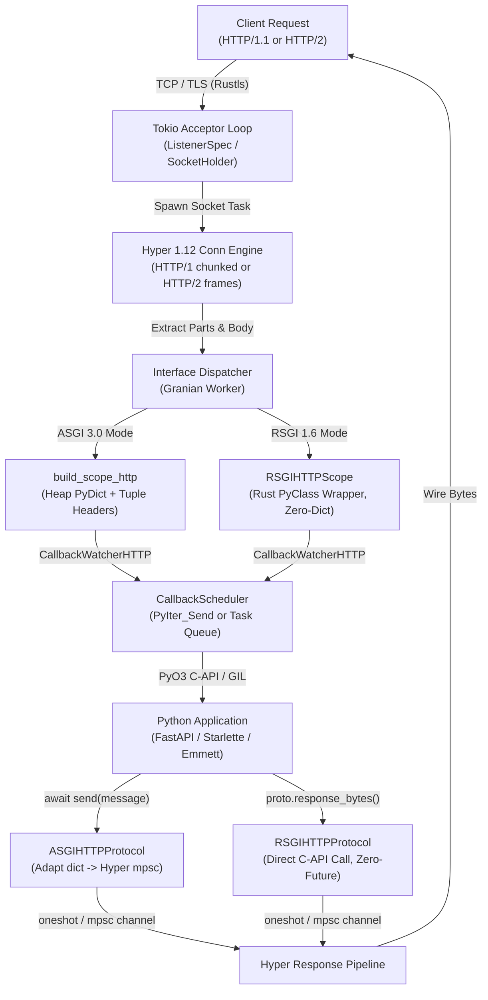

# Granian (2.8.7) Internals: Rust Tokio/Hyper HTTP/1 and HTTP/2 Engine, PyO3 Bridging, and ASGI vs RSGI Protocol Overhead

> [!summary] Claim
> Granian 2.8.7 moves socket I/O, TLS, and HTTP/1 and HTTP/2 parsing out of Python into Tokio and Hyper 1.12 bound through PyO3 0.30, keeps the GIL off Tokio threads by funnelling interpreter work through one `BlockingRunner` thread per worker, and offers RSGI 1.6 to cut the per-request dictionary and tuple churn that ASGI scopes and messages impose.

Part of [ASGI Servers and Async Runtime](README.md) in [API Engineering](../README.md).

## TL;DR

Granian embeds a compiled Rust networking core running Tokio and Hyper to terminate TCP, TLS, HTTP/1.1, and HTTP/2 outside the Python interpreter.
The contract lets Python applications run through the standard ASGI 3.0 dictionary-and-coroutine interface or through RSGI 1.6, whose scope is a Rust `pyclass` and whose response methods are plain synchronous calls.
The critical trap is blocking code inside an ASGI or RSGI handler: the coroutine runs on the worker's single Python event loop thread, and `--blocking-threads` cannot rescue it because Granian 2.8.7 rejects values above `1` for ASGI and RSGI.
On portability, Granian 2.8.7 ships wheels for CPython 3.10 to 3.15 plus free-threaded 3.14t and 3.15t, declares `#[pymodule(gil_used = false)]`, and switches to its thread-based `MTServer` on free-threaded builds (as of 2026-11).
Do not choose Granian when you need in-process HTTP/3 over QUIC (Granian 2.8.7 has no HTTP/3 listener), and do not choose RSGI when you depend on third-party ASGI middleware.

## Mental model



An incoming TCP connection is accepted inside Tokio through a listener built from `ListenerSpec` and handed to Hyper 1.12 for framing and protocol state machine execution.
Once Hyper parses the request head, Granian routes execution to either an ASGI or an RSGI handler.
In ASGI mode, Granian executes `build_scope_http`, allocating a scope dictionary, percent-decoding the path, and allocating a Python list of two-tuples of header bytes.
In RSGI mode, Granian moves Hyper's `HeaderMap`, `Uri`, `Method`, and `Version` into a Rust `pyclass` (`RSGIHTTPScope`) and builds Python strings only when a property is read.
The coroutine is then handed to `CallbackScheduler`, which runs on Granian's blocking thread under the GIL and either posts `loop.create_task` to the event loop (`--task-impl asyncio`, the default and the only mode Granian honors on Python 3.12 and later) or steps the coroutine with `PyIter_Send` (`--task-impl rust`, Python 3.10 and 3.11 only).
When responding, an ASGI application builds and awaits message dictionaries (`http.response.start` and `http.response.body`), which Granian translates into Hyper types and usually acknowledges with an already-complete awaitable, whereas an RSGI application calls synchronous methods such as `proto.response_bytes()` that push a response into a Rust `oneshot` channel and return `None`.

## How it works

### 1. Tokio 1.51 and Hyper 1.12 HTTP Engine Architecture

Granian terminates network transport in Rust; its manifest requires Tokio `1.51` (the lock file resolves `1.54.1`) and pins Hyper `=1.12` (locked `1.12.0`) `(granian 2.8.7 Cargo.toml, [dependencies])`.
The socket layer abstracts platform listeners into `ListenerSpec`, `UnixListenerSpec`, and `SocketHolder` `(granian 2.8.7 src/net.rs, ListenerSpec)`.
When Granian binds a TCP address it uses `socket2::Socket` to set `SO_REUSEPORT` on every non-Windows target (plus `SO_REUSEPORT_LB` on FreeBSD), `SO_REUSEADDR`, and `TCP_NODELAY`, then calls `listen(2)` with the configured backlog `(granian 2.8.7 src/net.rs, ListenerSpec::as_socket)`.
Non-blocking mode is set afterwards by `set_nonblocking(true)` in `WorkerConfig::tcp_listener` `(granian 2.8.7 src/workers.rs, WorkerConfig::tcp_listener)`.
The backlog defaults to `1024` with a minimum of `128` `(granian 2.8.7 granian/cli.py, --backlog)`.
TLS termination runs in Rust through `tls-listener` with the `rustls-ring` and `rustls-tls12` features `(granian 2.8.7 Cargo.toml, tls-listener)` and `TlsListener::new(TlsAcceptor::from(config), ...)` `(granian 2.8.7 src/tls.rs, tls_tcp_listener)`.
ALPN advertises `h2` and `http/1.1` in the default `--http auto` mode, only `http/1.1` with `--http 1`, and only `h2` with `--http 2` `(granian 2.8.7 src/workers.rs, WorkerConfig::tls_cfg)`, which is how HTTP/2 over TLS is selected (RFC 9113 Section 3.2).
The minimum TLS version defaults to TLS 1.3 (`--ssl-protocol-min tls1.3`); TLS 1.2 is accepted only when lowered explicitly `(granian 2.8.7 granian/cli.py, --ssl-protocol-min)`.

Hyper 1.12 handles protocol framing for RFC 9112 (HTTP/1.1) and RFC 9113 (HTTP/2); Granian passes its settings into the Hyper builders `(granian 2.8.7 src/workers.rs, conn_builder_h1)`.
For HTTP/1.1 connections:
- Hyper's read buffer is capped by `--http1-buffer-size`, default `417,792` bytes (`8192 + 4096 * 100`, 408 KiB), minimum `8,192` `(granian 2.8.7 granian/http.py, HTTP1Settings.max_buffer_size)`.
- If a client does not finish sending the request head within `--http1-header-read-timeout` (default `30,000` ms, allowed `1` to `60,000`), Hyper closes the connection, which bounds Slowloris-style header trickling `(granian 2.8.7 granian/http.py, HTTP1Settings.header_read_timeout)`.
- Persistent connections follow RFC 9112 Section 9.3 unless disabled via `--no-http1-keep-alive`.
- `--http1-pipeline-flush` (default off) asks Hyper to aggregate flushes for pipelined responses, reducing write syscalls.

For HTTP/2 connections:
- Frames use the RFC 9113 Section 4.1 9-octet header: length (24 bits), type (8 bits), flags (8 bits), one reserved bit, and stream identifier (31 bits).
- Concurrent streams are bounded by `--http2-max-concurrent-streams` (default `200`, minimum `10`), advertised as `SETTINGS_MAX_CONCURRENT_STREAMS` (RFC 9113 Section 6.5.2).
- Flow control operates at both the connection and stream levels (RFC 9113 Section 5.2).
- Granian advertises an initial stream window of `1,048,576` bytes (`--http2-initial-stream-window-size`) and sets an initial connection window of `1,048,576` bytes (`--http2-initial-connection-window-size`), both 1 MiB and both well above the protocol default of `65,535` (RFC 9113 Section 6.9.2) `(granian 2.8.7 granian/http.py, HTTP2Settings)`.
- `--http2-adaptive-window` (default off) makes Hyper size windows from bandwidth-delay product estimates and issue `WINDOW_UPDATE` frames (RFC 9113 Section 6.9) accordingly; Hyper documents that enabling it overrides the two initial window settings.
- `--http2-max-headers-size` (default `16,777,216` bytes, 16 MiB) is passed to Hyper's `max_header_list_size`, which advertises `SETTINGS_MAX_HEADER_LIST_SIZE` (RFC 9113 Section 6.5.2); this is 1024 times Hyper's own default of 16 KiB `(hyper 1.12.0 src/proto/h2/server.rs, DEFAULT_SETTINGS_MAX_HEADER_LIST_SIZE)`, so treat the Granian default as permissive and lower it on public listeners.

### 2. Tokio Runtime Topologies and Worker Models

Granian implements two distinct concurrency dimensions: the Python worker model (processes or threads) and the Tokio runtime threading model, selected by `RuntimeModes` `(granian 2.8.7 granian/constants.py, RuntimeModes)` and resolved in `granian/server/common.py`.

```
                    Granian Worker Topology
+-------------------------------------------------------------+
| Master Process (CLI / Signals / Metrics Aggregator)         |
+-------------------------------------------------------------+
           | fork / IPC socket transfer (MPServer)
           v
+-------------------------------------------------------------+
| Worker Process 1 (or Worker Thread in MTServer)             |
|                                                             |
|  +-------------------------------------------------------+  |
|  | Tokio Runtime (RuntimeModes::mt or RuntimeModes::st)  |  |
|  |   - Thread 1..N: Hyper Conn Engine & TCP Event Loop   |  |
|  +-------------------------------------------------------+  |
|                            |                                |
|                            | crossbeam channel              |
|                            v                                |
|  +-------------------------------------------------------+  |
|  | BlockingRunner (Blocking Thread Pool)                 |  |
|  |   - py_threads (1 on ASGI/RSGI, N on WSGI): GIL work  |  |
|  +-------------------------------------------------------+  |
|                            |                                |
|                            | PyIter_Send / Task Callback    |
|                            v                                |
|  +-------------------------------------------------------+  |
|  | Python Event Loop (asyncio, uvloop, or rloop)         |  |
|  |   - Application Coroutine Execution                   |  |
|  +-------------------------------------------------------+  |
+-------------------------------------------------------------+
```

`--runtime-mode auto` (the default) resolves to `st` only when the interface is RSGI, `--runtime-threads` is `1`, and `--http` is not `2`; every other combination, including every ASGI deployment, resolves to `mt` `(granian 2.8.7 granian/server/common.py, AbstractServer.serve)`.
Under `RuntimeModes::mt` (Multi-Threaded Runtime):
Tokio builds a multi-threaded work-stealing runtime with `runtime_threads` worker threads (default `1` per worker) `(granian 2.8.7 src/runtime.rs, init_runtime_mt)`.
Network I/O, TLS handshakes, HTTP parsing, and frame serialization are distributed across these threads.
Under `RuntimeModes::st` (Single-Threaded Runtime):
Tokio builds a `current_thread` runtime `(granian 2.8.7 src/runtime.rs, default_runtime)` and drives a `LocalSet` on it `(granian 2.8.7 src/runtime.rs, block_on_local)`.
This avoids cross-thread task migration and the synchronization that comes with it, at the cost of using one core per runtime.

When running multiple workers:
- `granian.server.Server` is `MPServer` on GIL builds and `MTServer` on free-threaded builds, chosen by `BUILD_GIL` `(granian 2.8.7 granian/server/__init__.py, Server)`.
- `MPServer` (Multi-Process Server) starts workers with `multiprocessing` using the interpreter's start method when it is `fork` or `spawn`, and `spawn` otherwise (for example when Python 3.14 defaults to `forkserver` on Linux) `(granian 2.8.7 granian/server/mp.py, WorkerProcess)`.
  Parent-child communication uses `IPCReceiverHandle` and `IPCSenderHandle` built on `interprocess` unnamed pipes `(granian 2.8.7 src/ipc.rs, IPCSenderHandle)`; on free-threaded builds both classes compile to empty stubs.
  Process RSS sampling uses `ProcInfoCollector` on top of the `sysinfo` crate `(granian 2.8.7 src/sys.rs, ProcInfoCollector)`.
- `MTServer` (Multi-Threaded Server) runs each worker as a `threading.Thread` named `granian-worker` inside one process `(granian 2.8.7 granian/server/mt.py, WorkerThread)`.
  On GIL builds the worker threads contend for one GIL.
  On free-threaded CPython (3.14t and 3.15t wheels in 2.8.7, PEP 703), worker threads can execute Python bytecode in parallel within one address space; the scaling you get must be measured on your workload.

### 3. The Blocking Thread Pool and GIL Isolation

A fundamental failure mode of hybrid Rust-Python servers is Tokio worker starvation: if a Tokio thread waited for the GIL while Python code held it, that thread would stop polling sockets.
Granian avoids this by routing every task that needs the interpreter through `RuntimeRef::spawn_blocking` into a `BlockingRunner` `(granian 2.8.7 src/blocking.rs, BlockingRunner)`.

`BlockingRunner` owns an unbounded crossbeam channel and dedicated OS threads separate from Tokio's runtime threads:
1. `BlockingRunnerMono`: a single dedicated thread running `blocking_worker`, used when `py_threads == 1` (`Empty` when it is `0`).
2. `BlockingRunnerPool`: a pool of up to `py_threads` threads that tracks idle threads in an `Arc<atomic::AtomicUsize>` and spawns a thread when the queue length exceeds the idle count.
   Pool threads idle longer than `--blocking-threads-idle-timeout` (default `30` s, allowed `5` to `600`) exit.
3. The CLI flag `--blocking-threads` becomes Rust `py_threads` `(granian 2.8.7 granian/server/mp.py, MPServer._spawn_asgi_worker)`; Granian raises `ConfigurationError('blocking_threads')` with the log line `Blocking threads > 1 is not supported on ASGI and RSGI` when an ASGI or RSGI deployment asks for more than `1`, and defaults WSGI to `max(1, backpressure // 2)` `(granian 2.8.7 granian/server/common.py, AbstractServer.__init__)`, so the pool exists only for WSGI.
4. Work such as building scopes and calling `CallbackScheduler::schedule` is wrapped in a `BlockingTask` and submitted through `run()`.
5. Each blocking thread calls `Python::attach` once for its lifetime and uses `py.detach` while waiting on the queue, so it holds the GIL only while running a task.
   With `--metrics`, it accumulates microsecond counters `blocking_idle_cumul`, `py_wait_cumul`, and `blocking_busy_cumul`, plus the `blocking_queue` gauge, exported as `blocking_idle_cumulative`, `py_wait_cumulative`, `blocking_busy_cumulative`, and `blocking_queue` `(granian 2.8.7 src/metrics.rs, WorkerMetrics)`.
6. Tokio's runtime threads therefore never wait for the GIL; the ASGI or RSGI coroutine itself runs on the worker's Python event loop thread, which is where blocking application code does its damage.

### 4. PyO3 0.30 Bridging and Coroutine Scheduling

Granian 2.8.7 requires PyO3 `=0.30` (locked `0.30.1`) with features `["anyhow", "bytes", "extension-module", "generate-import-lib"]` `(granian 2.8.7 Cargo.toml, pyo3)`.
Module initialization is declared via `(granian 2.8.7 src/lib.rs, _granian)`:
```rust
#[pymodule(gil_used = false)]
fn _granian(py: Python, module: &Bound<PyModule>) -> PyResult<()>
```
The attribute `gil_used = false` declares to free-threaded CPython that the extension does not need the GIL re-enabled on import (PEP 703).
The constant is defined per build flavor, `#[cfg(not(Py_GIL_DISABLED))] const BUILD_GIL: bool = true;` and `#[cfg(Py_GIL_DISABLED)] const BUILD_GIL: bool = false;`, and exported as `granian._granian.BUILD_GIL` so Python code can tell which build it imported.

To drive Python coroutines, Granian implements `CallbackScheduler` `(granian 2.8.7 src/callbacks.rs, CallbackScheduler)` and offers two scheduler implementations through `--task-impl` (default `asyncio`).
On Python 3.12 and later, Granian logs `Rust task implementation is not available on Python >= 3.12, falling back to asyncio` and forces `asyncio`; on 3.10 and 3.11 it logs `Rust task implementation is experimental!` `(granian 2.8.7 granian/server/common.py, AbstractServer.serve)`.
So every interpreter in this vault's CPython matrix (3.12 to 3.15t) runs Mode A.

#### Mode A: `--task-impl asyncio` (Standard Task Queue)
The application callback is wrapped by `_future_watcher_wrapper`, which awaits the app and then calls `watcher.done()` or `watcher.err(exc)` `(granian 2.8.7 granian/_futures.py, _future_watcher_wrapper)`.
The asyncio scheduler `_CBSchedulerAIO` schedules each request with `loop.call_soon_threadsafe(_run, cb(watcher), watcher, context=ctx)`, and `_run` calls `loop.create_task(coro)` and stores the task through `watcher.taskref(task)` `(granian 2.8.7 granian/_futures.py, _cbsched_aioschedule)`.
This creates a full `asyncio.Task` on the Python heap, registers it with the loop, and schedules its first step on the loop's ready queue.

#### Mode B: `--task-impl rust` (Direct PyIter_Send Coroutine Stepping, Python 3.10 and 3.11 only)
In this mode Granian never calls `loop.create_task`.
`_new_cbscheduler` builds a single `_CBSchedulerTask`, a subclass of `asyncio.Task` whose `__init__` only calls `asyncio.tasks._register_task(self)` without running `Task.__init__`, and Granian enters and leaves it around each step with `_enter_task` and `_leave_task` so `asyncio.current_task()` returns it `(granian 2.8.7 granian/_futures.py, _CBSchedulerTask)`.
Each step calls the CPython C API `PyIter_Send` directly `(granian 2.8.7 src/callbacks.rs, CallbackScheduler::send)`:
```rust
let mut pres = std::ptr::null_mut::<pyo3::ffi::PyObject>();
let gres = pyo3::ffi::PyIter_Send(state.coro.as_ptr(), self.pynone.as_ptr(), &raw mut pres);
```
- If the coroutine yields `None` (`pres == self.pynone`), Granian reschedules the next step with the loop's `call_soon` (`pym_lcs`).
- If it yields an object whose `_asyncio_future_blocking` attribute is true, Granian sets that attribute to false and registers a `CallbackSchedulerWaker` through the future's `add_done_callback` (`CallbackSchedulerState::add_waker`).
- When the future resolves, the waker calls `fut.result()` and then `CallbackScheduler::send` again, or `throw` with the exception.
This skips per-request `Task` construction; Granian publishes no measurement of the saving, and none was measured here.

To return Rust results to Python, Granian uses lightweight awaitable classes defined in `src/callbacks.rs` and created by helpers in `src/runtime.rs` `(granian 2.8.7 src/runtime.rs, empty_future_into_py)`:
1. `PyEmptyAwaitable` (`#[pyclass(frozen, freelist = 128)]`): its `__next__` returns `None`, so `await` finishes immediately without touching the event loop; returned when an operation completed synchronously (for example `send_bytes` into an unbounded channel).
2. `PyDoneAwaitable`: raises `StopIteration(value)` on the first `__next__`, so a ready result is delivered without an event loop round trip.
3. `PyErrAwaitable`: raises the stored exception on the first `__next__`.
4. `PyIterAwaitable`: a "bare yield" awaitable created by `future_into_py_iter`; the helper is marked `#[allow(dead_code)]` in 2.8.7.
5. `PyFutureAwaitable` (Unix only): an asyncio-future-like object with an `AtomicU8` state machine (`Pending = 0`, `Completed = 1`, `Cancelled = 2`) created by `future_into_py_futlike`.
   Completion and cancellation both use `compare_exchange` from `Pending`, so exactly one wins; `cancel()` also calls `cancel_tx.notify_one()` on a `tokio::sync::Notify`, and the Tokio side, waiting in a `tokio::select!`, stops awaiting the Rust future.
   On Windows, `future_into_py_futlike` instead creates a real `loop.create_future()` with a `PyFutureDoneCallback` and delivers results through `PyFutureResultSetter` via `call_soon_threadsafe`.
Source comments in `src/runtime.rs` state that `future_into_py_iter` is "generally ~55% faster" and `future_into_py_futlike` "generally ~38% faster" than `pyo3_asyncio.future_into_py`; these are the maintainer's unpublished measurements of future bridging, not of `--task-impl`, and were not reproduced here.

### 5. ASGI Protocol Internals in Granian

Granian implements ASGI 3.0 for HTTP and WebSockets and advertises `{"version": "3.0", "spec_version": "2.3"}` in `scope["asgi"]`.
When an HTTP request arrives, Granian constructs the scope via `build_scope_http` `(granian 2.8.7 src/asgi/utils.rs, build_scope_http)`:

```rust
// Simplified representation from src/asgi/utils.rs
macro_rules! build_scope_common {
    ($py:expr, $scope:ident, $req:expr, $server:expr, $client:expr, $scheme:expr, $proto:expr) => {
        let raw_path = $req.uri.path();
        let query_string = $req.uri.query().unwrap_or("");
        let path = percent_encoding::percent_decode_str(raw_path).decode_utf8_lossy();
        let $scope = PyDict::new($py);
        scope_set!($py, $scope, "type", $proto);
        scope_set!($py, $scope, "asgi", ASGI_VERSION.get_or_try_init(...));
        scope_set!($py, $scope, "http_version", match $req.version { ... });
        scope_set!($py, $scope, "server", ($server.ip(), $server.port().to_string()));
        scope_set!($py, $scope, "client", ($client.ip(), $client.port().to_string()));
        scope_set!($py, $scope, "scheme", $scheme);
        scope_set!($py, $scope, "path", &path);
        scope_set!($py, $scope, "raw_path", PyBytes::new($py, raw_path.as_bytes()));
        scope_set!($py, $scope, "query_string", PyBytes::new($py, query_string.as_bytes()));
        let headers = PyList::empty($py);
        for (key, value) in &$req.headers {
            headers.append((
                PyBytes::new($py, key.as_str().as_bytes()),
                PyBytes::new($py, value.as_bytes()),
            ))?;
        }
        scope_set!($py, $scope, "headers", headers);
    };
}
```

The real macro also sets `extensions` from a second `PyOnceLock` and inserts a `host` header from the URI authority when the request has none.
Notice the allocation footprint:
1. A new Python dictionary `PyDict::new($py)` is allocated for every request.
2. `path` is decoded into a new `PyString`.
3. `raw_path` is wrapped in a new `PyBytes`.
4. `query_string` is wrapped in a new `PyBytes`.
5. `server` and `client` each become a new tuple holding an IP string and a port string.
6. `headers` allocates a `PyList`, and for every header Granian allocates a `PyBytes` name, a `PyBytes` value, and a 2-tuple to hold them.
7. `asgi` and `extensions` are not rebuilt: they are cached in `PyOnceLock` statics and the same dictionary objects are bound into every scope.
8. `granian.asgi._callback_wrapper` then calls `scope.update(root_path=root_url_path, state=state.copy())` `(granian 2.8.7 granian/asgi.py, _callback_wrapper)`.

The ASGI application communicates with the server via `receive` and `send` backed by `ASGIHTTPProtocol` `(granian 2.8.7 src/asgi/io.rs, ASGIHTTPProtocol)`:
- `receive()`: returns `{"type": "http.request", "body": bytes, "more_body": bool}` while request data remains, then `{"type": "http.disconnect"}` once the client is gone.
- `send(message)`: calls `adapt_message_type`, which maps `http.response.start` to a status and a Hyper `HeaderMap`, `http.response.body` to `body` and `more_body`, and `http.response.pathsend` to a file path; any other type raises `RuntimeError("Unsupported ASGI message")`.
  Ordering is enforced in `send` itself: a second start raises `RuntimeError("ASGI flow error: Response already started")`, a body before start raises `RuntimeError("ASGI flow error: Response not started")`, and a body after the final one raises `RuntimeError("ASGI flow error: Response already finished")`.
  A start whose `content-type` does not begin with `text/event-stream` is held as a pending intent; a single final body (`more_body` false) is then sent as one `http_body_util::Full` response through the `oneshot` channel, and `send` returns a `PyEmptyAwaitable`.
  Only a streamed response (a body with `more_body` true, or a `text/event-stream` start) creates `ResponseBodyStream`, whose bounded `tokio::sync::mpsc::channel(4)` the source sizes as "chan capacity 2 (the actual number we need for pipelining) * 2".
  `send` first tries `try_send`; when the channel is full it returns a `PyFutureAwaitable` that completes when Hyper drains a frame, which is the only point where `await send()` yields to the event loop for backpressure.
  `http.response.pathsend` (advertised in `scope["extensions"]`) streams the file from Tokio with `ReaderStream::with_capacity(file, 131_072)` and answers `404` if the open fails.

### 6. RSGI Protocol Internals: Low-Allocation Rust Gateway Interface

RSGI (Rust Server Gateway Interface) version 1.6 is designed to avoid the impedance mismatch between Rust network engines and Python applications `(granian 2.8.7 docs/spec/RSGI.md)`; the server reports it through `RSGI_PROTO_VERSION = "1.6"` `(granian 2.8.7 src/rsgi/types.rs, RSGI_PROTO_VERSION)`.
In RSGI, the application signature is:
```python
coroutine application(scope, protocol)
```

#### RSGI Scope Architecture
Instead of building a Python dictionary, Granian passes an instance of `RSGIHTTPScope` `(granian 2.8.7 src/rsgi/types.rs, rsgi_scope_cls)`.
`RSGIHTTPScope` is a frozen Rust `#[pyclass]` that stores Hyper's `Version`, `Method`, and `Uri`, the scheme, the server and client addresses, and an `RSGIHeaders` wrapping the `HeaderMap`.
Its properties (`proto`, `rsgi_version`, `http_version`, `server`, `client`, `scheme`, `method`, `path`, `query_string`, `authority`) are `#[getter]` methods, so no Python objects exist for them until they are read.
Each read builds a fresh Python object: `scope.method` converts a Rust `&str` into a new `str`, and `scope.path` percent-decodes the URI path again on every access.
`headers` is a `#[pyo3(get)]` field of a `Clone` pyclass, so PyO3 clones the `RSGIHeaders` (and its `HeaderMap`) into a new Python object on each `scope.headers` access; bind it to a local once per request.

#### RSGI Headers Architecture
The headers collection is `RSGIHeaders`, a frozen `#[pyclass]` holding a Hyper `HeaderMap` `(granian 2.8.7 src/rsgi/types.rs, RSGIHeaders)`.
Headers are not converted into Python bytes or tuples up front.
`headers["content-type"]` performs the lookup in the Rust `HeaderMap` and returns a new Python `str` (an empty string if the value is not valid visible ASCII); a missing name raises `KeyError`.
`headers.get(name, default)`, `keys()`, `values()`, and `items()` build Python objects only when called, and `headers.get_all("set-cookie")` collects every value into a `PyList` on demand.

#### RSGI Response Emission
In ASGI, emitting a response takes two awaited calls:
`await send({"type": "http.response.start", ...})` followed by `await send({"type": "http.response.body", ...})`.
Each call allocates a message dictionary (plus a headers list and tuples for the start) and an awaitable object; on Granian the common non-streaming case completes through `PyEmptyAwaitable` without an event loop round trip.

In RSGI, `RSGIHTTPProtocol` `(granian 2.8.7 src/rsgi/io.rs, RSGIHTTPProtocol)` provides synchronous response methods:
- `proto.response_bytes(status, headers, body)`: extracts the status, the header list, and the body (copied into a Rust `Box<[u8]>`), builds `PyResponseBody::from_bytes`, and sends `PyResponse::Body` through the request's `oneshot::Sender<PyResponse>`.
  It returns `None`; no coroutine, Future, or Task is created.
- `proto.response_str(status, headers, body)`: the `str` body is extracted directly into a Rust `String`, so the application does not call `.encode()`.
- `proto.response_empty(status, headers)`: sends a zero-length body (for example `204 No Content` or `304 Not Modified`).
- `proto.response_file(status, headers, file)` and `proto.response_file_range(status, headers, file, start, end)`:
  open the file with `tokio::fs::File` and stream it through `ReaderStream::with_capacity(file, 131_072)` (128 KiB chunks) `(granian 2.8.7 src/rsgi/types.rs, PyResponseFile::to_response)`; `response_file_range` raises `ValueError("Invalid range")` when `start >= end`.
  The file is read by Tokio into userspace buffers and written to the socket without passing through Python memory or the GIL; it is not a kernel `sendfile` path.
- `proto.response_stream(status, headers)`: returns an `RSGIHTTPStreamTransport` backed by an unbounded `mpsc::unbounded_channel`; its `send_bytes` and `send_str` return `PyEmptyAwaitable`, so they never apply backpressure, and the source notes that "the interface doesn't need to be async anymore".
- `await proto()` returns the whole request body as `bytes`, `async for chunk in proto` iterates it, and `proto.client_disconnect()` returns an awaitable that resolves when the client goes away.

### 7. Quantitative Protocol Overhead Comparison

| Architectural Dimension | ASGI 3.0 on Granian | RSGI 1.6 on Granian | Performance Mechanism |
| :--- | :--- | :--- | :--- |
| **Scope Allocation** | Heap `PyDict` + `PyList` of header tuples | Rust `RSGIHTTPScope` (`pyclass`) | RSGI skips the scope dictionary and header tuples; fields become Python objects only when read. |
| **Headers Memory** | `list[tuple[bytes, bytes]]` (N tuples, 2N `bytes`) | `RSGIHeaders` wrapping `HeaderMap` | Headers stay in Rust; each lookup allocates only the returned `str`, but each `scope.headers` access clones the map. |
| **Inbound Body Read** | `await receive()` returning `dict` | `await proto()` returning `bytes` | RSGI returns raw bytes without a message envelope. |
| **Response Transmission** | Two `await send(dict)` calls | Synchronous `proto.response_bytes()` | RSGI needs no message dicts or awaitables; ASGI sends usually return a ready `PyEmptyAwaitable`. |
| **File Serving** | `http.response.pathsend` (Tokio, 128 KiB chunks) or Python chunks via `send(dict)` | `response_file()` (Tokio, 128 KiB chunks) | Both Tokio paths stream without the GIL; only the ASGI app that reads files itself pays per-chunk Python cost. |
| **Python Heap Objects per Request** | Lab model: 3 GC-tracked dicts | Lab model: 2 GC-tracked dicts | Measured on the pure-Python lab model, not on Granian; see Numbers and limits. |
| **GIL Work per Request** | Scope dict and header tuples built on the blocking thread, plus message dicts in the app | Scope `pyclass` built on the blocking thread; Python objects only on access | Both interfaces run scope construction and scheduling on the same single `BlockingRunner` thread; RSGI does less of it. |

## Numbers and limits

Defaults below are Granian 2.8.7 values read from `granian/cli.py`, `granian/http.py`, and `granian/server/common.py` at tag `v2.8.7` `(as of 2026-11)`.
Measured rows come from the lab on macOS 27.3 (`uname -sr` = `Darwin 27.3.0`, arm64) with CPython 3.14.6 from uv.

| Parameter / Metric | Granian 2.8.7 Default | Config Flag / Source | Architectural Impact and Bounds |
| :--- | :--- | :--- | :--- |
| **HTTP/1 Buffer Size** | 417,792 bytes (408 KiB) | `--http1-buffer-size` | Hyper's maximum read buffer for an HTTP/1.1 connection. Minimum allowed is 8,192 bytes. |
| **HTTP/1 Header Read Timeout** | 30,000 ms (30 s) | `--http1-header-read-timeout` | Maximum time to receive the complete request head before Hyper closes the connection. Allowed range: 1 to 60,000 ms. |
| **HTTP/2 Max Concurrent Streams** | 200 streams | `--http2-max-concurrent-streams` | Advertised in `SETTINGS_MAX_CONCURRENT_STREAMS`. Minimum allowed is 10. |
| **HTTP/2 Stream Window Size** | 1,048,576 bytes (1 MiB) | `--http2-initial-stream-window-size` | Initial per-stream window advertised in `SETTINGS_INITIAL_WINDOW_SIZE`; protocol default is 65,535. Minimum allowed is 1,024. |
| **HTTP/2 Connection Window Size** | 1,048,576 bytes (1 MiB) | `--http2-initial-connection-window-size` | Initial connection-level window across all streams. Minimum allowed is 1,024. |
| **HTTP/2 Max Headers Size** | 16,777,216 bytes (16 MiB) | `--http2-max-headers-size` | Advertised `SETTINGS_MAX_HEADER_LIST_SIZE`; h2 0.4.20 answers an oversized request header block with `431` and a stream reset. |
| **HTTP/2 Max Frame Size** | 16,384 bytes (16 KiB) | `--http2-max-frame-size` | Largest frame payload Granian accepts. The CLI allows values down to 1,024, but RFC 9113 Section 6.5.2 requires 16,384 to 16,777,215 and h2 0.4.20 asserts that range in `Settings::set_max_frame_size`, so a smaller value would panic (not executed here). |
| **Listen Backlog** | 1,024 connections | `--backlog` | Queue depth passed to `listen(2)`. Minimum allowed is 128. |
| **Worker Backpressure** | `backlog / workers` | `--backpressure` | Maximum concurrent requests per worker (`max(1, backpressure or backlog // workers)`). |
| **Blocking Threads (Default)** | 1 (ASGI/RSGI); `max(1, backpressure // 2)` (WSGI) | `--blocking-threads` | Threads in `BlockingRunner`; values above 1 raise `ConfigurationError` on ASGI and RSGI. |
| **Blocking Threads Idle Timeout** | 30 seconds | `--blocking-threads-idle-timeout` | Idle time before a `BlockingRunnerPool` thread exits. Allowed range: 5 to 600 s. |
| **Runtime Threads (Default)** | 1 thread per worker | `--runtime-threads` | Tokio worker threads for socket I/O and Hyper framing per worker. |
| **Runtime Blocking Threads (Default)** | 512 per worker | `--runtime-blocking-threads` | Tokio `max_blocking_threads` for its own blocking I/O pool, separate from `BlockingRunner`. |
| **File Stream Chunk Buffer** | 131,072 bytes (128 KiB) | Hardcoded in `src/rsgi/types.rs` and `src/asgi/io.rs` | `ReaderStream::with_capacity` for RSGI `response_file` and ASGI `http.response.pathsend`. |
| **ASGI Response Channel Capacity** | 4 frames | Hardcoded in `src/asgi/io.rs` | `ResponseBodyStream` channel used only for streamed ASGI responses. |
| **Measured ASGI Allocations (lab model)** | 3 GC-tracked dicts | Lab measurement | `AllocationTracker.measure_asgi_request` on `/ping` (scope, `state`, two messages, minus GC churn); `gc.get_objects()` does not track `bytes` or atomic tuples, so their counts read 0. |
| **Measured RSGI Allocations (lab model)** | 2 GC-tracked dicts | Lab measurement | `AllocationTracker.measure_rsgi_request` on `/ping`; the dicts come from the Python `RSGIHeadersWrapper` model, which real `RSGIHeaders` does not allocate. |

The two measured rows came from one run of `uv run --frozen python -c "..."` calling `AllocationTracker.measure_asgi_request(create_granian_compatible_asgi_app(), method='GET', path='/ping')` and the RSGI equivalent, which printed `dicts_allocated=3, total_blocks_delta=57` for ASGI and `dicts_allocated=2, total_blocks_delta=55` for RSGI.
They describe the Python lab model only; Granian's own per-request object counts were not measured.

## Portability

The table below documents Granian 2.8.7 portability and protocol features across CPython versions, alternative ASGI servers, and HTTP specifications.
The lab ran only on CPython 3.14.6 on macOS arm64; every other cell cites upstream metadata or source and states plainly when it is metadata only `(as of 2026-11)`.

| Runtime / Matrix Axis | Granian 2.8.7 | Uvicorn 0.54.0 | Hypercorn 0.18.0 | Upstream Specification / Issue Citation |
| :--- | :--- | :--- | :--- | :--- |
| **CPython 3.12.16** | Wheel built (`cp312`) | Classifier 3.12 | Classifier 3.12 | Granian `.github/workflows/build.yml` `PY_ALL`; package `METADATA` classifiers. Not run in lab. |
| **CPython 3.13.18** | Wheel built (`cp313`) | Classifier 3.13 | Classifier 3.13 | Same sources; no free-threaded 3.13t wheel for Granian 2.8.7. Not run in lab. |
| **CPython 3.14.10 (Default)** | Wheel built (`cp314`) | Classifier 3.14 | Classifier 3.14 | Lab passed (9 tests) on 3.14.6, not on 3.14.10. |
| **CPython 3.15.2** | Wheel built (`cp315`), per-version ABI | Not claimed: METADATA classifiers stop at 3.14 | Not claimed: METADATA classifiers stop at 3.14 | Granian builds version-specific `cp3XX` wheels, not stable ABI (`abi3`); Uvicorn and Hypercorn cells read from the installed `*.dist-info/METADATA` only. Not run in lab. |
| **CPython 3.15.2t (Free-Threaded)** | Wheel built (`3.15t`), `BUILD_GIL` false, `MTServer` | Not claimed: no free-threading classifier in METADATA | Not claimed: no free-threading classifier in METADATA | Granian `#[pymodule(gil_used = false)]` `(granian 2.8.7 src/lib.rs, _granian)`. Not run in lab. |
| **HTTP/1.1 (RFC 9112)** | Native (Hyper 1.12) | `httptools` 0.9 or `h11` 0.16 | `h11` 0.16 | Versions installed in the lab environment; conformance not tested in lab. |
| **HTTP/2 (RFC 9113)** | Native (Hyper 1.12, `h2` 0.4.20) | None (terminate HTTP/2 at a proxy) | Native (`h2` 4.4.1, `priority` 2.0.0) | Granian `Cargo.lock`; lab `site-packages`. |
| **HTTP/3 over QUIC (RFC 9114)** | No HTTP/3 listener in 2.8.7 | None | Native with the `h3` extra (`aioquic` 1.7.2) | Granian `src/workers.rs` builds only HTTP/1 and HTTP/2 connections; Hypercorn uses `aioquic`. |
| **WebSockets (RFC 6455)** | Native (`tokio-tungstenite` 0.30), not over HTTP/2-only mode | `websockets` 17.4 or `wsproto` 1.3.2 | `wsproto` 1.3.2 | Granian logs `Websockets are not supported on HTTP/2 only, ignoring` for `--http 2`. |
| **Task Engine** | `asyncio.Task` (`PyIter_Send` only on Python 3.10 and 3.11) | `loop.create_task` | `asyncio.TaskGroup` (asyncio worker) or Trio | Granian `granian/server/common.py`; Uvicorn `protocols/http/httptools_impl.py`; Hypercorn `asyncio/task_group.py`. |
| **Supported Loops** | `asyncio`, `uvloop`, `rloop`, `winloop` | `none`, `asyncio`, `uvloop`, `zuvloop` | `asyncio`, `uvloop`, `trio` worker classes | Granian `_loops.py` `loops.register`; Uvicorn `config.py` `LoopFactoryType`; Hypercorn `worker_class`. |

## Worked example

The worked example models Granian's scope generation, protocol validation, and heap allocation tracking in pure Python; it does not start a Granian server.
The implementation lives in [granian_protocol_overhead.py](../labs/src/api_labs/f12_asgi_servers_and_async_runtime/granian_protocol_overhead.py) and is validated by [test_granian_internals_rust_tokio_hyper_engine_and_rsgi_vs_asgi.py](../labs/tests/f12_asgi_servers_and_async_runtime/test_granian_internals_rust_tokio_hyper_engine_and_rsgi_vs_asgi.py).
The tests also import the real `granian` 2.8.7 package to check its version, enums, `BUILD_GIL`, `WorkerSignal`, and the `serve_mtr` and `serve_str` methods of `ASGIWorker` and `RSGIWorker`.

Here is a simplified excerpt from `granian_protocol_overhead.py` demonstrating ASGI scope construction and the RSGI descriptor model:

```python
# Simplified excerpt from api_labs/f12_asgi_servers_and_async_runtime/granian_protocol_overhead.py
from collections.abc import Mapping, Sequence
from typing import Any, ClassVar
from urllib.parse import unquote


class ASGIScopeBuilder:
    """Builds standard ASGI 3.0 HTTP scope matching Granian src/asgi/utils.rs."""

    _CACHED_ASGI_VERSION: ClassVar[dict[str, str]] = {"version": "3.0", "spec_version": "2.3"}
    _CACHED_EXTENSIONS: ClassVar[dict[str, dict[str, Any]]] = {
        "http.response.pathsend": {},
        "websocket.http.response": {},
    }

    @classmethod
    def build_http_scope(
        cls,
        *,
        method: str,
        path: str,
        headers: Sequence[tuple[bytes, bytes]] = (),
        authority: str | None = None,
    ) -> dict[str, Any]:
        decoded_path = unquote(path)
        raw_path = path.encode("latin-1")
        header_list: list[tuple[bytes, bytes]] = list(headers)
        if not any(k.lower() == b"host" for k, _ in header_list) and authority:
            header_list.insert(0, (b"host", authority.encode("latin-1")))

        return {
            "type": "http",
            "asgi": cls._CACHED_ASGI_VERSION,
            "http_version": "1.1",
            "server": ("127.0.0.1", "8000"),
            "client": ("127.0.0.1", "50000"),
            "scheme": "http",
            "method": method.upper(),
            "path": decoded_path,
            "raw_path": raw_path,
            "query_string": b"",
            "headers": header_list,
            "extensions": cls._CACHED_EXTENSIONS,
        }


class RSGIScopeDescriptor:
    """Immutable descriptor modeling Granian's RSGIHTTPScope PyClass."""

    __slots__ = (
        "_authority",
        "_client",
        "_headers",
        "_http_version",
        "_method",
        "_path",
        "_proto",
        "_query_string",
        "_rsgi_version",
        "_scheme",
        "_server",
    )

    def __init__(
        self,
        *,
        method: str,
        path: str,
        headers: Sequence[tuple[str, str]] = (),
        authority: str | None = None,
    ) -> None:
        self._proto: str = "http"
        self._rsgi_version: str = "1.6"
        self._http_version: str = "1.1"
        self._server: str = "127.0.0.1:8000"
        self._client: str = "127.0.0.1:50000"
        self._scheme: str = "http"
        self._method: str = method.upper()
        self._path: str = path
        self._query_string: str = ""
        self._headers: Mapping[str, str] = {k.lower(): v for k, v in headers}
        self._authority: str | None = authority

    @property
    def proto(self) -> str:
        return self._proto

    @property
    def path(self) -> str:
        return self._path

    @property
    def headers(self) -> Mapping[str, str]:
        return self._headers
```

Execution output captured from running the test suite on macOS 27.3 (`Darwin 27.3.0`, arm64) under CPython 3.14.6:

```text
$ uv run --frozen pytest tests/f12_asgi_servers_and_async_runtime/test_granian_internals_rust_tokio_hyper_engine_and_rsgi_vs_asgi.py -v
============================= test session starts ==============================
platform darwin -- Python 3.14.6, pytest-9.2.0, pluggy-1.7.0 -- /Users/shreejitverma/github/The-Distinguished-Engineer/build/api_notes/jobs/Granian-Internals-Rust-Tokio-Hyper-Engine-and-RSGI-vs-ASGI/verify/labs/.venv/bin/python
cachedir: .pytest_cache
hypothesis profile 'default'
rootdir: /Users/shreejitverma/github/The-Distinguished-Engineer/build/api_notes/jobs/Granian-Internals-Rust-Tokio-Hyper-Engine-and-RSGI-vs-ASGI/verify/labs
configfile: pyproject.toml
plugins: platformdirs-4.14.5, schemathesis-4.33.1, cov-7.1.0, hypothesis-6.170.14, inline-snapshot-0.36.1, Faker-40.44.0, locust-2.47.0, typeguard-4.6.0, anyio-4.16.0, asyncio-1.4.1.post1, respx-0.23.1
asyncio: mode=Mode.STRICT, debug=False, asyncio_default_fixture_loop_scope=function, asyncio_default_test_loop_scope=function
collecting ... collected 9 items

tests/f12_asgi_servers_and_async_runtime/test_granian_internals_rust_tokio_hyper_engine_and_rsgi_vs_asgi.py::test_granian_metadata_and_constants PASSED [ 11%]
tests/f12_asgi_servers_and_async_runtime/test_granian_internals_rust_tokio_hyper_engine_and_rsgi_vs_asgi.py::test_asgi_scope_construction_fidelity PASSED [ 22%]
tests/f12_asgi_servers_and_async_runtime/test_granian_internals_rust_tokio_hyper_engine_and_rsgi_vs_asgi.py::test_rsgi_scope_and_headers_fidelity PASSED [ 33%]
tests/f12_asgi_servers_and_async_runtime/test_granian_internals_rust_tokio_hyper_engine_and_rsgi_vs_asgi.py::test_asgi_protocol_state_machine_and_validation PASSED [ 44%]
tests/f12_asgi_servers_and_async_runtime/test_granian_internals_rust_tokio_hyper_engine_and_rsgi_vs_asgi.py::test_rsgi_protocol_state_machine_and_streaming PASSED [ 55%]
tests/f12_asgi_servers_and_async_runtime/test_granian_internals_rust_tokio_hyper_engine_and_rsgi_vs_asgi.py::test_allocation_overhead_asgi_vs_rsgi PASSED [ 66%]
tests/f12_asgi_servers_and_async_runtime/test_granian_internals_rust_tokio_hyper_engine_and_rsgi_vs_asgi.py::test_granian_compatible_asgi_app_with_httpx PASSED [ 77%]
tests/f12_asgi_servers_and_async_runtime/test_granian_internals_rust_tokio_hyper_engine_and_rsgi_vs_asgi.py::test_granian_rsgi_app_in_process PASSED [ 88%]
tests/f12_asgi_servers_and_async_runtime/test_granian_internals_rust_tokio_hyper_engine_and_rsgi_vs_asgi.py::test_granian_native_signal_and_worker_classes PASSED [100%]

============================== 9 passed in 0.84s ===============================
```

## Pitfalls

> [!warning] Blocking calls in ASGI or RSGI handlers stall the worker's event loop, and `--blocking-threads` cannot fix it
> **Trigger**: Running synchronous CPU-heavy code, a synchronous database driver (`psycopg2`), or blocking file I/O directly inside an `async def` ASGI or RSGI endpoint.
> **Symptom**: Every request on that worker waits behind the blocked event loop thread, latency rises for all endpoints including health checks, and with `--metrics` the `py_wait_cumulative` counter grows as the `BlockingRunner` thread waits for the GIL; starting the server with `--blocking-threads 16` on ASGI or RSGI fails with `Blocking threads > 1 is not supported on ASGI and RSGI` `(granian 2.8.7 granian/server/common.py, AbstractServer.serve)`.
> **Fix**: Offload blocking work with `anyio.to_thread.run_sync`, `loop.run_in_executor`, or a `ProcessPoolExecutor` for CPU-bound code, and scale with `--workers`, as detailed in [[Offloading-CPU-Bound-Work-ProcessPoolExecutor-vs-Free-Threaded-Python-3-15t]].

> [!warning] HTTP/2 Rapid Reset resource exhaustion (CVE-2023-44487)
> **Trigger**: A client opens many streams with `HEADERS` frames and cancels each one immediately with `RST_STREAM`, the attack NVD describes for CVE-2023-44487.
> **Symptom**: On vulnerable stacks, server CPU is spent creating and tearing down request work for streams the client already abandoned, starving legitimate streams.
> **Fix**: Hyper's maintainer stated on 2023-10-10 that hyper was not affected and pointed to `h2` v0.3.18 or newer, which detects the pattern and cancels the stream before handlers see it; Granian 2.8.7 locks `h2` 0.4.20, whose server default caps pending-accept remotely reset streams at `DEFAULT_REMOTE_RESET_STREAM_MAX = 20` `(h2 0.4.20 src/proto/mod.rs, DEFAULT_REMOTE_RESET_STREAM_MAX)`; keep the lock current when upgrading Granian and keep an edge proxy in front for volumetric defense.

> [!warning] Shared nested objects through ASGI `scope["state"]` shallow copy
> **Trigger**: `granian.asgi._callback_wrapper` injects `scope.update(state=state.copy())`, where `state` is the dictionary the lifespan startup populated.
> **Symptom**: `copy()` is shallow, so a handler or middleware that appends request-scoped objects (transaction handles, context managers) to a nested list or dict inside `scope["state"]` mutates the lifespan-wide object, which keeps them alive across requests and causes steady RSS growth.
> **Fix**: Treat nested values in `scope["state"]` as read-only and keep request-scoped data in `contextvars.ContextVar` or per-request locals, as documented in [[Memory-Leaks-in-Long-Running-Python-API-Workers]].

> [!warning] Swallowed `CancelledError` around Granian awaitables
> **Trigger**: A task awaiting a Granian awaitable (for example `await proto()` reading the body, or an `await send()` blocked on a full stream channel) is cancelled by a timeout or by application disconnect handling.
> **Symptom**: `PyFutureAwaitable.cancel()` wins the `compare_exchange` from `Pending` to `Cancelled` and notifies `cancel_tx`, so the Tokio side stops awaiting the Rust future `(granian 2.8.7 src/callbacks.rs, PyFutureAwaitable::cancel)`; the awaiting task sees `asyncio.CancelledError`, and code that catches and ignores it carries on past an `await` that never produced its result, so the handler proceeds with no body data or a response it never sent.
> **Fix**: Let `asyncio.CancelledError` propagate after cleanup and never set results on Granian's awaitables yourself, following [[Cancellation-Semantics-CancelledError-Swallowing-and-Shielded-Cleanup]].

> [!warning] ASGI header case and shape mismatch in custom middleware
> **Trigger**: Middleware that treats `scope["headers"]` like a dictionary or compares header names case-sensitively against mixed-case strings.
> **Symptom**: `TypeError`, `KeyError`, or silently missing headers, because ASGI delivers `list[tuple[bytes, bytes]]` and Granian passes Hyper's names, which are always lowercase, while HTTP field names are case-insensitive (RFC 9110 Section 5.1).
> **Fix**: Compare `name.lower()` bytes or decode with `.decode("latin-1").lower()` in custom ASGI middleware, or migrate to RSGI, where the spec guarantees lowercase names and `scope.headers` offers `get` and `get_all`.

## Security and robustness

### Threat Modeling and Boundaries

Granian acts as the outermost application layer or the intermediary between an edge reverse proxy (e.g., Cloudflare, AWS ALB, NGINX) and Python application code.
Its primary attack surface encompasses:
1. **HTTP/1 Request Smuggling (RFC 9112 Section 6.3)**:
   Hyper 1.12 parses framing headers before Python sees the request `(hyper 1.12.0 src/proto/h1/role.rs, Server::parse)`.
   A `Transfer-Encoding` whose final coding is not `chunked` is rejected as a bad request, `Transfer-Encoding` on HTTP/1.0 is rejected, and multiple differing `Content-Length` values are rejected.
   When both `Transfer-Encoding: chunked` and `Content-Length` are present, Hyper removes `Content-Length`, frames the body by the chunked coding, and disables keep-alive so the connection closes after the response, which is the RFC 9112 Section 6.1 option of processing by `Transfer-Encoding` alone and closing the connection.
2. **Slowloris and Slow Read Attacks**:
   Hyper bounds the time to receive the request head via `--http1-header-read-timeout` (30,000 ms default).
   A client that trickles header bytes is disconnected without any Python allocation; slow request bodies and slow response readers are not covered by this flag and need proxy or application timeouts.
3. **HPACK Decompression Bomb Attacks (RFC 9113 Section 4.3)**:
   Small HPACK-compressed blocks can expand into very large header lists.
   Granian advertises `--http2-max-headers-size` (16 MiB default) as `SETTINGS_MAX_HEADER_LIST_SIZE`, and `h2` 0.4.20 answers an oversized header block with `431 Request Header Fields Too Large` and a stream error `(h2 0.4.20 src/proto/streams/recv.rs, Recv::recv_headers)`; at 16 MiB the bound is loose, so lower it for public listeners.
4. **WebSocket Upgrade Poisoning (RFC 6455 Section 4.2.1)**:
   Granian treats a request as an upgrade when `Connection` contains `Upgrade` and `Upgrade` contains `websocket` `(granian 2.8.7 src/ws.rs, is_upgrade_request)`.
   `upgrade_intent` then requires `Sec-WebSocket-Key` and `Sec-WebSocket-Version: 13`, otherwise it returns a `ProtocolError` and the handler responds `400 Bad Request` before invoking the application `(granian 2.8.7 src/asgi/http.rs, handle_request_with_ws)`; the accept key comes from `tokio-tungstenite`'s `derive_accept_key`.

### Defensive Defaults Checklist

- [x] Run with an unprivileged OS user and mount static paths read-only when using `--static-path-mount`.
- [x] Configure explicit `--backpressure` based on database pool size (e.g., `backpressure = pool_size * 2`) to prevent queuing unbounded requests in memory.
- [x] Set `--http1-header-read-timeout 10000` (10 seconds) on public-facing endpoints to drop slow-loris connections rapidly.
- [x] Restrict `--http2-max-concurrent-streams` to `100` behind public balancers to limit concurrency overhead.
- [x] Keep the default `--ssl-protocol-min tls1.3` and lower it to `tls1.2` only when legacy clients strictly require it.

## The principal's view

From the perspective of a Staff or Principal Infrastructure Engineer, choosing Granian over Uvicorn or Hypercorn represents a conscious architectural trade-off between execution efficiency and ecosystem friction.

```
                           Architectural Decision Matrix
+------------------------+--------------------------+-----------------------------+
| System Profile         | Recommended Technology   | Architectural Trade-Off     |
+------------------------+--------------------------+-----------------------------+
| Standard ASGI API      | Uvicorn 0.54 with uvloop | Maximum ecosystem maturity, |
| (FastAPI, Starlette)   | and httptools            | extensive middleware        |
|                        |                          | compatibility, but higher   |
|                        |                          | GC allocation churn.        |
+------------------------+--------------------------+-----------------------------+
| High Throughput        | Granian 2.8.7 (ASGI)     | Rust I/O and parsing,       |
| Standard API           | with prebuilt wheels     | native HTTP/2 multiplexing; |
|                        |                          | measure gains on your own   |
|                        |                          | workload before switching.  |
+------------------------+--------------------------+-----------------------------+
| Performance-Critical   | Granian 2.8.7 (RSGI)     | Fewer scope and message     |
| Custom Microservices   | with native Emmett / RSGI| allocations, Tokio file I/O,|
|                        |                          | but breaks standard ASGI    |
|                        |                          | third-party middleware.     |
+------------------------+--------------------------+-----------------------------+
| Edge HTTP/3 & QUIC     | Hypercorn 0.18 or Envoy  | True HTTP/3 protocol support|
| In-Process             | in front of Granian      | at the cost of pure Python  |
|                        |                          | QUIC implementation limits. |
+------------------------+--------------------------+-----------------------------+
```

### 1. The Allocation Tax of ASGI
ASGI 3.0 was drafted in an era when Python networking servers ran entirely on Python sockets and `asyncio.Protocol`.
Its abstraction model - instantiating dictionaries for scopes and messages, allocating tuples of bytes for headers, and awaiting every `send()` - imposes a per-request allocation cost on Python's memory allocator and garbage collector.
That cost scales linearly with request rate, so measure it on your own stack (for example with `tracemalloc` or `sys.getallocatedblocks()` deltas) rather than assuming a figure; Granian does not publish one.
Granian's RSGI shows that moving the gateway interface into compiled `pyclass` structures removes most of this churn.
However, adopting RSGI locks the application out of the broader ASGI middleware ecosystem (such as `starlette.middleware`, standard CORS, or generic ASGI profilers).
A distinguished engineer adopts RSGI only for high-volume gateway endpoints, while utilizing Granian's ASGI mode for mainstream enterprise services.

### 2. Free-Threading (Python 3.14t - 3.15t) Readiness
Granian is one of the few production servers already shipping free-threaded wheels (3.14t and 3.15t in 2.8.7).
On those builds `granian.server.Server` is `MTServer`, so `--workers N` starts N threads, each with its own event loop and Tokio runtime, in one process; `--runtime-mode mt` only changes the Tokio threads inside each worker.
This can remove the memory duplication and inter-process overhead of multi-process Gunicorn/Uvicorn fleets (as analyzed in [[Multi-Process-Worker-Topologies-Gunicorn-Uvicorn-Workers-vs-Kubernetes-Replicas]]), but it also removes process isolation, and every C extension in the application must itself be free-threading safe; core scaling was not measured here.

## Interview questions

> [!question] L5: How does Granian differ from Uvicorn in terms of network socket termination and HTTP parsing?
>
> > [!success]- Answer
> > Uvicorn terminates network sockets inside Python using standard `asyncio` or `uvloop` (which binds libuv), and delegates HTTP/1 parsing to `httptools` (bindings to llhttp) or `h11`, while relying on an external reverse proxy for HTTP/2.
> > Granian terminates TCP sockets and TLS entirely in Rust using the Tokio asynchronous runtime and Hyper 1.12.
> > Hyper parses HTTP/1.1 and multiplexes HTTP/2 inside Rust before Granian bridges request metadata into Python through PyO3.
> > This architectural shift keeps network I/O, TLS cryptography, and frame management outside Python's garbage collection and GIL boundaries.
> >
> > Follow-up: What happens if an HTTP/1 client sends incomplete headers very slowly to Uvicorn versus Granian?

> [!question] L6: Explain the architectural trade-off between Granian's `--task-impl asyncio` and `--task-impl rust`.
>
> > [!success]- Answer
> > With `--task-impl asyncio` (the default), Granian's scheduler posts `loop.create_task(coro)` to the event loop through `call_soon_threadsafe`, so each request gets a standard `asyncio.Task` with its heap allocation, loop registration, and ready-queue scheduling.
> > With `--task-impl rust`, `CallbackScheduler` steps the coroutine directly with the C API `PyIter_Send`; a yielded `None` is rescheduled with `call_soon`, and a yielded future with `_asyncio_future_blocking` set gets a waker through `add_done_callback`.
> > A single `_CBSchedulerTask` stands in for the task so `asyncio.current_task()` still returns something, but task-level features such as cancellation do nothing on it (`cancel()` returns `False`).
> > Granian 2.8.7 honors `rust` only on Python 3.10 and 3.11 and labels it experimental there; on 3.12 and later it falls back to `asyncio` with a warning, and it publishes no latency figures for the difference.
> >
> > Follow-up: How does `--task-impl rust` maintain compatibility with libraries calling `asyncio.current_task()`?

> [!question] L6: In Granian's RSGI specification, why does `proto.response_bytes()` return synchronously instead of being an awaitable coroutine like ASGI's `send()`?
>
> > [!success]- Answer
> > In standard ASGI, `send()` is an asynchronous coroutine because the specification assumed the server transport was implemented inside Python and might need to await backpressure or event loop socket writes.
> > In Granian's RSGI, the network engine is Hyper running in a separate Tokio runtime.
> > Handing a finished response to Rust is a copy of the body into a Rust buffer plus a send on a `oneshot` channel, which never needs to wait.
> > Making `proto.response_bytes()` a synchronous method avoids allocating a message dictionary and an awaitable and avoids any event loop step.
> >
> > Follow-up: How does RSGI handle backpressure if the client is slow and the application is streaming gigabytes of data?

> [!question] L7: Under high concurrency, why can a team not fix slow synchronous handlers by raising `--blocking-threads` on a Granian ASGI deployment, and what should it do instead?
>
> > [!success]- Answer
> > Granian separates its Tokio runtime threads (socket polling and Hyper framing) from Python through `BlockingRunner`, a dedicated thread that builds scopes and schedules callbacks under the GIL.
> > The application coroutine itself runs on the worker's Python event loop thread, so a synchronous SQL query or heavy JSON serialization inside an `async def` handler blocks every other request on that worker.
> > Granian 2.8.7 rejects `--blocking-threads` above `1` for ASGI and RSGI with `ConfigurationError`; the multi-thread `BlockingRunnerPool` exists only for WSGI, where the default is `max(1, backpressure // 2)`.
> > The fix is to offload blocking calls (`anyio.to_thread.run_sync`, `loop.run_in_executor`, or a process pool for CPU work), add `--workers`, or serve truly synchronous code through Granian's WSGI interface with a sized blocking pool.
> >
> > Follow-up: How do Granian's cumulative metrics (`blocking_busy_cumulative`, `blocking_idle_cumulative`, and `py_wait_cumulative`) inform autoscaling decisions?

> [!question] L7: Predict the output: What happens when an ASGI application executes `await send({"type": "http.response.body", "body": b"chunk"})` before calling `http.response.start` under Granian 2.8.7?
>
> > [!success]- Answer
> > `adapt_message_type` accepts the message as an `HTTPResponseBody`, and `ASGIHTTPProtocol.send` then checks its `response_started` `AtomicBool`.
> > Because it is false, the match falls through to `error_flow!("Response not started")`, which becomes `RuntimeError("ASGI flow error: Response not started")` in Python.
> > If the application does not catch it, `_future_watcher_wrapper` calls `CallbackWatcherHTTP.err`, which logs the application exception and, since no response was sent yet, answers the client with `500 Internal Server Error` via `response_500()`.
> >
> > Follow-up: What happens if the application calls `http.response.start` a second time after headers were already flushed?

> [!question] L6: Debug this API: A developer writes an RSGI endpoint that uses `proto.response_file(200, headers, "/tmp/report.pdf")`, but the client receives an HTTP 404 even though the file exists on disk. What is the root cause?
>
> > [!success]- Answer
> > In Granian's RSGI implementation, `response_file` delegates file opening to Tokio with `tokio::fs::File::open`.
> > If the file path passed to `response_file` is relative, the open resolves it against the current working directory of the Granian process, which may differ from the Python module's directory; `--working-dir` does not help, because Granian only inserts it into `sys.path` (`patch_pypath`) and never calls `chdir` `(granian 2.8.7 granian/_internal.py, patch_pypath)`.
> > Furthermore, if the file fails to open due to OS file permission errors (`EACCES`), missing paths, or sandboxing restrictions, `PyResponseFile::to_response` logs `Cannot open file <path>` at info level and returns `response_404()`.
> > The fix is to pass an absolute path (`pathlib.Path.resolve()`) and ensure the OS user running Granian has read permissions on the file.
> >
> > Follow-up: Why does Granian return 404 instead of 500 when an open error occurs during `response_file`, and how would you tell the two causes (missing path versus `EACCES`) apart given that the log line carries only the path?

> [!question] L5: Why does Granian allocate fewer heap objects than Uvicorn when handling an identical HTTP GET request?
>
> > [!success]- Answer
> > Uvicorn creates an ASGI scope dictionary and allocates individual Python byte strings for each header key and value, then passes them through Python-based protocol classes and task wrappers.
> > In RSGI mode, Granian eliminates the scope dictionary entirely, representing the scope and headers via Rust `pyclass` wrappers that only instantiate Python objects when specific fields are accessed.
> > Even in ASGI mode, Granian caches the `asgi` version dictionary and the `extensions` mapping in PyO3 `PyOnceLock` statics and binds the same objects into every scope, instead of rebuilding them per request.
> >
> > Follow-up: Why are Python dictionary allocations particularly expensive in latency-critical microservices?

> [!question] L6: How does Granian handle graceful shutdown and in-flight request draining upon receiving `SIGTERM`?
>
> > [!success]- Answer
> > Upon receiving `SIGTERM`, the worker's signal handler installed by `set_loop_signals` calls `WorkerSignal.set()` `(granian 2.8.7 granian/_signals.py, set_loop_signals)`, which sends on a crossbeam channel and a Tokio `watch` channel `(granian 2.8.7 src/workers.rs, WorkerSignal)`.
> > The accept loop stops taking new connections, and every open connection task calls Hyper's `graceful_shutdown()` and then keeps awaiting the connection until it finishes `(granian 2.8.7 src/workers.rs, conn_handle_h1_impl and conn_handle_ha_impl)`.
> > For HTTP/1.1, graceful shutdown disables keep-alive so the connection closes after the in-flight response.
> > For HTTP/2, Hyper sends a `GOAWAY` frame (RFC 9113 Section 6.8) and lets streams already accepted complete.
> > In ASGI mode with Lifespan support, `LifespanProtocol.shutdown` queues `lifespan.shutdown` and waits for `lifespan.shutdown.complete` before the loop stops, ensuring managed cleanup as detailed in [[Graceful-Shutdown-SIGTERM-Drain-Windows-and-Kubernetes-PreStop-Hooks]].
> >
> > The parent process terminates every worker and joins it; `--workers-kill-timeout` (disabled by default, allowed 1 to 1800 s) is the only bound, after which the parent logs `Killing worker-N after it refused to gracefully stop` and calls `kill()` `(granian 2.8.7 granian/server/common.py, _stop_workers)`, so without it a stuck in-flight request holds shutdown open indefinitely.
> >
> > Follow-up: What happens to a request still running when `--workers-kill-timeout` expires, and what does a Kubernetes `terminationGracePeriodSeconds` shorter than that value do?

## Related

Prerequisites: [[Hypercorn-Internals-HTTP-2-HTTP-3-QUIC-and-AnyIO-Trio-Workers]]

Next: [[Multi-Process-Worker-Topologies-Gunicorn-Uvicorn-Workers-vs-Kubernetes-Replicas]]

See also:
- [[Uvicorn-Internals-Server-Lifecycle-Protocols-and-Flow-Control]]
- [[Uvloop-and-Httptools-Internals-Libuv-and-C-HTTP-Parsing]]
- [[End-to-End-Backpressure-TCP-Windows-ASGI-Send-Await-and-Bounded-Queues]]
- [[CPython-Asyncio-Event-Loop-Internals-Selectors-Ready-Queue-and-Timers]]
- [[Offloading-CPU-Bound-Work-ProcessPoolExecutor-vs-Free-Threaded-Python-3-15t]]
- [[Graceful-Shutdown-SIGTERM-Drain-Windows-and-Kubernetes-PreStop-Hooks]]
- [[Memory-Leaks-in-Long-Running-Python-API-Workers]]
- Lab: `labs/tests/f12_asgi_servers_and_async_runtime/test_granian_internals_rust_tokio_hyper_engine_and_rsgi_vs_asgi.py`

## Further reading

- [RFC 9110: HTTP Semantics](https://www.rfc-editor.org/rfc/rfc9110.html): The authoritative specification for HTTP request methods, headers, status codes, and message metadata.
- [RFC 9112: HTTP/1.1](https://www.rfc-editor.org/rfc/rfc9112.html): Specifies chunked transfer coding, framing, and persistent connection semantics implemented by Hyper.
- [RFC 9113: HTTP/2](https://www.rfc-editor.org/rfc/rfc9113.html): Defines binary framing, stream multiplexing, flow control windows, and the settings Granian exposes as CLI flags.
- [RFC 6455: The WebSocket Protocol](https://www.rfc-editor.org/rfc/rfc6455.html): Governs opening handshakes and data framing implemented via `tokio-tungstenite`.
- [RSGI Specification v1.6](https://github.com/emmett-framework/granian/blob/v2.8.7/docs/spec/RSGI.md): The official standard defining the Rust Server Gateway Interface, scope descriptors, and protocol methods.
- [ASGI 3.0 Specification](https://asgi.readthedocs.io/en/latest/specs/main.html): The baseline Python asynchronous server gateway interface defining scopes and message events.
- [PEP 703: Making the Global Interpreter Lock Optional in CPython](https://peps.python.org/pep-0703/): Explains free-threaded Python and why Granian's `BUILD_GIL` flag and `gil_used = false` module declaration decide between `MPServer` and `MTServer`.
- [Hyper 1.12 Architecture and Documentation](https://docs.rs/hyper/1.12.0/hyper/): In-depth guide to low-level asynchronous HTTP client and server engines in Rust.
- [Tokio 1.51 Runtime Internals](https://docs.rs/tokio/1.51.0/tokio/): Details the multi-threaded and current-thread runtimes, `LocalSet`, and blocking thread pool semantics Granian builds on.
- [hyper HTTP/2 Rapid Reset statement](https://seanmonstar.com/blog/hyper-http2-rapid-reset-unaffected/): The hyper maintainer's primary statement on CVE-2023-44487 and the `h2` version that mitigates it.
