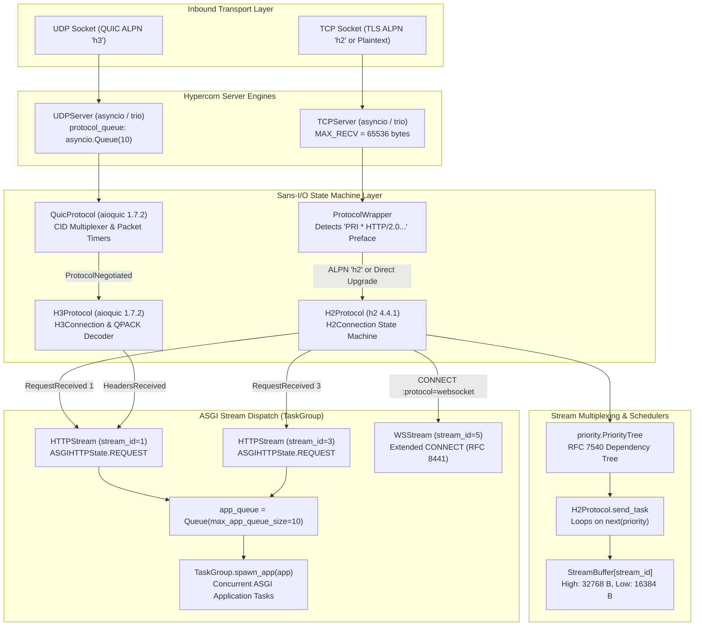

# Hypercorn (0.18.0) Internals: Multiplexed HTTP/2 (h2 4.4.1) and HTTP/3 QUIC (aioquic 1.7.2) ASGI Worker Architecture

> [!summary] Claim
> Hypercorn decomposes ASGI concurrency across multiplexed HTTP/2 streams via `h2` 4.4.1 and HTTP/3 QUIC streams via `aioquic` 1.7.2, scheduling independent stream coroutines over a single transport connection using an RFC 7540 priority tree and dual-runtime `TaskGroup` wrappers, which removes HTTP/1.1 response-ordering head-of-line blocking; its per-stream `send` backpressure holds only while the peer's flow-control window is open.

Part of [ASGI Servers and Async Runtime](README.md) in [API Engineering](../README.md).

## TL;DR

Hypercorn drives sans-I/O protocol state machines (`h2.connection.H2Connection` and `aioquic.h3.connection.H3Connection`), spawning isolated coroutines per stream within a worker `TaskGroup` and scheduling outbound DATA frames through a `priority.PriorityTree`.
ASGI applications running on Hypercorn under HTTP/2 or HTTP/3 get trailers (`http.response.trailers`), server push (`http.response.push`), and 103 Early Hints (`http.response.early_hint`) as scope extensions (RFC 9113 Section 8.1, RFC 9113 Section 8.4, RFC 8297 Section 2).
Hypercorn's `StreamBuffer.pop` evaluates the low-water mark against the popped chunk size rather than remaining buffer depth (`if len(data) < BUFFER_LOW_WATER`), so a full 16384-byte pop never resumes the producer while an empty pop, which `send_task` issues whenever the peer's flow-control window is 0, always does, letting an application buffer without bound against a stalled client.
Hypercorn 0.18.0 declares `Requires-Python: >=3.10` and offers `asyncio`, `uvloop`, and `trio` workers; the `trio` and `uvloop` workers need the optional extras `hypercorn[trio]` and `hypercorn[uvloop]`, and AnyIO applications run on whichever backend Hypercorn starts because AnyIO detects it through `sniffio`.
Do not choose Hypercorn for HTTP/1.1 REST microservices behind reverse proxies (Envoy, Nginx, Cloudflare) that already terminate HTTP/2 and HTTP/3, where its pure-Python `h11` and `h2` parsing buys nothing over Granian or Uvicorn with `httptools`.

## Mental model



Inbound client traffic arrives either over a TCP connection negotiated with ALPN `h2` (or plaintext upgraded from HTTP/1.1) or over a UDP socket carrying QUIC datagrams.
`TCPServer` and `UDPServer` read raw byte buffers and forward them to the sans-I/O protocol layer without executing HTTP parsing logic themselves.
`ProtocolWrapper` starts `H2Protocol` directly when ALPN selected `h2`; otherwise it starts `H11Protocol` and swaps to `H2Protocol` when `h11` parses the 24-byte HTTP/2 connection preface (`PRI * HTTP/2.0\r\n\r\nSM\r\n\r\n`) as a request line or a request asks for `Upgrade: h2c`.
For HTTP/2, `H2Protocol` passes raw frames into `h2.connection.H2Connection`, which parses binary frame headers and emits structured events.
When a `RequestReceived` event arrives, `H2Protocol` instantiates an `HTTPStream` (or a `WSStream` if the pseudo-header `:method` is `CONNECT`), registers the stream identifier in a `priority.PriorityTree`, and blocks it until outbound body data arrives.
A background `send_task` continuously polls the priority tree, popping chunks bounded by the peer's flow-control window and pushing them into the TCP socket writer.
For HTTP/3, `QuicProtocol` creates connection state only for an Initial packet in a datagram of at least 1200 bytes (RFC 9000 Section 14.1), demultiplexes packets by Connection ID (CID), runs loss-recovery timers, and feeds events to `H3Protocol`.
Each active stream provisions an independent `app_queue` bounded by `max_app_queue_size` (default 10) and dispatches the ASGI application inside a worker `TaskGroup`, enabling fully interleaved, out-of-order execution across streams sharing the same socket.

## How it works

### 1. HTTP/2 Binary Framing and the `h2` Sans-I/O Engine

HTTP/2 replaces HTTP/1.1 ASCII text lines with a binary framing layer defined in RFC 9113 Section 4.1.
Every HTTP/2 frame begins with a fixed 9-octet header consisting of a 24-bit payload length (at most 16384 octets unless the receiver advertises a larger `SETTINGS_MAX_FRAME_SIZE`, RFC 9113 Section 4.2), an 8-bit frame type, an 8-bit flags field, a 1-bit reserved field, and a 31-bit stream identifier.

```
 +-----------------------------------------------+
 |                 Length (24)                   |
 +---------------+---------------+---------------+
 |   Type (8)    |   Flags (8)   |
 +-+-------------+---------------+-------------------------------+
 |R|                 Stream Identifier (31)                      |
 +=+=============================================================+
 |                   Frame Payload (0...)                      ...
 +---------------------------------------------------------------+
```

Hypercorn delegates binary frame decoding to `h2` (4.4.1), a pure-Python sans-I/O state machine.
`H2Protocol` initializes `h2.connection.H2Connection` with `H2Configuration(client_side=False, header_encoding=None)` and replaces `local_settings` with three initial values `(hypercorn 0.18.0 hypercorn/protocol/h2.py, H2Protocol.__init__)`.
`MAX_CONCURRENT_STREAMS` is configured to `config.h2_max_concurrent_streams` (default 100; RFC 9113 Section 6.5.2 leaves it unlimited by default and recommends no less than 100).
`MAX_HEADER_LIST_SIZE` is configured to `config.h2_max_header_list_size` (default `2**16` = 65536 bytes, RFC 9113 Section 6.5.2).
`ENABLE_CONNECT_PROTOCOL` is set to 1, advertising RFC 8441 Extended CONNECT capability for WebSockets over HTTP/2.
`config.h2_max_inbound_frame_size` is assigned to `connection.DEFAULT_MAX_INBOUND_FRAME_SIZE`, a class attribute that `h2` 4.4.1 never reads after construction, so the advertised and enforced `MAX_FRAME_SIZE` stays at the `h2.settings.Settings` default of 16384 whatever the config says (measured: setting `h2_max_inbound_frame_size = 2**20` leaves `local_settings.max_frame_size == 16384`, CPython 3.14.6, macOS 27.3 arm64).

HTTP/2 connections initiate through one of three pathways:
- TLS with ALPN negotiation:
The TLS ClientHello advertises `h2` in its ALPN extension.
Upon handshake completion, `TCPServer.run` reads `ssl_object.selected_alpn_protocol()` and passes it to `ProtocolWrapper` `(hypercorn 0.18.0 hypercorn/asyncio/tcp_server.py, TCPServer.run)`, which instantiates `H2Protocol` directly when the value is `"h2"` `(hypercorn 0.18.0 hypercorn/protocol/__init__.py, ProtocolWrapper.__init__)`.
- Cleartext Direct Preface (Prior Knowledge):
The client connects over plain TCP and transmits the 24-octet connection preface `PRI * HTTP/2.0\r\n\r\nSM\r\n\r\n` (RFC 9113 Section 3.3 and Section 3.4) followed immediately by a `SETTINGS` frame.
`ProtocolWrapper` begins in `H11Protocol` mode; `h11` parses `PRI * HTTP/2.0` as a request, and `H11Protocol._check_protocol` raises `H2ProtocolAssumedError(b"PRI * HTTP/2.0\r\n\r\n" + trailing_data)` `(hypercorn 0.18.0 hypercorn/protocol/h11.py, H11Protocol._check_protocol)`.
`ProtocolWrapper` intercepts this exception, swaps its internal protocol reference to `H2Protocol`, calls `initiate()`, and delivers the reassembled bytes `(hypercorn 0.18.0 hypercorn/protocol/__init__.py, ProtocolWrapper.handle)`.
- Cleartext HTTP/1.1 Upgrade (`h2c`):
The client sends an HTTP/1.1 request containing `Upgrade: h2c` and `HTTP2-Settings: <base64url>` (RFC 7540 Section 3.2; RFC 9113 Section 3.1 deprecates this upgrade path).
If the request has no `Content-Length` or `Transfer-Encoding`, `H11Protocol._check_protocol` responds with `101 Switching Protocols` and raises `H2CProtocolRequiredError`, transferring the initial request and settings to `H2Protocol.initiate(headers, settings)`; an upgrade request with a body is answered in HTTP/1.1 instead.

### 2. Stream Multiplexing, Priority Scheduling, and Flow Control

In HTTP/1.1, request pipelining requires servers to send responses in the order the requests were received (RFC 9112 Section 9.3.2).
If an endpoint handling the first request executes a slow database query, all subsequent pipelined responses on that TCP socket are blocked behind it.
Hypercorn eliminates this head-of-line blocking by executing each HTTP/2 stream concurrently within the event loop.

When `H2Protocol._handle_events` receives `h2.events.RequestReceived`, it extracts `:method` and `:path` from the pseudo-headers and calls `_create_stream` `(hypercorn 0.18.0 hypercorn/protocol/h2.py, H2Protocol._create_stream)`.
For each stream, Hypercorn performs four coordination steps:
First, it constructs an instance of `HTTPStream` (or `WSStream` if `:method` is `CONNECT`).
Second, it creates an isolated `StreamBuffer` instance for that stream identifier.
Third, it inserts the stream identifier into `self.priority = priority.PriorityTree()` and immediately marks it as blocked via `self.priority.block(stream_id)` (unless a `PRIORITY` frame already inserted it).
Fourth, it hands the stream a `Request` event, and `HTTPStream.handle` builds the scope and spawns an independent ASGI coroutine via `self.task_group.spawn_app(self.app, self.config, self.scope, self.app_send)` `(hypercorn 0.18.0 hypercorn/protocol/http_stream.py, HTTPStream.handle)`.

Outbound scheduling is driven by a dedicated, persistent background task: `H2Protocol.send_task` `(hypercorn 0.18.0 hypercorn/protocol/h2.py, H2Protocol.send_task)`.
The `send_task` runs an infinite loop calling `stream_id = next(self.priority)`.
The `priority` library (2.0.0) implements the RFC 7540 stream dependency tree, selecting the next stream based on stream weights and parent-child dependency relationships.
If every stream in the tree is blocked (a stream is re-blocked after a pop returns no data, whether its buffer is empty or its flow-control window is exhausted), `next(self.priority)` raises `priority.DeadlockError("No unblocked streams to schedule.")` `(priority 2.0.0 priority/priority.py, PriorityTree.__next__)`.
The `send_task` catches this error, suspends execution by awaiting `self.has_data.wait()`, and clears the event once awakened.

When an ASGI application sends response body data, `HTTPStream.app_send` emits a `Body` event to `H2Protocol.stream_send`.
`H2Protocol` unblocks the stream in the priority tree via `self.priority.unblock(event.stream_id)`, sets `self.has_data`, and pushes the payload into `self.stream_buffers[stream_id]`.
The `send_task` awakens, retrieves the stream ID from the priority tree, and invokes `_send_data(stream_id)` (excerpt of the `try:` body, dedented, `(hypercorn 0.18.0 hypercorn/protocol/h2.py, H2Protocol._send_data)`):

```python
chunk_size = min(
    self.connection.local_flow_control_window(stream_id),
    self.connection.max_outbound_frame_size,
)
chunk_size = max(0, chunk_size)
data = await self.stream_buffers[stream_id].pop(chunk_size)
if data:
    self.connection.send_data(stream_id, data)
    await self._flush()
else:
    self.priority.block(stream_id)
```

In `h2.connection.H2Connection.local_flow_control_window(stream_id)`, the window is calculated as `min(self.outbound_flow_control_window, stream.outbound_flow_control_window)` `(h2 4.4.1 h2/connection.py, H2Connection.local_flow_control_window)`.
Both the connection-level window and the stream-level window start at 65535 octets (RFC 9113 Section 5.2.1).
Once 65535 bytes have been sent and the client has not sent `WINDOW_UPDATE`, `local_flow_control_window` returns 0.
`_send_data` calls `pop(0)`, gets `b""`, enters the `else:` branch, and re-blocks the stream in `self.priority`; that empty pop also releases a paused producer (Section 3).
When the peer transmits a `WINDOW_UPDATE` frame, `h2` emits `h2.events.WindowUpdated`.
`H2Protocol._window_updated` unblocks the affected stream (or all streams if `stream_id == 0`), sets `self.has_data`, and allows `send_task` to resume data transmission.

### 3. StreamBuffer Backpressure Mechanics and the Exact-Multiple Trap

Hypercorn regulates memory consumption between fast ASGI producers and slow network consumers using `StreamBuffer` `(hypercorn 0.18.0 hypercorn/protocol/h2.py, StreamBuffer)`.
The high-water threshold is defined as `BUFFER_HIGH_WATER = 2 * 2**14` (32768 bytes, or two default 16 KB frames).
The low-water threshold is defined as `BUFFER_LOW_WATER = BUFFER_HIGH_WATER / 2` (`16384.0`, a float because of true division).

When an ASGI coroutine calls `send({"type": "http.response.body", "body": data, "more_body": True})`, `H2Protocol.stream_send` unblocks the stream, sets `has_data`, and awaits `StreamBuffer.push(data)`.
`push` appends `data` to its internal `bytearray`.
If `len(self.buffer) >= BUFFER_HIGH_WATER`, `push` executes `await self._paused.wait()` and then `await self._paused.clear()`, suspending the ASGI application coroutine and applying direct backpressure.

In `StreamBuffer.pop(max_length)`, data is sliced out of the buffer (verbatim from the source):
```python
async def pop(self, max_length: int) -> bytes:
    length = min(len(self.buffer), max_length)
    data = bytes(self.buffer[:length])
    del self.buffer[:length]
    if len(data) < BUFFER_LOW_WATER:
        await self._paused.set()
    if len(self.buffer) == 0:
        await self._is_empty.set()
    return data
```

The edge case is line 74 of `hypercorn/protocol/h2.py`: `if len(data) < BUFFER_LOW_WATER: await self._paused.set()`.
The condition inspects the length of the popped chunk (`len(data)`), rather than the remaining buffer depth (`len(self.buffer)`).
It has two consequences, and neither is a hang.

First, the exact-multiple delay.
When an application pushes 49152 bytes (`3 x 16384`) in one `send`, `push` pauses, and `_send_data` pops three full `max_outbound_frame_size` chunks of 16384 bytes.
Because `16384 < 16384.0` is `False`, none of those pops releases the producer, so it stays suspended even when the buffer is at 0 bytes.
The stream is still unblocked in the priority tree, so `send_task` calls `_send_data` once more; that pop returns `b""`, `0 < 16384.0` is `True`, `_paused` is set, and the producer resumes.
The cost is one extra scheduling round, not a deadlock: the lab sends a 49152-byte body through `H2Protocol` and the client receives all 49152 bytes with `END_STREAM` (`test_h2_exact_multiple_body_completes_end_to_end`).

Second, and more serious, backpressure disappears when the peer's flow-control window is closed.
With the window at 0, `_send_data` calls `pop(0)`, which returns `b""` and therefore sets `_paused`, releasing the producer without draining anything.
Each new `send` unblocks the stream again, so the next `pop(0)` releases the next `push`.
In the lab, a client that never sends `WINDOW_UPDATE` received 65535 bytes, while all six 40000-byte `send` calls returned and the server held 174465 bytes in the `StreamBuffer` (`test_h2_zero_window_does_not_hold_producer`, CPython 3.14.6, macOS 27.3 arm64).
Patching the condition to `len(self.buffer) < BUFFER_LOW_WATER` in a scratch run held the producer after two sends (54465 bytes buffered), which confirms the mechanism.

### 4. HTTP/3 QUIC Worker Architecture via `aioquic`

HTTP/3 replaces TCP with QUIC over UDP (RFC 9000, RFC 9114).
While HTTP/2 multiplexes streams over a single ordered TCP stream, packet loss at the IP layer stalls the entire TCP connection until the dropped packet is retransmitted.
In contrast, QUIC multiplexes streams at the transport layer over UDP datagrams.
A lost packet carrying stream 1 data does not hold back in-order delivery of stream 3 data, although both streams still share one connection's congestion window.

Hypercorn integrates `aioquic` (1.7.2, installed through the optional `hypercorn[h3]` extra) inside `QuicProtocol` `(hypercorn 0.18.0 hypercorn/protocol/quic.py, QuicProtocol)`.
`UDPServer` receives UDP packets on the sockets created from `Config.quic_bind`.
In `hypercorn.asyncio.udp_server.UDPServer`, incoming datagrams are queued into `self.protocol_queue: asyncio.Queue = asyncio.Queue(10)`.
The UDP receive queue has a fixed capacity of 10 datagrams; if datagrams arrive faster than the event loop processes them, `datagram_received` silently discards them: `except asyncio.QueueFull: pass  # Just throw the data away, is UDP`.

When a datagram reaches `QuicProtocol.handle(RawData)`, Hypercorn coordinates connection state:
- Anti-Amplification Validation:
RFC 9000 Section 8.1 forbids a server from sending more than three times the bytes received from an unvalidated address, and RFC 9000 Section 14.1 requires a server to discard an Initial packet carried in a datagram smaller than 1200 bytes.
Hypercorn first answers an unsupported QUIC version with a Version Negotiation packet, then creates a connection only when no connection matches `header.destination_cid`, `len(event.data) >= 1200`, `header.packet_type == PACKET_TYPE_INITIAL`, and the worker is not terminating `(hypercorn 0.18.0 hypercorn/protocol/quic.py, QuicProtocol.handle)`.
A datagram that fails those checks and matches no existing CID is dropped without creating connection state.
- Connection ID Routing:
`QuicProtocol.connections: dict[bytes, _Connection]` maps Connection IDs to connection objects.
Hypercorn indexes connections under both `header.destination_cid` and `quic_connection.host_cid`.
When `ConnectionIdIssued` or `ConnectionIdRetired` events fire, Hypercorn updates `self.connections`, maintaining continuous routing during client connection migration across network interfaces (RFC 9000 Section 9).
- Loss Detection and Timers:
QUIC requires timers for loss detection and Probe Timeout (PTO) (RFC 9002 Section 6.1 and Section 6.2).
`QuicProtocol.send_all` flushes `datagrams_to_send` and then inspects `connection.quic.get_timer()`.
If a timer is set, Hypercorn calls `connection.task.restart(...)` on the connection's `SingleTask`, which cancels any previous timer task and starts `_handle_timer`, sleeping for `wait = max(0, timer - self.context.time())` and invoking `connection.quic.handle_timer(now=...)` `(hypercorn 0.18.0 hypercorn/protocol/quic.py, QuicProtocol._handle_timer)`.
- HTTP/3 Protocol Layer:
Once `ProtocolNegotiated` is emitted, Hypercorn instantiates `H3Protocol` `(hypercorn 0.18.0 hypercorn/protocol/h3.py, H3Protocol)`.
`H3Protocol` wraps `aioquic.h3.connection.H3Connection`, which decodes QPACK-compressed field sections (RFC 9204), and translates `HeadersReceived` and `DataReceived` events into `HTTPStream` or, for `CONNECT`, `WSStream` events.

### 5. Extended CONNECT and WebSocket Multiplexing (RFC 8441)

In HTTP/1.1, WebSockets initiate via an HTTP upgrade request (`GET /chat HTTP/1.1`, `Upgrade: websocket`, `Connection: Upgrade`), receiving a `101 Switching Protocols` response.
HTTP/2 does not support the `101 (Switching Protocols)` status code (RFC 9113 Section 8.6), and `Upgrade` is a connection-specific header field that makes an HTTP/2 message malformed (RFC 9113 Section 8.2.2).
RFC 8441 defines Extended CONNECT to tunnel WebSockets through multiplexed HTTP/2 streams without seizing the underlying TCP connection.

During connection setup, Hypercorn includes `SETTINGS_ENABLE_CONNECT_PROTOCOL = 1` (parameter code 0x08) in its initial HTTP/2 `SETTINGS` frame.
When a client opens a WebSocket stream, it sends a `HEADERS` frame with pseudo-headers:
- `:method = CONNECT`
- `:protocol = websocket`
- `:scheme = https`
- `:path = /chat`
- `:authority = api.example.com`

In `H2Protocol._create_stream`, Hypercorn evaluates `if method == "CONNECT":` `(hypercorn 0.18.0 hypercorn/protocol/h2.py, H2Protocol._create_stream)`.
Instead of creating an `HTTPStream`, it instantiates `WSStream` `(hypercorn 0.18.0 hypercorn/protocol/ws_stream.py, WSStream)`.
The test is on `:method` alone; `:protocol` is not inspected at this point, so any `CONNECT` stream, including a classic tunnel `CONNECT` without `:protocol`, is routed to `WSStream`.
`WSStream` maps the bidirectional HTTP/2 stream directly to ASGI `websocket` scope messages (`websocket.connect`, `websocket.receive`, `websocket.send`, `websocket.disconnect`), allowing WebSocket sessions to run concurrently with REST HTTP/2 requests over the same TCP socket.

### 6. Dual-Runtime Worker Topologies: Asyncio vs Trio and AnyIO Interoperability

Hypercorn selects a worker by `Config.worker_class` (`"asyncio"` by default, `"uvloop"`, or `"trio"`; anything else raises `ValueError`) `(hypercorn 0.18.0 hypercorn/run.py, run)`.
The `uvloop` and `trio` workers import their packages lazily: without `trio` installed, `run()` raises `ModuleNotFoundError: No module named 'trio'` before creating sockets (reproduced in the lab environment, where `trio` is absent), and `uvloop_worker` converts a missing `uvloop` into `Exception("uvloop is not installed")` `(hypercorn 0.18.0 hypercorn/asyncio/run.py, uvloop_worker)`.
To support both CPython's callback-based asyncio loop and Trio's strict structured concurrency model, Hypercorn implements an internal compatibility layer:
- `WorkerContext`: Provides a unified event interface via `EventWrapper`.
Because `trio.Event` lacks an in-place `clear()` method, `hypercorn.trio.worker_context.EventWrapper.clear()` instantiates a fresh `trio.Event()`.
To preserve interface parity, `EventWrapper.clear()` and `EventWrapper.set()` are defined as asynchronous coroutines across both asyncio and trio runtimes `(hypercorn 0.18.0 hypercorn/asyncio/worker_context.py, EventWrapper)`.
- `TaskGroup`: In asyncio, `hypercorn.asyncio.task_group.TaskGroup` wraps `asyncio.TaskGroup` (Python 3.11+), falling back to the `taskgroup` backport on older interpreters.
In Trio, `hypercorn.trio.task_group.TaskGroup` wraps `trio.open_nursery()`.
- `spawn_app`: When launching an ASGI application, `TaskGroup.spawn_app` creates an intermediate channel or bounded queue:
In asyncio, it allocates `app_queue: asyncio.Queue[ASGIReceiveEvent] = asyncio.Queue(config.max_app_queue_size)` `(hypercorn 0.18.0 hypercorn/asyncio/task_group.py, TaskGroup.spawn_app)`.
In Trio, it allocates `trio.open_memory_channel[ASGIReceiveEvent](config.max_app_queue_size)` `(hypercorn 0.18.0 hypercorn/trio/task_group.py, TaskGroup.spawn_app)`.

AnyIO (4.16.0) applications (such as Starlette and FastAPI services utilizing `anyio.to_thread.run_sync` or `anyio.create_task_group`) run on Hypercorn without a translation layer between runtimes.
AnyIO picks its backend from `sniffio.current_async_library()`, falling back to probing `asyncio.get_running_loop()` when `sniffio` is absent `(anyio 4.16.0 anyio/_core/_eventloop.py, current_async_library)`.
Under `worker_class = "asyncio"` or `"uvloop"` that returns `"asyncio"`, and under `"trio"` it returns `"trio"`, so tasks, cancel scopes, and exception groups map onto that runtime.

## Numbers and limits

| Parameter / Metric | Exact Value | Specification / Source | Architectural Significance |
|---|---|---|---|
| `BUFFER_HIGH_WATER` | `32768` bytes (32 KB) | `hypercorn.protocol.h2 BUFFER_HIGH_WATER` | `push` pauses the ASGI producer once the stream buffer reaches two frames (`>=`). |
| `BUFFER_LOW_WATER` | `16384.0` bytes (16 KB) | `hypercorn.protocol.h2 BUFFER_LOW_WATER` | Resume threshold in `StreamBuffer.pop` evaluating chunk size rather than buffer depth. |
| Producer bytes buffered against a zero window | `174465` bytes after six 40000-byte sends | Measured: `test_h2_zero_window_does_not_hold_producer`, CPython 3.14.6, macOS 27.3 arm64 | `240000 - 65535`; every `send` returned, so the high-water mark did not hold. |
| `SETTINGS_MAX_CONCURRENT_STREAMS` | `100` streams | `hypercorn.config Config.h2_max_concurrent_streams`, RFC 9113 Sec 6.5.2 | Maximum concurrent active request streams permitted per HTTP/2 TCP connection. |
| `SETTINGS_MAX_HEADER_LIST_SIZE` | `65536` bytes (64 KB) | `hypercorn.config Config.h2_max_header_list_size`, RFC 9113 Sec 6.5.2 | Upper limit on decoded HPACK header field section size to prevent memory exhaustion. |
| `SETTINGS_MAX_FRAME_SIZE` | `16384` bytes (16 KB) | `h2 4.4.1 h2/settings.py` `Settings` default, RFC 9113 Sec 6.5.2 | Advertised and enforced inbound limit; `Config.h2_max_inbound_frame_size` (default `2**14`) has no effect in 0.18.0. |
| Max HTTP/2 Frame Size Limit | `16777215` bytes (2^24 - 1 B) | RFC 9113 Section 4.2 | Theoretical wire limit of 24-bit length field in the HTTP/2 frame header. |
| Initial Flow Control Window | `65535` bytes | RFC 9113 Section 5.2.1 | Starting stream-level and connection-level credit before `WINDOW_UPDATE` frames. |
| Maximum Flow Control Window | `2147483647` bytes (2^31 - 1 B) | RFC 9113 Section 6.9.1 | A sender must not let a flow-control window exceed this value. |
| HTTP/2 Connection Preface | `24` bytes | RFC 9113 Section 3.4 | Wire constant `PRI * HTTP/2.0\r\n\r\nSM\r\n\r\n` identifying direct cleartext connections. |
| QUIC Minimum Initial Datagram | `1200` bytes | RFC 9000 Section 14.1 (3x limit in Section 8.1) | Smaller datagrams carrying Initial packets are discarded by the server. |
| QUIC Host Connection ID Length | `8` bytes | `hypercorn.protocol.quic QuicProtocol.handle` (`host_cid_length=8`); `aioquic` `QuicConfiguration.connection_id_length = 8` | Fixed connection identifier length used by Hypercorn for datagram demultiplexing. |
| QPACK Static Table Entries | `99` entries (indexes 0 to 98) | RFC 9204 Section 3.1 and Appendix A | Predefined header field index table in HTTP/3 (compared to 61 entries in HPACK, RFC 7541 Appendix A). |
| Initial PTO without RTT sample | about `1` second | RFC 9002 Section 6.2.2 (initial RTT 333 ms) | Delay before the first probe after a lost handshake datagram. |
| QPACK table capacity and blocked streams advertised by `aioquic` | `4096` bytes and `16` streams | `aioquic 1.7.2 aioquic/h3/connection.py`, `H3Connection.__init__` | Fixed in `H3Connection.__init__`; no Hypercorn option changes them, and no `MAX_FIELD_SECTION_SIZE` is advertised. |
| `max_app_queue_size` | `10` events | `hypercorn.config Config.max_app_queue_size` | Bounded queue depth between protocol receiver and ASGI application coroutines. |
| `UDPServer.protocol_queue` | `10` datagrams | `hypercorn.asyncio.udp_server.UDPServer` | Hardcoded queue bound in asyncio UDP server; drops bursts exceeding 10 packets. |
| `MAX_RECV` | `65536` bytes (`2**16`) | `hypercorn.asyncio.tcp_server.MAX_RECV` (module constant) | Socket read chunk size passed to `reader.read()` per TCP event loop iteration. |
| `keep_alive_timeout` | `5.0` seconds | `hypercorn.config Config.keep_alive_timeout` | Idle connection close timer evaluated when all active streams complete. |
| `keep_alive_max_requests` | `1000` requests | `hypercorn.config Config.keep_alive_max_requests` (added in 0.16.0) | `H2Protocol` sends `GOAWAY` once more than 1000 streams were opened on the connection; a Rapid Reset mitigation per the changelog. |
| `graceful_timeout` | `3.0` seconds | `hypercorn.config Config.graceful_timeout` | Grace period allowed for active requests to drain during worker shutdown. |

## Portability

The table below summarizes protocol capabilities, worker runtime support, and execution constraints across the runtime matrix `(as of 2026-11)`.

| Environment / Runtime | HTTP/1.1 Support | HTTP/2 Support | HTTP/3 QUIC Support | Worker Runtime Classes | Notes & Upstream Constraints |
|---|---|---|---|---|---|
| CPython 3.12 (3.12.16) | Not run | Not run | Not run | `asyncio`, `uvloop` | Leg not run (the lab matrix is paused by the user, 2026-11-11). Hypercorn 0.18.0 declares `Requires-Python: >=3.10` and `aioquic` 1.7.2 declares `>=3.11`, both listing 3.12 (package `METADATA`). |
| CPython 3.13 (3.13.18) | Not run | Not run | Not run | `asyncio`, `uvloop` | Leg not run (matrix paused). `uvloop` 0.23.0 ships `cp313` wheels for Linux (glibc and musl) and macOS (PyPI file list, as of 2026-11). |
| CPython 3.14 (3.14.6) | Yes (`h11` 0.16.0) | Yes (`h2` 4.4.1) | Header parsing only (`aioquic` 1.7.2) | `asyncio` | Lab run: 9 of 9 tests pass (`uv run --frozen pytest`, macOS 27.3 arm64); the matrix pin is 3.14.10, this run used the workspace interpreter 3.14.6. |
| CPython 3.15 (3.15.2) | Not run | Not run | Not run | `asyncio`, `uvloop` | Leg not run (matrix paused). `uvloop` 0.23.0 ships `cp315` wheels and `aioquic` 1.7.2 lists 3.15 in its classifiers, but Hypercorn 0.18.0 lists classifiers only through 3.14 (package `METADATA`). |
| CPython 3.15t Free-Threaded | Not run | Not run | Not run | `asyncio`, `uvloop` | Leg not run (matrix paused). `uvloop` 0.23.0 ships `cp315t` wheels, while `aioquic` 1.7.2 ships only `cp311-abi3` wheels plus an sdist (PyPI file lists, as of 2026-11); whether an installer picks an `abi3` wheel on a free-threaded interpreter was not tested. |
| Hypercorn 0.18.0 | Native | Native | Native (`hypercorn[h3]`) | `asyncio`, `uvloop`, `trio` | `trio` without the package raises `ModuleNotFoundError: No module named 'trio'` (reproduced). |
| Uvicorn 0.54.0 | Native (`httptools`/`h11`) | Optional (`http2=True` with `http="zttp"`, needs the `zttp` package) | None | `asyncio`, `uvloop` | `uvicorn/config.py` `Config.load` raises `ValueError` for `http2` without `zttp`; see [[Uvicorn-Internals-Server-Lifecycle-Protocols-and-Flow-Control]]. |
| Granian 2.8.7 | Native (Rust Hyper) | Native (Rust Hyper) | None listed | Tokio Multi-Thread | README at `v2.8.7` lists "HTTP/1 and HTTP/2 protocols"; see [[Granian-Internals-Rust-Tokio-Hyper-Engine-and-RSGI-vs-ASGI]]. |
| Linux POSIX (`epoll`) | Not run | Not run | Not run | `asyncio`, `uvloop` | `Config.create_sockets` sets `SO_REUSEPORT` on TCP and UDP binds only when `workers > 1` (read from `hypercorn/config.py`, `Config._create_sockets`); not run on Linux, so kernel behavior is not measured. |
| macOS Darwin (`kqueue`) | Yes | Yes | Header parsing only | `asyncio` | Lab run on arm64 is in-process (no sockets), so UDP `protocol_queue` behavior is read from source, not measured. |
| Windows (`IOCP`) | Not run | Not run | Not run | `asyncio` | Not run. `uvloop` 0.23.0 lists no Windows wheels, so the `uvloop` worker is unavailable there; `aioquic` 1.7.2 ships `win_amd64`, `win32`, and `win_arm64` wheels (PyPI file lists, as of 2026-11). |

## Worked example

The worked example demonstrates deterministic, in-memory HTTP/2 stream multiplexing under Hypercorn's `H2Protocol`.
The test harness binds client `h2.connection.H2Connection` directly to server `hypercorn.protocol.h2.H2Protocol` via an in-memory byte pipe, eliminating network latency and socket non-determinism.
The full lab is available in [implementation](../labs/src/api_labs/f12_asgi_servers_and_async_runtime/hypercorn_worker.py) and verified by [test](../labs/tests/f12_asgi_servers_and_async_runtime/test_hypercorn_internals_http_2_http_3_quic_and_anyio_trio_workers.py).

The same module also proves the Section 3 backpressure behavior: `test_h2_exact_multiple_body_completes_end_to_end` and `test_h2_zero_window_does_not_hold_producer` drive `StreamBuffer` through the real `H2Protocol.send_task`.
Below is the verified test demonstrating concurrent out-of-order stream completion over a single virtual connection:

```python
@pytest.mark.unit
@pytest.mark.asyncio
async def test_h2_concurrent_stream_multiplexing_out_of_order_completion() -> None:
    """Verify concurrent HTTP/2 streams over a single connection complete out-of-order."""
    slow_stream_gate = asyncio.Event()

    async def multiplexed_app(
        scope: Scope, receive: ASGIReceiveCallable, send: ASGISendCallable
    ) -> None:
        if scope["type"] != "http":
            return
        path = scope["path"]
        if path == "/slow":
            await slow_stream_gate.wait()

        await send(
            {
                "type": "http.response.start",
                "status": 200,
                "headers": [(b"content-type", b"text/plain")],
            }
        )
        await send(
            {
                "type": "http.response.body",
                "body": f"done-{path}".encode(),
                "more_body": False,
            }
        )

    async with InProcessH2Harness(multiplexed_app) as harness:
        # Stream 1: Slow request
        await harness.send_request(
            stream_id=1,
            headers=[
                (b":method", b"GET"),
                (b":scheme", b"http"),
                (b":authority", b"api.local"),
                (b":path", b"/slow"),
            ],
            end_stream=True,
        )

        # Stream 3: Fast request on the EXACT SAME in-memory virtual connection
        await harness.send_request(
            stream_id=3,
            headers=[
                (b":method", b"GET"),
                (b":scheme", b"http"),
                (b":authority", b"api.local"),
                (b":path", b"/fast"),
            ],
            end_stream=True,
        )

        # Allow fast stream to complete while slow stream is blocked
        await harness.drain_server()
        assert 3 in harness.responses
        assert harness.responses[3].ended is True
        assert harness.responses[3].status_code == 200
        assert bytes(harness.responses[3].body) == b"done-/fast"

        # Slow stream 1 must not be finished yet
        assert harness.responses[1].ended is False
        assert harness.completion_order == [3]

        # Release slow stream gate and assert completion
        slow_stream_gate.set()
        await harness.drain_server()

        assert harness.responses[1].ended is True
        assert harness.responses[1].status_code == 200
        assert bytes(harness.responses[1].body) == b"done-/slow"
        assert harness.completion_order == [3, 1]
```

Execution output captured by the fact-check run (CPython 3.14.6, macOS 27.3 arm64, `uname -r` = `27.3.0`), run from `labs/`:

```text
$ uv run --frozen pytest tests/f12_asgi_servers_and_async_runtime/test_hypercorn_internals_http_2_http_3_quic_and_anyio_trio_workers.py -v
============================= test session starts ==============================
platform darwin -- Python 3.14.6, pytest-9.2.0, pluggy-1.7.0 -- /Users/shreejitverma/github/The-Distinguished-Engineer/build/api_notes/jobs/Hypercorn-Internals-HTTP-2-HTTP-3-QUIC-and-AnyIO-Trio-Workers/verify/labs/.venv/bin/python
cachedir: .pytest_cache
hypothesis profile 'default'
rootdir: /Users/shreejitverma/github/The-Distinguished-Engineer/build/api_notes/jobs/Hypercorn-Internals-HTTP-2-HTTP-3-QUIC-and-AnyIO-Trio-Workers/verify/labs
configfile: pyproject.toml
plugins: platformdirs-4.14.5, schemathesis-4.33.1, cov-7.1.0, hypothesis-6.170.14, inline-snapshot-0.36.1, Faker-40.44.0, locust-2.47.0, typeguard-4.6.0, anyio-4.16.0, asyncio-1.4.1.post1, respx-0.23.1
asyncio: mode=Mode.STRICT, debug=False, asyncio_default_fixture_loop_scope=function, asyncio_default_test_loop_scope=function
collecting ... collected 9 items

tests/f12_asgi_servers_and_async_runtime/test_hypercorn_internals_http_2_http_3_quic_and_anyio_trio_workers.py::test_h2_concurrent_stream_multiplexing_out_of_order_completion PASSED [ 11%]
tests/f12_asgi_servers_and_async_runtime/test_hypercorn_internals_http_2_http_3_quic_and_anyio_trio_workers.py::test_asgi_extensions_injected_in_h2_scope PASSED [ 22%]
tests/f12_asgi_servers_and_async_runtime/test_hypercorn_internals_http_2_http_3_quic_and_anyio_trio_workers.py::test_h2_extended_connect_dispatches_to_ws_stream PASSED [ 33%]
tests/f12_asgi_servers_and_async_runtime/test_hypercorn_internals_http_2_http_3_quic_and_anyio_trio_workers.py::test_h2_stream_buffer_backpressure_and_exact_multiple_pause PASSED [ 44%]
tests/f12_asgi_servers_and_async_runtime/test_hypercorn_internals_http_2_http_3_quic_and_anyio_trio_workers.py::test_stream_buffer_zero_length_pop_releases_producer PASSED [ 55%]
tests/f12_asgi_servers_and_async_runtime/test_hypercorn_internals_http_2_http_3_quic_and_anyio_trio_workers.py::test_h2_exact_multiple_body_completes_end_to_end PASSED [ 66%]
tests/f12_asgi_servers_and_async_runtime/test_hypercorn_internals_http_2_http_3_quic_and_anyio_trio_workers.py::test_h2_zero_window_does_not_hold_producer PASSED [ 77%]
tests/f12_asgi_servers_and_async_runtime/test_hypercorn_internals_http_2_http_3_quic_and_anyio_trio_workers.py::test_quic_initial_datagram_anti_amplification_and_parsing PASSED [ 88%]
tests/f12_asgi_servers_and_async_runtime/test_hypercorn_internals_http_2_http_3_quic_and_anyio_trio_workers.py::test_protocol_wrapper_dynamic_upgrade_on_direct_preface PASSED [100%]

============================== 9 passed in 0.68s ===============================
```

## Pitfalls

> [!warning] Pitfall 1: StreamBuffer Backpressure Vanishes Against a Stalled Client
> **Trigger**: An ASGI application streams a large HTTP/2 response to a client that stops sending `WINDOW_UPDATE` (a slow mobile reader, or a deliberate slow-read attacker).
> **Symptom**: Worker memory grows with every `send`; `await send(...)` keeps returning although nothing reaches the socket, so the application never feels backpressure (lab: 174465 bytes buffered after six 40000-byte sends against a closed 65535-byte window).
> **Fix**: The cause is `StreamBuffer.pop` testing `len(data) < BUFFER_LOW_WATER`, so the `pop(0)` that `send_task` issues on a zero window releases the producer.
> Bound it at the application (cap total in-flight bytes per response, or use `http.disconnect` plus a send timeout), terminate HTTP/2 at a proxy that buffers with limits, or patch the test to `len(self.buffer) < BUFFER_LOW_WATER`.
> The exact-multiple case (bodies of `n x 16384` bytes) only costs one extra empty pop; it does not hang (`test_h2_exact_multiple_body_completes_end_to_end`).

> [!warning] Pitfall 2: HTTP/2 "Rapid Reset" Resource Exhaustion (CVE-2023-44487)
> **Trigger**: An attacker transmits a burst of HTTP/2 `HEADERS` frames followed immediately by `RST_STREAM` frames across a single TCP connection.
> **Symptom**: CPU climbs as Hypercorn instantiates `HTTPStream` objects, app queues, and application tasks for streams that are reset before responding (the reset delivers `http.disconnect` to the app rather than cancelling it).
> **Fix**: Hypercorn 0.16.0 added `keep_alive_max_requests` (default 1000) explicitly as a Rapid Reset mitigation: once a connection has opened more than 1000 streams, `H2Protocol` sends `GOAWAY`, so each TCP connection is capped, but there is no reset-rate budget and an attacker can simply reconnect.
> Keep the default (or lower it), and put an edge proxy (Envoy, Cloudflare, AWS ALB) that limits reset rates in front of public HTTP/2 listeners.

> [!warning] Pitfall 3: Silent UDP Datagram Dropping under Burst Traffic in Asyncio Workers
> **Trigger**: A sudden spike of HTTP/3 QUIC client connections delivers more than 10 UDP datagrams while the worker event loop is engaged in application tasks.
> **Symptom**: Datagrams are dropped without log warnings or socket errors (`except asyncio.QueueFull: pass  # Just throw the data away, is UDP`), which the peer sees as loss: handshake retries after a PTO of about 1 second (RFC 9002 Section 6.2.2) and congestion-window reductions.
> **Fix**: Run `workers > 1` so `Config.create_sockets` sets `SO_REUSEPORT` and the kernel spreads UDP flows across processes, keep application work off the event loop, or terminate HTTP/3 at a proxy.
> The queue bound of 10 is hardcoded in `hypercorn/asyncio/udp_server.py`; no config option changes it in 0.18.0.

> [!warning] Pitfall 4: TCP Head-of-Line Blocking on Lossy Networks with HTTP/2
> **Trigger**: Serving many concurrent streams over one HTTP/2 connection on lossy public mobile networks.
> **Symptom**: High 99th-percentile latency across all concurrent API calls; dropping a single TCP packet halts delivery of all multiplexed streams on that connection.
> **Fix**: Provide HTTP/3 QUIC endpoints (`Config.quic_bind`) alongside HTTP/2, advertising HTTP/3 availability through `Alt-Svc: h3=":443"; ma=86400` headers (RFC 7838, RFC 9114 Section 3.1.1).

## Security and robustness

### Rapid Reset (CVE-2023-44487)

In standard HTTP/1.1, an attacker cannot open a new request without completing or aborting the preceding TCP exchange.
In HTTP/2, an attacker can transmit tens of thousands of `HEADERS` frames followed immediately by `RST_STREAM` frames on stream IDs 1, 3, 5, 7, ... up to `h2_max_concurrent_streams`.
Hypercorn allocates `HTTPStream`, instantiates `asyncio.Queue(10)`, and spawns a task in its `TaskGroup` for each request.
On `StreamReset`, `H2Protocol._close_stream` delivers `StreamClosed`, and `HTTPStream.handle` answers it with `await self.app_put({"type": "http.disconnect"})` instead of cancelling the task, so each reset stream still costs a task that runs until the application notices the disconnect.
The only built-in cap is per connection: `keep_alive_requests` counts every created stream, and once it exceeds `keep_alive_max_requests` (1000) `H2Protocol` calls `close_connection()` (sends `GOAWAY`), the mitigation Hypercorn 0.16.0 introduced for this CVE per its changelog.
Rate limiting across connections still requires an inbound `RST_STREAM` budget at the ingress gateway.

### Frame Flooding (CVE-2019-9512, CVE-2019-9514, CVE-2019-9515)

The August 2019 Netflix advisory (NVD descriptions as cited) covered a ping flood (CVE-2019-9512), a reset flood that solicits a stream of `RST_STREAM` replies (CVE-2019-9514), and a settings flood where each `SETTINGS` frame forces an ACK (CVE-2019-9515); each makes the server build a queue of control-frame responses.
In Hypercorn, `h2` acknowledges `PING` and `SETTINGS` frames itself, and `_flush` writes the replies through `TCPServer.protocol_send`, which awaits `writer.drain()`; a client that floods but does not read therefore stalls Hypercorn's read loop instead of growing an unbounded queue `(hypercorn 0.18.0 hypercorn/asyncio/tcp_server.py, TCPServer.protocol_send)`.
`keep_alive_max_requests` counts streams, not control frames, so it does not bound these floods; CPU spent parsing them is bounded only by `read_timeout` (default `None`) and external rate limits.

### QUIC UDP Amplification Attacks (RFC 9000 Section 8.1)

Attackers frequently forge source IP addresses on UDP datagrams to bounce amplified server responses onto victim machines.
QUIC mandates that until the server validates the client's address (via a Retry token or by processing a Handshake packet from the client), it MUST NOT send more than three times the bytes received from that address (RFC 9000 Section 8.1).
Hypercorn enforces `len(event.data) >= 1200` on initial datagrams `(hypercorn 0.18.0 hypercorn/protocol/quic.py, QuicProtocol.handle)` and delegates the 3x anti-amplification window to `aioquic`.

### Header Compression Security: HPACK and QPACK

In HTTP/1.1, repeated ASCII headers are transmitted in plain text.
HTTP/2 uses HPACK (RFC 7541) with a 61-entry static table and a dynamic table, while HTTP/3 uses QPACK (RFC 9204) with a 99-entry static table and an out-of-band dynamic table encoder stream.
Compression introduces decompression bomb vulnerabilities: an attacker can send tiny compressed frames that expand into gigabytes of memory.
Hypercorn mitigates this by advertising `h2_max_header_list_size = 65536` (64 KB), and `h2` enforces the same value in its HPACK decoder (`DEFAULT_MAX_HEADER_LIST_SIZE = 2**16`).
If the decoded field section exceeds it, `hpack` raises `OversizedHeaderListError`, `h2` converts it to `h2.exceptions.DenialOfServiceError` and queues `GOAWAY` with `ENHANCE_YOUR_CALM`, and Hypercorn's `H2Protocol.handle` catches the `ProtocolError`, flushes, and closes the whole connection (reproduced in the lab environment with a 70000-byte header) `(h2 4.4.1 h2/connection.py, _decode_headers)`.
The QPACK side has no equivalent field-section cap in this stack.
`aioquic` 1.7.2 advertises only `QPACK_MAX_TABLE_CAPACITY = 4096` and `QPACK_BLOCKED_STREAMS = 16` (plus `ENABLE_CONNECT_PROTOCOL` and a grease setting) in `H3Connection._get_local_settings`, and `MAX_FIELD_SECTION_SIZE` (0x06) appears there only as an enum member that is never sent or checked `(aioquic 1.7.2 aioquic/h3/connection.py, H3Connection._get_local_settings)`.
`pylsqpack.Decoder` takes only the table capacity and the blocked-stream count, and Hypercorn's `H3Protocol` constructs `H3Connection(quic)` with no size option `(hypercorn 0.18.0 hypercorn/protocol/h3.py, H3Protocol.__init__)`.
RFC 9114 makes the limit optional: the default of `SETTINGS_MAX_FIELD_SECTION_SIZE` is unlimited (RFC 9114 Section 7.2.4.1) and an implementation "MAY impose a limit" and may answer an oversized section with `431` (RFC 9114 Section 4.2.2).
The only enforced error path is a malformed QPACK block: `pylsqpack.DecompressionFailed` becomes `QpackDecompressionFailed` with HTTP/3 error code `QPACK_DECOMPRESSION_FAILED` (0x200) `(aioquic 1.7.2 aioquic/h3/connection.py, H3Connection._decode_headers)`.
These facts come from reading the installed source; no oversized HTTP/3 request was sent in the lab, so memory growth under a large QPACK-compressed header is not measured.
Bound HTTP/3 header size at the QUIC edge (a proxy) or accept that a client can send a large field section.

### Request Smuggling Immunity

In HTTP/1.1, ambiguities between `Content-Length` and `Transfer-Encoding: chunked` enable request smuggling attacks (RFC 9112 Section 11.2).
HTTP/2 and HTTP/3 binary framing fundamentally eliminates this attack surface:
Payload boundaries are explicitly delimited by the 24-bit frame length in HTTP/2 (RFC 9113 Section 4.1) and QUIC stream offsets in HTTP/3 (RFC 9000 Section 2.2).
The `Transfer-Encoding` header is a connection-specific field that makes an HTTP/2 message malformed (RFC 9113 Section 8.2.2), and the RFC permits a stream error for malformed requests (RFC 9113 Section 8.1.1).
`h2` is stricter: a request carrying `transfer-encoding: chunked` raises `ProtocolError("Connection-specific header field present: ...")` `(h2 4.4.1 h2/utilities.py, _reject_connection_header)`, `h2` queues `GOAWAY` with `PROTOCOL_ERROR`, and Hypercorn closes the entire connection, including other in-flight streams (reproduced in the lab environment).
The residual smuggling risk sits at an HTTP/2-to-HTTP/1.1 downgrading proxy, not at Hypercorn's HTTP/2 parser.

## The principal's view

Staff-plus engineers evaluate HTTP/2 and HTTP/3 termination based on transport boundaries, operational complexity, and CPU cost.

### Serialization Overhead

Parsing binary framing state machines in pure Python (`h2` and `aioquic`) consumes substantial CPU cycles.
Every frame header decoding, flow control window arithmetic, and priority tree traversal executes under the Python GIL.
Terminating HTTP/2 or HTTP/3 at an edge reverse proxy (such as Envoy, Nginx, or AWS ALB) offloads wire parsing to C++ or Rust.
The edge proxy translates multiplexed streams into keep-alive HTTP/1.1 connections forwarded to backend Uvicorn or Granian workers, moving framing, HPACK, and flow-control work out of the Python process; this note does not measure the CPU saving, so benchmark your own traffic before deciding.
The trade-off is a downgrade hop, which reintroduces HTTP/1.1 request-smuggling risk at the proxy boundary and loses end-to-end trailers and push.

### DDoS Resilience

A single-threaded Python event loop shares its CPU between protocol parsing and application work, so UDP floods and HTTP/2 Rapid Reset traffic degrade application latency directly.
Envoy enforces connection limits and per-connection stream and reset limits in native worker threads before requests reach the application tier.

### When Hypercorn Termination is Justified

Hypercorn is the optimal architectural choice when specific conditions apply:
First, when true end-to-end HTTP/2 or HTTP/3 semantics are required between services (such as internal gRPC or gRPC-Web gateways utilizing streaming bidirectional channels).
Second, when the application relies on HTTP/2 server push (`http.response.push`) or trailing response headers (`http.response.trailers`) that intermediate HTTP/1.1 proxies strip.
Third, when the service is built on Trio and mandates strict structured concurrency invariants across the entire server stack.

## Interview questions

> [!question] L5: How does HTTP/2 stream multiplexing differ from HTTP/1.1 pipelining at the wire level?
>
> > [!success]- Answer
> > HTTP/1.1 pipelining allows clients to send multiple requests without waiting for intermediate responses, but the server MUST send the responses in the order the requests were received (RFC 9112 Section 9.3.2), creating application-level head-of-line blocking if the first request is slow.
> > HTTP/2 divides request and response messages into binary frames carrying a 31-bit stream identifier (RFC 9113 Section 4.1).
> > Frames from different streams can be interleaved arbitrarily across a single TCP socket, allowing faster responses to complete and return to the client before preceding slow responses finish.
> >
> > Follow-up: Why does HTTP/2 multiplexing fail to eliminate head-of-line blocking when packet loss occurs on the underlying network?

> [!question] L5: Why does Hypercorn inject `http.response.trailers`, `http.response.push`, and `http.response.early_hint` into `scope["extensions"]` for HTTP/2 but not for HTTP/1.1?
>
> > [!success]- Answer
> > In Hypercorn's `HTTPStream.handle`, the extensions dictionary is populated only when `event.http_version` is in `TRAILERS_VERSIONS`, `PUSH_VERSIONS`, and `EARLY_HINTS_VERSIONS`, each defined as `{"2", "3"}` `(hypercorn 0.18.0 hypercorn/protocol/http_stream.py, HTTPStream.handle)`.
> > HTTP/2 carries trailers as a final `HEADERS` block with `END_STREAM` (RFC 9113 Section 8.1), server push as `PUSH_PROMISE` frames (RFC 9113 Section 6.6 and Section 8.4), and 103 Early Hints (RFC 8297 Section 2) as an interim `HEADERS` block (RFC 9113 Section 8.1).
> > HTTP/1.1 has no push at all, and `HTTPStream.app_send` gates the push, early-hint, and trailers messages on the same version sets, so on HTTP/1.1 they would be ignored; ASGI extensions are advertised in `scope["extensions"]` only for features the server supports, so Hypercorn omits the keys.
> >
> > Follow-up: What requirement must an HTTP/2 client header fulfill before Hypercorn delivers trailing headers? (Hypercorn sends them only if the request carried `te: trailers`.)

> [!question] L6: Predict-the-output: An ASGI application on Hypercorn streams 49,152 bytes in chunks; predict whether `send` completes or hangs, and explain the internal condition causing this behavior.
>
> > [!success]- Answer
> > `send` completes, and the client receives all 49,152 bytes with `END_STREAM`; it does not hang (`test_h2_exact_multiple_body_completes_end_to_end`).
> > Hypercorn's `StreamBuffer` sets `BUFFER_HIGH_WATER = 32768` (32 KB); pushing 49,152 bytes in one `send` exceeds this limit and causes `push` to await `self._paused.wait()`.
> > In `StreamBuffer.pop`, Hypercorn evaluates `if len(data) < BUFFER_LOW_WATER: await self._paused.set()` against `BUFFER_LOW_WATER = 16384.0`.
> > The three full-frame pops of 16,384 bytes each fail `16384 < 16384.0`, so the producer is still paused when the buffer reaches 0 bytes.
> > The stream is still unblocked, so `send_task` pops again, gets `b""`, and `0 < 16384.0` sets `_paused`, releasing the producer one scheduling round late.
> > The real hazard is the inverse: when the peer's window is 0, every `pop(0)` returns `b""` and releases the producer, so backpressure stops holding (`test_h2_zero_window_does_not_hold_producer`).
> >
> > Follow-up: How would you modify `StreamBuffer.pop` so it resumes the producer on buffer depth, and what would that change for a zero-window client?

> [!question] L6: Explain how Hypercorn's `send_task` uses `priority.PriorityTree` and flow control windows to prevent stream starvation.
>
> > [!success]- Answer
> > `H2Protocol` maintains a dedicated `send_task` coroutine that continuously calls `stream_id = next(self.priority)` on an RFC 7540 dependency tree.
> > If all streams are blocked or have no pending data, `next()` raises `priority.DeadlockError`, causing `send_task` to sleep on `self.has_data.wait()`.
> > When awakened, `send_task` bounds each outbound DATA frame by `min(self.connection.local_flow_control_window(stream_id), self.connection.max_outbound_frame_size)`, clamped at 0.
> > If a stream's window is exhausted (window <= 0), `_send_data` pops 0 bytes and invokes `self.priority.block(stream_id)`, preventing that stream from consuming scheduling cycles until a `WINDOW_UPDATE` (or a new `send` from the application) triggers `self.priority.unblock(stream_id)`.
> > Each `next()` call advances the tree's weighted round-robin, so one stream with a large buffer cannot monopolise the socket while other unblocked streams have data.
> >
> > Follow-up: Why did RFC 9113 deprecate RFC 7540 priority trees, and what replaced them?

> [!question] L6: Why does packet loss on an HTTP/2 connection cause Head-of-Line blocking across all streams, whereas HTTP/3 QUIC isolates stream packet loss?
>
> > [!success]- Answer
> > HTTP/2 multiplexing operates at the application layer over a single underlying TCP byte stream.
> > TCP guarantees strictly ordered, gapless byte delivery; if a single TCP segment is lost in transit, the operating system kernel holds all subsequent arrived bytes in socket receive buffers until retransmission succeeds.
> > Even if frames for stream 3 arrived completely and uncorrupted, the application cannot read them because they are queued behind the missing segment of stream 1.
> > HTTP/3 runs over QUIC (UDP), where streams are first-class transport primitives (RFC 9000 Section 2.1).
> > Lost UDP packets only stall delivery of the specific QUIC stream offset contained within those datagrams; all other streams continue receiving data without transport latency.
> >
> > Follow-up: What mechanism does QUIC use to identify packets belonging to the same connection across IP address changes?

> [!question] L7+: Debug-this-API: A high-throughput HTTP/3 API on Hypercorn experiences intermittent 1-second latency spikes and client reconnection storms under UDP burst traffic despite low CPU usage; diagnose the root cause in `hypercorn.asyncio.udp_server.UDPServer` and propose an architectural fix.
>
> > [!success]- Answer
> > In `hypercorn.asyncio.udp_server.UDPServer`, incoming datagrams are queued via `self.protocol_queue: asyncio.Queue = asyncio.Queue(10)`.
> > When an inbound burst exceeds 10 UDP datagrams while the event loop is servicing an ASGI coroutine, `datagram_received` encounters `asyncio.QueueFull` and silently drops excess datagrams with `pass  # Just throw the data away, is UDP`.
> > Dropping handshake datagrams forces the peer into PTO recovery; without an RTT sample the initial RTT is 333 ms and the first PTO is about 1 second, doubling on each further loss (RFC 9002 Section 6.2.2 and Section 6.2.1).
> > To fix this, patch the hardcoded queue bound of 10 (there is no config option in 0.18.0), run `workers > 1` so Hypercorn sets `SO_REUSEPORT` on the UDP socket, or terminate QUIC at a proxy.
> >
> > Follow-up: How does `hypercorn.trio.udp_server.UDPServer` handle UDP datagram reception differently than the asyncio implementation?

> [!question] L7+: How does the HTTP/2 "Rapid Reset" attack (CVE-2023-44487) exploit stream multiplexing state machines, and what internal mitigations must an ASGI server implement?
>
> > [!success]- Answer
> > The Rapid Reset attack exploits the asymmetric computational cost between client frame generation and server state allocation.
> > A client sends thousands of `HEADERS` frames to initiate streams up to `SETTINGS_MAX_CONCURRENT_STREAMS` and immediately follows each with a `RST_STREAM` frame.
> > Because `RST_STREAM` transitions the stream to `closed` immediately, the client never exhausts its concurrency window and can maintain an unbounded stream generation rate over a single TCP socket.
> > The server must decompress headers, allocate scope structures, instantiate queues, and spawn coroutines, only to immediately cancel them.
> > To mitigate this, servers must track inbound `RST_STREAM` rates in a sliding window and forcibly close the underlying TCP connection with a `GOAWAY` frame if the ratio of resets to completed requests exceeds a defensive threshold.
> > Hypercorn 0.18.0 has only the coarser cap: after more than `keep_alive_max_requests` (1000) streams on one connection it sends `GOAWAY`, which bounds work per connection but not per client.
> >
> > Follow-up: What status code or error code does a server transmit in a `GOAWAY` frame when terminating a thrashing connection?

> [!question] L7+: How does Hypercorn support WebSockets over HTTP/2 via RFC 8441 Extended CONNECT, and how does the server distinguish it from standard HTTP/2 streams?
>
> > [!success]- Answer
> > Hypercorn advertises support for RFC 8441 during connection setup by setting `SETTINGS_ENABLE_CONNECT_PROTOCOL = 1` in its outbound `SETTINGS` frame.
> > A client requesting a WebSocket transmits a `HEADERS` frame with pseudo-header `:method = CONNECT` and an additional pseudo-header `:protocol = websocket`.
> > In `H2Protocol._create_stream`, Hypercorn inspects only the `:method` pseudo-header; `:protocol` is not checked there.
> > If `:method == "CONNECT"`, it instantiates `WSStream` rather than `HTTPStream` `(hypercorn 0.18.0 hypercorn/protocol/h2.py, H2Protocol._create_stream)`.
> > `WSStream` translates the stream's binary `DATA` frames directly into ASGI `websocket` events (`websocket.connect`, `websocket.receive`, `websocket.send`), enabling full-duplex WebSocket communication over a multiplexed stream without closing or hijacking the parent TCP connection.
> >
> > Follow-up: How does the client signal subprotocol negotiation in an Extended CONNECT request?

## Related

Prerequisites: [[Uvicorn-Internals-Server-Lifecycle-Protocols-and-Flow-Control]]

Next: [[Granian-Internals-Rust-Tokio-Hyper-Engine-and-RSGI-vs-ASGI]]

See also: [[HTTP-Evolution-HTTP1-HTTP2-HTTP3]]

- Lab: `labs/tests/f12_asgi_servers_and_async_runtime/test_hypercorn_internals_http_2_http_3_quic_and_anyio_trio_workers.py`

## Further reading

- [RFC 9113: HTTP/2](https://www.rfc-editor.org/rfc/rfc9113.html) - Defines binary framing, stream multiplexing, stream state machines, flow control windows, and SETTINGS synchronization.
- [RFC 9000: QUIC Transport](https://www.rfc-editor.org/rfc/rfc9000.html) - Defines UDP-based secure multiplexed transport, connection identifiers, connection migration, and the 1200-byte initial datagram threshold.
- [RFC 9002: QUIC Loss Detection and Congestion Control](https://www.rfc-editor.org/rfc/rfc9002.html) - Explains probe timeouts (PTO), packet timer calculations, and ACK delay bounds implemented in `aioquic`.
- [RFC 9114: HTTP/3](https://www.rfc-editor.org/rfc/rfc9114.html) - Specifies HTTP/3 message framing, unidirectional control and QPACK streams, and alternative service discovery.
- [RFC 9204: QPACK Field Compression](https://www.rfc-editor.org/rfc/rfc9204.html) - Details the 99-entry static table, dynamic table eviction, and encoder stream synchronization in HTTP/3.
- [RFC 8441: Bootstrapping WebSockets with HTTP/2](https://www.rfc-editor.org/rfc/rfc8441.html) - Defines Extended CONNECT and `SETTINGS_ENABLE_CONNECT_PROTOCOL` utilized by Hypercorn's `WSStream`.
- [RFC 7838: HTTP Alternative Services](https://www.rfc-editor.org/rfc/rfc7838.html) - Specifies the `Alt-Svc` header used to advertise HTTP/3 endpoints from HTTP/1.1 and HTTP/2 listeners.
- [ASGI 3.0 Specification](https://asgi.readthedocs.io/en/latest/specs/main.html) - Details the asynchronous callable contract, scope dictionaries, extensions, and receive/send event lifecycles.
- [Hypercorn GitHub Repository](https://github.com/pgjones/hypercorn) - Upstream source code for Hypercorn ASGI server and its asyncio/trio dual-worker architecture.
- [python-hyper/h2](https://github.com/python-hyper/h2) - Sans-I/O HTTP/2 state machine library implementing binary framing and RFC 7540/9113 invariants.
- [aiortc/aioquic](https://github.com/aiortc/aioquic) - Complete Python QUIC and HTTP/3 implementation powering Hypercorn's HTTP/3 engine.
- [python-hyper/priority](https://github.com/python-hyper/priority) - Implementation of the RFC 7540 stream priority tree scheduling algorithm used in Hypercorn's `send_task`.
- [RFC 8297: Early Hints](https://www.rfc-editor.org/rfc/rfc8297.html) - Defines the `103` status behind Hypercorn's `http.response.early_hint` extension.
- [RFC 9112: HTTP/1.1](https://www.rfc-editor.org/rfc/rfc9112.html) - Section 9.3.2 pipelining order and Section 11.2 request smuggling, the HTTP/1.1 baseline this note contrasts against.
- [Hypercorn 0.18.0 CHANGELOG](https://github.com/pgjones/hypercorn/blob/0.18.0/CHANGELOG.rst) - Records `keep_alive_max_requests` landing in 0.16.0 as the Rapid Reset mitigation.
- [CVE-2023-44487 NVD Record](https://nvd.nist.gov/vuln/detail/CVE-2023-44487) - The HTTP/2 Rapid Reset vulnerability analysis and security implications for multiplexed servers.
