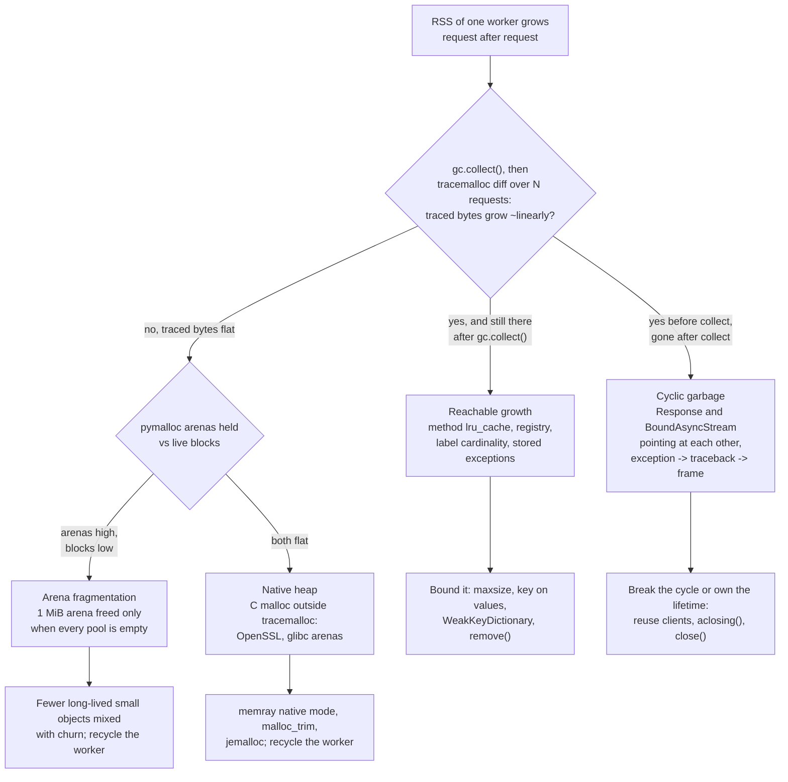

# Diagnosing Memory Leaks in Long-Running ASGI Workers: Unbounded lru_cache, Reference Cycles, Arena Fragmentation, and tracemalloc Diffs

> [!summary] Claim
> A Python worker's resident memory grows for four different reasons that need four different fixes - live objects pinned by an unbounded owner (a method `lru_cache`, a registry, a label set), garbage cycles waiting for a collector whose schedule changed between 3.14.0 and 3.14.5, async generators abandoned mid-iteration whose `finally` waits for the loop or the collector, and allocator arenas held by a few survivors - and a pair of `tracemalloc` snapshots taken after `gc.collect()` separates the first two from the last two in one request loop.

Part of [ASGI Servers and Async Runtime](README.md) in [API Engineering](../README.md).

## TL;DR

Mechanism: reference counting frees an object the moment its last reference drops, so memory that keeps growing is either still reachable (an owner never lets go), unreachable but cyclic (it waits for the generational collector), held by a suspended generator frame, or already free inside pymalloc arenas and C `malloc` heaps that the allocator has not returned to the OS.
Contract rule: every cache, registry, and label set reachable from a module, a class, or `app.state` needs an explicit bound and a key built only from small immutable values; `functools.lru_cache` on a method violates both, because the key contains `self` and the cache lives on the class (Python FAQ "How do I cache method calls?", Ruff `B019`).
Trap: `tracemalloc` sees only allocations made through CPython's allocator domains, and it switches pymalloc's own statistics off while it runs, so a flat traced total with a climbing RSS means native memory (OpenSSL contexts in CPython gh-142516) or fragmentation, not "no leak".
Portability: the lab shows the cache, cycle, and generator mechanisms identically on 3.12.13, 3.13.18, 3.14.6, 3.14.10, 3.15.2, and 3.15.0b3 free-threaded, and the arena effect on every GIL build; the version-sensitive part is collector scheduling (threshold 700 in 3.12, 2000 from 3.13, an incremental collector in 3.14.0 to 3.14.4 that 3.14.5 reverted after production memory reports) and the allocator (pymalloc arenas on GIL builds, mimalloc on free-threaded builds).
When not to chase it: a leak smaller than one worker restart per deploy, or one inside a native library you do not own, is cheaper to bound with `--limit-max-requests` plus jitter or Granian's `--workers-max-rss` than to fix, as long as the recycling is treated as a dated mitigation with a ticket, not as the fix.

## Mental model



Start from the worker's RSS, which counts every page the process touches, and ask the one question `tracemalloc` can answer: do traced Python allocations grow in proportion to requests served?
If they grow and survive an explicit `gc.collect()`, something reachable owns them, and the snapshot diff names the source line that allocated them (left branch).
If they grow but vanish after `gc.collect()`, they are cycles that reference counting cannot free and that the automatic collector has not reached yet; how long "not yet" lasts depends on the CPython release (middle branch).
If traced bytes are flat while RSS climbs, the memory is either free memory the allocator keeps (pymalloc arenas with a few survivors each) or memory that was never traced at all, because a C library called `malloc` directly (right branch).
Each branch ends in a different fix, which is why measuring before patching matters: recycling hides all four, and fixing the wrong one changes nothing.

## How it works

### Four layers of "used" memory

A long-running worker's RSS is the sum of four layers, and only the first two are Python objects.
Layer 1 is live, reachable objects: anything reachable from a module global, a class attribute, a running frame, `app.state`, or the event loop's ready queue, timer heap, and selector.
Layer 2 is unreachable cyclic garbage: objects whose reference counts are nonzero only because they point at each other, which only the cyclic collector frees (PEP 442 made cycles with `__del__` collectable in 3.4; `gc.garbage` "should be empty most of the time" since then, per the `gc` documentation).
Layer 3 is free memory the allocator keeps: freed blocks inside pymalloc pools and arenas, and freed chunks inside the C library's heaps.
Layer 4 is native memory allocated by extension modules and C libraries through `malloc` directly, which no Python-level tool sees.
A leak is unbounded growth in any layer as a function of requests served or time, and the diagnosis is to find which layer grows.

### Unbounded caches: `lru_cache` on a method

`functools.lru_cache` stores results in one dictionary per decorated function, created inside `_lru_cache_wrapper` (CPython 3.14.10 Lib/functools.py, `_lru_cache_wrapper`, `cache = {}`), and the C accelerator chooses between three wrappers by `maxsize` (CPython 3.14.10 Modules/_functoolsmodule.c, `uncached_lru_cache_wrapper`, `infinite_lru_cache_wrapper`, `bounded_lru_cache_wrapper`).
With `maxsize=None` the infinite wrapper only inserts and never evicts; `functools.cache` is literally `lru_cache(maxsize=None)(user_function)` (CPython 3.14.10 Lib/functools.py, `cache`).
The key is built from the positional arguments, a keyword marker, and the keyword items, and a single `int` or `str` argument is used bare (CPython 3.14.10 Lib/functools.py, `_make_key`, `fasttypes = {int, str}`); for a method the first positional argument is `self`, so the key holds a strong reference to the instance.
Because the decorator runs once at class creation, the cache belongs to the class-level function and outlives every instance: the Python FAQ says the `lru_cache` approach "creates a reference to the instance unless special efforts are made to pass in weak references" and that instances "are kept alive until they age out of the cache or until the cache is cleared".
In an API worker this turns any per-request object with a cached method into a permanent allocation: the lab's `LeakyPricer` is created once per request, `quote()` misses on every request because `self` is new, and after 50 requests all 50 instances and their 4 KiB buffers are still alive with `cache_info().currsize == 50`.
A bounded `maxsize` turns the unbounded leak into bounded retention of up to `maxsize` instances, which is still a bug when instances are large (a request body, a DB session, an `SSLContext`).
The fix that keeps the speedup is to cache a module-level function keyed only on immutable values (`base_price(tenant, sku)` in the lab), so the cache never sees `self` and its size is bounded by the value space and by `maxsize`.
`functools.cached_property` is the per-instance alternative: the FAQ notes it "does not create a reference to the instance", so the cached value dies with the instance.
Ruff flags the pattern as `B019` ("can lead to memory leaks, as the global cache will retain a reference to the instance", `ruff 0.17.4 rule B019`), and `UP033` separately rewrites `lru_cache(maxsize=None)` to `cache`, which is the same unbounded cache under a shorter name.

The same shape appears without a decorator.
A dictionary keyed by per-request values is an unbounded cache: `prometheus_client` creates one child metric per distinct label tuple and keeps it in `self._metrics` until `remove()` or `clear()` (prometheus-client 0.26.0 prometheus_client/metrics.py, `MetricWrapperBase.labels`), so a label fed from a user ID or a raw URL path grows a worker's heap with traffic diversity.
The aiohttp security advisory GHSA-27mf-ghqm-j3j8 (CVE-2024-52303) is a production instance: per the advisory and its fix commit, `_build_middlewares` was decorated with `@lru_cache(None)`, a request that produced a `MatchInfoError` built a new handler each time, every such handler became a new cache key, and "an attacker may be able to exhaust the memory resources of a server by sending a substantial number (100,000s to millions) of such requests" (aiohttp `>= 3.10.6, < 3.10.11`, fixed in 3.10.11).
The fix commit (aiohttp commit bc15db6) did both things this section recommends: it bounded the cache to `lru_cache(maxsize=1024)` and stopped caching for system routes, whose handlers are unique per request.
Mature ASGI code already follows the rule: Uvicorn builds a per-instance bounded cache, `functools.lru_cache(maxsize=4096)(self._compute_trust)`, and refuses to cache hosts longer than 253 characters "they can't be trusted and would pin huge cache keys" (uvicorn 0.54.0 uvicorn/middleware/proxy_headers.py, `_TrustedHosts.__init__` and `_TrustedHosts.__contains__`); FastAPI bounds its dependency classification caches at `_CALLABLE_CLASSIFICATION_CACHE_SIZE = 4096` (fastapi 0.162.0 fastapi/dependencies/models.py).

### Reference cycles and when the collector runs

Reference counting cannot free a cycle, so a cycle's memory lives until the cyclic collector runs, and in an API the cost is not the two or three objects in the cycle but everything they reach.
Three request-path cycles recur in practice.
An exception stored on an object that its own traceback reaches: `exc.__traceback__` references the frame, the frame's locals reference the object, and the object references `exc` (the lab's `handle_with_stored_exception`).
A response and its stream: httpx 0.28.1 replaces `response.stream` with a `BoundAsyncStream(response.stream, response=response, start=start)` that stores `self._response` (httpx 0.28.1 httpx/_client.py, `AsyncClient._send_single_request` and `BoundAsyncStream.__init__`), so every `Response` is in a two-object cycle; the lab shows a dropped `Response` stays alive after `del` with the collector paused, and dies by refcount if `response.stream` is replaced first.
Bound-method generators stored on their own object: a generator's frame holds `self`, and `self.rows = self._rows()` holds the generator (the lab's `Cursor`).

The collector's schedule is a version-specific fact, not a constant.
The GIL build's first-generation threshold was 700 in 3.12 (CPython 3.12.13 Include/internal/pycore_runtime_init.h, `.generations`) and is 2000 from 3.13 onward with 10 and 10 for the older generations (CPython 3.13.18 Include/internal/pycore_runtime_init.h; CPython 3.14.10 and 3.15.2 Include/internal/pycore_interp_structs.h, `GC_GENERATION_INIT`).
Since 3.12 the collector runs only from the eval breaker, not inside an allocation (What's New in Python 3.12, gh-97922), and a full collection is skipped unless `long_lived_pending >= long_lived_total / 4` (CPython 3.14.10 Python/gc.c), so a worker with a large long-lived heap collects its oldest generation rarely.
Python 3.14.0 shipped an incremental collector with a young generation and an old generation scanned in increments (CPython 3.14.0 Include/internal/pycore_runtime_init.h, `.young = { .threshold = 2000, }`).
Production ASGI services then reported memory growth after upgrading: CPython gh-142516 ("Observed memory leak in ssl library: Python 3.14 GC issue") collected reports from FastAPI and other ASGI apps on Kubernetes where RSS climbed while calling `gc.collect()` periodically kept it flat.
The maintainers traced one reproducer to the httpx `Response` <-> `BoundAsyncStream` cycle holding a default `SSLContext`, which one maintainer measured at about 800 kB per context on their machine, and bisected a further increase between 3.14.0 and 3.14.2 to the backport of GH-140262, which changed which objects count toward the collection threshold (gh-142516 comments, December 2025).
The core team reverted to the 3.13 generational collector in 3.14.5 and in 3.15 ("due to a number of reports of significant memory pressure in production environments", What's New in Python 3.14, "Garbage collection"; changelog entry gh-142516; discuss.python.org "Reverting the incremental GC in Python 3.14 and 3.15", 2026-04-16), and reporters confirmed stable memory on 3.14.5 in production before the issue closed on 2026-06-03.
The free-threaded build has its own collector: it triggers on a young count above 2000 but declines to collect while `count < gcstate->long_lived_total / 4`, scaling the threshold with the live heap (CPython 3.15.2 Python/gc_free_threading.c, `gc_should_collect`).
The lesson is that "the collector will get it" is a statement about one interpreter build, so the code that creates cycles on a hot path, not the collector, is what to fix.

Fixes, in order of preference: do not create the per-request cycle (reuse one `httpx.AsyncClient` for the worker's lifetime instead of one per call, which the gh-142516 reporters found removed their growth); break it when the owner is done (store `repr(exc)` or a `traceback.TracebackException`, not the exception; set back-references to `None` in `close()`); or make one side weak (`weakref.ref`, `WeakKeyDictionary`).
`gc.freeze()` (3.7, bpo-31558, gh-75739) moves every tracked object to a permanent generation that collections skip, which a pre-fork server uses so children do not touch the parent's objects; it reduces collector work and copy-on-write, it does not free anything (Python `gc` documentation, `gc.freeze`).

### Abandoned async generators

PEP 525 gives async generators a finalization protocol because an event loop must run `aclose()`: when a generator is first iterated it records the loop's `finalizer` hook, and when it is about to be destroyed it calls that hook (PEP 525, "Finalization").
asyncio's hooks keep a `weakref.WeakSet` of live generators and, on finalization, schedule `self.call_soon_threadsafe(self.create_task, agen.aclose())`, skipping it entirely if the loop is closed (CPython 3.14.10 Lib/asyncio/base_events.py, `BaseEventLoop._asyncgen_firstiter_hook` and `_asyncgen_finalizer_hook`; the same logic at 3.12.13 and 3.15.2).
`break` or `return` inside `async for` does not close the generator; it leaves it suspended at its `yield`, and its `finally` (the lease release, the cursor close, the `async with` exit) runs only after three events: the last reference drops, one loop turn runs the `create_task` callback, and a second turn runs the `aclose()` task's first step.
The lab measures exactly two loop turns between returning from `first_row_abandoned` and the lease being released, on every CPython in the matrix.
If a cycle holds the generator, the first event waits for the cyclic collector: the lab's `Cursor` keeps its lease through 50 loop turns with the collector paused, and after `gc.collect()` the lease is still held until two more loop turns pass, because collection only calls the finalizer hook.
Under load those two turns are not free: every request that abandons a generator keeps its lease until the loop gets back to the callback, and the cleanup runs in a new task without the request's `contextvars`, which the `contextlib.aclosing` documentation calls out ("the exit code isn't run after the lifetime of some task it depends on").
`contextlib.aclosing()` (3.10) awaits `aclose()` before the block exits, so the lease is back before the handler returns (lab: zero turns); PEP 533, which proposed this for every `for` loop, is Deferred.

Starlette's `StreamingResponse` is where this meets ASGI.
In Starlette 1.10.0, `StreamingResponse.stream_response` iterates `self.body_iterator` with `async for` and nothing in `StreamingResponse` calls `aclose()` on it; for an ASGI `spec_version` below 2.4, `__call__` runs `stream_response` and `listen_for_disconnect` in a task group and cancels the stream when the client disconnects (starlette 1.10.0 starlette/responses.py, `StreamingResponse.stream_response` and `StreamingResponse.__call__`), and Uvicorn 0.54.0 advertises `"spec_version": "2.3"` in the HTTP scope (uvicorn 0.54.0 uvicorn/protocols/http/h11_impl.py and httptools_impl.py).
Reading that code, a cancellation delivered while the generator itself is awaiting raises inside the generator and runs its `finally` immediately, but a cancellation delivered while `stream_response` awaits `send()` leaves the generator suspended at `yield`, and its cleanup then follows the finalizer path above; wrapping the generator body's resources in their own `try`/`finally` and keeping the generator out of cycles keeps that path short.

### Arena fragmentation: free memory that stays resident

pymalloc serves requests of at most `SMALL_REQUEST_THRESHOLD = 512` bytes from size classes 16 bytes apart on 64-bit builds; larger requests go to the C allocator (CPython 3.14.10 Include/internal/pycore_obmalloc.h, `SMALL_REQUEST_THRESHOLD`, `ALIGNMENT`).
Blocks are carved from pools of 16 KiB (`POOL_BITS 14`) inside arenas of 1 MiB (`ARENA_BITS 20`) when the radix tree is enabled on 64-bit builds, which it is by default (`WITH_PYMALLOC_RADIX_TREE 1`, `USE_LARGE_ARENAS`, `USE_LARGE_POOLS`), and 3.15 adds a 2 MiB arena option under `PYMALLOC_USE_HUGEPAGES` (CPython 3.15.2 Include/internal/pycore_obmalloc.h); arenas are obtained with `mmap(MAP_PRIVATE|MAP_ANONYMOUS)` where available (CPython 3.14.10 Objects/obmalloc.c, `_PyMem_ArenaAlloc`).
An arena goes back to the OS only when every pool in it is free, and even then the allocator keeps it if it is the last arena in the `usable_arenas` list, "to avoid thrashing" (CPython 3.14.10 Objects/obmalloc.c, `insert_to_freepool` arena management "Case 1", bpo-37257).
To give nearly empty arenas a chance to drain, `usable_arenas` is kept sorted so the "most full" arenas are allocated from first, tracked by the `nfp2lasta` index (same file, "Case 3").
That policy cannot help when survivors are spread evenly: one live 16-byte block keeps a 16 KiB pool, and one live pool keeps a 1 MiB arena.
The lab allocates 400,000 two-tuples of fresh ints (about 800,000 blocks), keeps every 64th tuple, and frees the rest: on 3.14.6 (review run, 2026-11-15) the live block count falls to 14,610 above baseline (1.8 percent of the 799,754-block peak) while the bytes held in arenas stay at exactly 34,603,008 (33 arenas) above baseline, and freeing the survivors returns all but 1,048,576 bytes.
The arena count differs by a few between runs with the heap's starting state (the drafter's earlier run on the same interpreter held a few more), which is why the test asserts ratios, not byte counts.
This is the signature to look for: RSS that rises during a burst (a large JSON body parsed into many small objects, a cache warmed and partly evicted) and never comes back, with `tracemalloc` showing the Python heap back near its baseline.
`sys._debugmallocstats()` prints the arena counts ("# arenas allocated current"), but only while pymalloc is the active object allocator: `_PyObject_DebugMallocStats` checks `_PyMem_PymallocEnabled()`, which compares the current allocator with `_PyObject_Malloc`, and `tracemalloc` replaces that allocator with its hook (CPython 3.14.10 Objects/obmalloc.c, `_PyObject_DebugMallocStats`, `_PyMem_PymallocEnabled`); the lab asserts that the arena line disappears while tracing.
The free-threaded build has no pymalloc: `Py_GIL_DISABLED` requires mimalloc (CPython 3.14.10 Objects/obmalloc.c, `#error "Py_GIL_DISABLED requires WITH_MIMALLOC"`) and `_debugmallocstats` prints mimalloc's statistics instead, so the lab's arena probe returns `None` there by design.

Above 512 bytes, the C allocator decides.
glibc serves allocations of at least `M_MMAP_THRESHOLD` (128 KiB initially, adjusted dynamically) with `mmap`, which can always be returned independently, and grows the heap with `sbrk` below it, where "the heap can be trimmed only if memory is freed at the top end"; top-of-heap trimming waits for `M_TRIM_THRESHOLD` (default 128 KiB) of contiguous free space, and each thread contending for the allocator can get its own malloc arena up to a limit derived from `M_ARENA_TEST` (8 on 64-bit) and the CPU count unless `MALLOC_ARENA_MAX` sets it (mallopt(3)).
`malloc_trim(0)` releases free memory "in all arenas and in all chunks with whole free pages" since glibc 2.8 (malloc_trim(3)), which helps glibc heaps and does nothing for pymalloc arenas.
gh-142516 shows the native layer in action: a maintainer found the RSS of the reproducer "quite a bit lower" under `LD_PRELOAD` of jemalloc, and the reporters used memray because the growth was in OpenSSL allocations under `load_verify_locations()`, which `tracemalloc` cannot see.

### `tracemalloc` diffs: what they see and how to read them

`tracemalloc` (PEP 454) installs hooks on the three Python allocator domains, `PYMEM_DOMAIN_RAW`, `PYMEM_DOMAIN_MEM`, and `PYMEM_DOMAIN_OBJ`, and records the Python traceback of each live block (CPython 3.14.10 Python/tracemalloc.c, `_PyTraceMalloc_Start`, `PyMem_SetAllocator`); a C library that calls `malloc` directly is invisible unless it reports blocks through `PyTraceMalloc_Track`.
Each trace stores up to `nframe` frames, 1 by default and at most `MAX_NFRAME = UINT16_MAX` (same file); storing more frames is only useful for grouping by `'traceback'` and "increases the memory and CPU overhead", which `tracemalloc.get_tracemalloc_memory()` measures (Python `tracemalloc` documentation, `start`).
An allocation made in C on behalf of Python code is attributed to the innermost Python frame, which is why the lab's growth on line 88 (`price = pricer.quote(...)`) is the cache key tuple and dictionary growth that the C `lru_cache` wrapper allocated, not anything line 88 created itself.
The procedure that makes a diff meaningful is fixed: warm up (imports, route compilation, caches that should fill), call `gc.collect()` so cyclic garbage does not count as growth, take a snapshot, serve N more requests, collect again, take a second snapshot, `compare_to(before, "lineno")`, and divide `size_diff` and `count_diff` by N.
A real leak shows a line whose `count_diff` is a multiple of N; one-off growth shows a small constant; the lab's leaky pricer shows `memory_leaks.py:57` at `+830600` bytes and `+400` blocks for 200 requests on 3.14.6, which is two blocks and exactly `sys.getsizeof(bytearray(4096)) == 4153` bytes per request, and the bounded pricer shows no growing line at all.
Filtering the snapshots to your own files (`tracemalloc.Filter(True, path)`) removes framework noise but also hides growth that happens inside a dependency; filter in the second pass, after an unfiltered diff has shown which file to look at.

### Measuring RSS honestly

`resource.getrusage(RUSAGE_SELF).ru_maxrss` is a peak, not a current value, and its unit differs by OS: KiB on Linux (getrusage(2)) and bytes on macOS, measured for this note on macOS 27.3 arm64 with CPython 3.14.10 after touching a 200 MiB `bytearray`: `ru_maxrss` 224,870,400 against `ps -o rss` 219,616 KiB, a ratio of about 1024.
On Linux, `/proc/self/smaps_rollup` gives a more accurate resident size than `VmRSS` in `/proc/self/status`, as a CPython maintainer pointed out in gh-142516, and in Kubernetes the number the OOM killer acts on is the container's cgroup memory, which also counts page cache.
`sys.getallocatedblocks()` counts live interpreter blocks and "can vary from call to call" because of internal caches (Python `sys` documentation), so read it as a trend after `gc.collect()`, as the lab does.

### Containment: worker recycling

Every server in this stack can replace a worker that has served too much, and all of them describe it as damage limitation.
Uvicorn 0.54.0 exits a worker once `server_state.total_requests >= limit_max_requests + randint(0, limit_max_requests_jitter)`, with the jitter drawn once per server because `limit_max_requests` is a `functools.cached_property` (uvicorn 0.54.0 uvicorn/server.py, `Server.limit_max_requests` and `Server.on_tick`; flags `--limit-max-requests` and `--limit-max-requests-jitter`).
Gunicorn's `max_requests` is documented as "a simple method to help limit the damage of memory leaks", with `max_requests_jitter` "to stagger worker restarts" (gunicorn 26.2.0 gunicorn/config.py, `MaxRequests`, `MaxRequestsJitter`).
Hypercorn 0.18.0 has the same pair, `max_requests` and `max_requests_jitter` (hypercorn 0.18.0 hypercorn/config.py; applied in hypercorn/asyncio/run.py, `worker_serve`).
Granian 2.8.7 recycles on measured memory instead of a request count: `--workers-max-rss` in MiB, sampled every `--rss-sample-interval` seconds (default 30) for `--rss-samples` consecutive samples (default 1), plus `--workers-lifetime` (granian 2.8.7 granian/cli.py; granian/server/common.py, `_watch_workers_rss`).
The process-topology consequences (who restarts the worker, whether in-flight requests drain, how replicas interact with Kubernetes memory limits) belong to [[Multi-Process-Worker-Topologies-Gunicorn-Uvicorn-Workers-vs-Kubernetes-Replicas]] and [[Graceful-Shutdown-SIGTERM-Drain-Windows-and-Kubernetes-PreStop-Hooks]].

## Numbers and limits

| Quantity | Value | Source |
| --- | --- | --- |
| `lru_cache` default `maxsize` | 128 | CPython 3.14.10 Lib/functools.py, `lru_cache(maxsize=128, typed=False)` |
| `functools.cache` bound | none (`lru_cache(maxsize=None)`) | CPython 3.14.10 Lib/functools.py, `cache` |
| Collector threshold, generation 0 | 700 (3.12), 2000 (3.13 to 3.15) | `pycore_runtime_init.h` at v3.12.13, v3.13.18; `pycore_interp_structs.h` at v3.14.10, v3.15.2 |
| Incremental GC releases | 3.14.0 to 3.14.4; reverted in 3.14.5 and 3.15 | What's New in Python 3.14 (as of 2026-11) |
| Full collection gate | `long_lived_pending >= long_lived_total / 4` | CPython 3.14.10 Python/gc.c |
| pymalloc small-request limit | 512 bytes, 16-byte size classes on 64-bit | CPython 3.14.10 `pycore_obmalloc.h` |
| pymalloc pool and arena | 16 KiB and 1 MiB on 64-bit (2 MiB arenas with `PYMALLOC_USE_HUGEPAGES` in 3.15) | `pycore_obmalloc.h` at v3.14.10, v3.15.2 |
| `tracemalloc` frame limit | 1 by default, at most 65535 | CPython 3.14.10 Python/tracemalloc.c, `MAX_NFRAME` |
| glibc `M_MMAP_THRESHOLD`, `M_TRIM_THRESHOLD` | 128 KiB initial (dynamic), 128 KiB | mallopt(3), man-pages 6.19 |
| Lab: leaky pricer growth, 200 requests | `+830600` B, `+400` blocks at the buffer line | `uv run --frozen pytest ... -v -s` from `labs/`, CPython 3.14.6, macOS 27.3 arm64, 2026-11-15; the test asserts `count_diff == 400` on every build |
| Per-request leak | 4153 B on 3.14.6 (`830600 / 200`), equal to `sys.getsizeof(bytearray(4096))`, which is 4153 on 3.12.13, 3.13.18, 3.14.6, and 3.14.10, 4193 on 3.15.2, and 4225 on 3.15.0b3t | same run, plus `python -I -c "import sys; print(sys.getsizeof(bytearray(4096)))"` on each interpreter, macOS 27.3 arm64, 2026-11-15 |
| Lab: arenas held after freeing 98 percent of blocks | 34,603,008 B of 34,603,008 B (33 arenas), 1,048,576 B left after freeing all; varies by a few arenas between runs | same `pytest` run, CPython 3.14.6 |
| Lab: loop turns from abandoned `async for` to `finally` | 2 | same `pytest` run on 3.14.6; the Interview snippet gives 1, 1, 0 on 3.14.10; a standalone cycle-held repro gives 2 turns after `gc.collect()` on 3.14.10, 3.15.2, and 3.15.0b3t, 2026-11-15 |
| aiohttp CVE-2024-52303 attack volume | "100,000s to millions" of requests | GHSA-27mf-ghqm-j3j8 |
| Default `SSLContext` size in gh-142516 | about 800 kB, one maintainer's machine | gh-142516 comment, 2025-12-18 |
| Granian RSS sampling | 30 s interval, 1 sample by default | granian 2.8.7 granian/cli.py |

## Portability

| Behavior | 3.12.13 | 3.13.18 | 3.14.6 / 3.14.10 | 3.15.2 | 3.15.0b3t (free-threaded) |
| --- | --- | --- | --- | --- | --- |
| Method `lru_cache` pins 50 of 50 instances; value-keyed cache frees them | lab passed | lab passed | lab passed (both) | lab passed | lab passed |
| `tracemalloc` diff names the buffer line, `count_diff == 400` | lab passed | lab passed | lab passed (both) | lab passed | lab passed |
| httpx 0.28.1 `Response` survives `del` until `gc.collect()` | lab passed | lab passed | lab passed (both) | lab passed | lab passed |
| Abandoned async generator releases after 2 loop turns; `aclosing` after 0 | lab passed | lab passed | lab passed (both) | lab passed | lab passed |
| Cycle-held generator released only after collection plus 2 turns | lab passed | lab passed | lab passed (both) | lab passed | lab passed; `gc.collect()` returned 0 for this cycle here versus 1 on 3.15.2 and 3.14.10 (standalone repro, re-run 2026-11-15) |
| pymalloc arenas retained by 1.8 percent survivors | lab passed | lab passed | lab passed (both) | lab passed | not applicable: mimalloc, probe returns `None` (lab passed) |
| Collector | generational, 700/10/10 | generational, 2000/10/10 | generational 2000/10/10 (3.14.0 to 3.14.4 were incremental) | generational 2000/10/10 | free-threaded collector, heap-scaled trigger |

The matrix ran on macOS 27.3 arm64 in the drafter's single run per interpreter (2026-11-11); the 2026-11-15 review re-ran the lab only on the 3.14.6 workspace interpreter, because lab matrix runs are paused, so the other "lab passed" cells rest on that earlier run.
3.12.16 and 3.15.2t are not installed here, so 3.12.13 and 3.15.0b3 free-threaded stand in, and no Debian Trixie or Alpine musl container leg ran.
On Linux the glibc and musl allocators change the layer-3 and layer-4 behavior (gh-142516 reporters saw the same growth on Debian Trixie and Alpine images, so that incident was not allocator-specific), but the four Python-level mechanisms do not depend on the C library.
Uvicorn, Hypercorn, and Granian run the same application code, so the leak mechanisms are identical under all three; they differ only in the containment knob (request count with jitter for Uvicorn and Hypercorn, RSS threshold and lifetime for Granian), as cited above.
HTTP/1.1, HTTP/2, and HTTP/3 do not change any mechanism here; they change how many requests share one connection object, which matters only when a leak is per connection rather than per request.

## Worked example

The [implementation](../labs/src/api_labs/f12_asgi_servers_and_async_runtime/memory_leaks.py) holds four probes, each with a leaky and a fixed variant, and a Starlette app that creates one pricer per request; the [test](../labs/tests/f12_asgi_servers_and_async_runtime/test_memory_leaks_in_long_running_python_api_workers.py) asserts both variants of each, so every test fails if the mechanism it names were absent.

The method cache and its fix, verbatim from the lab file:

```python
class LeakyPricer:
    """Per-request service whose cached method pins every instance it sees."""

    def __init__(self, tenant: str) -> None:
        self.tenant = tenant
        self.scratch = bytearray(SCRATCH_BYTES)  # per-request working buffer

    @functools.lru_cache(maxsize=None)  # noqa: B019, UP033 - the bug under study
    def quote(self, sku: str) -> int:
        return len(self.tenant) * 100 + len(sku)


@functools.lru_cache(maxsize=1024)
def base_price(tenant: str, sku: str) -> int:
    """Module-level cache keyed only on immutable values, with a bound."""
    return len(tenant) * 100 + len(sku)


class BoundedPricer:
    """Same contract; the cache never sees ``self``."""

    def __init__(self, tenant: str) -> None:
        self.tenant = tenant
        self.scratch = bytearray(SCRATCH_BYTES)

    def quote(self, sku: str) -> int:
        return base_price(self.tenant, sku)


def build_pricing_app(pricer_cls: type[LeakyPricer] | type[BoundedPricer]) -> Starlette:
    """One pricer per request, as a FastAPI dependency without caching would do."""
    created: weakref.WeakSet[LeakyPricer | BoundedPricer] = weakref.WeakSet()

    async def quote(request: Request) -> JSONResponse:
        pricer = pricer_cls(request.path_params["tenant"])
        created.add(pricer)
        price = pricer.quote(request.path_params["sku"])
        return JSONResponse({"price": price})

    app = Starlette(routes=[Route("/quote/{tenant}/{sku}", quote)])
    app.state.created = created
    return app
```

The snapshot diff, verbatim:

```python
def growth_by_line(
    before: tracemalloc.Snapshot, after: tracemalloc.Snapshot, *, path: str = __file__
) -> list[LineGrowth]:
    """Lines of ``path`` whose live allocations grew between two snapshots."""
    only = (tracemalloc.Filter(True, path),)
    stats = after.filter_traces(only).compare_to(before.filter_traces(only), "lineno")
    return [
        LineGrowth(
            f"{os.path.basename(s.traceback[0].filename)}:{s.traceback[0].lineno}",
            s.size_diff,
            s.count_diff,
        )
        for s in stats
        if s.size_diff > 0
    ]
```

The test that drives it through the ASGI stack, verbatim from the test file:

```python
@pytest.mark.unit
@pytest.mark.asyncio
async def test_tracemalloc_diff_names_the_pinned_allocation_line() -> None:
    tracemalloc.start(1)
    try:
        results: dict[str, list[ml.LineGrowth]] = {}
        for cls in (ml.LeakyPricer, ml.BoundedPricer):
            app = ml.build_pricing_app(cls)
            await ml.drive(app, paths(20))  # warm up: imports, route compile, cache fill
            gc.collect()
            before = tracemalloc.take_snapshot()
            await ml.drive(app, paths(200))
            gc.collect()
            after = tracemalloc.take_snapshot()
            results[cls.__name__] = ml.growth_by_line(before, after)
    finally:
        tracemalloc.stop()

    leaky, bounded = results["LeakyPricer"], results["BoundedPricer"]
    for name, growth in results.items():
        print(name, [(g.location, g.size_diff, g.count_diff) for g in growth[:3]])
    top = leaky[0]
    assert top.location == scratch_line(ml.LeakyPricer)
    assert top.count_diff == 2 * 200  # per request: the bytearray object and its buffer
    assert top.size_diff >= 200 * ml.SCRATCH_BYTES
    assert sum(g.size_diff for g in bounded) < ml.SCRATCH_BYTES
```

The abandoned generator and its fix, verbatim:

```python
async def stream_rows(pool: LeasePool, n: int) -> AsyncGenerator[int]:
    pool.in_use += 1
    try:
        for row in range(n):
            yield row
    finally:
        pool.in_use -= 1


async def first_row_abandoned(pool: LeasePool) -> int:
    async for row in stream_rows(pool, 100):
        return row  # leaves the generator suspended at its yield
    return -1


async def first_row_aclosing(pool: LeasePool) -> int:
    async with contextlib.aclosing(stream_rows(pool, 100)) as rows:
        async for row in rows:
            return row  # aclosing awaits rows.aclose() before returning
    return -1
```

The fragmentation probe, verbatim:

```python
def fragment(n: int = 400_000, keep_every: int = 64) -> FragmentationReport | None:
    """Allocate ``n`` small tuples, keep every ``keep_every``-th, then free all."""
    gc.collect()
    blocks_base = sys.getallocatedblocks()
    base = pymalloc_arena_bytes()
    objs = [(i, i) for i in range(n)]
    blocks_peak = sys.getallocatedblocks() - blocks_base
    peak = pymalloc_arena_bytes()
    keep = objs[::keep_every]
    del objs
    blocks_sparse = sys.getallocatedblocks() - blocks_base
    sparse = pymalloc_arena_bytes()
    del keep
    freed = pymalloc_arena_bytes()
    if base is None or peak is None or sparse is None or freed is None:
        return None
    return FragmentationReport(blocks_peak, blocks_sparse, peak - base, sparse - base, freed - base)
```

Captured run, from `labs/`, on CPython 3.14.6 (the workspace interpreter), macOS 27.3 arm64, with `-s` so the diff and the arena report print:

```text
$ uv run --frozen pytest tests/f12_asgi_servers_and_async_runtime/test_memory_leaks_in_long_running_python_api_workers.py -v -s
platform darwin -- Python 3.14.6, pytest-9.2.0, pluggy-1.7.0
collecting ... collected 11 items

...::test_method_lru_cache_pins_every_request_instance PASSED
...::test_module_cache_keyed_on_values_frees_instances PASSED
...::test_tracemalloc_diff_names_the_pinned_allocation_line LeakyPricer [('memory_leaks.py:57', 830600, 400), ('memory_leaks.py:88', 21472, 200), ('memory_leaks.py:86', 17600, 200)]
BoundedPricer []
PASSED
...::test_httpx_response_cycle_survives_del_until_collected PASSED
...::test_breaking_the_stream_cycle_frees_response_by_refcount PASSED
...::test_stored_exception_keeps_context_alive_through_its_traceback PASSED
...::test_abandoned_async_generator_holds_lease_for_two_loop_turns PASSED
...::test_aclosing_releases_lease_before_returning PASSED
...::test_cycle_held_generator_keeps_lease_until_the_collector_runs PASSED
...::test_sparse_survivors_pin_pymalloc_arenas FragmentationReport(blocks_peak=799754, blocks_sparse=14610, arena_bytes_peak=34603008, arena_bytes_sparse=34603008, arena_bytes_freed=1048576)
PASSED
...::test_tracemalloc_hooks_hide_pymalloc_stats PASSED

============================== 11 passed in 1.09s ==============================
```

The test node IDs are shortened to `...::` here; the rest is verbatim.
Read the diff from the top: line 57 grew by 400 blocks for 200 requests, two per request (the `bytearray` object and its buffer), and line 86 (`pricer = pricer_cls(...)`) grew by one 88-byte instance per request, so the instances and their buffers are both pinned; line 88 is the cache bookkeeping that the C `lru_cache` wrapper allocated under the caller's frame.
The bounded variant's diff is empty: nothing in the module outlived the requests.
The arena report shows 799,754 blocks at the peak, 14,610 after freeing 98 percent of them, and 33 MiB of arenas held in both states.
The drafter also ran the test once on 3.12.13, 3.13.18, 3.14.10, and 3.15.2 (each `11 passed`) and on 3.15.0b3 free-threaded in a minimal environment (`11 passed`) on 2026-11-11; the review re-ran only the 3.14.6 run shown above.

## Pitfalls

> [!warning] `lru_cache` on a method of a per-request object
> Trigger: `@lru_cache` or `@cache` on a method of a class instantiated per request or per connection, or any cache keyed on an object with request lifetime.
> Symptom: RSS and `cache_info().currsize` grow with requests served; a `tracemalloc` diff points at the instance's allocations, with `count_diff` a multiple of the request count; aiohttp's `@lru_cache(None)` on `_build_middlewares` became CVE-2024-52303 this way (GHSA-27mf-ghqm-j3j8).
> Fix: cache a module-level function keyed on immutable values with an explicit `maxsize`, use `cached_property` for per-instance memoization, and enable Ruff `B019`.

> [!warning] Upgrading CPython changes when cycles are freed
> Trigger: a service that allocates large objects reachable from cycles (an httpx `AsyncClient` per call with its default `SSLContext`) upgraded to 3.14.0 through 3.14.4.
> Symptom: RSS far above 3.13 levels (one maintainer's reproducer stabilized at about 420 MB on 3.14.2 versus about 80 MB on 3.14.0) and OOM kills in containers, while calling `gc.collect()` periodically keeps memory flat (CPython gh-142516).
> Fix: upgrade to 3.14.5 or later, which restored the generational collector; independently, stop creating the cycles on the hot path by reusing one client per worker and passing a shared `SSLContext`.

> [!warning] `break` out of `async for` does not close the generator
> Trigger: returning early from `async for` over a generator that holds a lease, a DB cursor, or an `async with` block.
> Symptom: under load, leases or connections stay checked out for at least two loop turns per request, or until a full collection when the generator sits in a cycle; cleanup runs in a different task, without the request's `contextvars`.
> Fix: `async with contextlib.aclosing(gen) as rows:` around every early-exit iteration, and keep generators out of cycles with their owners.

> [!warning] Reading `tracemalloc` as the whole truth
> Trigger: a flat `tracemalloc` total, or a clean diff, while RSS keeps climbing.
> Symptom: the team concludes there is no leak, or a leak only in Python, when the growth is OpenSSL memory under `load_verify_locations()` (gh-142516) or pymalloc arenas pinned by survivors.
> Fix: compare traced bytes, `sys.getallocatedblocks()`, arena counts with tracing off, and RSS from `smaps_rollup`; use a native-aware profiler (memray was the tool in gh-142516) when only RSS grows.

> [!warning] Storing the caught exception
> Trigger: `self.last_error = exc` on an object that the raising frame can reach, or keeping exceptions in a list for later reporting.
> Symptom: the exception's traceback pins every frame and every local it passed through, including request bodies, until the collector breaks the cycle; the lab keeps a 64 KiB context alive through `del` this way.
> Fix: store `repr(exc)` or `traceback.TracebackException.from_exception(exc)` without `capture_locals`, or `del exc` at the end of the handler.

> [!warning] Unbounded metric labels
> Trigger: a Prometheus label whose values come from user input (user ID, raw path, query string).
> Symptom: one child metric per distinct value in `MetricWrapperBase._metrics`, growing with traffic diversity and exported on every scrape.
> Fix: label only with bounded enumerations (route template, status class), and call `remove()` for labels tied to entities that go away.

> [!warning] Recycling as the fix
> Trigger: `--max-requests` added during an incident and never revisited.
> Symptom: the leak grows with the next feature, the restart interval shrinks, and restarts start to overlap with deploys and traffic peaks; without jitter all workers restart together.
> Fix: always set the jitter flag, alert on per-worker memory slope rather than absolute RSS, and keep a ticket open for the root cause.

## Security and robustness

A memory leak on a request path is a denial-of-service primitive: OWASP API4:2023 "Unrestricted Resource Consumption" lists missing "Maximum allocable memory" limits as a vulnerability condition, and CVE-2024-52303 shows an attacker turning a cache keyed on per-request objects into memory exhaustion with a few hundred thousand requests.
Treat every cache key built from client input as attacker-controlled: bound the entry count, bound the key size (Uvicorn's 253-character guard before caching a host), and prefer keys from a closed set (route template, tenant ID from a verified token) to keys from open text.
Never expose `tracemalloc` snapshots or `gc.get_objects()` over an unauthenticated endpoint: they reveal source paths and object contents, they cost memory and CPU proportional to the heap, and the `gc` documentation warns that objects returned by `gc.get_referrers()` "could still be under construction" and says to avoid it "for any purpose other than debugging".
Run with defense in depth: a container memory limit so one worker's leak cannot take the node, a recycle threshold below the limit so the server restarts the worker gracefully before the kernel kills it, and per-worker memory-slope alerts so the leak is noticed before either fires.
Starting `tracemalloc` in production costs memory per traced block and CPU per allocation; when it is needed, enable it on one canary worker (`PYTHONTRACEMALLOC=1` or `-X tracemalloc=1` at startup) rather than fleet-wide, and remove it after the diff is taken.

## The principal's view

The decision is where memory ownership lives: a staff-plus engineer requires that every long-lived container in a service (caches, registries, client pools, metric label sets) has a named owner, a bound, and an eviction or close path, and enforces it with lint (`B019`), review, and a leak test that serves N requests in-process and asserts a flat `tracemalloc` diff, as this note's lab does.
Recycling workers is the organizational trade-off: it buys stability with zero code change, but it hides regressions, costs warm caches and connection pools on every restart, and turns a slow leak into a latency sawtooth, so the policy should be that a recycle flag ships with an expiry date and an owner.
CPython upgrades deserve memory canaries, not only latency canaries: gh-142516 shows that a patch release can change when cycles are freed by a factor large enough to cause OOM kills, so roll new interpreters to one replica and compare per-worker memory slope for at least one traffic cycle.
Choose a different runtime model when the workload's memory profile fights the allocator: a service that builds huge transient object graphs per request (large JSON documents, dataframes) is a candidate for process-per-job isolation, for streaming parsers that never materialize the graph, or for moving the hot transformation into a language whose memory is freed deterministically; the free-threaded build, with mimalloc and a heap-scaled collector, is a different allocator and collector and needs its own measurement, not an assumption.

## Interview questions

> [!question] L5: Why does `@functools.lru_cache` on an instance method leak, and what do you use instead?
>
> > [!success]- Answer
> > The cache is created once when the class body runs, so it belongs to the class-level function and outlives every instance.
> > Its key includes `self`, so every instance that called the method stays strongly referenced until it is evicted or the cache is cleared.
> > With `maxsize=None` (or `functools.cache`) nothing is ever evicted.
> > Use `cached_property` for per-instance values, or move the computation to a module-level function keyed only on immutable values with an explicit `maxsize`.
> >
> > Follow-up: When is a bounded method cache still a problem?

> [!question] L5: A worker's RSS grows but `tracemalloc`'s traced total is flat; name three explanations.
>
> > [!success]- Answer
> > Native allocations made with `malloc` by a C library are not traced, such as OpenSSL memory under `load_verify_locations()` in gh-142516.
> > pymalloc arenas can stay allocated after most of their blocks are freed, because an arena is returned only when every pool in it is empty.
> > The C allocator can keep freed chunks in its heaps (glibc trims only from the top of the heap above `M_TRIM_THRESHOLD`).
> > Distinguish them with arena counts from `sys._debugmallocstats()` taken with tracing off and a native-aware profiler.
> >
> > Follow-up: Why does `sys._debugmallocstats()` not print arena counts while `tracemalloc` is running?

> [!question] L6: Predict the output of this program, a simplified excerpt of the lab's `stream_rows` probe, on CPython 3.14.10.
>
> ```python
> import asyncio
>
> held = 0
>
> async def rows():
>     global held
>     held += 1
>     try:
>         for i in range(10):
>             yield i
>     finally:
>         held -= 1
>
> async def main():
>     async for _ in rows():
>         break
>     print(held)
>     await asyncio.sleep(0)
>     print(held)
>     await asyncio.sleep(0)
>     print(held)
>
> asyncio.run(main())
> ```
>
> > [!success]- Answer
> > It prints `1`, `1`, `0` (run on 3.14.10 for this note).
> > `break` leaves the generator suspended; dropping the last reference calls asyncio's finalizer hook, which only schedules `call_soon_threadsafe(self.create_task, agen.aclose())`.
> > The first `sleep(0)` lets the loop run that callback, which creates the `aclose()` task; the second lets the task run, so `finally` executes.
> > The lab asserts the same two-turn delay on 3.12.13 through 3.15.2 and on the free-threaded build.
> >
> > Follow-up: What changes if the generator is stored on an object that its own frame references?

> [!question] L6: Debug this API: after an upgrade to Python 3.14.2, a FastAPI service whose handlers each run `async with httpx.AsyncClient() as client: await client.get(url)` is OOM-killed every few hours, and a periodic `gc.collect()` makes memory flat; what is happening?
>
> > [!success]- Answer
> > Memory that a forced collection releases is cyclic garbage, so the question is which cycle is large and why the automatic collector reaches it later on this release.
> > httpx 0.28 binds every `Response` to a `BoundAsyncStream` that references it back, and a new client per request creates a new default `SSLContext` (about 800 kB in one gh-142516 measurement) reachable from those cycles.
> > Python 3.14.0 to 3.14.4 shipped an incremental collector, and a bisection found the GH-140262 backport, which changed the threshold accounting, raised memory further between 3.14.0 and 3.14.2, so cycles survived long enough to drive RSS far above 3.13 levels.
> > Fix the code by creating one `AsyncClient` per worker in the lifespan and reusing it, and fix the runtime by moving to 3.14.5 or later, which restored the 3.13 generational collector.
> > Verify with a `tracemalloc` diff before and after `gc.collect()` over N requests, and with per-worker RSS slope in a canary.
> >
> > Follow-up: How would you prove in CI that the fix holds on the next CPython release?

> [!question] L6: Walk through taking a `tracemalloc` diff that you would trust for a per-request leak.
>
> > [!success]- Answer
> > Start tracing early (`-X tracemalloc=1` or `tracemalloc.start()` before the app is built), then warm up with representative requests so imports, route compilation, and legitimate caches fill.
> > Call `gc.collect()`, take a snapshot, serve N more requests, call `gc.collect()` again, take a second snapshot.
> > Compare with `compare_to(before, "lineno")`, look for lines whose `count_diff` is a multiple of N, and divide by N to get the per-request leak.
> > First diff unfiltered to find the file, then filter to that file for clarity; use `nframe > 1` and `"traceback"` grouping when the growing line is inside a shared helper.
> >
> > Follow-up: Why is the `lru_cache` bookkeeping attributed to the caller's line?

> [!question] L6: What is arena fragmentation in pymalloc, and how do you tell it apart from a leak?
>
> > [!success]- Answer
> > pymalloc serves objects of at most 512 bytes from 16 KiB pools inside 1 MiB arenas on 64-bit builds, and an arena is returned to the OS only when every one of its pools is empty.
> > A few long-lived objects spread across many arenas keep all of them resident even after most objects are freed; the lab keeps 33 MiB of arenas with 1.8 percent of the blocks alive (3.14.6).
> > A leak shows growing live blocks and traced bytes; fragmentation shows flat or falling live blocks with arena bytes and RSS stuck at the high-water mark.
> > It does not grow without bound by itself, it ratchets with the worst burst, so recycling or reducing burst size is the usual remedy.
> >
> > Follow-up: Why does `malloc_trim(0)` not help with pymalloc arenas?

> [!question] L7+: Design a leak-prevention policy for a platform of 200 Python API services.
>
> > [!success]- Answer
> > Make memory ownership reviewable: lint for `B019` and unbounded caches, and require a bound and an owner for every process-lifetime container.
> > Add a standard in-process leak test to the service template that serves N requests through `httpx.ASGITransport` and asserts a flat filtered `tracemalloc` diff after `gc.collect()`.
> > Alert on per-worker memory slope per request, not on absolute RSS, and require a jittered recycle threshold below the container limit as containment with an expiry date.
> > Canary every CPython and dependency upgrade on memory as well as latency, because collector and allocator changes ship in patch releases (3.14.5 reverted the 3.14 collector).
> >
> > Follow-up: Which of these controls would have caught gh-142516 before production, and which would not?

> [!question] L7+: When is restarting workers on a request count the right long-term answer?
>
> > [!success]- Answer
> > When the growth is in a native dependency you cannot change or in allocator fragmentation that a burst ratchets up, and the restart cost (cold caches, reconnects, lost in-flight work if draining is wrong) is smaller than the engineering cost of a rewrite.
> > It is the wrong answer for leaks in your own code, because the restart interval hides regressions and shrinks as the leak grows.
> > Granian's RSS-based recycling is better aligned with the goal than a request count when request cost varies, while a request count with jitter is more predictable for capacity planning.
> > Either way the policy needs graceful drain, jitter, and a memory-slope alert so recycling stays a backstop.
> >
> > Follow-up: How do worker restarts interact with a Kubernetes memory limit and the OOM killer?

> [!question] L7+: A team proposes `gc.disable()` in production workers to cut latency spikes; what do you require before approving it?
>
> > [!success]- Answer
> > Evidence that the service creates no cycles on its request path, because with the collector off every cycle is permanent; the httpx `Response` cycle alone would leak one response per request.
> > A leak test that runs N requests with the collector disabled and asserts flat live blocks, and a memory-slope alert.
> > Consider the narrower tools first: `gc.freeze()` after startup removes the long-lived heap from collections, and raising the first threshold reduces collection frequency without making cycles immortal.
> > Re-measure on each CPython release, because the collector's scheduling changed in 3.12, 3.13, 3.14.0, and 3.14.5.
> >
> > Follow-up: What does `gc.freeze()` do to copy-on-write sharing in a pre-fork server?

## Related

Prerequisites: [[Graceful-Shutdown-SIGTERM-Drain-Windows-and-Kubernetes-PreStop-Hooks]]

Next: [[SQLAlchemy-2-x-Architecture-Core-vs-ORM-Engine-and-Unified-Select]]

See also: [[02-Programming-Languages/Python/Python-Backend-Interview-Prep/16-Asyncio-Deep-Dive]], [[02-Programming-Languages/Python/Python-Backend-Interview-Prep/17-Concurrency-in-Web-Services-and-Coding]], [[Multi-Process-Worker-Topologies-Gunicorn-Uvicorn-Workers-vs-Kubernetes-Replicas]], [[Fire-and-Forget-Task-Hazards-GC-Disappearance-and-Managed-Task-Nurseries]], [[CPython-Asyncio-Event-Loop-Internals-Selectors-Ready-Queue-and-Timers]], [[Cancellation-Semantics-CancelledError-Swallowing-and-Shielded-Cleanup]], [[Offloading-CPU-Bound-Work-ProcessPoolExecutor-vs-Free-Threaded-Python-3-15t]], [[Granian-Internals-Rust-Tokio-Hyper-Engine-and-RSGI-vs-ASGI]], [[Uvicorn-Internals-Server-Lifecycle-Protocols-and-Flow-Control]]

- Lab: `labs/tests/f12_asgi_servers_and_async_runtime/test_memory_leaks_in_long_running_python_api_workers.py`

## Further reading

- [PEP 442 - Safe object finalization](https://peps.python.org/pep-0442/): why cycles with finalizers became collectable in 3.4 and what `gc.garbage` means now.
- [PEP 454 - Add a new tracemalloc module](https://peps.python.org/pep-0454/): the design of allocation tracing by Python traceback.
- [PEP 525 - Asynchronous Generators](https://peps.python.org/pep-0525/): the finalizer hooks that decide when an abandoned generator's `finally` runs.
- [PEP 533 - Deterministic cleanup for iterators](https://peps.python.org/pep-0533/): the deferred proposal that would have made `aclosing()` unnecessary.
- [CPython gh-142516](https://github.com/python/cpython/issues/142516): the 3.14 memory-pressure investigation, from production reports to bisection to the collector revert.
- [Reverting the incremental GC in Python 3.14 and 3.15](https://discuss.python.org/t/reverting-the-incremental-gc-in-python-3-14-and-3-15/107014): the release managers' decision and its rationale.
- [CPython Objects/obmalloc.c at v3.14.10](https://github.com/python/cpython/blob/v3.14.10/Objects/obmalloc.c): pymalloc's arena management comments, which explain exactly when memory goes back to the OS.
- [CPython Lib/functools.py at v3.14.10](https://github.com/python/cpython/blob/v3.14.10/Lib/functools.py): the pure-Python `lru_cache` and `_make_key`, readable in ten minutes.
- [GHSA-27mf-ghqm-j3j8 (CVE-2024-52303)](https://github.com/advisories/GHSA-27mf-ghqm-j3j8): an unbounded `lru_cache` in a web framework turned into a remotely triggerable memory exhaustion.
- [mallopt(3)](https://man7.org/linux/man-pages/man3/mallopt.3.html): the glibc thresholds and arena limits behind native-heap retention.
