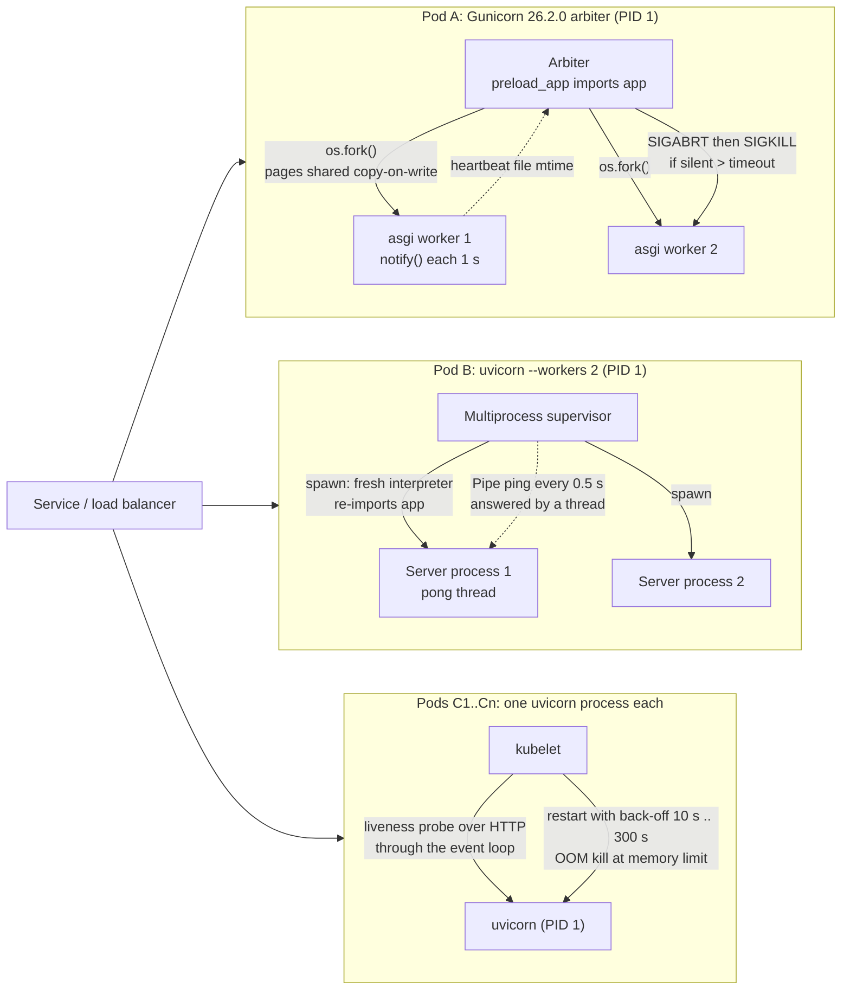

# Process Management in Production: Gunicorn (26.2.0) vs uvicorn --workers vs Single-Process Kubernetes Pods and Memory Recycling

> [!summary] Claim
> A Python API needs one process per core because of the GIL, and the only real choice is who supervises those processes: Gunicorn's arbiter forks workers that can share preloaded pages copy-on-write and kills workers whose event loop stops heartbeating, `uvicorn --workers` spawns fresh interpreters that share nothing and only notices dead or deadlocked children, and one process per Kubernetes pod hands supervision to the kubelet, which restarts with exponential back-off and kills on memory limits; pick the supervisor whose failure detection matches your failure modes, and always add jitter to request-count recycling.

Part of [ASGI Servers and Async Runtime](README.md) in [API Engineering](../README.md).

## TL;DR

Mechanism: Gunicorn's arbiter `os.fork()`s `N` workers that inherit the listening socket, watches each worker's heartbeat file, and replaces workers that exit, time out, or reach `max_requests + randint(0, max_requests_jitter)` requests `(gunicorn 26.2.0 gunicorn/workers/base.py, Worker.__init__)`.
Contract rule: whatever the topology, every worker's in-process state (caches, rate-limit counters, sessions, singletons) is private, so anything that must be global lives in an external store; the lab shows 4 workers with an in-memory limit of 5 admit 20 requests from one client.
Trap: `uvicorn --workers` starts children with `multiprocessing` `spawn` `(uvicorn 0.54.0 uvicorn/_subprocess.py, spawn)` and answers supervisor pings from a daemon thread, so it shares no memory copy-on-write and keeps a worker whose event loop is blocked in "alive" state forever; the lab's ping succeeds while the loop is stuck in `time.sleep`.
Portability: the drafter's run of the 24 tests passed on CPython 3.12.13, 3.13.18, 3.14.6, 3.14.10, 3.15.2, 3.14.6t, and 3.15.0b3t (GIL disabled) on macOS 27.3 arm64, and the review reran them on 3.14.6 after tightening one test; fork-based pre-fork servers are POSIX-only, and since CPython 3.14 `fork` is no longer the default `multiprocessing` start method anywhere.
When not to use it: on Kubernetes with a horizontal autoscaler and memory limits, prefer one `uvicorn` process per pod (or a small fixed worker count under Gunicorn only when copy-on-write savings or loop-starvation detection are measured to matter); free-threaded CPython 3.14t+ makes threads, not processes, the scaling unit for CPU-bound handlers.

## Mental model



Each subgraph is one way to get several Python processes behind one Service.
In Pod A the arbiter loads the application once (with `preload_app`) and forks, so workers start with the parent's pages mapped copy-on-write; each worker touches its heartbeat file from inside its event loop, and the arbiter escalates `SIGABRT` then `SIGKILL` when a heartbeat is older than `timeout`.
In Pod B the uvicorn supervisor spawns fresh interpreters that import the app themselves, so there is no sharing, and its health ping is answered by a separate thread, so it detects only processes that died or deadlocked the whole interpreter.
In Pods C the kubelet is the supervisor: an HTTP liveness probe goes through the event loop (so it does detect a blocked loop), but the reaction is a container restart with exponential back-off, and the memory limit is enforced by the kernel's OOM killer rather than by a graceful recycle.

## How it works

### Why there are processes at all

On a GIL build of CPython one process executes Python bytecode on one core at a time, so a CPU-bound share of every request caps a single `asyncio` process at roughly one core no matter how many connections it multiplexes.
The standard remedy is `N` identical processes that accept from the same listening socket, and the three topologies in this note differ only in who creates those processes, how they share memory, and how failures are detected and repaired.
Free-threaded builds (3.13t onward, with the GIL disabled at runtime) change the arithmetic; that path belongs to [[Offloading-CPU-Bound-Work-ProcessPoolExecutor-vs-Free-Threaded-Python-3-15t]].

### Gunicorn 26.2.0: the arbiter loop

`Arbiter.run` calls `start()` (create listeners, install signal handlers), `manage_workers()` to spawn the initial set, then loops forever on `wait_for_signals(timeout=1.0)`, `murder_workers()`, `manage_workers()`, and `manage_dirty_arbiter()` `(gunicorn 26.2.0 gunicorn/arbiter.py, Arbiter.run)`.
Signal handlers do nothing but `SIG_QUEUE.put_nowait(sig)` on a `queue.SimpleQueue`, which the code comments as "reentrant-safe for signal handlers", and the main loop dispatches each queued signal to `handle_<name>` `(gunicorn 26.2.0 gunicorn/arbiter.py, Arbiter.signal)`.
The signal contract that matters in production:

| Signal to the arbiter | Handler | Effect |
|---|---|---|
| `SIGTERM` | `handle_term` raises `StopIteration` -> `halt()` -> `stop(graceful=True)` | Close listeners, `SIGTERM` every worker, wait up to `graceful_timeout`, then `SIGKILL` the rest |
| `SIGINT`, `SIGQUIT` | `stop(False)` | `SIGQUIT` to workers (immediate exit), then `SIGKILL` after `graceful_timeout` |
| `SIGHUP` | `reload()` | Re-read config, spawn `workers` new workers, then `manage_workers()` kills the oldest surplus with `SIGTERM` |
| `SIGTTIN` / `SIGTTOU` | `num_workers += 1` / `-= 1` (never below 1) | Scale the pool live |
| `SIGUSR1` | Reopen log files and forward `SIGUSR1` to workers | Log rotation |
| `SIGUSR2` | `reexec()` | Fork and `execvpe` a new master that inherits listener fds through `GUNICORN_FD` |
| `SIGCHLD` | `reap_workers()` | `waitpid(-1, WNOHANG)` loop; boot failure (`exit 3`) or app load failure (`exit 4`) halts the server |

A `SIGINT` or `SIGQUIT` that arrives during a graceful stop (for example after `SIGTERM`) switches to quick shutdown: workers get `SIGQUIT` and the wait limit drops to 2 seconds `(gunicorn 26.2.0 gunicorn/arbiter.py, Arbiter.stop)`.
`reap_workers` deliberately reaps children it does not know, because "when gunicorn runs as PID 1 the kernel reparents orphans onto it", and logs a worker killed by `SIGKILL` with "Perhaps out of memory?" `(gunicorn 26.2.0 gunicorn/arbiter.py, Arbiter.reap_workers)`.

### Spawning: fork, preload, and what the child inherits

`spawn_worker` increments `worker_age`, constructs the worker object in the arbiter (so `__init__` runs pre-fork), calls the `pre_fork` hook, and `os.fork()`s; the child closes its siblings' heartbeat files, runs `post_fork`, and enters `worker.init_process()` `(gunicorn 26.2.0 gunicorn/arbiter.py, Arbiter.spawn_worker)`.
`spawn_workers` sleeps `0.1 * random.random()` seconds between forks, a small built-in stagger.
`init_process` sets the uid and gid, calls `util.seed()` (which runs `random.seed(os.urandom(64))`), creates a self-pipe for wakeups, marks the listening sockets close-on-exec, installs worker signal handlers, and then calls `load_wsgi()`, which calls `self.app.wsgi()` `(gunicorn 26.2.0 gunicorn/workers/base.py, Worker.init_process)`.
`BaseApplication.wsgi` caches the loaded callable: `if self.callable is None: self.callable = self.load()` `(gunicorn 26.2.0 gunicorn/app/base.py, BaseApplication.wsgi)`.
That one line defines `--preload` semantics: with `preload_app`, `Arbiter.setup` calls `self.app.wsgi()` in the master, every forked worker finds the callable already set, and the imported modules, compiled code objects, and module-level data are shared copy-on-write; without it, each worker imports the application after the fork.
The same cache is why `SIGHUP` does not pick up new application code under `--preload`: `reload()` re-reads configuration but never clears `callable`, so new workers inherit the old code from the master, while without preload each new worker imports the code fresh.

Copy-on-write sharing in CPython decays because reading an object writes to it.
Every new reference increments `ob_refcnt` inside the object header, and every cyclic garbage collection pass writes `gc_refs` in the GC header of every tracked object it scans; either write dirties the 4 KiB page holding the object, and the kernel then copies that page into the child.
The CPython documentation names the remedy: call `gc.disable()` early in the parent, `gc.freeze()` right before `fork()`, and `gc.enable()` early in the children, so collections in the children skip the frozen objects (Python `gc` documentation, `gc.freeze`, added in 3.7).
`gc.freeze` came from Instagram's pre-fork uWSGI fleet; the issue, opened by Lukasz Langa, says "Instagram disabled the GC completely for this reason", which left new cycles uncollected (bpo-31558, merged for 3.7 on 2017-10-16).
PEP 683 (CPython 3.12) made runtime-global objects immortal so their refcounts are never written; the lab shows `None`'s count does not move for 1000 new references while an ordinary object's count rises by exactly 1000, and `sys.getrefcount(None)` itself reports `4294967295` on 3.12.13 and 3.13.18 and `3221225472` on 3.14.6, 3.14.10, 3.15.2, 3.14.6t, and 3.15.0b3t (measured, macOS 27.3 arm64).
Immortality covers `None`, `True`, `False`, small ints, and static types, but on GIL builds not interned strings: a module-level string constant and a `sys.intern` result both rose by exactly 1000 for 1000 references on 3.12.13, 3.13.18, 3.14.6, 3.14.10, and 3.15.2, and stayed fixed only on the free-threaded 3.14.6t and 3.15.0b3t builds (measured, macOS 27.3 arm64); your application's dicts, lists, model classes, and loaded data always keep taking refcount writes.
Gunicorn exposes no `gc.freeze` setting; you call it yourself, for example in the `pre_fork` or `when_ready` server hook after the app is preloaded.

Fork also copies state that must not be shared.
A socket, database connection, or TLS session opened before the fork is the same kernel object in every worker, so two workers interleave bytes on one connection; open pools in `post_fork` or in the ASGI lifespan, never at import time under `--preload`.
CPython reseeds the module-level `random` generator in each child through `os.register_at_fork(after_in_child=_inst.seed)` in `Lib/random.py`, but a private `random.Random()` instance built before the fork is copied verbatim; the lab's two forked children draw the identical float from such an instance and different floats from `random.random()`.
Threads do not survive a fork, and since CPython 3.12 `os.fork()` raises a `DeprecationWarning` when it detects multiple threads (Python `multiprocessing` documentation, fork start method).
Gunicorn 26.x itself runs a control-socket server thread in the master, started "after initial workers spawn to avoid fork deadlocks with asyncio" `(gunicorn 26.2.0 gunicorn/arbiter.py, Arbiter.start)` and launched by `_start_control_server` right after the first `manage_workers()` in `Arbiter.run`, which means every later fork (a recycle, a crash replacement, `SIGTTIN`) happens in a multi-threaded master; the control server is a daemon `threading.Thread` that registers its own `os.register_at_fork` handlers `(gunicorn 26.2.0 gunicorn/ctl/server.py, ControlSocketServer)`, and `--no-control-socket` removes the thread `(gunicorn 26.2.0 gunicorn/config.py, ControlSocketDisable)`.

### The heartbeat: how Gunicorn detects a stuck worker

Each worker owns a `WorkerTmp`: a `tempfile.mkstemp` file that is unlinked immediately and kept open, so it costs one descriptor and no directory entry `(gunicorn 26.2.0 gunicorn/workers/workertmp.py, WorkerTmp.__init__)`.
`notify()` takes one reading `new_time = time.monotonic()` and writes `os.utime(self._tmp.fileno(), (new_time, new_time))`, storing a monotonic clock reading in the file's modification time, and `last_update()` returns `os.fstat(fd).st_mtime` `(gunicorn 26.2.0 gunicorn/workers/workertmp.py, WorkerTmp.notify)`.
`murder_workers` compares `time.monotonic() - worker.tmp.last_update()` with `timeout`; the first time a worker is over, it logs `WORKER TIMEOUT`, sets `worker.aborted`, and sends `SIGABRT`; on the next pass it sends `SIGKILL`; `timeout = 0` disables the check `(gunicorn 26.2.0 gunicorn/arbiter.py, Arbiter.murder_workers)`.
The lab runs the real `murder_workers` against a real heartbeat file aged 31 seconds with `timeout=30` and records `[SIGABRT, SIGKILL]` over two passes, and records nothing for a fresh heartbeat or `timeout=0`.
The `worker_tmp_dir` help text still says the heartbeat calls `os.fchmod` and can block on disk-backed filesystems `(gunicorn 26.2.0 gunicorn/config.py, WorkerTmpDir)`, while the 26.2.0 code calls `os.utime`; either way, point `--worker-tmp-dir` at a `tmpfs` such as `/dev/shm` in containers whose `/tmp` is an overlay on disk.

Who calls `notify()` decides what the watchdog can see.
The native `asgi` worker calls `self.notify()` at the top of a `while self.alive` loop that ends in `await asyncio.sleep(1.0)` `(gunicorn 26.2.0 gunicorn/workers/gasgi.py, ASGIWorker._serve)`, and `uvicorn.workers.UvicornWorker` passes `callback_notify=self.callback_notify` (a coroutine that calls `self.notify()`) and `timeout_notify=self.timeout`, which is the arbiter's `timeout / 2.0` handed to every worker in `spawn_worker`, plus `limit_max_requests=self.max_requests`, Gunicorn's already-jittered budget `(uvicorn 0.54.0 uvicorn/workers.py, UvicornWorker.__init__)`; uvicorn's `on_tick` runs every 0.1 seconds and checks the notify deadline once per second `(uvicorn 0.54.0 uvicorn/server.py, Server.on_tick)`.
Both heartbeats run as coroutines on the worker's event loop, so a handler that blocks the loop (a synchronous database driver, `time.sleep`, a CPU-bound parse) also stops the heartbeat; with a 0.02-second heartbeat interval the lab's largest gap was 0.423 seconds when a task called `time.sleep(0.4)` and 0.022 seconds without it (`loop_heartbeat_gap`, one run, CPython 3.14.6, macOS 27.3 arm64; the tests assert `>= 0.4` and `< 0.3`).
That makes Gunicorn's `timeout` a loop-starvation watchdog for async workers: a loop blocked longer than `timeout` gets the worker killed and replaced, at the price of every in-flight request on that worker.

### `uvicorn --workers`: the `Multiprocess` supervisor

With `workers > 1`, `uvicorn.main.run` binds one socket in the parent and runs `Multiprocess(config, sockets=[sock]).run()` `(uvicorn 0.54.0 uvicorn/main.py, run)`; the application must be an import string, because children import it themselves.
Children are created with `multiprocessing.get_context("spawn")` `(uvicorn 0.54.0 uvicorn/_subprocess.py, get_subprocess)`: a fresh interpreter that unpickles the `Config` and the socket and imports the app, so nothing is shared copy-on-write and per-worker memory is the full import footprint.
The supervisor loop wakes every 0.5 seconds (`should_exit.wait(0.5)`), handles queued signals, and calls `keep_subprocess_alive()`, which pings each child over a `multiprocessing.Pipe` with `timeout_worker_healthcheck` (default 5 seconds) and kills and replaces any child that does not answer `(uvicorn 0.54.0 uvicorn/supervisors/multiprocess.py, Multiprocess.keep_subprocess_alive)`.
The child answers from `threading.Thread(target=self.always_pong, daemon=True)` started before `self.server.run(sockets)` `(uvicorn 0.54.0 uvicorn/supervisors/multiprocess.py, Process.target)`, so the ping proves that the interpreter can still schedule a thread, not that the event loop is serving; the lab blocks an event loop for 1 second and gets `ping() == True` while it is still blocked.
A child that exits with `STARTUP_FAILURE` (exit code `3`) stops the whole supervisor instead of respawning, because a broken app, TLS file, or bind would fail the same way on every restart.
`SIGHUP` runs `restart_all()`, which in uvicorn 0.54.0 starts each replacement, waits until `is_ready()` reports `server.started`, and only then terminates the old worker, aborting the rolling restart if a replacement is not ready within the health-check timeout; `SIGTTIN` and `SIGTTOU` add and remove one worker.
On `SIGTERM` the supervisor sends `SIGTERM` to every child and joins them; each child runs uvicorn's normal graceful shutdown (stop accepting, close idle keep-alive connections, wait for in-flight tasks up to `--timeout-graceful-shutdown`, run lifespan shutdown) `(uvicorn 0.54.0 uvicorn/server.py, Server.shutdown)`.
The `uvicorn.workers` module that plugs uvicorn into Gunicorn emits a `DeprecationWarning` on import pointing to the separate `uvicorn-worker` package (as of 2026-11), and Gunicorn 26.2.0 ships its own `-k asgi` worker that needs neither.

### Request-count recycling: `max_requests` and its jitter

Gunicorn draws each worker's budget once, in the arbiter, at construction: `max_requests + randint(0, max_requests_jitter)`, or `sys.maxsize` when `max_requests` is 0 `(gunicorn 26.2.0 gunicorn/workers/base.py, Worker.__init__)`.
Every worker class increments `self.nr` per request and, at `nr >= max_requests`, logs "Autorestarting worker after current request." and sets `alive = False`; the `asgi` worker also forces `keepalive = False` on that response, so the client reconnects to a sibling `(gunicorn 26.2.0 gunicorn/asgi/protocol.py, ASGIProtocol)`.
The worker then exits normally and the arbiter's next `manage_workers()` forks a replacement.
Uvicorn computes `limit_max_requests + random.randint(0, limit_max_requests_jitter)` once per `Server` as a `functools.cached_property`, and `on_tick` ends the main loop when `total_requests >= max_requests` `(uvicorn 0.54.0 uvicorn/server.py, Server.limit_max_requests)`; `--limit-max-requests-jitter` defaults to 0.
Under `--workers`, the exited child is noticed by the next `keep_subprocess_alive()` pass and respawned; as a single process in a pod, the container exits and the kubelet restarts it with back-off.
The lab shows why jitter is not optional: with 8 workers, a budget of 1000, zero jitter, and 8000 evenly spread requests, all 8 restarts fall inside 8 consecutive requests (global indices 7992 to 7999), so the pod briefly has no warm worker; with `randint(0, 500)` jitter over 80000 requests (62 restarts, seed 7) the worst burst is 2 restarts in any 8-request window.

Recycling exists because a long-running CPython process often grows without leaking in the Python sense.
`pymalloc` serves requests of 512 bytes or less from 1 MiB arenas on 64-bit platforms (Python C API documentation, The pymalloc allocator), and returns an arena to the system only when all of its pools are free (`nf == ao->ntotalpools` in `insert_to_freepool`, CPython v3.14.0 `Objects/obmalloc.c`), so one surviving object pins a whole arena.
Larger requests go to the C allocator; glibc keeps several malloc arenas whose hard limit is "a multiple of the number of available CPUs" (`M_ARENA_TEST` defaults to 8 on 64-bit), trims the top of the heap only past a `128*1024`-byte `M_TRIM_THRESHOLD`, and raises its `mmap` threshold dynamically as large blocks are freed (`mallopt(3)`); `MALLOC_ARENA_MAX` caps the arena count.
The result is a resident set that ratchets up with peak request concurrency and fragmentation, which recycling resets; diagnosing a true leak, `tracemalloc` diffs, and arena tuning belong to [[Memory-Leaks-in-Long-Running-Python-API-Workers]].
Recycling is a mitigation with a cost: each restart throws away warm caches and pays connection-pool setup again (and, without preload, the whole import); under `--preload` the replacement starts again from the master's shared pages, which also re-shares whatever the old worker had dirtied.
Granian 2.8.7 offers the two policies Gunicorn lacks: `--workers-lifetime` (time-based, minimum 60 seconds) and `--workers-max-rss` (MiB, sampled every `--rss-sample-interval`, default 30 seconds, over `--rss-samples` consecutive samples, default 1) `(granian 2.8.7 granian/cli.py, cli)`.

### Kubernetes: one process per pod

With one uvicorn process as PID 1, the container runtime delivers the stop signal (`SIGTERM` by default, or the image's `STOPSIGNAL`) to that process, after any `preStop` hook, and sends `SIGKILL` when `terminationGracePeriodSeconds` (default 30) expires (Kubernetes Pod Lifecycle, Pod Termination Flow).
A container that exits for any reason, including a clean exit after `--limit-max-requests` under `restartPolicy: Always`, is restarted "with an exponential backoff delay (10s, 20s, 40s, ...), that is capped at 300 seconds", and the timer resets after 10 minutes of healthy running (Kubernetes Pod Lifecycle, as of 2026-11); a node can lower the cap with the kubelet's `crashLoopBackOff.maxContainerRestartPeriod` (`KubeletCrashLoopBackOffMax`, beta since v1.35), but during the delay that pod serves nothing.
Memory limits are enforced by the kernel's cgroup OOM killer "reactively", while CPU limits throttle (Kubernetes Resource Management for Pods and Containers, as of 2026-11), so a growing process is killed with `SIGKILL` mid-request instead of being drained.
The kubelet's HTTP liveness probe travels through the event loop, so unlike uvicorn's pipe ping it does detect a blocked loop, but it only acts after `failureThreshold x periodSeconds` and then restarts the whole container.
Graceful drain sequencing (endpoint removal races, `preStop` sleeps, drain budgets) is covered in [[Graceful-Shutdown-SIGTERM-Drain-Windows-and-Kubernetes-PreStop-Hooks]].

### Memory accounting: why per-pod RSS lies about pre-fork sharing

`RSS` counts every resident page a process maps, including pages shared with siblings, so summing worker RSS over-counts a pre-fork pool; `PSS` divides each page by the number of processes sharing it ("if a process has 1000 pages all to itself, and 1000 shared with one other process, its PSS will be 1500"), and `smaps_rollup` gives the per-process sums (Linux `proc.txt`, `/proc/PID/smaps`).
In cgroup v2 "a memory area is charged to the cgroup which instantiated it and stays charged to the cgroup until the area is released" (Linux cgroup v2 documentation, Memory Ownership), so a page that forked siblings still share was instantiated once and is charged once; the cgroup documentation does not spell out the forked-sibling case, so the following is an inference from that sentence, not a quoted rule.
By that inference a Gunicorn pod with a preloaded app is charged roughly `shared + N x private`, while `N` single-process pods are charged `N x (shared + private)`.
The difference is the only memory argument for multi-worker pods, and the lab shows why it shrinks over a worker's life: refcount writes (1000 new references changed an ordinary object's count by exactly 1000) and GC header writes are the writes that make the kernel copy a shared page.
This note ships no `PSS` measurement of a real preloaded app, because that needs `/proc/PID/smaps_rollup` on Linux and this lab runs on macOS; measure it on your own application over a full worker lifetime instead of assuming the saving.

## Numbers and limits

| Quantity | Value | Source or measurement |
|---|---|---|
| Gunicorn `workers` default | `WEB_CONCURRENCY` env var, else `1` | `(gunicorn 26.2.0 gunicorn/config.py, Workers)` |
| Gunicorn suggested starting point | `(2 x CPU cores) + 1` | gunicorn.org Design page (as of 2026-11) |
| Gunicorn `timeout` / `graceful_timeout` | `30` s / `30` s; `timeout = 0` disables the watchdog | `(gunicorn 26.2.0 gunicorn/config.py, Timeout, GracefulTimeout)`; lab |
| Gunicorn `max_requests` / `max_requests_jitter` | `0` (off) / `0` | `(gunicorn 26.2.0 gunicorn/config.py, MaxRequests, MaxRequestsJitter)` |
| Gunicorn worker budget | `max_requests + randint(0, jitter)`, inclusive both ends | `(gunicorn 26.2.0 gunicorn/workers/base.py, Worker.__init__)`; lab sees exactly `{10, 11, 12}` for `10` and `2` |
| Gunicorn `keepalive`, `backlog`, `worker_connections` | `2` s, `2048`, `1000` | `(gunicorn 26.2.0 gunicorn/config.py, Keepalive, Backlog, WorkerConnections)` |
| Gunicorn arbiter loop wake-up, stop poll, quick-stop limit | `1.0` s, `0.1` s, `2.0` s | `(gunicorn 26.2.0 gunicorn/arbiter.py, Arbiter.run, Arbiter.stop)` |
| Gunicorn spawn stagger | `0` to `0.1` s random sleep between forks | `(gunicorn 26.2.0 gunicorn/arbiter.py, Arbiter.spawn_workers)` |
| Gunicorn `asgi` worker heartbeat interval | `1.0` s | `(gunicorn 26.2.0 gunicorn/workers/gasgi.py, ASGIWorker._serve)` |
| `UvicornWorker` heartbeat | once more than `timeout / 2` = `15` s has passed at the default `timeout`, checked once per second | `(uvicorn 0.54.0 uvicorn/workers.py, UvicornWorker.__init__)`, `(uvicorn 0.54.0 uvicorn/server.py, Server.on_tick)`, and `(gunicorn 26.2.0 gunicorn/arbiter.py, Arbiter.spawn_worker)` |
| Gunicorn exit codes that halt the arbiter | `3` worker boot error, `4` app load error | `(gunicorn 26.2.0 gunicorn/arbiter.py, Arbiter.WORKER_BOOT_ERROR, Arbiter.APP_LOAD_ERROR)` |
| Uvicorn supervisor poll and health-check timeout | `0.5` s, `5` s (`--timeout-worker-healthcheck`) | `(uvicorn 0.54.0 uvicorn/supervisors/multiprocess.py)`, `(uvicorn 0.54.0 uvicorn/config.py, Config)` |
| Uvicorn `STARTUP_FAILURE` | exit code `3`, stops the supervisor | `(uvicorn 0.54.0 uvicorn/config.py, STARTUP_FAILURE)` |
| Uvicorn `--limit-max-requests-jitter` default | `0` | `(uvicorn 0.54.0 uvicorn/config.py, Config)`; lab |
| Kubernetes `terminationGracePeriodSeconds` default | `30` s, plus a one-off `2` s if `preStop` is still running | Kubernetes Pod Lifecycle (as of 2026-11) |
| Kubernetes restart back-off | `10` s doubling to `300` s cap (per-node cap configurable from `1` s to `300` s), reset after `10` min running | Kubernetes Pod Lifecycle (as of 2026-11) |
| pymalloc small-request limit and arena size | `512` bytes, `1` MiB on 64-bit (`2` MiB with `--with-pymalloc-hugepages`) | Python C API documentation (as of 2026-11) |
| glibc `M_ARENA_TEST` default and `M_TRIM_THRESHOLD` | `8` on 64-bit (arena cap is a multiple of CPUs), `128 * 1024` bytes | `mallopt(3)` |
| Granian RSS recycling sample interval | `30` s default, `1` to `300` s | `(granian 2.8.7 granian/cli.py, cli)` |
| Immortal refcount reported by `sys.getrefcount(None)` | `4294967295` (3.12.13, 3.13.18), `3221225472` (3.14.6, 3.14.6t, 3.14.10, 3.15.0b3t, 3.15.2) | Measured with `python -I -c "import sys; print(sys.getrefcount(None))"`, macOS 27.3 arm64 |
| Restarts inside any 8-request window, 8 workers, budget 1000 | `8` with jitter 0 (8000 requests); `2` with `randint(0, 500)` (80000 requests, 62 restarts, seed 7) | Lab simulation, `test_zero_jitter_...`, `test_jitter_spreads_...`, CPython 3.14.6 |
| Rate limit of 5 per client, 4 workers, in-memory | `20` of 30 admitted; `5` with a shared store | Lab, `test_in_memory_rate_limit_admits_workers_times_limit` |
| Heartbeat gap when a handler calls `time.sleep(0.4)` | `0.423` s measured (`0.022` s without the block; interval `0.02` s) | `loop_heartbeat_gap`, one run, CPython 3.14.6, macOS 27.3 arm64; tests assert `>= 0.4` and `< 0.3` |
| Lab suite | `24 passed in 2.38s` | `uv run --frozen pytest <module> -v`, CPython 3.14.6, macOS 27.3 arm64 |

## Portability

| Runtime, server, or protocol | Behavior | Evidence |
|---|---|---|
| CPython `3.12.13`, `3.13.18`, `3.14.6`, `3.14.10`, `3.15.2` | All 24 lab tests pass, including real `os.fork()` children and `gc.freeze` | Drafter's `uv run --frozen --python <v> pytest <module> -q` -> `24 passed`, macOS 27.3 arm64; the review reran only 3.14.6 (`24 passed`) after tightening `test_jitter_spreads_...`, with the matrix paused by instruction |
| CPython `3.14.6t` and `3.15.0b3t` (GIL disabled, confirmed after imports) | All 24 pass; immortal refcount reporting matches 3.14 | Drafter's lock-pinned subset installed with `uv pip install -c <uv export --frozen>`, not rerun by the review; `3.15.2t` is not installed here, so that leg did not run |
| Immortal objects (PEP 683) | `None`, `True`, and small ints fixed from 3.12; reported value changed between 3.13 and 3.14; interned strings immortal only on the free-threaded builds | Measured by the review on every interpreter above |
| `multiprocessing` default start method | `fork` on Linux through 3.13; `forkserver` on POSIX platforms that can pass file descriptors and `spawn` on macOS and Windows from 3.14; `spawn` when there is no writable temp dir from 3.15.1 (gh-155717), a check also present in the 3.14.10 stdlib but absent from 3.14.6 and 3.15.0b3 | Python `multiprocessing` documentation (as of 2026-11); `Lib/multiprocessing/context.py`, `_get_platform_default_context`, read in each local install |
| `os.fork()` with threads running | `DeprecationWarning` from 3.12 | Python `multiprocessing` documentation |
| Gunicorn `26.2.0` | POSIX only (`os.fork`); `sync`, `gthread`, `gevent`, `tornado`, and native `asgi` workers; HTTP/1.1 by default, HTTP/2 opt-in with `--http-protocols h2,h1` (TLS with ALPN; cleartext `h2c` off by default), `h3` accepted but documented as "future, not yet implemented" | `(gunicorn 26.2.0 gunicorn/workers/__init__.py, SUPPORTED_WORKERS)`, `(gunicorn 26.2.0 gunicorn/config.py, HTTPProtocols)` |
| Uvicorn `0.54.0` `--workers` | `spawn` on every platform; Windows uses `SIGBREAK` and `CTRL_BREAK_EVENT` in place of `SIGTERM` | Lab `test_uvicorn_workers_use_spawn_...`; `(uvicorn 0.54.0 uvicorn/supervisors/multiprocess.py, Process.terminate)` |
| Hypercorn `0.18.0` | `--workers N` starts children with `get_context("spawn")`; `workers = 0` runs in-process | `(hypercorn 0.18.0 hypercorn/run.py, run)`; see [[Hypercorn-Internals-HTTP-2-HTTP-3-QUIC-and-AnyIO-Trio-Workers]] |
| Granian `2.8.7` | Worker processes use the interpreter's default start method unless it is `forkserver`, which is replaced by `spawn`; so `fork` on Linux through 3.13 and `spawn` on Linux from 3.14 | `(granian 2.8.7 granian/server/mp.py, WorkerProcess.__init__)`; see [[Granian-Internals-Rust-Tokio-Hyper-Engine-and-RSGI-vs-ASGI]] |
| HTTP/1.1, HTTP/2, HTTP/3 | Topology is protocol-independent; HTTP/2 and HTTP/3 multiplex many requests per connection, so connection-level balancing across workers becomes coarser | Architectural consequence, not lab-tested |
| Linux vs macOS memory accounting | `PSS` via `/proc/PID/smaps_rollup` on Linux only | Linux `proc.txt` |

Container legs (Debian Trixie, Alpine musl) were not run for this draft.

## Worked example

The [implementation](../labs/src/api_labs/f12_asgi_servers_and_async_runtime/worker_topologies.py) drives the real Gunicorn 26.2.0 `Worker`, `WorkerTmp`, and `Arbiter.murder_workers`, the real uvicorn 0.54.0 `Server.limit_max_requests` and supervisor `Process` ping, real `os.fork()` children, and a Starlette app replicated behind a round-robin dispatcher.
The [test](../labs/tests/f12_asgi_servers_and_async_runtime/test_multi_process_worker_topologies_gunicorn_uvicorn_workers_vs_kubernetes_replicas.py) has 24 tests: 22 `unit` and 2 `socket` (the uvicorn ping uses a `multiprocessing.Pipe`, which is a UNIX socket pair).

Full source of `worker_topologies.py`:

```python
"""Pre-fork worker topologies: recycling budgets, heartbeats, fork state, and per-worker memory.

Drives the real Gunicorn 26.2.0 and Uvicorn 0.54.0 objects that decide when a worker is
recycled or killed, and real os.fork() children to show what a worker inherits.
"""

from __future__ import annotations

import asyncio
import gc
import importlib
import itertools
import os
import random
import sys
import threading
import time
from dataclasses import dataclass, field
from types import SimpleNamespace
from typing import TYPE_CHECKING, Any

from starlette.applications import Starlette
from starlette.responses import JSONResponse
from starlette.routing import Route
from uvicorn.config import Config as UvicornConfig
from uvicorn.server import Server as UvicornServer
from uvicorn.supervisors.multiprocess import Process as UvicornProcess

if TYPE_CHECKING:
    from collections.abc import Callable

    from starlette.requests import Request
    from starlette.types import Receive, Scope, Send

# Gunicorn ships no type information, so its modules are loaded as untyped values.
_gunicorn_config: Any = importlib.import_module("gunicorn.config")
_gunicorn_worker_base: Any = importlib.import_module("gunicorn.workers.base")
_gunicorn_workertmp: Any = importlib.import_module("gunicorn.workers.workertmp")
_gunicorn_arbiter: Any = importlib.import_module("gunicorn.arbiter")


# -- Recycling budgets: the exact formulas both servers use -------------------------------


def gunicorn_request_budget(max_requests: int, jitter: int, *, seed: int) -> int:
    """Return the max_requests budget a real Gunicorn Worker draws for itself."""
    cfg = _gunicorn_config.Config()
    cfg.set("max_requests", max_requests)
    cfg.set("max_requests_jitter", jitter)
    random.seed(seed)  # Worker.__init__ calls the module-level random.randint
    worker = _gunicorn_worker_base.Worker(1, os.getpid(), [], None, 15.0, cfg, None)
    try:
        return int(worker.max_requests)
    finally:
        worker.tmp.close()


def uvicorn_request_budget(limit: int | None, jitter: int, *, seed: int) -> int | None:
    """Return the limit_max_requests a real Uvicorn Server computes (a cached property)."""
    config = UvicornConfig(
        app="unused:app", limit_max_requests=limit, limit_max_requests_jitter=jitter
    )
    random.seed(seed)
    return UvicornServer(config).limit_max_requests


@dataclass
class RecyclePlan:
    """Global request indices at which each worker slot was recycled."""

    restarts: list[int] = field(default_factory=lambda: list[int]())

    def worst_burst(self, window: int) -> int:
        """Largest number of restarts that fall inside any `window` consecutive requests."""
        ordered = sorted(self.restarts)
        best = 0
        start = 0
        for end, value in enumerate(ordered):
            while value - ordered[start] >= window:
                start += 1
            best = max(best, end - start + 1)
        return best


def simulate_recycling(workers: int, budget: Callable[[], int], total_requests: int) -> RecyclePlan:
    """Dispatch requests round-robin; a worker that reaches its budget is replaced.

    Round-robin is the evenest possible spread, which is the worst case for synchronized
    restarts: with zero jitter every worker crosses its budget in the same few requests.
    """
    budgets = [budget() for _ in range(workers)]
    served = [0] * workers
    plan = RecyclePlan()
    for index in range(total_requests):
        slot = index % workers
        served[slot] += 1
        if served[slot] >= budgets[slot]:
            plan.restarts.append(index)
            served[slot] = 0
            budgets[slot] = budget()
    return plan


# -- Heartbeats: what each supervisor can and cannot see ----------------------------------


def make_heartbeat_file() -> Any:
    """Create the real Gunicorn per-worker heartbeat file (an unlinked temp file)."""
    return _gunicorn_workertmp.WorkerTmp(_gunicorn_config.Config())


def arbiter_murder_signals(timeout: int, silent_for: float, passes: int) -> list[int]:
    """Run the real Arbiter.murder_workers on one worker whose heartbeat is `silent_for` old."""
    tmp = make_heartbeat_file()
    sent: list[int] = []

    def record_kill(pid: int, sig: int) -> None:
        sent.append(sig)

    def ignore_log(*args: object) -> None:
        return None

    try:
        tmp.notify()
        stale = time.monotonic() - silent_for
        os.utime(tmp.fileno(), (stale, stale))  # same clock WorkerTmp.notify writes
        arbiter = _gunicorn_arbiter.Arbiter.__new__(_gunicorn_arbiter.Arbiter)
        arbiter.timeout = timeout
        arbiter.WORKERS = {4242: SimpleNamespace(tmp=tmp, aborted=False)}
        arbiter.log = SimpleNamespace(critical=ignore_log)
        arbiter.kill_worker = record_kill  # stands in for os.kill(pid, sig)
        for _ in range(passes):
            arbiter.murder_workers()
    finally:
        tmp.close()
    return sent


async def loop_heartbeat_gap(block_seconds: float, interval: float) -> float:
    """Largest gap between heartbeats when the heartbeat runs on the event loop.

    This is how Gunicorn's `asgi` worker (and `uvicorn.workers.UvicornWorker`) notify the
    arbiter: from a coroutine, so a blocking call starves the heartbeat.
    """
    tmp = make_heartbeat_file()
    beats: list[float] = []
    stop = asyncio.Event()

    async def heartbeat() -> None:
        while not stop.is_set():
            tmp.notify()
            beats.append(time.monotonic())
            await asyncio.sleep(interval)

    async def blocking_handler() -> None:
        await asyncio.sleep(interval * 2)
        time.sleep(block_seconds)  # noqa: ASYNC251 - the deliberate bug under test
        await asyncio.sleep(interval * 2)
        stop.set()

    try:
        async with asyncio.TaskGroup() as group:
            group.create_task(heartbeat())
            group.create_task(blocking_handler())
    finally:
        tmp.close()
    return max(later - earlier for earlier, later in itertools.pairwise(beats))


@dataclass(frozen=True)
class PingResult:
    answered: bool
    ready: bool
    loop_was_blocked: bool


def uvicorn_ping_while_loop_blocked(block_seconds: float, *, started: bool) -> PingResult:
    """Ask a real Uvicorn supervisor Process for a health ping while its event loop is blocked.

    Uvicorn answers pings from a daemon thread (Process.always_pong), not from the event loop,
    so a worker whose loop is stuck in a blocking call still looks alive to `--workers`.
    """
    process = UvicornProcess(UvicornConfig(app="unused:app"), sockets=[])
    process.server.started = started
    loop_blocked = threading.Event()
    loop_released = threading.Event()

    async def stuck_endpoint() -> None:
        loop_blocked.set()
        time.sleep(block_seconds)  # noqa: ASYNC251 - the deliberate bug under test
        loop_released.set()

    loop_thread = threading.Thread(target=asyncio.run, args=(stuck_endpoint(),))
    pong_thread = threading.Thread(target=process.pong)  # one pong, as always_pong does
    loop_thread.start()
    loop_blocked.wait()
    pong_thread.start()
    try:
        answered = process.ping(timeout=block_seconds / 2)
        still_blocked = not loop_released.is_set()
        pong_thread.join()
        pong_thread = threading.Thread(target=process.pong)
        pong_thread.start()
        ready = process.is_ready(timeout=block_seconds / 2)
    finally:
        pong_thread.join()
        loop_thread.join()
        process.parent_conn.close()
        process.child_conn.close()
    return PingResult(answered=answered, ready=ready, loop_was_blocked=still_blocked)


def uvicorn_worker_start_method() -> str:
    """Uvicorn --workers starts children with multiprocessing 'spawn', never fork."""
    subprocess_module: Any = importlib.import_module("uvicorn._subprocess")
    return str(subprocess_module.spawn.get_start_method())


# -- Fork semantics: what a pre-forked worker inherits ------------------------------------


def run_in_forked_child(task: Callable[[], str]) -> str:
    """Fork, run `task` in the child, and return what it printed through a pipe."""
    read_end, write_end = os.pipe()
    pid = os.fork()
    if pid == 0:  # child
        os.close(read_end)
        try:
            os.write(write_end, task().encode())
        finally:
            os._exit(0)
    os.close(write_end)
    chunks: list[bytes] = []
    while chunk := os.read(read_end, 65536):
        chunks.append(chunk)
    os.close(read_end)
    _, status = os.waitpid(pid, 0)
    if os.waitstatus_to_exitcode(status) != 0:
        raise RuntimeError(f"forked child exited with status {status}")
    return b"".join(chunks).decode()


def frozen_object_count() -> tuple[int, int]:
    """Freeze, count the permanent generation, unfreeze, count again."""
    gc.freeze()
    frozen = gc.get_freeze_count()
    gc.unfreeze()
    return frozen, gc.get_freeze_count()


def refcount_writes(target: object, references: int) -> int:
    """How much the refcount field of `target` changes when `references` new references exist.

    Every change is a write to the page that holds the object, which is what breaks
    copy-on-write sharing; immortal objects (PEP 683, CPython 3.12+) report no change.
    """
    before = sys.getrefcount(target)
    holders = [target] * references
    after = sys.getrefcount(target)
    del holders
    return after - before


# -- Per-worker memory: what diverges when an app runs in N processes ---------------------


def make_counter_app(store: dict[str, int] | None = None, limit: int = 5) -> Starlette:
    """One worker's copy of an app with a hit counter and an in-memory fixed-window limiter.

    `store=None` models module-level state (private to the process); passing one shared dict
    models an external store such as Redis that every worker reaches.
    """
    state: dict[str, int] = store if store is not None else {}
    worker_id = f"w{id(state) % 100000}"

    async def hit(request: Request) -> JSONResponse:
        client = request.headers.get("x-client", "anon")
        key = f"rate:{client}"
        state[key] = state.get(key, 0) + 1
        if state[key] > limit:
            return JSONResponse({"error": "rate limited"}, status_code=429)
        state["hits"] = state.get("hits", 0) + 1
        return JSONResponse({"worker": worker_id, "hits": state["hits"]})

    return Starlette(routes=[Route("/hit", hit)])


class RoundRobinWorkers:
    """ASGI stand-in for N worker processes behind one listener or Service."""

    def __init__(self, workers: list[Starlette]) -> None:
        self.workers = workers
        self.next_index = 0

    async def __call__(self, scope: Scope, receive: Receive, send: Send) -> None:
        worker = self.workers[self.next_index % len(self.workers)]
        self.next_index += 1
        await worker(scope, receive, send)
```

Four of the tests (simplified excerpt):

```python
@pytest.mark.unit
def test_zero_jitter_recycles_every_worker_in_the_same_burst() -> None:
    plan = simulate_recycling(workers=8, budget=lambda: 1000, total_requests=8000)
    assert len(plan.restarts) == 8
    assert plan.worst_burst(window=8) == 8  # all eight slots restart back to back


@pytest.mark.unit
def test_arbiter_sends_sigabrt_then_sigkill_to_a_silent_worker() -> None:
    sent = arbiter_murder_signals(timeout=30, silent_for=31.0, passes=2)
    assert sent == [signal.SIGABRT, signal.SIGKILL]


@pytest.mark.socket
def test_uvicorn_supervisor_ping_succeeds_while_the_event_loop_is_blocked() -> None:
    result = uvicorn_ping_while_loop_blocked(1.0, started=True)
    assert result.answered
    assert result.loop_was_blocked
    assert result.ready


@pytest.mark.unit
@pytest.mark.asyncio
async def test_in_memory_rate_limit_admits_workers_times_limit() -> None:
    app = RoundRobinWorkers([make_counter_app(limit=5) for _ in range(4)])
    transport = httpx.ASGITransport(app=app)
    async with httpx.AsyncClient(transport=transport, base_url="http://test") as client:
        codes = [(await client.get("/hit", headers=CLIENT_A)).status_code for _ in range(30)]
    assert codes.count(200) == 20
    assert codes.count(429) == 10
```

Captured with `uv run --frozen pytest tests/f12_asgi_servers_and_async_runtime/test_multi_process_worker_topologies_gunicorn_uvicorn_workers_vs_kubernetes_replicas.py -v` on CPython 3.14.6, macOS 27.3 arm64 (node ids shortened to the test name):

```text
collecting ... collected 24 items

test_gunicorn_budget_is_max_requests_plus_randint_jitter PASSED [  4%]
test_gunicorn_budget_includes_both_ends_of_the_jitter_range PASSED [  8%]
test_gunicorn_max_requests_zero_disables_recycling PASSED [ 12%]
test_uvicorn_budget_uses_the_same_formula_and_none_disables_it PASSED [ 16%]
test_uvicorn_default_jitter_is_zero_so_every_worker_gets_the_same_budget PASSED [ 20%]
test_zero_jitter_recycles_every_worker_in_the_same_burst PASSED [ 25%]
test_jitter_spreads_restarts_so_most_capacity_stays_up PASSED [ 29%]
test_worst_burst_counts_only_restarts_inside_the_window PASSED [ 33%]
test_arbiter_leaves_a_worker_with_a_fresh_heartbeat_alone PASSED [ 37%]
test_arbiter_sends_sigabrt_then_sigkill_to_a_silent_worker PASSED [ 41%]
test_arbiter_timeout_zero_disables_the_watchdog PASSED [ 45%]
test_blocking_call_starves_an_event_loop_heartbeat PASSED [ 50%]
test_non_blocking_loop_keeps_heartbeats_close_to_the_interval PASSED [ 54%]
test_uvicorn_supervisor_ping_succeeds_while_the_event_loop_is_blocked PASSED [ 58%]
test_uvicorn_readiness_reports_server_started_flag PASSED [ 62%]
test_uvicorn_workers_use_spawn_so_nothing_is_shared_copy_on_write PASSED [ 66%]
test_forked_worker_mutations_never_reach_the_parent_or_siblings PASSED [ 70%]
test_private_random_instance_created_before_fork_repeats_in_every_worker PASSED [ 75%]
test_module_random_is_reseeded_in_each_forked_child PASSED [ 79%]
test_gc_freeze_moves_tracked_objects_to_the_permanent_generation PASSED [ 83%]
test_ordinary_objects_take_refcount_writes_but_immortal_ones_do_not PASSED [ 87%]
test_in_memory_counter_diverges_across_workers PASSED [ 91%]
test_in_memory_rate_limit_admits_workers_times_limit PASSED [ 95%]
test_shared_store_restores_the_global_rate_limit PASSED [100%]

============================== 24 passed in 2.38s ==============================
```

## Pitfalls

> [!warning] Synchronized recycling storms
> Trigger: `--max-requests 1000` with no `--max-requests-jitter` (Gunicorn) or `--limit-max-requests` with the default jitter of 0 (uvicorn), behind a balancer that spreads load evenly.
> Symptom: every few minutes all workers in a pod exit within a fraction of a second, latency spikes while replacements import the app, and the access log shows a burst of "Autorestarting worker after current request."
> Fix: set jitter to 10 to 50 percent of the budget; the lab drops the worst burst from 8 of 8 workers to 2.

> [!warning] Blocked event loop that uvicorn --workers never replaces
> Trigger: a synchronous call inside an `async def` handler that never returns (a hung socket read with no timeout, a deadlocked C extension that releases the GIL).
> Symptom: that worker stops serving but stays in the pool because its pong thread still answers; a share of requests queues on its accept backlog and times out at the load balancer.
> Fix: add loop-lag monitoring and a liveness probe that goes through the event loop, or run under Gunicorn's `asgi` worker, whose heartbeat runs on the loop; see [[Detecting-Event-Loop-Blocking-Loop-Lag-Monitors-and-Debug-Callbacks]].

> [!warning] Connections opened before fork under `--preload`
> Trigger: a module-level database engine, Redis client, gRPC channel, or HTTP client created at import time with `preload_app = True`.
> Symptom: intermittent protocol errors and responses read by the wrong worker, because several processes share one kernel socket and, for TLS, one copied session state.
> Fix: create pools in `post_fork` or in the ASGI lifespan startup, and dispose any engine the master created; never share a socket other than the listener across a fork.

> [!warning] Pre-fork RNG state copied into every worker
> Trigger: a `random.Random()` instance or a third-party generator seeded at import time under `--preload`.
> Symptom: every worker generates the same sequence, so "random" request ids, retry jitter, or sampling decisions collide across workers; the lab's two children draw the identical value.
> Fix: use `secrets` or `os.urandom` for anything security-relevant, and reseed private generators in `post_fork`; the module-level `random` is already reseeded by CPython's `register_at_fork`.

> [!warning] `SIGHUP` does not deploy new code under `--preload`
> Trigger: a deploy process that updates files and sends `SIGHUP` to a preloaded Gunicorn.
> Symptom: new workers start but keep serving the old code, because `BaseApplication.wsgi` returns the callable cached in the master.
> Fix: send `SIGUSR2` to start a new master that re-executes and re-imports, then `SIGTERM` the old master once the new workers are healthy (`SIGWINCH` only stops old workers when Gunicorn is daemonized, `Arbiter.handle_winch`), or on Kubernetes roll pods instead of reloading in place.

> [!warning] Recycling a single-process pod through container restarts
> Trigger: `uvicorn --limit-max-requests N` as PID 1 with `restartPolicy: Always`.
> Symptom: the pod's restart count climbs, readiness flaps, and after a few cycles the kubelet waits 10, 20, 40 seconds and up to 5 minutes before starting it again, so capacity silently disappears.
> Fix: let a supervisor inside the pod recycle (Gunicorn or `uvicorn --workers`), or fix the growth and rely on the memory limit as a last resort.

> [!warning] Worker count derived from the node, not the pod
> Trigger: `workers = multiprocessing.cpu_count() * 2 + 1` in `gunicorn.conf.py` on a 64-core node with a `cpu: 2` limit.
> Symptom: 129 workers in a 2-CPU cgroup, CFS throttling, and a memory footprint that hits the limit at startup.
> Fix: set `WEB_CONCURRENCY` (read by both Gunicorn and uvicorn) from the pod spec; `os.cpu_count()` reports the host's logical CPUs, and CPython 3.13+ lets you override it with `-X cpu_count` or `PYTHON_CPU_COUNT` (verified locally: `-X cpu_count=3` makes both `os.cpu_count()` and `os.process_cpu_count()` return `3`).

> [!warning] Heartbeat file on a disk-backed filesystem
> Trigger: `/tmp` is an overlay or network filesystem and the node's disk stalls.
> Symptom: `WORKER TIMEOUT` kills of otherwise healthy workers.
> Fix: `--worker-tmp-dir /dev/shm` (or an `emptyDir` with `medium: Memory`).

## Security and robustness

Threat model: a single expensive request pattern (a large JSON body, a regex, a decompression bomb) can pin a worker's loop, and with process-level supervision an attacker who finds it can take workers out one at a time; Gunicorn's watchdog converts that into worker restarts, which is better than a silently dead worker but is still OWASP API4:2023 Unrestricted Resource Consumption, so bound body sizes, parse depth, and per-request CPU at the edge.
Per-worker state is a security boundary bug when it holds security decisions: in-memory rate limits multiply by the worker and pod count (the lab admits 20 instead of 5), in-memory lockout counters for login brute-force protection reset on every recycle, and in-memory revocation lists are inconsistent across workers; keep all of these in a shared store with atomic operations.
Recycling also resets in-process secrets caches, so a worker that fetched credentials at import time under `--preload` holds them for the master's lifetime, not the worker's; refresh credentials on a timer, not on process start.
The Gunicorn control socket (on by default since 25.1.0, mode `0600`) accepts worker-count and reload commands; in a shared PID or volume namespace, treat it as an administrative interface or disable it with `--no-control-socket`.
Run a supervisor as PID 1 only if it reaps orphans: Gunicorn 26.2.0 does (`waitpid(-1)` in `reap_workers`), while uvicorn's `Multiprocess` only joins its own children (no `waitpid(-1)` in `multiprocess.py`), so put a minimal init such as `tini` in front of it if the app spawns subprocesses; zombies eventually exhaust the pod's PID limit.
Defense in depth: request timeouts at the proxy, a per-worker concurrency cap (`--limit-concurrency` or `worker_connections`), loop-lag alarms, memory-based recycling as a backstop, and a pod memory limit as the last line.

## The principal's view

The decision is which layer owns process supervision, and the default answer on Kubernetes is the kubelet: one uvicorn process per pod makes every unit of capacity visible to the scheduler, the autoscaler, the load balancer, and the metrics pipeline, and makes a crash or OOM kill a well-understood pod event.
Choose Gunicorn with a small fixed worker count per pod (2 to 4) when one of three things is measured, not assumed: copy-on-write sharing of a large preloaded footprint (models, big lookup tables) saves enough `PSS` to matter at fleet scale, the event loop is known to block and you want a fast in-pod watchdog instead of a slow liveness probe, or the platform is not Kubernetes (VMs, bare metal, systemd) and something must supervise processes.
`uvicorn --workers` sits between them and is the weakest choice for production on Kubernetes: no copy-on-write, no loop-starvation detection, and an extra layer that hides per-process health from the platform; it is a good choice on a single VM where you want no extra dependency.
The organizational trade-off is observability: multi-worker pods make one pod's metrics an average over processes, so per-worker metrics need multiprocess-aware collectors, and incident responders must know two supervision layers instead of one.
Re-examine the whole question as free-threaded CPython matures: with the GIL disabled, one process with threads can use several cores and share one heap, which removes both the copy-on-write problem and the need for a process supervisor inside the pod, at the cost of thread-safety work in every C extension and in your own shared state.
If per-request CPU dominates and the team is willing to change language for the hot path, a compiled service or a Rust-backed server such as Granian removes much of the process-count pressure; that is a bigger decision than any worker flag.

## Interview questions

> [!question] L5: Why does a Python ASGI service run several processes per machine when one `asyncio` loop can hold thousands of connections?
>
> > [!success]- Answer
> > On a GIL build, one process runs Python bytecode on one core at a time.
> > The loop multiplexes waiting, but the CPU part of every request (parsing, validation, serialization) still serializes on that core.
> > Several processes behind one listening socket, or several pods behind one Service, use several cores.
> > Free-threaded builds change this, because threads in one process can then run Python code in parallel.
> >
> > Follow-up: What does each extra process cost you in memory if you use `uvicorn --workers`?

> [!question] L5: What does Gunicorn's `--max-requests-jitter` do, and what happens without it?
>
> > [!success]- Answer
> > Each worker draws its budget once as `max_requests + randint(0, jitter)`.
> > Without jitter every worker has the same budget, so evenly balanced traffic makes all of them restart at nearly the same moment.
> > During that window the pod has no warm worker and latency spikes.
> > With jitter the restarts spread out; in the lab the worst burst drops from 8 restarts to 2 in any 8-request window.
> >
> > Follow-up: What is uvicorn's equivalent flag and its default?

> [!question] L6: Predict the output: a module creates `rng = random.Random()` at import time, Gunicorn runs with `--preload` and two workers, and each worker's first request returns `rng.random()` and `random.random()`; do the two workers return equal values for either call?
>
> > [!success]- Answer
> > The two `rng.random()` values are equal, because both children inherit an identical copy of the instance's state.
> > The two `random.random()` values differ, because CPython reseeds the module-level generator in each child through `os.register_at_fork`, and Gunicorn also calls `random.seed(os.urandom(64))` in `init_process`.
> > The lab asserts exactly this with real forked children.
> >
> > Follow-up: Which generator should produce session ids, and does it need reseeding after fork?

> [!question] L6: Debug this API: a FastAPI service on Kubernetes runs `uvicorn --workers 4`; after a deploy, about a quarter of requests time out at the ingress, `kubectl` shows the pod `Running` and `Ready`, and the uvicorn parent logs nothing; what is happening and how do you confirm it?
>
> > [!success]- Answer
> > One worker's event loop is blocked, for example on a synchronous call with no timeout, so its accepted connections are never served.
> > The uvicorn supervisor pings children over a pipe answered by a daemon thread, so the stuck worker still looks alive and is never replaced.
> > The readiness probe passes whenever it lands on a healthy worker, which is three times out of four.
> > Confirm with `py-spy dump` on each worker PID or with a loop-lag metric per process; the stuck one shows the blocking frame.
> > Fix the blocking call, add a loop-lag watchdog, and consider Gunicorn's `asgi` worker or one process per pod so the probe and the watchdog see the loop.
> >
> > Follow-up: Why does Gunicorn's `timeout` catch this case, and what does it cost when it fires?

> [!question] L6: What exactly does `gc.freeze()` buy a pre-fork server, and what does it not fix?
>
> > [!success]- Answer
> > It moves every currently tracked object into a permanent generation that later collections skip.
> > Children therefore stop writing `gc_refs` into those objects' GC headers during collection, so those pages stay shared.
> > It does not stop refcount writes: any code that references an inherited object still dirties its page.
> > PEP 683 immortality removes refcount writes only for runtime-global objects such as `None` and small ints, not for application data.
> >
> > Follow-up: Where in Gunicorn's lifecycle would you call it, and why should `gc.disable()` come earlier?

> [!question] L6: Walk through what Gunicorn 26.2.0 does when it receives `SIGTERM` from the kubelet.
>
> > [!success]- Answer
> > The handler only queues the signal; the main loop dispatches it to `handle_term`, which raises `StopIteration`.
> > `halt()` stops the control socket and calls `stop(graceful=True)`, which closes the listeners and sends `SIGTERM` to every worker.
> > Workers stop accepting and finish in-flight requests; the arbiter reaps them every 0.1 seconds until `graceful_timeout` expires.
> > Any worker still alive then receives `SIGKILL`, and the arbiter exits.
> > `graceful_timeout` plus any `preStop` delay must fit inside `terminationGracePeriodSeconds`, or the kubelet kills everything first.
> >
> > Follow-up: What changes if a `SIGINT` arrives during that wait?

> [!question] L7+: A platform team proposes standardizing every Python API on "Gunicorn, `2 x cores + 1` workers, `--preload`, `--max-requests 1000`" inside Kubernetes pods; what is your review?
>
> > [!success]- Answer
> > The core count must come from the pod's CPU limit via `WEB_CONCURRENCY`, not from the node, or the pod oversubscribes its cgroup.
> > The formula was written for synchronous workers; for async workers one or two processes per allotted core is the usual ceiling, to be confirmed by load test.
> > `--preload` needs a rule that no connection or RNG is created at import time, and it disables code reload by `SIGHUP`.
> > `--max-requests` without jitter creates recycling storms, and recycling should be justified by measured growth, not set by default.
> > The bigger question is whether two supervision layers are worth it; one process per pod is simpler and more observable unless copy-on-write savings or loop watchdogs are measured to matter.
> >
> > Follow-up: What metrics would you require before allowing multi-worker pods for a given service?

> [!question] L7+: Your fleet runs 3,000 pods of one service, each one uvicorn process with a 1.5 GiB preloaded model; finance asks you to cut memory by half without changing the model; what options do you evaluate?
>
> > [!success]- Answer
> > Move to fewer, larger pods with a Gunicorn `asgi` pool and `--preload`, plus `gc.disable()`/`gc.freeze()` before fork, so the model pages are shared copy-on-write; measure `PSS` over a full worker lifetime, because refcount writes un-share pages.
> > Better, store the model in a form that is not Python objects (a memory-mapped array or file), so sharing does not depend on refcounts at all; file-backed `mmap` pages live in the page cache and are shared by every process that maps the same file.
> > Alternatively, move inference to a dedicated model server and keep the API pods small.
> > Each option trades blast radius and observability: bigger pods lose more capacity per crash and need per-worker metrics.
> >
> > Follow-up: How would free-threaded CPython change this analysis?

> [!question] L7+: When is it correct to recycle workers on a request count, and when should you instead recycle on memory or not at all?
>
> > [!success]- Answer
> > Request-count recycling is a cheap backstop when growth is roughly proportional to requests and the root cause is in a dependency you cannot fix quickly.
> > Memory-based recycling (a worker checks its own RSS or USS after each request and exits above a threshold) targets the real constraint and avoids restarts when traffic is light.
> > Neither replaces finding the leak, because both hide regressions and discard warm caches.
> > On Kubernetes the pod memory limit is the last resort and is a `SIGKILL`, so a recycle threshold must sit comfortably below it.
> >
> > Follow-up: How do you make a memory-based recycle graceful under Gunicorn?

## Related

Prerequisites: [[Granian-Internals-Rust-Tokio-Hyper-Engine-and-RSGI-vs-ASGI]]

Next: [[AnyIO-Structured-Concurrency-TaskGroups-CancelScopes-and-ExceptionGroups]]

See also: [[02-Programming-Languages/Python/Python-Backend-Interview-Prep/04-FastAPI]], [[02-Programming-Languages/Python/Python-Backend-Interview-Prep/17-Concurrency-in-Web-Services-and-Coding]], [[Uvicorn-Internals-Server-Lifecycle-Protocols-and-Flow-Control]], [[Graceful-Shutdown-SIGTERM-Drain-Windows-and-Kubernetes-PreStop-Hooks]], [[Memory-Leaks-in-Long-Running-Python-API-Workers]], [[Detecting-Event-Loop-Blocking-Loop-Lag-Monitors-and-Debug-Callbacks]], [[Offloading-CPU-Bound-Work-ProcessPoolExecutor-vs-Free-Threaded-Python-3-15t]], [[Hypercorn-Internals-HTTP-2-HTTP-3-QUIC-and-AnyIO-Trio-Workers]], [[CPython-Asyncio-Event-Loop-Internals-Selectors-Ready-Queue-and-Timers]]

- Lab: `labs/tests/f12_asgi_servers_and_async_runtime/test_multi_process_worker_topologies_gunicorn_uvicorn_workers_vs_kubernetes_replicas.py`

## Further reading

- [Gunicorn 26.2.0 arbiter.py](https://github.com/benoitc/gunicorn/blob/26.2.0/gunicorn/arbiter.py): the signal queue, spawn, reap, heartbeat murder, and graceful stop loop.
- [Gunicorn 26.2.0 workers/base.py](https://github.com/benoitc/gunicorn/blob/26.2.0/gunicorn/workers/base.py): the jittered `max_requests` budget and the post-fork `init_process` sequence.
- [Gunicorn 26.2.0 workers/gasgi.py](https://github.com/benoitc/gunicorn/blob/26.2.0/gunicorn/workers/gasgi.py): the native ASGI worker and its event-loop heartbeat.
- [Gunicorn design](https://gunicorn.org/design/): the maintainers' description of the arbiter and worker types.
- [Uvicorn 0.54.0 supervisors/multiprocess.py](https://github.com/Kludex/uvicorn/blob/0.54.0/uvicorn/supervisors/multiprocess.py): the `spawn`-based supervisor, thread-answered ping, and ready-gated rolling restart.
- [Uvicorn 0.54.0 server.py](https://github.com/Kludex/uvicorn/blob/0.54.0/uvicorn/server.py): `limit_max_requests` with jitter and the graceful shutdown sequence.
- [Python gc.freeze](https://docs.python.org/3/library/gc.html#gc.freeze): the official recipe for copy-on-write friendly forking.
- [bpo-31558](https://bugs.python.org/issue31558): the Instagram-originated proposal and discussion behind `gc.freeze`.
- [PEP 683](https://peps.python.org/pep-0683/): immortal objects and their pre-fork motivation.
- [Python multiprocessing start methods](https://docs.python.org/3/library/multiprocessing.html#contexts-and-start-methods): `fork`, `forkserver`, `spawn`, and the 3.14 default change.
- [Kubernetes Pod Lifecycle](https://kubernetes.io/docs/concepts/workloads/pods/pod-lifecycle/): restart back-off and the termination flow.
- [Kubernetes resource management](https://kubernetes.io/docs/concepts/configuration/manage-resources-containers/): reactive memory enforcement and CPU throttling.
- [mallopt(3)](https://man7.org/linux/man-pages/man3/mallopt.3.html): glibc arena, trim, and mmap thresholds behind native memory growth.
- [Linux cgroup v2](https://docs.kernel.org/admin-guide/cgroup-v2.html): memory ownership rules that decide how shared pages are charged.
- [Linux proc.txt](https://www.kernel.org/doc/Documentation/filesystems/proc.txt): `smaps`, `PSS`, and `smaps_rollup` for measuring shared pages.
