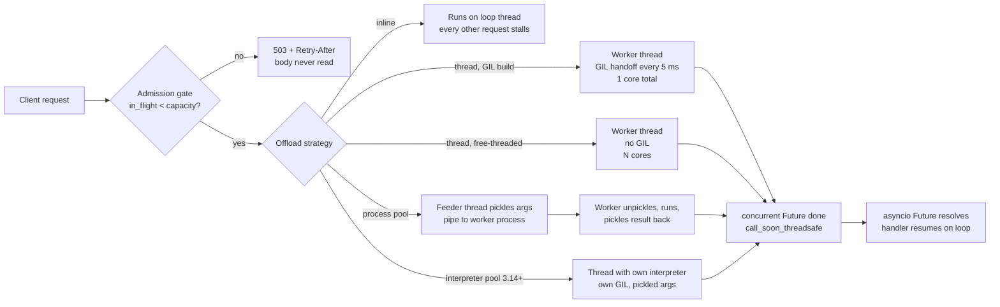

# Handling CPU-Bound Work Behind an Async API: ProcessPoolExecutor vs ThreadPool on GIL Builds vs Free-Threaded CPython (3.13t-3.15t)

> [!summary] Claim
> A CPU-bound handler must leave the event loop thread, but on a GIL build a thread pool only buys loop responsiveness (one core, inflated per-request latency), a process pool buys real cores at the price of pickling and process lifecycle, and a free-threaded `3.13t`-`3.15t` build buys real cores in threads only while every imported extension keeps the GIL off - so the choice is an admission-controlled executor picked per workload, not a default.

Part of [ASGI Servers and Async Runtime](README.md) in [API Engineering](../README.md).

## TL;DR

- Mechanism: `await loop.run_in_executor(executor, fn, arg)` wraps a `concurrent.futures.Future` in an `asyncio.Future`; the loop thread stays free, and where `fn` actually runs (thread under the GIL, thread without it, another process, another interpreter) decides whether you gain cores.
- Contract rule: offload anything that runs longer than a few milliseconds, bound it with an admission gate that answers `503 Service Unavailable` plus `Retry-After` before reading the body, and size the executor to cores, not to the `40`-token AnyIO default or the `min(32, cpus + 4)` thread pool default.
- Trap: cancellation does not reach the worker; `asyncio.wait_for` returns `TimeoutError` while the thread keeps burning CPU, a running process-pool future cannot be cancelled, and AnyIO's shielded `to_thread.run_sync` can silently swallow a deadline that expired while the thread ran.
- Portability: four pure-Python threads reached `cpu_parallelism` `0.98` on GIL `3.14.6` and `3.93` on `3.14.6t` in this lab; Linux switched the default start method from `fork` to `forkserver` in 3.14, macOS defaults to `spawn` on every version in the matrix, and `InterpreterPoolExecutor` exists only from 3.14.
- When not to: if the work is microseconds, inline it; if it is seconds to minutes, or must survive a deploy, put it on a durable queue and return `202 Accepted` instead of holding an HTTP request open on an executor.

## Mental model



A request first meets an admission gate that runs only on the loop thread, so a plain integer counter is race-free; a full gate answers `503` before the body is buffered.
An admitted request picks one of four places to run: inline on the loop (which freezes every other connection for the whole computation), a worker thread (which on a GIL build still shares one core with the loop and other threads, handing the GIL over every `5 ms`), a worker thread on a free-threaded build (true parallelism), or a separate process or interpreter (true parallelism with every argument and result crossing a pickle boundary).
Every path ends the same way: the `concurrent.futures.Future` completes on a foreign thread, `asyncio.futures._chain_future` copies its state into the loop's future with `call_soon_threadsafe`, and the handler resumes on the loop thread.

## How it works

### The bridge: `run_in_executor` and `to_thread`

`BaseEventLoop.run_in_executor(executor, func, *args)` lazily creates a default `ThreadPoolExecutor(thread_name_prefix='asyncio')` when `executor` is `None`, then returns `futures.wrap_future(executor.submit(func, *args), loop=self)` `(CPython 3.14.10 Lib/asyncio/base_events.py, BaseEventLoop.run_in_executor)`.
`asyncio.to_thread(func, /, *args, **kwargs)` is a thin wrapper that copies the current `contextvars.Context` and calls `loop.run_in_executor(None, functools.partial(ctx.run, func, *args, **kwargs))`, so it always uses the default thread pool and always propagates context variables `(CPython 3.14.10 Lib/asyncio/threads.py, to_thread)`.
`BaseEventLoop.set_default_executor` raises `TypeError('executor must be ThreadPoolExecutor instance')` for anything else, so you cannot make `to_thread` use processes `(CPython 3.14.10 Lib/asyncio/base_events.py, BaseEventLoop.set_default_executor)`; the lab proves the `TypeError` on every version in the matrix.
uvloop does not copy that check: `Loop.set_default_executor` just assigns `self._default_executor = executor` `(uvloop 0.23.0 uvloop/loop.pyx, Loop.set_default_executor)`, so the same code is accepted under Uvicorn with `--loop uvloop` and rejected under `--loop asyncio`.
Cancellation crosses the bridge in one direction only: when the asyncio future is cancelled, `_chain_future._call_check_cancel` calls `source.cancel()` on the concurrent future `(CPython 3.14.10 Lib/asyncio/futures.py, _chain_future)`, and `concurrent.futures.Future.cancel()` succeeds only for a future that has not started running.

### Framework defaults: Starlette, FastAPI, AnyIO

Starlette's `run_in_threadpool(func, *args, **kwargs)` is `await anyio.to_thread.run_sync(functools.partial(func, *args, **kwargs))` `(starlette 1.10.0 starlette/concurrency.py, run_in_threadpool)`, and Starlette's `request_response` wraps any non-async endpoint with it `(starlette 1.10.0 starlette/routing.py, request_response)`.
FastAPI does the same for a `def` (not `async def`) path operation: `run_endpoint_function` awaits `run_in_threadpool(_run_sync_endpoint, ...)` when `is_coroutine` is false `(fastapi 0.162.0 fastapi/routing.py, run_endpoint_function)`, and sync dependencies go through `run_in_threadpool` too `(fastapi 0.162.0 fastapi/dependencies/utils.py, solve_dependencies)`.
All of these share one process-wide limiter: `current_default_thread_limiter` creates `CapacityLimiter(40)` on first use `(anyio 4.16.0 anyio/_backends/_asyncio.py, AsyncIOBackend.current_default_thread_limiter)`, which the lab asserts.
`run_sync_in_worker_thread` enters `async with limiter or cls.current_default_thread_limiter():` and then `with CancelScope(shield=not abandon_on_cancel)` `(anyio 4.16.0 anyio/_backends/_asyncio.py, AsyncIOBackend.run_sync_in_worker_thread)`, so by default the awaiting task is shielded until the thread returns.
Idle AnyIO worker threads are pruned after `WorkerThread.MAX_IDLE_TIME = 10` seconds `(anyio 4.16.0 anyio/_backends/_asyncio.py, WorkerThread)`.

### Thread pools on a GIL build

The default `ThreadPoolExecutor` size is `min(32, (os.process_cpu_count() or 1) + 4)` from 3.13 (`os.cpu_count()` in 3.8-3.12), justified in the source comment as covering "CPU bound task which releases GIL" and I/O `(CPython 3.14.10 Lib/concurrent/futures/thread.py, ThreadPoolExecutor.__init__)`; on this 12-core host that is `16`, asserted by the lab.
A thread executing bytecode holds the GIL; a waiting thread blocks in `take_gil` on `COND_TIMED_WAIT(gil->cond, gil->mutex, interval, timed_out)` and, if it times out, sets `gil_drop_request` so the holder yields at its next eval-breaker check `(CPython 3.14.10 Python/ceval_gil.c, take_gil)`.
The interval is `DEFAULT_INTERVAL 5000` microseconds `(CPython 3.14.10 Python/ceval_gil.c, DEFAULT_INTERVAL)`, exposed as `sys.getswitchinterval()` `0.005`, which the lab asserts on every build.
Two consequences follow, both measured below: pure-Python threads never exceed about one core of process CPU time, and the event loop thread itself must win the GIL back from busy workers before it can run a callback, so it waits up to one switch interval per handoff (worst heartbeat gap `27.8 ms` with four busy workers on `3.14.6`).
C code that drops the GIL is the exception.
`hashlib` (the OpenSSL-backed `_hashlib.HASH` that `hashlib.sha256` returns on the uv CPython builds here) releases it with `Py_BEGIN_ALLOW_THREADS` once an object sees an update whose buffer is at least `HASHLIB_GIL_MINSIZE 2048` bytes `(CPython 3.14.10 Modules/hashlib.h, HASHLIB_GIL_MINSIZE)` `(CPython 3.14.10 Modules/_hashopenssl.c, EVP_update_impl)`; the switch is sticky (`use_mutex` stays true for later small updates), and a free-threaded build starts every object with `use_mutex = true` `(CPython 3.14.10 Modules/hashlib.h, HASHLIB_INIT_MUTEX)`.
Four threads hashing 1 MiB chunks (256 MiB each) reached `cpu_parallelism` `3.68` on `3.14.6`, while 1024-byte chunks (48 MiB each) stayed at `1.00`.
`json.loads` and `json.dumps` do not release the GIL, so a "parse, canonicalize, hash" endpoint like the lab's `transform_and_hash` serializes on threads even though it ends in `hashlib`.

### Process pools

`ProcessPoolExecutor(max_workers=None)` defaults to `os.process_cpu_count() or 1` workers, capped at `_MAX_WINDOWS_WORKERS = 64 - 3 = 61` on Windows because `WaitForMultipleObjects` waits on at most 64 handles and three are reserved `(CPython 3.14.10 Lib/concurrent/futures/process.py, ProcessPoolExecutor.__init__)`.
`submit` puts a `_WorkItem` into `_pending_work_items`; the executor manager thread moves items into a `multiprocessing` call queue of size `max_workers + EXTRA_QUEUED_CALLS` where `EXTRA_QUEUED_CALLS = 1`, and the source comment says futures in the call queue cannot be cancelled `(CPython 3.14.10 Lib/concurrent/futures/process.py, EXTRA_QUEUED_CALLS)`.
The move calls `work_item.future.set_running_or_notify_cancel()` before `call_queue.put(...)`, so `Future.running()` turns true when the item is queued for a worker, not when the worker starts it `(CPython 3.14.10 Lib/concurrent/futures/process.py, _ExecutorManagerThread.add_call_item_to_queue)`.
`multiprocessing.Queue.put` hands the object to a feeder thread that runs `_ForkingPickler.dumps(obj)` in the parent `(CPython 3.14.10 Lib/multiprocessing/queues.py, Queue._feed)`, which means pickling the arguments costs parent CPU (and, on a GIL build, parent GIL time shared with the event loop).
A pickling failure therefore surfaces late: `_SafeQueue._on_queue_feeder_error` pops the work item and calls `work_item.future.set_exception(e)` `(CPython 3.14.10 Lib/concurrent/futures/process.py, _SafeQueue._on_queue_feeder_error)`, so `submit(lambda: 1)` returns a future and `result()` raises, as the lab proves.
The worker loop `_process_worker` reads call items, runs `fn(*args, **kwargs)`, and returns results or exceptions wrapped in `_ExceptionWithTraceback` through the result queue `(CPython 3.14.10 Lib/concurrent/futures/process.py, _process_worker)`.
If any worker dies abruptly, the manager marks every pending future failed with a fresh `BrokenProcessPool("A process in the process pool was terminated abruptly while the future was running or pending.")`, terminates the remaining workers, and refuses later `submit` calls with `BrokenProcessPool` `(CPython 3.14.10 Lib/concurrent/futures/process.py, _ExecutorManagerThread._terminate_broken)`; one bad input that segfaults a C extension takes down every in-flight request on that pool.
`max_tasks_per_child` (added in 3.11) makes `_process_worker` exit after N tasks and the manager spawn a replacement; when it is set and no `mp_context` is given the pool uses `spawn`, and combining it with a `fork` context raises `ValueError("max_tasks_per_child is incompatible with the 'fork' multiprocessing start method; supply a different mp_context.")` `(CPython 3.14.10 Lib/concurrent/futures/process.py, ProcessPoolExecutor.__init__)`.
The 3.15 documentation records a fix for a deadlock (`gh-115634`) where the executor could hang after a worker exited at its `max_tasks_per_child` limit while tasks remained queued, and the `3.14.10` source carries the same `gh-115634` reasoning in `_ExecutorManagerThread._replace_dead_worker`.
`terminate_workers()` and `kill_workers()` (added in 3.14, Python 3.15.2 `concurrent.futures` documentation) snapshot the worker processes, call `self.shutdown(wait=False, cancel_futures=True)`, and then send `Process.terminate` or `Process.kill` to every snapshotted worker that is still alive `(CPython 3.14.10 Lib/concurrent/futures/process.py, ProcessPoolExecutor._force_shutdown)`.

### Start methods and the fork hazard

The platform default context comes from `_get_platform_default_context`: on POSIX other than macOS it returns `forkserver` when `reduction.HAVE_SEND_HANDLE` holds and a writable temp directory exists, otherwise `spawn`, with the comment "gh-84559: We changed everyones default to a thread safeish one in 3.14" `(CPython 3.14.10 Lib/multiprocessing/context.py, _get_platform_default_context)`.
CPython 3.12 still returns `spawn` on macOS and `fork` elsewhere `(CPython 3.12.13 Lib/multiprocessing/context.py, _default_context)`.
An event-loop process is multi-threaded (the default executor, the process pool's manager and feeder threads, AnyIO workers), and `os.fork()` in such a process emits `DeprecationWarning("This process (pid=...) is multi-threaded, use of fork() may lead to deadlocks in the child.")` `(CPython 3.14.10 Modules/posixmodule.c, warn_about_fork_with_threads)`, because only the forking thread survives in the child and any lock another thread held stays locked forever.
`spawn` and `forkserver` avoid that, but they re-import the module that defines the submitted function in every new worker and re-run the main script unless it is guarded by `if __name__ == "__main__":`.
This lab hit exactly that: a benchmark script without the guard made each spawned worker call `ProcessPoolExecutor.submit` during import, which raised `RuntimeError: An attempt has been made to start a new process before the current process has finished its bootstrapping phase.` `(CPython 3.14.10 Lib/multiprocessing/spawn.py, _check_not_importing_main)` in the child and `BrokenProcessPool` in the parent; the verification pass reproduced both with a four-line unguarded script on `3.14.6`.
For the same reason the lab module imports only the standard library at top level and imports Starlette and AnyIO inside the functions that need them, so each spawned worker pays only for `asyncio`, `json`, `hashlib`, and `multiprocessing`.

### Free-threaded CPython (PEP 703, PEP 779)

PEP 703 adds the `--disable-gil` configure flag, which defines `Py_GIL_DISABLED` and adds the `t` ABI suffix (PEP 703).
Without the GIL, CPython relies on biased reference counting ("Reference counting operations from the owning thread use non-atomic instructions to modify a local reference count" while other threads update a shared count atomically), immortalization, deferred reference counting, the thread-safe `mimalloc` allocator in place of `pymalloc`, per-object locks via `Py_BEGIN_CRITICAL_SECTION`, and stop-the-world garbage collection (PEP 703).
PEP 779 (Final, resolved 2025-06-16) moved the build to phase II, "officially supported but still optional", for 3.14, with a single-threaded slowdown target of `15%` and a memory target of `20%` (pyperformance geometric mean); in 3.13 the build was phase I, explicitly experimental, which is why `3.13.14t` reports `experimental free-threading build` in `sys.version` here.
The 3.14 HOWTO gives the current single-threaded overhead as "about 1% on macOS aarch64 to 8% on x86-64 Linux systems" on pyperformance (Python 3.14 free-threading HOWTO).
Detect the build with `sysconfig.get_config_var("Py_GIL_DISABLED") == 1` and the live state with `sys._is_gil_enabled()`; they differ when the GIL was turned back on (Python 3.14 free-threading HOWTO).
The GIL comes back in two ways.
Explicitly: `PYTHON_GIL=1` or `-X gil=1` on a `t` build, measured here as `sys._is_gil_enabled() -> True` on `3.15.0b3t`; on a GIL build `PYTHON_GIL=0` is fatal (`Fatal Python error: config_read_gil: Disabling the GIL is not supported by this build`, measured on `3.15.2`).
Implicitly: importing an extension whose module definition does not declare `Py_mod_gil` as `Py_MOD_GIL_NOT_USED` calls `_PyEval_EnableGILPermanent` and emits `RuntimeWarning: The global interpreter lock (GIL) has been enabled to load module '...', which has not declared that it can run safely without the GIL. To override this behavior and keep the GIL disabled (at your own risk), run with PYTHON_GIL=0 or -Xgil=0.` `(CPython 3.14.10 Python/import.c, _PyImport_CheckGILForModule)`.
That warning is easy to miss in server logs, and after it the process is a GIL build that also pays the free-threading overhead.
In this lab the GIL stayed off after importing `httpx`, `starlette`, `anyio`, and `pytest_asyncio` on `3.14.6t` and `3.15.0b3t` (`sys._is_gil_enabled() -> False`).
Builtins stay memory-safe without the GIL: `dict`, `list`, and `set` "use internal locks to protect against concurrent modifications in ways that behave similarly to the GIL", but sharing one iterator across threads can yield "duplicate or missing elements", and reading `frame.f_locals` of a frame running in another thread "may crash the interpreter" (Python 3.14 free-threading HOWTO).
Free threading removes the GIL as a lock for your code too: a compound read-modify-write on a shared object that was effectively atomic under the GIL's 5 ms slices is now a real data race unless you take a `threading.Lock`.

### Granian and other servers on a free-threaded build

Granian picks its server class at import time: `Server = MPServer if BUILD_GIL else MTServer` `(granian 2.8.7 granian/server/__init__.py, Server)`, so on a free-threaded wheel its workers are threads in one process.
`MTServer.serve` logs `free-threaded Python support is experimental!`, rejects `--reload` and `--workers-max-rss`, and `_check_gil` raises `FatalError('gil')` if `sys._is_gil_enabled()` is not `False` `(granian 2.8.7 granian/server/mt.py, MTServer._check_gil)`, so an extension that silently re-enabled the GIL turns into a startup failure there rather than a quiet slowdown.
Granian's `--blocking-threads` (per worker, default `1` for ASGI and RSGI) and `--runtime-blocking-threads` (per worker, default `512`) size its own thread pools `(granian 2.8.7 granian/server/common.py, AbstractServer.__init__)`, and `AbstractServer.serve` raises `ConfigurationError('blocking_threads')` for `--blocking-threads` above `1` on ASGI and RSGI `(granian 2.8.7 granian/server/common.py, AbstractServer.serve)`; neither replaces an application-level CPU executor.
Uvicorn and Gunicorn scale CPU across cores only with processes (`--workers`), covered in [[Multi-Process-Worker-Topologies-Gunicorn-Uvicorn-Workers-vs-Kubernetes-Replicas]].

### Subinterpreters (PEP 734, 3.14+)

`concurrent.futures.InterpreterPoolExecutor` is a `ThreadPoolExecutor` subclass in which each worker thread owns a separate interpreter with its own GIL (PEP 684), so pure-Python work runs on several cores inside one process even on a GIL build (Python 3.15.2 `concurrent.futures` documentation).
The callable, arguments, and return value are serialized with `pickle`, each interpreter imports its own copy of every module, and mutable objects cannot be shared (same source); PEP 734 notes that buffer-protocol objects such as `memoryview` are a sharing exception.
The lab runs `spin` in four interpreters and asserts process CPU parallelism above `2.0` on GIL builds from 3.14 (drafting run: `3.14.6`, `3.14.10`, `3.15.2`; verification re-ran it on `3.14.6`), and asserts the class is absent on `3.12` and `3.13`.
An extension module that does not support multiple interpreters cannot be imported there: on `3.14.6`, `concurrent.interpreters.create().exec("import orjson")` failed with `ImportError: module orjson.orjson does not support loading in subinterpreters`, and `pydantic-core 2.50.4` and `uvloop 0.23.0` failed the same way (measured in the verification pass), which in practice limits this path to stdlib-heavy kernels.

## Numbers and limits

| Parameter or metric | Value | Source or measurement context |
|---|---|---|
| GIL switch interval | `5 ms` (`DEFAULT_INTERVAL 5000` us) | `(CPython 3.14.10 Python/ceval_gil.c, DEFAULT_INTERVAL)`; `sys.getswitchinterval() == 0.005` asserted by the lab (all 8 interpreters in the drafting run) and read on `3.14.6`, `3.14.6t`, and `3.15.0b3t` in verification |
| `hashlib` GIL release threshold | `2048` bytes per update | `(CPython 3.14.10 Modules/hashlib.h, HASHLIB_GIL_MINSIZE)` |
| Default `ThreadPoolExecutor` size | `min(32, (os.process_cpu_count() or 1) + 4)` (3.13+); `16` on this 12-core host | `(CPython 3.14.10 Lib/concurrent/futures/thread.py, ThreadPoolExecutor.__init__)`; asserted in the lab |
| AnyIO default thread limiter | `40` tokens, shared by Starlette and FastAPI sync endpoints | `(anyio 4.16.0 anyio/_backends/_asyncio.py, AsyncIOBackend.current_default_thread_limiter)`; asserted |
| AnyIO idle worker thread lifetime | `10` s | `(anyio 4.16.0 anyio/_backends/_asyncio.py, WorkerThread.MAX_IDLE_TIME)` |
| `ProcessPoolExecutor` call queue | `max_workers + 1` uncancellable slots | `(CPython 3.14.10 Lib/concurrent/futures/process.py, EXTRA_QUEUED_CALLS)` |
| Windows process pool cap | `61` workers | `(CPython 3.14.10 Lib/concurrent/futures/process.py, _MAX_WINDOWS_WORKERS)` |
| asyncio slow-callback warning threshold (debug mode) | `0.1` s | `(CPython 3.14.10 Lib/asyncio/base_events.py, BaseEventLoop.__init__)` |
| Free-threaded single-thread overhead | about `1%` (macOS aarch64) to `8%` (x86-64 Linux), pyperformance | Python 3.14 free-threading HOWTO (as of 2026-11) |
| PEP 779 phase II targets | `<= 15%` single-thread slowdown, `<= 20%` memory | PEP 779 Specification |
| Integer string conversion limit (CVE-2020-10735 mitigation) | `4300` digits; `json.loads("1" * 5000)` raises `ValueError` | measured on `3.14.10` |
| Lab payload | `2000` records, `249,066` bytes JSON, `249,075` bytes pickled | measured (all runs below) |
| `transform_and_hash` on that payload, inline | `7.8 ms` (`3.14.6`), `6.8 ms` (`3.14.6t`), `6.7 ms` (`3.15.0b3t`) | single run each |
| `spin(3_000_000)` single thread | `161.5 ms` (`3.14.6`), `144.8 ms` (`3.14.6t`), `164.6 ms` (`3.15.0b3t`) | single run each; host load makes these unusable as an overhead comparison |
| 4 threads x `spin(3_000_000)` | wall `642.8 ms`, `cpu_parallelism 0.98` (`3.14.6`); `153.6 ms`, `3.93` (`3.14.6t`); `168.4 ms`, `3.96` (`3.15.0b3t`) | single run each |
| 4 threads x `hash_buffer` | 1 MiB chunks: `3.68` (`3.14.6`), `3.90` (`3.14.6t`), `3.95` (`3.15.0b3t`); 1024 B chunks: `1.00`, `3.45`, `3.94` | `cpu_parallelism`, single run each |
| Spawn pool, first task on a fresh worker | `64.5 ms` (`3.14.6`), `67.0 ms` (`3.14.6t`), `62.3 ms` (`3.15.0b3t`) | pool creation to first `submit(worker_pid).result()`, single run each |
| Process pool `echo_len` round trip | `1 B`: `0.13 ms`; `1 MiB`: `0.29 ms`; `16 MiB`: `4.10 ms` (`3.14.6`) | mean of 20 calls after one warm-up |
| Offload benchmark, 32 jobs, concurrency 4, 4 workers (`3.14.6` GIL) | inline: wall `0.207 s`, p50 `6.5 ms`, loop gap `205.8 ms`; thread: `0.209 s`, p50 `25.5 ms`, gap `27.8 ms`; process: `0.058 s`, p50 `7.0 ms`, gap `0.9 ms` | `run_benchmark()`, single run |
| Same benchmark, `3.15.0b3t` | inline: `0.252 s`, gap `251.2 ms`; thread: `0.077 s`, p50 `7.4 ms`, gap `10.1 ms`; process: `0.056 s`, gap `1.2 ms` | `run_benchmark()`, single run |
| Same benchmark, `3.14.6t` | inline: `0.205 s`, gap `204.1 ms`; thread: `0.062 s`, p50 `7.5 ms`, gap `0.6 ms`; process: `0.059 s`, gap `0.7 ms` | `run_benchmark()`, single run |

All measurements: Apple M3 Pro (12 cores), `macOS 27.3` (`Darwin 27.3.0 arm64`), 2026-11-15, from one run per interpreter of a temporary verification driver script (not kept) that called the lab's `runtime_info`, `make_payload`, `pickled_size`, `transform_and_hash`, `spin`, `run_in_threads`, `hash_buffer`, `spawn_pool`, `echo_len`, and `run_benchmark`, launched from `labs/` with `uv run --frozen python` (GIL, workspace `3.14.6`) and `PYTHONPATH=src uv run --no-project --python 3.14t` or `3.15t` with `--with` pins of the locked `anyio`, `starlette`, `httpx`, `httpcore`, `h11`, `certifi`, `idna`, `sniffio`, `typing-extensions`, `pytest`, and `pytest-asyncio` (free-threaded); the host load average was 26 to 34 because other lab jobs were running, so absolute times are noisy, while the GIL ceiling of about `1.0` cores is not affected by load.

## Portability

| Runtime or server | Pure-Python threads | `hashlib` >= 2048 B in threads | Default start method | `InterpreterPoolExecutor` | Verification |
|---|---|---|---|---|---|
| CPython `3.12.13` (GIL) | `< 1.5` cores | `> 2.0` cores | `spawn` on macOS, `fork` on Linux | absent | `20 passed` (locked workspace venv), macOS 27.3 arm64; Linux leg from `(CPython 3.12.13 Lib/multiprocessing/context.py, _default_context)`; `3.12.16` not available to uv here |
| CPython `3.13.18` (GIL) | `< 1.5` cores | `> 2.0` cores | `spawn` on macOS, `fork` on Linux | absent | `20 passed` (locked workspace venv) |
| CPython `3.13.14t` (free-threaded, experimental) | `> 2.0` cores | `> 2.0` cores | `spawn` on macOS | absent | `20 passed` with `--no-project` and the 14 locked packages the lab imports |
| CPython `3.14.6` and `3.14.10` (GIL) | `< 1.5` cores | `> 2.0` cores | `spawn` on macOS, `forkserver` on Linux | present, `> 2.0` cores | `20 passed` on each (locked workspace venv); `3.14.6` re-run in verification (`20 passed in 7.52s`); Linux leg from `(CPython 3.14.10 Lib/multiprocessing/context.py, _get_platform_default_context)` |
| CPython `3.14.6t` (free-threaded, supported) | `> 2.0` cores (`3.93` measured in verification) | `> 2.0` cores (`3.90`) | `spawn` on macOS | present | `20 passed` with `--no-project` |
| CPython `3.15.2` (GIL) | `< 1.5` cores | `> 2.0` cores | `spawn` on macOS, `forkserver` on Linux | present, `> 2.0` cores | `20 passed` (locked workspace venv) |
| CPython `3.15.0b3t` (free-threaded) | `> 2.0` cores (`3.96` measured in verification) | `> 2.0` cores (`3.95`) | `spawn` on macOS | present | `20 passed` with `--no-project`; `3.15.2t` not installed here |
| Locked workspace on any `t` build | - | - | - | - | `uv sync --frozen --python 3.14t` fails: `psycopg-binary==3.3.8` "doesn't have a source distribution or wheel for the current platform" (re-run in verification); `orjson 3.13.0` also lists no `cp314t` wheel in `uv.lock`, while `uvloop 0.23.0` does (`cp314-cp314t` wheels for macOS and Linux) |
| asyncio loop (Uvicorn `--loop asyncio`, Hypercorn asyncio worker) | `set_default_executor` requires `ThreadPoolExecutor` | - | - | - | `TypeError` asserted on all 8 interpreters (drafting run) |
| uvloop `0.23.0` (Uvicorn `--loop uvloop`) | default executor `ThreadPoolExecutor(thread_name_prefix='uvloop')`; `set_default_executor` accepts any object | - | - | - | `(uvloop 0.23.0 uvloop/loop.pyx, Loop.run_in_executor)`; not executed |
| Hypercorn trio worker | Starlette's `run_in_threadpool` goes through AnyIO, which dispatches to its trio backend | - | - | - | `(anyio 4.16.0 anyio/_backends/_trio.py)` exists; not executed |
| Granian `2.8.7` | free-threaded wheel uses `MTServer` (thread workers) and refuses to start with the GIL on | - | - | - | `(granian 2.8.7 granian/server/__init__.py, Server)`; not executed |
| HTTP/1.1, HTTP/2, HTTP/3 | offload is per request, independent of wire protocol; HTTP/2 and HTTP/3 let one connection carry many concurrent CPU requests, bounded on HTTP/2 only by `SETTINGS_MAX_CONCURRENT_STREAMS` (no initial limit, recommended `>= 100`) and on HTTP/3 by QUIC `MAX_STREAMS`, because HTTP/3 forbids setting `0x03` | - | - | - | `(RFC 9113 Section 6.5.2)`, `(RFC 9000 Section 4.6)`, `(RFC 9114 Section 7.2.4.1)`; admission must count requests, not connections |

Debian Trixie and Alpine musl containers were not run; the Linux start-method cells come from source, not execution.
The `20 passed` cells come from the drafting run on 2026-11-15; the verification pass (lab checks paused by the 2026-11-11 instruction) re-ran the module only on `3.14.6` and re-measured the free-threaded parallelism with the driver described under Numbers and limits.

## Worked example

The [implementation](../labs/src/api_labs/f12_asgi_servers_and_async_runtime/cpu_offload.py) holds the CPU kernels (`spin`, `transform_and_hash`, `hash_buffer`), measurement helpers (`run_in_threads`, `measure_stall`, `best_of`), the `offload` dispatcher, and a Starlette `POST /digest` app with an admission gate; the [test](../labs/tests/f12_asgi_servers_and_async_runtime/test_offloading_cpu_bound_work_processpoolexecutor_vs_free_threaded_python_3_15t.py) has 20 tests.

The offload dispatcher and the admission-gated endpoint (simplified excerpt: these functions are verbatim, the module's imports and other functions are omitted):

```python
async def offload(
    strategy: Strategy,
    work: Work,
    payload: bytes,
    *,
    executor: Executor | None = None,
    limiter: anyio.CapacityLimiter | None = None,
) -> str:
    """Run `work(payload)` inline on the loop, in a worker thread, or in a worker process."""
    if strategy == "inline":
        return work(payload)
    if strategy == "thread":
        import anyio.to_thread

        return await anyio.to_thread.run_sync(work, payload, limiter=limiter)
    if executor is None:
        raise ValueError("the process strategy needs an executor")
    loop = asyncio.get_running_loop()
    return await loop.run_in_executor(executor, work, payload)


@dataclass(slots=True)
class AdmissionGate:
    """Counts in-flight CPU jobs; safe without a lock because it only runs on the loop thread."""

    capacity: int
    in_flight: int = 0
    rejected: int = 0

    def try_enter(self) -> bool:
        if self.in_flight >= self.capacity:
            self.rejected += 1
            return False
        self.in_flight += 1
        return True

    def leave(self) -> None:
        self.in_flight -= 1
```

```python
    async def digest(request: Request) -> Response:
        if not gate.try_enter():
            return JSONResponse(
                {"detail": "cpu workers saturated"}, status_code=503, headers={"Retry-After": "1"}
            )
        try:
            body = bytearray()
            async for chunk in request.stream():
                body += chunk
                if len(body) > max_body_bytes:
                    return JSONResponse({"detail": "body too large"}, status_code=413)
            result = await offload(strategy, work, bytes(body), executor=executor, limiter=limiter)
        finally:
            gate.leave()
        return JSONResponse({"sha256": result, "strategy": strategy})
```

The gate is checked before the body is read, so a saturated server rejects without buffering the payload, and `finally` releases the slot on every path including `413`.
The thread strategy passes an explicit `CapacityLimiter` sized to the gate so CPU jobs never draw from, or exhaust, the shared `40`-token limiter that sync endpoints and file I/O also use.

The tests that pin the GIL behavior (simplified excerpt: verbatim test functions, imports omitted):

```python
def thread_parallelism(fn: Callable[[], object]) -> float:
    return run_in_threads(fn, WORKERS).cpu_parallelism


@pytest.mark.unit
def test_pure_python_threads_use_more_than_one_core_only_without_the_gil() -> None:
    work = functools.partial(spin, SPIN_N)
    if runtime_info().gil_enabled:
        assert thread_parallelism(work) < 1.5
    else:
        assert best_of(lambda: thread_parallelism(work), at_least=2.0) > 2.0


@pytest.mark.unit
def test_hashlib_updates_of_at_least_2048_bytes_run_in_parallel_on_every_build() -> None:
    work = functools.partial(hash_buffer, 1 << 20, 256 << 20)
    assert best_of(lambda: thread_parallelism(work), at_least=2.0) > 2.0


@pytest.mark.unit
def test_hashlib_updates_under_2048_bytes_serialize_on_a_gil_build() -> None:
    work = functools.partial(hash_buffer, 1024, 48 << 20)
    if runtime_info().gil_enabled:
        assert thread_parallelism(work) < 1.5
    else:
        assert best_of(lambda: thread_parallelism(work), at_least=2.0) > 2.0
```

`cpu_parallelism` is process CPU time (`time.process_time()`, all threads) divided by wall time, so it reads about `1.0` when the GIL serializes the threads and approaches the thread count when it does not.
Upper bounds use one run, because host load can only lower observed parallelism, never lift it past the GIL ceiling; lower bounds use `best_of`, up to five attempts, for the same reason.
The first draft of this lab failed honestly in two places, and the tests now pin what was found: a 2000-record payload took only about `9 ms`, too short to show a stall, so the stall test uses 20,000 records; and `anyio.fail_after(0.05)` around a 0.4 s shielded `run_sync` did not raise `TimeoutError` at all, because `fail_at` raises only `if cancel_scope.cancelled_caught and current_time() >= cancel_scope.deadline` `(anyio 4.16.0 anyio/_core/_tasks.py, fail_at)` and no checkpoint followed the thread's return.

Captured output of `uv run --frozen pytest tests/f12_asgi_servers_and_async_runtime/test_offloading_cpu_bound_work_processpoolexecutor_vs_free_threaded_python_3_15t.py -q` in `labs/` under CPython `3.14.6` on `macOS 27.3 arm64` (`Darwin 27.3.0`):

```text
....................                                                     [100%]
20 passed in 7.52s
```

The drafting run also printed `20 passed` for the same module under `3.12.13`, `3.13.18`, `3.14.10`, `3.15.2`, `3.13.14t`, `3.14.6t`, and `3.15.0b3t`; the verification pass did not re-run those legs.

Benchmark output captured from `print(format_rows(run_benchmark()))` on `3.14.6` (GIL), with `strategy`, `reqs`, `conc`, `wall_s`, `p50_ms`, `max_ms`, `loop_gap_ms` columns:

```text
strategy reqs conc  wall_s   p50_ms   max_ms loop_gap_ms
inline     32    4   0.207      6.5      7.1       205.8
thread     32    4   0.209     25.5     28.6        27.8
process    32    4   0.058      7.0      7.9         0.9
```

And on `3.15.0b3t` (free-threaded):

```text
strategy reqs conc  wall_s   p50_ms   max_ms loop_gap_ms
inline     32    4   0.252      6.4     38.8       251.2
thread     32    4   0.077      7.4     18.5        10.1
process    32    4   0.056      6.6      8.4         1.2
```

Read the GIL table row by row: inline has the best per-job latency but blocks the loop for the entire batch (`205.8 ms`); threads fix most of the loop stall yet keep the same total throughput (`0.209 s` vs `0.207 s`) and roughly quadruple per-job latency (`25.5 ms` vs `6.5 ms`) because four jobs time-slice one GIL; only processes gain throughput (`3.6x`).
On the free-threaded builds, threads come close to processes without any pickling (`0.077 s` vs `0.056 s` here, `0.062 s` vs `0.059 s` on `3.14.6t`), which is the entire promise of PEP 703 for this workload.

## Pitfalls

> [!warning] Thread offload on a GIL build is mistaken for parallelism
> - **Trigger**: A team moves a pure-Python or `json`-heavy handler into `def` (FastAPI) or `asyncio.to_thread` and expects throughput to scale with the `40` AnyIO threads or 16 executor threads.
> - **Symptom**: Throughput stays at one core while p50 latency multiplies by the number of concurrent jobs; measured here, four concurrent `transform_and_hash` jobs moved p50 from `6.5 ms` to `25.5 ms` with no throughput gain on `3.14.6`, and the worst event-loop heartbeat gap was `27.8 ms` because the loop thread competes for the same GIL.
> - **Fix**: Use threads only for work that releases the GIL (`hashlib` >= 2048 bytes, `zlib`, NumPy kernels, I/O), use a process pool or `InterpreterPoolExecutor` for pure-Python work on GIL builds, or run on a free-threaded build after checking `sys._is_gil_enabled()` at startup.

> [!warning] Timeouts and client disconnects do not stop the worker
> - **Trigger**: `await asyncio.wait_for(asyncio.to_thread(work), 2)` or a disconnect that cancels the handler task.
> - **Symptom**: The caller gets `TimeoutError` (or the task is cancelled) while the thread keeps running to completion; the lab proves the thread finishes after the timeout; under AnyIO's default `abandon_on_cancel=False` the task waits for the thread and, if no checkpoint follows, the expired `fail_after` deadline raises nothing at all (`cancel_called` true, `cancelled_caught` false, `0.4 s` elapsed against a `0.05 s` deadline, measured); and a running process-pool future returns `False` from `cancel()`.
> - **Fix**: Bound the work, not just the wait: cap input size, check a cooperative `threading.Event` inside long loops, and for hard limits use a process pool and `terminate_workers()` (3.14+) or recycle with `max_tasks_per_child`, and count abandoned work against the admission gate until it actually finishes.

> [!warning] One crashing input breaks every request on the process pool
> - **Trigger**: A C extension segfaults or the kernel OOM-kills a worker while processing one request.
> - **Symptom**: Every pending and running future fails with `BrokenProcessPool`, and every later `submit` raises `BrokenProcessPool` immediately, so the worker returns errors until it is restarted; the lab proves both.
> - **Fix**: Catch `BrokenProcessPool` in one place, swap in a new pool under a lock, and retry only idempotent work; keep pools per workload so a crash in one kernel does not take down unrelated endpoints.

> [!warning] Free-threaded build silently running with the GIL
> - **Trigger**: Deploying on `python3.14t` with a dependency whose wheel does not declare `Py_mod_gil` (or that ships no `t` wheel and builds from source without it).
> - **Symptom**: A single `RuntimeWarning` at import (`The global interpreter lock (GIL) has been enabled to load module ...`) and then GIL-build scaling with free-threaded overhead `(CPython 3.14.10 Python/import.c, _PyImport_CheckGILForModule)`.
> - **Fix**: Assert `sys._is_gil_enabled() is False` after app import (Granian 2.8.7 does this and refuses to start), or run tests with `-W error::RuntimeWarning` as this lab did on `3.14.6t` and `3.15.0b3t`.

> [!warning] `fork` from a threaded event-loop process
> - **Trigger**: A `ProcessPoolExecutor` created with the `fork` context (the Linux default before 3.14) after the loop has started threads, or code that relies on `fork` inheriting globals.
> - **Symptom**: `DeprecationWarning: This process (pid=...) is multi-threaded, use of fork() may lead to deadlocks in the child.`, and occasional children hung on a lock copied in the locked state `(CPython 3.14.10 Modules/posixmodule.c, warn_about_fork_with_threads)`.
> - **Fix**: Pass `mp_context=multiprocessing.get_context("spawn")` (or `forkserver`) explicitly, as the lab's `spawn_pool` does, so behavior is the same on 3.12 Linux, 3.14 Linux, and macOS; create pools in the ASGI lifespan, not at import.

> [!warning] Unguarded main module under `spawn` or `forkserver`
> - **Trigger**: A script that creates a pool at module level without `if __name__ == "__main__":`.
> - **Symptom**: Each child re-imports the script, tries to start a pool during bootstrap, raises `RuntimeError: An attempt has been made to start a new process before the current process has finished its bootstrapping phase.`, and the parent sees `BrokenProcessPool`; captured in this lab on `3.14.6`, `3.14.6t`, and `3.15.0b3t`.
> - **Fix**: Guard the entry point, keep worker functions in a lightweight importable module, and do not import the web framework in the module that defines the kernels.

## Security and robustness

CPU-bound endpoints are the cheapest denial-of-service target in an API, because the attacker spends bytes and the server spends milliseconds of core time per byte (OWASP API4:2023 Unrestricted Resource Consumption, see [[Unrestricted-Resource-Consumption-API4-2023-Payload-Depth-and-Limit-Guards]]).
Defense in depth for them:

- Admission before work: reject at the gate with `503` and `Retry-After` before reading the body; `(RFC 9110 Section 15.6.4)` defines `503` as the server "currently unable to handle the request due to a temporary overload", and `(RFC 9110 Section 10.2.3)` says `Retry-After` on a `503` "indicates how long the service is expected to be unavailable to the client".
- Size caps while streaming: the lab counts bytes as they arrive and answers `413 Content Too Large` `(RFC 9110 Section 15.5.14)` once `max_body_bytes` is exceeded, instead of trusting `Content-Length`.
- Algorithmic complexity limits: CVE-2020-10735 showed `int("text")` with 100,000 digits taking about `50 ms` and 1,000,000 digits about `5 s` (CVE record); since the fix, CPython caps conversion at `4300` digits and `json.loads("1" * 5000)` raises `ValueError` (measured on `3.14.10`), so never raise `sys.set_int_max_str_digits` globally in an API process.
- Per-request, not per-connection, accounting: HTTP/2 and HTTP/3 multiplex many requests on one connection, HTTP/2 `SETTINGS_MAX_CONCURRENT_STREAMS` has no initial limit `(RFC 9113 Section 6.5.2)`, and HTTP/3 delegates the stream limit to QUIC `MAX_STREAMS` `(RFC 9000 Section 4.6)`, so a connection limit alone does not bound CPU work.
- Pickle is code execution: process and interpreter pools unpickle what they receive, so never forward attacker-controlled pickles to them; send `bytes` and parse inside the worker, and remember that CVE-2022-42919 (Python 3.9 before 3.9.16 and 3.10 before 3.10.9, Linux) let any local user in the same network namespace send pickles to a `forkserver` over an abstract socket and run code as its user; `forkserver` is now the Linux default, so stay on patched releases and treat multi-tenant hosts accordingly.
- Isolation of blast radius: a process pool contains a segfault to `BrokenProcessPool`, while a crash in a thread or subinterpreter takes down the whole server process; untrusted parsing or C-extension code belongs in a process with `max_tasks_per_child` to bound leaked memory (see [[Memory-Leaks-in-Long-Running-Python-API-Workers]]).
- Free-threaded data races: code that was "safe" because the GIL serialized it can now corrupt shared state; audit module-level caches, counters, and lazily initialized globals before switching a service to a `t` build.

## The principal's view

The decision is not "threads vs processes"; it is where CPU contention is allowed to live and who sees it.
On a GIL build there are only two honest options for pure-Python CPU work behind an async API: a process pool per worker process (pickling cost, crash isolation, more memory) or more server processes with work inline in small slices (simpler, but every slice stalls its loop).
Thread offload on a GIL build is a latency tool, not a capacity tool, and teams that adopt it for capacity end up debugging p99 rather than throughput.
Free-threaded CPython changes the economics: one process, shared memory, no pickling, and threads that really use cores, at an overhead the HOWTO puts at about 1-8% single-threaded.
The cost is organizational: every C extension in the dependency tree must ship a `t` wheel that declares `Py_mod_gil`, every team must stop treating the GIL as a lock, and the locked dependency set must build on two ABIs (in this workspace `psycopg-binary 3.3.8` and `orjson 3.13.0` have no `cp314t` wheel in `uv.lock`, so the full lab environment cannot be created on a `t` build at all).
A sound staged adoption: keep production on the GIL build with a process pool, run the test suite and a canary on `3.14t` with `-W error::RuntimeWarning` and a startup assertion on `sys._is_gil_enabled()`, and move only the services whose hot path is pure Python and whose dependencies are clean.
Choose a different tool entirely when the work exceeds the HTTP timeout budget (use a durable queue with `202 Accepted`, see [[Long-Running-Operations-202-Accepted-and-Operation-Resources-AIP-151]]), when the kernel is numeric (vectorize in NumPy or Polars, which release the GIL), or when the service is CPU-bound end to end (a Rust or Go service behind the same API contract removes the question).

## Interview questions

> [!question] L5: Why does a FastAPI `def` endpoint that runs a 200 ms pure-Python computation not take more than one core even though FastAPI runs it in a thread pool with 40 threads?
>
> > [!success]- Answer
> > FastAPI calls `run_in_threadpool`, which is `anyio.to_thread.run_sync` with the shared `CapacityLimiter(40)`, so up to 40 calls run concurrently in threads.
> > On a GIL build only the thread holding the GIL executes bytecode, and waiting threads force a handoff every `5 ms` switch interval.
> > Process CPU time therefore stays near one core; the lab measured `cpu_parallelism 0.98` for four pure-Python threads on `3.14.6`.
> >
> > Follow-up: Which kind of work in that same thread pool would use more than one core, and why?

> [!question] L5: What does `ProcessPoolExecutor().submit(lambda: 1)` do, and when do you find out it failed?
>
> > [!success]- Answer
> > `submit` succeeds and returns a `Future`, because pickling happens later in the call queue's feeder thread.
> > When pickling the lambda fails, `_SafeQueue._on_queue_feeder_error` sets the exception on that future, so `future.result()` raises a pickling error.
> > The lab asserts both halves and that the pool still works afterwards.
> >
> > Follow-up: How would you make the same callable work with a process pool?

> [!question] L6: Predict the output: on CPython 3.14 with AnyIO 4.16, does `with anyio.fail_after(0.05) as s: await anyio.to_thread.run_sync(time.sleep, 0.4)` followed by `print(s.cancel_called, s.cancelled_caught)` raise, how long does it take, and what does it print?
>
> > [!success]- Answer
> > It takes about `0.4 s`, raises nothing, and prints `True False`.
> > `run_sync` defaults to `abandon_on_cancel=False`, so the call runs inside `CancelScope(shield=True)` and the deadline cannot interrupt it.
> > When the thread returns, there is no further checkpoint inside the block, so no `CancelledError` is delivered, `cancelled_caught` stays false, and `fail_at` raises `TimeoutError` only when `cancelled_caught` is true and the current time has reached the scope deadline `(anyio 4.16.0 anyio/_core/_tasks.py, fail_at)`.
> > With `abandon_on_cancel=True` the task raises `TimeoutError` after about `0.05 s` and the thread keeps sleeping in the background.
> >
> > Follow-up: Which of the two behaviors is safer for an endpoint that writes to a database inside the thread?

> [!question] L6: Debug this API: a Starlette service offloads a JSON-normalization job with `asyncio.to_thread`; under load, health checks time out and p99 for every endpoint rises to about 25 ms, even for endpoints that do no CPU work, while CPU usage sits at about 100% of one core on a 16-core node; what is happening and what do you change?
>
> > [!success]- Answer
> > The jobs are pure Python plus `json`, which hold the GIL, so all worker threads and the event-loop thread share one core.
> > The loop thread must win the GIL from busy workers before it can run any callback, so every request, including health checks, inherits the handoff delay; the lab measured a `27.8 ms` worst loop heartbeat gap with four busy threads on `3.14.6`.
> > Move the kernel to a process pool (or `InterpreterPoolExecutor` on 3.14+, or a verified free-threaded build), size it to cores, put an admission gate in front that returns `503` with `Retry-After`, and keep health checks off the shared limiter.
> >
> > Follow-up: How would you prove the diagnosis in production before changing code?

> [!question] L6: A process-pool-backed endpoint starts returning `500` for every request after one specific customer upload, and restarting the pod fixes it until the next upload; explain the mechanism and the fix.
>
> > [!success]- Answer
> > The upload makes a worker die abruptly (a segfault in a C extension or an OOM kill).
> > The executor manager then fails every pending future with `BrokenProcessPool`, terminates the other workers, and makes every later `submit` raise `BrokenProcessPool`, so the pool is permanently dead.
> > Detect `BrokenProcessPool`, replace the pool under a lock, retry only idempotent work, and quarantine or size-limit the offending input; `max_tasks_per_child` limits leak-driven OOMs.
> >
> > Follow-up: Why does a thread pool not have this failure mode, and what worse failure mode does it have instead?

> [!question] L6: Your service worked on Linux with Python 3.12 and its process pool now behaves differently on Python 3.14 Linux: globals set at startup are missing in workers and startup is slower - why?
>
> > [!success]- Answer
> > On POSIX other than macOS, 3.14 changed the default start method from `fork` to `forkserver` (gh-84559), so workers no longer inherit the parent's memory and re-import the target module.
> > State that used to be inherited must now be passed through an `initializer` and `initargs` or computed in the worker.
> > The change exists because forking a multi-threaded event-loop process can deadlock the child, which CPython already warns about with a `DeprecationWarning`.
> >
> > Follow-up: When would you still pass `mp_context=multiprocessing.get_context("fork")` explicitly, and what must be true of the parent?

> [!question] L7+: You are asked to move a CPU-heavy Python API fleet to free-threaded 3.14t to cut the process count: what is your rollout plan and what are the gates?
>
> > [!success]- Answer
> > First inventory the dependency tree for `t` wheels that declare `Py_mod_gil`, because one non-declaring import re-enables the GIL for the whole process with only a `RuntimeWarning`.
> > Gate CI on the full suite under the `t` build with `-W error::RuntimeWarning` and a startup assertion `sys._is_gil_enabled() is False`.
> > Audit shared mutable state (caches, counters, lazy globals) for races the GIL used to hide, and add explicit locks.
> > Canary one service with a pure-Python hot path, compare throughput per core and memory against the GIL build with process pools (PEP 779 targets at most 15% single-thread slowdown and 20% memory), and keep the GIL build deployable as rollback.
> >
> > Follow-up: What do you lose in crash isolation when you collapse N processes into one free-threaded process, and how do you compensate?

> [!question] L7+: When is `InterpreterPoolExecutor` the right choice over both a process pool and a free-threaded build?
>
> > [!success]- Answer
> > When you are on a GIL build (3.14+), the kernel is pure Python with stdlib-only imports, and you want multi-core execution without process start-up cost and per-process memory.
> > Each worker thread has its own interpreter and GIL, so the lab measured more than two cores of process CPU time on GIL `3.14.6`, `3.14.10`, and `3.15.2` (drafting run; `3.14.6` re-run in verification).
> > It still pickles arguments and results like a process pool, cannot share mutable objects, cannot import extensions that do not support subinterpreters, and a crash still takes down the whole process.
> >
> > Follow-up: How would the answer change for a kernel that depends on a C extension without multi-phase initialization?

> [!question] L5: Why does the lab's admission gate need no lock, and when would it need one?
>
> > [!success]- Answer
> > `try_enter` and `leave` only run on the event-loop thread, and there is no `await` between the capacity check and the increment, so no other coroutine can interleave.
> > It would need a lock if worker threads or another loop updated the counter, which on a free-threaded build is a real data race rather than a GIL-serialized one.
> >
> > Follow-up: Where exactly would an `await` placed between the check and the increment break the invariant?

## Related

Prerequisites: [[Detecting-Event-Loop-Blocking-Loop-Lag-Monitors-and-Debug-Callbacks]]

Next: [[Fire-and-Forget-Task-Hazards-GC-Disappearance-and-Managed-Task-Nurseries]]

See also: [[02-Programming-Languages/Python/Python-Backend-Interview-Prep/16-Asyncio-Deep-Dive]], [[02-Programming-Languages/Python/Python-Backend-Interview-Prep/17-Concurrency-in-Web-Services-and-Coding]], [[CPython-Asyncio-Event-Loop-Internals-Selectors-Ready-Queue-and-Timers]], [[Cancellation-Semantics-CancelledError-Swallowing-and-Shielded-Cleanup]], [[AnyIO-Structured-Concurrency-TaskGroups-CancelScopes-and-ExceptionGroups]], [[Multi-Process-Worker-Topologies-Gunicorn-Uvicorn-Workers-vs-Kubernetes-Replicas]], [[Granian-Internals-Rust-Tokio-Hyper-Engine-and-RSGI-vs-ASGI]], [[End-to-End-Backpressure-TCP-Windows-ASGI-Send-Await-and-Bounded-Queues]], [[Memory-Leaks-in-Long-Running-Python-API-Workers]], [[Load-Shedding-Priority-Traffic-Classes-and-LIFO-Queue-Management]], [[Unrestricted-Resource-Consumption-API4-2023-Payload-Depth-and-Limit-Guards]], [[Long-Running-Operations-202-Accepted-and-Operation-Resources-AIP-151]]

- Lab: `labs/tests/f12_asgi_servers_and_async_runtime/test_offloading_cpu_bound_work_processpoolexecutor_vs_free_threaded_python_3_15t.py`

## Further reading

- [PEP 703: Making the Global Interpreter Lock Optional in CPython](https://peps.python.org/pep-0703/) - The design of the free-threaded build: biased reference counting, immortalization, deferred reference counting, mimalloc, per-object critical sections, and stop-the-world GC.
- [PEP 779: Criteria for supported status for free-threaded Python](https://peps.python.org/pep-0779/) - Why 3.14t is phase II (supported, optional) and the 15% speed and 20% memory targets that gate it.
- [PEP 734: Multiple Interpreters in the Stdlib](https://peps.python.org/pep-0734/) - `concurrent.interpreters` and `InterpreterPoolExecutor`, the per-interpreter-GIL alternative to processes.
- [Python free-threading HOWTO (3.14)](https://docs.python.org/3.14/howto/free-threading-python.html) - Build detection, `PYTHON_GIL`, automatic GIL re-enabling on import, overhead numbers, and known limitations.
- [concurrent.futures documentation](https://docs.python.org/3/library/concurrent.futures.html) - Version history of executor defaults, the 3.14 start-method change, `max_tasks_per_child`, `terminate_workers`, and `InterpreterPoolExecutor`.
- [CPython Lib/concurrent/futures/process.py at v3.14.10](https://github.com/python/cpython/blob/v3.14.10/Lib/concurrent/futures/process.py) - The executor manager thread, call queue sizing, feeder-error handling, and broken-pool teardown cited throughout.
- [CPython Python/ceval_gil.c](https://raw.githubusercontent.com/python/cpython/v3.14.10/Python/ceval_gil.c) - The GIL handoff protocol, `gil_drop_request`, and the 5 ms default interval.
- [RFC 9110: HTTP Semantics](https://www.rfc-editor.org/rfc/rfc9110.txt) - Sections 15.6.4 (`503`), 10.2.3 (`Retry-After`), and 15.5.14 (`413`) used by the admission gate.
- [RFC 9113: HTTP/2](https://www.rfc-editor.org/rfc/rfc9113.html) - Section 6.5.2 `SETTINGS_MAX_CONCURRENT_STREAMS`, why per-connection limits do not bound per-request CPU work.
- [CVE-2022-42919](https://cveawg.mitre.org/api/cve/CVE-2022-42919) - Local code execution through pickles sent to a `multiprocessing` forkserver, relevant now that forkserver is the Linux default.
- [CVE-2020-10735](https://cveawg.mitre.org/api/cve/CVE-2020-10735) - Quadratic integer-string conversion as a CPU denial of service, the origin of the 4300-digit limit.
