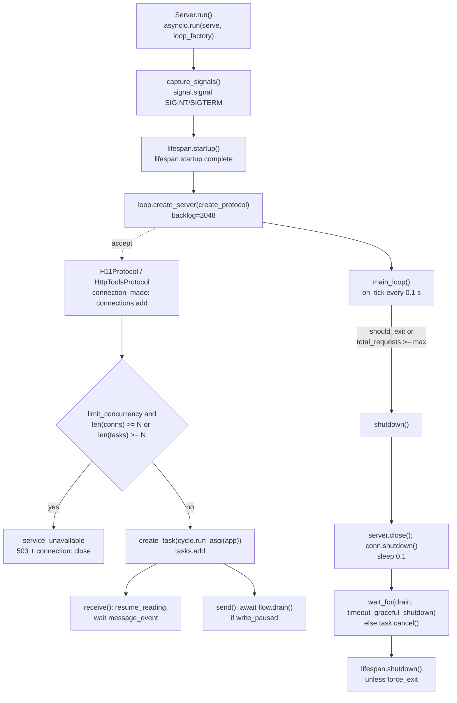

# Uvicorn (0.54.0) Internals: Server.serve(), H11Protocol vs HttpToolsProtocol, FlowControl High/Low Watermarks, and --limit-concurrency

> [!summary] Claim
> Uvicorn is one `asyncio.Protocol` instance per TCP connection plus a 100 ms supervisor tick, and its only admission control (`--limit-concurrency`) is a `>=` comparison against live connection and task counts that includes the requesting connection itself, keeps counting tasks whose clients already left, and never reaps connections that have not finished their first request head.

Part of [ASGI Servers and Async Runtime](README.md) in [API Engineering](../README.md).

## TL;DR

- Mechanism: `Server.serve()` runs lifespan startup, `loop.create_server()` with a protocol factory, a `main_loop()` that ticks every `0.1` s, and a drain-then-cancel `shutdown()`; each connection is an `H11Protocol` (pure-Python `h11`) or `HttpToolsProtocol` (`llhttp` via `httptools`) that spawns one ASGI task per request.
- Contract rule: `FlowControl` pauses socket reads when a request body buffer exceeds `HIGH_WATER_LIMIT = 65536` bytes and parks every ASGI `send()` while the transport is above its write high watermark (asyncio default `64 KiB` high and `16 KiB` low; uvloop `64 KiB` high and `16` bytes low).
- Trap: `--limit-concurrency N` rejects a request with a fixed `503 Service Unavailable` when `len(connections) >= N or len(tasks) >= N`, so `N = 1` rejects every request, abandoned tasks still count, and idle half-sent connections hold slots indefinitely because no timer is armed before the first response.
- Portability: both protocol classes behave identically for the lab's 37 checks on CPython 3.12.13, 3.13.18, 3.14.6, 3.14.10, and 3.15.2, but they differ on HTTP/1.0 framing, request-head size caps, and `Connection: close` on drain; the free-threaded 3.15t leg could not be installed here.
- When not to use it: do not use `--limit-concurrency` as your load shedder or rely on Uvicorn for slowloris defense; put a proxy with header and idle timeouts in front, and use a semaphore or queue in the app if you need graceful queuing instead of an immediate `503`.

## Mental model



`Server.run()` hands `serve()` to `asyncio.run` with the loop factory chosen by `--loop`.
`serve()` installs signal handlers with `signal.signal` so it can restore the previous handlers on exit.
It then runs lifespan startup before any socket exists, so a failing startup exits with code `3` without ever accepting a connection.
`create_server()` binds the listener and passes a factory that builds one protocol object per accepted connection, all sharing one `ServerState` (the `connections` set, the `tasks` set, `total_requests`, and `default_headers`).
Every protocol registers itself in `connections` inside `connection_made`, before any byte is parsed, which is why the admission check on the right counts the caller.
Admitted requests become tasks whose `receive()` and `send()` are the only two places where application code meets flow control.
The left column is the process lifecycle: a `0.1` s tick refreshes the `Date` header and polls `should_exit`, and shutdown drains in two phases (connections, then tasks) under one optional timeout before cancelling whatever is left.

## How it works

### Server.serve(): startup, tick, shutdown

`Server.run()` calls `asyncio_run(self.serve(sockets=sockets), loop_factory=self.config.get_loop_factory())` (uvicorn 0.54.0 uvicorn/server.py, Server.run).
On CPython 3.12 and later `asyncio_run` is plain `asyncio.run`; the `_compat` shim only backfills `loop_factory` on 3.10 and 3.11 (uvicorn 0.54.0 uvicorn/_compat.py, asyncio_run).
`--loop auto` returns uvloop's factory when `uvloop` imports and the stdlib factory otherwise (uvicorn 0.54.0 uvicorn/loops/auto.py, auto_loop_factory).

`serve()` wraps `_serve()` in `capture_signals()`, which only acts on the main thread and installs `handle_exit` for `SIGINT` and `SIGTERM` (plus `SIGBREAK` on Windows) with `signal.signal`, explicitly not `loop.add_signal_handler`, so the original handlers can be restored (uvicorn 0.54.0 uvicorn/server.py, Server.capture_signals).
After `serve()` returns, every captured signal is re-raised in LIFO order with `signal.raise_signal`, so a process stopped by `SIGTERM` still dies with the default `SIGTERM` disposition once Uvicorn has drained.
`handle_exit` sets `should_exit` on the first signal and sets `force_exit` only when a `SIGINT` arrives while `should_exit` is already set; a second `SIGTERM` does nothing extra (lab: `test_second_sigint_forces_exit_but_repeated_sigterm_does_not`).

`_serve()` loads the config if needed, instantiates `config.lifespan_class`, and calls `startup()`, then `main_loop()` unless `should_exit` is already set (a signal arrived during startup), then `shutdown()` if `started` is true (uvicorn 0.54.0 uvicorn/server.py, Server._serve).
`startup()` awaits `lifespan.startup()` first and calls `sys.exit(STARTUP_FAILURE)` with `STARTUP_FAILURE = 3` if the lifespan asked to exit (uvicorn 0.54.0 uvicorn/config.py, STARTUP_FAILURE).
`LifespanOn.startup()` treats an app that raises during lifespan as fatal only when `--lifespan on`; under the default `auto` an exception there is tolerated, while an explicit `lifespan.startup.failed` is always fatal (uvicorn 0.54.0 uvicorn/lifespan/on.py, LifespanOn.startup).
The listener comes from one of four branches: pre-bound `sockets` (Gunicorn worker, `--workers`, `--reload`), `--fd`, `--uds` (preserving existing file permissions, default `0o666`), or `host`/`port`; the `--uds` branch calls `loop.create_unix_server(create_protocol, path=config.uds, ssl=config.ssl, backlog=config.backlog)` and the other three call `loop.create_server(create_protocol, ..., ssl=config.ssl, backlog=config.backlog)` (uvicorn 0.54.0 uvicorn/server.py, Server.startup).
A bind `OSError` in the host/port branch logs the error, runs `lifespan.shutdown()`, and exits with `3`, so lifespan resources are released even when the port is taken.
`create_protocol` instantiates `config.http_protocol_class(config=..., server_state=..., app_state=self.lifespan.state, _loop=...)`; the lab's `open_connection` calls the same constructor with the same keywords.

`main_loop()` calls `on_tick(counter)` then sleeps `0.1` s in a loop, with `counter` wrapped at `864000` (one day of ticks).
`on_tick` rebuilds `server_state.default_headers` (`date` from `email.utils.formatdate(usegmt=True)` plus `config.encoded_headers`, which carries `server: uvicorn` by default) only when `counter % 10 == 0`, so the `Date` header has one-second granularity and costs nothing per request (lab: `test_on_tick_refreshes_default_headers_every_tenth_tick_and_enforces_max_requests`).
The same branch invokes `callback_notify` every `timeout_notify` seconds, which is how the Gunicorn worker heartbeat is driven (uvicorn 0.54.0 uvicorn/workers.py, UvicornWorker.callback_notify).
`on_tick` returns true when `should_exit` is set or when `total_requests >= limit_max_requests`, where `limit_max_requests` is a `functools.cached_property` equal to `limit_max_requests + random.randint(0, limit_max_requests_jitter)`, drawn once per `Server` (lab: `test_max_requests_jitter_is_drawn_once_per_server`).

`shutdown()` runs this exact sequence (uvicorn 0.54.0 uvicorn/server.py, Server.shutdown):

1. `server.close()` on every listener and `sock.close()` on every passed-in socket, so no new connection is accepted.
2. `connection.shutdown()` on every connection: idle ones (no cycle, or the cycle's response is complete) are closed now; in-flight ones get `cycle.keep_alive = False`.
3. `await asyncio.sleep(0.1)`.
4. `asyncio.wait_for(self._wait_tasks_to_complete(), timeout=self.config.timeout_graceful_shutdown)`, which polls `connections` every `0.1` s until empty, then polls `tasks` the same way, then awaits `server.wait_closed()` on each listener.
5. On `asyncio.TimeoutError`, log `Cancel %s running task(s), timeout graceful shutdown exceeded` and call `t.cancel(msg="Task cancelled, timeout graceful shutdown exceeded")` on every task.
6. `lifespan.shutdown()` unless `force_exit`.

`timeout_graceful_shutdown` defaults to `None`, so step 4 waits forever unless a second `SIGINT` sets `force_exit` or an external `SIGKILL` arrives.
CPython's `Server.wait_closed()` itself waits until the server is closed and all its connections are dropped; its docstring records that this was broken in 3.11 and earlier and still broken in 3.12.0, with the fix aimed at 3.12.1 (CPython 3.14.6 Lib/asyncio/base_events.py, Server.wait_closed).
Step 5 has a consequence the lab pins down: `RequestResponseCycle.run_asgi` wraps the app in `except BaseException`, which catches the `CancelledError`, logs `Exception in ASGI application`, and, if the response had not started, sends a `500 Internal Server Error` with `connection: close` before the transport closes (lab: `test_graceful_shutdown_timeout_cancels_inflight_task_and_client_gets_500`).
The cancellation is therefore swallowed at the task boundary, and the client sees a `500`, not a reset.
Cancellation semantics in general are covered in [[Cancellation-Semantics-CancelledError-Swallowing-and-Shielded-Cleanup]]; the Kubernetes side of the drain window is in [[Graceful-Shutdown-SIGTERM-Drain-Windows-and-Kubernetes-PreStop-Hooks]].

### Protocol selection

`Config.load()` resolves `--http` through the `HTTP_PROTOCOLS` dict, whose keys are `"auto"`, `"h11"`, `"httptools"`, and `"zttp"` and whose values are import strings; `auto` maps to `uvicorn.protocols.http.auto:AutoHTTPProtocol`, which is `HttpToolsProtocol` if `import httptools` succeeds and `H11Protocol` otherwise (uvicorn 0.54.0 uvicorn/config.py, HTTP_PROTOCOLS; uvicorn/protocols/http/auto.py).
`--http2` raises `ValueError` unless `--http zttp` is also set, and then loads `AutoZttpProtocol`; the 0.54.0 release notes call HTTP/2 "experimental and opt-in" and state that h2c upgrade and WebSockets over HTTP/2 remain unsupported (as of 2026-11).
The `zttp` package is not pinned in this workspace, so `ZttpProtocol` was not executed; the statements here come from reading `zttp_impl.py`, which is byte-identical to the 0.54.0 tag on GitHub (checked 2026-11-15).
It imports the same `FlowControl`, `HIGH_WATER_LIMIT`, and `service_unavailable`, repeats the same `limit_concurrency` expression, and increments `total_requests` in its own `on_response_complete` (uvicorn 0.54.0 uvicorn/protocols/http/zttp_impl.py, ZttpProtocol.handle_events and ZttpProtocol.on_response_complete).
No HTTP/3 protocol class exists in 0.54.0.

### H11Protocol: a sans-I/O state machine driven by events

`H11Protocol.__init__` builds `h11.Connection(h11.SERVER, max_incomplete_event_size)` where the size is `--h11-max-incomplete-event-size` or h11's `DEFAULT_MAX_INCOMPLETE_EVENT_SIZE = 16 * 1024` (h11 0.16.0 h11/_connection.py, DEFAULT_MAX_INCOMPLETE_EVENT_SIZE).
`data_received` cancels the keep-alive timer, calls `conn.receive_data(data)`, and loops on `conn.next_event()` in `handle_events` (uvicorn 0.54.0 uvicorn/protocols/http/h11_impl.py, H11Protocol.handle_events):

- `h11.RemoteProtocolError` -> `send_400_response`, which writes a `400 Bad Request` with `connection: close` and closes.
- `NEED_DATA` -> return and wait for more bytes.
- `PAUSED` -> `flow.pause_reading()`; h11 emits this when the client half of the cycle is `DONE` and bytes of a pipelined next request are already buffered, and it persists until `start_next_cycle()` (h11 0.16.0 h11/_connection.py, Connection._extract_next_receive_event; h11 docs, `PAUSED` and `start_next_cycle`; lab: `test_h11_server_reports_paused_for_a_buffered_second_request`).
- `h11.Request` -> build the scope (`spec_version` `2.3`, `path` percent-decoded with `unquote`, `state` a shallow copy of lifespan state), hand off WebSocket upgrades, run the `limit_concurrency` check, create a `RequestResponseCycle`, and start `cycle.run_asgi(app)` as a task registered in `server_state.tasks` with `add_done_callback(self.tasks.discard)`.
- `h11.Data` -> append to `cycle.body` and pause reading if `len(cycle.body) > HIGH_WATER_LIMIT`, then set `message_event`.
- `h11.EndOfMessage` -> `more_body = False`, set `message_event`.

The response path hands every ASGI message to h11 (`h11.Response`, `h11.Data`, `h11.EndOfMessage`), so h11 chooses framing: chunked for an HTTP/1.1 response without `Content-Length`, close-delimited for HTTP/1.0, and it raises `LocalProtocolError` on body-length violations.
After the final body chunk, if h11 says `MUST_CLOSE` or `cycle.keep_alive` is false, the protocol sends `ConnectionClosed` and closes the transport.
That is why a connection drained by `Server.shutdown()` under h11 closes after the response without advertising `Connection: close` in it, while httptools adds the header (lab: `test_shutdown_closes_idle_connections_and_lets_inflight_finish`).

### HttpToolsProtocol: llhttp callbacks and a hand-written response encoder

`HttpToolsProtocol` builds `httptools.HttpRequestParser(self)` and calls `set_dangerous_leniencies(lenient_data_after_close=True)` so the server can answer the first of several pipelined requests on a closing connection (uvicorn 0.54.0 uvicorn/protocols/http/httptools_impl.py, HttpToolsProtocol.__init__).
Parsing is callback-driven: `on_message_begin` creates the scope, `on_url` and `on_header` accumulate (header names lowercased, `Expect: 100-continue` noted), and `on_headers_complete` finishes the scope, runs the same `limit_concurrency` expression, and either starts the task or, if a previous cycle is still running, calls `flow.pause_reading()` and `pipeline.appendleft((cycle, app))`.
`on_response_complete` pops the next pipelined cycle with `pipeline.pop()`, so the deque is FIFO and responses leave in request order as RFC 9112 Section 9.3.2 requires (lab: `test_pipelined_requests_are_served_one_at_a_time_in_order`).
httptools' Cython layer concatenates partial header names and values into Python `bytes` (`_current_header_value += val`) until the header completes (httptools 0.9.0 httptools/parser/parser.pyx, HttpParser._on_header_value), and Uvicorn sets no cap on that, unlike h11's `16 KiB` incomplete-event cap (lab: `test_incomplete_request_head_is_capped_only_by_h11`).

The response side is Uvicorn's own encoder: a precomputed `STATUS_LINE` table for codes `100` to `599`, header names checked against `HEADER_RE` and values against `HEADER_VALUE_RE = re.compile(b"[\x00-\x08\x0a-\x1f\x7f]")`, which rejects CR and LF and raises `RuntimeError("Invalid HTTP header value.")` (the defense against CVE-2020-7695).
It tracks `Content-Length` and raises `Response content longer than Content-Length` or `Response content shorter than Content-Length` on mismatch.
If the app sent neither `Content-Length` nor `Transfer-Encoding`, it appends `transfer-encoding: chunked` for every method except `HEAD` and every status except `204` and `304`, without consulting the request's HTTP version (lab: `test_http_1_0_request_gets_chunked_framing_only_from_httptools`).
RFC 9112 Section 6.1 says "A server MUST NOT send a response containing Transfer-Encoding unless the corresponding request indicates HTTP/1.1 (or later minor revisions)", so that branch is non-conformant for HTTP/1.0 clients; h11 gets it right by falling back to close-delimited framing (RFC 9112 Section 6.3, item 8).

| Aspect | `H11Protocol` | `HttpToolsProtocol` |
| --- | --- | --- |
| Parser | `h11` 0.16.0, pure Python, sans-I/O events | `httptools` 0.9.0 over `llhttp`, C callbacks |
| Pipelining | h11 `PAUSED` -> `pause_reading`, `start_next_cycle` after response | `pipeline` deque + `pause_reading`, popped in `on_response_complete` |
| Incomplete head cap | `16384` bytes default, `--h11-max-incomplete-event-size` | none in Uvicorn (lab buffered a 32 KiB partial header without a response) |
| HTTP/1.0 response without length | close-delimited, `Connection: close` | `transfer-encoding: chunked` plus `connection: close` |
| Drained in-flight response | no `Connection: close` header, then close | `connection: close` appended, then close |
| Response framing errors | h11 `LocalProtocolError` | `RuntimeError` from Uvicorn's encoder |
| Malformed request | `400` via `RemoteProtocolError` | `400` via `HttpParserError` |

### FlowControl: the read side and the write side

`FlowControl` is 30 lines that bridge transport callbacks to ASGI awaits (simplified excerpt of uvicorn 0.54.0 uvicorn/protocols/http/flow_control.py, coverage pragmas removed):

```python
# simplified excerpt
HIGH_WATER_LIMIT = 65536


class FlowControl:
    def __init__(self, transport: asyncio.Transport) -> None:
        self._transport = transport
        self.read_paused = False
        self.write_paused = False
        self._is_writable_event = asyncio.Event()
        self._is_writable_event.set()

    async def drain(self) -> None:
        await self._is_writable_event.wait()

    def pause_reading(self) -> None:
        if not self.read_paused:
            self.read_paused = True
            self._transport.pause_reading()

    def resume_reading(self) -> None:
        if self.read_paused:
            self.read_paused = False
            self._transport.resume_reading()

    def pause_writing(self) -> None:
        if not self.write_paused:
            self.write_paused = True
            self._is_writable_event.clear()

    def resume_writing(self) -> None:
        if self.write_paused:
            self.write_paused = False
            self._is_writable_event.set()
```

Read side: `HIGH_WATER_LIMIT` is not a socket option; it is a bound on `cycle.body`, the bytes parsed but not yet returned by `receive()`.
Once that buffer is strictly above `65536` bytes, `pause_reading()` removes the socket's reader from the selector (CPython 3.14.6 Lib/asyncio/selector_events.py, _SelectorTransport.pause_reading, which calls `self._loop._remove_reader(self._sock_fd)`), so the kernel receive buffer fills and TCP flow control pushes back on the client.
The lab feeds exactly `65536` body bytes (no pause), then one more (one pause) (lab: `test_request_body_beyond_high_water_limit_pauses_reading`).
`receive()` calls `flow.resume_reading()` before it waits on `message_event`, so reading resumes the moment the app asks for more, and each `receive()` drains the whole buffer into one `http.request` message.
Because reading is paused only after the threshold is crossed, the buffer can overshoot by up to one transport read: CPython's selector transport reads up to `max_size = 256 * 1024` bytes per `recv` (CPython 3.14.6 Lib/asyncio/selector_events.py, _SelectorTransport.max_size) and uvloop uses `UV_STREAM_RECV_BUF_SIZE = 256000` (uvloop 0.23.0 uvloop/includes/consts.pxi, UV_STREAM_RECV_BUF_SIZE).

Write side: the transport, not Uvicorn, decides when to pause.
CPython's `_FlowControlMixin._maybe_pause_protocol` calls `protocol.pause_writing()` when `get_write_buffer_size() > high_water`, and `_maybe_resume_protocol` calls `resume_writing()` when the size is `<= low_water` (CPython 3.14.6 Lib/asyncio/transports.py, _FlowControlMixin._maybe_pause_protocol).
The defaults are `high = 64 * 1024` and `low = high // 4`, giving `(16384, 65536)` from `get_write_buffer_limits()`.
uvloop sets `_high_water = FLOW_CONTROL_HIGH_WATER * 1024` but `_low_water = FLOW_CONTROL_HIGH_WATER // 4` with `FLOW_CONTROL_HIGH_WATER = 64`, so its default low watermark is `16` bytes, not `16 KiB` (uvloop 0.23.0 uvloop/handles/basetransport.pyx, UVBaseTransport.__cinit__); the lab measured `(16, 65536)` on a real uvloop TCP transport (lab: `test_default_transport_write_watermarks_differ_between_loops`).
Calling `set_write_buffer_limits()` goes through `add_flowcontrol_defaults`, which computes `low = high // 4` in bytes, so the 16-byte low mark only applies to transports nobody reconfigured.
In practice a uvloop-hosted response resumes only when the user-space buffer is almost empty, which trades fewer pause and resume transitions for less overlap between computing the next chunk and sending the last.
The asyncio documentation says `pause_writing()` is called when the buffer "becomes greater than or equal to the high value", but the same page and both implementations use strictly greater (`size <= self._high_water: return`).

`RequestResponseCycle.send()` checks `if self.flow.write_paused and not self.disconnected: await self.flow.drain()` before writing anything, so one slow reader parks exactly the one task writing to it, while the event loop and every other connection keep running (lab: `test_pause_writing_parks_send_until_resume_writing`).
`connection_lost()` calls `flow.resume_writing()` and sets `cycle.disconnected = True`, so a parked `send()` wakes up, sees `disconnected`, and returns `None` without writing and without raising (lab: `test_disconnect_while_write_paused_releases_send_without_raising`).
The ASGI HTTP spec added in version 2.4 that `send()` on a closed connection should raise a server-specific `OSError` subclass; Uvicorn 0.54.0 advertises `spec_version` `2.3` in the scope and keeps the silent behavior, so an app learns about the disconnect only from `receive()` returning `http.disconnect`.
The full slow-client chain from the TCP window to `send()` is in [[End-to-End-Backpressure-TCP-Windows-ASGI-Send-Await-and-Bounded-Queues]].

### --limit-concurrency: an admission check, not a semaphore

Both HTTP/1.1 protocols run this expression once per parsed request head, after WebSocket upgrade handling and before creating the cycle (uvicorn 0.54.0 uvicorn/protocols/http/h11_impl.py, H11Protocol.handle_events; uvicorn/protocols/http/httptools_impl.py, HttpToolsProtocol.on_headers_complete):

```python
# simplified excerpt
if self.limit_concurrency is not None and (
    len(self.connections) >= self.limit_concurrency or len(self.tasks) >= self.limit_concurrency
):
    app = service_unavailable
```

`service_unavailable` is a tiny ASGI app that sends a `503` with `content-type: text/plain; charset=utf-8`, `content-length: 19`, `connection: close`, and the body `Service Unavailable`, plus the server's `date` and `server` default headers when they are populated.
It still runs as an ordinary task through `RequestResponseCycle`, so the rejection is cheap but not free, and `on_response_complete` increments `total_requests` for it, so rejected requests count toward `--limit-max-requests`.
This follows from the source, which matches the 0.54.0 tag on GitHub: `H11Protocol.handle_events` builds the `RequestResponseCycle` with `on_response=self.on_response_complete` whichever app it chose, `RequestResponseCycle.send` calls `self.on_response()` once the response is complete, `on_response_complete` increments `total_requests` before its `is_closing()` check, and `Server.on_tick` compares `total_requests >= max_requests` (uvicorn 0.54.0 uvicorn/protocols/http/h11_impl.py and uvicorn/server.py).
The lab does not exercise it with a live server.
Five properties follow from the expression and from where it sits:

1. The caller is already in `connections` because `connection_made` ran first, so at most `N - 1` other connections may exist; `--limit-concurrency 1` rejects every request on an idle server (lab: `test_limit_concurrency_counts_the_requesting_connection_itself`).
2. `tasks` keeps tasks whose clients disconnected, because `connection_lost` removes the protocol from `connections` but does not cancel the task; with `N = 2` and two abandoned slow handlers, the next client gets a `503` while zero connections are open (lab: `test_limit_concurrency_counts_tasks_whose_clients_already_left`).
3. A connection counts from `connection_made` to `connection_lost`, whether or not it has sent a byte, and no timer is armed until the first response completes, so connections that never finish a request head hold slots indefinitely (lab: `test_unfinished_request_heads_hold_concurrency_slots_with_no_timer`).
4. The check runs per request, not per connection, so an existing keep-alive connection can be admitted on its first request and rejected on its tenth, and a rejected request costs the client its connection because of `connection: close`.
5. WebSocket protocols add themselves to `connections` and their tasks to `tasks` but contain no `limit_concurrency` check, so WebSocket handshakes are never rejected by the limit while still consuming its budget; the HTTP protocol removes itself from `connections` on upgrade (uvicorn 0.54.0 uvicorn/protocols/websockets/websockets_impl.py, wsproto_impl.py, websockets_sansio_impl.py).

There is no queueing: a request over the limit is answered immediately rather than waiting for a slot, and nothing smooths bursts.
The 503 carries no `Retry-After`, although RFC 9110 Section 15.6.4 says the server "MAY send a Retry-After header field (Section 10.2.3)" to tell the client how long to wait.
The admission point also sits after `--backlog` (default `2048`, passed to `listen()`), so connections the process has not yet accepted are invisible to it.

### Keep-alive, 100-continue, and the request that never arrives

`on_response_complete` increments `total_requests`, returns if the transport is closing, cancels any old timer, arms `loop.call_later(timeout_keep_alive, timeout_keep_alive_handler)` (default `5` s), resumes reading, and starts any pipelined cycle (in httptools the timer is armed only when the pipeline is empty).
`data_received` cancels the timer on every incoming segment, and the handler closes the transport if it is not already closing (lab: `test_keep_alive_timer_is_armed_after_the_response`).
`connection_made` arms nothing, and a partially received head cancels nothing new, so the keep-alive timeout is an idle-between-requests timeout only; there is no header-read timeout and no body-read timeout in either protocol.
`100 Continue` is written lazily: `receive()` sends `HTTP/1.1 100 Continue` only on the first call, and only if the client sent `Expect: 100-continue` and the transport is open, so an app that rejects a request without reading the body never invites the upload (RFC 9110 Section 10.1.1 and Section 15.2.1).

## Numbers and limits

| Quantity | Value | Source or measurement |
| --- | --- | --- |
| Request body buffer that pauses reads | `> 65536` bytes (`HIGH_WATER_LIMIT`) | uvicorn 0.54.0 flow_control.py; lab feeds 65536 then 65537 bytes |
| asyncio transport write limits `(low, high)` | `(16384, 65536)` | CPython 3.14.6 transports.py `_set_write_buffer_limits`; measured on a real loopback transport |
| uvloop transport write limits `(low, high)` | `(16, 65536)` | uvloop 0.23.0 basetransport.pyx `__cinit__`; measured on a real loopback transport |
| Bytes read per `recv` | `262144` (asyncio), `256000` (uvloop) | CPython 3.14.6 selector_events.py `max_size`; uvloop consts.pxi `UV_STREAM_RECV_BUF_SIZE` |
| h11 incomplete event cap | `16384` bytes | h11 0.16.0 `DEFAULT_MAX_INCOMPLETE_EVENT_SIZE`; lab gets `400` for a 32 KiB partial head |
| httptools incomplete head cap | none in Uvicorn | lab: 32 KiB partial head buffered, no response; a verifier rerun over real loopback (`Server.serve()`, CPython 3.14.6, macOS 27.3 arm64) sent a 1 MiB partial head and got no response within 1 s, while `--http h11` closed the connection |
| `--limit-concurrency` | `None`; effective ceiling `N - 1` other connections | uvicorn 0.54.0 config.py; lab |
| `--backlog` | `2048` | uvicorn 0.54.0 config.py, main.py |
| `--timeout-keep-alive` | `5` s, armed only after a response | uvicorn 0.54.0 config.py; lab |
| `--timeout-graceful-shutdown` | `None` (wait forever) | uvicorn 0.54.0 config.py |
| `--timeout-notify` | `30` s | uvicorn 0.54.0 config.py |
| Supervisor tick | `0.1` s; `Date` refresh every 10 ticks; counter wraps at `864000` | uvicorn 0.54.0 server.py, main_loop and on_tick |
| Shutdown polling | `0.1` s sleep after `connection.shutdown()`, then `0.1` s polls | uvicorn 0.54.0 server.py |
| Startup failure exit code | `3` | uvicorn 0.54.0 config.py `STARTUP_FAILURE` |
| `503` body / `500` body | 19 bytes / 21 bytes | uvicorn 0.54.0 flow_control.py, httptools_impl.py |
| Lab wall time, 37 tests | `1.86` s | `uv run --frozen pytest ... -v -p no:cacheprovider` from `labs/`, CPython 3.14.6, macOS 27.3 arm64 (Darwin 27.3.0), verifier run 2026-11-15 |

The `--limit-max-requests` check runs on the tick, so a worker can serve up to `0.1` s of extra requests beyond its limit plus whatever is in flight during the drain; jitter spreads worker restarts and is drawn once per process.

## Portability

| Dimension | Behavior | Evidence |
| --- | --- | --- |
| CPython 3.12.13 | all 37 lab checks pass | `uv run --frozen --python 3.12` (3.12.13 was the newest 3.12 available here, not the matrix's 3.12.16); drafter run, not re-run at verification because matrix checks are paused |
| CPython 3.13.18 | all 37 pass | `uv run --frozen --python 3.13.18`; drafter run, not re-run at verification |
| CPython 3.14.6 and 3.14.10 | all 37 pass | workspace interpreter 3.14.6, re-run at verification 2026-11-15 (37 passed); `uv run --frozen --python 3.14.10`, drafter run |
| CPython 3.15.2 | all 37 pass | `uv run --frozen --python 3.15.2`; drafter run, not re-run at verification |
| CPython 3.15t free-threaded | not run | only 3.15.0b3t is installed, and the workspace sync failed (`psycopg-binary` has no free-threaded wheel, `aioquic` failed to build) |
| asyncio vs uvloop write watermarks | `(16384, 65536)` vs `(16, 65536)` | lab socket test on each CPython above |
| contextvars leaking out of tasks | fixed in CPython 3.15 only; 3.13 and 3.14 backports rejected; `--reset-contextvars` is Uvicorn's opt-in workaround | python/cpython issue 140947; uvicorn settings docs say uvloop is not affected |
| `--http h11` vs `httptools` | differ on HTTP/1.0 framing, head cap, drain `Connection: close` | lab parametrized tests |
| `--http zttp` (HTTP/2, experimental) | same `FlowControl`, `limit_concurrency`, and `total_requests` code by source reading; not executed | uvicorn 0.54.0 zttp_impl.py, byte-identical to the 0.54.0 tag on GitHub (checked 2026-11-15); `zttp` not pinned here |
| HTTP/3 | no protocol class in Uvicorn 0.54.0 | uvicorn 0.54.0 config.py `HTTP_PROTOCOLS` |
| Hypercorn, Granian | out of scope here | see [[Hypercorn-Internals-HTTP-2-HTTP-3-QUIC-and-AnyIO-Trio-Workers\|Hypercorn]] and [[Granian-Internals-Rust-Tokio-Hyper-Engine-and-RSGI-vs-ASGI\|Granian]] |
| Debian Trixie, Alpine musl containers | not run | the brief paused container checks; no claim made |

## Worked example

The [implementation](../labs/src/api_labs/f12_asgi_servers_and_async_runtime/uvicorn_internals.py) builds the real protocol classes from a loaded `Config` and connects them to an in-memory transport that counts `pause_reading`, `resume_reading`, and `close`, and that delivers `connection_lost` on the next loop turn after `close()`, as a selector transport does.
The [test](../labs/tests/f12_asgi_servers_and_async_runtime/test_uvicorn_internals_server_lifecycle_protocols_and_flow_control.py) drives both protocols with parametrized tests, and four socket test cases bind `127.0.0.1:0`: two run the real `Server.serve()`, and two read the default write watermarks off real server-side transports on the asyncio and uvloop loops.

The constructor call mirrors `Server.startup.create_protocol`:

```python
def open_connection(
    config: Config, state: ServerState, loop: asyncio.AbstractEventLoop
) -> Connection:
    """Mirror ``Server.startup.create_protocol`` followed by the loop's ``connection_made``."""
    # Config.load resolved --http through HTTP_PROTOCOLS to the class Server.startup instantiates.
    protocol_class = next(c for c in PROTOCOLS.values() if c is config.http_protocol_class)
    protocol = protocol_class(config=config, server_state=state, app_state={}, _loop=loop)
    transport = MemoryTransport(loop)
    transport.set_protocol(protocol)
    protocol.connection_made(transport)
    return Connection(protocol=protocol, transport=transport)
```

The test that pins the off-by-one in `--limit-concurrency`:

```python
@pytest.mark.unit
@pytest.mark.asyncio
@pytest.mark.parametrize("kind", KINDS)
@pytest.mark.parametrize(("limit", "expected"), [(1, 503), (2, 200)])
async def test_limit_concurrency_counts_the_requesting_connection_itself(
    kind: ProtocolKind, limit: int, expected: int
) -> None:
    calls: list[str] = []

    async def app(scope: Scope, receive: Any, send: Any) -> None:
        calls.append(scope["path"])
        await respond(send, b"ok")

    state = ServerState()
    config = build_config(app, kind, limit_concurrency=limit)
    conn = open_connection(config, state, asyncio.get_running_loop())
    conn.feed(get_request())
    await settle()

    assert status_codes(conn.transport.output) == [expected]
    if expected == 503:
        # A lone client on an idle server is rejected: connection_made already added it.
        assert bytes(conn.transport.output) == SERVICE_UNAVAILABLE_WIRE
        assert calls == []
        assert conn.transport.closed
    else:
        assert calls == ["/"]
        assert not conn.transport.closed
```

The abandoned-task case that turns client timeouts into a `503` storm:

```python
@pytest.mark.unit
@pytest.mark.asyncio
@pytest.mark.parametrize("kind", KINDS)
async def test_limit_concurrency_counts_tasks_whose_clients_already_left(
    kind: ProtocolKind,
) -> None:
    gate = asyncio.Event()

    async def app(scope: Scope, receive: Any, send: Any) -> None:
        await gate.wait()
        await respond(send, b"late")

    loop = asyncio.get_running_loop()
    state = ServerState()
    config = build_config(app, kind, limit_concurrency=2)
    for path in ("/a", "/b"):
        abandoned = open_connection(config, state, loop)
        abandoned.feed(get_request(path))
        await settle()
        abandoned.lose()  # client hangs up; its ASGI task keeps running

    assert (len(state.connections), len(state.tasks)) == (0, 2)
    late = open_connection(config, state, loop)
    late.feed(get_request("/late"))
    await settle()
    assert status_codes(late.transport.output) == [503]

    gate.set()  # abandoned tasks finish; their send() calls are dropped silently
    await settle()
    assert len(state.tasks) == 0
    fresh = open_connection(config, state, loop)
    fresh.feed(get_request("/fresh"))
    await settle()
    assert status_codes(fresh.transport.output) == [200]
```

Captured run, from `labs/`, on CPython 3.14.6 under macOS 27.3 arm64 (`uv run --frozen pytest tests/f12_asgi_servers_and_async_runtime/test_uvicorn_internals_server_lifecycle_protocols_and_flow_control.py -v -p no:cacheprovider`, file prefix and progress column trimmed):

```text
platform darwin -- Python 3.14.6, pytest-9.2.0, pluggy-1.7.0
test_limit_concurrency_counts_the_requesting_connection_itself[1-503-h11] PASSED
test_limit_concurrency_counts_the_requesting_connection_itself[1-503-httptools] PASSED
test_limit_concurrency_counts_the_requesting_connection_itself[2-200-h11] PASSED
test_limit_concurrency_counts_the_requesting_connection_itself[2-200-httptools] PASSED
test_limit_concurrency_counts_tasks_whose_clients_already_left[h11] PASSED
test_limit_concurrency_counts_tasks_whose_clients_already_left[httptools] PASSED
test_unfinished_request_heads_hold_concurrency_slots_with_no_timer[h11] PASSED
test_unfinished_request_heads_hold_concurrency_slots_with_no_timer[httptools] PASSED
test_request_body_beyond_high_water_limit_pauses_reading[h11] PASSED
test_request_body_beyond_high_water_limit_pauses_reading[httptools] PASSED
test_pause_writing_parks_send_until_resume_writing[h11] PASSED
test_pause_writing_parks_send_until_resume_writing[httptools] PASSED
test_disconnect_while_write_paused_releases_send_without_raising[h11] PASSED
test_disconnect_while_write_paused_releases_send_without_raising[httptools] PASSED
test_pipelined_requests_are_served_one_at_a_time_in_order[h11] PASSED
test_pipelined_requests_are_served_one_at_a_time_in_order[httptools] PASSED
test_http_1_0_request_gets_chunked_framing_only_from_httptools[h11-False] PASSED
test_http_1_0_request_gets_chunked_framing_only_from_httptools[httptools-True] PASSED
test_incomplete_request_head_is_capped_only_by_h11[h11-None-expected0] PASSED
test_incomplete_request_head_is_capped_only_by_h11[h11-65536-expected1] PASSED
test_incomplete_request_head_is_capped_only_by_h11[httptools-None-expected2] PASSED
test_keep_alive_timer_is_armed_after_the_response[0-True-h11] PASSED
test_keep_alive_timer_is_armed_after_the_response[0-True-httptools] PASSED
test_keep_alive_timer_is_armed_after_the_response[5-False-h11] PASSED
test_keep_alive_timer_is_armed_after_the_response[5-False-httptools] PASSED
test_shutdown_closes_idle_connections_and_lets_inflight_finish[h11-False] PASSED
test_shutdown_closes_idle_connections_and_lets_inflight_finish[httptools-True] PASSED
test_malformed_request_line_gets_400_and_close[h11] PASSED
test_malformed_request_line_gets_400_and_close[httptools] PASSED
test_on_tick_refreshes_default_headers_every_tenth_tick_and_enforces_max_requests PASSED
test_max_requests_jitter_is_drawn_once_per_server PASSED
test_second_sigint_forces_exit_but_repeated_sigterm_does_not PASSED
test_serve_orders_lifespan_startup_requests_and_lifespan_shutdown PASSED
test_graceful_shutdown_timeout_cancels_inflight_task_and_client_gets_500 PASSED
test_default_transport_write_watermarks_differ_between_loops[asyncio-expected0] PASSED
test_default_transport_write_watermarks_differ_between_loops[uvloop-expected1] PASSED
test_h11_server_reports_paused_for_a_buffered_second_request PASSED
 37 passed in 1.86s
```

## Pitfalls

> [!warning] `--limit-concurrency 1` is a kill switch, not a mutex
> Trigger: setting `--limit-concurrency 1` to serialize a non-thread-safe handler, or any small `N` copied from a thread-pool mental model.
> Symptom: every request on an idle server gets `503 Service Unavailable`, with `Exceeded concurrency limit.` in the log; with `N = 2` the second concurrent connection is rejected.
> Fix: budget for `N - 1` concurrent connections, and serialize critical sections with an `asyncio.Lock` or `asyncio.Semaphore` inside the app ([[Async-Synchronization-Primitives-Locks-Semaphores-and-Reentrant-Deadlocks]]).

> [!warning] Client timeouts turn into a 503 storm
> Trigger: a slow dependency makes handlers outlive the client's or load balancer's timeout, and `--limit-concurrency` is set.
> Symptom: the `503` rate climbs while open connections fall, because `connection_lost` does not cancel the task and `len(tasks) >= N` keeps rejecting; the server recovers only when the stuck handlers finish.
> Fix: put deadlines on downstream calls, watch for `http.disconnect` in long handlers (`receive()` returns it once `cycle.disconnected` is set), and alert on `len(server_state.tasks)` rather than on connection count.

> [!warning] Idle and half-sent connections exhaust the budget
> Trigger: port scanners, health checkers that connect and never send, or a slowloris client holding partial heads, against a server with `--limit-concurrency`.
> Symptom: legitimate requests get `503` while CPU is idle; the culprits never appear in the access log because they never produced a request.
> Fix: terminate client connections at a proxy with header-read and idle timeouts, and treat `--limit-concurrency` as a last-resort fuse; this is OWASP API4:2023 Unrestricted Resource Consumption (missing execution time limits and file descriptor limits).

> [!warning] `--timeout-graceful-shutdown` unset means drain forever
> Trigger: the default `None`, plus a long-poll, SSE, or stuck handler at `SIGTERM`.
> Symptom: the pod logs `Waiting for connections to close. (CTRL+C to force quit)` and is then killed by the orchestrator's `SIGKILL`, so lifespan shutdown never runs.
> Fix: set the timeout below the orchestrator's grace period so lifespan shutdown still has time; when it expires, cancelled requests that had not started a response get a `500`, not a reset (lab: `test_graceful_shutdown_timeout_cancels_inflight_task_and_client_gets_500`).

> [!warning] Chunked responses to HTTP/1.0 clients under httptools
> Trigger: an HTTP/1.0 client (some health checkers and embedded clients still speak it) hits an endpoint that streams or omits `Content-Length`, with the default `--http auto` and `httptools` installed.
> Symptom: the body arrives wrapped in chunk-size lines (`2\r\nhi\r\n0\r\n\r\n`), which an HTTP/1.0 client stores verbatim; RFC 9112 Section 6.1 forbids `Transfer-Encoding` in that response.
> Fix: set `Content-Length` on responses to HTTP/1.0 requests, or run `--http h11`, which falls back to close-delimited framing (lab: `test_http_1_0_request_gets_chunked_framing_only_from_httptools`).

> [!warning] `send()` after disconnect silently succeeds
> Trigger: a streaming endpoint that generates chunks until `send()` raises, written against the ASGI 2.4 rule.
> Symptom: under Uvicorn 0.54.0 `send()` returns normally after the client is gone, so the generator runs to completion and burns CPU and downstream quota for nobody.
> Fix: race the producer against `receive()` returning `http.disconnect`, as `StreamingResponse` does when the scope's `spec_version` is below `2.4` (starlette 1.10.0 starlette/responses.py, StreamingResponse.listen_for_disconnect) ([[ASGI-HTTP-and-Disconnect-Event-Lifecycle]]).

> [!warning] Context leaking between requests on the stdlib loop
> Trigger: lifespan or instrumentation code sets a `ContextVar` while running on the asyncio loop on CPython 3.13 or 3.14, where the cpython#140947 fix was not backported.
> Symptom: values set in one request's task are visible in other contexts; the issue's reproducer is a protocol that creates a task in `data_received` and then pauses reading, which is Uvicorn's shape.
> Fix: CPython 3.15, uvloop, or `--reset-contextvars`, which runs each request in a fresh `contextvars.Context()` (and therefore also hides context deliberately set during lifespan) ([[ASGI-State-Isolation-and-ContextVars-Across-Request-Lifecycle]]).

> [!warning] Header injection and log injection (CVE-2020-7695, CVE-2020-7694)
> Trigger: Uvicorn before `0.11.7` with attacker-influenced header values or URLs.
> Symptom: CRLF in a header value split the response (GHSA-f97h-2pfx-f59f, CWE-74), and percent-decoded ANSI escape sequences reached the access log (GHSA-33c7-2mpw-hg34).
> Fix: upgrade; in 0.54.0 the httptools encoder rejects CR and LF through `HEADER_VALUE_RE`, and h11 validates header values itself.

> [!warning] Chunked-body smuggling through h11 (CVE-2025-43859)
> Trigger: h11 before `0.16.0` behind a proxy that parses chunk boundaries differently.
> Symptom: h11 accepted any two bytes after each chunk's data instead of requiring CRLF, letting the proxy and Uvicorn disagree about request boundaries (GHSA-vqfr-h8mv-ghfj, CVSS 9.1).
> Fix: this workspace pins `h11==0.16.0`; check the lock file, not the Uvicorn version, because `--http h11` inherits h11's parser ([[HTTP-Request-Smuggling-CL-TE-and-Desync-Mechanics]]).

## Security and robustness

Threat model: Uvicorn is an HTTP/1.1 origin server with no authentication, no rate limiting, and two bounded buffers (the `65536`-byte read pause and, for h11 only, the `16384`-byte incomplete-event cap), so every other resource bound must come from the layer in front or the app.
Connection exhaustion is the cheapest attack: connections count against `--limit-concurrency` from `connection_made`, nothing times them out before their first response, and the process's file descriptor limit is the only other ceiling.
Memory exhaustion through headers is possible on the httptools path, which buffers a partial header in Python `bytes` with no Uvicorn-side cap; the h11 path answers `400` once an incomplete head passes `--h11-max-incomplete-event-size`.
Request bodies are bounded per connection by backpressure, not by size: reading pauses at `65536` buffered bytes, but an app that keeps calling `receive()` will accept an unbounded upload, so body-size limits belong in the app or the proxy (OWASP API4:2023 lists maximum upload size).
Request smuggling depends on parser agreement between hops; Uvicorn's two parsers are different code bases (`h11` in Python, `llhttp` in C), so a proxy-plus-Uvicorn pair should be tested with the parser you actually deploy, and `--http auto` silently changes parser when `httptools` is installed or removed (RFC 9112 Section 11.2).
Pipelining is handled serially and in order on both paths, so a pipelined burst cannot make the server answer out of order, but it does stall the connection on the slowest request ([[HTTP-1-1-Pipelining-and-Head-of-Line-Blocking]]).
Response integrity: CR and LF are rejected in header values on both paths, and both reject `Content-Length` mismatches before they reach the wire, which closes the response-splitting and desync classes on the server side.
Robustness on shutdown: `run_asgi` catches `BaseException`, so `KeyboardInterrupt` and `CancelledError` inside a handler become a logged error and a `500`; handlers that need cleanup must use `try/finally`, not rely on the exception propagating.
Defense in depth: a reverse proxy enforces header, idle, and body timeouts and sizes; Uvicorn enforces `--limit-concurrency` as a fuse and `--timeout-graceful-shutdown` as a drain bound; the app enforces body size, deadlines, and disconnect checks; and the orchestrator recycles workers (`--limit-max-requests` with jitter).

## The principal's view

The decision is where admission control lives, and Uvicorn's answer is "mostly not here".
`--limit-concurrency` is a per-process fuse with an off-by-one, no queue, no `Retry-After`, and blind spots for abandoned tasks, idle sockets, and WebSockets; treat it as protection against a runaway process, sized well above normal peak, and never as the mechanism that keeps p99 latency in check.
Real load shedding belongs where queueing delay is visible: a proxy or mesh with per-route concurrency and outlier detection, or an app-level semaphore that can return a structured `503` with `Retry-After`.
The organizational trade-off is ownership: putting limits in the proxy means the platform team owns them and applications cannot see them, while putting them in the app means every service reimplements them; the usual compromise is proxy-enforced connection and timeout hygiene plus app-enforced per-endpoint concurrency.
Choose the parser deliberately rather than through `--http auto`: `h11` is slower but has a head-size cap and RFC-correct HTTP/1.0 framing, `httptools` is faster and is what most production images run, and the difference is invisible until an HTTP/1.0 client or a smuggling test finds it.
Choose a different server when the requirements leave Uvicorn's design: Hypercorn for HTTP/2 and HTTP/3 in Python today, Granian when the HTTP stack should live in Rust outside the GIL, and a Gunicorn or Kubernetes process topology for multi-core use, since one Uvicorn process is one event loop ([[Multi-Process-Worker-Topologies-Gunicorn-Uvicorn-Workers-vs-Kubernetes-Replicas]]).
Choose a different language or runtime when one slow handler must not be able to occupy a concurrency slot for minutes after its client left; that is a property of cooperative scheduling plus uncancelled tasks, not a bug any flag fixes.

## Interview questions

> [!question] L5: What does `--limit-concurrency` actually count, and what does a rejected client receive?
>
> > [!success]- Answer
> > It compares `len(server_state.connections)` and `len(server_state.tasks)` against the limit with `>=`, once per request head, inside the protocol class.
> > A rejected request is answered by `service_unavailable`: `503`, `content-length: 19`, `connection: close`, body `Service Unavailable`.
> > The connection is then closed, so the client must reconnect to retry.
> >
> > Follow-up: Why does the rejection still create an asyncio task, and what counter does it increment?

> [!question] L5: Predict the output: `uvicorn app:app --limit-concurrency 1`, then one `curl http://127.0.0.1:8000/` against an otherwise idle server.
>
> > [!success]- Answer
> > `curl` prints `Service Unavailable` with status `503`, and the log shows `Exceeded concurrency limit.`.
> > `connection_made` added the connection to `server_state.connections` before the request was parsed, so `len(connections)` is `1` and `1 >= 1` is true.
> > With `--limit-concurrency 2`, the same request returns `200`.
> >
> > Follow-up: What value would you set to allow 100 concurrent keep-alive clients, and what else consumes that budget?

> [!question] L5: Where does `HIGH_WATER_LIMIT` apply, and how is it different from the transport's write watermarks?
>
> > [!success]- Answer
> > `HIGH_WATER_LIMIT = 65536` bounds the request body bytes parsed but not yet consumed by `receive()`; above it, `FlowControl.pause_reading()` stops reading the socket.
> > The write watermarks belong to the transport: asyncio calls `protocol.pause_writing()` when its user-space write buffer exceeds `64 KiB` and `resume_writing()` at or below `16 KiB` (uvloop: `16` bytes).
> > Uvicorn only reacts to those calls by making `send()` await `drain()`.
> >
> > Follow-up: Why does `receive()` call `resume_reading()` before waiting rather than after?

> [!question] L6: Debug this API: after a downstream database slowdown the service returns `503` to most requests for minutes, the load balancer shows almost no open connections to the pod, and `--limit-concurrency 200` is set; what is happening?
>
> > [!success]- Answer
> > Clients and the load balancer timed out and disconnected, which removed their protocols from `connections`, but their ASGI tasks are still waiting on the database and remain in `server_state.tasks`.
> > `len(tasks) >= 200` keeps rejecting new requests although `len(connections)` is small.
> > Fix the cause with downstream deadlines and disconnect-aware handlers, and monitor in-flight task count; raising the limit only delays the cliff.
> >
> > Follow-up: How would you make abandoned handlers stop early without cancelling work that must finish, such as a payment write?

> [!question] L6: Compare `H11Protocol` and `HttpToolsProtocol` on pipelined requests and on an HTTP/1.0 request whose response has no `Content-Length`.
>
> > [!success]- Answer
> > Both serve pipelined requests one at a time in arrival order: h11 returns `PAUSED` and Uvicorn pauses reading until `start_next_cycle()`, while httptools queues cycles in a deque and pauses reading.
> > For HTTP/1.0 without a length, h11 sends a close-delimited body, while Uvicorn's httptools encoder adds `transfer-encoding: chunked`, which RFC 9112 Section 6.1 forbids for a request that does not indicate HTTP/1.1.
> > Both close the connection afterwards.
> >
> > Follow-up: Which one bounds a request head that never completes, and with which flag?

> [!question] L6: Walk through what `Server.shutdown()` does on `SIGTERM` with `--timeout-graceful-shutdown 10` and one handler stuck forever.
>
> > [!success]- Answer
> > It closes the listeners, calls `shutdown()` on each connection (idle ones close, in-flight ones get `keep_alive = False`), and sleeps `0.1` s.
> > It then polls for connections and then tasks to drain under `wait_for(..., 10)`; after 10 s it cancels every remaining task with `Task cancelled, timeout graceful shutdown exceeded`.
> > `run_asgi` catches the `CancelledError`, logs it, and sends a `500` if no response had started, and then `lifespan.shutdown()` runs unless a second `SIGINT` forced exit.
> >
> > Follow-up: What happens with the default `None` timeout under Kubernetes, and which shutdown steps never run?

> [!question] L6: Why does Uvicorn use `signal.signal` instead of `loop.add_signal_handler`, and what does it do with the signal after shutdown?
>
> > [!success]- Answer
> > `signal.signal` returns the previous handler, so `capture_signals()` can restore it after `serve()` returns, which matters when Uvicorn is embedded or run programmatically.
> > The handler only records the signal and sets `should_exit` (or `force_exit` on a second `SIGINT`), and the 100 ms tick notices the flag.
> > After shutdown it re-raises the captured signals in LIFO order with `signal.raise_signal`, so the process exits with the conventional signal disposition.
> >
> > Follow-up: What happens if you call `Server.serve()` from a non-main thread?

> [!question] L7+: Design the admission-control and drain strategy for a fleet of Uvicorn pods behind a proxy, given Uvicorn's actual `--limit-concurrency` semantics.
>
> > [!success]- Answer
> > Put connection-level hygiene at the proxy: header-read, idle, and body timeouts, body-size limits, and per-route concurrency with fast `503` plus `Retry-After`, because Uvicorn has no pre-request timeout and its limit counts idle sockets.
> > Inside the app, cap expensive endpoints with semaphores sized from measured latency (Little's law) and enforce downstream deadlines so abandoned tasks cannot accumulate.
> > Keep `--limit-concurrency` as a fuse well above peak, set `--timeout-graceful-shutdown` below the pod grace period minus the preStop delay, and use `--limit-max-requests` with jitter to recycle workers.
> > Choose `--http` explicitly and test the proxy and server parser pair for smuggling.
> >
> > Follow-up: Which metric tells you the fuse is about to trip before users see `503`s?

> [!question] L7+: uvloop's default write low watermark is 16 bytes while asyncio's is 16 KiB. What does that change for a streaming endpoint, and would you override it?
>
> > [!success]- Answer
> > With uvloop, a paused `send()` resumes only when the user-space write buffer is nearly empty, so the app produces the next chunk while the socket may already be idle, which can cut throughput on high bandwidth-delay paths but reduces pause and resume churn.
> > With asyncio, the app resumes while 16 KiB is still queued, overlapping production with transmission.
> > Override with `transport.set_write_buffer_limits(high=...)` only after measuring, because both values sit above the kernel send buffer, which usually dominates.
> >
> > Follow-up: Where in Uvicorn would you hook a per-connection `set_write_buffer_limits` call without forking the protocol class?

## Related

Prerequisites: [[Uvloop-and-Httptools-Internals-Libuv-and-C-HTTP-Parsing]]

Next: [[Hypercorn-Internals-HTTP-2-HTTP-3-QUIC-and-AnyIO-Trio-Workers]]

See also: [[02-Programming-Languages/Python/Python-Backend-Interview-Prep/04-FastAPI]], [[02-Programming-Languages/Python/Python-Backend-Interview-Prep/17-Concurrency-in-Web-Services-and-Coding]], [[CPython-Asyncio-Event-Loop-Internals-Selectors-Ready-Queue-and-Timers]], [[End-to-End-Backpressure-TCP-Windows-ASGI-Send-Await-and-Bounded-Queues]], [[Graceful-Shutdown-SIGTERM-Drain-Windows-and-Kubernetes-PreStop-Hooks]], [[Multi-Process-Worker-Topologies-Gunicorn-Uvicorn-Workers-vs-Kubernetes-Replicas]], [[Cancellation-Semantics-CancelledError-Swallowing-and-Shielded-Cleanup]], [[Async-Synchronization-Primitives-Locks-Semaphores-and-Reentrant-Deadlocks]], [[Granian-Internals-Rust-Tokio-Hyper-Engine-and-RSGI-vs-ASGI]], [[ASGI-HTTP-and-Disconnect-Event-Lifecycle]], [[ASGI-Lifespan-Protocol-Startup-Shutdown-and-Scope-State]], [[ASGI-State-Isolation-and-ContextVars-Across-Request-Lifecycle]], [[HTTP-1-1-Framing-Keep-Alive-and-Chunked-Encoding]], [[HTTP-1-1-Pipelining-and-Head-of-Line-Blocking]], [[HTTP-Request-Smuggling-CL-TE-and-Desync-Mechanics]]

- Lab: `labs/tests/f12_asgi_servers_and_async_runtime/test_uvicorn_internals_server_lifecycle_protocols_and_flow_control.py`

## Further reading

- [uvicorn 0.54.0 flow_control.py](https://github.com/Kludex/uvicorn/blob/0.54.0/uvicorn/protocols/http/flow_control.py): `FlowControl`, `HIGH_WATER_LIMIT`, and the `503` app in 54 lines.
- [uvicorn 0.54.0 release notes](https://github.com/Kludex/uvicorn/releases/tag/0.54.0): HTTP/2 trailers and `103 Early Hints` through experimental `zttp`, and what HTTP/2 still does not support.
- [Uvicorn settings](https://uvicorn.dev/settings/): maintainer definitions of `--limit-concurrency`, `--backlog`, `--timeout-*`, `--http`, `--loop`, and `--reset-contextvars`.
- [RFC 9112](https://www.rfc-editor.org/rfc/rfc9112.html): Section 6.1 (no `Transfer-Encoding` to HTTP/1.0), Section 6.3 (body length), Section 9.3.2 (pipelined response order), Section 9.6 (tear-down), Section 11.2 (smuggling).
- [RFC 9110](https://www.rfc-editor.org/rfc/rfc9110.html): Section 15.6.4 (`503`), Section 10.2.3 (`Retry-After`), Sections 10.1.1 and 15.2.1 (`Expect` and `100 Continue`).
- [ASGI HTTP and WebSocket spec](https://asgi.readthedocs.io/en/latest/specs/www.html): the `http.request`, `http.response.*`, and `http.disconnect` messages and the 2.4 rule that `send()` on a closed connection raises.
- [asyncio Transports and Protocols](https://docs.python.org/3/library/asyncio-protocol.html): `set_write_buffer_limits`, `pause_writing`, `resume_writing`, and the protocol callback state machine Uvicorn implements.
- [h11 API](https://h11.readthedocs.io/en/latest/api.html): `PAUSED`, `start_next_cycle`, `max_incomplete_event_size`, and h11's minimal server-side pipelining.
- [GHSA-vqfr-h8mv-ghfj](https://github.com/advisories/GHSA-vqfr-h8mv-ghfj): CVE-2025-43859, h11 chunk-terminator leniency and its smuggling impact.
- [GHSA-f97h-2pfx-f59f](https://github.com/advisories/GHSA-f97h-2pfx-f59f) and [GHSA-33c7-2mpw-hg34](https://github.com/advisories/GHSA-33c7-2mpw-hg34): Uvicorn response splitting and log injection, fixed in 0.11.7.
- [cpython#140947](https://github.com/python/cpython/issues/140947): context variables leaking out of `asyncio.Task`, found in Uvicorn's protocol shape and fixed in 3.15.
- [OWASP API4:2023](https://api-security.owasp.org/editions/2023/en/0xa4-unrestricted-resource-consumption): the resource limits an API must set, most of which Uvicorn leaves to other layers.
