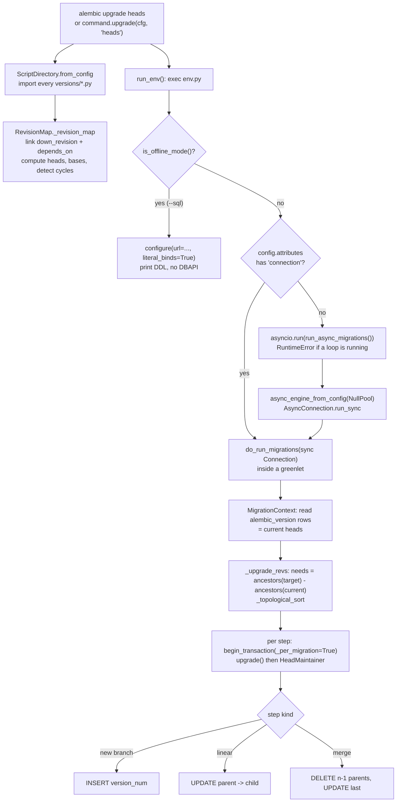

# Alembic (1.20.1) Internals: Revision DAGs, Branch Merging, Autogenerate Diff Limitations, and Async env.py Configuration

> [!summary] Claim
> Alembic's history is a DAG rebuilt from `down_revision` and `depends_on` attributes on every command, the database stores only the current heads (one `alembic_version` row per unmerged head), autogenerate is a reflection diff that cannot see renames, CHECK constraints (unless opted in), or server defaults (unless asked), and the async `env.py` is a sync migration engine driven through `asyncio.run()` plus `AsyncConnection.run_sync()`, so it crashes with `RuntimeError` when called from inside a running event loop, as the lab measures.

Part of [Database Access and Transactions for APIs](README.md) in [API Engineering](../README.md).

## TL;DR

Mechanism: `RevisionMap._revision_map` loads every migration file, links `down_revision` and `depends_on` edges, and derives heads and bases, then `HeadMaintainer` turns each migration step into `INSERT`, `UPDATE`, or `DELETE` of rows in `alembic_version` `(alembic 1.20.1 alembic/script/revision.py, RevisionMap._revision_map; alembic/runtime/migration.py, HeadMaintainer.update_to_step)`.
Contract rule: `head` must resolve to exactly one revision or the command fails with `Multiple head revisions are present`; `heads` means all of them, and `alembic merge heads` writes a revision whose `down_revision` is a tuple that joins them.
Trap: `alembic downgrade -1` from a merge point raises `Ambiguous walk`, `ScriptDirectory.get_heads()` still counts a revision that is only referenced through `depends_on`, and calling `command.upgrade()` from inside FastAPI's lifespan with the stock async template raises `asyncio.run() cannot be called from a running event loop`.
Portability: all 15 lab tests pass on CPython 3.12.13, 3.13.18, 3.14.6, 3.14.10, and 3.15.2 with SQLAlchemy 2.1.8, and on 3.14.6 with 2.0.57; the 3.15.0b3 free-threaded build segfaults when importing `sqlalchemy.ext.asyncio`.
When not to use this: do not let autogenerate output reach production unreviewed, do not run migrations from every API replica at startup, and do not use `op.execute` migrations for data backfills that need batching (see [[Zero-Downtime-Schema-Migrations-Expand-Contract-and-Lock-Timeouts]]).

## Mental model



A command first builds the whole revision graph from Python files, without touching the database, so a broken graph (a cycle, a missing parent, two heads where one is required) fails before any connection opens.
It then executes `env.py`, which is ordinary user code: offline mode renders SQL text, online mode either borrows a connection placed in `config.attributes` or creates its own `AsyncEngine` and enters it through `asyncio.run()`.
Either way the migration engine itself is synchronous, so the async template hands it a sync `Connection` facade through `AsyncConnection.run_sync`, which runs the callable in a greenlet (see [[Async-SQLAlchemy-Under-the-Hood-Greenlet-Bridge-and-MissingGreenlet]]).
`MigrationContext` reads the current heads from `alembic_version`, the revision map subtracts the ancestor set of the current heads from the ancestor set of the target, sorts the difference topologically, and each step runs `upgrade()` and then rewrites the version rows, one row per unmerged head.

## How it works

### The revision file is the graph

A migration module carries four module-level attributes, `revision`, `down_revision`, `branch_labels`, and `depends_on`, which the loader reads by importing the file (`alembic 1.20.1 alembic/script/base.py, Script._from_path`, which calls `util.load_python_file` and reads `module.revision`).
There is no central manifest: the graph is whatever the files in `version_locations` say on this checkout, which is why two developers who branch from the same head produce two heads after both merge to `main`.
`Revision.__init__` rejects a self-reference (`LoopDetected`, message `Self-loop is detected in revisions (a)`) and `Revision.verify_rev_id` rejects identifiers containing `@`, `-`, `+`, or `:` (`_revision_illegal_chars`), because those characters are syntax in targets such as `billing@head` and `-1`.
Generated identifiers come from `util.rev_id()`, which returns `uuid.uuid4().hex[-12:]` (`alembic 1.20.1 alembic/util/langhelpers.py, rev_id`): 12 lowercase hex characters, all of them random bits of the UUID because the version and variant nibbles sit earlier in the hex string.

### Building the map: heads, real heads, bases, cycles

`RevisionMap._revision_map` is a memoized property, so the map is built once per `ScriptDirectory` and every command builds a fresh one `(alembic 1.20.1 alembic/script/revision.py, RevisionMap._revision_map)`.
It walks every revision, warns `Revision %s is present more than once` on a duplicate identifier and lets the later file win, and starts with every revision in both `heads` and `_real_heads`.
For each edge it calls `add_nextrev` on the parent and then discards the parent from `heads` only if the edge is a `down_revision` edge (`_versioned_down_revisions`), but discards it from `_real_heads` for any edge including `depends_on` (`_all_down_revisions`).
That split is the source of a real production confusion: `ScriptDirectory.get_heads()` returns `heads`, while `upgrade heads` resolves the symbol `heads` through `_resolve_revision_number` to `_real_heads`, and the database ends up holding only the real heads.
Alembic 1.18.5 added `get_heads(consider_depends_on=True)` (changelog #1806) to return `_real_heads`, and the lab shows two "heads" in the script directory versus one row in the database for a `depends_on` pair.
A base is a revision whose `down_revision` is `None`; a "real" base also has no `depends_on`.
`_detect_cycles` computes the set reachable downward from the heads and intersects it with the set reachable upward from the bases; any revision outside that intersection is on a cycle and raises `CycleDetected` (`Cycle is detected in revisions (a, b)` in the lab), and the same check repeats over dependency edges for `DependencyCycleDetected`.

### Resolving identifiers

`_resolve_revision_number` splits `branch@symbol` on the first `@`, maps an unqualified `heads` to `_real_heads` (a qualified `billing@heads` instead filters `heads` to that branch's lineage), maps `head` through `get_current_head()` (which raises `MultipleHeads` when more than one head remains after filtering to the branch's lineage, if one was given), and maps `base` or `None` to the empty tuple.
A literal that is not a full key falls through to a prefix scan in `_revision_for_ident`: every key that `startswith` the argument is a candidate, more than one candidate raises `Multiple revisions start with '<prefix>'`, and zero candidates raise `No such revision or branch`.
The often-repeated "at least four characters" rule is only a hint appended to the zero-match error when the argument is shorter than four characters; the `len(x) > 3` filter in the scan applies to the stored keys, not to the argument, so the lab resolves the one-character prefix `a` to `ae1027a6acf` in a one-revision map.
Relative targets are parsed by the regex `(?:(.+?)@)?(\w+)?((?:\+|-)\d+)` (`_relative_destination`), and `_walk` takes one step at a time: walking down reads `down_revision`, and if a step has more than one candidate, it raises `RevisionError("Ambiguous walk")`.
A merge revision has two parents, so `downgrade -1` from it fails, and the fix is an absolute target (`downgrade aaaa1`).
A branch-qualified relative target does not help: `_walk` applies the branch filter only when walking up, so `downgrade aaaa1@-1` and `downgrade mmmm1@-1` from the merge point both raise `Ambiguous walk` (verifier probe, 2026-11-15, CPython 3.14.6).

### Planning an upgrade

`command.upgrade` installs a callback that calls `ScriptDirectory._upgrade_revs(destination, current_heads)`, which calls `iterate_revisions(destination, current, implicit_base=True)` `(alembic 1.20.1 alembic/command.py, upgrade; alembic/script/base.py, ScriptDirectory._upgrade_revs)`.
`_collect_upgrade_revisions` computes `required = ancestors(target) | target` and `current = ancestors(current_heads) | current_heads`, both including dependencies, and returns `needs = required - current`.
`_topological_sort` then emits the needed revisions heads-first, walking down from the targets and deferring a revision until no other pending head still has it as an ancestor, and breaks ties by the insertion order of the revision map (file listing order), so the order between independent sibling branches is deterministic but is not a contract you should rely on.
`_upgrade_revs` reverses that list, so parents run before children, into `MigrationStep.upgrade_from_script` objects; downgrade uses `_collect_downgrade_revisions`, which drops the descendants of the target's children that are currently active and raises `RangeNotAncestorError("Nothing to drop", ...)` when that set is empty and the target is not itself a current head.

### Storing heads: the version table and HeadMaintainer

The version table is `Table(version_table, MetaData(), Column("version_num", String(32), nullable=False))` plus a `PrimaryKeyConstraint` named `<version_table>_pkc` when `version_table_pk` is true `(alembic 1.20.1 alembic/ddl/impl.py, DefaultImpl.version_table_impl)`.
`MigrationContext.get_current_heads` returns `()` if the table does not exist and otherwise every `version_num` row; `run_migrations` creates the table with `checkfirst=True` when there are no heads, and on a fresh database that `CREATE TABLE` commits or rolls back with the transaction that follows it (lab: a refused `upgrade head` and a failed single-transaction run both leave no `alembic_version` table).
After every step, `HeadMaintainer.update_to_step` decides what to write `(alembic 1.20.1 alembic/runtime/migration.py, HeadMaintainer.update_to_step)`:
- `should_delete_branch` (a downgrade of a base, or of a revision whose parents are still implied by another head) emits `DELETE`.
- `should_create_branch` (an upgrade of a base, or of a revision none of whose parents is currently a head) emits `INSERT`, which is how a second row appears when two branches are upgraded.
- `should_merge_branches` (an upgrade whose parents include more than one current head) emits `DELETE` for all but one parent and an `UPDATE` of the last parent to the merge revision.
- `should_unmerge_branches` is the reverse on downgrade: `INSERT` the extra parents and `UPDATE` the merge row to one of them.
- Everything else is a plain `UPDATE alembic_version SET version_num = child WHERE version_num = parent`.
For `DELETE` and `UPDATE`, online mode checks `rowcount == 1` when the dialect `supports_sane_rowcount` and raises `Online migration expected to match one row` otherwise, which is the guard that catches two runners racing on the same row.
The values are spliced into SQL with `literal_column("'%s'" % version)`, not bound parameters, which matters only because it means a revision identifier is trusted code, not data.
`downgrade base` deletes the last row but never drops the table, and since 1.19.0 offline mode no longer emits a `DROP TABLE` either (changelog #1822, and the comment at the end of `MigrationContext.run_migrations`).

### Transactions: transactional_ddl and transaction_per_migration

Each dialect implementation declares `transactional_ddl`: `True` for PostgreSQL and SQL Server, `False` for MySQL, Oracle, SQLite, and the default implementation `(alembic 1.20.1 alembic/ddl/postgresql.py, mssql.py, mysql.py, oracle.py, sqlite.py, impl.py)`.
`MigrationContext.begin_transaction` combines that flag with `transaction_per_migration`: with transactional DDL and the default `transaction_per_migration=False`, the outer `context.begin_transaction()` in `env.py` opens one real transaction around every step; with either flag flipped, the outer call is a no-op and each step's `begin_transaction(_per_migration=True)` opens and commits its own transaction.
If the connection is already inside a transaction when `configure` runs (`_in_external_transaction`), every `begin_transaction` returns a `nullcontext()`, and the caller's transaction owns the commit.
The lab makes the difference observable: with three migrations where the third fails, the SQLite default (per-migration) leaves `alembic_version = r2` and tables `t1` and `t2`, while forcing `transactional_ddl=True` (the PostgreSQL behavior) leaves nothing at all, not even `alembic_version`.
That SQLite result depends on opening the driver with `connect_args={"autocommit": False}` (Python 3.12+ `sqlite3` transaction control, passed through by aiosqlite); SQLAlchemy 2.1.8 documents that the default legacy `sqlite3` mode does not emit `BEGIN` before DDL, so each `CREATE TABLE` would autocommit `(sqlalchemy 2.1.8 lib/sqlalchemy/dialects/sqlite/base.py, module docstring "Transactions with SQLite and the sqlite3 driver")`.
`MigrationContext.autocommit_block()` exists for statements PostgreSQL refuses inside a transaction block, such as `ALTER TYPE ... ADD VALUE`, and its docstring warns that it "unconditionally" commits the transaction preceding the block, including a caller-owned one.

### Autogenerate is a reflection diff

`compare_metadata(context, metadata)` and `alembic revision --autogenerate` both reflect the live schema through the SQLAlchemy inspector and compare it with `target_metadata`; since 1.18.0 the reflection uses the SQLAlchemy 2.0 bulk inspector methods (changelog #1771).
In 1.20.1 the comparators are plugins: `autogenerate/compare/__init__.py` registers the `schema`, `tables`, `types`, `constraints`, `server_defaults`, and `comments` modules as `alembic.autogenerate.schemas`, `.tables`, `.types`, `.constraints`, `.defaults`, and `.comments`, and registers `alembic.ext.checkconstraint_byname` outside that wildcard so it is never on by default `(alembic 1.20.1 alembic/autogenerate/compare/__init__.py)`.
`AutogenContext` selects plugins from the `autogenerate_plugins` option, defaulting to `["alembic.autogenerate.*"]` `(alembic 1.20.1 alembic/autogenerate/api.py)`; the plugin system is new in 1.18.0 (`Plugin` docstring, `.. versionadded:: 1.18.0`).
The output is a list where each entry is either a tuple such as `("add_column", schema, table, Column)` or a list of `modify_*` tuples grouped per column, which is the structure the lab's `diff_kinds` flattens.
What it can and cannot see, per the Alembic 1.20.1 autogenerate documentation and confirmed by the lab where marked:
- Detected: table and column additions and removals, nullability changes, basic index and explicitly named unique constraint changes, and basic foreign key changes.
- Detected by default: column type changes (`compare_type` defaults to `True` in `MigrationContext.__init__`); the lab sees `VARCHAR(10)` versus `String(20)` as `modify_type`.
- Opt-in: server default changes (`compare_server_default` defaults to `False`); the lab sees nothing for `DEFAULT 'new'` versus `server_default="queued"` until the flag is set, then `modify_default`.
- Opt-in: named CHECK constraints by name only, through the `alembic.ext.checkconstraint_byname` plugin (added in 1.19.0 as #508, made opt-in and renamed in 1.19.2 as #1859); the lab sees `[]` by default and `["add_constraint"]` with the plugin, and the documentation states expression changes are never detected.
- Never: table and column renames, which surface as a drop plus an add (the lab sees `["add_column", "remove_column"]` for `name` to `full_name`), anonymously named constraints, `Enum` on backends without a native enum type, and some free-standing constraints such as `PRIMARY KEY` and `EXCLUDE` ("may not be supported").
- Not yet: sequence additions and removals, which the documentation lists as "not yet implemented".
`RevisionContext._run_environment` refuses to autogenerate unless the database is at all heads, raising `Target database is not up to date.`, because a diff against an older schema would re-emit migrations that already exist `(alembic 1.20.1 alembic/autogenerate/api.py, RevisionContext._run_environment)`.
`alembic check` (1.9.0+) runs the same comparison without writing a file and raises `AutogenerateDiffsDetected` with `New upgrade operations detected: ...` when the diff is non-empty `(alembic 1.20.1 alembic/command.py, check)`, which makes it a CI gate for "models changed but nobody wrote a migration".

### Stamping and the autogenerate hooks

`alembic stamp <rev>` runs `env.py` with a `StampStep` function, so it rewrites the `alembic_version` rows to the target without executing any `upgrade()` body `(alembic 1.20.1 alembic/command.py, stamp; alembic/runtime/migration.py, StampStep.stamp_revision, which does nothing)`.
It accepts `base` (empty the table), `heads`, several revisions for several branches, and `--purge` to delete every existing row first; its `--sql` mode supports only a single starting revision, written `start:end`.
Stamp is the adoption tool for a database that was built outside Alembic and the repair tool after a manual fix, and the cost is that a wrong stamp makes the next `upgrade` skip or repeat real DDL, because the version table is the only record of what ran.
Four `EnvironmentContext.configure` options shape autogenerate output `(alembic 1.20.1 alembic/runtime/environment.py, EnvironmentContext.configure)`:
- `include_name(name, type_, parent_names)` filters reflected names before they are loaded, which is the cheap way to skip tables Alembic must not manage, and `include_schemas=True` widens reflection to every schema.
- `include_object(object, name, type_, reflected, compare_to)` filters individual objects after they are built, for rules that need the object itself.
- `process_revision_directives(context, revision, directives)` receives the one `MigrationScript` about to be written and may edit or empty it, which is the supported place to suppress empty revisions or reject forbidden operations; it runs on every `--autogenerate`, and on plain `revision` only when `revision_environment` is true.
- `render_as_batch=True` wraps table-altering operations in `batch_alter_table()`, which is how SQLite, whose `ALTER TABLE` is limited, gets a copy-and-rename migration.

### The async env.py

`alembic init -t async` writes an `env.py` whose `run_migrations_online()` calls `asyncio.run(run_async_migrations())`, which builds an `AsyncEngine` with `async_engine_from_config(..., poolclass=pool.NullPool)`, opens one connection, and calls `await connection.run_sync(do_run_migrations)` `(alembic 1.20.1 alembic/templates/async/env.py)`.
`AsyncConnection.run_sync` wraps the callable in `greenlet_spawn`, so the synchronous migration code runs in a greenlet and every driver call it makes is bridged back to the event loop `(sqlalchemy 2.1.8 lib/sqlalchemy/ext/asyncio/engine.py, AsyncConnection.run_sync)`.
`NullPool` fits a short-lived CLI process: the engine opens exactly one connection and `dispose()` closes it, so no pooled socket outlives `asyncio.run()`'s loop.
The template's offline branch passes a URL, `target_metadata`, `literal_binds=True`, and `dialect_opts={"paramstyle": "named"}`, but no engine, so `alembic upgrade --sql` needs no driver and no event loop at all.
The failure mode is calling the CLI path from code that is already inside a loop, such as a FastAPI lifespan or an `async def` test: `asyncio.run()` checks for a running loop and raises `RuntimeError: asyncio.run() cannot be called from a running event loop`, and the already-created coroutine is garbage collected with `RuntimeWarning: coroutine 'run_async_migrations' was never awaited` (observed in the lab probe on 3.14.6, and again by the verifier's probe on 2026-11-15).
The cookbook's "Programmatic API use (connection sharing) With Asyncio" recipe fixes this by placing a sync connection in `config.attributes["connection"]` from inside `await conn.run_sync(...)`, so `env.py` skips `asyncio.run()` entirely; the lab's `upgrade_in_running_loop` does exactly that.
Because that recipe uses `engine.begin()`, the whole upgrade runs in the caller's transaction (`_in_external_transaction`), so a failure in the last migration rolls back the first one too on a transactional-DDL database.

## Numbers and limits

| Quantity | Value | Source |
|---|---|---|
| Generated revision id | 12 hex chars, `uuid4().hex[-12:]`, 48 random bits | `util.rev_id`; lab checks 1000 ids match `[0-9a-f]{12}` and are distinct |
| Collision odds for `n` generated ids | about `n^2 / 2^49`, so about `1.8e-7` at `n = 10000` | birthday bound computed from 48 bits, not measured |
| Forbidden id characters | `@`, `-`, `+`, `:` | `_revision_illegal_chars` |
| `version_num` column | `String(32)`, `NOT NULL`, primary key `alembic_version_pkc` | `DefaultImpl.version_table_impl` |
| Rows in `alembic_version` | one per unmerged real head; `0` after `downgrade base` | `HeadMaintainer`; lab: 2 rows for two heads, 1 after merge, 0 at base |
| Minimum partial id length | none enforced; the four-character text is a hint on the no-match error | `_revision_for_ident`; lab resolves `a` |
| Slug length in file names | `40` characters by default (`truncate_slug_length`) | `ScriptDirectory.__init__` |
| `transactional_ddl` | `True`: PostgreSQL, SQL Server; `False`: MySQL, Oracle, SQLite, default | `alembic/ddl/*.py` class attributes |
| `compare_type` default | `True` | `MigrationContext.__init__`, `EnvironmentContext.configure` signature |
| `compare_server_default` default | `False` | same |
| CHECK constraint autogenerate | off unless `alembic.ext.checkconstraint_byname` is listed | `autogenerate/compare/__init__.py`; changelog 1.19.2 #1859 |
| Locks taken by Alembic around a run | none (no lock code in `alembic/runtime` or `alembic/command.py` in 1.20.1) | source search; serialization is the caller's job |
| SQLAlchemy floor | `SQLAlchemy>=2.0` | `alembic-1.20.1.dist-info/METADATA`; changelog 1.20.0 #1851 |
| Python floor | `>=3.10` | same METADATA `Requires-Python` |
| Release date | 1.20.1 on 2026-10-21 | Alembic changelog (as of 2026-11) |
| Lab runtime | 15 tests in `1.67s` (one run, 2026-11-15) | `uv run --frozen pytest ... -q`, CPython 3.14.6, macOS 27.3 arm64 |

## Portability

| Behavior | 3.12.13 | 3.13.18 | 3.14.6 | 3.14.10 | 3.15.2 | 3.15.0b3t | SQLAlchemy 2.0.57 on 3.14.6 |
|---|---|---|---|---|---|---|---|
| Two heads, `head` refused, `heads` writes 2 rows | pass | pass | pass | pass | pass | crash at import | pass |
| Merge collapses heads and rows | pass | pass | pass | pass | pass | crash at import | pass |
| `downgrade -1` at merge raises `Ambiguous walk` | pass | pass | pass | pass | pass | crash at import | pass |
| Base round trip keeps empty version table | pass | pass | pass | pass | pass | crash at import | pass |
| `depends_on` head mismatch | pass | pass | pass | pass | pass | crash at import | pass |
| Cycle and prefix resolution, `rev_id` shape | pass | pass | pass | pass | pass | crash at import | pass |
| Per-migration vs single-transaction rollback | pass | pass | pass | pass | pass | crash at import | pass |
| `asyncio.run` refused in a running loop, `run_sync` path works | pass | pass | pass | pass | pass | crash at import | pass |
| Autogenerate rename, type, server default, CHECK plugin | pass | pass | pass | pass | pass | crash at import | pass |

Every "pass" cell is one run of the 15-test module on that interpreter (macOS 27.3 arm64), each leg in its own locked virtual environment (`UV_PROJECT_ENVIRONMENT`), all with Alembic 1.20.1 and SQLAlchemy 2.1.8 except the last column, which used `--no-group sqlalchemy21 --group sqlalchemy20`.
The independent fact-check (2026-11-15) reran only the 3.14.6 leg (15 passed); the other columns are the drafter's single runs, not re-executed because lab checks are paused.
The matrix pins 3.12.16 and 3.15.2t; neither is installed here, so 3.12.13 and the 3.15.0b3 free-threaded build were used.
On 3.15.0b3t the locked workspace cannot install (`psycopg-binary==3.3.8` has no wheel), so a minimal environment was built (`alembic==1.20.1`, `sqlalchemy[asyncio]==2.1.8`, `aiosqlite==0.22.1`, `pytest==9.2.0`, `pytest-asyncio==1.4.1.post1`, greenlet 3.5.6 resolved), and collection segfaulted in `sqlalchemy/util/concurrency.py` line 85 (`_initialize`) while importing `sqlalchemy.ext.asyncio`, the same crash [[Connection-Pooling-Internals-QueuePool-AsyncAdaptedQueuePool-and-Pre-Ping]] recorded; it is an environment failure on a beta interpreter, not an Alembic behavior.
The lab's SQLite transaction semantics need `sqlite3` `autocommit=False`, which exists from Python 3.12, the floor of this matrix; on 3.10 and 3.11 the SQLAlchemy `BEGIN` event recipe is the documented alternative (not run here).
Database backends change two things the lab can only model: the `transactional_ddl` flag (PostgreSQL and SQL Server roll the whole run back by default, while MySQL implicitly commits any open transaction before each DDL statement and, for most of them, after it, MySQL 8.4 Section 15.3.3) and which objects reflection can see (the autogenerate documentation notes some backends do not reflect CHECK constraints, and the plugin then does nothing).
ASGI servers (Uvicorn, Hypercorn, Granian) and HTTP versions do not affect Alembic; the only server-side interaction is that a lifespan handler runs inside the server's event loop, which is exactly where the `asyncio.run()` trap fires.
Debian and Alpine container legs were not run (lab checks paused).

## Worked example

The [implementation](../labs/src/api_labs/f13_database_access_and_transactions_for_apis/alembic_internals.py) writes a throwaway Alembic project (an `env.py` that is the stock async template plus the cookbook connection-sharing branch, the stock `script.py.mako`, and one file per revision) and points it at an aiosqlite file database, so every test drives the real `command`, `ScriptDirectory`, `MigrationContext`, and `compare_metadata` code.
The [test](../labs/tests/f13_database_access_and_transactions_for_apis/test_alembic_internals_revision_graph_autogenerate_and_async_env.py) builds a diamond (`base1` with children `aaaa1` and `bbbb1`), a failing chain, a `depends_on` pair, and three live schemas for autogenerate.

The generated `env.py` (simplified excerpt of the `ENV_PY` string in the implementation; the offline branch is omitted):

```python
def do_run_migrations(connection):
    context.configure(
        connection=connection,
        target_metadata=target_metadata,
        transactional_ddl=config.attributes.get("transactional_ddl"),
        transaction_per_migration=config.attributes.get(
            "transaction_per_migration", False
        ),
    )
    with context.begin_transaction():
        context.run_migrations()


async def run_async_migrations():
    connectable = async_engine_from_config(
        config.get_section(config.config_ini_section, {}),
        prefix="sqlalchemy.",
        poolclass=pool.NullPool,
        connect_args={"autocommit": False},
    )
    async with connectable.connect() as connection:
        await connection.run_sync(do_run_migrations)
    await connectable.dispose()


def run_migrations_online():
    connection = config.attributes.get("connection")
    if connection is None:
        asyncio.run(run_async_migrations())
    else:
        do_run_migrations(connection)
```

The in-loop path (simplified excerpt of the implementation):

```python
def _upgrade_on(connection: Connection, cfg: Config, target: str) -> None:
    cfg.attributes["connection"] = connection
    command.upgrade(cfg, target)


async def upgrade_in_running_loop(cfg: Config, target: str) -> None:
    """Cookbook path: share one AsyncConnection's sync facade with command.upgrade."""
    url = cfg.get_main_option("sqlalchemy.url")
    if url is None:
        raise ValueError("sqlalchemy.url is not set")
    engine = create_async_engine(url, connect_args={"autocommit": False})
    try:
        async with engine.begin() as conn:
            await conn.run_sync(_upgrade_on, cfg, target)
    finally:
        await engine.dispose()
```

The merge and the ambiguous relative downgrade (simplified excerpt of the test module):

```python
@pytest.mark.unit
def test_merge_revision_collapses_heads_and_rows(tmp_path: Path) -> None:
    cfg = write_project(tmp_path, DIAMOND, tmp_path / "app.db")
    command.upgrade(cfg, "heads")
    merge = command.merge(cfg, "heads", message="merge", rev_id="mmmm1")
    assert merge is not None
    assert sorted(merge.down_revision or ()) == ["aaaa1", "bbbb1"]
    assert graph_summary(cfg).heads == ("mmmm1",)
    command.upgrade(cfg, "head")
    assert asyncio.run(db_state(url_of(cfg)))[0] == ("mmmm1",)


@pytest.mark.unit
def test_relative_downgrade_from_merge_point_is_ambiguous(tmp_path: Path) -> None:
    cfg = write_project(tmp_path, DIAMOND, tmp_path / "app.db")
    command.merge(cfg, "heads", message="merge", rev_id="mmmm1")
    command.upgrade(cfg, "head")
    with pytest.raises(CommandError, match="Ambiguous walk"):
        command.downgrade(cfg, "-1")
    command.downgrade(cfg, "aaaa1")
    assert asyncio.run(db_state(url_of(cfg)))[0] == ("aaaa1", "bbbb1")
```

The transaction-scope test (simplified excerpt of the test module):

```python
@pytest.mark.unit
def test_failed_migration_rolls_back_per_transaction_scope(tmp_path: Path) -> None:
    per_migration = write_project(tmp_path / "a", FAILING_CHAIN, tmp_path / "a.db")
    with pytest.raises(OperationalError, match="no such table"):
        command.upgrade(per_migration, "heads")
    assert asyncio.run(db_state(url_of(per_migration))) == (
        ("r2",),
        ("alembic_version", "t1", "t2"),
    )

    one_transaction = write_project(tmp_path / "b", FAILING_CHAIN, tmp_path / "b.db")
    one_transaction.attributes["transactional_ddl"] = True
    with pytest.raises(OperationalError, match="no such table"):
        command.upgrade(one_transaction, "heads")
    assert asyncio.run(db_state(url_of(one_transaction))) == ((), ())
```

Captured on CPython 3.14.6, macOS 27.3 arm64, from `labs/`:

```text
$ uv run --frozen pytest tests/f13_database_access_and_transactions_for_apis/test_alembic_internals_revision_graph_autogenerate_and_async_env.py -q
...............                                                          [100%]
15 passed in 1.67s
```

The first run of the module failed two tests, and both failures corrected the author's assumptions rather than the code: a three-character prefix matching two revisions raises `Multiple revisions start with 'ae1'`, not the four-character hint, and a refused `upgrade head` leaves no `alembic_version` table because its creation is rolled back with the failed run.
The other tests cover the two-head graph, the `heads` upgrade writing two rows, the base round trip, the `depends_on` mismatch (`get_heads()` returns `xxxx1` and `yyyy1`, the database holds only `yyyy1`), cycle detection, `rev_id` shape, the `asyncio.run()` refusal inside a running loop, and the three autogenerate blind spots.

## Pitfalls

> [!warning] Two merged pull requests leave two heads and break the deploy
> Trigger: two branches each add a migration on top of the same head, and both merge to `main`.
> Symptom: the deploy step runs `alembic upgrade head` and fails with `Multiple head revisions are present for given argument 'head'`; nothing is applied, because the graph is resolved before any step runs (lab: the database is untouched).
> Fix: gate CI on `len(ScriptDirectory.get_heads()) == 1` (or `alembic heads` printing one line) so the second pull request fails before merge, then add `alembic merge heads -m "merge"`; use `upgrade heads` only for histories that are meant to stay branched.

> [!warning] A relative downgrade from a merge revision
> Trigger: an operator rolls back one step with `alembic downgrade -1` right after a merge revision was applied.
> Symptom: `FAILED: Ambiguous walk`, because the merge revision has two parents and `_walk` refuses to choose.
> Fix: downgrade to an absolute revision (`alembic downgrade aaaa1`), which unmerges the version row into two rows, and write the rollback command into the runbook before the incident.

> [!warning] depends_on makes the "are we at head" check lie
> Trigger: a health check or CI step compares `ScriptDirectory.get_heads()` with `MigrationContext.get_current_heads()` in a history that uses `depends_on`.
> Symptom: permanent drift alarms, because `get_heads()` includes a revision referenced only through `depends_on`, while `upgrade heads` leaves one row for the dependent revision (lab: 2 versus 1).
> Fix: compare against `get_heads(consider_depends_on=True)` (Alembic 1.18.5+, #1806), which returns exactly what `alembic_version` holds after a full upgrade.

> [!warning] command.upgrade() inside the API's event loop
> Trigger: a FastAPI or Starlette lifespan, an `async def` pytest fixture, or a Jupyter cell calls `command.upgrade(cfg, "head")` with the stock async `env.py`.
> Symptom: `RuntimeError: asyncio.run() cannot be called from a running event loop` plus `RuntimeWarning: coroutine 'run_async_migrations' was never awaited`, and the application fails to start.
> Fix: use the cookbook connection-sharing branch (`config.attributes["connection"]` set inside `await conn.run_sync(...)`), or better, run migrations as a separate process before the API starts; never "fix" it with `nest_asyncio`, which re-enters the loop under the server.

> [!warning] Autogenerate turns a rename into data loss
> Trigger: a model renames `name` to `full_name` and the developer commits the autogenerated revision unread.
> Symptom: the migration drops `name` and adds an empty `full_name` column (lab: `["add_column", "remove_column"]`), and the data is gone on upgrade.
> Fix: edit the revision to `op.alter_column("users", "name", new_column_name="full_name")`, or better, use expand-and-contract so old and new code both work during the deploy ([[Zero-Downtime-Schema-Migrations-Expand-Contract-and-Lock-Timeouts]]).

> [!warning] Silent drift in defaults and CHECK constraints
> Trigger: someone changes a `server_default` or adds a `CheckConstraint` in the models and relies on `alembic check` to catch missing migrations.
> Symptom: `alembic check` prints `No new upgrade operations detected.` while production still has the old default and no constraint (lab: `[]` for both by default).
> Fix: set `compare_server_default=True` after testing it against your backend, name every constraint with a `MetaData(naming_convention=...)`, list `alembic.ext.checkconstraint_byname` in `autogenerate_plugins`, and remember that a changed CHECK expression under the same name is never detected.

> [!warning] Every replica runs migrations at startup
> Trigger: the container entrypoint runs `alembic upgrade head` before starting Uvicorn, and Kubernetes starts 20 pods at once.
> Symptom: concurrent runners race; Alembic takes no lock of its own, so you see duplicate-key errors on `alembic_version_pkc`, `Online migration expected to match one row` errors, or DDL lock queues that stall live traffic.
> Fix: run migrations once per release as a Kubernetes Job or pipeline step, or serialize runners in `env.py` with `SELECT pg_advisory_xact_lock(<constant>)` inside the migration transaction (PostgreSQL 18 Section 9.28.10).

> [!warning] SQLite and MySQL partial upgrades
> Trigger: migration 5 of 7 fails on a backend whose Alembic implementation has `transactional_ddl = False`.
> Symptom: migrations 1 to 4 stay committed and the version row points at 4 (lab: `r2` of 3), and on MySQL even the failed migration's earlier DDL statements stay applied, because DDL causes an implicit commit (MySQL 8.4 Section 15.3.3).
> Fix: keep one DDL change per revision on such backends, set `transaction_per_migration=True` everywhere so behavior matches across backends, and make each revision restartable.

## Security and robustness

Migrations run with DDL privileges, so the migration role should be separate from the API's runtime role, which needs only DML on its tables; an API credential that can `DROP TABLE` turns any SQL injection into schema destruction (OWASP API8:2023 Security Misconfiguration lists "improperly configured permissions on cloud services" among its conditions; separating the DDL role is the same least-privilege principle applied to the database).
`env.py` and every revision file are executed as Python on load (`util.load_python_file`), so `script_location` and `version_locations` must be write-protected exactly like application code, and a migration directory is never assembled from user uploads or downloaded at deploy time.
Revision identifiers are spliced into SQL as literals by `HeadMaintainer` (`literal_column("'%s'" % version)`), and `verify_rev_id` blocks only `@`, `-`, `+`, and `:`, so a hand-written `--rev-id` must stay within `[0-9a-z_]` and 32 characters to fit `version_num`.
`op.execute()` with f-string SQL is SQL injection waiting for a parameter; build statements with SQLAlchemy constructs or `sa.text()` with bound parameters, even in migrations.
Data migrations inside a schema revision hold locks for the whole transaction on transactional-DDL databases; bound their runtime with `lock_timeout` and `statement_timeout` and move large backfills to batched jobs ([[Zero-Downtime-Schema-Migrations-Expand-Contract-and-Lock-Timeouts]]).
Offline `--sql` output is the audit artifact: generate it in CI, attach it to the change review, and diff it against what ran, because the database stores only the current heads, not the history of what ran.
The defense in depth for drift is three layers: `alembic check` in CI against a database built from scratch, a one-head gate on every pull request, and a startup readiness check that compares `get_current_heads()` with `get_heads(consider_depends_on=True)` and refuses traffic on mismatch.

## The principal's view

The decision is who owns the schema timeline: Alembic gives you a code-reviewed DAG of migrations in the same repository as the models, which is the right default for one service that owns one database.
The organizational cost is coordination: every team that touches the schema merges into one graph, so heads diverge weekly in an active monorepo, and the one-head CI gate plus a habit of `alembic merge` is cheaper than any amount of process.
Branch labels and multiple bases (`version_locations`, `depends_on`) let several components share one database with independent histories, but each dependency edge is a cross-team release coupling, and `get_heads()` versus real heads already shows the tooling is subtle; prefer one history per database and one database per service.
Treat autogenerate as a draft generator, not a source of truth: its blind spots (renames, CHECK expressions, defaults by default, enums) are exactly the changes that lose or corrupt data, so the review of a revision file is a production change review.
Run migrations as a release step, not as part of process startup, and design every revision to be compatible with the code currently running (expand, deploy, contract); then rollback is a code deploy, and `downgrade` is reserved for development databases.
Choose differently when the schema is not yours to version: for a database shared by many services choose a schema registry or a dedicated migrations service; for declarative "desired state" workflows a diff-and-plan tool (for example Atlas or `sqldef`, not evaluated here) fits better than an imperative DAG; and for document stores the migration is in application code that reads both shapes.

## Interview questions

> [!question] L5: What do `down_revision` and `alembic_version` store, and how does Alembic decide what to run?
>
> > [!success]- Answer
> > Each revision file names its parent or parents in `down_revision`, and Alembic rebuilds the whole graph from the files on every command.
> > The database stores only the current heads, one `version_num` row per unmerged head.
> > An upgrade runs the ancestors of the target minus the ancestors of the current heads, sorted topologically, and rewrites the rows after every step.
> >
> > Follow-up: Why is there no history table of applied migrations?

> [!question] L5: What is the difference between `alembic upgrade head` and `alembic upgrade heads`?
>
> > [!success]- Answer
> > `head` must resolve to one revision and fails with `Multiple head revisions are present` when the graph has diverged.
> > `heads` targets every real head, upgrades all branches, and leaves one row per branch in `alembic_version`.
> > Use `head` in deploys so divergence fails loudly, and merge instead of switching to `heads`.
> >
> > Follow-up: What does `billing@head` mean?

> [!question] L5: Name three schema changes autogenerate does not detect by default.
>
> > [!success]- Answer
> > Column and table renames, which appear as a drop plus an add.
> > Server default changes, until `compare_server_default=True`.
> > CHECK constraints, until the `alembic.ext.checkconstraint_byname` plugin is enabled, and even then only by name.
> >
> > Follow-up: Why does an unnamed constraint make this worse?

> [!question] L6: Predict the output: after `alembic merge heads` creates `mmmm1` over `aaaa1` and `bbbb1`, you run `alembic upgrade head` and then `alembic downgrade -1`.
>
> > [!success]- Answer
> > The upgrade succeeds and leaves one row, `mmmm1`.
> > The downgrade fails with `Ambiguous walk`, because `_walk` steps down through `down_revision` and the merge revision has two parents.
> > `alembic downgrade aaaa1` works and leaves two rows, `aaaa1` and `bbbb1`, through the unmerge path of `HeadMaintainer`.
> >
> > Follow-up: Which SQL statements does the merge step emit against `alembic_version`?

> [!question] L6: Debug this API: a FastAPI service runs `command.upgrade(Config("alembic.ini"), "head")` in its lifespan handler and now fails at startup with `asyncio.run() cannot be called from a running event loop`; what happened and what is the fix?
>
> > [!success]- Answer
> > The project switched to the async `env.py` template, whose online path calls `asyncio.run()`, and the lifespan already runs inside Uvicorn's event loop.
> > The narrow fix is the cookbook pattern: open an `AsyncConnection`, call `await conn.run_sync(fn, cfg)`, and inside `fn` set `cfg.attributes["connection"]` before `command.upgrade`, so `env.py` reuses that connection.
> > The better fix is to remove migrations from startup and run them once per release, because every replica would otherwise race.
> >
> > Follow-up: Why does `run_sync` work when `asyncio.run` does not?

> [!question] L6: Your readiness probe compares `ScriptDirectory.get_heads()` with the rows in `alembic_version` and reports drift forever after a full `upgrade heads`; why?
>
> > [!success]- Answer
> > The history uses `depends_on`, and `get_heads()` keeps a revision that is referenced only as a dependency, while `upgrade heads` resolves to the dependency-aware real heads.
> > After the upgrade the dependent revision's row replaced the dependency's row, so the database holds fewer heads than `get_heads()` reports.
> > Compare with `get_heads(consider_depends_on=True)` from Alembic 1.18.5.
> >
> > Follow-up: When is `depends_on` preferable to a merge revision?

> [!question] L6: Migration 3 of 3 fails; what is left in the database on PostgreSQL versus SQLite with Alembic's defaults?
>
> > [!success]- Answer
> > PostgreSQL has `transactional_ddl = True`, so the default single outer transaction rolls everything back, including the creation of `alembic_version` on a fresh database.
> > SQLite's implementation has `transactional_ddl = False`, so each migration commits on its own and the database is left at revision 2.
> > With the legacy `sqlite3` transaction mode even the failed migration's DDL may stay, because the driver does not emit `BEGIN` before DDL.
> >
> > Follow-up: What does `autocommit_block()` do to that guarantee on PostgreSQL?

> [!question] L7+: Twenty pods each run `alembic upgrade head` on start; what can go wrong and how do you design migrations for a fleet?
>
> > [!success]- Answer
> > Alembic takes no lock, so runners race: duplicate inserts into `alembic_version`, row-count mismatches on the version `UPDATE`, or DDL waiting behind live traffic locks.
> > Run migrations exactly once per release as a Job or pipeline stage, with `lock_timeout` set and an advisory lock as a backstop.
> > Make each revision backward compatible with the running code (expand and contract), so the order of migration and rollout does not matter and rollback is a code deploy.
> >
> > Follow-up: How do you prove in CI that a revision is backward compatible?

> [!question] L7+: Should autogenerate be trusted in your organization, and what guardrails make it safe?
>
> > [!success]- Answer
> > Trust it as a draft: it reflects the live schema and diffs it with metadata, so it cannot know intent (a rename), cannot compare expressions (CHECK bodies), and skips defaults unless asked.
> > Guardrails: a one-head CI gate, `alembic check` against a database built from scratch, a naming convention so every constraint has a stable name, opt-in comparators enabled deliberately, and human review of every revision file as a production change.
> > Add `process_revision_directives` to drop empty revisions and enforce house rules on the generated operations.
> >
> > Follow-up: Which changes would you forbid autogenerate from emitting at all?

> [!question] L7+: When would you choose branch labels and multiple bases over one linear history?
>
> > [!success]- Answer
> > When one database hosts independently versioned components (a plugin system, a shared platform schema and a product schema) that release on different schedules.
> > Each branch label gives a separately addressable head (`billing@head`), and `depends_on` expresses the cross-component ordering without merging histories.
> > The cost is real complexity in tooling and in operations, so the default for one service and one database remains one linear history with merges.
> >
> > Follow-up: How would you split such a database later?

## Related

Prerequisites: [[Transactional-Outbox-Pattern-Solving-Dual-Writes-Between-DB-and-Events]]

Next: [[Zero-Downtime-Schema-Migrations-Expand-Contract-and-Lock-Timeouts]]

See also: [[02-Programming-Languages/Python/Python-Backend-Interview-Prep/06-SQL-and-SQLAlchemy]], [[SQLAlchemy-2-x-Architecture-Core-vs-ORM-Engine-and-Unified-Select]], [[Async-SQLAlchemy-Under-the-Hood-Greenlet-Bridge-and-MissingGreenlet]], [[Connection-Pooling-Internals-QueuePool-AsyncAdaptedQueuePool-and-Pre-Ping]], [[Transaction-Isolation-Levels-and-Concurrency-Anomalies-in-APIs]], [[Request-Scoped-Transaction-Patterns-Commit-As-You-Go-vs-Unit-of-Work]], [[Structuring-Large-FastAPI-Applications-APIRouter-Lifespan-and-Domain-Modules]], [[Multi-Process-Worker-Topologies-Gunicorn-Uvicorn-Workers-vs-Kubernetes-Replicas]], [[Graceful-Shutdown-SIGTERM-Drain-Windows-and-Kubernetes-PreStop-Hooks]], [[Design-First-vs-Code-First-OpenAPI-and-CI-Drift-Gates]]

- Lab: `labs/tests/f13_database_access_and_transactions_for_apis/test_alembic_internals_revision_graph_autogenerate_and_async_env.py`

## Further reading

- [Alembic: Working with Branches](https://alembic.sqlalchemy.org/en/latest/branches.html) - the maintainer's account of heads, merges, branch labels, multiple bases, and `depends_on`, with the version table rows at each step.
- [Alembic: Auto Generating Migrations](https://alembic.sqlalchemy.org/en/latest/autogenerate.html) - the authoritative list of what autogenerate detects, can optionally detect, and cannot detect, and the plugin and CHECK constraint options.
- [Alembic Cookbook](https://alembic.sqlalchemy.org/en/latest/cookbook.html) - "Using Asyncio with Alembic" and the connection-sharing recipe for running migrations from inside an event loop.
- [Alembic changelog](https://alembic.sqlalchemy.org/en/latest/changelog.html) - dated record of the 1.18 plugin system, `consider_depends_on`, the 1.19 CHECK constraint plugin, and the 1.20 SQLAlchemy 2.0 floor.
- [Alembic source at rel_1_20_1](https://github.com/sqlalchemy/alembic/tree/rel_1_20_1) - `alembic/script/revision.py` and `alembic/runtime/migration.py` are the graph and the version-row state machine described here.
- [SQLAlchemy source at rel_2_1_8](https://github.com/sqlalchemy/sqlalchemy/tree/rel_2_1_8) - `lib/sqlalchemy/dialects/sqlite/base.py` documents the `sqlite3` legacy transaction mode that decides whether SQLite DDL is transactional.
- [MySQL 8.4 Statements That Cause an Implicit Commit](https://dev.mysql.com/doc/refman/8.4/en/implicit-commit.html) - Section 15.3.3, why a non-transactional-DDL backend leaves half-applied migrations.
- [PostgreSQL 18 advisory lock functions](https://www.postgresql.org/docs/current/functions-admin.html) - Section 9.28.10, the primitive for serializing concurrent migration runners.
