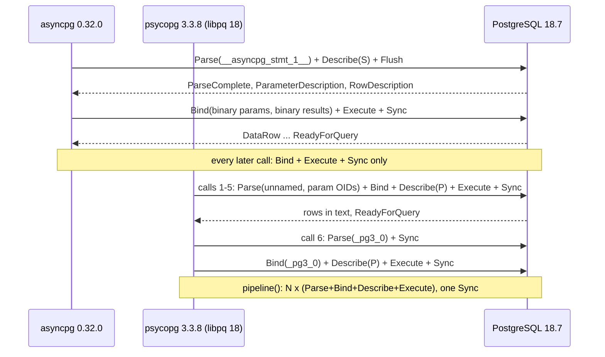

# Async PostgreSQL Drivers Compared: asyncpg (0.32.0) Binary Protocol vs psycopg 3 (3.3.8) Libpq/Pipeline Mode and Prepared Statement Caching

> [!summary] Claim
> asyncpg implements the PostgreSQL v3 protocol itself, names and caches every statement on first use, and moves every value in binary, while psycopg 3 drives libpq, sends one unnamed extended-query round trip per call until a query has run five times, and adds libpq pipeline mode; both caches are per connection and keyed client-side, so DDL, PgBouncer transaction pooling, and per-value parameter types are exactly where they break.

Part of [Database Access and Transactions for APIs](README.md) in [API Engineering](../README.md).

## TL;DR

- Mechanism: asyncpg sends `Parse` + `Describe` + `Flush` for a new query text, then `Bind` + `Execute` + `Sync` with all parameters and results in binary; psycopg 3 sends `Parse` (unnamed) + `Bind` + `Describe` + `Execute` + `Sync` in one write, with server-side binding, binary numbers, text strings, and text results by default.
- Contract rule: asyncpg caches up to 100 named `__asyncpg_stmt_N__` statements per connection from the first execution; psycopg prepares a query as `_pg3_N` on its sixth execution (`prepare_threshold=5`) and keeps at most 100; SQLAlchemy's asyncpg dialect adds its own LRU on top, which holds up to 150 before pruning to 100.
- Trap: a cached plan outlives the schema (`cached plan must not change result type` after `ALTER TABLE`), a process-wide statement counter collides behind PgBouncer transaction pooling, and psycopg types a Python `int` by magnitude, so `id = 41` and `id = 70000` produce two cache keys and two prepared statements.
- Portability: in the drafter's matrix run the lab passes on CPython 3.12.13, 3.13.18, 3.14.6, 3.14.10, and 3.15.2; the free-threaded 3.15.0b3 build cannot install the lock (`psycopg-binary==3.3.8` has no wheel) and segfaults importing `sqlalchemy.ext.asyncio`; pipeline mode needs libpq >= 14 and protocol-level statement `Close` needs libpq >= 17.
- When not to use the caches: behind PgBouncer < 1.21 in transaction mode, with per-tenant `search_path` switching, or for one-off query texts; and when latency dominates, reach for pipeline mode or `COPY` rather than a faster driver.

## Mental model



asyncpg learns a statement's parameter and column types from the server before the first bind, because it sends `Parse` with zero parameter type OIDs and asks for a statement `Describe`; that costs one extra round trip per new query text, and in exchange every later execution is a single `Bind` + `Execute` + `Sync` with binary values on both sides.
psycopg decides parameter types client-side, so it can send `Parse`, `Bind`, `Describe`, `Execute`, and `Sync` in one write and pay one round trip per call, re-parsing the unnamed statement each time.
After five executions of the same `(query, parameter OIDs)` key it spends one extra round trip on a named `Parse` and from then on skips parsing.
Inside `pipeline()` psycopg stops waiting between statements entirely and sends one `Sync` for the batch.
Every client-to-server arrow in the diagram is a frontend message batch captured on the wire by the probe described under Numbers and limits.

## How it works

### The protocol both drivers speak

Both drivers use the extended query protocol of the PostgreSQL v3 frontend/backend protocol (PostgreSQL 18 docs Section 54.2.3).
`Parse` carries the query text, optional parameter type OIDs, and a destination statement name, where an empty name selects the unnamed statement.
A named statement "lasts till the end of the current session, unless explicitly destroyed", while the unnamed statement lasts only until the next `Parse` into it or the next simple `Query` (PostgreSQL 18 docs Section 54.2.3).
`Bind` names the source statement and destination portal, carries the parameter values, and "specifies the format to use for any data returned by the query" (PostgreSQL 18 docs Section 54.2.3).
`Sync` closes the implicit transaction if no explicit `BEGIN` is open and makes the server answer `ReadyForQuery`; on any error the backend "reads and discards messages until a Sync is reached" (PostgreSQL 18 docs Section 54.2.3).
`Flush` "forces the backend to deliver any data pending in its output buffers" and, unlike `Sync`, does not close the implicit transaction (PostgreSQL 18 docs Section 54.2.3).

The byte layout is fixed by the message formats chapter (PostgreSQL 18 docs Section 54.7).
Every frontend message after startup is `Byte1` type, an `Int32` length that counts itself but not the type byte, and the body; `Sync` is therefore exactly `S 00 00 00 04`.
`Bind` carries `Int16` C and `Int16[C]` parameter format codes, where `C = 1` means one code applies to every parameter, then `Int16` value count and per value an `Int32` length (`-1` for NULL, no bytes follow) and the bytes, then `Int16` R and `Int16[R]` result format codes, with `0` meaning text and `1` binary.
Pipelining is the same protocol used without waiting: the client sends further messages before reading results, and "completion of the pipeline must be determined by counting ReadyForQuery messages" (PostgreSQL 18 docs Section 54.2.4).
If the client has not issued `BEGIN`, an implicit transaction block spans everything up to the next `Sync`, so one failure rolls back every statement since the previous `Sync` (PostgreSQL 18 docs Section 54.2.4).

The server side of prepared statements is the same for both drivers.
A prepared statement with parameters is executed with custom plans for the first five executions, after which the server builds a generic plan and keeps it if its estimated cost is not much higher than the average custom plan, unless `plan_cache_mode` forces one choice (PostgreSQL 18 docs, SQL `PREPARE`); the probe cluster reported `plan_cache_mode` = `auto`.
The server re-analyzes and re-plans a prepared statement when objects it uses undergo DDL or their statistics change, and re-parses it when `search_path` changes (PostgreSQL 18 docs, SQL `PREPARE`).
Re-planning is not always possible: if the result row type changes, PostgreSQL refuses with `cached plan must not change result type`, which the probe reproduced (see Pitfalls).

### asyncpg: its own protocol, binary everywhere

asyncpg does not use libpq.
Its protocol is Cython (`asyncpg/protocol/coreproto.pyx`, `protocol.pyx`) and its README describes it as "an efficient, clean implementation of PostgreSQL server binary protocol" (asyncpg 0.32.0 README.rst).
A query goes through `Connection._get_statement`, which looks up the per-connection cache under the key `(query, record_class, ignore_custom_codec)` and returns the cached statement on a hit (asyncpg 0.32.0 asyncpg/connection.py, Connection._get_statement).
On a miss it decides whether the statement may be cached: only if `statement_cache_size` is greater than zero and the query is no longer than `max_cacheable_statement_size`, which defaults to `1024 * 15` (asyncpg 0.32.0 asyncpg/connection.py, connect).
A cacheable statement gets a name from `_get_unique_id('stmt')`, which formats a module-global counter as `__asyncpg_{prefix}_{hex}__` (asyncpg 0.32.0 asyncpg/connection.py, Connection._get_unique_id); the counter is per process, not per connection or server, which matters behind a pooler.

The prepare step is `_prepare_and_describe`: one write holding `Parse` with `buf.write_int16(0)` parameter types, `Describe` of the statement, and `Flush`, with no `Sync` (asyncpg 0.32.0 asyncpg/protocol/coreproto.pyx, CoreProtocol._prepare_and_describe, CoreProtocol._build_parse_message).
Sending no OIDs makes the server infer every parameter type, and the `ParameterDescription` reply tells asyncpg which binary codec to use for each argument.
If a type is unknown to the codec cache, `_get_statement` runs an introspection query, registers the types, and re-prepares when that query clobbered the unnamed statement, and raises `InternalClientError` once more than five introspection rounds have run (asyncpg 0.32.0 asyncpg/connection.py, Connection._get_statement).
Execution is `_send_bind_message`: `Bind` + `Execute` + `Sync` in one packet (asyncpg 0.32.0 asyncpg/protocol/coreproto.pyx, CoreProtocol._send_bind_message).
When every codec is binary, the bind encoder writes the parameter format list as the single `Int32` `0x00010001`, which is `C = 1` followed by code `1`, and does the same for result formats (asyncpg 0.32.0 asyncpg/protocol/prepared_stmt.pyx, PreparedStatementState._encode_bind_msg).
The probe saw exactly that: `Bind(stmt='__asyncpg_stmt_1__', pfmt=[1], vals=[b'\x00\x00\x00)'], rfmt=[1])`, the int4 `41` as four big-endian bytes.

The cache itself is `_StatementCache`, an `OrderedDict` LRU: a hit calls `move_to_end`, `put` appends, and `_maybe_cleanup` pops from the front while the size exceeds `max_size`, calling `on_remove` for each evicted statement (asyncpg 0.32.0 asyncpg/connection.py, _StatementCache).
Each entry also gets a `loop.call_later(max_lifetime, ...)` timer, 300 seconds by default, that evicts it even if it is hot (asyncpg 0.32.0 asyncpg/connection.py, _StatementCache._set_entry_timeout, connect).
Eviction does not close the server statement immediately: `_maybe_gc_stmt` marks an unreferenced, uncached statement closed and queues it, and the next `_get_statement` that creates a statement sends the queued `Close` messages (asyncpg 0.32.0 asyncpg/connection.py, Connection._maybe_gc_stmt, Connection._cleanup_stmts).
The probe shows the cost: 200 distinct query texts through the default cache of 100 produced 500 client writes, two per statement plus one `Close` + `Sync` per eviction.

With `statement_cache_size=0` asyncpg uses the unnamed statement and calls `statement.mark_unprepared()`, so the next bind re-sends `Parse`; the source comment says "We always do this when stmt_cache_size is set to 0 assuming people are running PgBouncer which is mishandling implicit transactions" (asyncpg 0.32.0 asyncpg/connection.py, Connection._get_statement).
The probe confirms two `Parse` messages per call in that mode: `Parse('') + Describe + Flush`, then `Parse('') + Bind + Execute + Sync`, so every call costs two round trips.

`executemany` is a client-side pipeline: `_bind_execute_many_more` fills up to `_EXECUTE_MANY_BUF_NUM` = 4 buffers of `_EXECUTE_MANY_BUF_SIZE` = 32768 bytes with `Bind` + `Execute` pairs and appends one `Sync` only at the end of the input (asyncpg 0.32.0 asyncpg/protocol/coreproto.pyx, CoreProtocol._bind_execute_many_more; asyncpg/protocol/consts.pxi).
One `Sync` means one implicit transaction, so a failure in row 4,000 of 5,000 rolls back all of them.

Two exceptions handle schema drift.
`OutdatedSchemaCacheError` (a type changed under the codec cache) triggers `reload_schema_state()` and is re-raised; `InvalidCachedStatementError` (the server's `cached plan must not change result type`) calls `_drop_global_statement_cache()`, which clears this connection's cache or, for a pooled connection, every connection's cache in the pool, then retries once if no transaction is open and re-raises inside a transaction (asyncpg 0.32.0 asyncpg/connection.py, Connection._do_execute).
The probe saw both branches: outside a transaction the query after `ALTER TABLE ... ADD COLUMN` returned the new columns `['a', 'b']`; inside `transaction()` it raised `InvalidCachedStatementError`.

Codecs are asyncpg's, not the server's text output.
`json` and `jsonb` decode to `str` by default (asyncpg usage docs, Type Conversion), and a `dict` argument fails client-side with `DataError: invalid input for query argument $1: {'a': 1} (expected str, got dict)` (probe).
`set_type_codec(typename, *, schema='public', encoder, decoder, format='text')` replaces a codec per connection, rejects domains and non-tuple composite codecs, and calls `_drop_local_statement_cache()` because existing statements were bound to the old codec (asyncpg 0.32.0 asyncpg/connection.py, Connection.set_type_codec); the probe saw one `Close` + `Sync` for every statement that had been cached (nine of them), sent right after the `Parse` of the next new statement.

### psycopg 3: libpq, client-side typing, and a threshold

psycopg 3 wraps libpq; `psycopg.pq.__impl__` reports `binary` for the `psycopg-binary` wheel, which bundles libpq `180006`, and `python` for the pure package on the system libpq (`180007` from Homebrew `libpq` 18.7 here).
The async connection is libpq in non-blocking mode: each operation is a generator yielding wait states, and `wait_async` turns them into `loop.add_reader` and `loop.add_writer` callbacks on the libpq socket (psycopg 3.3.8 psycopg/waiting.py, wait_async).
On Windows `AsyncConnection.connect` raises `InterfaceError` when the running loop is a `ProactorEventLoop` and asks for a selector-based loop instead (psycopg 3.3.8 psycopg/connection_async.py, AsyncConnection.connect).

Binding is server-side.
`PostgresQuery.convert` rewrites `%s` placeholders to `$1`, `$2`, and dumps each value with the adapter chosen for its Python type; the `types` tuple of OIDs and the `formats` list go into `Parse` and `Bind` (psycopg 3.3.8 psycopg/_queries.py, PostgresQuery.convert, PostgresQuery.dump).
With the default `%s` (`PyFormat.AUTO`) the lab observes binary for numbers and booleans and text with OID `0` (server infers) for `str`, and `Jsonb` defaults to text with OID `3802`.
A Python `int` is typed by its magnitude: `IntDumper.upgrade` returns an int2 dumper for `-2**15 <= v < 2**15`, int4 up to `2**31`, int8 up to `2**63`, and numeric beyond (psycopg 3.3.8 psycopg/types/numeric.py, IntDumper.upgrade); the lab asserts OIDs 21, 23, 20, and 1700 for `41`, `70000`, `2**40`, and `2**70`.
Results come back as text unless `binary=True` is passed to `execute()` or set on the cursor (psycopg 3.3.8 psycopg/_cursor_base.py, BaseCursor._execute_send).
`_execute_send` uses the simple `Query` message only when there are no parameters and text results, because simple query allows several statements in one string; otherwise it calls `send_query_params`, which is libpq's unnamed `Parse` + `Bind` + `Describe` + `Execute` + `Sync` (psycopg 3.3.8 psycopg/_cursor_base.py, BaseCursor._execute_send).
In the default non-autocommit mode the first statement of each transaction is preceded by a simple `Query('BEGIN')`, a separate round trip that the probe captured.

Preparation is decided by `PrepareManager`, keyed by `(query bytes, parameter OIDs)` (psycopg 3.3.8 psycopg/_preparing.py, PrepareManager.key).
`get()` returns `Prepare.NO` while the stored count is below `prepare_threshold` (default 5), `Prepare.SHOULD` with a new name `_pg3_{n}` when the count reaches it, and `Prepare.YES` with the stored name afterwards; `prepare=True` forces `SHOULD` and `prepare=False` or `prepare_threshold=None` forces `NO` (psycopg 3.3.8 psycopg/_preparing.py, PrepareManager.get).
Because the count is incremented after each execution, the sixth execution is the one that prepares; the lab and the probe both show five unnamed executions, then `Parse(name='_pg3_0') + Sync`, then `Bind(stmt='_pg3_0')`.
On `SHOULD` outside a pipeline the cursor sends the named `Parse` and waits for its result before the `Bind`, which is the extra round trip (psycopg 3.3.8 psycopg/_cursor_base.py, BaseCursor._maybe_prepare_gen).
`executemany` passes `prepare=True`, so the probe's three-row `executemany` prepared `_pg3_1` on the first row.
`validate()` drops the entry if the result is not exactly one `COMMAND_OK` or `TUPLES_OK` result, and otherwise `_rotate()` evicts the least recently used name once more than `prepared_max` (default 100) are held, queueing it for deallocation (psycopg 3.3.8 psycopg/_preparing.py, PrepareManager.validate, PrepareManager._rotate).
`_should_discard` runs only when a statement is prepared or about to be, and matches the command status of every `COMMAND_OK` result against `^(?:DROP|ALTER|ROLLBACK|DISCARD ALL|DEALLOCATE ALL)\b`; a match clears every name and queues `None`, meaning `DEALLOCATE ALL`, because "the same object may get recreated and postgres would fail internal lookups" (psycopg 3.3.8 psycopg/_preparing.py, PrepareManager._should_discard).
`Connection.rollback()` also sends `ROLLBACK` and clears the whole cache, but only when a transaction is open; on an idle autocommit connection it returns before touching the cache (psycopg 3.3.8 psycopg/_connection_base.py, BaseConnection._rollback_gen).
`_deallocate` uses the protocol-level `Close` through `PQsendClosePrepared` when libpq has it (libpq >= 17, `capabilities.has_send_close_prepared()`), and the SQL `DEALLOCATE name` otherwise; its docstring notes that PgBouncer supports protocol `Close` from 1.21 and `DEALLOCATE ALL` from 1.22 but not `DEALLOCATE name` (psycopg 3.3.8 psycopg/_connection_base.py, BaseConnection._deallocate).
Separately from preparation, the `%s` to `$n` conversion is memoized in an `lru_cache` only for queries up to `MAX_CACHED_STATEMENT_LENGTH` = 4096 bytes with at most `MAX_CACHED_STATEMENT_PARAMS` = 50 parameters (psycopg 3.3.8 psycopg/_queries.py).

### psycopg pipeline mode

`conn.pipeline()` calls `enter_pipeline_mode()` on the libpq connection, queues each `send_query_params` call in `command_queue` and each pending cursor in `result_queue`, and syncs on `Pipeline.sync()`, on `commit()` and `rollback()`, and on block exit (psycopg 3.3.8 psycopg/_pipeline_base.py, BasePipeline._enter_gen, BasePipeline._sync_gen, BasePipeline._exit_gen; psycopg pipeline docs).
Inside a pipeline psycopg always uses `PQsendQueryParams`, never the simple protocol, and multiple statements in one string are rejected (psycopg 3.3.8 psycopg/_cursor_base.py, BaseCursor._execute_send; libpq docs Section 32.5.1).
The probe's three inserts went out as three `Parse` + `Bind` + `Describe` + `Execute` groups followed by one `Sync` and a `Flush`.
libpq recommends non-blocking mode for pipelines because a blocking client can deadlock: it blocks sending while the server blocks sending results the client is not reading (libpq docs Section 32.5.1 and its footnote); psycopg's async connection is non-blocking by construction.
After an error the server skips commands until the next `Sync` and libpq reports `PGRES_PIPELINE_ABORTED` for each (libpq docs Section 32.5.1.3); psycopg raises the first real error and `PipelineAborted` for the skipped ones (psycopg pipeline docs).
libpq's own example of the payoff: 100 statements at 300 ms round-trip time cost 30 s without pipelining and as little as 0.3 s with it (libpq docs Section 32.5.3).

### SQLAlchemy 2.1.8 on top of each driver

The asyncpg dialect "makes use of `asyncpg.connection.prepare()` for all statements" and caches the prepared statement objects per DBAPI connection (SQLAlchemy 2.1.8 lib/sqlalchemy/dialects/postgresql/asyncpg.py, module docs).
`AsyncAdapt_asyncpg_connection._prepare` looks up `util.LRUCache(prepared_statement_cache_size)`, default 100, and on a miss calls `self._connection.prepare(operation, name=self._prepared_statement_name_func())` (SQLAlchemy 2.1.8 lib/sqlalchemy/dialects/postgresql/asyncpg.py, AsyncAdapt_asyncpg_connection._prepare).
The default name function returns `None`, and asyncpg's `_prepare` turns `name=None` into `named=self._stmt_cache_enabled`, so with asyncpg's cache enabled every SQLAlchemy statement becomes a named `__asyncpg_stmt_N__` that bypasses asyncpg's own cache (`use_cache=False`) and lives in SQLAlchemy's (asyncpg 0.32.0 asyncpg/connection.py, Connection._prepare).
`LRUCache` prunes only when its size exceeds `capacity + capacity * threshold` with `threshold=0.5`, and then keeps the `capacity` most recently used (SQLAlchemy 2.1.8 lib/sqlalchemy/util/_collections.py, LRUCache._manage_size), so the default holds up to 150 named statements per connection; the lab shows a capacity-2 cache holding three.
`prepared_statement_cache_size` is a DBAPI argument parsed from the URL query string and coerced to `int` in `create_connect_args`; it is not asyncpg's `statement_cache_size`, which stays at 100 unless passed in `connect_args` (SQLAlchemy 2.1.8 lib/sqlalchemy/dialects/postgresql/asyncpg.py, PGDialect_asyncpg.create_connect_args, AsyncAdapt_asyncpg_dbapi.connect).
Cache entries carry a timestamp; DDL executed through the dialect (`pre_exec` with `isddl`) and `InvalidCachedStatementError` or `InternalServerError` (`handle_dbapi_exception`) bump `_invalidate_schema_cache_asof`, and the next `_prepare` on any connection calls `reload_schema_state()` and re-prepares entries older than that timestamp (SQLAlchemy 2.1.8 lib/sqlalchemy/dialects/postgresql/asyncpg.py, PGExecutionContext_asyncpg, AsyncAdapt_asyncpg_connection._check_type_cache_invalidation).
That invalidation is process-local, which the dialect documentation states directly: DDL from another process still surfaces as `InvalidCachedStatementError`, and the dialect "cannot prevent them from being raised in the first place" (SQLAlchemy 2.1.8 lib/sqlalchemy/dialects/postgresql/asyncpg.py, module docs).
On every new connection `on_connect` registers binary `json` and `jsonb` codecs in schema `pg_catalog`; the `jsonb` encoder prepends `b"\x01"`, the jsonb binary format version byte, and the decoder strips it and calls `json_deserializer` or `json.loads` (SQLAlchemy 2.1.8 lib/sqlalchemy/dialects/postgresql/asyncpg.py, PGDialect_asyncpg.setup_asyncpg_jsonb_codec).

The psycopg dialect (`create_async_engine("postgresql+psycopg://...")` selects `PGDialectAsync_psycopg`) does not cache statements itself and leaves preparation to psycopg's `PrepareManager`.
Its constructor builds one `AdaptersMap` derived from `psycopg.adapters`, applies `set_json_loads` and `set_json_dumps` to that map when `json_deserializer` or `json_serializer` is given, and passes it to every `connect()` as `context` (SQLAlchemy 2.1.8 lib/sqlalchemy/dialects/postgresql/psycopg.py, PGDialect_psycopg.__init__, PGDialect_psycopg.create_connect_args).
`set_json_loads` with a context registers loader subclasses only in that map, so the custom loader is scoped to the engine and the global `psycopg.adapters` are untouched (psycopg 3.3.8 psycopg/types/json.py, set_json_loads); the lab proves both halves.
`JsonbBinaryDumper` emits `b"\x01" + json`, and `JsonbBinaryLoader` raises `DataError("unknown jsonb binary format: ...")` for any other first byte (psycopg 3.3.8 psycopg/types/json.py).

## Numbers and limits

| Quantity | Value | Source |
| --- | --- | --- |
| asyncpg `statement_cache_size` default | `100` statements per connection | asyncpg 0.32.0 asyncpg/connection.py, `connect` |
| asyncpg `max_cached_statement_lifetime` default | `300` s, `0` = forever | same |
| asyncpg `max_cacheable_statement_size` default | `1024 * 15` = 15360 characters of query text | same |
| asyncpg `executemany` write batch | 4 buffers x 32768 bytes of `Bind`/`Execute` pairs, one `Sync` at the end | asyncpg 0.32.0 asyncpg/protocol/consts.pxi |
| asyncpg type introspection retries | more than 5 raises `InternalClientError` | asyncpg 0.32.0 asyncpg/connection.py, `_get_statement` |
| psycopg `prepare_threshold` default | `5`: the 6th execution prepares | psycopg 3.3.8 psycopg/_preparing.py; lab and probe |
| psycopg `prepared_max` default | `100`, LRU deallocation beyond it | same |
| psycopg query-conversion cache bound | `4096` bytes, `50` parameters | psycopg 3.3.8 psycopg/_queries.py |
| SQLAlchemy asyncpg `prepared_statement_cache_size` | `100`, prunes only above `150` | SQLAlchemy 2.1.8 asyncpg.py and util/_collections.py; lab |
| PostgreSQL custom-plan executions before generic plan is considered | `5` | PostgreSQL 18 docs, SQL `PREPARE` |
| libpq version for pipeline mode | PostgreSQL 14 libpq, any v3 server | libpq docs Section 32.5 |
| libpq version for `PQsendClosePrepared` with PgBouncer | 17 | psycopg prepare docs (as of 2026-11) |
| PgBouncer protocol-level prepared statements | added in 1.21.0 (2023-10-16); `DEALLOCATE ALL`/`DISCARD ALL` in 1.22.0; `max_prepared_statements` default `200` since 1.24.0 | PgBouncer changelog and config docs (as of 2026-11) |
| libpq example: 100 statements at 300 ms RTT | 30 s serial vs about 0.3 s pipelined | libpq docs Section 32.5.3 |
| asyncpg vendor claim | "on average, 5x faster than psycopg3", geometric mean, June 2023 | asyncpg 0.32.0 README.rst (not reproduced here, see below) |

Measured rows below come from throwaway probe scripts (not part of the lab) against a temporary PostgreSQL 18.7 (Homebrew) cluster on `127.0.0.1` TCP with `trust` auth and TLS off, re-run once each by the fact-check on 2026-11-15 from `labs/` (`uv run --frozen python <probe>.py`) with CPython 3.14.6, asyncpg 0.32.0, psycopg 3.3.8 (`binary`, libpq 18.6), on an Apple M3 Pro, macOS 27.3 (`uname -r` = `27.3.0`).
The latency probe adds 1 ms to every client-to-server write with a forwarding proxy, so each round trip costs at least 1 ms, and counts the writes.

| Workload, 200 statements, +1 ms per client write | Total | Per statement | Client writes |
| --- | --- | --- | --- |
| asyncpg, one cached statement | 311 ms | 1.56 ms | 201 |
| asyncpg, 200 distinct query texts (cache 100) | 799 ms | 3.99 ms | 500 |
| psycopg autocommit, one statement | 321 ms | 1.61 ms | 201 |
| psycopg autocommit, 200 distinct texts | 322 ms | 1.61 ms | 200 |
| psycopg non-autocommit, `execute` + `commit` | 958 ms | 4.79 ms | 601 |
| psycopg `pipeline()` | 15 ms | 0.08 ms | 13 |

| Workload on loopback, no added latency (psycopg in autocommit) | Median of 5 |
| --- | --- |
| 5000 sequential `select $1::int4`, asyncpg `fetchval` | 244.5 ms |
| same, psycopg `execute` + `fetchone` (prepared after 5) | 242.5 ms |
| same, psycopg `prepare_threshold=None` | 265.0 ms |
| 5000 selects in one psycopg `pipeline()` | 249.9 ms |
| 5000-row insert (`int4, text, float8, bool, int8`), asyncpg `executemany` | 11.5 ms |
| same, psycopg `executemany` | 196.1 ms |
| same, asyncpg `copy_records_to_table` | 4.3 ms |
| same, psycopg `copy` + `write_row` | 4.2 ms |
| fetch 20000 rows x 5 columns (`int4, text, numeric, bool, int8`), asyncpg `fetch` | 8.4 ms |
| same, psycopg text results | 9.2 ms |
| same, psycopg `binary=True` | 13.3 ms |

Read the two tables together.
On loopback, where a round trip costs tens of microseconds, the drivers were within 1 percent of each other for single-row statements (244.5 ms vs 242.5 ms per 5000), and pipelining bought nothing because the client CPU, not the network, is the bottleneck there, so the README's 5x average is workload-specific and was not reproduced on this workload.
Binary results are not automatically faster either: with a `numeric` column in the row, psycopg's `binary=True` fetch was slower than text (13.3 ms vs 9.2 ms).
Once a round trip costs a millisecond, round-trip count dominates everything: non-autocommit psycopg pays three round trips per request (`BEGIN`, the statement, `COMMIT`), asyncpg pays two per new query text plus eviction `Close` traffic, and pipelining collapses 200 round trips into 13 writes.
The large measured gap is bulk insert through `executemany` (196.1 ms vs 11.5 ms), and `COPY` erases it for both drivers (4.3 ms and 4.2 ms).
The probe printed, among other lines:

```text
asyncpg pg_prepared_statements: ['__asyncpg_stmt_1__', '__asyncpg_stmt_2__', '__asyncpg_stmt_3__', '__asyncpg_stmt_4__']
psycopg pg_prepared_statements: ['_pg3_0']
rows committed after failed pipeline (autocommit) -> 0
psycopg autocommit after ALTER attempt 3 -> FeatureNotSupported | cached plan must not change result type
psycopg tx after ALTER attempt 1 -> FeatureNotSupported | cached plan must not change result type
psycopg tx after ALTER attempt 2 -> ok
asyncpg after ALTER, no transaction -> ok, columns ['a', 'b']
asyncpg after ALTER, in transaction -> InvalidCachedStatementError | cached statement plan is invalid due to a database schema or
```

## Portability

| Dimension | Behavior | Evidence |
| --- | --- | --- |
| CPython `3.12.13` (the matrix's `3.12.16` is not installed here) | 27 passed | lab, drafter's run, `uv run --frozen --python 3.12.13` with a separate `UV_PROJECT_ENVIRONMENT`; not re-run in the fact-check (lab matrix paused 2026-11-11) |
| CPython `3.13.18` | 27 passed | lab, drafter's run, `uv run --frozen --python 3.13.18`; not re-run in the fact-check |
| CPython `3.14.6` (workspace `.venv`) and `3.14.10` | 27 passed on each | lab; 3.14.6 re-run by the fact-check on 2026-11-15, 3.14.10 drafter's run only |
| CPython `3.15.2` (Homebrew) | 27 passed | lab, drafter's run, `uv run --frozen --python /opt/homebrew/bin/python3.15`; not re-run in the fact-check |
| CPython `3.15.0b3` free-threaded (the matrix's `3.15.2t` is not installed here) | The lock cannot install: `psycopg-binary==3.3.8` has no wheel for it; with pure `psycopg==3.3.8` on system libpq 18.7, collection segfaults in `sqlalchemy/util/concurrency.py` line 85 (`_initialize`) while importing `sqlalchemy.ext.asyncio` | lab, drafter's run, `uv run --python 3.15.0b3+freethreaded` and `uv run --no-project` with the pinned packages; not re-run in the fact-check |
| Debian Trixie and Alpine (musl) containers | Not run | none |
| asyncpg 0.32.0 | Own Cython protocol, no libpq; binary formats for built-in types; `json`/`jsonb` decode to `str` | source read; probe |
| psycopg 3.3.8 `binary` vs `python` implementation | Same Python-level adapters and `PrepareManager`; `binary` bundles libpq 18.6, `python` uses the system libpq | `psycopg.pq.__impl__` and `pq.version()` printed on 3.14.6 (`binary 180006`, re-checked 2026-11-15) and 3.15.0b3t (drafter's run) |
| psycopg pipeline mode | Needs libpq >= 14 (`capabilities.has_pipeline()` true here) | libpq docs Section 32.5; probe |
| psycopg statement `Close` vs `DEALLOCATE` | `PQsendClosePrepared` with libpq >= 17, SQL `DEALLOCATE` otherwise | psycopg 3.3.8 `_connection_base.py`; `has_send_close_prepared()` true here |
| psycopg async on Windows | `ProactorEventLoop` rejected with `InterfaceError`; use a selector loop | psycopg 3.3.8 `connection_async.py`; not run on Windows |
| SQLAlchemy 2.1.8 vs 2.0.57 | Only 2.1.8 was run; the 2.0 leg was not run for this note | lab (2.1.8 only) |
| PostgreSQL server | 18.7 probed; protocol behavior cited is the v3 protocol | probe; PostgreSQL 18 docs Chapter 54 |
| PgBouncer transaction pooling | Not run (not installed); named statements need PgBouncer >= 1.21 with `max_prepared_statements` > 0 | PgBouncer config docs and changelog |
| ASGI servers (Uvicorn, Hypercorn, Granian) and HTTP versions | Not applicable: driver behavior is independent of the HTTP server and protocol; only the event loop matters | design of both drivers (asyncio transports or `add_reader`) |

## Worked example

The [implementation](../labs/src/api_labs/f13_database_access_and_transactions_for_apis/pg_driver_caches.py) drives the real cache and codec objects of asyncpg 0.32.0, psycopg 3.3.8, and SQLAlchemy 2.1.8 in-process, and the [test](../labs/tests/f13_database_access_and_transactions_for_apis/test_async_postgresql_drivers_compared_asyncpg_vs_psycopg_3.py) asserts each decision; no PostgreSQL server is needed because every decision under test is made client-side before a byte is sent.
The psycopg half replays the calls `BaseCursor._maybe_prepare_gen` makes around `PrepareManager` (verbatim excerpt from `pg_driver_caches.py`):

```python
def psycopg_prepare_trace(
    executions: Sequence[Execution], *, threshold: int | None = 5, prepared_max: int = 100
) -> PsycopgPrepareTrace:
    """Replay the calls psycopg's cursor makes around PrepareManager for each execute().

    Mirrors BaseCursor._maybe_prepare_gen: get(), maybe_add_to_cache(), validate(),
    then maintain_gen(), which turns the flush queue into DEALLOCATE or Close.
    """
    manager = PrepareManager()
    manager.prepare_threshold = threshold
    manager.prepared_max = prepared_max
    trace = PsycopgPrepareTrace()
    for ex in executions:
        pgq = PostgresQuery(Transformer())
        pgq.convert(ex.sql.encode(), ex.params)
        prep, name = manager.get(pgq)
        key = manager.maybe_add_to_cache(pgq, prep, name)
        if key is not None:
            result = _Result(pq.ExecStatus.COMMAND_OK, ex.command_status)
            manager.validate(key, prep, name, cast("Any", [result]))
        flushed: list[str] = []
        while manager._to_flush:  # pyright: ignore[reportPrivateUsage]
            target = manager._to_flush.popleft()  # pyright: ignore[reportPrivateUsage]
            flushed.append("DEALLOCATE ALL" if target is None else target.decode())
        trace.steps.append(PrepareStep(prep.name, name.decode(), tuple(flushed)))
        names = manager._names  # pyright: ignore[reportPrivateUsage]
        trace.prepared = {n.decode(): k[0].decode() for k, n in names.items()}
    return trace
```

Three of the tests carry the note's main claims (verbatim excerpt from the test module):

```python
@pytest.mark.unit
def test_psycopg_prepares_on_the_sixth_execution_with_default_threshold() -> None:
    trace = psycopg_prepare_trace([Execution("select %s::int4", [41])] * 7)
    assert [s.decision for s in trace.steps] == ["NO"] * 5 + ["SHOULD", "YES"]
    assert trace.steps[5].name == "_pg3_0"
    assert trace.prepared == {"_pg3_0": "select $1::int4"}
```

```python
@pytest.mark.unit
def test_psycopg_cache_key_includes_parameter_oids() -> None:
    small, large = Execution("select %s", [41]), Execution("select %s", [70_000])
    trace = psycopg_prepare_trace([small, large] * 7, threshold=1)
    assert sorted(trace.prepared) == ["_pg3_0", "_pg3_1"]
    assert set(trace.prepared.values()) == {"select $1"}
```

```python
@pytest.mark.unit
@pytest.mark.asyncio
async def test_sqlalchemy_lru_grows_to_one_and_a_half_capacity_before_pruning() -> None:
    fake = FakeAsyncpg()
    adapter = sqlalchemy_asyncpg_adapter(fake, prepared_statement_cache_size=2)
    for sql in ["q1", "q2", "q3", "q3", "q1"]:
        await sqlalchemy_prepare(adapter, sql)
    assert [q for q, _ in fake.prepares] == ["q1", "q2", "q3"]  # 3 entries held for cap 2
    await sqlalchemy_prepare(adapter, "q4")  # 4 > 2 + 2 * 0.5: keep the 2 most recently used
    await sqlalchemy_prepare(adapter, "q2")
    assert [q for q, _ in fake.prepares] == ["q1", "q2", "q3", "q4", "q2"]
```

The rest of the module covers the `Bind` layout and asyncpg's precomputed `Sync`/`Flush` bytes, psycopg's OID choice per value and the `Int8` wrapper that pins it, `prepared_max` eviction and the `DEALLOCATE ALL` on `DROP`, asyncpg's LRU order, disabled and oversized statements, lifetime expiry and the statement-name counter, SQLAlchemy's name function and timestamp invalidation, and the JSONB codec each dialect registers.
Captured from `labs/` on macOS 27.3 arm64 with CPython 3.14.6 (workspace `.venv`):

```sh
uv run --frozen pytest tests/f13_database_access_and_transactions_for_apis/test_async_postgresql_drivers_compared_asyncpg_vs_psycopg_3.py -q
```

```text
...........................                                              [100%]
27 passed in 1.85s
```

The wire traces quoted in this note came from a recording proxy in the throwaway probe; its message decoder is the part worth reusing (simplified excerpt):

```python
def describe(msgs: bytes) -> list[str]:
    out, i = [], 0
    while i < len(msgs):
        kind = msgs[i : i + 1]
        (length,) = struct.unpack("!i", msgs[i + 1 : i + 5])  # counts itself, not the type byte
        body = msgs[i + 5 : i + 1 + length]
        i += 1 + length
        out.append(decode_one(kind, body))  # Parse names and OIDs, Bind formats and values
    return out
```

The asyncpg and psycopg traces it printed for the same `select $1::int4 + 1` with `41`:

```text
[asyncpg fetchval #1] Parse(name='__asyncpg_stmt_1__', oids=[], q='select $1::int4 + 1') | Describe(S, '__asyncpg_stmt_1__') | Flush
[asyncpg fetchval #1] Bind(stmt='__asyncpg_stmt_1__', pfmt=[1], vals=[b'\x00\x00\x00)'], rfmt=[1]) | Execute | Sync
[asyncpg fetchval #2] Bind(stmt='__asyncpg_stmt_1__', pfmt=[1], vals=[b'\x00\x00\x00)'], rfmt=[1]) | Execute | Sync
[psycopg execute #5] Parse(name='', oids=[21], q='select $1::int4 + 1') | Bind(stmt='', pfmt=[1], vals=[b'\x00)'], rfmt=[0]) | Describe(P, '') | Execute | Sync
[psycopg execute #6] Parse(name='_pg3_0', oids=[21], q='select $1::int4 + 1') | Sync
[psycopg execute #6] Bind(stmt='_pg3_0', pfmt=[1], vals=[b'\x00)'], rfmt=[0]) | Describe(P, '') | Execute | Sync
[psycopg execute #7] Bind(stmt='_pg3_0', pfmt=[1], vals=[b'\x00)'], rfmt=[0]) | Describe(P, '') | Execute | Sync
```

Note the two encodings of the same value: asyncpg sends int4 `41` in four bytes because the server described `$1` as int4, and psycopg sends int2 `41` in two bytes with OID 21 because it typed the Python `int` itself.

## Pitfalls

> [!warning] Named statements behind PgBouncer transaction pooling
> Trigger: asyncpg (directly or through SQLAlchemy) behind a PgBouncer older than 1.21, or with `max_prepared_statements = 0`, in `transaction` or `statement` pool mode.
> Symptom: `prepared statement "__asyncpg_stmt_1__" already exists` or `prepared statement "..." does not exist` (the PostgreSQL error texts, reproduced on 18.7), because the statement lives on one server connection and the next transaction runs on another, and because every process counts from `__asyncpg_stmt_1__`.
> Fix: upgrade PgBouncer to >= 1.21 with `max_prepared_statements` > 0, which rewrites protocol-level names to `PGBOUNCER_{unique_id}` (PgBouncer config docs); or pass `statement_cache_size=0` to asyncpg (asyncpg FAQ), or a unique `prepared_statement_name_func` through SQLAlchemy `connect_args` (SQLAlchemy 2.1.8 asyncpg dialect docs); for psycopg set `prepare_threshold=None`, or with PgBouncer >= 1.22 keep it and use libpq >= 17 (psycopg prepare docs).
> SQL-level `PREPARE`, `EXECUTE`, and `DEALLOCATE` are forwarded unchanged and still break (PgBouncer config docs).

> [!warning] A migration invalidates every pooled plan
> Trigger: `ALTER TABLE ... ADD COLUMN` (or a type change) while workers hold prepared `SELECT *` statements.
> Symptom: psycopg raises `FeatureNotSupported: cached plan must not change result type`; asyncpg retries transparently outside a transaction but raises `InvalidCachedStatementError` inside one, so request-scoped transactions see the error (probe, both drivers).
> In a transaction psycopg recovers on the next attempt, because `rollback()` sends `ROLLBACK` and then clears the whole prepared cache; on an autocommit connection `rollback()` returns early when the connection is idle, so when the `ALTER` ran on another connection the same autocommit connection failed 3 of 3 attempts in the probe and keeps failing until the name is evicted, the connection is recycled, or a `DISCARD ALL` or `DEALLOCATE ALL` runs on it (psycopg 3.3.8 psycopg/_connection_base.py, BaseConnection._rollback_gen).
> Fix: never `SELECT *` from application code, ship columns expand-then-contract (see [[Zero-Downtime-Schema-Migrations-Expand-Contract-and-Lock-Timeouts]]), treat `FeatureNotSupported` and `InvalidCachedStatementError` as retryable once at the transaction boundary, recycle pools after DDL, and do not run prepared statements on long-lived autocommit connections without one of those; SQLAlchemy's invalidation only covers DDL issued by the same process.

> [!warning] One query, several psycopg cache keys
> Trigger: `WHERE id = %s` called with ids below and above `32768` (or `2**31`).
> Symptom: two or three prepared statements per query text (`_pg3_0` and `_pg3_1` in the lab), the threshold reached later per key, and `prepared_max=100` exhausted by a few dozen hot queries.
> Fix: pin the type with a wrapper such as `psycopg.types.numeric.Int8(value)` (lab asserts OID 20 for `Int8(41)`), or pass a typed value consistently; asyncpg does not have this split because it sends no parameter OIDs.

> [!warning] Pipeline mode is not autocommit
> Trigger: three inserts in `async with conn.pipeline():` on an autocommit connection, the second violating a unique key.
> Symptom: `UniqueViolation` and zero rows committed, including the first insert, because the server wraps everything up to the `Sync` in one implicit transaction (PostgreSQL 18 docs Section 54.2.4; probe).
> Fix: call `await pipeline.sync()` between independently committable groups, or use explicit `transaction()` blocks; asyncpg `executemany` has the same all-or-nothing behavior through its single trailing `Sync`.

> [!warning] Unique query texts defeat both caches
> Trigger: literals formatted into SQL (`f"... + {i}"`), dynamic `IN (...)` lists, or ORM statements whose text varies per call.
> Symptom: asyncpg pays two round trips per call plus `Close` traffic once the cache of 100 churns (500 writes for 200 statements in the probe); psycopg never reaches its threshold; server memory holds dead plans until eviction.
> Fix: bind values, use `= any($1::int8[])` instead of `IN $1` (asyncpg FAQ), and keep statement shapes stable.

> [!warning] Non-autocommit round trips
> Trigger: psycopg's default `autocommit=False` with one statement per request.
> Symptom: three round trips per request (`BEGIN`, the statement, `COMMIT`); 4.79 ms vs 1.61 ms per request at +1 ms latency in the probe.
> Fix: use autocommit for single-statement reads, or batch the transaction's statements in a pipeline; see [[Request-Scoped-Transaction-Patterns-Commit-As-You-Go-vs-Unit-of-Work]].

> [!warning] asyncpg `jsonb` is a string
> Trigger: raw asyncpg code passing a `dict` to a `jsonb` parameter, or expecting a `dict` back.
> Symptom: `DataError: invalid input for query argument $1: {'a': 1} (expected str, got dict)` and `str` results (probe).
> Fix: register a codec in the pool's `init` callback so every connection gets it, or use SQLAlchemy, which registers binary `json`/`jsonb` codecs on connect; do not register a second `json.dumps` codec under SQLAlchemy, whose JSON type already serializes before the codec runs.

> [!warning] Bulk insert through `executemany` in psycopg
> Trigger: loading thousands of rows with `cursor.executemany`.
> Symptom: 196.1 ms for 5000 rows vs 11.5 ms in asyncpg (probe), even though both pipeline the rows.
> Fix: use `COPY` (`cursor.copy()` with `write_row`, 4.2 ms in the probe) or a multi-row `INSERT ... SELECT FROM unnest(...)`; see [[High-Throughput-Bulk-Writes-Upserts-and-RETURNING-in-SQLAlchemy-2-x]].

## Security and robustness

- The driver parses bytes from the server, so the server is part of the client's attack surface: CVE-2020-17446 let "a malicious PostgreSQL server ... trigger a crash or execute arbitrary code (on a database client)" through an uninitialized pointer in asyncpg's array decoder, fixed in 0.21.0, CVSS 9.8 (GHSA-2xpj-f5g2-8p7m).
  Pin a fixed release, and connect with certificate verification (`sslmode=verify-full` in libpq terms, an `ssl.SSLContext` for asyncpg) so an on-path attacker cannot impersonate the server; asyncpg's `ssl` default is `'prefer'` (asyncpg 0.32.0 asyncpg/connection.py, `connect` docstring), which falls back to plaintext and is a misconfiguration in the sense of API8:2023 Security Misconfiguration.
- Server-side binding is the injection defense: both drivers send values in `Bind`, never in the query text.
  Client-side quoting still exists in psycopg (`ClientCursor`, `sql.Literal`), and `Dumper.quote` calls libpq's `PQescapeLiteral` when a connection is available (psycopg 3.3.8 psycopg/adapt.py, Dumper.quote).
  CVE-2025-1094 broke that family of functions (`PQescapeLiteral`, `PQescapeIdentifier`, `PQescapeString`, `PQescapeStringConn`) for text that fails encoding validation, exploitable when the result is fed to `psql`, fixed in 17.3, 16.7, 15.11, 14.16, and 13.19 (PostgreSQL security advisory); the `binary` wheel here bundles libpq 18.6, but the `python` implementation inherits whatever system libpq is installed.
- Prepared statements are server memory per connection: up to 100 per asyncpg connection, 150 per SQLAlchemy-on-asyncpg connection, and 100 per psycopg connection, multiplied by pool size, workers, and replicas.
  Unbounded query-text variety from user input (dynamic filters compiled to different SQL) turns that into API4:2023 Unrestricted Resource Consumption on the database; bound the shapes, not just the values.
- Errors are different classes per driver (`asyncpg.exceptions.*` vs `psycopg.errors.*`); SQLAlchemy maps both to DBAPI exceptions, and its asyncpg dialect keeps `InvalidCachedStatementError` as its own `NotSupportedError` subclass, so map retryable conditions (serialization failure, cached-plan invalidation) explicitly at the transaction boundary, never by string matching.
- A pipeline or `executemany` reports an error at a later `await` than the statement that caused it (psycopg pipeline docs), so never let a caught exception in a pipeline block continue as if earlier statements committed.

## The principal's view

The decision is not "which driver is faster", because the measured differences here are smaller than one network round trip; it is which round-trip and caching model the platform standardizes on, and that choice leaks into every service.
asyncpg optimizes the steady state: one round trip per cached statement, binary decoding everywhere, a pipelined `executemany`, and the fastest bulk path short of `COPY`, at the cost of its own protocol stack (no libpq underneath and no general pipeline API beyond `executemany`), `$n` placeholders, `str` for `json`, and named statements from the first execution that need PgBouncer >= 1.21 or explicit disabling.
psycopg 3 optimizes compatibility: libpq semantics, the same API sync and async, unnamed statements until a query proves hot, explicit pipeline mode for high-latency links, and prepared statements that cooperate with PgBouncer >= 1.22 on libpq >= 17; the costs are client-side typing that can split cache keys, text results unless asked, and an `executemany` that is slow enough that bulk paths must use `COPY`.
Under SQLAlchemy, which most FastAPI services use, the dialect hides the placeholder and JSON differences, but not the caching model: SQLAlchemy-on-asyncpg names every statement and holds up to 150 per connection, and its cache invalidation is per process, so the migration process must be treated as a fleet-wide cache-invalidation event.
Choose asyncpg when the database is close, the pooler supports protocol-level prepared statements (or there is none), and write volume is high; choose psycopg when the topology includes older poolers, cross-region links where pipeline mode removes most round trips, or teams that also need a sync driver with identical semantics.
Choose neither as the fix for latency: count round trips per request first (autocommit vs `BEGIN`/`COMMIT`, unique statement texts, N+1 patterns from [[Eliminating-N-Plus-1-Queries-Selectinload-Joinedload-Subqueryload-and-Raiseload]]), then pipeline or batch, and only then compare drivers on the remaining CPU cost.
Pool sizing interacts with all of this, because every connection carries its own cache and warms it separately; see [[Sizing-Connection-Pools-Across-Workers-Pods-and-PgBouncer-Transaction-Mode]].

## Interview questions

> [!question] L5: Why does asyncpg's first execution of a new query text cost two round trips while psycopg's costs one?
>
> > [!success]- Answer
> > asyncpg sends `Parse` with no parameter type OIDs plus a statement `Describe` and a `Flush`, and waits for the `ParameterDescription` so it can pick a binary codec per parameter.
> > Only then can it send `Bind` + `Execute` + `Sync`.
> > psycopg chooses parameter OIDs and formats client-side from the Python values, so it sends `Parse`, `Bind`, `Describe`, `Execute`, and `Sync` in one write.
> > The trade is reversed later: asyncpg's cached statement needs no `Parse` at all, while psycopg re-parses an unnamed statement until the sixth execution.
> >
> > Follow-up: what does asyncpg do when the described type has no codec in its cache yet?

> [!question] L5: Predict the output: after a default psycopg `AsyncConnection` runs `await conn.execute("select %s::int4 + 1", (41,))` seven times, which names does `pg_prepared_statements` list, and which execution created them?
>
> > [!success]- Answer
> > One row, `_pg3_0`.
> > Executions 1 to 5 use the unnamed statement because the stored count is below `prepare_threshold=5`.
> > The sixth sees count 5, gets `Prepare.SHOULD`, and sends `Parse(name='_pg3_0') + Sync` before its `Bind`.
> > The seventh reuses `_pg3_0` with `Bind` only.
> > The probe printed `['_pg3_0']`, and the lab asserts the `NO x 5, SHOULD, YES` sequence.
> >
> > Follow-up: what would the list contain if the parameter alternated between `41` and `70000`?

> [!question] L6: Why would a service with only 40 distinct queries show `prepared_max` churn in psycopg?
>
> > [!success]- Answer
> > The cache key is the query bytes plus the tuple of parameter OIDs.
> > psycopg types a Python `int` by magnitude, so the same query with an id below 32768 sends OID 21 and with a larger id sends OID 23 or 20, and each combination is a separate key and statement.
> > Queries with several integer parameters multiply the combinations.
> > Fix it by pinning types with wrappers such as `Int8`, or by making the values consistently typed.
> >
> > Follow-up: why does asyncpg not have this problem?

> [!question] L6: Debug this API: right after a deploy that ran `ALTER TABLE orders ADD COLUMN note text`, a FastAPI service on SQLAlchemy plus psycopg returns `500` for a burst of requests with `FeatureNotSupported: cached plan must not change result type`, then recovers; explain the burst and design the fix.
>
> > [!success]- Answer
> > Each pooled connection had prepared `SELECT * FROM orders ...` as `_pg3_N`; the new column changes the result row type, and PostgreSQL refuses to re-plan a cached statement whose result type changed.
> > The error happens once per connection holding that statement, which explains a burst sized to the pool times the workers.
> > Each connection recovers because SQLAlchemy rolls back the failed transaction, and psycopg's `rollback()` sends `ROLLBACK` and clears its entire prepared cache, so the next request re-prepares against the new row type.
> > On an autocommit engine that recovery does not happen: `rollback()` is a no-op on an idle connection, and the probe saw the same connection fail every attempt.
> > Fix: select explicit columns, add columns in an expand step before code reads them, retry once at the transaction boundary on this error, or recycle pools as part of the migration.
> >
> > Follow-up: how would the same incident look with asyncpg outside and inside a transaction?

> [!question] L6: A team moves to PgBouncer in transaction mode and immediately sees `prepared statement "__asyncpg_stmt_1__" already exists`; explain why the name collides and list the options.
>
> > [!success]- Answer
> > asyncpg names statements from a process-wide counter, so every worker process produces `__asyncpg_stmt_1__` first.
> > In transaction mode two client connections share one server connection over time, so one process's statement is already on the server when another tries to create the same name, or a statement is missing on the connection the next transaction lands on.
> > Options: PgBouncer >= 1.21 with `max_prepared_statements` > 0 (it rewrites names to `PGBOUNCER_{id}`), `statement_cache_size=0` in asyncpg `connect_args`, a unique `prepared_statement_name_func`, or session pooling.
> >
> > Follow-up: why does asyncpg resend `Parse` on every call when the cache is disabled?

> [!question] L6: Why did a failed `pipeline()` block on an autocommit psycopg connection leave zero rows, including the inserts before the failing one?
>
> > [!success]- Answer
> > Pipeline mode sends statements without a `Sync` between them, and without an explicit `BEGIN` the server opens an implicit transaction that ends only at the next `Sync`.
> > After the error the server skips the remaining commands and rolls the implicit transaction back at the `Sync`.
> > Autocommit only controls whether psycopg sends `BEGIN`; it does not insert syncs.
> > Call `sync()` between independent groups when partial success is intended.
> >
> > Follow-up: does asyncpg's `executemany` behave the same way, and why?

> [!question] L7: Your API's p50 is dominated by database time on a primary 1 ms RTT away; how would you cut it before changing drivers?
>
> > [!success]- Answer
> > Count round trips per request first, because at 1 ms each they dominate the tens of microseconds of driver CPU.
> > Non-autocommit psycopg costs `BEGIN`, statement, `COMMIT`: three round trips for a one-statement read, so use autocommit for single reads.
> > Remove N+1 loading, stabilize statement texts so caches hit (asyncpg pays two round trips per new text), and batch independent statements of one transaction in a pipeline or a single SQL statement.
> > The probe shows the scale: 200 statements cost about 321 ms serially at +1 ms and 15 ms in one pipeline.
> > Only then compare drivers on the remaining CPU, measured on your workload, not on the README's average.
> >
> > Follow-up: what failure semantics do you have to change in the service code when you introduce a pipeline?

> [!question] L7: How much server memory and how many server-side statements does a fleet commit to with SQLAlchemy on asyncpg, and how do you bound it?
>
> > [!success]- Answer
> > Each DBAPI connection holds up to 150 named statements in SQLAlchemy's LRU (capacity 100, threshold 0.5) plus any asyncpg-cached ones from raw usage.
> > Multiply by pool size plus overflow, workers per pod, and pods; every connection also warms separately, so new pods pay prepare round trips.
> > Bound it with `prepared_statement_cache_size`, stable statement shapes, `max_cacheable_statement_size` for giant generated SQL, and fewer longer-lived connections through a pooler that supports protocol-level statements.
> > Watch `pg_prepared_statements` per backend in staging to verify the real count.
> >
> > Follow-up: what does PgBouncer's `max_prepared_statements` bound, and on which side of the pooler?

> [!question] L5: How do asyncpg and psycopg return a `jsonb` column by default, and what does SQLAlchemy do about it?
>
> > [!success]- Answer
> > asyncpg returns `str` and rejects a `dict` argument with `DataError`; psycopg returns parsed Python objects and requires the `Jsonb` wrapper for parameters.
> > SQLAlchemy's asyncpg dialect registers binary `json` and `jsonb` codecs on every connection, adding and stripping the `\x01` version byte, and its psycopg dialect installs `json_deserializer` into an engine-scoped `AdaptersMap`.
> >
> > Follow-up: what does psycopg do with a binary `jsonb` value whose first byte is not `1`?

## Related

Prerequisites: [[Async-SQLAlchemy-Under-the-Hood-Greenlet-Bridge-and-MissingGreenlet]]

Next: [[Connection-Pooling-Internals-QueuePool-AsyncAdaptedQueuePool-and-Pre-Ping]]

See also: [[02-Programming-Languages/Python/Python-Backend-Interview-Prep/06-SQL-and-SQLAlchemy]], [[Sizing-Connection-Pools-Across-Workers-Pods-and-PgBouncer-Transaction-Mode]], [[Zero-Downtime-Schema-Migrations-Expand-Contract-and-Lock-Timeouts]], [[High-Throughput-Bulk-Writes-Upserts-and-RETURNING-in-SQLAlchemy-2-x]], [[Request-Scoped-Transaction-Patterns-Commit-As-You-Go-vs-Unit-of-Work]], [[Eliminating-N-Plus-1-Queries-Selectinload-Joinedload-Subqueryload-and-Raiseload]], [[SQLAlchemy-2-x-Architecture-Core-vs-ORM-Engine-and-Unified-Select]], [[CPython-Asyncio-Event-Loop-Internals-Selectors-Ready-Queue-and-Timers]]

- Lab: `labs/tests/f13_database_access_and_transactions_for_apis/test_async_postgresql_drivers_compared_asyncpg_vs_psycopg_3.py`

## Further reading

- [PostgreSQL 18, Message Flow](https://www.postgresql.org/docs/18/protocol-flow.html): the extended query protocol, `Sync` error recovery, and pipelining (Sections 54.2.3 and 54.2.4).
- [PostgreSQL 18, Message Formats](https://www.postgresql.org/docs/18/protocol-message-formats.html): the byte layout of `Parse`, `Bind`, `Describe`, `Execute`, `Sync`, and `Close` (Section 54.7).
- [PostgreSQL 18, PREPARE](https://www.postgresql.org/docs/18/sql-prepare.html): custom versus generic plans, `plan_cache_mode`, and re-planning after DDL.
- [libpq pipeline mode](https://www.postgresql.org/docs/18/libpq-pipeline-mode.html): the client API psycopg builds on, its error model, and the deadlock warning (Section 32.5).
- [asyncpg 0.32.0 connection.py](https://github.com/MagicStack/asyncpg/blob/v0.32.0/asyncpg/connection.py): `_get_statement`, `_StatementCache`, and the cached-statement retry.
- [asyncpg 0.32.0 coreproto.pyx](https://github.com/MagicStack/asyncpg/blob/v0.32.0/asyncpg/protocol/coreproto.pyx): the exact message batches asyncpg writes.
- [psycopg 3.3.8 _preparing.py](https://github.com/psycopg/psycopg/blob/3.3.8/psycopg/psycopg/_preparing.py): the whole prepare policy in about 200 lines.
- [psycopg prepared statements](https://www.psycopg.org/psycopg3/docs/advanced/prepare.html) and [pipeline mode](https://www.psycopg.org/psycopg3/docs/advanced/pipeline.html): maintainer documentation, including the PgBouncer conditions.
- [SQLAlchemy 2.1.8 asyncpg dialect](https://github.com/sqlalchemy/sqlalchemy/blob/rel_2_1_8/lib/sqlalchemy/dialects/postgresql/asyncpg.py): the prepared statement cache, name function, and invalidation rules.
- [PgBouncer configuration](https://www.pgbouncer.org/config.html) and [changelog](https://www.pgbouncer.org/changelog.html): `max_prepared_statements` and the versions that made named statements work in transaction mode.
- [GHSA-2xpj-f5g2-8p7m (CVE-2020-17446)](https://github.com/advisories/GHSA-2xpj-f5g2-8p7m): why a database client must treat the server as untrusted input.
- [CVE-2025-1094](https://www.postgresql.org/support/security/CVE-2025-1094/): the libpq quoting flaw behind every client-side quoting path.
