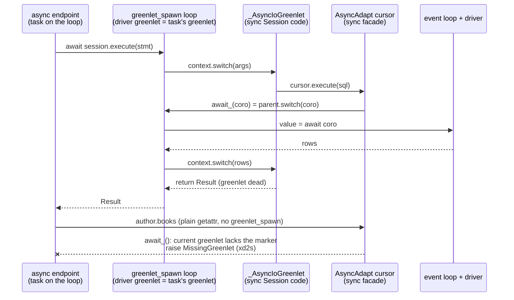

# How AsyncEngine and AsyncSession Work Internally: greenlet_spawn Bridging and Why Implicit Lazy Loading Raises MissingGreenlet

> [!summary] Claim
> `AsyncSession` is a thin proxy that runs the ordinary synchronous `Session` inside a child greenlet via `greenlet_spawn`, and the async driver adapter calls `await_()` to pass each driver coroutine up to the event loop; any database IO reached from a frame that is not inside that greenlet, which is exactly what an implicit lazy load, an expired-attribute refresh, or a Pydantic `from_attributes` read on the event loop is, has no awaiting parent to switch to and fails with `MissingGreenlet` (code `xd2s`).

Part of [Database Access and Transactions for APIs](README.md) in [API Engineering](../README.md).

## TL;DR

- Mechanism: every `AsyncSession` and `AsyncConnection` method is `await greenlet_spawn(self.sync_session.method, ...)`; the child greenlet runs the full sync ORM, and when the driver adapter reaches IO it calls `await_(coro)`, which does `current.parent.switch(coro)` so the `greenlet_spawn` loop can `await` it and switch the result back (sqlalchemy 2.1.8 `lib/sqlalchemy/util/concurrency.py`, `greenlet_spawn` and `await_`).
- Contract rule: in async code, every attribute that is not already loaded is IO, so load it explicitly (`selectinload`, `await obj.awaitable_attrs.rel`, `await session.refresh(obj, ["rel"])`, `run_sync`) or forbid it (`raiseload`, `lazy="raise"`), and create sessions with `expire_on_commit=False`.
- Trap: the same bug surfaces in three shapes, a `StatementError` wrapping `MissingGreenlet` when the session already holds a connection, a bare `MissingGreenlet` when the load must check out a new connection, and a FastAPI `ResponseValidationError` of type `get_attribute_error` when Pydantic reads the relationship during response validation; on aiosqlite and psycopg an `except MissingGreenlet` catches only the second, which the lab proves for aiosqlite and a PostgreSQL probe proves for psycopg, while on asyncpg every lazy load is the bare form (see Portability).
- Portability fact: SQLAlchemy 2.1 renamed `await_only()` to `await_()` (the error text changed with it), removed `await_fallback()`, and stopped installing `greenlet` unless you ask for `sqlalchemy[asyncio]`; free-threaded CPython needs `greenlet` `>= 3.5.4`, which fixed a deadlock when a switch happens inside asyncio's `Task.__step` (greenlet 3.5.6 `CHANGES.rst`).
- When not to use it: if a code path is mostly ORM graph traversal with lazy loads, a sync `Session` in a threadpool (`def` endpoint) is simpler than an async session wrapped in `run_sync`; and the bridge needs an asyncio loop, so it is not a choice for Trio.

## Mental model



The endpoint's task runs in the thread's main greenlet, so when it awaits `session.execute`, `greenlet_spawn` builds a child greenlet whose parent is that main greenlet and switches into it.
The child runs the unmodified synchronous ORM down to the driver adapter, which looks like a blocking DBAPI cursor but holds a coroutine; `await_()` switches back to the parent with that coroutine as the value.
The parent is suspended inside the `while not context.dead` loop of `greenlet_spawn`, a normal coroutine frame, so it can `await` the driver coroutine, yielding to the event loop, and then switch the result back into the child, which resumes exactly where `await_()` was called.
When the child function returns, the greenlet is dead and the result flows out of `greenlet_spawn` as the return value of `await session.execute(...)`.
The last two arrows are the bug: `author.books` is a plain descriptor read on the main greenlet, the lazy loader runs the same sync path down to the adapter, and `await_()` finds no `__sqlalchemy_greenlet_provider__` marker on the current greenlet, so there is no parent frame able to `await`, and it raises.

## How it works

### Why a greenlet bridge exists at all

The ORM's flush, autoflush, lazy loading, unexpiring, and event hooks are thousands of lines of synchronous code that call a PEP 249 cursor.
Rewriting them with `async def` would color every function between `Session.execute` and `cursor.execute`, including attribute descriptors, which cannot be `async` at all because `obj.attr` is not an `await` expression.
Instead SQLAlchemy keeps one synchronous implementation and adapts at the two ends: the public API is `async` and the driver is `async`, and greenlets carry the call stack between them.
The source credits the design to a gist by snaury and to greenlet issue 173 (sqlalchemy 2.1.8 `lib/sqlalchemy/util/concurrency.py`, comment above `_AsyncIoGreenlet`).
The documentation states the trade-off plainly in its `run_sync` section: the approach "works against some of the central philosophies of the asyncio programming model", namely that every statement that can do IO must carry an `await` (SQLAlchemy 2.1.8 `doc/build/orm/extensions/asyncio.rst`, section `session_run_sync`).
`MissingGreenlet` is the mechanism that keeps that philosophy intact outside the explicitly bridged calls.

### greenlet in one paragraph

A greenlet is a stackful coroutine implemented in C++: `switch()` saves the slice of the C stack that belongs to the current greenlet to the heap and restores the target's slice, so a deep Python and C call chain can be suspended at any point without being written as a generator (greenlet 3.5.6 `greenlet/TStackState.cpp`, `StackState::copy_stack_to_heap` and `StackState::copy_heap_to_stack`, read in the copy the installed wheel ships).
Every thread has an implicit main greenlet; `greenlet(fn, parent)` creates a child whose return value or uncaught exception is delivered to `parent`; `child.switch(*args)` starts or resumes it and returns whatever the child next passes back; `child.throw(typ, val, tb)` raises inside the child at its suspension point; and `child.dead` becomes true when `fn` has returned.
A greenlet is not a thread: only one greenlet per thread runs at a time and switches are explicit, so the bridge adds no parallelism and no locking.

### `greenlet_spawn`: the driver loop

`await_` and `greenlet_spawn` together are under 80 lines in 2.1.8 (sqlalchemy 2.1.8 `lib/sqlalchemy/util/concurrency.py`, `greenlet_spawn`):

1. `context = _AsyncIoGreenlet(fn, getcurrent())` creates the child with the caller's greenlet as parent.
2. `result = context.switch(*args, **kwargs)` runs `fn` synchronously until it either returns (child dead, `result` is the return value) or calls `await_()` (child alive, `result` is the awaitable it handed up).
3. `while not context.dead:` it does `value = await result` and then `result = context.switch(value)`; if the await raised, `except BaseException:` does `result = context.throw(*sys.exc_info())`, so the driver error, a `CancelledError`, or a `TimeoutError` is raised inside the sync frame where its `try`, `except`, and `finally` blocks run.
4. With `_require_await=True` it raises `AwaitRequired` (code `xd1r`) if no switch occurred, which catches a sync DBAPI wired into an async engine; `AsyncConnection.execute`, `exec_driver_sql`, and `stream` pass `_require_await=True`, while `run_sync` passes `False` (sqlalchemy 2.1.8 `lib/sqlalchemy/ext/asyncio/engine.py`, `AsyncConnection.exec_driver_sql` and `AsyncConnection.run_sync`).

`_AsyncIoGreenlet` adds two things to a plain greenlet: the class attribute `__sqlalchemy_greenlet_provider__ = True`, which is the marker `await_()` and `in_greenlet()` test with `getattr`, and `self.gr_context = driver.gr_context` in `__init__` when the installed greenlet has `gr_context` (sqlalchemy 2.1.8 `lib/sqlalchemy/util/concurrency.py`, `_concurrency_shim_cls._initialize`).
The context copy matters for APIs: greenlet's `gr_context` was added in greenlet `1.0a1` (PR 198) to restore greenlets-on-asyncio patterns (greenlet 3.5.6 `CHANGES.rst`, "1.0a1"), and the lab proves that a bare greenlet started inside a task sees a `ContextVar` at its default (`"unset"`) while code run through `greenlet_spawn` sees the task's value (`"req-42"`), so request IDs, OpenTelemetry spans, and tenant context set in middleware survive into sync ORM event handlers.

### `await_`: the switch up, and the only place `MissingGreenlet` is raised

`await_(awaitable)` reads `getcurrent()` and, if it lacks the marker, calls `_safe_cancel_awaitable(awaitable)` (which calls `.close()` only when `asyncio.iscoroutine` is true) and raises `exc.MissingGreenlet("greenlet_spawn has not been called; can't call await_() here. Was IO attempted in an unexpected place?")`; otherwise it returns `current.parent.switch(awaitable)` (sqlalchemy 2.1.8 `lib/sqlalchemy/util/concurrency.py`, `await_`).
`MissingGreenlet` subclasses `InvalidRequestError` with `code = "xd2s"`, and `AwaitRequired` subclasses it with `code = "xd1r"` (sqlalchemy 2.1.8 `lib/sqlalchemy/exc.py`, `MissingGreenlet` and `AwaitRequired`).
The error page says that under the ORM this "is nearly always due to the use of lazy loading" (SQLAlchemy 2.1.8 `doc/build/errors.rst`, `error_xd2s`).
The check is a per-greenlet marker, not "is a loop running", which has two consequences.
Code in an `asyncio.to_thread` or AnyIO worker thread runs in that thread's main greenlet, so it also lacks the marker and fails the same way: a verification probe that read `author.books` inside `asyncio.to_thread` got `StatementError` with `.orig` a `MissingGreenlet` (CPython `3.14.6`, SQLAlchemy `2.1.8`, aiosqlite `0.22.1`; probe script, not a lab test; the AnyIO threadpool was not run).
And the check costs one `getattr` per driver call, so it is always on, even in production.

The `close()` in `_safe_cancel_awaitable` exists to suppress `RuntimeWarning: coroutine ... was never awaited`, but it closes only the object it is given.
aiosqlite `0.22.1` decorates `Connection.cursor` with `@contextmanager`, which wraps the coroutine in a `Result` object, and SQLAlchemy calls `await_(cursor.__aenter__())` (sqlalchemy 2.1.8 `lib/sqlalchemy/connectors/asyncio.py`, `AsyncAdapt_dbapi_cursor._aenter_cursor`; aiosqlite 0.22.1 `aiosqlite/context.py`, `Result.__aenter__`).
The outer `__aenter__` coroutine is closed, but the inner `Connection.cursor` coroutine stays in `CORO_CREATED` and warns at garbage collection, which is why a `MissingGreenlet` under aiosqlite is followed by `RuntimeWarning: coroutine 'Connection.cursor' was never awaited` at a random later line; the lab test `test_await_outside_greenlet_leaves_aiosqlite_inner_coroutine_unstarted` pins both states.

### The adapter layer: a sync DBAPI facade over an async driver

`create_async_engine(url, **kw)` sets `kw["_is_async"] = True`, refuses `server_side_cursors=True` with `AsyncMethodRequired`, builds a normal sync `Engine`, and wraps it; `AsyncEngine.__init__` raises `InvalidRequestError` "The asyncio extension requires an async driver to be used" unless `sync_engine.dialect.is_async` (sqlalchemy 2.1.8 `lib/sqlalchemy/ext/asyncio/engine.py`, `create_async_engine` and `AsyncEngine.__init__`).
The dialect hands the pool an `AdaptedConnection` subclass whose sync methods each wrap one driver coroutine: `AsyncAdapt_dbapi_cursor.execute` is `await_(self._execute_async(operation, parameters))`, `commit` is `await_(self._connection.commit())`, and `_execute_async` runs under `async with self._adapt_connection._execute_mutex`, an `asyncio.Lock` per connection, then eagerly drains `fetchall()` into a `collections.deque` for non-server-side cursors (sqlalchemy 2.1.8 `lib/sqlalchemy/connectors/asyncio.py`, `AsyncAdapt_dbapi_cursor` and `AsyncAdapt_dbapi_connection`).
So a buffered `execute` performs all its IO inside the bridge, and fetching rows from the returned `Result` afterwards is pure memory access; `AsyncSession.execute` also sets the execution option `prebuffer_rows: True` for the ORM layer, while `stream` sets `stream_results: True` and returns an `AsyncResult` whose fetches are each bridged (sqlalchemy 2.1.8 `lib/sqlalchemy/ext/asyncio/session.py`, `_EXECUTE_OPTIONS` and `_STREAM_OPTIONS`).
The same pattern is used by every async dialect: a `grep -c "await_("` over the installed 2.1.8 dialects counts 13 call sites in `dialects/postgresql/asyncpg.py`, 11 in `dialects/postgresql/psycopg.py`, and 4 in `dialects/sqlite/aiosqlite.py`; the driver differences themselves belong to [[Async-PostgreSQL-Drivers-Compared-Asyncpg-vs-Psycopg-3]].

The pool is bridged too.
`AsyncAdaptedQueuePool` is `QueuePool` with `_queue_class = sqla_queue.AsyncAdaptedQueue`, whose blocking `get` and `put` call `await_(self._queue.get())` on an `asyncio.Queue` (sqlalchemy 2.1.8 `lib/sqlalchemy/pool/impl.py`, `AsyncAdaptedQueuePool`; `lib/sqlalchemy/util/queue.py`, `AsyncAdaptedQueue`).
That `asyncio.Queue` binds to the loop that first uses it, which is why the docs require `AsyncEngine.dispose()` before reusing an engine on another loop, or `NullPool`, and name the symptom `Task <Task pending ...> got Future attached to a different loop` (SQLAlchemy 2.1.8 `doc/build/orm/extensions/asyncio.rst`, "Using multiple asyncio event loops").
`aiosqlite` picks the pool per URL: `StaticPool` for `:memory:` and `AsyncAdaptedQueuePool` for files (sqlalchemy 2.1.8 `lib/sqlalchemy/dialects/sqlite/aiosqlite.py`, `get_pool_class`), which the lab asserts.

### `AsyncSession` is a proxy, not a second ORM

`AsyncSession.__init__` assigns `self.sync_session = self._proxied = self._assign_proxied(self.sync_session_class(bind=sync_bind, binds=sync_binds, **kw))`, with `sync_session_class = Session` by default (sqlalchemy 2.1.8 `lib/sqlalchemy/ext/asyncio/session.py`, `AsyncSession.__init__`).
IO methods are hand-written wrappers: `execute`, `scalar`, `get`, `refresh`, `flush`, `commit`, `rollback`, `close`, `delete`, and `run_sync` are each one `await greenlet_spawn(self.sync_session.<method>, ...)`, and `run_sync(fn)` is literally `greenlet_spawn(fn, self.sync_session, *arg, _require_await=False, **kw)` (same file, `AsyncSession.run_sync`).
Non-IO methods such as `add`, `expire`, `expunge`, and `in_transaction` are generated plain proxies through `util.create_proxy_methods(Session, ...)`, so `session.add(obj)` is synchronous and safe, while `session.expire(obj)` is safe to call but turns the next read of `obj` into IO.
The identity map, unit of work, and expiry rules are those of the sync `Session`, covered in [[Session-Internals-Identity-Map-Unit-of-Work-Flush-and-Expire-On-Commit]].
Events are not async either: the docs say to register sync listeners on `AsyncEngine.sync_engine` or `AsyncSession.sync_session`, and to reach an awaitable-only driver method inside such a listener with `dbapi_connection.run_async(fn)`, which is `await_(fn(self._connection))` (sqlalchemy 2.1.8 `lib/sqlalchemy/engine/interfaces.py`, `AdaptedConnection.run_async`); the lab's `SqlCounter` uses `before_cursor_execute` on `sync_engine` exactly this way.

### Why implicit lazy loading cannot work, and which frame raises

An ORM attribute is a descriptor; `author.books` calls `InstrumentedAttribute.__get__` -> `_AttributeImpl.get` -> `_fire_loader_callables` -> `LazyLoader._load_for_state` -> `_emit_lazyload` -> `Session.execute` -> `Connection._execute_context`, all synchronous, on whatever greenlet is current (frames observed in the probe traceback, see `report.md`).
On the main greenlet no frame up the stack is the `greenlet_spawn` loop, so `await_()` has nobody to switch to; there is no way to retrofit one, because the caller wrote `author.books`, not `await`.
The same is true of an expired column after `commit()` (`state._load_expired` -> `loading._load_on_pk_identity`), a `deferred()` column, a `dynamic` relationship, and any `Session.get()` that misses the identity map.

Where the first `await_()` happens decides the exception type, and the lab pins both shapes:

| Situation | First `await_()` reached | What propagates | Why |
|---|---|---|---|
| Session already holds a connection (inside a transaction), or the pool hands out an idle connection without IO | `AsyncAdapt_dbapi_cursor._aenter_cursor`, while `_execute_context` creates the cursor | `StatementError("(sqlalchemy.exc.MissingGreenlet) greenlet_spawn has not been called; ...")` with `.orig` the `MissingGreenlet` and `code == "xd2s"` | `Connection._handle_dbapi_exception` wraps a non-DBAPI error when `statement is not None and context is None`, and `DBAPIError.instance` returns a `StatementError` for a `SQLAlchemyError` with `code=orig.code` (sqlalchemy 2.1.8 `lib/sqlalchemy/engine/base.py`, `Connection._handle_dbapi_exception`; `lib/sqlalchemy/exc.py`, `DBAPIError.instance`) |
| The load must open a connection (`NullPool`, empty pool, or overflow) | the dialect's `connect`, for aiosqlite `AsyncAdapt_aiosqlite_dbapi.connect` calling `await_(connection)` | bare `MissingGreenlet` | `_handle_dbapi_exception_noconnection` wraps only `dialect.loaded_dbapi.Error`, so a `MissingGreenlet` passes through unwrapped (same file, `Connection._handle_dbapi_exception_noconnection`) |
| FastAPI `response_model` validation reads the relationship from an ORM object | same as row 1 | `fastapi.exceptions.ResponseValidationError` with one error, `type` `get_attribute_error`, `loc` `("response", "books")`, and the `StatementError` text in `msg` | pydantic-core catches any exception raised by `getattr` other than `AttributeError` (which `getattr_opt` maps to a missing attribute) and converts it to `ErrorType::GetAttributeError { error, .. }` with the exception stringified by `py_err_string`, rendered as `"Error extracting attribute: {error}"` (pydantic-core 2.50.4 `src/lookup_key.rs`, `LookupPath::py_get_attr`; `src/errors/types.rs`, `ErrorType::message_template_python`) |

The third row is the one that reaches production as a mystery: FastAPI validates the response of an `async def` endpoint on the event loop with `field.validate(response_content, {}, loc=("response",))` when `is_coroutine` is true (fastapi 0.162.0 `fastapi/routing.py`, `serialize_response`), the original exception object is gone, and an `exception_handler(SQLAlchemyError)` never runs.
Two runtime observations from the probe sharpen the first row: with `expire_on_commit=True` on a file database the lazy load after `commit()` still raised the wrapped `StatementError`, because `AsyncAdaptedQueuePool` returned the idle connection without IO, and only `NullPool` forced the bare form.
A verification probe confirmed the file-database observation (`AsyncAdaptedQueuePool`, `expire_on_commit=True`, `StatementError` with `.orig` a `MissingGreenlet`).
So the shape you see depends on pool state, and also on the driver, which is why a handler must test both (`is_missing_greenlet` in the lab).
The first row assumes the dialect's cursor awaits when it is created: psycopg inherits `AsyncAdapt_dbapi_cursor.__init__` and its `_aenter_cursor`, but `AsyncAdapt_asyncpg_cursor.__init__` overrides it without any `await_()`, so on asyncpg the first `await_()` is `AsyncAdapt_asyncpg_cursor.execute` inside `_exec_single_context`, where `context` is not `None` and `_handle_dbapi_exception` does not wrap, so a bare `MissingGreenlet` is expected even on a held connection (sqlalchemy 2.1.8 `lib/sqlalchemy/dialects/postgresql/asyncpg.py`, `AsyncAdapt_asyncpg_cursor`; `lib/sqlalchemy/engine/base.py`, `Connection._exec_single_context`).
A probe against a throwaway local PostgreSQL 18.7 (Homebrew, `127.0.0.1`, trust auth, removed afterwards) confirmed this reading on CPython 3.14.6, macOS 27.3 arm64, sqlalchemy 2.1.8, asyncpg 0.32.0, and psycopg 3.3.8: on asyncpg, lazy-loading `author.books` in a session that held a connection raised bare `sqlalchemy.exc.MissingGreenlet` with `code == "xd2s"` and no `.orig`, with both `AsyncAdaptedQueuePool` and `NullPool`, and an expired attribute after `commit()` raised the bare form as well.
On psycopg the held-connection load raised `StatementError` with `.orig` a `MissingGreenlet` under both pools, and the expired attribute after `commit()` raised `StatementError` with the default pool but the bare `MissingGreenlet` with `NullPool`, because the session had released its connection and the load had to connect.

### The legal ways to load

| Technique | How it reaches the bridge | Statements for 1 author + books in the lab | Trade-off |
|---|---|---|---|
| `select(Author).options(selectinload(Author.books))` | inside the original `await session.execute` | `2` (author, then `IN` batch) | Must be known at query time; see [[Eliminating-N-Plus-1-Queries-Selectinload-Joinedload-Subqueryload-and-Raiseload]] |
| `await author.awaitable_attrs.books` | `AsyncAttrs._AsyncAttrGetitem.__getattr__` returns `greenlet_spawn(getattr, self._instance, name)` (sqlalchemy 2.1.8 `lib/sqlalchemy/ext/asyncio/session.py`, `AsyncAttrs`) | `2` | One round trip per object and attribute, so N+1 in a loop; added in `2.0.13` |
| `await session.run_sync(fn)` | `fn(sync_session)` runs inside one child greenlet, so lazy loads inside it are legal | `2` | Hides IO from review again, and blocking non-SQLAlchemy IO inside `fn` blocks the loop (sqlalchemy 2.1.8 `lib/sqlalchemy/ext/asyncio/session.py`, `AsyncSession.run_sync` docstring tip) |
| `await session.refresh(author, attribute_names=["books"])` | `greenlet_spawn(self.sync_session.refresh, ...)` | `3`: the author query, a PK-only `SELECT author.id FROM author WHERE author.id = ?`, then the lazy load | Extra round trip; relationship names are honored since `2.0.4` per the docs |
| `raiseload(Author.books)` or `lazy="raise"` | never reaches IO | `1`, then `InvalidRequestError: 'Author.books' is not available due to lazy='raise'` | Turns a latent production failure into a deterministic test failure |
| `expire_on_commit=False` | prevents the post-commit unexpire load | the column read after `commit()` costs `0` extra statements | Objects can be stale after commit; the docs recommend it for asyncio |

The documentation lists the same toolbox, plus write-only relationships, assigning empty collections on new objects, and avoiding `cascade="all"` because it implies `refresh-expire` (SQLAlchemy 2.1.8 `doc/build/orm/extensions/asyncio.rst`, section `asyncio_orm_avoid_lazyloads`).

### Cancellation and timeouts through the bridge

Because `greenlet_spawn` catches `BaseException` around `await result` and throws it into the child, `task.cancel()` or an `asyncio.timeout()` expiring during a query raises `CancelledError` or `TimeoutError` at the `await_()` call inside the sync ORM frame, and the ORM's own cleanup runs on the way out; the lab test `test_task_cancellation_is_thrown_into_the_sync_frame` shows the sync frame observing `CancelledError`.
`util.is_exit_exception` classifies `CancelledError` and `TimeoutError` as exit exceptions, and `_handle_dbapi_exception` sets `self._is_disconnect = ... or (is_exit_exception and not self.closed)` with `invalidate_pool_on_disconnect = not is_exit_exception`, so a cancelled statement invalidates that one connection instead of returning it to the pool in an unknown protocol state, without invalidating the rest of the pool (sqlalchemy 2.1.8 `lib/sqlalchemy/engine/base.py`, `Connection._handle_dbapi_exception`).
The cost is a reconnect for every cancelled query, which matters under client-disconnect storms; graceful termination inside a greenlet uses `await_(asyncio.shield(self._terminate_graceful_close()))` (sqlalchemy 2.1.8 `lib/sqlalchemy/connectors/asyncio.py`, `AsyncAdapt_terminate.terminate`, referencing issue 10717).
How cancellation interacts with shielded cleanup in general is in [[Cancellation-Semantics-CancelledError-Swallowing-and-Shielded-Cleanup]].

### Version differences: 2.0.57 vs 2.1.8

- Name and message: 2.0.57 defines `await_only()` and raises "can't call await_only() here" (sqlalchemy 2.0.57 `lib/sqlalchemy/util/_concurrency_py3k.py`, `await_only`); 2.1.8 defines `await_()`, keeps `await_only = await_` with the comment "old name. deprecated on 2.2", and raises "can't call await_() here"; log alerts that match on the message text must match both.
- `await_fallback()`, which ran the coroutine with `loop.run_until_complete` when no loop was running, is deprecated in 2.0.24 and absent from 2.1.8 (only a docstring in `testing/requirements.py` mentions it); 2.0's `AsyncAdaptedLock.__enter__` used `await_fallback`, 2.1's uses `await_`.
- Module layout: 2.0.57 imports `greenlet` eagerly in `util/concurrency.py` and keeps the implementation in `_concurrency_py3k.py`; 2.1.8 has one module with a lazy `_concurrency_shim_cls` that imports `greenlet` on first attribute access and raises `ImportError` with the `pip install sqlalchemy[asyncio]` hint if it is missing; `sqlalchemy.ext.asyncio` forces that import when it is itself imported, so the core package imports without `greenlet` and the asyncio extension does not.
- Installation: 2.0.57 `setup.cfg` installs `greenlet >= 1` by default only when `platform_machine` is one of `aarch64`, `ppc64le`, `x86_64`, `amd64`, `AMD64`, `win32`, or `WIN32`; Apple Silicon macOS reports `arm64` (the lab machine's `platform.machine()`), so `pip install sqlalchemy==2.0.57` there never pulled `greenlet`; 2.1 drops the expression and installs `greenlet` only through the `[asyncio]` extra (SQLAlchemy 2.1.8 `doc/build/changelog/migration_21.rst`, `change_10197`; installed 2.1.8 `METADATA`: `Requires-Dist: greenlet>=1; extra == "asyncio"`).

## Numbers and limits

| Quantity | Value | Source or measurement |
|---|---|---|
| `MissingGreenlet` error code | `xd2s`, URL `https://sqlalche.me/e/21/xd2s` on 2.1 | sqlalchemy 2.1.8 `lib/sqlalchemy/exc.py`, `MissingGreenlet`; URL from the exception string captured in the probe |
| `AwaitRequired` error code | `xd1r` | sqlalchemy 2.1.8 `lib/sqlalchemy/exc.py`, `AwaitRequired`; asserted by the lab |
| `greenlet_spawn` + one `await_()` of a trivial coroutine, per call | `3678` ns best of 5 runs x 20000 calls | Re-measured by the verifier with a probe script (not a lab test) timing each loop with `loop.time()`, `labs/.venv/bin/python -I probe.py`, CPython `3.14.6`, SQLAlchemy `2.1.8`, greenlet `3.5.6`, macOS `27.3` arm64, Apple M3 Pro, load average about `25` to `27` on the host during the run, so read as an upper bound (as of 2026-11) |
| `greenlet_spawn` of a function that never awaits | `2949` ns | Same probe and machine |
| Direct `await` of the same coroutine, no bridge | `40` ns | Same probe and machine; the bridge cost is dominated by greenlet creation and two switches, and is small next to a database round trip but is paid on every `AsyncSession` IO method |
| Statements to read one author's books | lazy: fails at the second; `selectinload` `2`; `awaitable_attrs` `2`; `run_sync` `2`; `refresh(attribute_names=...)` `3`; `raiseload` `1` then error | Asserted by `test_explicit_strategies_load_the_collection` and `test_raiseload_fails_fast_without_emitting_sql` via a `before_cursor_execute` counter |
| Locks per adapted connection | one `asyncio.Lock` (`_execute_mutex`) | sqlalchemy 2.1.8 `lib/sqlalchemy/connectors/asyncio.py`, `AsyncAdapt_dbapi_connection.__init__` |
| `QueuePool` and `AsyncAdaptedQueuePool` defaults | `pool_size=5`, `max_overflow=10` | sqlalchemy 2.1.8 `lib/sqlalchemy/pool/impl.py`, `QueuePool.__init__`; sizing is in [[Sizing-Connection-Pools-Across-Workers-Pods-and-PgBouncer-Transaction-Mode]] |
| Minimum CPython for SQLAlchemy 2.1.8 | `3.11` | installed `METADATA` `Requires-Python: >=3.11` |
| Minimum CPython for this lab | `3.12` | the lab uses PEP 695 generic function syntax (`def mini_await[T]`) |
| Lab runtime | `23 passed in 2.48s` | Verifier rerun of `uv run --frozen pytest ... -q -p no:cacheprovider`, CPython `3.14.6`, macOS `27.3` arm64, host load average about `26` (as of 2026-11) |

## Portability

| Runtime or component | Behavior | Evidence |
|---|---|---|
| CPython `3.14.6` (workspace interpreter) | All 23 lab tests pass | Ran: `uv run --frozen pytest`, macOS `27.3` arm64 (as of 2026-11) |
| CPython `3.12.16`, `3.13.18`, `3.14.10`, `3.15.2` | Not run here: matrix runs were paused by the user on 2026-11-11; `greenlet 3.5.6` publishes `cp312`, `cp313`, `cp314`, and `cp315` wheels for macOS universal2, manylinux, musllinux, and Windows | `labs/uv.lock` wheel list for `greenlet 3.5.6`; greenlet 3.5.6 `CHANGES.rst`, in the note under the `3.5.5` entry, says 3.15 wheels are now built with `3.15.0rc1` and are "believed compatible with 3.15b4 as well (but not earlier versions)" |
| Free-threaded CPython `3.15.2t` (and `3.14t`) | Not run here; `cp314t` and `cp315t` wheels exist; greenlet's free-threaded history matters for this bridge specifically: `3.3.0` added initial `3.14t` support, `3.5.3` fixed a crash with critical sections, and `3.5.4` fixed "a deadlock on free-threaded builds when a greenlet switch happened while a `PyCriticalSection` was held -- for example inside asyncio's `Task.__step`", which is the exact switch `greenlet_spawn` performs; pin `greenlet >= 3.5.4` on free-threaded builds | greenlet 3.5.6 `CHANGES.rst`, entries `3.3.0`, `3.5.3`, `3.5.4`; `labs/uv.lock` wheel list |
| SQLAlchemy `2.0.57` vs `2.1.8` | Same bridge algorithm; `await_only` vs `await_` name and message, `await_fallback` removed in 2.1, greenlet no longer a default dependency in 2.1 | Source diff of the two tags (How it works, "Version differences"); the lab's `sqlalchemy20` dependency group was not run |
| Drivers: aiosqlite `0.22.1` | Both `MissingGreenlet` shapes and the unstarted inner `Connection.cursor` coroutine | Ran in the lab |
| Drivers: asyncpg `0.32.0`, psycopg `3.3.8` async | Same adapter pattern (`await_` call sites in each dialect), so the same failure; psycopg keeps the inherited `_aenter_cursor` and gives the `StatementError` shape on a held connection (bare only when the load must connect), while asyncpg's cursor does no IO at creation and gives a bare `MissingGreenlet` in every lazy-load case; the aiosqlite-specific `Result` warning does not apply as stated | Run: local PostgreSQL 18.7 probe, CPython 3.14.6, macOS 27.3 arm64, `labs/.venv/bin/python -I`, sqlalchemy 2.1.8, asyncpg 0.32.0, psycopg 3.3.8; source: sqlalchemy 2.1.8 `dialects/postgresql/asyncpg.py`, `AsyncAdapt_asyncpg_cursor.__init__`, and `dialects/postgresql/psycopg.py`, `AsyncAdapt_psycopg_cursor` |
| ASGI servers (Uvicorn `0.54.0`, Hypercorn `0.18.0` asyncio worker, Granian `2.8.7`) and HTTP/1.1, HTTP/2, HTTP/3 | The bridge lives inside the application's event loop and is independent of server and wire protocol | Not run; the lab drives the app in-process with `httpx.ASGITransport` |
| Hypercorn Trio worker, or any non-asyncio loop | Not supported: the pool queue is `asyncio.Queue` and the connection mutex is `asyncio.Lock`, and the async drivers are asyncio libraries | sqlalchemy 2.1.8 `lib/sqlalchemy/util/queue.py`, `AsyncAdaptedQueue`; `lib/sqlalchemy/connectors/asyncio.py`, `AsyncAdapt_dbapi_connection.__init__`; not run |
| `def` (threadpool) endpoints touching an `AsyncSession` object's lazy attributes | Fail with `MissingGreenlet` too: the worker thread's main greenlet has no marker | sqlalchemy 2.1.8 `await_`; a verification probe reading `author.books` in `asyncio.to_thread` got `StatementError` wrapping `MissingGreenlet` on aiosqlite; a FastAPI `def` endpoint on the AnyIO threadpool was not run |

## Worked example

The lab is one module in three parts: a 40-line re-implementation of the bridge so each switch is visible, the real `AsyncSession` over `sqlite+aiosqlite`, and a FastAPI app with an error handler that classifies the failure.
Code: [implementation](../labs/src/api_labs/f13_database_access_and_transactions_for_apis/async_sqlalchemy_greenlet_bridge.py) and [test](../labs/tests/f13_database_access_and_transactions_for_apis/test_async_sqlalchemy_under_the_hood_greenlet_bridge_and_missinggreenlet.py).

The bridge, verbatim excerpt (lines 72-123 of the implementation):

```python
class _BridgeGreenlet(_greenlet_module.greenlet):  # type: ignore[misc]
    """A child greenlet that marks itself as bridge-provided and inherits the task's context."""

    is_bridge = True

    def __init__(self, fn: Callable[..., Any], driver: _Greenlet) -> None:
        _greenlet_init(self, fn, driver)
        # Without this copy a new greenlet starts with an empty contextvars.Context.
        self.gr_context = driver.gr_context


def mini_await[T](awaitable: Awaitable[T], trace: list[str] | None = None) -> T:
    """Suspend the sync caller, hand ``awaitable`` to the event loop, return its result."""
    current = _getcurrent()
    if not getattr(current, "is_bridge", False):
        if isinstance(awaitable, Coroutine):
            cast("Coroutine[Any, Any, T]", awaitable).close()  # no "never awaited" warning
        raise MiniMissingGreenletError("mini_await() called outside mini_spawn()")
    if trace is not None:
        trace.append("child: switch to parent with awaitable")
    parent = current.parent
    if parent is None:
        raise MiniMissingGreenletError("bridge greenlet has no driver parent")
    return cast("T", parent.switch(awaitable))


async def mini_spawn[T](
    fn: Callable[..., T], *args: Any, trace: list[str] | None = None, **kwargs: Any
) -> T:
    """Run sync ``fn`` in a child greenlet; await each awaitable it passes up via mini_await."""
    child = cast("_Greenlet", _BridgeGreenlet(fn, _getcurrent()))
    result: Any = child.switch(*args, **kwargs)
    while not child.dead:
        if trace is not None:
            trace.append("driver: awaiting on the event loop")
        try:
            value = await result
        except BaseException:
            # Re-raise inside the sync frame so its try/except and finally blocks run.
            result = child.throw(*sys.exc_info())
        else:
            if trace is not None:
                trace.append("driver: switch result back into child")
            result = child.switch(value)
    return cast("T", result)


def is_missing_greenlet(error: BaseException) -> bool:
    """True for both shapes: bare ``MissingGreenlet`` and ``StatementError`` wrapping it."""
    if isinstance(error, exc.MissingGreenlet):
        return True
    return isinstance(error, exc.StatementError) and isinstance(error.orig, exc.MissingGreenlet)
```

The bug and three of the fixes, verbatim excerpt (lines 203-232):

```python
async def titles_via_implicit_lazy_load(session: AsyncSession, author_id: int) -> list[str]:
    """The bug: plain attribute access on the event loop needs IO it cannot await."""
    author = await get_author(session, author_id)
    return [book.title for book in author.books]


async def titles_via_awaitable_attrs(session: AsyncSession, author_id: int) -> list[str]:
    author = await get_author(session, author_id)
    books: list[Book] = await author.awaitable_attrs.books
    return [book.title for book in books]


async def titles_via_selectinload(session: AsyncSession, author_id: int) -> list[str]:
    stmt = select(Author).where(Author.id == author_id).options(selectinload(Author.books))
    author = (await session.execute(stmt)).scalar_one()
    return [book.title for book in author.books]


async def titles_via_run_sync(session: AsyncSession, author_id: int) -> list[str]:
    def sync_block(sync_session: Session) -> list[str]:
        author = sync_session.get_one(Author, author_id)
        return [book.title for book in author.books]  # lazy load is legal here

    return await session.run_sync(sync_block)


async def titles_via_refresh(session: AsyncSession, author_id: int) -> list[str]:
    author = await get_author(session, author_id)
    await session.refresh(author, attribute_names=["books"])
    return [book.title for book in author.books]
```

The API surface, verbatim excerpt (lines 290-299); the handler sees rows 1 and 2 of the shape table but not row 3:

```python
    @app.exception_handler(exc.SQLAlchemyError)
    async def sqlalchemy_error(request: Request, error: exc.SQLAlchemyError) -> JSONResponse:
        if is_missing_greenlet(error):
            # A programming error, not a database outage: never retry it, page the owner.
            return JSONResponse({"error": "implicit_io", "code": "xd2s"}, status_code=500)
        return JSONResponse({"error": "database"}, status_code=503)

    @app.get("/authors/{author_id}/titles/{strategy}")
    async def titles(author_id: int, strategy: str, session: SessionDep) -> dict[str, list[str]]:
        return {"titles": await LOADERS[strategy](session, author_id)}
```

The two exception shapes, verbatim excerpt of the test (lines 194-223):

```python
@pytest.mark.unit
@pytest.mark.asyncio
async def test_lazy_load_on_held_connection_raises_statement_error_wrapping_missing_greenlet(
    engine: AsyncEngine,
) -> None:
    assert pool_class_name(engine) == "StaticPool"
    async with sessions(engine)() as session:
        with pytest.raises(exc.StatementError) as info:
            await titles_via_implicit_lazy_load(session, 1)
    error = info.value
    assert not isinstance(error, exc.MissingGreenlet)
    assert isinstance(error.orig, exc.MissingGreenlet)
    assert error.code == "xd2s"
    assert is_missing_greenlet(error)


@pytest.mark.unit
@pytest.mark.asyncio
async def test_lazy_load_that_must_connect_raises_bare_missing_greenlet(tmp_path: Path) -> None:
    eng = make_engine(f"sqlite+aiosqlite:///{tmp_path / 'lab.db'}", null_pool=True)
    try:
        await create_schema_and_seed(eng)
        assert pool_class_name(eng) == "NullPool"
        async with sessions(eng, expire_on_commit=True)() as session:
            with pytest.raises(exc.MissingGreenlet) as info:
                await name_after_commit(session, 1)
        assert not isinstance(info.value, exc.StatementError)
        assert is_missing_greenlet(info.value)
    finally:
        await eng.dispose()
```

What the 23 tests pin: the switch order of the mini bridge (`child: switch to parent with awaitable` -> `driver: awaiting on the event loop` -> `driver: switch result back into child`, twice for two awaits), exceptions and cancellation thrown back into the sync frame, the `ContextVar` copy, `AwaitRequired`, the aiosqlite inner-coroutine state, both `MissingGreenlet` shapes, the default pool per URL, the `expire_on_commit` difference, the statement count of every loading strategy, `raiseload`, the classified `500` for the lazy endpoint, `200` for the four explicit strategies, and the `ResponseValidationError` of type `get_attribute_error` that bypasses the SQLAlchemy handler.

Run from `labs/` on CPython `3.14.6`, macOS `27.3` arm64 (Apple M3 Pro), `uv 0.11.26`, SQLAlchemy `2.1.8`, greenlet `3.5.6`, aiosqlite `0.22.1`, FastAPI `0.162.0`, Pydantic `2.14.3`:

```text
$ uv run --frozen pytest tests/f13_database_access_and_transactions_for_apis/test_async_sqlalchemy_under_the_hood_greenlet_bridge_and_missinggreenlet.py -q -p no:cacheprovider
.......................                                                  [100%]
23 passed in 2.48s
```

## Pitfalls

> [!warning] Lazy relationship read during `response_model` validation
> Trigger: an `async def` endpoint returns an ORM instance and its `response_model` has a field backed by an unloaded relationship (`books: list[BookOut]` with `from_attributes=True`).
> Symptom: a `500` from `ResponseValidationError` whose single error is `{"type": "get_attribute_error", "loc": ("response", "books"), "msg": "Error extracting attribute: StatementError: (sqlalchemy.exc.MissingGreenlet) ..."}`; `exception_handler(SQLAlchemyError)` and Sentry grouping by exception type both miss it, and the message embeds the SQL text.
> Fix: eager-load everything the response model reads (`selectinload`), or convert to the Pydantic model inside the endpoint while the data is loaded; enforce with `raiseload("*")` in tests.

> [!warning] `except MissingGreenlet` catches only one of the shapes
> Trigger: an error handler, retry decorator, or alert rule keyed on `isinstance(e, MissingGreenlet)`.
> Symptom: on aiosqlite and psycopg (probe-verified) the common case, a lazy load while the session holds a connection, arrives as `StatementError` with `.orig` set, and the handler falls through to a generic `503` that clients retry; switching drivers can change which shape you get.
> Fix: test `e.code == "xd2s"` or both shapes as `is_missing_greenlet` does, classify it as a non-retryable programming error, and never retry it; retries only multiply load.

> [!warning] `expire_on_commit=True` with an async session
> Trigger: `AsyncSession(engine)` or `async_sessionmaker(engine)` with the default `expire_on_commit=True`, then reading `obj.name` after `await session.commit()`, often while building the response.
> Symptom: `MissingGreenlet` on a plain column, not a relationship, so it looks unrelated to lazy loading; the lab shows it.
> Fix: `async_sessionmaker(engine, expire_on_commit=False)`, as the SQLAlchemy asyncio docs do in every example, and `await session.refresh(obj)` when fresh state is required.

> [!warning] `run_sync` and `awaitable_attrs` as a reflex
> Trigger: silencing every `MissingGreenlet` by wrapping code in `run_sync` or sprinkling `awaitable_attrs`.
> Symptom: N+1 query storms that are now invisible in review, one bridged round trip per object, and loop stalls when the sync function also does blocking non-SQLAlchemy IO, which the `AsyncSession.run_sync` docstring tip warns "will block on traditional IO calls" (sqlalchemy 2.1.8 `lib/sqlalchemy/ext/asyncio/session.py`).
> Fix: load the shape the endpoint needs in one query; reserve `run_sync` for porting legacy sync code and for `metadata.create_all` style operations.

> [!warning] Sharing an engine across event loops
> Trigger: a module-level `AsyncEngine` used from `asyncio.run()` in tests and again from the server loop, or from several threads each running a loop.
> Symptom: `got Future attached to a different loop` from the pool's `asyncio.Queue` or the connection's `asyncio.Lock` (docs, "Using multiple asyncio event loops").
> Fix: create the engine in the lifespan of the loop that uses it and `await engine.dispose()` on shutdown, or use `NullPool` when loops must share it.

> [!warning] `greenlet` missing at runtime
> Trigger: installing `sqlalchemy` without `[asyncio]` on 2.1, or on 2.0 on a platform outside its `platform_machine` list such as Apple Silicon macOS.
> Symptom: on 2.1, `import sqlalchemy` succeeds, but `import sqlalchemy.ext.asyncio` raises `ImportError: The SQLAlchemy asyncio module requires that the Python 'greenlet' library is installed`, because that package's `__init__.py` calls `concurrency._concurrency_shim._initialize()` at import (sqlalchemy 2.1.8 `lib/sqlalchemy/ext/asyncio/__init__.py`; reproduced in a verification probe with `greenlet` blocked from import).
> Fix: depend on `sqlalchemy[asyncio]` explicitly in the lock file, and on free-threaded builds pin `greenlet >= 3.5.4`.

No CVE or public postmortem specific to `MissingGreenlet` was found while drafting; the incidents above are failure modes demonstrated by the lab, not cited outages.

## Security and robustness

- Information exposure: `StatementError.__str__` carries `[SQL: ...]` and `[parameters: ...]`, and pydantic copies that text into the `get_attribute_error` message and `ctx.error`; any handler that echoes exception text or `ResponseValidationError.errors()` to clients leaks table names, column names, and bound values, which OWASP API8:2023 Security Misconfiguration lists as "Error messages include stack traces, or expose other sensitive information".
  Return a generic body, log the detail server side, and set `create_engine(..., hide_parameters=True)` (sqlalchemy 2.1.8 `lib/sqlalchemy/engine/create.py`, `hide_parameters`) so logs do not hold user data either.
- Resource consumption: every fix that loads lazily on demand (`awaitable_attrs`, `run_sync`, `refresh`) costs one bridged round trip per object, so a list endpoint with a client-controlled `limit` becomes an amplification knob (OWASP API4:2023 Unrestricted Resource Consumption); bound page size and eager-load collections.
- Cancellation storms: client disconnects and `asyncio.timeout()` cancel in-flight statements, and each cancelled statement invalidates its connection, so a burst of disconnects turns into a burst of reconnects; set server-side `statement_timeout` as the primary limit and keep application timeouts as the backstop.
- Loop blocking: `run_sync` runs inline on the event loop thread, so CPU-heavy ORM work inside it (large flushes, big result hydration) stalls every other request on that worker; see [[Detecting-Event-Loop-Blocking-Loop-Lag-Monitors-and-Debug-Callbacks]].
- Defense in depth: `lazy="raise"` on relationships by default, `raiseload("*")` in tests, `expire_on_commit=False`, one `AsyncSession` per request task (never shared across `gather`, see [[Why-Sharing-an-AsyncSession-Across-Concurrent-Tasks-Corrupts-State]]), and an error classifier that maps `xd2s` to a non-retryable `500`.

## The principal's view

The architectural decision is where IO is allowed to happen.
The greenlet bridge gives you one ORM with two front doors, and its cost is that the sync ORM's convenience, implicit IO on attribute access, becomes a runtime failure behind the async door.
A staff-level standard for an async API codebase is that the data-access layer returns fully loaded objects or plain DTOs, relationships are `lazy="raise"` by default, and the test suite fails on any implicit load, so `MissingGreenlet` is a test failure and never a page.
The organizational trade-off is migration cost: a large sync codebase moving to async will lean on `run_sync`, which keeps it working but reintroduces invisible IO, so budget the move as "make loading explicit" rather than "add `await`".
Choose differently when the workload does not need async database IO: CPU-light CRUD with modest concurrency is often simpler as `def` endpoints with a sync `Session` in the AnyIO threadpool (see [[Async-Def-vs-Def-Endpoints-and-AnyIO-Threadpool-Limiter-Semantics]]), and a service that wants native async end to end with no greenlet can use Core with the driver directly, or a driver-level query layer, at the price of losing the ORM unit of work.
Free-threaded CPython does not change the model, since the bridge is single-threaded per loop by design, but it raises the bar on the `greenlet` version you ship.

## Interview questions

> [!question] L5: What does `greenlet_spawn` do, in one sentence per step?
>
> > [!success]- Answer
> > It creates a child greenlet whose parent is the caller's greenlet and switches into it to run the sync function.
> > When the sync code reaches the driver adapter, `await_()` switches back to the parent, handing it the driver coroutine.
> > The parent, which is a coroutine frame, awaits that coroutine on the event loop and switches the result back into the child.
> > It repeats until the child is dead and then returns the function's return value, or throws any exception from the await into the child.
> >
> > Follow-up: Why does it catch `BaseException` rather than `Exception` around the await?

> [!question] L5: Why does `author.books` raise `MissingGreenlet` in an async endpoint, and give three fixes with their cost.
>
> > [!success]- Answer
> > The attribute descriptor triggers the lazy loader synchronously on the event loop's main greenlet, which is not inside `greenlet_spawn`, so `await_()` has no parent able to await.
> > `selectinload(Author.books)` loads it in the original query for one extra statement per relationship, not per row.
> > `await author.awaitable_attrs.books` bridges that one access, costing a round trip per object.
> > `await session.run_sync(fn)` bridges a whole sync block, which is convenient but hides IO again.
> >
> > Follow-up: Which option would you enforce in CI, and how?

> [!question] L6: Predict the output of this simplified excerpt of `test_bridge_copies_the_task_context_into_the_child_greenlet`.
>
> ```python
> async def main():
>     request_id.set("req-42")
>     g = greenlet.greenlet(request_id.get)
>     print(g.switch())
>     print(await greenlet_spawn(request_id.get))
> ```
>
> > [!success]- Answer
> > It prints `unset` and then `req-42`, where `unset` is the `ContextVar` default.
> > A bare greenlet starts with an empty `contextvars.Context`, so it does not see the task's value.
> > `_AsyncIoGreenlet.__init__` assigns `self.gr_context = driver.gr_context`, so code run through the bridge sees the task's context.
> > The lab test `test_bridge_copies_the_task_context_into_the_child_greenlet` asserts both lines.
> >
> > Follow-up: Which production features break if that copy is removed?

> [!question] L6: Debug this API: the team added `@app.exception_handler(MissingGreenlet)` returning `500`, yet most lazy-load bugs still return the generic database error, and one endpoint returns an unhandled `ResponseValidationError`.
>
> > [!success]- Answer
> > When the session already holds a connection, the first `await_()` happens while creating the cursor inside `_execute_context`, and `_handle_dbapi_exception` wraps the error in `StatementError` with `.orig` set, so a handler for `MissingGreenlet` never matches.
> > On aiosqlite only a load that must open a connection, as with `NullPool` or an exhausted pool, surfaces the bare `MissingGreenlet`; asyncpg's cursor does no IO at creation, so on asyncpg even a held-connection load is the bare form (probe-verified), which is why the classifier must not depend on the driver.
> > The `ResponseValidationError` endpoint returns an ORM object to a `response_model`, and pydantic-core turns the exception raised by `getattr` into a `get_attribute_error` line error with the text stringified.
> > Fix the classifier to check `code == "xd2s"` or `.orig`, and fix the endpoint by eager loading what the response model reads.
> >
> > Follow-up: How would you make this class of bug fail in CI instead of production?

> [!question] L6: Why does reading a plain column after `await session.commit()` sometimes raise `MissingGreenlet`?
>
> > [!success]- Answer
> > With the default `expire_on_commit=True`, commit expires every loaded attribute.
> > The next read calls `state._load_expired`, which emits a `SELECT` by primary key through the same sync path, outside the bridge.
> > `async_sessionmaker(engine, expire_on_commit=False)` prevents it; `await session.refresh(obj)` reloads explicitly when needed.
> >
> > Follow-up: What correctness risk does `expire_on_commit=False` introduce, and when does it matter?

> [!question] L6: What happens to the connection when a request is cancelled in the middle of `await session.execute(...)`?
>
> > [!success]- Answer
> > The `CancelledError` raised at the `await` inside `greenlet_spawn` is thrown into the child greenlet at its `await_()` call.
> > SQLAlchemy treats `CancelledError` and `TimeoutError` as exit exceptions, marks that connection as disconnected, and does not return it to the pool in an unknown state.
> > It does not invalidate the rest of the pool, so the cost is one reconnect per cancelled statement.
> >
> > Follow-up: What happens to pool churn during a client-disconnect storm, and what server-side setting reduces it?

> [!question] L7+: Why did SQLAlchemy choose greenlets over rewriting the ORM with `async def`, and what would you lose or gain by the alternative?
>
> > [!success]- Answer
> > The ORM's unit of work, autoflush, lazy loading, and events are a large synchronous call graph that ends at a PEP 249 cursor, and attribute descriptors cannot be awaited at all.
> > Greenlets keep one implementation and adapt only at the two ends, at a cost of a few microseconds per bridged call and a C extension dependency.
> > A native async ORM would make every IO point visible in the type system, but it would either forbid implicit loading entirely or duplicate the codebase, and it still could not make `obj.attr` awaitable.
> > The bridge's `MissingGreenlet` check is what preserves the asyncio rule that IO needs an `await` outside the explicitly bridged calls.
> >
> > Follow-up: What would change if Python grew awaitable descriptors?

> [!question] L7+: You are approving free-threaded CPython `3.15t` for an async SQLAlchemy service: what do you check?
>
> > [!success]- Answer
> > That a `greenlet` wheel exists for the exact interpreter tag (`cp315t`) and that the pinned version is at least `3.5.4`, which fixed a deadlock when a switch happens while asyncio's `Task.__step` holds a critical section, the exact switch the bridge performs.
> > That every native dependency in the lock installs on the free-threaded build, and that the full test suite runs there, not just import.
> > That nobody expects parallelism from it: each event loop still runs one greenlet at a time, so throughput gains come from running several loops or threads, each with its own engine.
> >
> > Follow-up: Why must each loop have its own `AsyncEngine`?

> [!question] L7+: A team wants a lint rule that bans `run_sync` in request handlers: argue for and against.
>
> > [!success]- Answer
> > For: `run_sync` restores implicit IO, so N+1 patterns and blocking calls become invisible, and the rule forces explicit loading at the query.
> > Against: some operations have no async equivalent, such as `metadata.create_all`, reflection with `inspect()`, and legacy sync service code during a migration.
> > A workable policy allows it in migrations, admin tasks, and a named allowlist, and requires `raiseload("*")` tests for request paths.
> >
> > Follow-up: How would you measure the number of statements each endpoint emits in CI?

## Related

Prerequisites: [[Session-Internals-Identity-Map-Unit-of-Work-Flush-and-Expire-On-Commit]]

Next: [[Async-PostgreSQL-Drivers-Compared-Asyncpg-vs-Psycopg-3]]

See also: [[02-Programming-Languages/Python/Python-Backend-Interview-Prep/04-FastAPI]], [[02-Programming-Languages/Python/Python-Backend-Interview-Prep/06-SQL-and-SQLAlchemy]], [[SQLAlchemy-2-x-Architecture-Core-vs-ORM-Engine-and-Unified-Select]], [[Eliminating-N-Plus-1-Queries-Selectinload-Joinedload-Subqueryload-and-Raiseload]], [[Connection-Pooling-Internals-QueuePool-AsyncAdaptedQueuePool-and-Pre-Ping]], [[Why-Sharing-an-AsyncSession-Across-Concurrent-Tasks-Corrupts-State]], [[Request-Scoped-Transaction-Patterns-Commit-As-You-Go-vs-Unit-of-Work]], [[Response-Serialization-Pipeline-Response-Model-and-Double-Validation-Cost]], [[Async-Def-vs-Def-Endpoints-and-AnyIO-Threadpool-Limiter-Semantics]], [[Cancellation-Semantics-CancelledError-Swallowing-and-Shielded-Cleanup]], [[CPython-Asyncio-Event-Loop-Internals-Selectors-Ready-Queue-and-Timers]], [[Detecting-Event-Loop-Blocking-Loop-Lag-Monitors-and-Debug-Callbacks]]

- Lab: `labs/tests/f13_database_access_and_transactions_for_apis/test_async_sqlalchemy_under_the_hood_greenlet_bridge_and_missinggreenlet.py`

## Further reading

- SQLAlchemy 2.1.8 `lib/sqlalchemy/util/concurrency.py` (tag `rel_2_1_8`): the whole bridge, `greenlet_spawn`, `await_`, `_AsyncIoGreenlet`, in under 300 lines.
- SQLAlchemy 2.0.57 `lib/sqlalchemy/util/_concurrency_py3k.py` (tag `rel_2_0_57`): the 2.0 form with `await_only` and `await_fallback`, for reading older stack traces.
- SQLAlchemy 2.1 asyncio documentation, "Preventing Implicit IO when Using AsyncSession" and "Running Synchronous Methods and Functions under asyncio": the maintainers' own list of loading techniques and their stated trade-off.
- SQLAlchemy error reference `xd2s`: the canonical one-paragraph explanation linked from every `MissingGreenlet` message.
- SQLAlchemy 2.1 migration notes, `change_10197`: why `greenlet` left the default install.
- greenlet 3.5.6 `CHANGES.rst`: the `gr_context` origin (`1.0a1`, PR 198) and the free-threaded fixes (`3.3.0` through `3.5.4`) that this bridge depends on.
- pydantic-core 2.50.4 `src/lookup_key.rs`, `LookupPath::py_get_attr`: why an exception raised by an attribute becomes a validation error.
