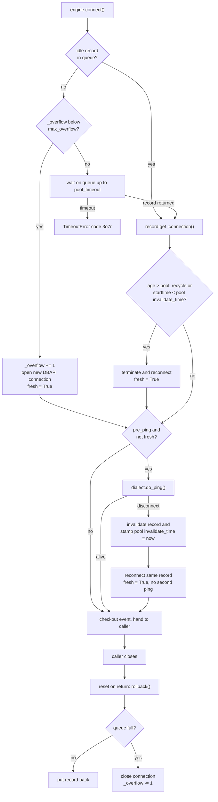

# SQLAlchemy Connection Pooling: QueuePool, AsyncAdaptedQueuePool, pool_size, max_overflow, pool_timeout, pool_recycle, and pool_pre_ping

> [!summary] Claim
> A SQLAlchemy pool is a bounded queue of connection records plus a signed overflow counter, and every liveness rule (`pool_recycle`, pool-wide invalidation, `pool_pre_ping`) runs only at checkout, so a connection that dies while checked out still fails its request, while `pool_pre_ping` turns a database restart into one invisible reconnect, not one failed request per pooled connection, as the lab measures.

Part of [Database Access and Transactions for APIs](README.md) in [API Engineering](../README.md).

## TL;DR

Mechanism: `QueuePool` keeps at most `pool_size` idle records in a `deque` guarded by a `threading.RLock`, counts extra connections in `_overflow` (which starts at `-pool_size`), and blocks for `pool_timeout` seconds only once `pool_size + max_overflow` connections are checked out `(sqlalchemy 2.1.8 sqlalchemy/pool/impl.py, QueuePool._do_get)`.
Contract rule: `AsyncAdaptedQueuePool` is a `QueuePool` subclass with its queue swapped for an `asyncio.Queue`, so waiters suspend instead of blocking the loop, and `create_async_engine` raises `ArgumentError` (code `pcls`) when given the thread-blocking `QueuePool`.
Trap: `pool_recycle`, pre-ping, and pool invalidation run only at checkout, a fresh connection is never pinged, and a checkout retries a disconnect once (two attempts in source), not the "three times" the documentation, the `DisconnectionError` docstring, and a comment inside `_checkout` itself state.
Portability: all 17 lab tests pass on CPython 3.12.13, 3.13.18, 3.14.6, 3.14.10, and 3.15.2 with SQLAlchemy 2.1.8, and on 3.14.6 with 2.0.57, while the 3.15.0b3 free-threaded build segfaults inside SQLAlchemy's compiled extensions and inside greenlet.
When not to use this: put `NullPool` in front of PgBouncer transaction pooling or in short-lived processes, and never share a pooled connection across `os.fork()`.

## Mental model



A checkout first tries the queue without waiting, and only when the overflow budget is exhausted does it block, for at most `pool_timeout` seconds, before raising `TimeoutError`.
A record that comes out of the queue is checked against three timestamps: its own age against `pool_recycle`, the pool-wide `invalidate_time` stamped by the last detected disconnect, and its own soft-invalidation time; any hit closes the socket and reconnects in place.
Only then does pre-ping run, and it skips any connection opened during this checkout, because a connection that was just created is known to be alive.
A failed ping invalidates the record and moves the pool's `invalidate_time` to now, which condemns every older connection in the queue without touching them; each one is reconnected without a ping when it is next checked out.
On return, the pool rolls back, then puts the record back unless the queue already holds `pool_size` records, in which case the connection is an overflow connection and is closed.

## How it works

### The layers: Pool, record, fairy

SQLAlchemy splits a pooled connection into three objects `(sqlalchemy 2.1.8 sqlalchemy/pool/base.py, _ConnectionRecord, _ConnectionFairy)`.
The `_ConnectionRecord` is a slot in the pool: it owns the DBAPI connection, its `starttime` (set from `time.time()` immediately before the driver's connect call), a `fresh` flag, and a weak reference to whichever fairy currently has it checked out.
The `_ConnectionFairy` is the per-checkout proxy handed to `Connection`; it carries a reentrancy `_counter` (so nested `connect()` calls on the same fairy do not run the checkout logic twice) and, since 2.1.0rc2, a `weakref.finalize` that returns the record if the fairy is garbage collected without being closed.
`Pool` subclasses implement only `_do_get` and `_do_return_conn`; everything about liveness lives in the record and the fairy, which is why `QueuePool`, `NullPool`, `StaticPool`, and `AsyncAdaptedQueuePool` share recycle, invalidation, pre-ping, and reset-on-return behavior.

### QueuePool: a bounded deque and a signed counter

`QueuePool.__init__` builds `self._pool = self._queue_class(pool_size, use_lifo=use_lifo)` (`_queue_class` is `sqla_queue.Queue` on `QueuePool`), sets `self._overflow = 0 - pool_size`, and forces `self._max_overflow = -1` when `pool_size == 0` `(sqlalchemy 2.1.8 sqlalchemy/pool/impl.py, QueuePool.__init__)`.
The negative start is the whole trick: `_overflow` counts every connection that exists, offset by `pool_size`, so it reaches `0` when `pool_size` connections exist and `max_overflow` at the hard cap.
The pool opens nothing eagerly; the lab's first snapshot is `PoolSnapshot(size=2, checked_in=0, overflow=-2, checked_out=0)`.
`checkedout()` is computed, not stored: `maxsize - qsize() + _overflow` `(sqlalchemy 2.1.8 sqlalchemy/pool/impl.py, QueuePool.checkedout)`.

`_do_get` reads as follows `(sqlalchemy 2.1.8 sqlalchemy/pool/impl.py, QueuePool._do_get)`:

1. `wait = use_overflow and self._overflow >= self._max_overflow`, that is, block only when no overflow budget remains.
2. `self._pool.get(wait, self._timeout)` returns an idle record if there is one; when `wait` is false and the queue is empty it raises `Empty` at once.
3. If the cap is reached and the get timed out, raise `exc.TimeoutError("QueuePool limit of size %d overflow %d reached, connection timed out, timeout %0.2f", code="3o7r")`.
4. If the cap was reached between steps 1 and 3 by another thread and `wait` was false, recurse into `_do_get()` to wait properly.
5. Otherwise `_inc_overflow()` takes `_overflow_lock`, increments if still below the cap, and the pool creates a new record; if creation raises, `_dec_overflow()` gives the slot back under `safe_reraise()`.

The wait is the condition-variable loop of `sqlalchemy.util.queue.Queue.get`, an adaptation of the old stdlib `Queue` that uses an `RLock` because a garbage-collection callback can return a connection (a `put`) from inside a `get` on the same thread `(sqlalchemy 2.1.8 sqlalchemy/util/queue.py, module docstring and Queue.__init__)`.
`pool_timeout` therefore bounds only the time spent waiting for another caller to return a record.
It does not bound the time to open a new connection: `_create_connection()` runs after the timed `get`, so a slow or blackholed server is governed by the driver's own connect timeout, which is `timeout=60` seconds by default in `asyncpg` `(asyncpg 0.32.0 asyncpg/connection.py, connect)` and the `connect_timeout` connection parameter in psycopg, which falls back to `_DEFAULT_CONNECT_TIMEOUT = 130` seconds when unset or `<= 0` and is raised to a 2-second minimum `(psycopg 3.3.8 psycopg/conninfo.py, timeout_from_conninfo)`.

Return is `_do_return_conn`: `self._pool.put(record, False)`, and on `Full` the record is closed and `_overflow` decremented `(sqlalchemy 2.1.8 sqlalchemy/pool/impl.py, QueuePool._do_return_conn)`.
Nothing marks a connection as "overflow" when it is created; whichever connection happens to be returned when the queue is already full is the one closed.
With `pool_size=0`, `Queue._full()` is `maxsize > 0 and ...`, which is never true, so the queue is unbounded and every connection ever opened is kept; the lab opens 8, returns 8, and sees `checked_in == 8` with zero closes.

`pool_use_lifo=True` only changes `Queue._get` from `popleft()` to `pop()` `(sqlalchemy 2.1.8 sqlalchemy/util/queue.py, Queue._get)`.
FIFO rotates through every idle connection, keeping all of them warm, so none ever idles long enough for a server or load balancer timeout to reap it; LIFO keeps reusing the hottest few and lets the rest idle out, which is the documented reason to pair it with pre-ping.

### AsyncAdaptedQueuePool: same algorithm, asyncio queue

`AsyncAdaptedQueuePool(QueuePool)` overrides exactly three class attributes: `_is_asyncio = True`, `_queue_class = AsyncAdaptedQueue`, and `_dialect = _AsyncConnDialect()` `(sqlalchemy 2.1.8 sqlalchemy/pool/impl.py, AsyncAdaptedQueuePool)`.
`AsyncAdaptedQueue` creates its `asyncio.Queue` (or `asyncio.LifoQueue`) lazily in a memoized `_queue` property, so an engine built at import time does not bind to the wrong loop `(sqlalchemy 2.1.8 sqlalchemy/util/queue.py, AsyncAdaptedQueue._queue)`.
`get()` first tries `get_nowait()`, and only if that raises `QueueEmpty` does it call `await_(compat.wait_for(timeout, self._queue.get))`; `await_` is the greenlet bridge that suspends the calling greenlet and yields to the event loop (see [[Async-SQLAlchemy-Under-the-Hood-Greenlet-Bridge-and-MissingGreenlet]]).
On Python 3.12 and later `compat.wait_for` is `asyncio.wait_for`; on 3.11 it is `asyncio.timeout` because 3.11's `wait_for` could swallow a cancellation (gh-86296) `(sqlalchemy 2.1.8 sqlalchemy/util/compat.py, wait_for)`.
A timeout surfaces as `asyncio.TimeoutError` -> `Empty` -> the same `TimeoutError` text, so the lab matches `"QueuePool limit of size 1 overflow 0"` on the async engine as well.
`_overflow_lock` is still a `threading.Lock`, but it is held only around an integer compare-and-increment, never across an `await`.

The pool and the loop are bound: `asyncio.Queue` inherits `_LoopBoundMixin`, which records the first running loop that waits on it and raises `RuntimeError(... is bound to a different event loop)` from any other loop `(CPython 3.14.10 Lib/asyncio/mixins.py, _LoopBoundMixin._get_loop)`.
Only a waiting `get()` calls `_get_loop()` (an uncontended `get_nowait()` and the `put_nowait()` on return do not), so an `AsyncEngine` shared across pytest's per-function event loops, or across threads each running a loop, binds to the loop of its first contended checkout and fails on the first contended checkout from any other loop, not on the first checkout.

Pool selection happens in `DefaultDialect.get_pool_class`: in 2.1.8 it returns the dialect class's `poolclass` attribute if set, else `AsyncAdaptedQueuePool` when the dialect `is_async` and `QueuePool` otherwise `(sqlalchemy 2.1.8 sqlalchemy/engine/default.py, DefaultDialect.get_pool_class)`.
In 2.0.57 the default method returns `QueuePool` and each async dialect overrides it, returning `FallbackAsyncAdaptedQueuePool` when the URL carries `async_fallback=true` `(sqlalchemy 2.0.57 sqlalchemy/dialects/postgresql/asyncpg.py, PGDialect_asyncpg.get_pool_class)`; 2.1.0b1 removed `async_fallback`, and `FallbackAsyncAdaptedQueuePool` is gone from 2.1.8's `pool/impl.py`.
SQLite is special: `sqlite+aiosqlite` with a file uses `AsyncAdaptedQueuePool`, and `:memory:` or an empty database name uses `StaticPool` (one shared connection) `(sqlalchemy 2.1.8 sqlalchemy/dialects/sqlite/aiosqlite.py, SQLiteDialect_aiosqlite.get_pool_class)`.
Since 2.1.0rc1 (#13433), selecting `StaticPool` only because the URL carries `mode=memory` emits a deprecation warning (code `sqmp`), because a future release will give such URLs `AsyncAdaptedQueuePool`; plain `:memory:` does not warn `(sqlalchemy 2.1.8 sqlalchemy/dialects/sqlite/pysqlite.py, SQLiteDialect_pysqlite._warn_memory_mode_pool_selection)`.
After building the pool, `create_engine` raises `ArgumentError("Pool class QueuePool cannot be used with asyncio engine", code="pcls")` when `pool._is_asyncio is not dialect.is_async` `(sqlalchemy 2.1.8 sqlalchemy/engine/create.py, create_engine)`; this check exists in 2.0.57 too.

### create_engine parameter mapping

`create_engine` inspects the pool class's constructor and pops matching keyword arguments, translating `timeout` <- `pool_timeout`, `recycle` <- `pool_recycle`, `pre_ping` <- `pool_pre_ping`, `use_lifo` <- `pool_use_lifo`, `reset_on_return` <- `pool_reset_on_return`, `logging_name` <- `pool_logging_name`, `echo` <- `echo_pool`, and the deprecated `events` <- `pool_events`; `pool_size` and `max_overflow` pass through under their own names `(sqlalchemy 2.1.8 sqlalchemy/engine/create.py, _pool_translate_kwargs)`.
Because only constructor arguments are consumed, `pool_size=5` passed with `poolclass=NullPool` is left over and `create_engine` raises `TypeError("Invalid argument(s) ...")` rather than silently ignoring it.

### Checkout liveness: recycle, generation invalidation, soft invalidation

`_ConnectionRecord.get_connection` runs on every checkout of an existing record and reconnects in place when any of these holds, in this order `(sqlalchemy 2.1.8 sqlalchemy/pool/base.py, _ConnectionRecord.get_connection)`:

1. `dbapi_connection is None` (the record was hard-invalidated earlier): connect.
2. `pool._recycle > -1 and time.time() - self.starttime > pool._recycle`: log `"exceeded timeout; recycling"`.
3. `pool._invalidate_time > self.starttime`: log `"invalidated due to pool invalidation"`.
4. `self._soft_invalidate_time > self.starttime`: a soft invalidation requested while the connection was checked out.

Each recycle is `__close(terminate=True)` followed by `__connect()`, which resets `starttime` and sets `fresh = True`.
`pool_recycle` is measured from connection creation, not from last use, so `pool_recycle=3600` reconnects a busy connection once an hour.
The comparisons use strict `>` on `time.time()`, and the source comment notes Windows `time.time()` may be accurate only to about 16 ms, so an invalidation and a reconnect inside the same clock tick can be indistinguishable there.
None of this runs while a connection is checked out; the lab advances a fake clock past `pool_recycle` while holding a connection, executes `SELECT 1` on the same DBAPI connection, and sees the reconnect only on the next checkout.

`Pool._invalidate(connection, exception)` is the generation mechanism: if the failing connection's `starttime` is newer than the pool's `_invalidate_time`, it sets `_invalidate_time = time.time()`, condemning every connection created before now `(sqlalchemy 2.1.8 sqlalchemy/pool/base.py, Pool._invalidate)`.
Idle connections are not touched (no I/O, no pings); they fail rule 3 when next checked out.
The engine calls `pool._invalidate` from `Connection._handle_dbapi_exception` whenever `dialect.is_disconnect(...)` is true for a statement error `(sqlalchemy 2.1.8 sqlalchemy/engine/base.py, Connection._handle_dbapi_exception)`.
An exit exception (any `BaseException` that is not an `Exception`, plus `asyncio.TimeoutError` and `asyncio.CancelledError`) is treated as a disconnect of that one connection, which is invalidated, but it does not stamp the pool generation `(sqlalchemy 2.1.8 sqlalchemy/util/concurrency.py, is_exit_exception)`.
So a request cancelled mid-statement costs its connection a reconnect, because the wire protocol state is unknown, without condemning its idle siblings.

### pool_pre_ping: one ping, invalidate the generation, reconnect once

The ping lives in `_ConnectionFairy._checkout` `(sqlalchemy 2.1.8 sqlalchemy/pool/base.py, _ConnectionFairy._checkout)`.
It is skipped entirely when there is no `checkout` listener and no pre-ping, or when `_counter != 1` (a nested checkout of the same fairy).
Otherwise it runs a loop with `attempts = 2`:

1. Read and clear `record.fresh`; if pre-ping is on and the connection is not fresh, call `pool._dialect._do_ping_w_event(dbapi_connection)`.
2. A false result raises `InvalidatePoolError`, a `DisconnectionError` subclass with `invalidate_pool = True`.
3. Run `checkout` listeners; a listener may also raise `DisconnectionError`.
4. On `DisconnectionError`: hard-invalidate this record, and if `invalidate_pool` also call `pool._invalidate(fairy, e, _checkin=False)`; then reconnect the record with `get_connection()` and decrement `attempts`.
5. If reconnecting raises, the record is checked back in (empty) and the connect error propagates to the caller.
6. After two failed attempts: `fairy.invalidate()` and `InvalidRequestError("This connection is closed")`.

Three consequences follow, each measured in the lab.
First, a fresh connection is never pinged, so the reconnected connection in step 4 is not pinged on the second loop iteration, and a pure pre-ping checkout emits at most one ping; the lab counts zero pings on the first checkout and one on each reuse.
Second, the retry budget is two attempts, not three: a `checkout` listener that always raises `DisconnectionError` is called twice, the record is connected three times (one original plus two reconnects), and the caller gets `InvalidRequestError`; the pooling documentation says the pre-ping "will try up to three times", the `DisconnectionError` docstring says the exception "will be caught three times in a row", and the comment directly above `attempts = 2` says "there are three attempts made here"; all three disagree with the code in 2.1.8 and 2.0.57 (the `_checkout` body is identical in both).
Third, one failed ping condemns the generation: after a simulated restart of a two-connection pool, the first request pings, fails, invalidates, and reconnects, and the second request's connection is recycled by rule 3 without a ping, so the lab sees exactly one `invalidate` event and four `connect` events.

`DefaultDialect._do_ping_w_event` calls `do_ping`, catches only `loaded_dbapi.Error`, and returns `False` only if `is_disconnect(err, ...)` is true; any other DBAPI error propagates out of the checkout `(sqlalchemy 2.1.8 sqlalchemy/engine/default.py, DefaultDialect._do_ping_w_event)`.
A ping is therefore exactly as good as the dialect's `is_disconnect` classifier.
`DefaultDialect.do_ping` opens a cursor and executes `_dialect_specific_select_one`, which is `str(select(1).compile(dialect=self))`.
Drivers differ `(sqlalchemy 2.1.8)`:

| Dialect | `do_ping` | `is_disconnect` rule |
|---|---|---|
| `postgresql+asyncpg` | `connection.ping()` -> `fetchrow(";")`, wrapped in an explicit transaction when none is open and the connection is not in autocommit, "to support pgbouncer transaction mode" (#10226) `(dialects/postgresql/asyncpg.py, AsyncAdapt_asyncpg_connection._async_ping)` | `connection._connection.is_closed()`, or `InterfaceError` containing `"connection is closed"` |
| `postgresql+psycopg` | `_PGDialect_common_psycopg.do_ping` switches the connection to autocommit, executes `_dialect_specific_select_one` (overridden to `";"` in `PGDialect_psycopg`), and restores autocommit `(dialects/postgresql/_psycopg_common.py, dialects/postgresql/psycopg.py)` | DBAPI `Error` with `connection.closed or connection.broken` |
| `sqlite` (pysqlite) | default `SELECT 1` | `ProgrammingError` containing `"Cannot operate on a closed database."` `(dialects/sqlite/pysqlite.py, SQLiteDialect_pysqlite.is_disconnect)` |
| `sqlite+aiosqlite` | default `SELECT 1` | `OperationalError` containing `"no active connection"` or `"connection closed"`; the adapter maps aiosqlite's `ValueError` to that `(dialects/sqlite/aiosqlite.py)` |

### Reset on return and the finalizer

On checkin `_finalize_fairy` calls `fairy._reset(...)`, which fires the `reset` event and then calls `do_rollback` for `"rollback"` (the default, also spelled `True`) or `do_commit` for `"commit"`, and does nothing for `None` or `False` `(sqlalchemy 2.1.8 sqlalchemy/pool/base.py, _ConnectionFairy._reset)`.
A `Connection` that already rolled back passes `transaction_was_reset=True`, so the pool skips a second, redundant `rollback()`.
If reset raises an ordinary `Exception`, the record is invalidated rather than returned dirty; if it raises a `BaseException` such as `CancelledError`, the record is checked in through `_checkin_failed` and the exception propagates (#13699, 2.1.6).
`ROLLBACK` reverts uncommitted writes and any `SET` issued inside the aborted transaction, but a `SET` committed earlier persists "until the end of the session" (PostgreSQL 18 `SET`), and so do temporary tables, prepared statements, `LISTEN` registrations, and session-level advisory locks, which `DISCARD ALL` clears, and `DISCARD ALL` "cannot be executed inside a transaction block" (PostgreSQL 18 `DISCARD`).

A checked-out fairy that is dropped without `close()` is returned by its `weakref.finalize` callback with `is_gc_cleanup=True`.
For a sync dialect the connection is reset and checked in normally; the lab deletes an unclosed `raw_connection()` and sees `checked_in == 1`.
For an async dialect no I/O is possible from a finalizer, so the connection is detached and terminated (or dropped, when the driver has no `terminate`), and the pool logs and warns `"The garbage collector is trying to clean up non-checked-in connection ..."` `(sqlalchemy 2.1.8 sqlalchemy/pool/base.py, _finalize_fairy)`.
2.0.57 implements the same cleanup with a `weakref.ref` callback plus a module-level `_strong_ref_connection_records` dictionary; 2.1.0rc2 switched to `weakref.finalize`, and 2.1.7 (#13738) gave `fairy_ref` a no-op callback because CPython 3.15 no longer clears callback-free weakrefs to objects in reference cycles before finalizers run (the gh-135552 GC change), which had left cycle-collected connections checked out.

### dispose, recreate, and fork

`QueuePool.dispose()` closes only the connections currently in the queue and resets `_overflow` to `-size()`; checked-out connections are untouched `(sqlalchemy 2.1.8 sqlalchemy/pool/impl.py, QueuePool.dispose)`.
`Engine.dispose(close=True)` disposes and then swaps in `pool.recreate()`, a new pool with identical arguments and the same event dispatch; `close=False` skips the dispose but still swaps in the recreated pool, leaving the old pool's connections untouched, which is the documented call for a child process after `os.fork()`, so the child never touches the parent's sockets `(sqlalchemy 2.1.8 sqlalchemy/engine/base.py, Engine.dispose)`.
`AsyncEngine.dispose()` must be awaited because closing asyncio connections is I/O.

## Numbers and limits

| Quantity | Value | Source |
|---|---|---|
| `pool_size` default | `5` | `QueuePool.__init__` signature (sqlalchemy 2.1.8) |
| `max_overflow` default | `10` | same |
| `pool_timeout` default | `30.0` seconds | same |
| Hard cap per engine (pool) | `pool_size + max_overflow`, default `15` | `QueuePool._do_get`; lab cap test |
| `_overflow` at creation | `-pool_size` | `QueuePool.__init__`; lab snapshot `overflow=-2` |
| `pool_size=0` | unbounded queue and `max_overflow` forced to `-1` | `QueuePool.__init__`, `Queue._full`; lab keeps 8 of 8 |
| `pool_recycle` default | `-1` (never) | `Pool.__init__` |
| Checkout disconnect attempts | `2` | `_ConnectionFairy._checkout` (`attempts = 2`) in 2.1.8 and 2.0.57; lab counts 2 listener calls, 3 connects |
| Documented attempts | "up to three times" | SQLAlchemy 2.1 pooling docs (disagrees with source) |
| Pings per checkout with pre-ping | `0` if fresh, else `1` | `_checkout`; lab |
| Requests failed by a restart, pre-ping off | `1` per checked-in generation, then healed | lab: 1 `DBAPIError` with `connection_invalidated=True`, then 2 successes |
| Requests failed by a restart, pre-ping on | `0` for idle connections | lab |
| Pre-ping cost | one extra driver call per reused checkout (`do_ping`: a `;` statement on psycopg, `ping()` on asyncpg), so one network round trip | mechanism from source `(sqlalchemy 2.1.8 sqlalchemy/pool/base.py, _ConnectionFairy._checkout)`; the latency is the network RTT to the database, which the lab (in-process SQLite) does not measure, so this note gives no millisecond figure |
| `asyncpg` connect timeout default | `60` seconds | `asyncpg 0.32.0 asyncpg/connection.py, connect(timeout=60)` |
| psycopg connect timeout when `connect_timeout` is unset | `130` seconds, minimum `2` | `psycopg 3.3.8 psycopg/conninfo.py, _DEFAULT_CONNECT_TIMEOUT`, `timeout_from_conninfo` |
| PostgreSQL `max_connections` default | "typically 100" | PostgreSQL 18.7 docs (as of 2026-11) |
| PostgreSQL `superuser_reserved_connections` default | `3` | same |
| PostgreSQL `idle_session_timeout`, `idle_in_transaction_session_timeout` | `0` (disabled) | PostgreSQL 18.7 docs (as of 2026-11) |
| AWS NLB TCP idle timeout | `350` seconds default, `60`-`6000` configurable, fixed `350` for TLS listeners | AWS ELB docs (as of 2026-11) |
| MySQL idle disconnect | "eight hours" by default | `create_engine` `pool_recycle` docstring (sqlalchemy 2.1.8) |
| Windows `time.time()` accuracy | about 16 ms | comment in `_ConnectionRecord.get_connection` |
| Lab runtime | 17 tests in `1.33s` (one run, 2026-11-15) | `uv run --frozen pytest ... -q`, CPython 3.14.6, macOS 27.3 arm64 (Apple M3 Pro) |
| Lab async timeout | `pool_timeout=0.2` with at least 10 ticks of a 10 ms ticker during the wait | lab assertion; exact tick counts were not recorded |

The arithmetic that matters across processes (`workers x pods x (pool_size + max_overflow) <= max_connections - reserved`) belongs to [[Sizing-Connection-Pools-Across-Workers-Pods-and-PgBouncer-Transaction-Mode]].

## Portability

| Behavior | 3.12.13 | 3.13.18 | 3.14.6 | 3.14.10 | 3.15.2 | 3.15.0b3t (GIL off) | SQLAlchemy 2.0.57 on 3.14.6 |
|---|---|---|---|---|---|---|---|
| Cap and `TimeoutError` code `3o7r` | pass | pass | pass | pass | pass | pass | pass |
| Overflow closed on checkin, snapshots | pass | pass | pass | pass | pass | pass | pass |
| `pool_size=0` unbounded | pass | pass | pass | pass | pass | pass | pass |
| Pre-ping skips fresh, pings reused | pass | pass | pass | pass | pass | segfault (see below) | pass |
| Pre-ping heals restart, one invalidation | pass | pass | pass | pass | pass | not reached | pass |
| No pre-ping: one failed request then healed | pass | pass | pass | pass | pass | not reached | pass |
| Checkout retry budget is 2 | pass | pass | pass | pass | pass | not reached | pass |
| Recycle only at checkout | pass | pass | pass | pass | pass | not reached | pass |
| FIFO vs LIFO reuse | pass | pass | pass | pass | pass | not reached | pass |
| Reset on return leaks with `None` | pass | pass | pass | pass | pass | not reached | pass |
| Finalizer returns unclosed sync connection | pass | pass | pass | pass | pass | not reached | pass |
| Async default pool and `pcls` guard | pass | pass | pass | pass | pass | crash importing `sqlalchemy.ext.asyncio` | pass |
| Async timeout does not block loop | pass | pass | pass | pass | pass | crash | pass |
| Async waiter handoff, async pre-ping | pass | pass | pass | pass | pass | crash | pass |
| `FallbackAsyncAdaptedQueuePool`, `async_fallback` | absent | absent | absent | absent | absent | absent | present (source) |
| GC cleanup mechanism | `weakref.finalize` | same | same | same | same | same | `weakref.ref` callback (source) |

Every "pass" cell is one run of the 17-test module on that interpreter (macOS 27.3 arm64), with the 3.12 to 3.15.2 legs in separate locked virtual environments (`UV_PROJECT_ENVIRONMENT`) and the 2.0.57 leg via `--no-group sqlalchemy21 --group sqlalchemy20`.
The matrix pins 3.12.16 and 3.15.2t; neither is installed here, so 3.12.13 and the 3.15.0b3 free-threading build were used.
On 3.15.0b3t the locked workspace cannot install (`psycopg-binary==3.3.8` has no wheel), so a minimal virtual environment was built (`sqlalchemy[asyncio]==2.1.8`, `aiosqlite==0.22.1`, `pytest==9.2.0`, `pytest-asyncio==1.4.1.post1`, greenlet 3.5.6 resolved).
There, `greenlet.getcurrent().gr_context` segfaults with the GIL on or off, so importing `sqlalchemy.ext.asyncio` crashes at `sqlalchemy/util/concurrency.py` line 85; a temporary sync-only copy of the module passed the first three tests (which open connections but run no SQL) and then segfaulted on the first statement execution, in `sqlalchemy/sql/cache_key.py` `_generate_cache_key`, with SQLAlchemy's Cython extensions loaded.
A plain `create_engine("sqlite:///...")` plus `SELECT 1` script reproduces that crash, so it is not a pool behavior; it is recorded as an environment failure on a beta interpreter and was not reported upstream from here.
ASGI servers (Uvicorn, Hypercorn, Granian) and HTTP versions do not change pool mechanics, which run inside the application process; the server only sets how many concurrent requests contend for the pool.
Debian and Alpine container legs were not run (lab checks paused).

## Worked example

The [implementation](../labs/src/api_labs/f13_database_access_and_transactions_for_apis/connection_pooling.py) attaches a ledger to the real pool events, snapshots `QueuePool` counters, and simulates a database restart by closing every driver connection underneath the pool, which still holds the records, exactly as it holds sockets a restarted server has reset.
The [test](../labs/tests/f13_database_access_and_transactions_for_apis/test_connection_pooling_internals_queuepool_asyncadaptedqueuepool_and_pre_ping.py) drives real `QueuePool` and `AsyncAdaptedQueuePool` instances over SQLite files, so it needs no server or socket.

```python
"""Connection pool lab: QueuePool and AsyncAdaptedQueuePool limits, recycle, reset, and pre-ping.

The lab drives real SQLAlchemy pools over SQLite files, so no server or socket is needed.
A database restart is simulated by closing every raw driver connection behind the pool's
back: the pool still holds the records, exactly as it holds sockets the server has reset.
"""

from __future__ import annotations

from dataclasses import dataclass, field
from typing import TYPE_CHECKING, Any

from sqlalchemy import event, text
from sqlalchemy.pool import QueuePool

if TYPE_CHECKING:
    from sqlalchemy.engine import Engine
    from sqlalchemy.engine.interfaces import DBAPIConnection
    from sqlalchemy.ext.asyncio import AsyncEngine
    from sqlalchemy.pool import ConnectionPoolEntry, PoolProxiedConnection


@dataclass
class PoolLedger:
    """Counts pool lifecycle events and keeps every driver connection the pool opened."""

    connects: int = 0
    checkouts: int = 0
    checkins: int = 0
    invalidations: int = 0
    closes: int = 0
    drivers: list[Any] = field(default_factory=list[Any])


def attach_ledger(engine: Engine) -> PoolLedger:
    """Listen to the engine's pool events; pass `AsyncEngine.sync_engine` for async engines."""
    ledger = PoolLedger()

    def on_connect(dbapi_connection: DBAPIConnection, record: ConnectionPoolEntry) -> None:
        ledger.connects += 1
        ledger.drivers.append(record.driver_connection)

    def on_checkout(
        dbapi_connection: DBAPIConnection,
        record: ConnectionPoolEntry,
        proxy: PoolProxiedConnection,
    ) -> None:
        ledger.checkouts += 1

    def on_checkin(dbapi_connection: DBAPIConnection | None, record: ConnectionPoolEntry) -> None:
        ledger.checkins += 1

    def on_invalidate(
        dbapi_connection: DBAPIConnection,
        record: ConnectionPoolEntry,
        exception: BaseException | None,
    ) -> None:
        ledger.invalidations += 1

    def on_close(dbapi_connection: DBAPIConnection, record: ConnectionPoolEntry) -> None:
        ledger.closes += 1

    event.listen(engine, "connect", on_connect)
    event.listen(engine, "checkout", on_checkout)
    event.listen(engine, "checkin", on_checkin)
    event.listen(engine, "invalidate", on_invalidate)
    event.listen(engine, "close", on_close)
    return ledger


@dataclass(frozen=True)
class PoolSnapshot:
    """The four counters `QueuePool.status()` prints."""

    size: int
    checked_in: int
    overflow: int
    checked_out: int


def snapshot(engine: Engine) -> PoolSnapshot:
    pool = engine.pool
    if not isinstance(pool, QueuePool):
        raise TypeError(f"expected a QueuePool subclass, got {type(pool).__name__}")
    return PoolSnapshot(pool.size(), pool.checkedin(), pool.overflow(), pool.checkedout())


def drop_server_side(ledger: PoolLedger) -> int:
    """Close every sync driver connection under the pool, as a server restart would."""
    dropped = len(ledger.drivers)
    for driver in ledger.drivers:
        driver.close()
    ledger.drivers.clear()
    return dropped


async def drop_server_side_async(ledger: PoolLedger) -> int:
    """Close every aiosqlite driver connection under the pool, as a server restart would."""
    dropped = len(ledger.drivers)
    for driver in ledger.drivers:
        await driver.close()
    ledger.drivers.clear()
    return dropped


def serve_request(engine: Engine) -> int:
    """One API request: check out, run `SELECT 1`, return the connection to the pool."""
    with engine.connect() as conn:
        return int(conn.execute(text("SELECT 1")).scalar_one())


async def serve_request_async(engine: AsyncEngine) -> int:
    async with engine.connect() as conn:
        return int((await conn.execute(text("SELECT 1"))).scalar_one())
```

The central tests, excerpted byte-for-byte from the test module, prove the restart behavior with and without pre-ping:

```python
@pytest.mark.unit
def test_pre_ping_replaces_dead_connection_and_invalidates_its_generation(
    tmp_path: Path,
) -> None:
    engine = sqlite_engine(tmp_path, pool_size=2, max_overflow=0, pool_pre_ping=True)
    ledger = attach_ledger(engine)
    first, second = engine.connect(), engine.connect()
    first.close()
    second.close()
    assert drop_server_side(ledger) == 2

    assert serve_request(engine) == 1
    assert serve_request(engine) == 1
    # One failed ping invalidated the whole generation: the second stale
    # connection was recycled on checkout without being pinged at all.
    assert ledger.invalidations == 1
    assert ledger.connects == 4
    assert snapshot(engine).checked_in == 2
    engine.dispose()


@pytest.mark.unit
def test_without_pre_ping_one_request_fails_then_the_pool_heals(tmp_path: Path) -> None:
    engine = sqlite_engine(tmp_path, pool_size=2, max_overflow=0)
    ledger = attach_ledger(engine)
    first, second = engine.connect(), engine.connect()
    first.close()
    second.close()
    drop_server_side(ledger)

    with pytest.raises(exc.DBAPIError) as caught:
        serve_request(engine)
    assert caught.value.connection_invalidated is True
    assert "Cannot operate on a closed database." in str(caught.value.orig)
    assert serve_request(engine) == 1
    assert serve_request(engine) == 1
    assert ledger.invalidations == 1
    engine.dispose()
```

And the test that contradicts the documented retry count:

```python
@pytest.mark.unit
def test_checkout_disconnection_error_is_retried_once_not_three_times(tmp_path: Path) -> None:
    engine = sqlite_engine(tmp_path, pool_size=1, max_overflow=0)
    ledger = attach_ledger(engine)
    calls: list[int] = []

    @event.listens_for(engine, "checkout")
    def always_disconnected(dbapi_connection: Any, record: Any, proxy: Any) -> None:
        calls.append(1)
        raise exc.DisconnectionError("simulated dead socket")

    with pytest.raises(exc.InvalidRequestError, match="This connection is closed"):
        engine.connect()
    assert len(calls) == 2
    assert ledger.connects == 3
    assert snapshot(engine).checked_in == 1
    engine.dispose()
```

Captured output, run from `labs/` on CPython 3.14.6 (the workspace interpreter), macOS 27.3 arm64:

```text
$ uv run --frozen pytest tests/f13_database_access_and_transactions_for_apis/test_connection_pooling_internals_queuepool_asyncadaptedqueuepool_and_pre_ping.py -q
.................                                                        [100%]
17 passed in 1.33s
```

The other 14 tests cover the cap and `3o7r` timeout, overflow close-on-checkin, `pool_size=0`, ping counting, recycle with a fake clock patched into `sqlalchemy.pool.base.time`, FIFO versus LIFO, reset-on-return leakage, the GC finalizer, the async default pool and `pcls` guard, the async timeout with a ticker proving the loop kept running, the async waiter handoff, and async pre-ping over aiosqlite.

## Pitfalls

> [!warning] Pre-ping does not save the request that is already running
> Trigger: the database restarts, fails over, or a NAT or load balancer silently drops a connection while a request holds it checked out.
> Symptom: that request fails with `OperationalError` or `InterfaceError` and `connection_invalidated=True`, even with `pool_pre_ping=True`, because the ping runs only at checkout (the pooling documentation says pre-ping "does not accommodate for connections dropped in the middle of transactions or other SQL operations").
> Fix: retry whole idempotent transactions on `DBAPIError` where `connection_invalidated` is true (see [[Preventing-and-Recovering-from-Database-Deadlocks-in-API-Transactions]]), and keep transactions short.

> [!warning] pool_timeout is not a connect timeout
> Trigger: the database host blackholes SYNs during a failover while the pool has overflow budget left.
> Symptom: requests hang far longer than `pool_timeout`, because the new-connection path runs after the timed queue wait; with `asyncpg` the default connect `timeout` is 60 seconds.
> Fix: set the driver connect timeout (`connect_args={"timeout": 5}` for asyncpg, `connect_timeout` for psycopg) and a request deadline above both.

> [!warning] Holding a connection across slow non-database work exhausts the pool
> Trigger: an endpoint opens a session, runs a query, then awaits an external HTTP call or streams a response while the transaction is still open.
> Symptom: under load, `TimeoutError: QueuePool limit of size 5 overflow 10 reached, connection timed out, timeout 30.00` after exactly `pool_timeout` seconds, while the database itself is idle; `pool.status()` shows checked-out equal to 15.
> Fix: end the transaction before the slow await, scope sessions to the unit of work (see [[Request-Scoped-Transaction-Patterns-Commit-As-You-Go-vs-Unit-of-Work]]), and alert on `checkedout()` approaching the cap.

> [!warning] An AsyncEngine reused across event loops
> Trigger: a module-level `AsyncEngine` used by pytest-asyncio's per-function loops, or by `asyncio.run()` called repeatedly.
> Symptom: `RuntimeError: <Queue ...> is bound to a different event loop` on the first contended checkout, or connections whose transports belong to a closed loop.
> Fix: create the engine inside the application lifespan or a loop-scoped fixture and `await engine.dispose()` at the end.

> [!warning] Disabling reset on return leaks state between requests
> Trigger: `pool_reset_on_return=None` to save a round trip, with code that forgets to commit or roll back, or issues session-level `SET` statements.
> Symptom: the next request on that connection sees the previous request's uncommitted rows, locks, or settings; the lab reads `1` leaked row with `None` and `0` with `"rollback"`.
> Fix: keep the default, and for tenant or role settings use `SET LOCAL` inside the transaction, or a `reset` event that runs `DISCARD ALL` outside a transaction.

> [!warning] LIFO without pre-ping
> Trigger: `pool_use_lifo=True` behind a server or middlebox idle timeout, such as the AWS NLB's 350 seconds.
> Symptom: the cold tail of the stack sits idle until reaped, and the first burst that reaches it fails one request per dead connection.
> Fix: pair LIFO with `pool_pre_ping=True` (the documentation's recommendation), or set `pool_recycle` below the shortest idle timeout on the path.

> [!warning] Forked workers sharing sockets
> Trigger: an engine connects in the Gunicorn master (for example during app import with `preload_app`), then workers fork.
> Symptom: two processes interleave bytes on one socket: protocol errors, wrong result sets, or a hung connection.
> Fix: call `engine.dispose(close=False)` in the post-fork hook, or create engines after fork (see [[Multi-Process-Worker-Topologies-Gunicorn-Uvicorn-Workers-vs-Kubernetes-Replicas]]).

> [!warning] Cancellation during checkin in SQLAlchemy 2.1.0 to 2.1.6
> Trigger: a request task is cancelled (client disconnect, timeout) while its connection is being reset or closed on return.
> Symptom: in releases before the fixes, a connection could be lost from the pool or interfere with the next checkout; the 2.1 changelog lists #12710 and #13622 (2.1.2), #13673 and #13678 (2.1.5), #13699 (2.1.6), and #13749 (2.1.7, lost waiters on Python 3.11).
> Fix: run 2.1.7 or later (2.1.8 is pinned here), or 2.0.56 or later on the 2.0 series, where the changelog marks all of these as backported (2.0.55 and 2.0.56), and do not wrap session cleanup in code that swallows `CancelledError` (see [[Cancellation-Semantics-CancelledError-Swallowing-and-Shielded-Cleanup]]).
> No public production postmortem for these tickets was found; the changelog entries are the primary source.

## Security and robustness

Pool exhaustion is a cheap denial of service and falls under OWASP API4:2023 Unrestricted Resource Consumption, which lists missing "execution timeouts" and "maximum number of file descriptors" among the limits an API must set (see [[Unrestricted-Resource-Consumption-API4-2023-Payload-Depth-and-Limit-Guards]]).
An attacker who finds one endpoint that holds a connection for seconds (an unindexed search, a large export, a slow upstream inside a transaction) needs only `pool_size + max_overflow` concurrent requests per worker to make every other endpoint wait `pool_timeout` and then fail.
Defenses, in depth: a server statement timeout (`statement_timeout`) and `idle_in_transaction_session_timeout` on the database role, an application deadline shorter than `pool_timeout`, a per-route concurrency cap or a separate engine for expensive routes so they cannot starve the hot path, and rate limits ahead of all of it.
Keep `pool_timeout` short for interactive APIs (a few seconds), because a 30-second queue wait converts overload into latency for everyone instead of fast, retryable failures.

A pooled connection is shared state across principals.
`ROLLBACK` clears uncommitted rows and transaction-scoped settings, but not committed session state, so row-level security keyed on a session variable (`SET app.tenant_id = ...`) must use `SET LOCAL` inside the request's transaction, or the next tenant on the connection inherits it (PostgreSQL 18 `SET` semantics).
`pool_reset_on_return="commit"` is unsafe for APIs: it commits whatever the previous request left behind.
Pool logging at `echo_pool="debug"` formats the driver's connection object with `%r` and a failed connect's exception with `%s` `(sqlalchemy 2.1.8 sqlalchemy/pool/base.py, _ConnectionRecord.__connect and _ConnectionFairy._checkout)`, so what it prints is whatever the driver's `repr` and error text contain, and SQLAlchemy does not scrub either; treat pool debug logs as sensitive and do not ship them to shared sinks.
SQLAlchemy's own `URL` masks the password in `str()` and `repr()` (`postgresql+psycopg://u:***@h/db`, run here on 2.1.8) and exposes it only through `render_as_string(hide_password=False)` `(sqlalchemy 2.1.8 sqlalchemy/engine/url.py, URL.render_as_string)`.
Disconnect classification is a trust boundary for availability: a dialect `is_disconnect` that misses a driver's error text (the 2.1.0rc1 entry #13441 fixed this for `mssql-python`) turns a dead connection into a hard error that pre-ping cannot heal.

## The principal's view

The pool is a per-process admission controller in front of the database's only truly scarce resource, backend processes, and the staff-plus decision is where admission control lives: in each process's `QueuePool`, in an external pooler such as PgBouncer, or in both.
In-process pooling gives the lowest latency and full session features (prepared statements, `LISTEN`, temporary tables), but its total is `processes x (pool_size + max_overflow)`, which grows with every autoscaling event and must be budgeted against `max_connections` by whoever owns the fleet.
An external transaction-mode pooler decouples client count from backend count, at the cost of session features and of one more hop; once it is in place, set `poolclass=NullPool` or a small pool in the application so two pools do not fight, and accept that pre-ping then tests the pooler, not the database (see [[Sizing-Connection-Pools-Across-Workers-Pods-and-PgBouncer-Transaction-Mode]]).
Prefer `pool_pre_ping=True` everywhere a failover or idle reaper exists: it costs one round trip per reused checkout and removes a whole class of post-restart errors, while `pool_recycle` alone is a guess about other systems' timeouts.
Prefer a small `pool_size` with modest `max_overflow` and a short `pool_timeout`, so overload fails fast and shows up as a metric, rather than a large pool that moves the queue into the database, where every extra backend costs memory and lock-manager contention.
Choose a different design when the workload is many short-lived processes (serverless functions: `NullPool` plus a managed proxy) or when per-request isolation matters more than latency (a connection per tenant role, or `DISCARD ALL` on reset).

## Interview questions

> [!question] L5: What do `pool_size=5` and `max_overflow=10` mean, and what happens to the sixteenth concurrent request?
>
> > [!success]- Answer
> > The pool keeps up to 5 idle connections and allows up to 10 more to exist temporarily, so at most 15 are checked out at once.
> > The sixteenth checkout waits on the pool's queue for up to `pool_timeout` (30 seconds by default) for another request to return a connection.
> > If none is returned in time it raises `sqlalchemy.exc.TimeoutError` with code `3o7r` and the text `QueuePool limit of size 5 overflow 10 reached`.
> > When the extra connections are returned while 5 are already idle, they are closed rather than kept.
> >
> > Follow-up: Which connection is closed on return, the newest one?

> [!question] L5: Why does `create_async_engine` refuse `poolclass=QueuePool`, and what does it use instead?
>
> > [!success]- Answer
> > `QueuePool` waits on a `threading.Condition`, which would block the event loop thread and every other coroutine with it.
> > `AsyncAdaptedQueuePool` is the same algorithm with an `asyncio.Queue`, so a waiting checkout suspends through the greenlet bridge and the loop keeps running.
> > `create_engine` compares `pool._is_asyncio` with `dialect.is_async` and raises `ArgumentError` with code `pcls` on a mismatch.
> >
> > Follow-up: Which pool does `sqlite+aiosqlite:///:memory:` get, and why?

> [!question] L5: What is the difference between `pool_recycle` and `pool_pre_ping`?
>
> > [!success]- Answer
> > `pool_recycle` replaces a connection at checkout once it is older than N seconds since it was opened, without asking the server anything.
> > `pool_pre_ping` sends a lightweight statement on each checkout of a reused connection and reconnects only if the dialect classifies the failure as a disconnect.
> > Recycle is a guess about other systems' idle timeouts; pre-ping is evidence, at the cost of one round trip.
> > Neither acts on a connection that is checked out.
> >
> > Follow-up: Why would you still set `pool_recycle` when pre-ping is on?

> [!question] L6: Predict the output: with `pool_size=2, max_overflow=1`, you check out three connections, close all three, then print `engine.pool.status()` and the number of `close` pool events.
>
> > [!success]- Answer
> > `Pool size: 2  Connections in pool: 2 Current Overflow: 0 Current Checked out connections: 0`, and exactly one `close` event.
> > Before any checkout, `overflow()` is `-2`, because `_overflow` starts at `-pool_size`; with three checked out it is `1`.
> > On return, the first two records fit in the queue and the third finds it full, so `_do_return_conn` closes it and decrements `_overflow` to `0`.
> > The lab asserts these exact snapshots and `(connects, closes) == (3, 1)`.
> >
> > Follow-up: What would `checked_in` be with `pool_size=0`?

> [!question] L6: The database restarts while ten connections sit idle in the pool and `pool_pre_ping` is off; how many requests fail, and why not ten?
>
> > [!success]- Answer
> > One request fails, the first to use a dead connection, with a `DBAPIError` whose `connection_invalidated` is true.
> > The engine's error handler sees `is_disconnect` and calls `pool._invalidate`, which stamps the pool's `invalidate_time` with the current time.
> > Every connection whose `starttime` is earlier is recycled on its next checkout, without I/O, so the following nine requests reconnect transparently.
> > With pre-ping on, even the first request succeeds, because the failed ping is handled inside checkout.
> >
> > Follow-up: Which connections does the generation stamp fail to protect?

> [!question] L6: Debug this API: a FastAPI service with an `AsyncEngine` at defaults returns `500` under load after exactly 30 seconds with `QueuePool limit of size 5 overflow 10 reached`, yet the database shows almost no active queries, so what do you look for?
>
> > [!success]- Answer
> > Exactly 30 seconds is `pool_timeout`, and an idle database means connections are checked out but not executing, so something holds them across non-database waits.
> > Look for endpoints that await an external HTTP call, a queue publish, or a streaming response while a session's transaction is open, and for sessions or connections that are never closed because a dependency lacks `finally` or `async with`.
> > Confirm with `engine.pool.status()` or `checkedout()` metrics, and `pg_stat_activity` showing `idle in transaction` sessions.
> > Fix by closing the transaction before slow awaits, scoping sessions with `async with`, setting `idle_in_transaction_session_timeout`, and lowering `pool_timeout` so overload fails fast.
> >
> > Follow-up: Would raising `max_overflow` to 100 fix it?

> [!question] L6: How many times does SQLAlchemy retry a checkout when a `checkout` listener or a ping reports a disconnect?
>
> > [!success]- Answer
> > The source loop uses `attempts = 2`, so a listener that always raises `DisconnectionError` runs twice and the caller gets `InvalidRequestError("This connection is closed")`.
> > The documentation's "three times" does not match 2.1.8 or 2.0.57.
> > For pre-ping alone the ping runs at most once, because the reconnected connection is marked `fresh` and fresh connections are not pinged.
> > If the reconnect itself fails, the connect error propagates immediately.
> >
> > Follow-up: How would you prove this in a test without a real database?

> [!question] L7+: You run 40 pods x 4 Uvicorn workers against a PostgreSQL primary with `max_connections=500`; how do you design the pooling?
>
> > [!success]- Answer
> > In-process pools alone allow `160 x (pool_size + max_overflow)` connections, so even the defaults (2400) exceed the server, and autoscaling makes it worse.
> > Either shrink each pool hard (for example `pool_size=2, max_overflow=1`, 480 total, leaving reserved slots) and accept per-worker queuing, or put PgBouncer in transaction mode in front and give the application `NullPool` or a tiny pool.
> > With transaction pooling, disable or account for asyncpg's prepared statement cache, and remember that pre-ping then tests the pooler.
> > Add `statement_timeout`, `idle_in_transaction_session_timeout`, short `pool_timeout`, and a `checkedout()` saturation metric per process.
> >
> > Follow-up: What breaks when a pod scales from 40 to 120 during an incident?

> [!question] L7+: Why does SQLAlchemy invalidate a whole generation of connections on one failed ping instead of pinging each one?
>
> > [!success]- Answer
> > A disconnect usually means a server restart or failover, which kills every connection opened before it, so the cheap inference is "everything older than now is dead".
> > Stamping `invalidate_time` is O(1), does no I/O, and spreads reconnects over subsequent checkouts instead of a thundering herd of pings and connects.
> > The cost is false positives: a single idle connection dropped by a middlebox also recycles healthy siblings, which is cheap but visible as a connect burst.
> > The same reasoning explains why the reconnected connection is not pinged again.
> >
> > Follow-up: How does this interact with `pool_use_lifo=True`?

> [!question] L7+: When would you choose `NullPool` for a production API?
>
> > [!success]- Answer
> > Behind PgBouncer or RDS Proxy in transaction mode, where the external pooler already multiplexes and a second pool only pins its server connections.
> > In short-lived processes (serverless, CLI jobs, forked task workers) where connections would not be reused and a pool risks sharing sockets across `fork()`.
> > The trade-off is a full connect, TLS handshake, and authentication per checkout when no external pooler exists, which is usually milliseconds per request.
> >
> > Follow-up: Does `pool_pre_ping` do anything with `NullPool`?

## Related

Prerequisites: [[Async-PostgreSQL-Drivers-Compared-Asyncpg-vs-Psycopg-3]]

Next: [[Sizing-Connection-Pools-Across-Workers-Pods-and-PgBouncer-Transaction-Mode]]

See also: [[02-Programming-Languages/Python/Python-Backend-Interview-Prep/06-SQL-and-SQLAlchemy]], [[SQLAlchemy-2-x-Architecture-Core-vs-ORM-Engine-and-Unified-Select]], [[Async-SQLAlchemy-Under-the-Hood-Greenlet-Bridge-and-MissingGreenlet]], [[Session-Internals-Identity-Map-Unit-of-Work-Flush-and-Expire-On-Commit]], [[Why-Sharing-an-AsyncSession-Across-Concurrent-Tasks-Corrupts-State]], [[Request-Scoped-Transaction-Patterns-Commit-As-You-Go-vs-Unit-of-Work]], [[Preventing-and-Recovering-from-Database-Deadlocks-in-API-Transactions]], [[Outbound-Connection-Pools-Limits-and-DNS-TTL-Staleness]], [[Multi-Process-Worker-Topologies-Gunicorn-Uvicorn-Workers-vs-Kubernetes-Replicas]], [[Graceful-Shutdown-SIGTERM-Drain-Windows-and-Kubernetes-PreStop-Hooks]], [[Cancellation-Semantics-CancelledError-Swallowing-and-Shielded-Cleanup]], [[Unrestricted-Resource-Consumption-API4-2023-Payload-Depth-and-Limit-Guards]]

- Lab: `labs/tests/f13_database_access_and_transactions_for_apis/test_connection_pooling_internals_queuepool_asyncadaptedqueuepool_and_pre_ping.py`

## Further reading

- [SQLAlchemy 2.1 Connection Pooling](https://docs.sqlalchemy.org/en/21/core/pooling.html) - the maintainer documentation for pessimistic and optimistic disconnect handling, LIFO, reset on return, and fork safety.
- [SQLAlchemy 2.1 changelog](https://docs.sqlalchemy.org/en/21/changelog/changelog_21.html) - the dated record of the `weakref.finalize` switch, `async_fallback` removal, and the 2.1.x cancellation fixes to pool checkin.
- [What's New in SQLAlchemy 2.1](https://docs.sqlalchemy.org/en/21/changelog/migration_21.html) - Python 3.11 minimum and the opt-in `greenlet` dependency for the asyncio extension.
- [CPython gh-135552](https://github.com/python/cpython/issues/135552) - the GC crash whose fix changed when callback-free weakrefs are cleared, which forced SQLAlchemy #13738.
- [PostgreSQL 18 client connection defaults](https://www.postgresql.org/docs/current/runtime-config-client.html) - `idle_session_timeout`, `idle_in_transaction_session_timeout`, and the warning about poolers.
- [PostgreSQL 18 connections and authentication](https://www.postgresql.org/docs/current/runtime-config-connection.html) - `max_connections`, reserved slots, and TCP keepalive settings.
- [PostgreSQL 18 SET](https://www.postgresql.org/docs/current/sql-set.html) and [DISCARD](https://www.postgresql.org/docs/current/sql-discard.html) - exactly which session state survives `ROLLBACK` on a pooled connection.
- [AWS Network Load Balancer TCP idle timeout](https://docs.aws.amazon.com/elasticloadbalancing/latest/network/update-idle-timeout.html) - a concrete middlebox timeout that silently ends idle pooled connections.
- [OWASP API4:2023 Unrestricted Resource Consumption](https://api-security.owasp.org/editions/2023/en/0xa4-unrestricted-resource-consumption) - the threat model for pool exhaustion.
