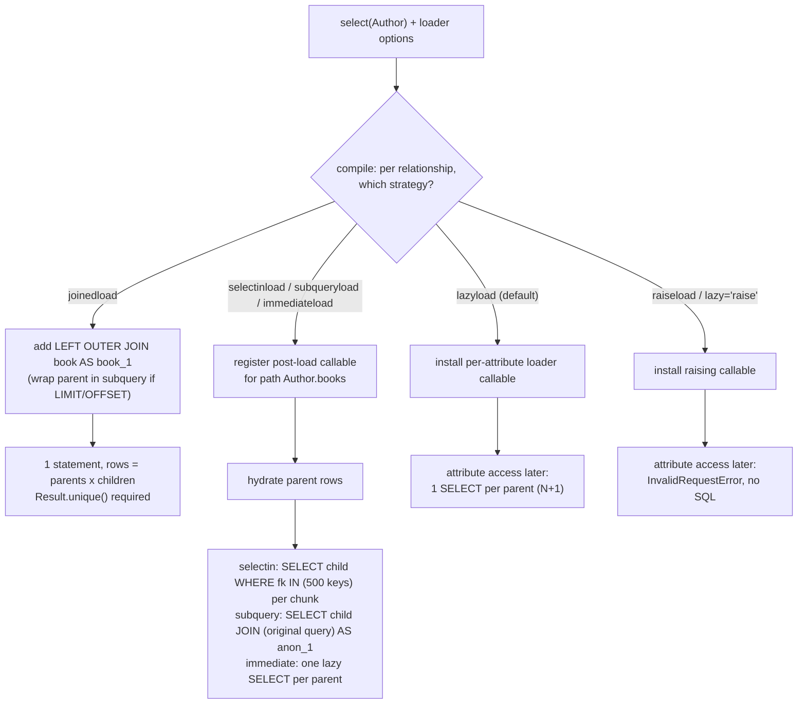

# SQLAlchemy Loading Strategies: selectinload vs joinedload vs subqueryload, contains_eager, and Enforcing Zero N+1 in Tests with raiseload('*')

> [!summary] Claim
> A relationship's loader strategy decides how many statements a request costs, not what it returns: lazy loading costs `1 + N`, `selectinload` costs `1 + ceil(N / 500)` per relationship with no change to the parent query, `joinedload` costs `1` but multiplies rows and must be `.unique()`d, `subqueryload` re-runs the parent query as a subquery, and a test `Session` that appends `raiseload("*")` to every top-level `SELECT` turns any relationship the query forgot to load into an `InvalidRequestError` raised before any SQL is sent.

Part of [Database Access and Transactions for APIs](README.md) in [API Engineering](../README.md).

## TL;DR

- Mechanism: `selectinload` registers a post-load callable that, after the parent rows are hydrated, runs `SELECT ... WHERE fk IN (pk1, ..., pkK)` in chunks of `_chunksize = 500`; `joinedload` adds an anonymously aliased `LEFT OUTER JOIN` to the same statement; `subqueryload` wraps the original statement as `FROM (SELECT parent.id ...) AS anon_1 JOIN child` (sqlalchemy 2.1.8 `lib/sqlalchemy/orm/strategies.py`, `_SelectInLoader`, `_JoinedLoader`, `_SubqueryLoader`).
- Contract rule: every relationship an endpoint serializes is named in the statement's loader options, and the test suite runs with a `Session` subclass whose `do_orm_execute` hook appends `raiseload("*")`, so a missing option fails CI instead of emitting `N` extra queries (or `MissingGreenlet`) in production.
- Trap: `raiseload` is not absolute: it does not apply inside the unit-of-work flush, `sql_only=True` lets many-to-one reads through only when the target is still alive in the weakly referenced identity map, and `Load(Parent).raiseload("*")` covers only the parent entity, so nested `N+1` slips through; the lab proves all three.
- Portability fact: the strategies are dialect-independent except `selectinload` on composite keys, which needs tuple `IN` (rendered on SQLite `3.53.1` as `IN (VALUES (?, ?), ...)`, unsupported on SQL Server per the docs); SQLAlchemy `2.1` adds `selectinload(..., chunksize=)` and deprecates `noload`; `2.0.57` has no `chunksize=` and an undeprecated `noload`.
- When not to use it: for one parent with a large collection, or a collection you page through, eager loading is the wrong tool: use a `write_only` relationship or an explicit paginated `select()`; and for many-to-one on a non-null foreign key, `joinedload(..., innerjoin=True)` is usually cheaper than a second round trip.

## Mental model



Each relationship on each path of a statement gets exactly one loader strategy at compile time, chosen from the options on the statement, then wildcard options, then the mapping's `lazy=` default.
`joinedload` changes the statement itself, so its cost is paid inside the single round trip as extra columns and multiplied rows.
The post-load strategies leave the parent statement untouched and run their own statements after the parent rows are hydrated, which is why they compose with `LIMIT`, `yield_per`, and arbitrary parent queries.
Lazy and raise strategies emit nothing at query time; they install a callable on the attribute, and the bill arrives at first access, as `N` extra statements or as an exception.
The whole design follows "The Zen of Joined Eager Loading" in the docs: loader options change the number of statements, never the result set (SQLAlchemy 2.1.8 `doc/build/orm/queryguide/relationships.rst`, `zen_of_eager_loading`).

## How it works

### The N+1 problem, stated precisely

The SQLAlchemy glossary defines it: for a result of `N` parent objects whose related attribute is lazily loaded, iterating that attribute emits one `SELECT` for the parents and one per member, "N + 1 SELECT statements" (SQLAlchemy 2.1.8 `doc/build/glossary.rst`, `N plus one problem`).
In an API this happens in the serializer, not the query: the handler runs one `select()`, and a Pydantic `from_attributes` model or a dict comprehension touches `author.books` per row.
The lab measures it directly by appending every string passed to `cursor.execute` from the `before_cursor_execute` engine event: with lazy loading, 5 authors cost 6 statements and 40 authors cost 41.
In an `AsyncSession` the same access does not emit `N` statements at all; it fails with `MissingGreenlet`, which is covered in [[Async-SQLAlchemy-Under-the-Hood-Greenlet-Bridge-and-MissingGreenlet]].

### Where the strategy comes from

`relationship(lazy=...)` accepts `select` (the default), `immediate`, `joined`, `subquery`, `selectin`, `raise`, `raise_on_sql`, `noload`, `write_only`, and `dynamic` (sqlalchemy 2.1.8 `lib/sqlalchemy/orm/_orm_constructors.py`, `relationship`, parameter `lazy`).
Each value maps to a loader class through `@relationships.RelationshipProperty.strategy_for(lazy=...)` decorators: `_LazyLoader` serves `select`, `True`, `raise`, `raise_on_sql`, and `baked_select`; `_ImmediateLoader` serves `immediate`; `_SubqueryLoader` serves `subquery`; `_JoinedLoader` serves `joined` and `False`; `_SelectInLoader` serves `selectin`; `_NoLoader` serves `noload` and `None` (sqlalchemy 2.1.8 `lib/sqlalchemy/orm/strategies.py`).
In 2.0.57 the same classes are public (`SelectInLoader`, `PostLoader`); 2.1 renamed them with a leading underscore, so code that subclassed or patched them breaks on upgrade.
Loader options override the mapping per statement: `selectinload(Author.books)` is `_set_relationship_strategy(attr, {"lazy": "selectin"}, opts={"recursion_depth": ..., "chunksize": ...})`, and `raiseload(attr, sql_only=False)` is `{"lazy": "raise_on_sql" if sql_only else "raise"}` (sqlalchemy 2.1.8 `lib/sqlalchemy/orm/strategy_options.py`, `_AbstractLoad.selectinload` and `_AbstractLoad.raiseload`).
A wildcard `"*"` sets the strategy for every relationship not named explicitly, except `write_only` and `dynamic`; explicit options win regardless of order, and among several wildcard options the last one wins (SQLAlchemy 2.1.8 `doc/build/orm/queryguide/relationships.rst`, `wildcard_loader_strategies`).

### `selectinload`: post-load `IN` batches

`_SelectInLoader.create_row_processor` does not add a column to the parent query; it calls `loading._PostLoad.callable_for_path(context, selectin_path, ..., self._load_for_path, ...)`, which records the loader against the path `Author -> books` (sqlalchemy 2.1.8 `lib/sqlalchemy/orm/strategies.py`, `_SelectInLoader.create_row_processor`).
After each batch of parent rows is turned into objects, the instance loop drains `context.post_load_paths` and calls each `_PostLoad.invoke`, which hands the collected states to `_load_for_path` (sqlalchemy 2.1.8 `lib/sqlalchemy/orm/loading.py`, `instances.chunks` and `_PostLoad.invoke`).
`_load_for_path` builds one raw `Select` of `[*pk_cols, entity]` filtered by `in_expr.in_(sql.bindparam("primary_keys"))`, an expanding bind parameter, then executes it once per slice of `chunksize` keys, groups rows by the leading key columns, and calls `set_committed_value` on each parent (same file, `_load_via_parent` and `_load_via_child`).
`_chunksize = 500` is a class attribute; 2.1 adds a per-option override through `_set_chunksize`, which raises `ArgumentError("'chunksize=0' is not an appropriate input, please use a positive non-zero integer.")` for anything but a positive `int`, and the docstring marks it `versionadded:: 2.1.0b3`.
The lab pins both: 1201 parents produce 4 statements with `IN` lists of `[500, 500, 201]`, and `chunksize=2` over 3 parents produces `[2, 1]`.

Three query shapes exist, chosen once in `_SelectInLoader.__init__`:

| Relationship | `omit_join` decision | Second statement in the lab |
|---|---|---|
| One-to-many, simple foreign key | `self.parent._get_clause[0].compare(lazyloader._rev_lazywhere, ...)` is true, so the parent table is not joined | `SELECT book.author_id, book.id, book.title FROM book WHERE book.author_id IN (?, ?, ?) ORDER BY book.id` |
| Many-to-one where the lazy loader can use `get()` | `self.omit_join = lazyloader.use_get`; keys are the parents' foreign key values, de-duplicated in a `defaultdict` keyed by the foreign key value tuple | `SELECT author.id, author.name FROM author WHERE author.id IN (?, ?, ?)` for 9 books by 3 authors |
| Many-to-many, not self-referential | `join_cond.secondary_can_be_used_for_related_join` | `SELECT author_tag.author_id, tag.id, tag.label FROM author_tag JOIN tag ON tag.id = author_tag.tag_id WHERE author_tag.author_id IN (?, ?, ?) ORDER BY tag.id` |
| Anything else (custom `primaryjoin`, or the one-to-many comparison fails) | false: `_init_for_join` joins from an `AliasedClass` of the parent | `FROM parent_alias JOIN child` with the parent alias primary key in the `IN` |

For many-to-one, if any parent state does not have the foreign key loaded (deferred or expired), `_load_for_path` sees `PASSIVE_NO_RESULT` and degrades to `_fallback_query_info`, the joined form, for the whole batch; parents whose foreign key is `NULL` go to `none_states` and get `None` without being queried.
`relationship(omit_join=False)` disables the optimization; the docstring says it "may only be set to `False`" because the `True` case is auto-detected (sqlalchemy 2.1.8 `lib/sqlalchemy/orm/_orm_constructors.py`, parameter `omit_join`).
With a composite primary key, `in_expr` is `sql.tuple_(*pk_cols)`, which the SQLite dialect renders as `(printing.prefix, printing.seq) IN (VALUES (?, ?), (?, ?))` (lab output); the docs warn that tuple `IN` is not supported on SQL Server and needs SQLite `>= 3.15`, and that SQLAlchemy does not check ahead of time (SQLAlchemy 2.1.8 `doc/build/orm/queryguide/relationships.rst`, `selectin_eager_loading`).
The relationship's `order_by` is applied to the child statement directly in the omit-join case, so ordering is per collection without any extra sort of the parent.
Chained options compose by path: `selectinload(Author.books).selectinload(Book.reviews)` costs one statement per level, and the lab's 3-author graph loads 9 review lists with one `IN` of 9 book ids.

Because it runs after each parent batch, `selectinload` works with `yield_per`: with `yield_per=2` the lab sees `IN` lists `[2, 1]`, one per partition.
`selectinload(..., recursion_depth=n)` continues a self-referential relationship that many levels, marked "alpha" for the 2.0 series in its docstring; `join_depth` on the relationship plays the same role for mapping-level eager loaders.

### `joinedload`: one statement, anonymously aliased

`_JoinedLoader.setup_query` sets `compile_state.multi_row_eager_loaders = True` for a collection and appends to `compile_state.create_eager_joins`, which later renders `LEFT OUTER JOIN book AS book_1 ON author.id = book_1.author_id` (sqlalchemy 2.1.8 `lib/sqlalchemy/orm/strategies.py`, `_JoinedLoader.setup_query`).
The alias is anonymous on purpose: `.where()` and `.order_by()` on the statement cannot reach it, which is what keeps the result set unchanged; to filter or sort by the related table you need an explicit `.join()` and, if you also want the collection populated from it, `contains_eager()` (docstring of `_AbstractLoad.joinedload`).
For a collection, `loading.instances` installs a `require_unique` filter when `QueryContext.requires_uniquing` is true, which is `bool(compile_state.multi_row_eager_loaders)`, the flag `setup_query` set above; the filter raises `InvalidRequestError("The unique() method must be invoked on this Result, as it contains results that include joined eager loads against collections")` unless the caller applies `Result.unique()` (sqlalchemy 2.1.8 `lib/sqlalchemy/orm/loading.py`, `instances`; `lib/sqlalchemy/orm/context.py`, `QueryContext.requires_uniquing`).
The separate flag `context.loaders_require_uniquing`, set by `_JoinedLoader.create_row_processor` for a collection, feeds only the `yield_per` refusal described under `subqueryload` below.
The docs explain that uniquing is kept explicit because it "changes the behavior of the result set to return fewer ORM objects than the statement would normally return in terms of number of rows".
The lab hits the error and then gets `[3, 3, 3]` books per author from one statement with `.unique()`.

The row cost is multiplicative.
Two collection `joinedload`s on one parent produce the Cartesian product of the two child sets per parent: the lab executes the compiled SQL of `joinedload(Author.books), joinedload(Author.tags)` and counts `36` raw rows for 3 authors x 3 books x 4 tags, while `selectinload` for the same graph is 3 statements returning `3 + 9 + 12` rows.
Every parent column is repeated on every one of those rows, so wire bytes and hydration cost scale with the product, not the sum.

`LIMIT` and `OFFSET` need care, because a limit over joined rows would cut a collection in half.
`_ORMSelectCompileState._should_nest_selectable` returns false unless eager joins are being added (`eager_adding_joins`), and is then true when there is a `limit_clause` or `offset_clause` together with `multi_row_eager_loaders`, or a `DISTINCT`, `DISTINCT ON`, or `GROUP BY`; in that case the parent query is wrapped and the join attaches outside it (sqlalchemy 2.1.8 `lib/sqlalchemy/orm/context.py`, `_should_nest_selectable`).
The lab captures the shape: `SELECT anon_1.id, ... FROM (SELECT author.id AS id, author.name AS name FROM author ORDER BY author.id LIMIT ? OFFSET ?) AS anon_1 LEFT OUTER JOIN book AS book_1 ON anon_1.id = book_1.author_id ORDER BY anon_1.id, book_1.id`, and both limited authors keep all 3 books.

For many-to-one, there is no multiplication and no `unique()` requirement, and `innerjoin=True` renders a plain `JOIN` (lab: `FROM book JOIN author AS author_1 ON author_1.id = book.author_id`); the docs recommend it when the foreign key is `NOT NULL`, and the docs call `joinedload` "the most general purpose strategy" for many-to-one (`what_kind_of_loading`).
Chaining an inner join under an outer join right-nests it, `a LEFT OUTER JOIN (b JOIN c)`, unless `innerjoin="unnested"` is given, which renders `a LEFT OUTER JOIN b LEFT OUTER JOIN c` instead (docstring of `_AbstractLoad.joinedload`).
The docs also advise against `joinedload` with `with_for_update()`, because the joined table may be locked too depending on the backend; locking is covered in [[Optimistic-vs-Pessimistic-Locking-Version-ID-Col-and-FOR-UPDATE-SKIP-LOCKED]].

### `subqueryload`: re-running the parent query

`_SubqueryLoader._generate_from_original_query` clones the original statement, replaces its columns with the parent's local join columns, drops `ORDER BY` unless there is a row-limiting clause, sets `DISTINCT` when the target columns are not a full primary key, and turns the result into `AliasedClass(leftmost_mapper, embed_q)`; the child query then joins to that alias (sqlalchemy 2.1.8 `lib/sqlalchemy/orm/strategies.py`).
The lab's second statement is `SELECT book.id AS book_id, ..., anon_1.author_id AS anon_1_author_id FROM (SELECT author.id AS author_id FROM author WHERE author.name != ?) AS anon_1 JOIN book ON anon_1.author_id = book.author_id ORDER BY book.id`: the database evaluates the parent's `WHERE` twice.
It sets `context.loaders_require_buffering = True`, and `loading.instances` refuses `yield_per` with `InvalidRequestError("Can't use yield_per with eager loaders that require uniquing or row buffering, e.g. joinedload() against collections or subqueryload().  Consider the selectinload() strategy for better flexibility in loading objects.")`; the lab hits that message for both `subqueryload` and collection `joinedload`.
A statement built with `lambda_stmt` forces the loader to re-invoke the lambda, and it warns: "Consider using selectinload() for more effective full-lambda caching" (same file, `_SubqueryLoader._setup_query_from_rowproc`).
With `LIMIT` and no `ORDER BY` on a unique key, the subquery can return different parent rows than the outer query did; the docs give `order_by(User.name, User.id)` as the correct form (`subquery_eager_loading`).
The docs label it legacy: "mostly legacy at this point, superseded by the `selectinload()` strategy", with one remaining use: collections of objects with composite primary keys on SQL Server, which lacks tuple `IN`.

### `immediateload`, `lazyload`, and `noload`

`immediateload` loads each parent's relationship with the lazy loader as the parents are loaded, so it costs `1 + N` exactly like lazy loading (lab: 5 authors -> 6 statements), just earlier; its docstring says it is "superseded in general by the `selectinload()` option".
Its one advantage, which the docs cite for many-to-one with few distinct targets, is that it goes through the identity map and emits nothing when the related object is already present.
`noload` makes the attribute return an empty collection or `None` without loading; 2.1 decorates it with `@util.deprecated("2.1", "... This option produces incorrect results by returning ``None`` for related items.")`, and the lab sees `SADeprecationWarning` and `author.books == []` for an author with 3 books; `2.0.57` has the same option without the deprecation.

### `contains_eager`: routing an explicit join into the collection

`contains_eager(attr)` uses the joined strategy with `opts={"eager_from_alias": coerced_alias}`, so no join is added and the row processor reads the columns of the join you wrote (sqlalchemy 2.1.8 `lib/sqlalchemy/orm/strategy_options.py`, `_AbstractLoad.contains_eager`).
That makes it the tool for filtered or sorted collections: `select(Author).join(Author.books).where(Book.title.like("%-b0")).options(contains_eager(Author.books))` loads each author with only the matching book, in one statement.
The ORM never overwrites an already loaded attribute unless told to: `_SelectInLoader._load_via_parent` and `_load_via_child` skip a state when `not overwrite and self.key in state_dict`, and the joined row processor behaves the same way, so a filtered `contains_eager` against objects that are already in the session leaves their full collections in place.
The lab shows `[3, 3, 3]` without `populate_existing=True` and `[["a1-b0"], ["a2-b0"], ["a3-b0"]]` with it.
"Already in the session" means alive: the identity map is a `_WeakInstanceDict` and each `InstanceState` holds `weakref.ref(obj, self._cleanup)` (sqlalchemy 2.1.8 `lib/sqlalchemy/orm/session.py`, `Session.__init__`; `lib/sqlalchemy/orm/state.py`, `InstanceState.__init__`), so if nothing references the earlier results they are collected and the filtered query builds new objects; the lab's first run of this test failed for exactly that reason until it kept the earlier list.
`populate_existing` resets every loaded attribute, including pending changes, so flush first; and the filtered collection is not sticky, the next expire or reload restores the full contents (`contains_eager` section of the docs).
For a simple `WHERE` on the collection, `selectinload(Author.books.and_(Book.title.like("%-b1")))` is simpler: the criteria are appended to the `IN` query (`WHERE book.author_id IN (?, ?, ?) AND book.title LIKE ?` in the lab), with the same `populate_existing` caveat; to apply criteria to every occurrence of an entity, use `with_loader_criteria` (`loader_option_criteria`).

### `raiseload`: turning the bill into an exception

`_LazyLoader.__init__` sets `_raise_always = lazy == "raise"` and `_raise_on_sql = lazy == "raise_on_sql"`, and `_invoke_raise_load` raises `InvalidRequestError("'%s' is not available due to lazy='%s'" % (self, lazy))` (sqlalchemy 2.1.8 `lib/sqlalchemy/orm/strategies.py`, `_LazyLoader`).
The check order in `_load_for_state` decides what is caught:

1. A pending object (no identity key) that is not configured with `load_on_pending` returns `ATTR_EMPTY` before any raise check.
2. With `lazy="raise"`, it raises when the `NO_RAISE` flag is absent and the load is not a pure identity-map lookup for history, that is `not use_get or passive & RELATED_OBJECT_OK`; an ordinary attribute read passes `RELATED_OBJECT_OK`, so even a many-to-one whose target is in the identity map raises.
3. Only after the raise check does it look for a session, so a detached object under `raiseload` reports `InvalidRequestError`, not `DetachedInstanceError`.
4. With `lazy="raise_on_sql"`, the use-get path first calls `session._identity_lookup`; only if that misses does `_emit_lazyload` call `_invoke_raise_load(..., "raise_on_sql")`, and the non-get path raises just before `session.execute`.

So `raiseload("*")` forbids `book.author` even when the `Author` is in memory, and `raiseload("*", sql_only=True)` allows it at zero statements; the lab asserts both.
The identity map is weak, so the `sql_only` outcome depends on whether the application still holds the parent: in the lab, keeping only `book` and calling `gc.collect()` makes the same `book.author` read raise `lazy='raise_on_sql'`.
The raise happens before any SQL is built: the lab's statement count does not move, and on an `AsyncSession` the error is a plain `InvalidRequestError`, not a `StatementError` wrapping `MissingGreenlet`, because no `await_()` is ever reached.

Wildcard scope follows paths.
The docs say `raiseload("*")` alongside `joinedload(Order.items)` applies "to all relationships not just on `Order` besides `items`, but all those on the `Item` objects as well", while `Load(Order).raiseload("*")` limits it to `Order` and `joinedload(Order.items).raiseload("*")` limits it to `Item` (`prevent_lazy_with_raiseload`).
The lab measures the consequence: with `selectinload(Author.books), Load(Author).raiseload("*")`, `Author.tags` raises but reading `book.reviews` for 9 books emits 9 lazy `SELECT`s, `2 + 9 = 11` statements in total, so a scoped wildcard is not an `N+1` guard.
`raiseload` covers relationships only; deferred columns use `defer(col, raiseload=True)` (added in 1.4) or `load_only(..., raiseload=True)` (added in 2.0) (docstrings of `_AbstractLoad.defer` and `_AbstractLoad.load_only`).
It does not apply to the flush: the docs say if `Session.flush` "needs to load a collection in order to finish its work, it will do so while bypassing any `raiseload()` directives", and the lab's `session.delete(author)` under `raiseload("*")` emits `SELECT book.id, book.title, book.author_id FROM book WHERE ? = book.author_id ORDER BY book.id` for the `delete` cascade (`cascade="all, delete-orphan"`), then the review and `author_tag` loads, before `DELETE FROM author`.

### Making it a suite-wide invariant: `do_orm_execute`

Per-query `raiseload("*")` depends on every author remembering it, so the lab moves it into the session class.
`SessionEvents.do_orm_execute` runs for every ORM statement executed through `Session.execute`, and a handler may replace `orm_execute_state.statement` (sqlalchemy 2.1.8 `lib/sqlalchemy/orm/events.py`, `SessionEvents.do_orm_execute`; the docstring of `with_loader_criteria` in `lib/sqlalchemy/orm/_orm_constructors.py` shows the same `is_select` / `is_column_load` / `is_relationship_load` filter and `execute_state.statement = execute_state.statement.options(...)` assignment).
The handler skips `is_relationship_load` and `is_column_load`, whose docstrings say handlers "will very likely not want to add any options" there because options already propagate (sqlalchemy 2.1.8 `lib/sqlalchemy/orm/session.py`, `ORMExecuteState.is_relationship_load` and `ORMExecuteState.is_column_load`).
Because explicit options win over the wildcard, the endpoint's own `selectinload` chain still loads, and only the relationships nobody asked for raise.
Production keeps the plain `Session`; tests pass `sync_session_class=RaiseloadSession` to `async_sessionmaker`, so the guard costs nothing at runtime and the class-level listener cannot be forgotten per test.

### Sticky options and the 2.1 path rule

Options with `propagate_to_loaders` are copied onto each loaded instance as `state.load_options` together with `state.load_path` and replayed by later lazy loads and refreshes of that instance (sqlalchemy 2.1.8 `lib/sqlalchemy/orm/loading.py`, `_instance_processor._instance`; `lib/sqlalchemy/orm/strategies.py`, `_LazyLoader._emit_lazyload`).
The docs call them "sticky": they persist "even if the above `Parent` object is accessed from a subsequent query that specifies a different set of options", until `populate_existing` or the object leaves the session (`orm_queryguide_relationship_sub_options`).
The code path: `_instance` writes `state.load_options` only in its full-population branch for a new identity or under `populate_existing`; a row for an object already in the identity map takes the partial-population branch, which refreshes expired attributes and leaves `state.load_options` alone (sqlalchemy 2.1.8 `lib/sqlalchemy/orm/loading.py`, `_instance_processor._instance`).
The lab loads `Author 1` with `lazyload(Author.books).raiseload(Book.reviews)`, calls `expire_all()`, re-selects it with no options at all, gets the same object back, and `Book.reviews` still raises.
When one object is reachable by two paths in one statement, 2.0 remembered whichever path a strategy saw first, so a deep `raiseload("*")` under `A.b -> B.a` could end up applied to the top-level `a`; 2.1 favors the shallowest path deterministically (SQLAlchemy 2.1.8 `doc/build/changelog/migration_21.rst`, `change_13507`, ticket 13507).

## Numbers and limits

| Quantity | Value | Source or measurement |
|---|---|---|
| Statements to read `N` parents and one collection | lazy `1 + N`; immediate `1 + N`; selectin `2`; subquery `2`; joined `1` | Lab `test_statement_count_per_strategy` at `N = 5` and `N = 40` |
| `selectinload` keys per `IN` statement | `500` by default (`_SelectInLoader._chunksize`) | sqlalchemy 2.1.8 and 2.0.57 `lib/sqlalchemy/orm/strategies.py`; lab: 1201 parents -> `[500, 500, 201]` |
| `selectinload` statements per relationship level | `ceil(K / chunksize)` for `K` distinct keys | `_load_via_parent` and `_load_via_child` loops; lab many-to-one: 9 books, 3 distinct keys, one `IN` of 3 |
| `chunksize=` option | positive `int`, 2.1 only (`versionadded:: 2.1.0b3`) | sqlalchemy 2.1.8 `lib/sqlalchemy/orm/strategy_options.py`; absent from 2.0.57; lab `chunksize=2` -> `[2, 1]`, `chunksize=0` -> `ArgumentError` |
| `joinedload` rows for two sibling collections | parents x children_a x children_b | Lab: `3 x 3 x 4 = 36` raw rows vs 3 `selectinload` statements |
| SQLite bound parameters per statement | `SQLITE_MAX_VARIABLE_NUMBER`: `999` before 3.32.0, `32766` after | https://www.sqlite.org/limits.html (as of 2026-11); measured: `sqlite3.connect(":memory:").getlimit(sqlite3.SQLITE_LIMIT_VARIABLE_NUMBER)` returns `32766` on the lab's SQLite `3.53.1`, CPython `3.14.6`, macOS `27.3` arm64 |
| PostgreSQL bound parameters per statement | the `Bind` message carries the parameter count as an `Int16` | PostgreSQL 18 documentation, Section 54.7 Message Formats, `Bind (F)` (as of 2026-11); the default chunk of 500 is far below it |
| Oracle `IN` list limit | "Some databases like Oracle Database have a hard limit on how large an IN expression can be" | SQLAlchemy 2.1.8 docs, `selectin_eager_loading`; the exact Oracle number is not cited here |
| Tuple `IN` support | not on SQL Server; SQLite `>= 3.15` | SQLAlchemy 2.1.8 docs, `selectin_eager_loading` |
| Statements for the lab endpoint `GET /authors` (authors, books, reviews) | `3` at both `N = 3` and `N = 30` | Lab `test_endpoint_statement_budget_is_constant_in_n`, aiosqlite `0.22.1` |
| Lab runtime | `37 passed in 1.84s` (one run, fact-check) | `uv run --frozen pytest ... -q -p no:cacheprovider`, CPython `3.14.6`, macOS `27.3` arm64, Apple M3 Pro |

No benchmark of wall-clock latency per strategy was run; the costs above are statement and row counts, which are deterministic, while latency depends on round-trip time and the database.

## Portability

| Runtime or component | Behavior | Evidence |
|---|---|---|
| CPython `3.14.6` (workspace interpreter), SQLAlchemy `2.1.8`, SQLite `3.53.1` | All 37 lab tests pass | Ran: `uv run --frozen pytest`, macOS `27.3` arm64 (as of 2026-11) |
| CPython `3.12.16`, `3.13.18`, `3.14.10`, `3.15.2`, `3.15.2t` | Not run: CPython matrix runs were paused by the user on 2026-11-11 | The loaders are pure Python with no version-specific code paths in the files read; unproven here |
| Free-threaded CPython | The weak identity map and `gc.collect()` behavior in `test_sql_only_outcome_depends_on_the_parent_still_being_referenced` relies on the parent being unreachable; not run on `3.15.2t` | Not run on `3.15.2t` (matrix paused by the user on 2026-11-11); no claim is made here about the outcome on free-threaded builds |
| SQLAlchemy `2.0.57` | Same strategies and `_chunksize = 500`; no `chunksize=` option, `noload` not deprecated, loader classes public (`SelectInLoader`), and the deep-path option rule differs (`change_13507`) | Source read at tag `rel_2_0_57`; the lab's `sqlalchemy20` group was not run, and two lab tests (`chunksize`, `noload` warning) are 2.1-only by design |
| SQLite | Tuple `IN` renders as `IN (VALUES (?, ?), ...)` | Ran in the lab |
| PostgreSQL via asyncpg `0.32.0` or psycopg `3.3.8` | Same loader logic; `IN` and tuple `IN` are supported | SQLAlchemy 2.1.8 docs, `selectin_eager_loading` ("all other included backends support it"); not run, no PostgreSQL server in the lab |
| SQL Server | Tuple `IN` unsupported, so `selectinload` on composite keys fails at the database; `subqueryload` is the documented fallback | SQLAlchemy 2.1.8 docs, `subquery_eager_loading`; not run |
| `AsyncSession` (aiosqlite) | `selectinload` chains and the `RaiseloadSession` guard work through `sync_session_class`; lazy loads are not `N+1` but `MissingGreenlet` | Ran in the lab (two async tests); see [[Async-SQLAlchemy-Under-the-Hood-Greenlet-Bridge-and-MissingGreenlet]] |
| ASGI servers (Uvicorn, Hypercorn, Granian) and HTTP/1.1, HTTP/2, HTTP/3 | Independent: loading happens inside the application before the response is serialized | Not run; the lab drives the app in-process with `httpx.ASGITransport` |

## Worked example

The lab is one module: a five-table model (`Author`, `Book`, `Review`, `Tag` through `author_tag`, and a composite-key `Edition` and `Printing`), a `StatementLog` fed by `before_cursor_execute`, the `RaiseloadSession` guard, and a FastAPI app over `AsyncSession` and aiosqlite.
Code: [implementation](../labs/src/api_labs/f13_database_access_and_transactions_for_apis/loading_strategies.py) and [test](../labs/tests/f13_database_access_and_transactions_for_apis/test_eliminating_n_plus_1_queries_selectinload_joinedload_subqueryload_and_raiseload.py).

Counting statements, verbatim excerpt (lines 129-158 of the implementation):

```python
@dataclass
class StatementLog:
    """Every SQL string the DBAPI cursor was asked to execute, whitespace-normalized."""

    statements: list[str] = field(default_factory=list[str])

    def __len__(self) -> int:
        return len(self.statements)

    def clear(self) -> None:
        self.statements.clear()

    def in_list_sizes(self) -> list[int]:
        """Bound parameters inside each flat ``IN (?, ...)`` list, in execution order."""
        return [
            match.group(1).count("?")
            for statement in self.statements
            for match in _IN_LIST.finditer(statement)
        ]


def record_statements(engine: Engine, log: StatementLog) -> None:
    """Append every statement ``engine`` executes to ``log`` (works for ``sync_engine`` too)."""

    def before_cursor_execute(
        conn: Any, cursor: Any, statement: str, parameters: Any, context: Any, executemany: bool
    ) -> None:
        log.statements.append(" ".join(statement.split()))

    event.listen(engine, "before_cursor_execute", before_cursor_execute)
```

The guard, verbatim excerpt (lines 235-253):

```python
def raiseload_everything(orm_execute_state: ORMExecuteState) -> None:
    """``do_orm_execute`` hook: append ``raiseload("*")`` to every top-level ORM SELECT.

    Relationship loads (lazy, selectin, subquery) and column refreshes are skipped because the
    options of the top-level statement already propagate to them.
    """
    if (
        orm_execute_state.is_select
        and not orm_execute_state.is_column_load
        and not orm_execute_state.is_relationship_load
    ):
        orm_execute_state.statement = orm_execute_state.statement.options(raiseload("*"))


class RaiseloadSession(Session):
    """A ``Session`` for tests: any relationship the query did not load raises before SQL."""


event.listen(RaiseloadSession, "do_orm_execute", raiseload_everything)
```

The API, verbatim excerpt (lines 289-311); `/authors-regressed` is the endpoint after a later edit added `stars` to the payload without adding `Book.reviews` to the options:

```python
def create_app(engine: AsyncEngine, session_class: type[Session] = Session) -> FastAPI:
    """``session_class=RaiseloadSession`` is the test configuration; production uses ``Session``."""
    app = FastAPI()
    app.state.sessions = async_sessionmaker(
        engine, expire_on_commit=False, sync_session_class=session_class
    )

    @app.get("/authors")
    async def list_authors(session: SessionDep) -> list[dict[str, Any]]:
        stmt = (
            select(Author)
            .order_by(Author.id)
            .options(selectinload(Author.books).selectinload(Book.reviews))
        )
        return [author_payload(author) for author in await session.scalars(stmt)]

    @app.get("/authors-regressed")
    async def list_authors_regressed(session: SessionDep) -> list[dict[str, Any]]:
        # A later edit added ``stars`` to the payload but not ``Book.reviews`` to the options.
        stmt = select(Author).order_by(Author.id).options(selectinload(Author.books))
        return [author_payload(author) for author in await session.scalars(stmt)]

    return app
```

The strategy table as a test, verbatim excerpt of the test module (lines 60-91):

```python
@pytest.mark.unit
@pytest.mark.parametrize(
    ("strategy", "expected"),
    [
        ("lazy", lambda n: 1 + n),
        ("immediate", lambda n: 1 + n),
        ("selectin", lambda n: 2),
        ("subquery", lambda n: 2),
        ("joined", lambda n: 1),
    ],
)
@pytest.mark.parametrize("n_authors", [5, 40])
def test_statement_count_per_strategy(
    strategy: Strategy, expected: Callable[[int], int], n_authors: int
) -> None:
    with counting_engine() as (engine, log):
        seed(engine, n_authors=n_authors, books_per_author=2, reviews_per_book=0)
        log.clear()
        with Session(engine) as session:
            assert count_books(session, strategy) == 2 * n_authors
        assert len(log) == expected(n_authors), log.statements


@pytest.mark.unit
def test_selectinload_batches_parent_keys_500_at_a_time() -> None:
    with counting_engine() as (engine, log):
        seed(engine, n_authors=1201, books_per_author=0, reviews_per_book=0)
        log.clear()
        with Session(engine) as session:
            session.scalars(authors_with_books("selectin")).all()
        assert len(log) == 1 + 3
        assert log.in_list_sizes() == [500, 500, 201]
```

The `sql_only` and weak-identity-map pair, verbatim excerpt of the test module (lines 313-343):

```python
@pytest.mark.unit
def test_raiseload_sql_only_allows_identity_map_hits(lab: Lab) -> None:
    engine, log = lab
    for sql_only, raises in [(False, True), (True, False)]:
        with Session(engine) as session:
            stmt = select(Author).options(
                selectinload(Author.books), raiseload("*", sql_only=sql_only)
            )
            author = session.scalars(stmt).first()
            assert author is not None
            book = author.books[0]
            before = len(log)
            if raises:
                with pytest.raises(exc.InvalidRequestError, match="lazy='raise'"):
                    _ = book.author
            else:
                assert book.author.name == "author-1"  # parent is in the identity map
            assert len(log) == before


@pytest.mark.unit
def test_sql_only_outcome_depends_on_the_parent_still_being_referenced(lab: Lab) -> None:
    engine, log = lab
    with Session(engine) as session:
        stmt = select(Author).options(selectinload(Author.books), raiseload("*", sql_only=True))
        book = session.scalars(stmt).first().books[0]  # type: ignore[union-attr]
        gc.collect()  # the Author had no strong reference left; the identity map is weak
        before = len(log)
        with pytest.raises(exc.InvalidRequestError, match="lazy='raise_on_sql'"):
            _ = book.author
        assert len(log) == before
```

The API pair, verbatim excerpt of the test module (lines 424-448):

```python
@pytest.mark.unit
@pytest.mark.asyncio
@pytest.mark.parametrize("n_authors", [3, 30])
async def test_endpoint_statement_budget_is_constant_in_n(n_authors: int) -> None:
    body, statements = await _get("/authors", n_authors, RaiseloadSession)
    assert isinstance(body, list)
    assert len(body) == n_authors
    assert body[0] == {
        "id": 1,
        "books": [
            {"title": "a1-b0", "stars": [1, 2]},
            {"title": "a1-b1", "stars": [1, 2]},
            {"title": "a1-b2", "stars": [1, 2]},
        ],
    }
    # BEGIN is not a cursor execute on aiosqlite; authors, books, reviews:
    assert statements == 3


@pytest.mark.unit
@pytest.mark.asyncio
async def test_raiseload_session_turns_a_forgotten_option_into_a_deterministic_error() -> None:
    with pytest.raises(exc.InvalidRequestError, match=r"'Book\.reviews' is not available") as info:
        await _get("/authors-regressed", 3, RaiseloadSession)
    assert not isinstance(info.value, exc.StatementError)  # raised before any IO was attempted
```

What the 37 tests pin: the five-strategy statement table at two sizes, the 500-key chunking and the `chunksize` option and its `ArgumentError`, the three `selectinload` shapes (one-to-many, de-duplicated many-to-one without a join, many-to-many through the secondary) and tuple `IN`, `selectinload` under `yield_per`, the `unique()` error, the `LIMIT` subquery wrap, the 36-row Cartesian product, `innerjoin=True`, the `subqueryload` subquery, both `yield_per` refusals, `contains_eager` with and without `populate_existing`, `and_()` criteria, `raiseload` before SQL, wildcard reach and `Load()` scoping, `sql_only` and the weak identity map, the flush bypass, sticky options, `noload`'s deprecation and wrong answer, the guard session, and the API budget and regression.

Run from `labs/` on CPython `3.14.6`, macOS `27.3` arm64 (Apple M3 Pro), `uv 0.11.26`, SQLAlchemy `2.1.8`, aiosqlite `0.22.1`, SQLite `3.53.1`, FastAPI `0.162.0`, httpx `0.28.1`, pytest `9.2.0`:

```text
$ uv run --frozen pytest tests/f13_database_access_and_transactions_for_apis/test_eliminating_n_plus_1_queries_selectinload_joinedload_subqueryload_and_raiseload.py -q -p no:cacheprovider
.....................................                                    [100%]
37 passed in 1.84s
```

## Pitfalls

> [!warning] Serializer-driven N+1
> Trigger: a list endpoint returns ORM objects and the response model, or a later edit to a dict builder, reads a relationship the query did not load.
> Symptom: on a sync `Session`, `1 + N` statements per request that grow with page size and never show up in unit tests with three rows; on an `AsyncSession`, `MissingGreenlet` or a `ResponseValidationError` of type `get_attribute_error`.
> Fix: name every serialized relationship in the statement's options, and run the suite with `RaiseloadSession` so the regression fails with `'Book.reviews' is not available due to lazy='raise'`, as `test_raiseload_session_turns_a_forgotten_option_into_a_deterministic_error` does.

> [!warning] Two collection `joinedload`s on one parent
> Trigger: `options(joinedload(Order.items), joinedload(Order.payments))` to "save a round trip".
> Symptom: the result has `items x payments` rows per order, all parent columns repeated on each; one order with 200 items and 50 payments is 10000 rows, so memory and latency scale with the product (the lab's small case is 36 rows for a 3 + 9 + 12-row graph).
> Fix: `selectinload` for collections, `joinedload` only for many-to-one and at most one small collection.

> [!warning] Forgetting `unique()`, or adding `DISTINCT` instead
> Trigger: `session.scalars(select(A).options(joinedload(A.bs))).all()`.
> Symptom: `InvalidRequestError: The unique() method must be invoked on this Result, ...`; teams that "fix" it with `.distinct()` also make `_should_nest_selectable` true, wrapping the query in a subquery.
> Fix: `.unique()` on the result, or switch the collection to `selectinload`, which needs neither.

> [!warning] `Load(Parent).raiseload("*")` as an N+1 guard
> Trigger: scoping the wildcard to the lead entity to "avoid breaking nested code".
> Symptom: the nested level lazy loads silently; the lab counts `2 + 9 = 11` statements with the scoped wildcard in place.
> Fix: the unscoped `raiseload("*")`, which the docs say reaches related entities too, appended by the session hook.

> [!warning] `sql_only=True` that passes or fails depending on garbage collection
> Trigger: `raiseload("*", sql_only=True)` to allow back-references such as `book.author`.
> Symptom: the read passes while the handler holds the parent list and raises `lazy='raise_on_sql'` when only the child survives, because the identity map holds objects weakly.
> Fix: load the back-reference explicitly, or rely on `sql_only` only where the parent is referenced by construction; do not interpret a pass as "no SQL needed in production".

> [!warning] `contains_eager` filters that do not filter
> Trigger: a filtered `contains_eager` or `and_()` load in a session that already holds those parents with full collections (an earlier query in the same request, or a long-lived session).
> Symptom: the filtered query returns the full collections, so a "only active items" endpoint leaks inactive ones; whether it happens depends on whether the earlier objects are still referenced.
> Fix: `execution_options(populate_existing=True)` after flushing pending changes, or a fresh session per request (see [[Request-Scoped-Transaction-Patterns-Commit-As-You-Go-vs-Unit-of-Work]]).

> [!warning] Mapping-level `lazy="joined"` or `lazy="selectin"` defaults
> Trigger: setting eager defaults on the mapping so "everything is fast".
> Symptom: every query for the parent pays for children it does not use, including `Session.get` in write paths and the loads behind `refresh`, and chained defaults cascade across the graph.
> Fix: keep mapping defaults at `select` or `raise`, and state eager loading per query where the shape is known; the docs note that joined eager loading "is usually applied as an option to a query, rather than as a default loading option on the mapping, in particular when used for collections rather than many-to-one-references".

> [!warning] `subqueryload` with `LIMIT` and a non-unique `ORDER BY`
> Trigger: `select(User).options(subqueryload(User.addresses)).order_by(User.name).limit(1)`.
> Symptom: the subquery can pick a different parent than the outer query, so collections attach to the wrong parents or are empty.
> Fix: order by a unique key (`order_by(User.name, User.id)`), or use `selectinload`, which keys on the actual parent identities.

No CVE or public postmortem specific to SQLAlchemy loader strategies was found while drafting; the incidents above are failure modes demonstrated by the lab or stated in the SQLAlchemy documentation, not cited outages.

## Security and robustness

- Resource consumption: an endpoint with lazy loading turns a client-controlled `limit` into a statement-count multiplier, and a `joinedload` of two collections turns it into a row-count multiplier; both are OWASP API4:2023 Unrestricted Resource Consumption, which lists a missing or inappropriate limit on the "Number of records per page to return in a single request-response" as a vulnerability.
  Bound page size at the API layer (see [[Offset-Limit-Pagination-Mechanics-Cost-and-Window-Drift]]), eager-load with `selectinload`, and assert a statement budget per endpoint in tests.
- Data exposure through stale collections: a filtered collection that is silently not re-filtered (the `contains_eager` and `and_()` pitfall) can return rows a tenant or role filter was meant to remove; for authorization filters, apply `with_loader_criteria` on every query through `do_orm_execute`, or filter in the statement rather than in a loader option, and never reuse a session across principals.
- Statement size: `selectinload` caps each `IN` at 500 keys, but hand-written `IN` lists from request input do not; reject or chunk client-supplied id lists against the driver's parameter limit (`Int16` count in the PostgreSQL `Bind` message, `32766` default on modern SQLite).
- Lock scope: `joinedload` under `with_for_update()` can lock the joined rows too, depending on the backend (docs, `joined_eager_loading`); load children with `selectinload` after the locked parent query, or lock explicitly with `FOR UPDATE OF`.
- Defense in depth: mapping defaults of `lazy="raise"` on large or sensitive collections, `RaiseloadSession` in tests, an endpoint statement budget asserted in CI, and production telemetry: `opentelemetry-instrumentation-sqlalchemy` `0.66b2` registers `before_cursor_execute` and `after_cursor_execute` listeners on the engine (`opentelemetry/instrumentation/sqlalchemy/engine.py`), so spans per request expose a regression that tests missed.

## The principal's view

The decision is who owns the shape of the data an endpoint returns.
If the serializer owns it, by walking ORM attributes, the query cannot know what to load and lazy loading fills the gap one round trip at a time; if the query owns it, the endpoint states its object graph once as loader options, and the strategy is a per-relationship cost choice.
A staff-level standard makes the query the owner and makes the alternative impossible to merge: relationships default to `select` or `raise`, tests run under a session that appends `raiseload("*")`, every list endpoint has an asserted statement budget that does not depend on `N`, and `selectinload` is the default for collections with `joinedload` reserved for many-to-one.
The organizational trade-off is friction: every new field on a response model now needs a matching loader option, which feels like ceremony until the first page-size incident; codifying the load options next to the response model (a `load_options()` per DTO) keeps the two in one review.
Choose differently when the graph is not tree-shaped or not bounded: deep recursive structures belong in a recursive CTE, large collections in `write_only` relationships with explicit pagination (SQLAlchemy 2.1.8 `doc/build/orm/large_collections.rst`), aggregates in SQL rather than in Python over loaded children, and read-heavy fan-out endpoints in a purpose-built read model or a GraphQL layer with a batching data loader, which applies the same `IN`-batching idea at the resolver level.

## Interview questions

> [!question] L5: What is the N+1 problem, and how many statements does each SQLAlchemy strategy cost for `N` parents and one collection?
>
> > [!success]- Answer
> > Lazy loading emits one `SELECT` for the parents and one per parent when the collection is first touched, so `1 + N`.
> > `immediateload` is also `1 + N`, just at load time.
> > `selectinload` and `subqueryload` cost one extra statement per relationship level (selectin per 500 keys), so `2` for small `N`.
> > `joinedload` costs `1`, paid in multiplied rows.
> >
> > Follow-up: Why is `immediateload` rarely the right answer?

> [!question] L5: Why does `joinedload` on a collection require `Result.unique()`, and why does `selectinload` not?
>
> > [!success]- Answer
> > The `LEFT OUTER JOIN` returns one row per child, so the same parent appears once per child row.
> > SQLAlchemy refuses to collapse them silently because that changes how many objects the statement returns; it raises until you call `.unique()`.
> > `selectinload` never touches the parent statement, so the parent rows are already one per object.
> >
> > Follow-up: What happens to the statement when you add `.limit(10)` to a collection `joinedload`?

> [!question] L6: Predict the output: `select(Author).options(selectinload(Author.books), Load(Author).raiseload("*"))` over 3 authors with 3 books each, then reading every `book.reviews` and finally `authors[0].tags`.
>
> > [!success]- Answer
> > The reviews load lazily with no error, one `SELECT` per book, so 9 extra statements and 11 in total.
> > `authors[0].tags` raises `InvalidRequestError: 'Author.tags' is not available due to lazy='raise'`.
> > `Load(Author)` scopes the wildcard to relationships of `Author` on that path, so `Book.reviews` keeps its mapping default.
> > The lab test `test_load_entity_raiseload_star_is_scoped_and_lets_n_plus_1_through` asserts exactly this.
> >
> > Follow-up: Which option form would make `book.reviews` raise too?

> [!question] L6: Debug this API: a list endpoint is fast in tests and takes seconds in production; the SQL log shows hundreds of identical `SELECT ... FROM review WHERE ? = review.book_id` per request, and the test suite uses `raiseload(Author.books)` on its queries.
>
> > [!success]- Answer
> > The query loads `Author.books` with `selectinload` but the payload also reads `book.reviews`, which lazy loads once per book; test fixtures have three books, production has hundreds per page.
> > `raiseload(Author.books)` targets one attribute, so it never covered `Book.reviews`.
> > Fix the endpoint with `selectinload(Author.books).selectinload(Book.reviews)`, and replace per-query raiseloads with a test session whose `do_orm_execute` hook appends `raiseload("*")` to every top-level `SELECT`.
> > Add a statement-budget test that runs the endpoint at two sizes and asserts the same count.
> >
> > Follow-up: Why must the hook skip `is_relationship_load` statements?

> [!question] L6: When does `raiseload("*", sql_only=True)` allow `book.author`, and why can that make a test flaky?
>
> > [!success]- Answer
> > `raise_on_sql` lets a many-to-one that can use `get()` look in the identity map first and raises only if SQL would be emitted.
> > The identity map holds objects through weak references, so the lookup succeeds only while something still references the `Author`.
> > A test that keeps the parent list passes, and the same code that keeps only the child raises `lazy='raise_on_sql'` after garbage collection.
> >
> > Follow-up: Why does plain `raiseload("*")` raise even when the author is in memory?

> [!question] L6: A filtered `contains_eager` query returns full collections in production but filtered ones in a unit test; why?
>
> > [!success]- Answer
> > The ORM does not overwrite attributes that are already loaded; in production an earlier query in the same session already loaded those parents with full collections and they are still referenced.
> > In the unit test the parents are new objects, so the filtered rows populate them.
> > Add `execution_options(populate_existing=True)` after flushing, or use a fresh session.
> >
> > Follow-up: What does `populate_existing` do to pending changes on those objects?

> [!question] L7+: Why is `subqueryload` legacy, and when would you still choose it?
>
> > [!success]- Answer
> > It re-runs the original statement as a subquery, so it inherits the cost and the correctness hazards of that statement, needs a unique `ORDER BY` with `LIMIT`, buffers rows so it cannot work with `yield_per`, and nests repeatedly for deep chains.
> > `selectinload` uses only the loaded primary keys, so its SQL is independent of the parent query.
> > The documented exception is a collection on objects with composite primary keys on SQL Server, which lacks tuple `IN`.
> >
> > Follow-up: What does `selectinload` render for a composite key on SQLite, and what would SQL Server do with it?

> [!question] L7+: You are setting the data-access standard for 40 services; what do you mandate about relationship loading, and what do you deliberately leave open?
>
> > [!success]- Answer
> > Mandate that queries own the object graph: mapping defaults of `select` or `raise`, eager loading declared per query, `selectinload` for collections, `joinedload` for many-to-one, and no `subqueryload` or `noload` in new code.
> > Mandate enforcement in CI: a test session with a `do_orm_execute` `raiseload("*")` hook and statement-budget tests for list endpoints at two sizes.
> > Leave open the read-model choice for heavy fan-out endpoints, where a CTE, a denormalized projection, or a batching data loader may beat ORM hydration.
> > The cost is friction on every response-model change, which you reduce by keeping loader options next to the DTO.
> >
> > Follow-up: How would you detect in production the regressions that tests missed, without logging every SQL string?

> [!question] L7+: Why does SQLAlchemy keep its eager loaders from changing the result set, and what would break if `joinedload` honored the statement's `WHERE` on the joined table?
>
> > [!success]- Answer
> > The design rule is that any combination of loader options returns the same objects with the same collections, and only the number of statements changes, so you can tune loading without touching semantics.
> > That is why the eager join is anonymously aliased and unreachable from `.where()` and `.order_by()`.
> > If it honored the filter, adding an optimization would silently drop parents and truncate collections, and the identity map would cache those partial collections for the rest of the session.
> > When you want a filtered collection you say so explicitly, with `contains_eager` or `and_()`, and accept the `populate_existing` rules.
> >
> > Follow-up: How does the 2.1 shallowest-path rule for sticky options follow from the same principle?

## Related

Prerequisites: [[Preventing-and-Recovering-from-Database-Deadlocks-in-API-Transactions]]

Next: [[High-Throughput-Bulk-Writes-Upserts-and-RETURNING-in-SQLAlchemy-2-x]]

See also: [[02-Programming-Languages/Python/Python-Backend-Interview-Prep/06-SQL-and-SQLAlchemy]], [[SQLAlchemy-2-x-Architecture-Core-vs-ORM-Engine-and-Unified-Select]], [[Session-Internals-Identity-Map-Unit-of-Work-Flush-and-Expire-On-Commit]], [[Async-SQLAlchemy-Under-the-Hood-Greenlet-Bridge-and-MissingGreenlet]], [[Request-Scoped-Transaction-Patterns-Commit-As-You-Go-vs-Unit-of-Work]], [[Optimistic-vs-Pessimistic-Locking-Version-ID-Col-and-FOR-UPDATE-SKIP-LOCKED]], [[Async-PostgreSQL-Drivers-Compared-Asyncpg-vs-Psycopg-3]], [[Offset-Limit-Pagination-Mechanics-Cost-and-Window-Drift]]

- Lab: `labs/tests/f13_database_access_and_transactions_for_apis/test_eliminating_n_plus_1_queries_selectinload_joinedload_subqueryload_and_raiseload.py`

## Further reading

- SQLAlchemy 2.1.8 `lib/sqlalchemy/orm/strategies.py` (tag `rel_2_1_8`): `_LazyLoader`, `_SelectInLoader`, `_JoinedLoader`, and `_SubqueryLoader`, the whole mechanism in one file.
- SQLAlchemy 2.1.8 `lib/sqlalchemy/orm/strategy_options.py`: the option API, wildcard handling, and the `noload` deprecation.
- SQLAlchemy 2.1 ORM Querying Guide, "Relationship Loading Techniques" (`doc/build/orm/queryguide/relationships.rst`): the maintainers' strategy comparison, the "zen of joined eager loading", `raiseload` scope, and `contains_eager` rules.
- SQLAlchemy 2.1 migration notes, `change_13507`: the deterministic shallowest-path rule for options on objects reached by several paths.
- SQLAlchemy 2.1 "Working with Large Collections" (`doc/build/orm/large_collections.rst`): `write_only` relationships, the alternative when a collection should never be loaded whole.
- SQLite "Limits In SQLite": `SQLITE_MAX_VARIABLE_NUMBER`, the ceiling for any `IN` list on SQLite.
- PostgreSQL 18 documentation, Section 54.7 "Message Formats", `Bind`: why bound parameter counts are capped by a 16-bit field.
