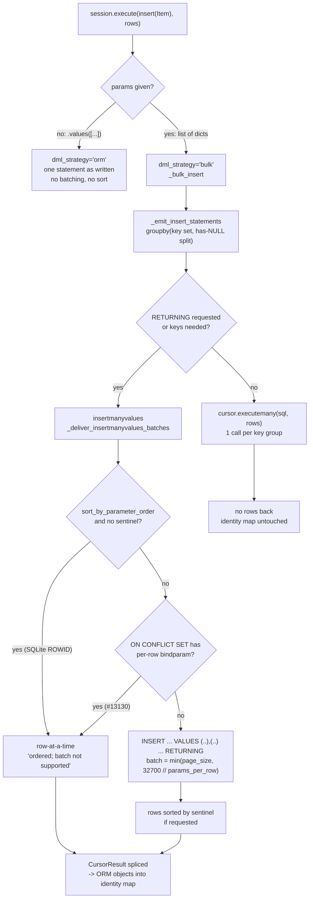

# Bulk Inserts, ON CONFLICT DO UPDATE Upserts, and RETURNING Clauses in SQLAlchemy 2.x

> [!summary] Claim
> In SQLAlchemy 2.x a list of dictionaries passed to `Session.execute(insert(Model), rows)` becomes one DBAPI `executemany()` when nothing has to come back, and becomes "insertmanyvalues" batches of up to 1000 rows per `INSERT ... VALUES (...), (...) RETURNING` when something does, but the moment you ask for RETURNING rows in input order on a table whose key the database generates without a usable sentinel (SQLite `ROWID`, or the ORM unit of work on SQLite), the batching silently degrades to one statement per row, and an upsert's RETURNING set is neither ordered nor complete, so correlate by natural key, never by position.

Part of [Database Access and Transactions for APIs](README.md) in [API Engineering](../README.md).

## TL;DR

- Mechanism: `Session.execute(insert(Item), rows)` picks the ORM "bulk" strategy, groups consecutive rows by their key set, and hands each group to Core, which either calls `cursor.executemany()` (no RETURNING) or rewrites the statement into multi-row `VALUES` batches capped by `insertmanyvalues_page_size=1000` and `insertmanyvalues_max_parameters=32700` (RETURNING); `sqlalchemy.dialects.postgresql.insert` and `sqlalchemy.dialects.sqlite.insert` add `on_conflict_do_update(index_elements=..., set_={"col": stmt.excluded.col})`, which rides the same batching.
- Contract rule: request `returning(..., sort_by_parameter_order=True)` only when you will zip results with inputs, give such tables a client-side sentinel (a client-generated UUID key or `insert_sentinel()`), key upsert results by the conflict target, and pass `execution_options={"populate_existing": True}` when an upsert can return rows already in the session.
- Trap: on SQLite the lab's `add_all()` flush of 5,000 rows and the ordered bulk `RETURNING` both emit 5,000 single-row statements, `ON CONFLICT ... DO NOTHING RETURNING` returns fewer rows than it was given even when "ordered", and `Column.onupdate` never fires inside `DO UPDATE SET`.
- Portability: the lab passes 19 of 19 tests on CPython 3.14.6 with SQLAlchemy 2.1.8 (re-run in verification), the drafter's matrix also reported 19 of 19 on 3.12.13, 3.13.18, 3.14.10, 3.15.2, 3.14.6 free-threaded, and 3.14.6 with 2.0.57, where a per-row bound parameter in `set_` is not forwarded by the ORM bulk path; 3.15.0b3 free-threaded segfaults inside greenlet at import (greenlet documents 3.15 wheel/interpreter pre-release incompatibility), and `3.15.2t` was not run.
- When not to use it: for millions of rows use the driver's `COPY` path or a staging table plus `INSERT ... SELECT ... ON CONFLICT`, for per-object business logic, events, and relationship cascades use the unit of work, and on MySQL (no RETURNING) none of the RETURNING machinery applies.

## Mental model



A list of parameter dictionaries is the switch: with it, the ORM takes the bulk path and splits the rows into groups that share the same set of keys (and the same set of non-`None` keys, unless `render_nulls=True`), because one SQL string can only have one column list.
Each group without RETURNING goes to the DBAPI as a single `executemany()`, which is the cheapest path because nothing is fetched and the ORM does no bookkeeping.
A group with RETURNING cannot use `executemany()`, because PEP 249 says that using it "for an operation which produces one or more result sets constitutes undefined behavior", so Core's "insertmanyvalues" rewrites the one-row `VALUES (?, ?)` into a batch of up to 1000 tuples, and then decides whether that batch can still guarantee the requested order: if the database generates the key and there is no sentinel value to sort on, or if the upsert's `SET` clause carries a per-row bound parameter, it falls back to one statement per row.
Every batch's rows are spliced into one `CursorResult`, and when the `RETURNING` names an entity, the ORM turns the rows into objects and registers them in the identity map, where an already-loaded object wins over the returned row unless `populate_existing` is set.

## How it works

### Three ways to insert many rows, and what each one costs

The unit of work (`session.add_all(objs)` then `flush()`) tracks every object, so for each new row it needs the server-generated primary key back, in input order, to assign identity keys; `_emit_insert_statements` runs with `bookkeeping=True`, which makes `deterministic_results_reqd` true and asks for `return_defaults(*table.primary_key, sort_by_parameter_order=bookkeeping)` `(sqlalchemy 2.1.8 lib/sqlalchemy/orm/persistence.py, _emit_insert_statements)`.
ORM bulk INSERT (`session.execute(insert(Item), rows)`) is selected by `_BulkORMInsert.orm_pre_session_exec`: when `params` is non-empty and the `dml_strategy` execution option is `"auto"`, it becomes `"bulk"`, and with no params it becomes `"orm"` `(sqlalchemy 2.1.8 lib/sqlalchemy/orm/bulk_persistence.py, _BulkORMInsert.orm_pre_session_exec)`.
The bulk strategy calls `_bulk_insert(..., isstates=False, return_defaults=insert_options._return_defaults)` (default `False`), which copies each dictionary (`mappings = [dict(m) for m in mappings]`) so caller data is not mutated, and runs with `bookkeeping=False` for a single-table mapper, so no primary keys are fetched unless you asked for RETURNING `(sqlalchemy 2.1.8 lib/sqlalchemy/orm/bulk_persistence.py, _bulk_insert)`.
Core (`connection.execute(table.insert(), rows)`) skips the ORM entirely; the maintainers' tip contrasts the two: ORM bulk INSERT allows heterogeneous dictionaries and emits one statement per key set, while a Core `Insert` "only uses the first dictionary in the list to determine a single VALUES clause for all parameter sets" (https://docs.sqlalchemy.org/en/21/orm/queryguide/dml.html).
`Insert.values([...])` with a list renders one multi-row statement exactly as written and executes it once, so it gets no insertmanyvalues batching, no parameter-limit protection, and no heterogeneous keys; the docs reserve it for upserts and per-row SQL expressions (https://docs.sqlalchemy.org/en/21/orm/queryguide/dml.html).
The legacy `Session.bulk_save_objects()`, `bulk_insert_mappings()`, and `bulk_update_mappings()` share the same implementation but are documented as "a legacy feature as of the 2.0 series" and lack RETURNING `(sqlalchemy 2.1.8 lib/sqlalchemy/orm/session.py, Session.bulk_insert_mappings)`.

### Grouping by key set, and why `None` splits batches

`_emit_insert_statements` feeds the collected records through `itertools.groupby` keyed on `(connection, set(params), bool(value_params), has_all_pks, has_all_defaults)`, so only consecutive rows with an identical key set share a statement `(sqlalchemy 2.1.8 lib/sqlalchemy/orm/persistence.py, _emit_insert_statements)`.
`_collect_insert_commands(..., bulk=True, render_nulls=False)` skips a key whose value is `None` unless the column is one whose type evaluates `None` itself (`value is None and col not in eval_none and not render_nulls`), so that a server default can apply, which changes the row's key set `(sqlalchemy 2.1.8 lib/sqlalchemy/orm/persistence.py, _collect_insert_commands)`; the lab's three rows `qty=1`, `qty=None`, `qty=3` produce exactly `INSERT INTO item (sku, qty) VALUES (?, ?)`, `INSERT INTO item (sku) VALUES (?)`, `INSERT INTO item (sku, qty) VALUES (?, ?)`.
`insert(Item).execution_options(render_nulls=True)` keeps `None` as a bound `NULL` and the same three rows become one `executemany()`; the cost is that a server default on that column no longer applies to those rows (https://docs.sqlalchemy.org/en/21/orm/queryguide/dml.html, "Sending NULL values in ORM bulk INSERT statements").
Because `groupby` is order-sensitive, a sparse optional column alternating between present and absent can turn 5,000 rows into thousands of statements; normalize rows to one key set before calling, or sort them so equal key sets are adjacent when order does not matter.

### insertmanyvalues: turning `executemany` into multi-row `VALUES`

PEP 249 leaves result sets from `cursor.executemany()` undefined and "Return values are not defined" (https://peps.python.org/pep-0249/), so for RETURNING the compiler records an `_InsertManyValues` structure holding the rendered single-row `VALUES` text (`single_values_expr`), the per-row crud parameters, `sort_by_parameter_order`, `includes_upsert_behaviors` (true when `_post_values_clause` is set, which is how `ON CONFLICT` is attached), `sentinel_columns`, `implicit_sentinel`, `has_upsert_bound_parameters`, and `embed_values_counter` `(sqlalchemy 2.1.8 lib/sqlalchemy/sql/compiler.py, _InsertManyValues)`.
At execution, `SQLCompiler._deliver_insertmanyvalues_batches` replaces `(single_values_expr)` with a token, then for each batch renders `N` copies of the tuple with parameter names suffixed by a batch index (`__EXECMANY_INDEX__` placeholders for named paramstyles) and yields an `_InsertManyValuesBatch` with `replaced_statement`, `replaced_parameters`, `batchnum`, `total_batches`, `rows_sorted`, and `is_downgraded` `(sqlalchemy 2.1.8 lib/sqlalchemy/sql/compiler.py, SQLCompiler._deliver_insertmanyvalues_batches)`.
The batch size is `min(insertmanyvalues_page_size, (insertmanyvalues_max_parameters - params_outside_batch) // params_per_row)`, with `insertmanyvalues_page_size = 1000` and `insertmanyvalues_max_parameters = 32700` on `DefaultDialect` `(sqlalchemy 2.1.8 lib/sqlalchemy/engine/default.py, DefaultDialect)`.
The lab's 40-column table therefore inserts 2,000 rows in three statements of 817, 817, and 366 rows (`32700 // 40 = 817`), while a two-column table inserts 2,500 rows as 1000, 1000, and 500.
The 32700 figure is documented as "a healthy distance away from PostgreSQL's limit of 32767 and SQLite's modern limit of 32766" (https://docs.sqlalchemy.org/en/21/core/connections.html, "Controlling the Batch Size"); the SQLite dialect lowers it to 999 when the linked library is older than 3.32.0 `(sqlalchemy 2.1.8 lib/sqlalchemy/dialects/sqlite/base.py, SQLiteDialect.__init__)`.
`Connection._exec_insertmany_context` runs each batch as a separate `dialect.do_execute()` (one `cursor.execute()`), fires `before_cursor_execute` once per batch, and with echo on logs each batch's parameters with a tag such as `insertmanyvalues 2/10 (unordered)` or `(ordered; batch not supported)` `(sqlalchemy 2.1.8 lib/sqlalchemy/engine/base.py, Connection._exec_insertmany_context)`.
That loop passes a literal `True` as the event's `executemany` argument for every batch, even though the DBAPI call is `execute()` with a flat tuple; the lab's first draft counted rows from that flag and reported 2,000 rows per 1,000-row batch, so its `Executed.executemany` now inspects whether the parameters are a list.
The engine-wide knob is `create_engine(..., insertmanyvalues_page_size=250)`, and per statement it is `.execution_options(insertmanyvalues_page_size=...)`; the lab's 1,000 rows become four 250-row statements.
Capability is a pair of dialect flags: `insert_executemany_returning` defaults to `insert_returning and use_insertmanyvalues`, and so does `insert_executemany_returning_sort_by_parameter_order` `(sqlalchemy 2.1.8 lib/sqlalchemy/engine/default.py, DefaultDialect.insert_executemany_returning)`.
`DefaultExecutionContext._init_compiled` raises `InvalidRequestError` with "does not support INSERT..RETURNING when executemany is used" or "... with deterministic row ordering when executemany is used" when a dialect lacks them, and the same method raises "does not support UPDATE..RETURNING when executemany is used" because `update_executemany_returning = False` on `DefaultDialect` `(sqlalchemy 2.1.8 lib/sqlalchemy/engine/default.py, DefaultExecutionContext._init_compiled)`.
Of the built-in dialects only Oracle's `cx_oracle` (and `oracledb`, its subclass) sets `update_executemany_returning = True`, so the UPDATE error applies to SQLite, PostgreSQL, MySQL, and SQL Server `(sqlalchemy 2.1.8 lib/sqlalchemy/dialects/oracle/cx_oracle.py, OracleDialect_cx_oracle)`.

### `sort_by_parameter_order` and insert sentinels

SQLite states that "The output order for the RETURNING rows is arbitrary" and "There is no way to cause the output rows to appear in a particular order" (https://www.sqlite.org/lang_returning.html, Sections 2.1 and 3), and the SQLAlchemy maintainers state that "most database backends provide no formal guarantee of the order in which the records from RETURNING are returned" (https://docs.sqlalchemy.org/en/21/orm/queryguide/dml.html), so a batched `RETURNING` cannot be zipped with its inputs.
`returning(..., sort_by_parameter_order=True)` (added in 2.0.10) asks insertmanyvalues to restore input order, which requires a sentinel: a column whose value per row is known before the insert (a client-side default such as `uuid.uuid4`, a column marked `insert_sentinel=True`, or an `insert_sentinel()` / `orm_insert_sentinel()` integer counter column), or a server-generated key the dialect can sort on (https://docs.sqlalchemy.org/en/21/core/connections.html, "Correlating RETURNING rows to parameter sets").
PostgreSQL declares `insertmanyvalues_implicit_sentinel = ANY_AUTOINCREMENT | USE_INSERT_FROM_SELECT | RENDER_SELECT_COL_CASTS`, so for `SERIAL` or `IDENTITY` keys it renders `INSERT INTO t (x) SELECT p0::INTEGER FROM (VALUES (..., 0), (..., 1), ...) AS imp_sen(p0, sen_counter) ORDER BY sen_counter RETURNING t.id, t.id AS id__1` and sorts the returned rows by the generated integer `(sqlalchemy 2.1.8 lib/sqlalchemy/dialects/postgresql/base.py, PGDialect)` `(sqlalchemy 2.1.8 lib/sqlalchemy/sql/compiler.py, SQLCompiler.visit_insert)`; compiling `insert(t).returning(t.c.id, sort_by_parameter_order=True)` offline with the psycopg dialect and `for_executemany=True` printed exactly that single-row template, and the docs show the batched form in the monotonic-functions section (https://docs.sqlalchemy.org/en/21/core/connections.html).
SQLite keeps the default `NOT_SUPPORTED`, and the docs say plainly that "the SQLite backend will degrade to 'non-batched' mode when ordered RETURNING is requested"; in code this is the `use_row_at_a_time = True; downgraded = True` branch taken when `sort_by_parameter_order` is set, the statement has result columns, and `imv.sentinel_columns is None` `(sqlalchemy 2.1.8 lib/sqlalchemy/sql/compiler.py, SQLCompiler._deliver_insertmanyvalues_batches)`.
The lab measures both sides: ordered `RETURNING` on `Item` (SQLite `ROWID` key) emits 50 single-row statements for 50 rows, and on `Shipment` (client-side `uuid.uuid4` key) it emits three batched statements for 2,500 rows and still returns them in input order.
The ORM unit of work always requests ordered key return, which is why `add_all()` of 5,000 `Item` objects on SQLite is 5,000 `INSERT ... RETURNING id` statements; passing explicit primary keys avoids RETURNING entirely, and the probe run for this note saw that flush become one `executemany()`.
Version 2.1 adds `monotonic=True` for server functions such as `func.uuidv7(monotonic=True)` so a server-side UUIDv7 default can act as a sortable sentinel on PostgreSQL 18 and later (https://docs.sqlalchemy.org/en/21/core/connections.html, "Configuring Monotonic Functions such as UUIDV7").
A multi-row `Insert.values([...])` combined with `sort_by_parameter_order=True` is refused at compile time with `CompileError: RETURNING cannot be deterministically sorted when using an INSERT which includes multi-row values().` `(sqlalchemy 2.1.8 lib/sqlalchemy/sql/compiler.py, SQLCompiler.visit_insert)`, which the lab asserts.

### Upserts: `on_conflict_do_update` and `excluded`

`sqlalchemy.dialects.postgresql.insert()` and `sqlalchemy.dialects.sqlite.insert()` return dialect `Insert` subclasses whose `excluded` property is `alias(self.table, name="excluded").columns`, so `stmt.excluded.qty` compiles to `excluded.qty`, the row proposed for insertion `(sqlalchemy 2.1.8 lib/sqlalchemy/dialects/postgresql/dml.py, Insert.excluded)`.
That is why the statement is built in two steps (`base = sqlite_insert(Item)`, then `base.on_conflict_do_update(..., set_={"qty": base.excluded.qty})`): `excluded` belongs to the statement object.
`OnConflictDoUpdate.__init__` on PostgreSQL requires exactly one of `constraint` or `index_elements` ("Either constraint or index_elements, but not both, must be specified unless DO NOTHING") and a non-empty `set_` ("set parameter dictionary must not be empty"), while the SQLite class has no `constraint` parameter and allows the target to be omitted, matching SQLite 3.35.0's rule that the last `ON CONFLICT` clause may omit its conflict target `(sqlalchemy 2.1.8 lib/sqlalchemy/dialects/postgresql/dml.py, OnConflictDoUpdate.__init__)` `(sqlalchemy 2.1.8 lib/sqlalchemy/dialects/sqlite/dml.py, OnConflictDoUpdate.__init__)` (https://www.sqlite.org/lang_upsert.html, Section 4).
`PGCompiler.visit_on_conflict_do_update` renders `ON CONFLICT (sku) DO UPDATE SET qty = excluded.qty`, or `ON CONFLICT ON CONSTRAINT <name>` for a named constraint, appends ` WHERE <expr>` for the `where=` argument, and for `set_` keys that match no column emits only a warning ("Additional column names not matching any column keys in table ...") and renders them anyway `(sqlalchemy 2.1.8 lib/sqlalchemy/dialects/postgresql/base.py, PGCompiler.visit_on_conflict_do_update)`.
The docstring's warning is the one that bites in production: `set_` "does not take into account Python-specified default UPDATE values or generation functions, e.g. those specified using Column.onupdate" `(sqlalchemy 2.1.8 lib/sqlalchemy/dialects/postgresql/dml.py, Insert.on_conflict_do_update)`; the lab's `updated_at` column stays `None` after an upsert and is set by a bulk `UPDATE` by primary key in the same session.
PostgreSQL guarantees "an atomic INSERT or UPDATE outcome ... even under high concurrency", chooses arbiter indexes by inference from `index_elements` (a non-partial unique index is inferred whenever one matches), supports an `index_predicate` (SQLAlchemy's `index_where=`) for partial unique indexes, and does not support exclusion constraints as arbiters for `DO UPDATE` (https://www.postgresql.org/docs/18/sql-insert.html, "ON CONFLICT Clause").
It also calls the statement "deterministic": it "will not be allowed to affect any single existing row more than once; a cardinality violation error will be raised", which is SQLSTATE `21000` `cardinality_violation` (https://www.postgresql.org/docs/18/sql-insert.html) (https://www.postgresql.org/docs/18/errcodes-appendix.html).
SQLite decides per row ("In the case of a multi-row insert, the upsert decision is made separately for each row of the insert"), so the lab's batch `[{"sku": "dup", "qty": 1}, {"sku": "dup", "qty": 2}]` inserts then updates the same row in one statement, returns two `RETURNING` rows with `id == 1`, and leaves `qty == 2` (https://www.sqlite.org/lang_upsert.html, Section 2).
On PostgreSQL the outcome depends on how SQLAlchemy ships the batch, which a probe against PostgreSQL 18.7 with psycopg 3.3.8 and SQLAlchemy 2.1.8 (CPython 3.14.6, macOS 27.3) showed for two rows with the same `sku`: with `returning(...)` (one multi-row insertmanyvalues statement) and with `Insert.values([...])` the statement fails with SQLSTATE `21000` ("ON CONFLICT DO UPDATE command cannot affect row a second time") and nothing is written, but the same upsert executed without `RETURNING` goes through `executemany()`, runs as one statement per row, raises nothing, and leaves `qty == 2` as on SQLite.
So whether duplicate keys in one batch are an error depends on whether the rows travel in one statement, which is another reason to deduplicate by conflict key before sending.
SQLite also aborts the entire statement if the `DO UPDATE` itself violates a constraint ("the behavior is as if the DO UPDATE clause were actually written as DO UPDATE OR ABORT") and needs `WHERE true` after an `INSERT ... SELECT` source to avoid a parsing ambiguity with join `ON` (https://www.sqlite.org/lang_upsert.html, Sections 2.2 and 3).
Version 2.1 lets the SQLite `insert()` carry several `ON CONFLICT` clauses, evaluated in order (#13113, 2.1.0rc1, https://docs.sqlalchemy.org/en/21/changelog/changelog_21.html); the lab does not exercise that.

### Upserts in the batching machinery

The connections guide states that the dialect upsert constructs "also support 'insertmanyvalues' behaviors when they are used with RETURNING" (https://docs.sqlalchemy.org/en/21/core/connections.html, "Upsert Support"), and the lab's 10-row upsert is exactly one `INSERT INTO item (sku, qty) VALUES (?, ?), ... ON CONFLICT (sku) DO UPDATE SET qty = excluded.qty RETURNING id, sku, qty, updated_at`.
The batch is safe because `excluded.qty` is a column reference resolved per row by the database, but a per-row bound parameter in `set_` (for example `set_={"qty": bindparam("new_qty")}`) cannot be batched: one statement has one `SET` clause, so `has_upsert_bound_parameters` forces row-at-a-time (#13130, 2.1.0b2, backported to 2.0.47) `(sqlalchemy 2.1.8 lib/sqlalchemy/sql/compiler.py, SQLCompiler._deliver_insertmanyvalues_batches)`.
The lab's four-row bound-parameter upsert therefore runs as four statements on 2.1.8 and writes `[900, 901, 902, 903]`.
On 2.0.57 the same ORM bulk call fails earlier with `StatementError: A value is required for bind parameter 'new_qty'`: the non-attribute key is not forwarded, although both releases contain the `extra_bp_names` lookup in `_bulk_insert`, because that lookup calls `_get_embedded_bindparams()`, which reads the statement's cache key or, when there is none, traverses its children.
In 2.0.57 the dialect `Insert` sets `inherit_cache = False` (no cache key) and `OnConflictDoUpdate` declares no `_traverse_internals` (the traversal never reaches `set_`), so the call returns `[]` and `new_qty` never enters `include_bulk_keys`; in 2.1.8 `Insert.inherit_cache = True` and `OnConflictDoUpdate._traverse_internals` lists `update_values_to_set`, and the same call returns `['new_qty']` `(sqlalchemy 2.0.57 lib/sqlalchemy/dialects/sqlite/dml.py, Insert)` `(sqlalchemy 2.1.8 lib/sqlalchemy/dialects/sqlite/dml.py, OnConflictDoUpdate)` `(sqlalchemy 2.0.57 lib/sqlalchemy/sql/elements.py, ClauseElement._get_embedded_bindparams)`.
A probe for this verification showed that result on both releases and for both the SQLite and PostgreSQL `insert()`, and showed that the Core form `session.connection().execute(stmt, rows)` writes `[900, 901, 902, 903]` in four statements on both releases.
For psycopg2, which uses insertmanyvalues even without RETURNING (`use_insertmanyvalues_wo_returning = True`), insertmanyvalues is now disabled for any statement with `ON CONFLICT` (#13130) `(sqlalchemy 2.1.8 lib/sqlalchemy/sql/crud.py, _get_returning_modifiers)`; PostgreSQL `ON CONFLICT` plus `sort_by_parameter_order` with a `SERIAL` key generated invalid SQL until #13107 (2.1.0b2, backported to 2.0.47) (https://docs.sqlalchemy.org/en/21/changelog/changelog_21.html).
An upsert with `sort_by_parameter_order=True` downgrades to row-at-a-time whenever the sentinel cannot travel through the `ON CONFLICT` form (`includes_upsert_behaviors and not embed_values_counter`), so on SQLite an ordered upsert of 5,000 rows is again 5,000 statements.
An upsert against a joined-inheritance mapper through the bulk path raises "bulk INSERT with a 'post values' clause (typically upsert) not supported for multi-table mapper" `(sqlalchemy 2.1.8 lib/sqlalchemy/orm/bulk_persistence.py, _BulkORMInsert.orm_execute_statement)`.

### RETURNING into the session: identity map and `populate_existing`

When `returning(Item)` names an entity, `_BulkORMInsert.orm_execute_statement` hands the cursor to `_return_orm_returning`, which loads the rows the same way a `select()` does, so every returned row is uniqued through the identity map; the lab's 2,500-row bulk `RETURNING` leaves 2,500 objects in `session.identity_map` and `session.get(Item, id)` then costs no SQL `(sqlalchemy 2.1.8 lib/sqlalchemy/orm/bulk_persistence.py, _BulkORMInsert.orm_execute_statement)`.
For a pure insert that is harmless, but an upsert can return a row whose object is already loaded, and identity-map uniquing then keeps the in-memory values: the lab's loaded `Item` keeps `qty == 0` after an upsert that wrote `7`, and only `execution_options={"populate_existing": True}` (forwarded by `orm_execute_statement` into `_sa_orm_load_options`) refreshes it to `8` (https://docs.sqlalchemy.org/en/21/orm/queryguide/dml.html, "Using RETURNING with upsert statements").
The same identity map makes the SQLite duplicate-key batch return the same Python object twice (`out[0] is out[1]`), which is one more reason to collapse results into a dictionary keyed by the natural key.
Without RETURNING, bulk INSERT touches the identity map not at all (the lab asserts `len(session.identity_map) == 0` after 5,000 rows), so a following `session.get()` goes to the database.
The bulk statement still runs inside the session's transaction and is preceded by an autoflush (`orm_pre_session_exec` calls `session._autoflush()` unless the `autoflush` option is false), so pending objects added earlier are written first.

### What RETURNING can and cannot tell you

PostgreSQL returns "each row actually inserted (or updated, if an ON CONFLICT DO UPDATE clause was used)", and "if a row was locked but not updated because an ON CONFLICT DO UPDATE ... WHERE clause condition was not satisfied, the row will not be returned" (https://www.postgresql.org/docs/18/sql-insert.html).
`DO NOTHING` likewise returns only inserted rows; the lab's four-row `DO NOTHING RETURNING sku` with two pre-existing keys returns `["new-1", "new-2"]`, and an ordered two-row call returns `["new-3"]`, so `zip(inputs, returned)` pairs the skipped `old-1` input with `new-3` without any error.
PostgreSQL 18 adds `RETURNING old.*, new.*` (and `RETURNING WITH (OLD AS o, NEW AS n)`), where `old` columns are `NULL` for a freshly inserted row and non-`NULL` for a conflicting row updated by `DO UPDATE`, which is the documented way to tell "created" from "updated" in one statement (https://www.postgresql.org/docs/18/sql-insert.html).
SQLAlchemy 2.1.8 has no construct for that form (the only `old` in the PostgreSQL dialect source is a reserved-word entry), so it needs `literal_column("old.qty")` in `returning()`.
That works: a probe against a local PostgreSQL 18.7 (Homebrew, `aarch64-apple-darwin`) over `postgresql+psycopg` (psycopg 3.3.8), SQLAlchemy 2.1.8, CPython 3.14.6, macOS 27.3, executed `insert(t).on_conflict_do_update(index_elements=["sku"], set_={"qty": excluded.qty}).returning(t.c.sku, literal_column("old.qty").label("old_qty"), literal_column("new.qty").label("new_qty"))` as one two-row insertmanyvalues statement, against a table that already held `sku="a", qty=1`, and returned `[('a', 1, 10), ('b', None, 20)]`: `old.qty` is `1` for the updated row and `NULL` for the inserted row.
In the same probe a four-row `DO NOTHING RETURNING sku` with two pre-existing keys returned `['n1', 'n2']`, and an ordered `returning(t.c.id, t.c.sku, sort_by_parameter_order=True)` insert of five rows into a `SERIAL` key came back in input order as one statement of the `INSERT INTO item (sku, qty) SELECT p0::VARCHAR, p1::INTEGER FROM (VALUES (...), 0), ...` form.
The probe script was a throwaway and is not part of the lab, so the lab suite does not assert any PostgreSQL behavior.
SQLite `RETURNING` reports "both inserted and updated rows" for an upsert, reflects values before `AFTER` triggers run, buffers all output in memory until the statement finishes, is unavailable inside triggers, and requires SQLite 3.35 (the SQLAlchemy dialect switches `insert_returning`, `update_returning`, and `delete_returning` off below 3.35) (https://www.sqlite.org/lang_returning.html) `(sqlalchemy 2.1.8 lib/sqlalchemy/dialects/sqlite/base.py, SQLiteDialect.__init__)`.

### Bulk UPDATE by primary key

`session.execute(update(Item), [{"id": 1, "qty": 10}, {"id": 3, "qty": 30}])` is "ORM Bulk UPDATE by Primary Key": every dictionary must contain the full key, the ORM renders `UPDATE item SET qty=?, updated_at=CURRENT_TIMESTAMP WHERE item.id = ?`, and runs one `executemany()` per key set (https://docs.sqlalchemy.org/en/21/orm/queryguide/dml.html).
Unlike the upsert, this path applies `Column.onupdate`, which the lab shows as the `updated_at=` assignment and a non-`None` timestamp.
RETURNING is not available on this path because "the list of multiple parameter dictionaries necessarily makes use of DBAPI executemany"; the lab triggers the `UPDATE..RETURNING when executemany is used` error.
When you need RETURNING from many updates, express them as one set-based statement (an `UPDATE ... FROM (VALUES ...)` on PostgreSQL, or an upsert keyed on the primary key) instead of an executemany.

### Drivers and the wire

On PostgreSQL every batch is one `Parse`/`Bind`/`Execute` cycle whose `Bind` message carries an `Int16` count of parameter values, which is why the parameter budget matters (https://www.postgresql.org/docs/18/protocol-message-formats.html, "Bind (F)").
asyncpg refuses more than 32767 arguments in `PreparedStatementState._encode_bind_msg` with `InterfaceError: the number of query arguments cannot exceed 32767` `(asyncpg 0.32.0 asyncpg/protocol/prepared_stmt.pyx, PreparedStatementState._encode_bind_msg)`, which `insertmanyvalues_max_parameters=32700` stays under.
psycopg 3's `Cursor.executemany` enters pipeline mode when `Pipeline.is_supported()`, so the no-RETURNING path streams many `Bind`/`Execute` pairs without waiting for each result `(psycopg 3.3.8 psycopg/cursor.py, Cursor.executemany)`.
psycopg2's `executemany_mode="values_plus_batch"` additionally batches `UPDATE` and `DELETE` with `execute_batch()` (default `executemany_batch_page_size` of 100), at the cost of losing `rowcount` for those statements `(sqlalchemy 2.1.8 lib/sqlalchemy/dialects/postgresql/psycopg2.py, module docstring)`.
On SQLite every call is in-process; the measured difference between batched and row-at-a-time ordered RETURNING in the lab is small, matching the documentation's remark that "In some cases, such as on SQLite, 'non-batched' mode performs exactly as well as 'batched' mode", while on a networked server each statement costs at least one round trip.

### Failure atomicity

All batches of one `Connection.execute()` run on one connection inside the current transaction, so a constraint error in batch 3 of 5 raises with batches 1 and 2 already executed but uncommitted; rolling back the session discards all of them, and committing after catching the error is a bug.
That makes "partial success" an application decision: either let the whole request fail (atomic batch) or split the batch into savepoints or separate transactions and report per-item results, which is the API contract question covered in [[Atomic-vs-Partial-Batch-Execution-and-207-Multi-Status]].
Two transactions upserting overlapping key sets in different orders acquire row locks in different orders, which is the classic row-lock deadlock PostgreSQL detects and resolves "by aborting one of the transactions involved"; the documented defense is a consistent lock order, so sort each batch by its conflict key before executing it (https://www.postgresql.org/docs/18/explicit-locking.html, Section 13.3.4) and see [[Preventing-and-Recovering-from-Database-Deadlocks-in-API-Transactions]].

## Numbers and limits

| Quantity | Value | Source or measurement |
| --- | --- | --- |
| Default rows per insertmanyvalues batch | `1000` | `(sqlalchemy 2.1.8 lib/sqlalchemy/engine/default.py, DefaultDialect.insertmanyvalues_page_size)` |
| Default max bound parameters per batch | `32700` | `(sqlalchemy 2.1.8 lib/sqlalchemy/engine/default.py, DefaultDialect.insertmanyvalues_max_parameters)` |
| SQLite batch parameter cap when linked SQLite < 3.32.0 | `999` | `(sqlalchemy 2.1.8 lib/sqlalchemy/dialects/sqlite/base.py, SQLiteDialect.__init__)` |
| `SQLITE_MAX_VARIABLE_NUMBER` default | `999` before 3.32.0 (2020-05-22), `32766` after | https://www.sqlite.org/limits.html |
| SQLite UPSERT / generalized UPSERT / RETURNING | 3.24.0 (2018-06-04) / 3.35.0 (2021-03-12) / 3.35 | https://www.sqlite.org/lang_upsert.html, `(sqlalchemy 2.1.8 lib/sqlalchemy/dialects/sqlite/base.py, SQLiteDialect.__init__)` |
| asyncpg arguments per statement | `32767` | `(asyncpg 0.32.0 asyncpg/protocol/prepared_stmt.pyx, PreparedStatementState._encode_bind_msg)` |
| PostgreSQL `Bind` parameter count field | `Int16` | https://www.postgresql.org/docs/18/protocol-message-formats.html |
| psycopg2 `executemany_batch_page_size` default | `100` | `(sqlalchemy 2.1.8 lib/sqlalchemy/dialects/postgresql/psycopg2.py, module docstring)` |
| Rows per batch, 40-column table | `817` (`32700 // 40`), lab: `[817, 817, 366]` for 2,000 rows | lab `test_parameter_cap_shrinks_batch_for_wide_rows` |
| `add_all()` + flush, 5,000 rows, SQLite `ROWID` key | 5,000 statements, best of 5: `78.0 ms` | lab `benchmark()` |
| ORM bulk INSERT, no RETURNING | 1 `executemany()`, `9.4 ms` | lab `benchmark()` |
| ORM bulk INSERT RETURNING, unordered | 5 statements, `24.8 ms` | lab `benchmark()` |
| ORM bulk INSERT RETURNING, ordered, `ROWID` key | 5,000 statements, `43.7 ms` | lab `benchmark()` |
| ORM bulk INSERT RETURNING, ordered, client UUID key | 5 statements, `42.0 ms` | lab `benchmark()` |

The five timings come from one invocation of `benchmark(n=5000, repeats=5)` (best of five, fresh in-memory engine per repeat, commit included), re-measured in verification on 2026-11-15 on an Apple M3 Pro, macOS 27.3 (`uname -r` `27.3.0`), CPython 3.14.6, SQLite 3.53.1, SQLAlchemy 2.1.8, run as `uv run --frozen python -c "...benchmark(n=5000, repeats=5)..."` from `labs/`; the drafter's earlier run was within 4% of every value, and they are in-process numbers with no network and should be read as CPU cost per strategy, not as server throughput.
The ordered UUID strategy is batched yet no faster than the row-at-a-time `ROWID` strategy here, because SQLite has no round trip to save (that the `Uuid` type's per-row conversion explains the rest is an inference, not profiled); over a network the statement count dominates, and at an illustrative `0.5 ms` round trip (an assumption, not a measurement) 5,000 statements would add about `2.5 s` while 5 would add about `2.5 ms`.

## Portability

| Dimension | Version or leg | Result |
| --- | --- | --- |
| CPython `3.12` | `3.12.13` (`macos-aarch64`), SQLite `3.53.1` | Drafter's matrix run (not re-run in verification, lab checks paused 2026-11-11): `19 passed` via `PYTHONPATH=src uv run --no-project --python 3.12 --with "sqlalchemy[asyncio]==2.1.8" --with fastapi==0.162.0 --with starlette==1.10.0 --with pydantic==2.14.3 --with httpx==0.28.1 --with aiosqlite==0.22.1 --with pytest==9.2.0 --with pytest-asyncio==1.4.1.post1 pytest <test> -q`; the contract pin `3.12.16` is not installed and was not run |
| CPython `3.13` | `3.13.18`, SQLite `3.54.1` | Drafter's matrix run, not re-run: `19 passed` (same command, `--python 3.13`) |
| CPython `3.14` | `3.14.6` (workspace venv) and `3.14.10` (Homebrew), SQLite `3.53.1` / `3.54.1` | Proven by lab on 3.14.6: `19 passed in 1.91s` (`uv run --frozen pytest <test> -q`, re-run in verification); 3.14.10: drafter's run, not re-run: `19 passed` (`--python /opt/homebrew/bin/python3.14`) |
| CPython `3.15` | `3.15.2` (Homebrew), SQLite `3.54.1` | Drafter's matrix run, not re-run: `19 passed` |
| CPython `3.14t` free-threaded | `3.14.6`, `sys._is_gil_enabled()` is `False` | Drafter's matrix run, not re-run: `19 passed`; sessions and connections still must not be shared across threads, see [[Why-Sharing-an-AsyncSession-Across-Concurrent-Tasks-Corrupts-State]] |
| CPython `3.15t` free-threaded | only `3.15.0b3t` is available; the pin `3.15.2t` is not installed and was not run | Drafter's run on `3.15.0b3t`: `Fatal Python error: Segmentation fault` in `sqlalchemy/util/concurrency.py` line 85, `_initialize`, while `sqlalchemy.ext.asyncio` imports greenlet; `python -c "import greenlet; print(greenlet.getcurrent().gr_context)"` segfaults alone on that build; the greenlet changelog says its binary 3.15 wheels are built against one specific 3.15 pre-release and "may not be compatible with earlier or later versions of 3.15" (3.5.5 notes: built with 3.15.0rc1, "believed compatible with 3.15b4 ... (but not earlier versions)"), so a wheel/interpreter mismatch is the documented explanation for a `b3` crash, and the result for `3.15.2t` is simply not known (https://greenlet.readthedocs.io/en/latest/changes.html) |
| SQLAlchemy `2.1.8` vs `2.0.57` | CPython 3.14.6 | Both pass (drafter's run on 2.0.57, not re-run); difference observed and re-probed in verification: the ORM bulk upsert with `set_={"qty": bindparam("new_qty")}` raises `A value is required for bind parameter 'new_qty'` on 2.0.57 and runs row-at-a-time on 2.1.8 (the test asserts each); fixes #13107 and #13130 exist in both (2.1.0b2, backported to 2.0.47); multiple SQLite `ON CONFLICT` clauses (#13113) and `monotonic=True` sentinels are 2.1 only (changelog) |
| SQLite | `3.53.1` and `3.54.1` (lab) | Proven by lab; RETURNING needs >= 3.35, multi-row VALUES >= 3.7.11, parameter cap 999 below 3.32.0 `(sqlalchemy 2.1.8 lib/sqlalchemy/dialects/sqlite/base.py, SQLiteDialect.__init__)` |
| PostgreSQL | `18.7` (Homebrew, local, `psycopg 3.3.8`, SQLAlchemy 2.1.8, CPython 3.14.6, macOS 27.3) | Proven by a one-off probe, not by the lab suite: `RETURNING old.qty, new.qty` through `literal_column`, ordered `SERIAL` insertmanyvalues in one `imp_sen`-style statement, `DO NOTHING RETURNING` returning only inserted rows, and `21000` for duplicate keys in one multi-row statement but no error for the same rows via `executemany()` without `RETURNING`; versions below 18 and other drivers (asyncpg) were not run, and "PostgreSQL 9 and above for insertmanyvalues" is cited from https://docs.sqlalchemy.org/en/21/core/connections.html |
| MySQL / MariaDB | MySQL: no RETURNING; MariaDB >= 10.5 | Not run; insertmanyvalues RETURNING is unavailable on MySQL and upserts use `on_duplicate_key_update()` (https://docs.sqlalchemy.org/en/21/core/connections.html, "Current Support") |
| Drivers | `aiosqlite 0.22.1` and `pysqlite` (lab); `asyncpg 0.32.0`, `psycopg 3.3.8` | Only the SQLite drivers ran; the asyncpg 32767-argument limit and psycopg pipeline `executemany` are read from source, not executed |
| ASGI servers and HTTP versions | `uvicorn 0.54.0`, `hypercorn 0.18.0`, `granian 2.8.7`; HTTP/1.1, HTTP/2, HTTP/3 | Not run: the API tests use in-process `httpx.ASGITransport`, and every behavior in this note happens inside the endpoint before response bytes exist, so the server and HTTP version cannot change it (a design inference, not a measurement) |
| Containers | Debian Trixie, Alpine musl | Not run; no claim |

## Worked example

The [implementation](../labs/src/api_labs/f13_database_access_and_transactions_for_apis/bulk_writes.py) and [test](../labs/tests/f13_database_access_and_transactions_for_apis/test_high_throughput_bulk_writes_upserts_and_returning_in_sqlalchemy_2_x.py) run every strategy against in-memory SQLite with a `before_cursor_execute` log, so each claim is checked against the SQL and the parameter shapes that actually reached the DBAPI.

The cursor-call log and engine factory (excerpt, verbatim lines 75-129 of `bulk_writes.py`):

```python
@dataclass(frozen=True)
class Executed:
    statement: str
    parameters: Any
    event_executemany: bool  # True for every "insertmanyvalues" batch as well

    @property
    def executemany(self) -> bool:
        """Whether the DBAPI call was `cursor.executemany()` (a list of parameter sets).

        Each "insertmanyvalues" batch is one `cursor.execute()` with a flat tuple,
        even though the event receives `executemany=True` for it.
        """
        return isinstance(self.parameters, list)

    @property
    def rows(self) -> int:
        """Parameter sets carried by this one cursor call."""
        if self.executemany:
            return len(self.parameters)
        return max(1, self.statement.count("(?"))


@dataclass
class StatementLog:
    """Every statement handed to `cursor.execute()` or `cursor.executemany()`."""

    entries: list[Executed] = field(default_factory=list[Executed])

    def record(
        self,
        conn: Any,
        cursor: Any,
        statement: str,
        parameters: Any,
        context: Any,
        executemany: bool,
    ) -> None:
        self.entries.append(Executed(statement, parameters, executemany))

    def clear(self) -> None:
        self.entries.clear()

    def rows_per_call(self) -> list[int]:
        return [e.rows for e in self.entries]


def make_engine(**kwargs: Any) -> tuple[Engine, StatementLog]:
    """One shared in-memory SQLite connection with the schema created."""
    engine = create_engine("sqlite://", poolclass=StaticPool, **kwargs)
    log = StatementLog()
    event.listen(engine, "before_cursor_execute", log.record)
    Base.metadata.create_all(engine)
    log.clear()
    return engine, log
```

The write strategies (excerpt, verbatim lines 136-192 of `bulk_writes.py`):

```python
def insert_unit_of_work(session: Session, rows: Sequence[dict[str, Any]]) -> list[int]:
    """`add_all()` + flush: the ORM needs every new key back, in input order."""
    items = [Item(**row) for row in rows]
    session.add_all(items)
    session.flush()
    return [item.id for item in items]


def insert_bulk(session: Session, rows: Sequence[dict[str, Any]]) -> None:
    """ORM bulk INSERT without RETURNING: one DBAPI `executemany()`."""
    session.execute(insert(Item), rows)


def insert_bulk_returning(
    session: Session, rows: Sequence[dict[str, Any]], *, ordered: bool
) -> list[Item]:
    """ORM bulk INSERT with RETURNING: "insertmanyvalues" batches."""
    stmt = insert(Item).returning(Item, sort_by_parameter_order=ordered)
    return list(session.scalars(stmt, rows))


def insert_shipments_returning(session: Session, skus: Sequence[str]) -> list[Shipment]:
    stmt = insert(Shipment).returning(Shipment, sort_by_parameter_order=True)
    return list(session.scalars(stmt, [{"sku": sku} for sku in skus]))


def upsert_items(
    session: Session, rows: Sequence[dict[str, Any]], *, populate_existing: bool
) -> list[Item]:
    """INSERT .. ON CONFLICT (sku) DO UPDATE SET qty = excluded.qty RETURNING item.*"""
    base = sqlite_insert(Item)
    stmt = base.on_conflict_do_update(
        index_elements=[Item.sku], set_={"qty": base.excluded.qty}
    ).returning(Item)
    result = session.scalars(stmt, rows, execution_options={"populate_existing": populate_existing})
    return list(result)


def upsert_items_bound_set(session: Session, rows: Sequence[dict[str, Any]]) -> list[int]:
    """Same upsert, but SET takes a per-row bound parameter instead of `excluded`."""
    base = sqlite_insert(Item)
    stmt = base.on_conflict_do_update(
        index_elements=[Item.sku], set_={"qty": bindparam("new_qty")}
    ).returning(Item.id)
    return list(session.scalars(stmt, rows))


def insert_ignore_returning(
    session: Session, rows: Sequence[dict[str, Any]], *, ordered: bool
) -> list[str]:
    """INSERT .. ON CONFLICT (sku) DO NOTHING RETURNING sku."""
    stmt = (
        sqlite_insert(Item)
        .on_conflict_do_nothing(index_elements=[Item.sku])
        .returning(Item.sku, sort_by_parameter_order=ordered)
    )
    return list(session.scalars(stmt, rows))
```

The batch-upsert API, which validates the batch at the edge and correlates `RETURNING` rows by `sku` (excerpt, verbatim lines 232-292 of `bulk_writes.py`):

```python
class ItemIn(BaseModel):
    sku: str = Field(min_length=1, max_length=32)
    qty: int = Field(ge=0)


class BatchIn(BaseModel):
    items: list[ItemIn] = Field(min_length=1, max_length=MAX_BATCH)

    @model_validator(mode="after")
    def skus_are_unique(self) -> Self:
        # PostgreSQL rejects a batch that hits one row twice (SQLSTATE 21000);
        # reject it at the edge with 422 instead of a 500 from the database.
        seen: set[str] = set()
        for item in self.items:
            if item.sku in seen:
                raise ValueError(f"duplicate sku in batch: {item.sku}")
            seen.add(item.sku)
        return self


class ItemOut(BaseModel):
    id: int
    sku: str
    qty: int | None


async def make_async_engine() -> tuple[AsyncEngine, StatementLog]:
    engine = create_async_engine("sqlite+aiosqlite://", poolclass=StaticPool)
    log = StatementLog()
    event.listen(engine.sync_engine, "before_cursor_execute", log.record)
    async with engine.begin() as conn:
        await conn.run_sync(Base.metadata.create_all)
    log.clear()
    return engine, log


async def get_session(request: Request) -> AsyncIterator[AsyncSession]:
    sessions: async_sessionmaker[AsyncSession] = request.app.state.sessions
    async with sessions() as session:
        yield session


def build_app(sessions: async_sessionmaker[AsyncSession]) -> FastAPI:
    app = FastAPI()
    app.state.sessions = sessions

    @app.put("/items")
    async def bulk_upsert(  # pyright: ignore[reportUnusedFunction]
        body: BatchIn, session: Annotated[AsyncSession, Depends(get_session)]
    ) -> list[ItemOut]:
        base = sqlite_insert(Item)
        stmt = base.on_conflict_do_update(
            index_elements=[Item.sku], set_={"qty": base.excluded.qty}
        ).returning(Item.id, Item.sku, Item.qty)
        result = await session.execute(stmt, [item.model_dump() for item in body.items])
        # RETURNING order is unspecified: correlate by the natural key, not position.
        by_sku = {row.sku: ItemOut(id=row.id, sku=row.sku, qty=row.qty) for row in result}
        await session.commit()
        return [by_sku[item.sku] for item in body.items]

    return app
```

The 5,000-row comparison from the lab plan (excerpt, verbatim lines 33-43 of the test):

```python
@pytest.mark.unit
def test_5000_row_strategies_round_trip_counts() -> None:
    result = benchmark(n=5000, repeats=1)
    calls = {name: r.cursor_calls for name, r in result.items()}
    assert calls == {
        "add_all_flush": 5000,  # ordered RETURNING id, no sentinel on SQLite ROWID
        "bulk_executemany": 1,  # one cursor.executemany(), nothing fetched back
        "bulk_returning_unordered": 5,  # 5 x 1000-row INSERT .. VALUES (..), (..) RETURNING
        "bulk_returning_ordered_rowid": 5000,  # downgraded to row-at-a-time
        "bulk_returning_ordered_uuid": 5,  # client-side UUID key is the sentinel
    }
```

Upsert semantics: one batched statement, stale identity-map objects, and the skipped `onupdate` (excerpt, verbatim lines 162-206 of the test):

```python
@pytest.mark.unit
def test_upsert_inserts_and_updates_in_one_batched_statement() -> None:
    engine, log = make_engine()
    with Session(engine) as session:
        before = {i.sku: i.id for i in insert_bulk_returning(session, item_rows(5), ordered=False)}
        session.commit()
        log.clear()
        out = upsert_items(session, item_rows(10, qty=100), populate_existing=True)
        assert len(log.entries) == 1
        assert "ON CONFLICT (sku) DO UPDATE SET qty = excluded.qty RETURNING" in (
            log.entries[0].statement
        )
        assert log.entries[0].rows == 10
        by_sku = {i.sku: i for i in out}
        assert {sku: by_sku[sku].id for sku in before} == before  # same rows, updated
        assert {i.qty for i in out} == set(range(100, 110))
        assert session.scalar(select(func.count()).select_from(Item)) == 10


@pytest.mark.unit
def test_upsert_returning_leaves_loaded_objects_stale_without_populate_existing() -> None:
    engine, _ = make_engine()
    with Session(engine) as session:
        session.execute(insert(Item), item_rows(1))
        loaded = session.scalars(select(Item)).one()
        assert loaded.qty == 0
        returned = upsert_items(session, [{"sku": "sku-00000", "qty": 7}], populate_existing=False)
        assert returned == [loaded]  # identity map hands back the same object
        assert loaded.qty == 0  # the row says 7; the in-memory object won
        upsert_items(session, [{"sku": "sku-00000", "qty": 8}], populate_existing=True)
        assert loaded.qty == 8


@pytest.mark.unit
def test_upsert_skips_python_onupdate_but_bulk_update_applies_it() -> None:
    engine, _ = make_engine()
    with Session(engine) as session:
        session.execute(insert(Item), item_rows(2))
        upsert_items(session, item_rows(2, qty=50), populate_existing=True)
        stamps = session.scalars(select(Item.updated_at).order_by(Item.id)).all()
        assert stamps == [None, None]  # ON CONFLICT DO UPDATE ignored Column.onupdate
        session.execute(update(Item), [{"id": 1, "qty": 1}])
        stamps = session.scalars(select(Item.updated_at).order_by(Item.id)).all()
        assert stamps[0] is not None
        assert stamps[1] is None
```

The traps that do not raise: `DO NOTHING` shortening the result and duplicate keys in one SQLite batch (excerpt, verbatim lines 228-256 of the test):

```python
@pytest.mark.unit
def test_do_nothing_returning_omits_conflicting_rows_even_when_ordered() -> None:
    engine, _ = make_engine()
    with Session(engine) as session:
        session.execute(insert(Item), [{"sku": "old-1", "qty": 1}, {"sku": "old-2", "qty": 1}])
        rows = [
            {"sku": "old-1", "qty": 9},
            {"sku": "new-1", "qty": 9},
            {"sku": "old-2", "qty": 9},
            {"sku": "new-2", "qty": 9},
        ]
        assert sorted(insert_ignore_returning(session, rows, ordered=False)) == ["new-1", "new-2"]
        more = [{"sku": "old-1", "qty": 9}, {"sku": "new-3", "qty": 9}]
        got = insert_ignore_returning(session, more, ordered=True)
        assert got == ["new-3"]
        # zip(input, RETURNING) silently pairs the skipped "old-1" with "new-3"
        assert next(zip(more, got, strict=False))[0]["sku"] == "old-1"


@pytest.mark.unit
def test_duplicate_keys_in_one_sqlite_batch_update_the_row_twice() -> None:
    engine, log = make_engine()
    with Session(engine) as session:
        stmt_rows = [{"sku": "dup", "qty": 1}, {"sku": "dup", "qty": 2}]
        out = upsert_items(session, stmt_rows, populate_existing=True)
        assert len(log.entries) == 1
        assert [i.id for i in out] == [1, 1]
        assert out[0] is out[1]
        assert session.scalars(select(Item.qty)).all() == [2]  # PostgreSQL: SQLSTATE 21000
```

Run from `labs/` on CPython 3.14.6, macOS 27.3 (Apple M3 Pro):

```text
$ uv run --frozen pytest tests/f13_database_access_and_transactions_for_apis/test_high_throughput_bulk_writes_upserts_and_returning_in_sqlalchemy_2_x.py -q
...................                                                      [100%]
19 passed in 1.91s
```

The benchmark, run once from `labs/` on the same machine (CPython 3.14.6, SQLite 3.53.1, SQLAlchemy 2.1.8):

```text
add_all_flush                  cursor_calls= 5000 best_ms=78.0
bulk_executemany               cursor_calls=    1 best_ms=9.4
bulk_returning_unordered       cursor_calls=    5 best_ms=24.8
bulk_returning_ordered_rowid   cursor_calls= 5000 best_ms=43.7
bulk_returning_ordered_uuid    cursor_calls=    5 best_ms=42.0
```

## Pitfalls

> [!warning] Ordered RETURNING quietly becomes one statement per row
> Trigger: `returning(..., sort_by_parameter_order=True)`, or an ORM `add_all()` flush, on a table whose primary key the database generates and for which the dialect has no implicit sentinel (SQLite `ROWID`, or a server default such as a non-monotonic `server_default` function).
> Symptom: no error and correct results, but the lab logs 5,000 statements for 5,000 rows, and SQL echo shows `(ordered; batch not supported)` on each one.
> Fix: drop the ordering requirement and correlate by a natural key, or add a client-side sentinel (`default=uuid.uuid4` key, `insert_sentinel=True`, or `orm_insert_sentinel()`), or on 2.1 mark a monotonic server default with `monotonic=True` (https://docs.sqlalchemy.org/en/21/core/connections.html).

> [!warning] Zipping RETURNING rows with inputs after DO NOTHING or a DO UPDATE WHERE
> Trigger: `on_conflict_do_nothing()`, or `on_conflict_do_update(where=...)` that skips some rows, followed by `zip(inputs, result)`.
> Symptom: wrong IDs attached to wrong inputs with no exception; the lab's ordered call returns `["new-3"]` for inputs `[old-1, new-3]`, and PostgreSQL documents that rows "locked but not updated" by the `WHERE` are not returned (https://www.postgresql.org/docs/18/sql-insert.html).
> Fix: return the conflict-target columns and build a dictionary keyed by them, as the lab's `PUT /items` endpoint does, and treat a missing key as "skipped".

> [!warning] `Column.onupdate` does not fire inside `DO UPDATE SET`
> Trigger: relying on `onupdate=func.now()` or a Python callable to maintain `updated_at` while writing through `on_conflict_do_update`.
> Symptom: rows updated by the upsert keep their old `updated_at` (the lab shows `None`), so incremental exports, caches, and ETags keyed on that column miss the change.
> Fix: put it in `set_` explicitly (`set_={"qty": base.excluded.qty, "updated_at": func.now()}`), or maintain it with a database trigger; the limitation is documented in `(sqlalchemy 2.1.8 lib/sqlalchemy/dialects/postgresql/dml.py, Insert.on_conflict_do_update)`.

> [!warning] Upserted rows already in the session stay stale
> Trigger: an upsert with `returning(Model)` inside a session that loaded some of the same rows earlier.
> Symptom: the returned objects carry the pre-upsert values, because identity-map uniquing keeps the loaded object; the lab's `loaded.qty` stays `0` after the database row became `7`.
> Fix: pass `execution_options={"populate_existing": True}`, or return plain columns instead of the entity.

> [!warning] Duplicate keys inside one batch
> Trigger: a client batch that names the same natural key twice.
> Symptom: PostgreSQL aborts the whole multi-row statement (the `RETURNING` or `.values([...])` form; a plain `executemany()` without `RETURNING` runs per row and raises nothing) with SQLSTATE `21000` `cardinality_violation`, usually surfacing as a `500`, while SQLite silently applies both rows and returns two rows with the same `id`, so tests on SQLite pass and production fails (https://www.postgresql.org/docs/18/sql-insert.html, https://www.sqlite.org/lang_upsert.html).
> Fix: reject duplicates at the API edge with `422` (the lab's `BatchIn.skus_are_unique`), or deduplicate with an explicit "last write wins" rule before executing.

> [!warning] A per-row bound parameter in `set_`
> Trigger: `set_={"qty": bindparam("new_qty")}` with a list of parameter dictionaries and RETURNING.
> Symptom: on 2.1.8 every row becomes its own statement; before the #13130 fix (2.0.47 and 2.1.0b2) the batched form applied the wrong row's values, and on 2.0.57 the ORM bulk path raises `A value is required for bind parameter 'new_qty'` (lab-observed).
> Fix: express the new value through `excluded.<column>` (put it in the inserted row) so the statement batches, or run the bound form through `session.connection().execute()`, which a verification probe ran as four row-at-a-time statements with the correct values on both 2.0.57 and 2.1.8.

> [!warning] NULLs and sparse keys fragment the batch
> Trigger: rows where optional fields are sometimes missing or `None`.
> Symptom: one statement per run of equal key sets; the lab's three rows become three statements.
> Fix: normalize every row to the same keys and use `render_nulls=True` when no server default must apply to `NULL` columns (https://docs.sqlalchemy.org/en/21/orm/queryguide/dml.html).

> [!warning] Counting statements with the wrong event flag
> Trigger: a test or metric that counts rows per call from `before_cursor_execute(..., executemany)`.
> Symptom: every insertmanyvalues batch reports `executemany=True` although the DBAPI call is `cursor.execute()`; this lab's first draft computed `2000` rows for a 1,000-row batch from that flag, and releases without the #13018 fix (listed under 2.1.0b1, with no backport note) passed `after_cursor_execute` the unbatched template statement (https://docs.sqlalchemy.org/en/21/changelog/changelog_21.html).
> Fix: count the `VALUES` tuples or check whether the parameters are a list, as `Executed.executemany` and `Executed.rows` do.

> [!warning] Legacy bulk methods could wedge the session
> Trigger: a failed `Session.bulk_insert_mappings()`, `bulk_update_mappings()`, or `bulk_save_objects()` call when the transaction could not begin.
> Symptom: every later flush raised `InvalidRequestError: Session is already flushing`, and neither `rollback()` nor `close()` cleared it (#13485, fixed in 2.1.0rc1 and backported to 2.0.52, https://docs.sqlalchemy.org/en/21/changelog/changelog_21.html).
> Fix: use `session.execute(insert(Model), rows)` and `session.execute(update(Model), rows)`, which the maintainers name as the replacements.

> [!warning] Replacing a unique index under live upsert traffic
> Trigger: `CREATE UNIQUE INDEX CONCURRENTLY` or `REINDEX CONCURRENTLY` on the arbiter index while `INSERT ... ON CONFLICT` runs.
> Symptom: PostgreSQL documents that such upserts "may unexpectedly fail with a unique violation" during the build (https://www.postgresql.org/docs/18/sql-insert.html).
> Fix: prefer `index_elements` inference over `ON CONFLICT ON CONSTRAINT <name>` so the replacement index is picked up, and retry unique violations during index maintenance windows; see [[Zero-Downtime-Schema-Migrations-Expand-Contract-and-Lock-Timeouts]].

## Security and robustness

Unbounded batches are OWASP API4:2023 Unrestricted Resource Consumption, which names "Number of operations to perform in a single API client request" among the limits an API must set (https://owasp.org/API-Security/editions/2023/en/0xa4-unrestricted-resource-consumption/).
A batch drives memory three times over: the parsed JSON, the parameter list SQLAlchemy builds (insertmanyvalues materializes `list(parameters)` before slicing), and the RETURNING result, which SQLite buffers in full until the statement completes (https://www.sqlite.org/lang_returning.html); cap the item count in the schema (`Field(max_length=MAX_BATCH)`, enforced as `422` in the lab) and the request body size at the edge.
Passing client JSON straight into `insert(Item)` lets the client set any mapped attribute, including `id` or tenant columns, which is OWASP API3:2023 Broken Object Property Level Authorization ("previously named: Mass Assignment"); build rows from a Pydantic model with an explicit field list, as `item.model_dump()` on `ItemIn` does (https://owasp.org/API-Security/editions/2023/en/0xa3-broken-object-property-level-authorization/).
An upsert keyed only on a client-chosen natural key can overwrite another tenant's row, which is OWASP API1:2023 Broken Object Level Authorization; make the tenant part of the unique constraint and the conflict target, and add `where=(Item.tenant_id == base.excluded.tenant_id)` so a cross-tenant conflict becomes a skipped row rather than a write (https://owasp.org/API-Security/editions/2023/en/0xa1-broken-object-level-authorization/).
Never build `set_` keys from client input: unknown keys produce only a warning and are rendered through `preparer.quote()`, which quotes a name only when it needs quoting (an offline compile rendered `SET bogus = %(param_1)s`) `(sqlalchemy 2.1.8 lib/sqlalchemy/dialects/postgresql/base.py, PGCompiler.visit_on_conflict_do_update)`, so the allowlist must live in your code.
Values always travel as bound parameters on every path above, including the rewritten insertmanyvalues batches, so the injection surface is identifiers and expressions you assemble yourself, not row values.
For idempotent retries, an upsert keyed on a client-supplied idempotency key makes a replayed batch converge to the same rows, but it does not replay the original response; pair it with [[Idempotency-Key-Header-Specification-and-State-Machine-Draft-08]] when clients need byte-identical replays.
Detect duplicate keys before the database does, because PostgreSQL turns them into a statement-level `21000` whenever the rows share one statement and SQLite into silent double application.

## The principal's view

The decision is not "ORM or Core" but "who owns identity for a write": the unit of work owns it for small, behavior-rich writes (events, cascades, validation per object), and pays for it with key round trips that on SQLite are one statement per row; set-based bulk statements own it for high-volume ingestion and make the database's unique constraint the arbiter.
Standardize on natural keys plus upserts for ingestion endpoints, because they make retries safe and let RETURNING be correlated by key, which removes the need for ordered RETURNING and the sentinel machinery altogether.
Choose the batch size as a product contract (the lab's 1,000 items) and let SQLAlchemy choose the statement size, because insertmanyvalues already caps statements by parameter count; changing `insertmanyvalues_page_size` is a measured tuning step, not a default.
Decide atomicity per endpoint: one transaction for "all or nothing" imports, chunked transactions with per-item status when clients need progress, and write down which one in the API contract ([[Batch-Get-and-Bulk-Mutation-Design-AIP-231-to-AIP-235]]).
Test on the production database engine: the lab demonstrates three behaviors (duplicate keys, ordered batching, RETURNING order) where SQLite and PostgreSQL differ, and an SQLite-only suite would pass code that fails on PostgreSQL.
Go below SQLAlchemy when the volume is millions of rows per job: PostgreSQL `COPY` into a staging table followed by one `INSERT ... SELECT ... ON CONFLICT` is the documented direction, because the manual says `COPY` "incurs significantly less overhead for large data loads" and that loading many rows with it "is almost always faster than using INSERT, even if PREPARE is used and multiple insertions are batched into a single transaction" (https://www.postgresql.org/docs/18/populate.html, Section 14.4.2); no `COPY` benchmark was run for this note, so the size of the gap is not claimed, and a columnar loader is the next step for analytical stores.
When writes must also publish events, the upsert belongs in the same transaction as an outbox row, which is the next note: [[Transactional-Outbox-Pattern-Solving-Dual-Writes-Between-DB-and-Events]].

## Interview questions

> [!question] L5: What does `session.execute(insert(User), rows)` do differently from `session.add_all([User(**r) for r in rows])`?
>
> > [!success]- Answer
> > The first selects the ORM bulk strategy, groups rows by key set, and with no RETURNING sends one `executemany()` per group without creating objects or touching the identity map.
> > The second creates tracked objects and the unit of work must learn every new primary key, so it requests ordered RETURNING of the keys.
> > On SQLite with a `ROWID` key that ordered request has no sentinel, so the lab's 5,000 objects take 5,000 statements against 1 `executemany()` for the bulk form.
> >
> > Follow-up: What do you lose with the bulk form, and how do you get objects back when you need them?

> [!question] L5: Why does a bulk INSERT with RETURNING not use `cursor.executemany()`?
>
> > [!success]- Answer
> > PEP 249 calls `executemany()` on an operation that produces result sets undefined behavior, so RETURNING data cannot be relied on there.
> > SQLAlchemy's insertmanyvalues instead rewrites the statement into multi-row `VALUES (...), (...)` batches run with `cursor.execute()`, up to 1000 rows and 32700 parameters per statement by default.
> > The rows from all batches are concatenated into one `CursorResult`.
> >
> > Follow-up: How many statements does a 2,000-row insert into a 40-column table produce, and why?

> [!question] L6: Predict the output: on SQLite, `skus` are `["old-1", "new-3"]`, `old-1` already exists, and you run `session.scalars(sqlite_insert(Item).on_conflict_do_nothing(index_elements=[Item.sku]).returning(Item.sku, sort_by_parameter_order=True), [{"sku": s, "qty": 9} for s in skus]).all()` followed by `dict(zip(skus, result))`; what is printed?
>
> > [!success]- Answer
> > The result is `["new-3"]`, because `DO NOTHING` returns no row for the conflicting input.
> > `dict(zip(skus, result))` is `{"old-1": "new-3"}`: the skipped input is paired with the inserted row and no exception is raised.
> > `sort_by_parameter_order=True` orders the rows that exist; it cannot invent rows for skipped inputs.
> >
> > Follow-up: How would you report "created" versus "skipped" per input instead?

> [!question] L6: Debug this API: a `PUT /items` endpoint upserts a JSON batch with `pg_insert(Item).on_conflict_do_update(index_elements=[Item.sku], set_={"qty": stmt.excluded.qty})` and passes `request.json()["items"]` straight to `session.execute()`; it works in the SQLite test suite, but in production some requests return `500` and the logs show `CardinalityViolation`: what is wrong, and what else is wrong with this endpoint?
>
> > [!success]- Answer
> > Some client batches contain the same `sku` twice, and PostgreSQL refuses to let one `ON CONFLICT DO UPDATE` statement affect the same row twice, raising SQLSTATE `21000`, while SQLite applies both rows in order, so the tests never saw it.
> > Fix it at the edge: validate uniqueness and return `422`, or deduplicate with a documented last-write-wins rule, and sort the batch by key to keep lock order consistent across concurrent requests.
> > The endpoint also passes raw client dictionaries, so clients can set `id` or any column (OWASP API3:2023), has no batch size limit (API4:2023), and if it zips RETURNING rows with inputs it can mislabel results because the order is unspecified.
> >
> > Follow-up: How would you scope the conflict target so one tenant cannot overwrite another tenant's row?

> [!question] L6: Your upsert-based sync job writes the new values, but downstream consumers polling `updated_at > :watermark` miss updates; why?
>
> > [!success]- Answer
> > `Column.onupdate` is applied by SQLAlchemy only to `UPDATE` statements it generates, and the `DO UPDATE SET` of an `ON CONFLICT` clause renders only the keys in `set_`.
> > Rows updated through the conflict path therefore keep their old `updated_at`, which the lab shows as `None` after an upsert while a bulk `UPDATE` by primary key sets it.
> > Add `"updated_at": func.now()` to `set_`, or maintain the column with a trigger so every writer obeys it.
> >
> > Follow-up: What breaks if you use a Python-side timestamp in `set_` while application servers have skewed clocks?

> [!question] L6: When does `sort_by_parameter_order=True` keep batching, and when does it degrade?
>
> > [!success]- Answer
> > It keeps batching when each row carries a sentinel known before the insert, such as a client-generated UUID key or an `insert_sentinel()` column, or when the dialect can sort a server-generated integer key, as PostgreSQL does for `SERIAL` and `IDENTITY` with its `INSERT ... SELECT ... FROM (VALUES ...) ORDER BY sen_counter` form.
> > It degrades to one statement per row when no sentinel exists for the dialect (SQLite `ROWID`), when an upsert's sentinel cannot travel through the statement form, or when `set_` has per-row bound parameters.
> > The lab shows 50 statements for 50 `ROWID` rows and 3 statements for 2,500 UUID rows, both correctly ordered.
> >
> > Follow-up: Why is a multi-row `Insert.values([...])` with `sort_by_parameter_order=True` a compile error instead of a downgrade?

> [!question] L7+: Design the write path for an ingestion API that receives 10 million rows per day in client batches of up to 1,000, must be retry-safe, and must tell clients which items were created versus updated.
>
> > [!success]- Answer
> > Make a natural or client-supplied idempotency key the unique constraint, write each batch with one `INSERT ... ON CONFLICT (tenant_id, key) DO UPDATE ... WHERE <changed> RETURNING key, id`, and correlate results by key, never by position.
> > On PostgreSQL 18 add `RETURNING old.id` so a `NULL` old key marks a created row; on older servers record creation with a separate `created_at` comparison or a `DO NOTHING` pass followed by an update pass, each with its own cost.
> > Validate and sort each batch by key at the edge, run one transaction per batch for atomicity, cap the batch in the schema, and send very large backfills through `COPY` into a staging table and one set-based merge instead of the request path.
> > Test on PostgreSQL itself, because duplicate-key handling, RETURNING order, and batching differ on SQLite.
> >
> > Follow-up: How do you keep the upsert and the event that announces it consistent if the message broker is down?

> [!question] L7+: A team proposes raising `insertmanyvalues_page_size` to 50,000 to make imports faster; what do you ask before approving it?
>
> > [!success]- Answer
> > Whether the bottleneck is round trips at all: the parameter cap still limits a two-column table to 16,350 rows and a 40-column table to 817 rows per statement, so the change may do nothing.
> > What it costs: larger statements mean more memory for SQL text, parameters, and buffered RETURNING rows, longer lock hold times per statement, and a larger blast radius when one row fails.
> > What evidence exists: a measurement against the production engine over the real network, compared with alternatives such as removing ordered RETURNING, normalizing key sets, or using `COPY`.
> >
> > Follow-up: Which of these changes would you expect to help on SQLite, and why are they different on PostgreSQL?

> [!question] L5: Why does an upsert that returns ORM entities sometimes hand back objects with old values?
>
> > [!success]- Answer
> > The returned rows are loaded through the identity map, and an object already present in the session keeps its in-memory attribute values instead of being overwritten by the row.
> > `execution_options={"populate_existing": True}` tells the loader to refresh those objects from the returned rows.
> > In the lab the loaded object keeps `qty == 0` after the row became `7`, and becomes `8` after a second upsert with `populate_existing`.
> >
> > Follow-up: Why is this not an issue for a plain bulk INSERT with RETURNING?

## Related

Prerequisites: [[Eliminating-N-Plus-1-Queries-Selectinload-Joinedload-Subqueryload-and-Raiseload]], [[Session-Internals-Identity-Map-Unit-of-Work-Flush-and-Expire-On-Commit]], [[SQLAlchemy-2-x-Architecture-Core-vs-ORM-Engine-and-Unified-Select]]

Next: [[Transactional-Outbox-Pattern-Solving-Dual-Writes-Between-DB-and-Events]]

See also: [[02-Programming-Languages/Python/Python-Backend-Interview-Prep/06-SQL-and-SQLAlchemy]], [[Async-PostgreSQL-Drivers-Compared-Asyncpg-vs-Psycopg-3]], [[Preventing-and-Recovering-from-Database-Deadlocks-in-API-Transactions]], [[Optimistic-vs-Pessimistic-Locking-Version-ID-Col-and-FOR-UPDATE-SKIP-LOCKED]], [[Atomic-vs-Partial-Batch-Execution-and-207-Multi-Status]], [[Batch-Get-and-Bulk-Mutation-Design-AIP-231-to-AIP-235]], [[Full-Replacement-PUT-and-Upsert-Semantics]], [[Idempotency-Key-Header-Specification-and-State-Machine-Draft-08]], [[Zero-Downtime-Schema-Migrations-Expand-Contract-and-Lock-Timeouts]]

- Lab: `labs/tests/f13_database_access_and_transactions_for_apis/test_high_throughput_bulk_writes_upserts_and_returning_in_sqlalchemy_2_x.py`

## Further reading

- SQLAlchemy 2.1 "Insert Many Values" Behavior for INSERT statements (https://docs.sqlalchemy.org/en/21/core/connections.html): the maintainers' description of batching, sentinels, downgrade, and batch-size limits.
- SQLAlchemy 2.1 ORM-Enabled INSERT, UPDATE, and DELETE statements (https://docs.sqlalchemy.org/en/21/orm/queryguide/dml.html): bulk INSERT, heterogeneous parameters, `render_nulls`, upserts with RETURNING, and bulk UPDATE by primary key.
- SQLAlchemy 2.1 PostgreSQL and SQLite dialect pages (https://docs.sqlalchemy.org/en/21/dialects/postgresql.html, https://docs.sqlalchemy.org/en/21/dialects/sqlite.html): `on_conflict_do_update`, `excluded`, and dialect-specific upsert options.
- SQLAlchemy 2.1.8 source, `lib/sqlalchemy/orm/bulk_persistence.py` (https://raw.githubusercontent.com/sqlalchemy/sqlalchemy/rel_2_1_8/lib/sqlalchemy/orm/bulk_persistence.py): the bulk strategy selection and `_bulk_insert`.
- SQLAlchemy 2.1 changelog (https://docs.sqlalchemy.org/en/21/changelog/changelog_21.html): issues #13107, #13113, #13130, #13018, and #13485 behind the version differences above.
- PostgreSQL 18 `INSERT` (https://www.postgresql.org/docs/18/sql-insert.html): `ON CONFLICT` atomicity, arbiter inference, cardinality violation, and `RETURNING old/new`.
- PostgreSQL 18 frontend/backend protocol message formats (https://www.postgresql.org/docs/18/protocol-message-formats.html): the `Bind` message and its `Int16` parameter count.
- SQLite UPSERT and RETURNING (https://www.sqlite.org/lang_upsert.html, https://www.sqlite.org/lang_returning.html): per-row conflict decisions, multiple `ON CONFLICT` clauses, and arbitrary RETURNING order.
- PostgreSQL 18 "Populating a Database" (https://www.postgresql.org/docs/18/populate.html): the manual's statement that `COPY` has far less overhead than batched `INSERT`, which is the basis for the staging-table advice.
- greenlet changelog (https://greenlet.readthedocs.io/en/latest/changes.html): the upstream note on 3.15 pre-release wheel compatibility and the free-threaded fixes in 3.5.4, which frames the free-threaded 3.15 result.
- SQLite limits (https://www.sqlite.org/limits.html): `SQLITE_MAX_VARIABLE_NUMBER` and its change in 3.32.0.
- PEP 249 (https://peps.python.org/pep-0249/): why `executemany()` cannot carry RETURNING rows.
- OWASP API Security Top 10 2023, API1, API3, and API4 (https://owasp.org/API-Security/editions/2023/en/0xa4-unrestricted-resource-consumption/): the threat model for batch endpoints.
