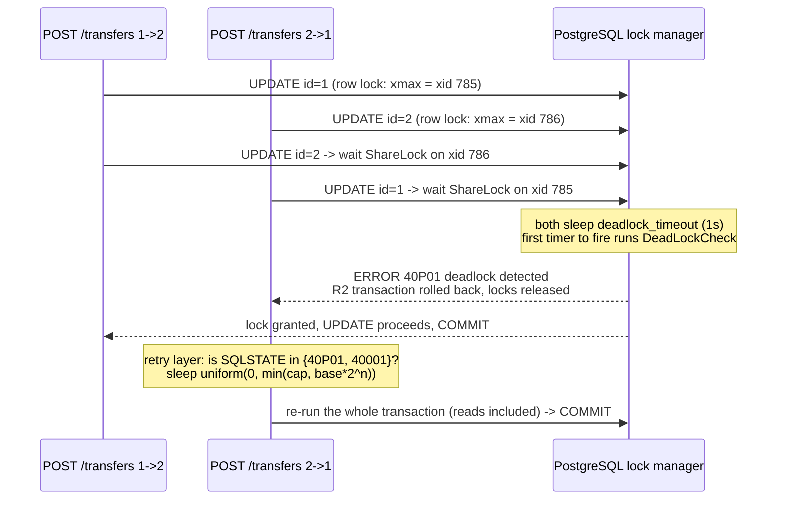

# Database Deadlocks in Multi-Row API Updates: Deterministic Lock Ordering and Exponential-Backoff Transaction Retries

> [!summary] Claim
> A deadlock is a cycle in the database's wait-for graph that the engine breaks by aborting one transaction, so an API that updates several rows must remove the cycle by acquiring row locks in one global order (sort the keys, lock with `SELECT ... ORDER BY id FOR NO KEY UPDATE`) and must still re-run the whole transaction, with capped full-jitter backoff, when the database reports SQLSTATE `40P01` or `40001`.

Part of [Database Access and Transactions for APIs](README.md) in [API Engineering](../README.md).

## TL;DR

- Mechanism: two requests that lock the same rows in opposite order (`A->B` and `B->A`) each hold what the other waits for; PostgreSQL sleeps `deadlock_timeout` (default `1s`), runs `DeadLockCheck`, and aborts the transaction that found the cycle with SQLSTATE `40P01`.
- Contract rule: every code path that locks more than one row locks them in one total order (primary key ascending, parents before children), and takes the strongest lock mode it will need first.
- Trap: retrying is not a fix, it is a recovery path; and a `lock_timeout` shorter than `deadlock_timeout` turns one aborted transaction into two cancelled ones with SQLSTATE `55P03`, which a `40P01`-only retry classifier does not retry.
- Portability fact: PostgreSQL reports `40P01` after `deadlock_timeout`, InnoDB reports error `1213` with SQLSTATE `40001` immediately, SQL Server reports error `1205` after a lock monitor pass (5 s default), and SQLite returns `SQLITE_BUSY` without calling the busy handler when waiting could deadlock; and SQLAlchemy wraps the same `40P01` as `DBAPIError` under asyncpg but `OperationalError` under psycopg.
- When not to use it: do not retry inside the request when the transaction made an external side effect, when the error is outside Class `40` (`23505`, `55P03`, `57014`), or when the commit outcome is unknown; use an idempotency key, a queue, or a single-row design instead.

## Mental model



Each request's first `UPDATE` writes its transaction ID into the row's `xmax`, so the row is locked without any entry in the shared lock table.
The second `UPDATE` of each request finds the row locked and waits on the other transaction's ID lock (`ShareLock on transaction N`), which is why the error names transactions, not rows.
Neither waiter checks for a cycle immediately: each arms a `deadlock_timeout` timer, and the first timer to fire runs the wait-for-graph search, finds the cycle through itself, removes itself from the wait queue, and raises `40P01`.
The rollback releases the victim's row lock, the survivor's wait ends, and the API layer decides from the SQLSTATE alone whether re-running the victim's unit of work is safe.

## How it works

### Where row locks live and what a waiter actually waits on

PostgreSQL does not keep row locks in shared memory.
A row is marked locked by storing the locking transaction's XID in the tuple's `xmax` with infomask bits that distinguish a lock from a delete, and a `MultiXact` replaces the XID when several transactions hold locks on the same tuple (PostgreSQL REL_18_STABLE src/backend/access/heap/README.tuplock).
That is why `max_locks_per_transaction` (default `64`) bounds table-level objects but "is _not_ the number of rows that can be locked; that value is unlimited" (PostgreSQL 18 docs Section 19.12).
A transaction that finds a locked row runs `LockTuple()`, then `XactLockTableWait()` on the XID in `xmax`, marks the tuple as its own, and calls `UnlockTuple()` (README.tuplock).
The heavyweight tuple lock exists for fairness: waiting on the XID alone "will release all waiters concurrently", which allows "indefinite starvation of some waiters", so the tuple lock forms an ordered queue (README.tuplock).
A probe against PostgreSQL 18.7 captured exactly this: the client error detail reads `Process 60354 waits for ShareLock on transaction 754; blocked by process 60353.`, and `pg_stat_activity` reports such waits as wait event type `Lock` with event `transactionid` ("Waiting for a transaction to finish") or `tuple` ("Waiting to acquire a lock on a tuple") (PostgreSQL 18 docs Section 27.2, Table 27.11).

### Which statements take which row lock

| Statement | Row lock taken (PostgreSQL 18 docs Section 13.3.2) |
| --- | --- |
| `SELECT ... FOR UPDATE`, `DELETE`, `UPDATE` of a column with a unique index usable by a foreign key | `FOR UPDATE` |
| `UPDATE` of any other column, `SELECT ... FOR NO KEY UPDATE` | `FOR NO KEY UPDATE` |
| `SELECT ... FOR SHARE` | `FOR SHARE` |
| Foreign key check on insert or update of a child row, `SELECT ... FOR KEY SHARE` | `FOR KEY SHARE` |

The foreign key row is the query `SELECT 1 FROM [ONLY] <pktable> x WHERE pkatt1 = $1 [AND ...] FOR KEY SHARE OF x` built by `RI_FKey_check` (PostgreSQL REL_18_STABLE src/backend/utils/adt/ri_triggers.c, RI_FKey_check).
Per Table 13.3, `FOR KEY SHARE` conflicts only with `FOR UPDATE`, so a child insert does not block a concurrent non-key `UPDATE` of the parent, but it does block `DELETE` of the parent or an `UPDATE` of its key.
`FOR SHARE` conflicts with `FOR NO KEY UPDATE`, which is the root of the lock-upgrade deadlock: two transactions that both read a row `FOR SHARE` and then both `UPDATE` it each wait for the other's share lock.
The docs state the rule: "the first lock acquired on an object in a transaction is the most restrictive mode that will be needed for that object" (PostgreSQL 18 docs Section 13.3.4), and a probe reproduced the upgrade deadlock on 18.7 (one side `40P01`, the other committed).

### Deferred detection: `deadlock_timeout` and `CheckDeadLock`

PostgreSQL checks lazily because the check is expensive: "We optimistically assume that deadlocks are not common in production applications and just wait on the lock for a while before checking for a deadlock" (PostgreSQL 18 docs Section 19.12, `deadlock_timeout`).
`ProcSleep` arms the timer with `enable_timeout_after(DEADLOCK_TIMEOUT, DeadlockTimeout)`, the handler `CheckDeadLockAlert` only sets `got_deadlock_timeout` and the process latch, and the sleeping backend then calls `CheckDeadLock`, which calls `DeadLockCheck(MyProc)` (PostgreSQL REL_18_STABLE src/backend/storage/lmgr/proc.c, ProcSleep, CheckDeadLockAlert, CheckDeadLock).
On `DS_HARD_DEADLOCK` it calls `RemoveFromWaitQueue` and the caller raises the error; `DS_SOFT_DEADLOCK` and `DS_BLOCKED_BY_AUTOVACUUM` are handled in `ProcSleep` (proc.c).
`DeadLockCheck` "looks for deadlocks involving the given process"; `FindLockCycle` scans "outward from the given proc to see if there is a cycle in the waits-for graph that includes this proc" (PostgreSQL REL_18_STABLE src/backend/storage/lmgr/deadlock.c).
Edges come in two kinds: hard edges from locks already held, and soft edges from a waiter queued ahead with a conflicting request; the detector first tries to reorder wait queues to reverse soft edges, and only aborts when no rearrangement removes the cycle (PostgreSQL REL_18_STABLE src/backend/storage/lmgr/README, The Deadlock Detection Algorithm).
The victim is the detecting process, and "If earlier waiters in the cycle have not yet run CheckDeadLock, then the first one to do so will be the victim" (lmgr README), which is why the docs say exactly which transaction is aborted "is difficult to predict and should not be relied upon" (Section 13.3.4).
The error is raised by `DeadLockReport` with `errcode(ERRCODE_T_R_DEADLOCK_DETECTED)`, `errmsg("deadlock detected")`, a client detail built from `Process %d waits for %s on %s; blocked by process %d.`, a separate `errdetail_log` that adds each process's query text, and `errhint("See server log for query details.")` (deadlock.c, DeadLockReport).
The workspace arrays are sized from `MaxBackends` (`maxPossibleConstraints = MaxBackends * 4`), so the search is bounded by the number of backends, not by the number of locked rows (deadlock.c, InitDeadLockChecking).

The server log from the probe run shows every step: the detector, the other waiter (whose timer also fired but which logged `still waiting` rather than a deadlock), the error with query text, and the survivor's grant (timestamps, `[pid]` prefixes, and `STATEMENT` lines removed, every other line kept; PostgreSQL 18.7, `log_lock_waits = on`, `deadlock_timeout = 1s`, captured 2026-11-15):

```text
LOG:  process 60354 detected deadlock while waiting for ShareLock on transaction 754 after 1002.162 ms
DETAIL:  Process holding the lock: 60353. Wait queue: .
CONTEXT:  while updating tuple (0,1) in relation "accounts"
LOG:  process 60353 still waiting for ShareLock on transaction 755 after 1002.196 ms
DETAIL:  Process holding the lock: 60354. Wait queue: 60353.
CONTEXT:  while updating tuple (0,2) in relation "accounts"
ERROR:  deadlock detected
DETAIL:  Process 60354 waits for ShareLock on transaction 754; blocked by process 60353.
	Process 60353 waits for ShareLock on transaction 755; blocked by process 60354.
	Process 60354: UPDATE accounts SET balance = balance + 10 WHERE id = $1
	Process 60353: UPDATE accounts SET balance = balance + 10 WHERE id = $1
HINT:  See server log for query details.
CONTEXT:  while updating tuple (0,1) in relation "accounts"
LOG:  process 60353 acquired ShareLock on transaction 755 after 1002.625 ms
CONTEXT:  while updating tuple (0,2) in relation "accounts"
```

The `still waiting` and `acquired` lines exist only because `log_lock_waits` was turned on; its default is `off` in PostgreSQL 18 (runtime-config-logging, `log_lock_waits`).

### Why sorting removes the cycle

A cycle needs some transaction to hold a lock on key `k1` while waiting for `k2 < k1`.
If every transaction acquires its locks in ascending key order, every wait-for edge points from a holder of smaller keys to a holder of a larger key it wants, so the graph is a DAG and cannot close a cycle; transactions form queues instead.
PostgreSQL's own advice is the same: "The best defense against deadlocks is generally to avoid them by being certain that all applications using a database acquire locks on multiple objects in a consistent order" (Section 13.3.4), and the MySQL manual says that with a consistent order "transactions form well-defined queues and do not deadlock" (MySQL 8.4 Reference Manual, How to Minimize and Handle Deadlocks).
The order must be global: across endpoints, background jobs, migrations, and tables (for example, parent row before child rows), because one code path that locks in reverse order reintroduces the cycle.

The SQL form that fixes the order inside one statement is a locking `SELECT` with `ORDER BY` before the writes:

```sql
SELECT id FROM accounts WHERE id = ANY($1) ORDER BY id FOR NO KEY UPDATE;
UPDATE accounts SET balance = balance - $3 WHERE id = $src;
UPDATE accounts SET balance = balance + $3 WHERE id = $dst;
```

The docs describe the evaluation order this relies on: with a locking clause, "`ORDER BY` is applied first. The command sorts the result, but might then block trying to obtain a lock on one or more of the rows" (PostgreSQL 18 docs, SELECT, The Locking Clause).
`FOR NO KEY UPDATE` is the mode a non-key `UPDATE` takes anyway, so the pre-lock does not escalate, and it does not block foreign-key `FOR KEY SHARE` checks the way `FOR UPDATE` would (Table 13.3).
A single `UPDATE ... WHERE id = ANY($1)` locks rows in the order the plan visits them, which is independent of the array order; a probe saw zero deadlocks in 600 such statements, but the docs promise no lock order for a plain `UPDATE`, so treat that as an observation about one plan, not a guarantee.

### Never waiting, and the limits of the ordered pre-lock

A deadlock needs a wait, so a statement that refuses to wait cannot join a cycle.
"With `NOWAIT`, the statement reports an error, rather than waiting, if a selected row cannot be locked immediately. With `SKIP LOCKED`, any selected rows that cannot be immediately locked are skipped", and the docs add that skipping "provides an inconsistent view of the data, so this is not suitable for general purpose work, but can be used to avoid lock contention with multiple consumers accessing a queue-like table" (PostgreSQL 18 docs, SELECT, The Locking Clause).
`NOWAIT` therefore trades a deadlock for an immediate error that the caller must classify and retry or surface as `503`; `SKIP LOCKED` is correct only for queue-style consumers, never for a transfer that needs both rows.
The ordered pre-lock has a documented caveat at `READ COMMITTED`: because "`ORDER BY` is applied first", the select "might then block trying to obtain a lock on one or more of the rows", and after it unblocks "some of the ordering column values might have been modified, leading to those rows appearing to be out of order"; that matters when the sort key is a mutable column, so sort on the immutable primary key (PostgreSQL 18 docs, SELECT, The Locking Clause).
At `REPEATABLE READ` or `SERIALIZABLE` the same situation raises `40001` instead, which is already in the retry set (same page).
Advisory locks share the regular lock table: "Both advisory locks and regular locks are stored in a shared memory pool", and a session-level advisory lock "does not honor transaction semantics", so it survives a rollback, while a transaction-level one is released at transaction end (PostgreSQL 18 docs Section 13.3.5).
Prefer the transaction-level form inside a retried unit of work, so the retry does not re-enter holding the previous attempt's lock; the docs do not describe advisory-lock deadlock handling, so this note makes no claim about it.

### Recovery: classify by SQLSTATE, re-run the whole unit of work

PostgreSQL defines Class `40` Transaction Rollback as `40000` `transaction_rollback`, `40001` `serialization_failure`, `40002` `transaction_integrity_constraint_violation`, `40003` `statement_completion_unknown`, and `40P01` `deadlock_detected` (PostgreSQL 18 docs Appendix A).
Section 13.5 says `40001` can be retried unconditionally, "It may also be advisable to retry deadlock failures" (`40P01`), and `23505` / `23P01` need more care because "they might represent persistent error conditions" (PostgreSQL 18 docs Section 13.5).
It also states the contract a retry loop must honor: "It is important to retry the complete transaction, including all logic that decides which SQL to issue and/or which values to use. Therefore, PostgreSQL does not offer an automatic retry facility" (Section 13.5).
`40003` is deliberately not retryable: it means the outcome of the statement is unknown, which is exactly the case where blind re-execution can apply a transfer twice.

The SQLSTATE arrives through different wrappers depending on the driver, measured against PostgreSQL 18.7 with SQLAlchemy 2.1.8:

| Driver | Exception raised by SQLAlchemy | `.orig` type | `.orig.sqlstate` |
| --- | --- | --- | --- |
| asyncpg 0.32.0 | `sqlalchemy.exc.DBAPIError` | `AsyncAdapt_asyncpg_dbapi.Error` (cause: `asyncpg.exceptions.DeadlockDetectedError`) | `40P01` (also `.pgcode`) |
| psycopg 3.3.8 | `sqlalchemy.exc.OperationalError` | `psycopg.errors.DeadlockDetected` | `40P01` (no `.pgcode`) |

The asyncpg difference is in the source: the dialect's `_asyncpg_error_translate` maps `asyncpg.exceptions.PostgresError` to the adapter's base `Error` and has no entry for `TransactionRollbackError`, while the adapter copies `sqlstate` onto `pgcode` and `sqlstate` (sqlalchemy 2.1.8 lib/sqlalchemy/dialects/postgresql/asyncpg.py, AsyncAdapt_asyncpg_dbapi._asyncpg_error_translate and AsyncAdapt_asyncpg_dbapi.Error.__init__).
`DeadlockDetectedError` subclasses `TransactionRollbackError` with `sqlstate = '40P01'` (asyncpg 0.32.0 asyncpg/exceptions/__init__.py, DeadlockDetectedError), and psycopg declares `DeadlockDetected(OperationalError, code='40P01', name='DEADLOCK_DETECTED')` (psycopg 3.3.8 psycopg/errors.py, DeadlockDetected).
So `except sqlalchemy.exc.OperationalError` silently misses every asyncpg deadlock; classify on `sqlstate` reached through `.orig` and `__cause__`.

### Backoff: why full jitter

Two victims that retry after the same fixed delay re-create the same interleaving.
Full Jitter draws the sleep uniformly from `[0, min(cap, base * 2**n)]`; tenacity 9.2.1 implements it as `wait_random_exponential`, whose docstring says it "corresponds to the 'Full Jitter' algorithm" and whose `__call__` returns `random.uniform(self.min, high)` (tenacity 9.2.1 tenacity/wait.py, wait_random_exponential).
Marc Brooker's measurements (AWS Architecture Blog, 2015-03-04) found un-jittered exponential backoff "the clear loser", Equal Jitter doing "slightly more work than 'Full Jitter'" and taking "much longer", and Full Jitter using "less work, but slightly more time" than Decorrelated Jitter.
stamina 26.1.0 uses additive jitter instead: `min(wait_max, wait_initial * wait_exp_base^{attempt - 1} + random(0, wait_jitter))` with defaults `attempts=10`, `timeout=45.0`, `wait_initial=0.1`, `wait_max=5.0`, `wait_jitter=1.0`, `wait_exp_base=2` (stamina 26.1.0 stamina/_core.py, retry); those defaults suit HTTP calls, not a deadlock retry inside a request whose own deadline is often under a second.
The SQL Server guide gives the same advice in prose: "Randomizing the duration of the pause minimizes the likelihood of the deadlock reoccurring" (Microsoft Learn, Deadlocks guide).
The broader retry-policy design (which errors, budgets, decorrelated jitter) lives in [[Retries-Exponential-Backoff-Full-vs-Decorrelated-Jitter-and-Stamina]]; this note covers only the database leg.

### Other engines

InnoDB "detects deadlocks immediately" when `innodb_deadlock_detect` is enabled (the default) (MySQL 8.4 innodb-parameters, `innodb_lock_wait_timeout`), "tries to pick small transactions to roll back, where the size of a transaction is determined by the number of rows inserted, updated, or deleted", and returns error `1213` `ER_LOCK_DEADLOCK`, SQLSTATE `40001`, "Deadlock found when trying to get lock; try restarting transaction" (MySQL 8.4 Reference Manual, Deadlock Detection; MySQL 8.4 Error Reference).
A wait-for list over 200 transactions, or a check that must look at more than 1,000,000 locks, is treated as a deadlock and the checking transaction is rolled back (MySQL 8.4 Reference Manual, Deadlock Detection).
`innodb_lock_wait_timeout` (default `50` s, range 1 to 1073741824) rolls back only the current statement, not the transaction, unless the server runs with `--innodb-rollback-on-timeout`, and returns `1205` with SQLSTATE `HY000` (MySQL 8.4 innodb-parameters; Error Reference).
SQL Server's lock monitor runs every 5 s by default, drops "to as low as 100 milliseconds" while it keeps finding deadlocks, picks the transaction "least expensive to roll back" unless `SET DEADLOCK_PRIORITY` (`LOW`, `NORMAL`, `HIGH`, or -10 to 10) says otherwise, and returns error `1205` (Microsoft Learn, Deadlocks guide).
SQLite has database-level locks rather than row locks; "If SQLite determines that invoking the busy handler could result in a deadlock, it will go ahead and return SQLITE_BUSY to the application instead of invoking the busy handler" (SQLite C API, `sqlite3_busy_handler`).

## Numbers and limits

| Quantity | Value | Source |
| --- | --- | --- |
| PostgreSQL `deadlock_timeout` default | `1s`, "probably about the smallest value you would want in practice" | PostgreSQL 18 docs Section 19.12 (as of 2026-11) |
| PostgreSQL `log_lock_waits` default | `off` | PostgreSQL 18 docs, runtime-config-logging (as of 2026-11) |
| PostgreSQL `max_locks_per_transaction` default | `64` objects per process; row locks unlimited | PostgreSQL 18 docs Section 19.12 |
| Detection latency, AB/BA, `deadlock_timeout = 1s` | 1.003 s from second lock request to `40P01` (client side) | measured 2026-11-15: psycopg 3.3.8 threads against a throwaway PostgreSQL 18.7 (Homebrew) on 127.0.0.1, CPython 3.14.6, macOS 27.3 (Darwin 27.3.0), Apple M3 Pro |
| Detection latency at `100ms` / `20ms` | 0.103 s / 0.022 s | measured, same setup |
| Server-side wait reported in log | `after 1002.162 ms` (1s), `101.982 ms` (100ms), `21.689 ms` (20ms) | measured, server log |
| AB/BA deadlock rate, caller order | 141 of 600 transactions (23.5%) aborted with `40P01` | measured: 4 threads x 150 random transfers over 4 rows, 1 ms between the two `UPDATE`s, `deadlock_timeout = 10ms`, same setup; the count varies run to run (the draft's run saw 143) |
| Same workload, `ORDER BY id FOR NO KEY UPDATE` first | 0 of 600 | measured, same setup |
| Same workload, one `UPDATE ... WHERE id = ANY` | 0 of 600 (observation, not a guarantee) | measured, same setup |
| `lock_timeout = 50ms` with `deadlock_timeout = 1s`, AB/BA | both transactions cancelled with `55P03` after 53 ms; zero commits; `pg_stat_database.deadlocks` unchanged | measured, same setup (two runs: 52.6 to 53.4 ms) |
| Three-transaction cycle | exactly one of three aborted; detail lists 3 processes | measured, same setup |
| InnoDB `innodb_lock_wait_timeout` default | `50` s, statement-level rollback | MySQL 8.4 innodb-parameters (as of 2026-11) |
| InnoDB wait-for graph search limit | 200 transactions or 1,000,000 locks, then treated as deadlock | MySQL 8.4 Reference Manual, Deadlock Detection |
| SQL Server lock monitor interval | 5 s default, down to 100 ms | Microsoft Learn Deadlocks guide (as of 2026-11) |
| stamina retry defaults | 10 attempts, 45 s timeout, 0.1 s initial, 5 s max, 1 s jitter | stamina 26.1.0 stamina/_core.py, retry |
| Lab suite runtime | 25 tests in 1.54 s | measured 2026-11-15 (second run; the first took 3.17 s): `uv run --frozen pytest ... -q`, CPython 3.14.6, macOS 27.3 arm64 (Apple M3 Pro) |

The measured detection latency is `deadlock_timeout` plus about 2 ms (server log: `1002.162 ms` at `1s`, `21.689 ms` at `20ms`), which means the cost of a deadlock to an API is dominated by the configured timeout, not by the graph search.
With the default `1s`, every deadlock adds at least one second to the victim request and holds the survivor's lock for the same second, so the p99 of a contended endpoint carries the timeout directly.
Lowering `deadlock_timeout` reduces that latency but runs the check on every lock wait that exceeds it; the docs recommend the opposite direction on loaded servers, "Ideally the setting should exceed your typical transaction time" (Section 19.12).

## Portability

| Dimension | Behavior | Evidence |
| --- | --- | --- |
| CPython 3.14.6 (workspace venv) | 25 lab tests pass | ran: `uv run --frozen pytest`, macOS 27.3 arm64 |
| CPython 3.12.16, 3.13.18, 3.14.10, 3.15.2, 3.15.2t | not run: lab matrix checks are paused (2026-11-11); the lab needs PEP 695 syntax, so 3.12 is the floor | `requires-python = ">=3.12,<3.16"` in `labs/pyproject.toml` |
| PostgreSQL 18.7 | `40P01` after `deadlock_timeout`; victim is the first detector | ran: probe 2026-11-15; lmgr README; proc.c |
| MySQL 8.4 InnoDB | immediate detection, error `1213`, SQLSTATE `40001`; InnoDB tries to pick a small transaction as the victim | MySQL 8.4 Reference Manual, Deadlock Detection; innodb-parameters; Error Reference (not run) |
| SQL Server | lock monitor, error `1205`, `DEADLOCK_PRIORITY` | Microsoft Learn Deadlocks guide (not run) |
| SQLite | `SQLITE_BUSY` without the busy handler when waiting could deadlock | SQLite `sqlite3_busy_handler` docs (not run) |
| SQLAlchemy 2.1.8 + asyncpg 0.32.0 | `DBAPIError`, `.orig.sqlstate == "40P01"` | ran: probe against PostgreSQL 18.7, 2026-11-15 |
| SQLAlchemy 2.1.8 + psycopg 3.3.8 | `OperationalError`, `.orig.sqlstate == "40P01"` | ran: probe against PostgreSQL 18.7, 2026-11-15 |
| SQLAlchemy 2.0.57 | not run | the `sqlalchemy20` leg was not exercised |
| Uvicorn, Hypercorn, Granian; HTTP/1.1, HTTP/2, HTTP/3 | not applicable: the deadlock and its retry happen below the ASGI boundary; only the `503` + `Retry-After` response crosses it | lab uses in-process `httpx.ASGITransport` only |

## Worked example

The lab is an in-process model, because the workspace has no PostgreSQL service: [implementation](../labs/src/api_labs/f13_database_access_and_transactions_for_apis/deadlock_retry.py) and [test](../labs/tests/f13_database_access_and_transactions_for_apis/test_preventing_and_recovering_from_database_deadlocks_in_api_transactions.py).
`RowLockManager` reproduces the three PostgreSQL behaviors an API depends on: a waiter arms a `deadlock_timeout` timer, checks the wait-for graph once when it fires, and if the cycle runs through itself it is the victim with SQLSTATE `40P01`; a waiter that finds no cycle keeps waiting.
It models only exclusive row locks (the `FOR UPDATE` / `FOR NO KEY UPDATE` writer case), so each transaction waits for at most one row and the wait-for graph is a chain that `_find_cycle` can walk.

The lock manager (simplified excerpt):

```python
    async def acquire(self, txid: int, row: int) -> None:
        loop = asyncio.get_running_loop()
        async with self._cond:
            if self._owner.get(row, txid) == txid:
                self._owner[row] = txid
                return
            started = loop.time()
            deadline = started + self.deadlock_timeout
            checked = False
            self._waits_for[txid] = row
            try:
                while row in self._owner:
                    if checked:
                        await self._cond.wait()
                        continue
                    try:
                        await asyncio.wait_for(self._cond.wait(), max(0.0, deadline - loop.time()))
                    except TimeoutError:
                        checked = True
                        self.checks += 1
                        cycle = self._find_cycle(txid)
                        if cycle is not None:
                            self.deadlocks += 1
                            raise DeadlockDetectedError(cycle, loop.time() - started) from None
                self._owner[row] = txid
            finally:
                del self._waits_for[txid]

    def _find_cycle(self, start: int) -> tuple[int, ...] | None:
        """Follow waiter -> row -> owner edges; exclusive locks make the graph a single chain."""
        path = [start]
        txid = start
        while (row := self._waits_for.get(txid)) is not None:
            owner = self._owner.get(row)
            if owner is None:
                return None
            if owner == start:
                return tuple(path)
            if owner in path:
                return None  # a cycle that does not include us: its own member will detect it
            path.append(owner)
            txid = owner
        return None
```

The transfer and the retry loop (simplified excerpt); `lock_order="sorted"` is the whole prevention fix, and `run_with_retries` re-invokes the entire unit of work so the reads run again:

```python
    rows = sorted((source, destination)) if lock_order == "sorted" else [source, destination]
    async with ledger.transaction() as tx:
        await tx.lock(rows[0])
        if think_time:
            await asyncio.sleep(think_time)
        await tx.lock(rows[1])
        if tx.read(source) < amount:
            raise InsufficientFundsError(f"account {source} cannot cover {amount}")
        tx.write(source, tx.read(source) - amount)
        tx.write(destination, tx.read(destination) + amount)


def sqlstate_of(exc: BaseException) -> str | None:
    """Find a SQLSTATE via SQLAlchemy's `.orig` and Python's `__cause__` / `__context__` links."""
    seen: set[int] = set()
    stack: list[BaseException] = [exc]
    while stack:
        current = stack.pop()
        if id(current) in seen:
            continue
        seen.add(id(current))
        code = getattr(current, "sqlstate", None)
        if isinstance(code, str) and len(code) == 5:
            return code
        for link in (getattr(current, "orig", None), current.__cause__, current.__context__):
            if isinstance(link, BaseException):
                stack.append(link)
    return None


def is_retryable(exc: BaseException) -> bool:
    return sqlstate_of(exc) in RETRYABLE_SQLSTATES


def full_jitter_delay(retry: int, *, base: float, cap: float, rng: random.Random) -> float:
    """Full Jitter: uniform over [0, min(cap, base * 2**retry)], `retry` counted from 0."""
    return rng.uniform(0.0, min(cap, base * 2.0**retry))
```

```python
    """Re-run the whole unit of work (reads included) on `40P01` / `40001`, nothing else."""
    for attempt in range(1, policy.max_attempts + 1):
        report.attempts = attempt
        try:
            return await work()
        except Exception as exc:
            if not is_retryable(exc) or attempt == policy.max_attempts:
                raise
            report.sqlstates.append(sqlstate_of(exc) or "")
            delay = full_jitter_delay(
                attempt - 1, base=policy.base_delay, cap=policy.max_delay, rng=rng
            )
            report.delays.append(delay)
            await sleep(delay)
    raise AssertionError("unreachable: the loop returns or raises")
```

What the 25 tests prove:

- `A->B` racing `B->A` in caller order aborts exactly one side with `40P01`, a two-member cycle, one commit, one rollback, and only the survivor's transfer applied.
- The same race with sorted locks commits both with zero deadlocks; a seeded 40-transfer workload over 4 rows deadlocks in caller order and never when sorted, and conserves the total.
- A three-transaction cycle aborts exactly one member.
- The victim's error arrives no earlier than `deadlock_timeout`, and a plain wait four times longer than `deadlock_timeout` checks once, finds no cycle, and succeeds.
- Retries recover the victim on attempt 2, and a retried unit of work sees the value a concurrent writer committed between attempts.
- The classifier accepts real `psycopg.errors.DeadlockDetected`, `SerializationFailure`, `asyncpg.exceptions.DeadlockDetectedError`, and both SQLAlchemy wrappers, follows `raise ... from`, and rejects `55P03`, `57014`, `23505`, and non-database errors.
- Full-jitter delays stay inside `[0, min(cap, base * 2**n)]`, the window grows, and it stops at the cap; retries stop at `max_attempts` and re-raise the last error; a non-retryable error is raised on the first attempt.
- Through FastAPI: without retries the victim gets `503` with `Retry-After: 1` and `"sqlstate": "40P01"`; with retries both requests return `200`; with sorted locks both return `200` on attempt 1; a self-transfer is `422` and an overdraft is `409`.

Captured output (CPython 3.14.6, macOS 27.3 arm64, run from `labs/`):

```text
$ uv run --frozen pytest tests/f13_database_access_and_transactions_for_apis/test_preventing_and_recovering_from_database_deadlocks_in_api_transactions.py -q
.........................                                                [100%]
25 passed in 1.54s
```

## Pitfalls

> [!warning] Locking rows in the order the client sent them
> Trigger: a bulk endpoint (`PATCH /items`, a cart checkout, a ledger transfer) iterates the request body and issues one `UPDATE` per element.
> Symptom: intermittent `500`s carrying `deadlock detected` with `waits for ShareLock on transaction`, rising with concurrency; a probe measured 141 of 600 transactions aborted on PostgreSQL 18.7 at four concurrent workers.
> Fix: sort the keys server-side and lock them in one `SELECT ... WHERE id = ANY($1) ORDER BY id FOR NO KEY UPDATE` before any write; in the bulk-upsert path, sort the `VALUES` list by the conflict key, as covered in [[High-Throughput-Bulk-Writes-Upserts-and-RETURNING-in-SQLAlchemy-2-x]].

> [!warning] Lock upgrade: read `FOR SHARE`, then `UPDATE`
> Trigger: a "check then act" transaction reads a row with `FOR SHARE` (or a repository helper that locks for reading) and later updates the same row, while another request does the same.
> Symptom: `40P01` on a single row; a probe reproduced it on PostgreSQL 18.7 with two transactions and one row.
> Fix: take the strongest mode first (`FOR NO KEY UPDATE` if you will update), as Section 13.3.4 instructs; or use an optimistic version column, covered in [[Optimistic-vs-Pessimistic-Locking-Version-ID-Col-and-FOR-UPDATE-SKIP-LOCKED]].

> [!warning] `lock_timeout` below `deadlock_timeout` hides deadlocks and doubles the damage
> Trigger: a global `lock_timeout` (often set for migrations, see [[Zero-Downtime-Schema-Migrations-Expand-Contract-and-Lock-Timeouts]]) leaks into application sessions with a value under `deadlock_timeout`.
> Symptom: instead of one `40P01` victim and one commit, both transactions fail with `55P03` `canceling statement due to lock timeout` (measured: both after 53 ms, zero commits); a classifier that retries only Class `40` reports both as hard failures, and `pg_stat_database.deadlocks` stays at zero.
> Fix: keep application `lock_timeout` above `deadlock_timeout`, or decide explicitly that `55P03` is retryable for that endpoint; alert on `55P03` counts as well as deadlocks.

> [!warning] DDL deadlocking against live traffic, unnoticed
> Trigger: automated DDL (partition creation, `ALTER TABLE`) takes table-level locks in a different order from the application's row and table locks.
> Symptom: GitLab's production incident INC-643, in which "automatic CI partition creation deadlocked against the live workload and went unnoticed", led to the `PatroniDeadlocksDetected` alert on `increase(pg_stat_database_deadlocks[5m])` with per-cluster thresholds (5 per 5 minutes on the main cluster, sustained for 10 minutes) (GitLab runbook, PatroniDeadlocksDetected).
> Fix: alert on the `deadlocks` counter of `pg_stat_database` ("Number of deadlocks detected in this database", PostgreSQL 18 docs Section 27.2.17), turn on `log_lock_waits`, and run DDL with a short `lock_timeout` and retry, so the migration loses rather than the workload.

> [!warning] Catching the wrong SQLAlchemy exception class
> Trigger: `except sqlalchemy.exc.OperationalError` written against psycopg, then the service switches to `postgresql+asyncpg`.
> Symptom: deadlocks stop being retried and surface as `500`s; measured on SQLAlchemy 2.1.8: asyncpg deadlocks are `sqlalchemy.exc.DBAPIError`, psycopg deadlocks are `sqlalchemy.exc.OperationalError`.
> Fix: classify by `exc.orig.sqlstate` (present for both drivers), as `sqlstate_of` does, and cover both drivers in tests; see [[Async-PostgreSQL-Drivers-Compared-Asyncpg-vs-Psycopg-3]].

> [!warning] Retrying the statement instead of the transaction
> Trigger: a retry decorator wraps one `session.execute(...)`, or the retry reuses values computed before the failure.
> Symptom: after `40P01` the whole transaction is rolled back, so re-issuing only the failed statement either fails in the aborted transaction or commits a half-transfer computed from stale reads.
> Fix: the retry boundary is the transaction boundary, with every read inside it (PostgreSQL 18 docs Section 13.5); place it around the unit of work described in [[Request-Scoped-Transaction-Patterns-Commit-As-You-Go-vs-Unit-of-Work]], never around a request-scoped session that is already half used.

> [!warning] Retrying everything in Class `40`, or retrying outside the transaction's atomicity
> Trigger: `if sqlstate.startswith("40")`, or retrying after a connection drop during `COMMIT`, or retrying a transaction that already called a payment provider or published to a broker.
> Symptom: `40003` `statement_completion_unknown` or a lost `COMMIT` acknowledgement may mean the transaction did commit, so a retry double-applies it; an external side effect is repeated on every attempt.
> Fix: retry in-request only `40P01` and `40001`, which guarantee rollback; move side effects behind a transactional outbox ([[Transactional-Outbox-Pattern-Solving-Dual-Writes-Between-DB-and-Events]]) and protect client retries with an idempotency key ([[Idempotency-Key-Header-Specification-and-State-Machine-Draft-08]]).

> [!warning] Nested retries multiply load during a lock storm
> Trigger: the repository retries 5 times, the service layer retries 3 times, and the client retries 3 times on `503`.
> Symptom: up to 45 transaction attempts per user action exactly when the hot rows are already contended, which keeps the deadlock rate high.
> Fix: retry deadlocks at exactly one layer, cap attempts at 3 to 5 with full jitter bounded by the request deadline, and spend a retry budget across the fleet ([[Retry-Budgets-and-Preventing-Cascading-Retry-Amplification-Storms]]).

## Security and robustness

- Lock contention is a resource-consumption attack surface: OWASP API4:2023 Unrestricted Resource Consumption says an API is vulnerable when limits such as the "Number of records per page to return in a single request-response" are "missing or set inappropriately", and an unbounded list of IDs to update is the write-side version of that limit.
  Cap the number of keys per request (the lab caps `amount` with `Field(gt=0, le=1_000_000)` and rejects self-transfers in a `model_validator`), sort server-side so client order cannot create cycles, and bound each transaction with `statement_timeout` and `idle_in_transaction_session_timeout` so a slow client cannot hold row locks.
- Never hold a transaction open across an external call or a user interaction: "So long as no deadlock situation is detected, a transaction seeking either a table-level or row-level lock will wait indefinitely for conflicting locks to be released" (Section 13.3.4).
- Do not return the server's `DETAIL` or `CONTEXT` to clients: the captured client-side detail contains backend process IDs, transaction IDs, the tuple's physical location `(0,1)`, and the relation name; the lab returns only `{"detail": ..., "sqlstate": "40P01"}`, while the server log keeps the query text from `errdetail_log`.
- Answer an exhausted retry with `503 Service Unavailable` (RFC 9110 Section 15.6.4) and `Retry-After` (RFC 9110 Section 10.2.3), not `409 Conflict` (RFC 9110 Section 15.5.10), because the request was valid and the conflict was transient; `409` is reserved here for the business rule (insufficient funds) that a retry cannot change.
- `POST` is not idempotent (RFC 9110 Section 9.2.2), so a client that retries the `503` must send the same `Idempotency-Key`; the server-side retry is safe only because `40P01` guarantees the failed attempt rolled back.
- `pg_blocking_pids()` is the right diagnostic for a live hang, but "Frequent calls to this function could have some impact on database performance, because it needs exclusive access to the lock manager's shared state for a short time" (PostgreSQL 18 docs Section 9.27.1); do not poll it from a health check.
- Deadlock victims are unpredictable by design (Section 13.3.4), so tests must assert "exactly one aborted, totals conserved", never which request lost; the lab follows that rule.

## The principal's view

The decision is not "retry or sort", it is where contention is allowed to exist in the data model.
Sorting keys is a cheap, local, code-review-enforceable invariant, and it should be a platform rule: a shared repository helper `lock_rows(ids)` that always sorts and always uses `FOR NO KEY UPDATE`, plus a lint or review check that bans per-element `UPDATE` loops over request bodies.
Retries are the second line, owned by one layer (the unit-of-work boundary), classified by SQLSTATE, bounded by the request deadline, and observable: export attempts per request and `40P01` / `40001` / `55P03` counts, and alert on `pg_stat_database.deadlocks` the way GitLab does.
The organizational trade-off is that a global lock order is a cross-team contract: every service, batch job, and migration that touches the same tables must follow it, and the cost of one violator is paid by everyone else's p99 in units of `deadlock_timeout`.
When a single row is hot (a global counter, one merchant balance), ordering does not help because there is no second resource to order; redesign instead with sharded counters, append-only ledger entries with asynchronous aggregation, or a single-writer queue per key.
When the invariant spans rows that cannot all be locked (write skew), move to `SERIALIZABLE` and retry `40001` ([[Transaction-Isolation-Levels-and-Concurrency-Anomalies-in-APIs]]); when work can be partitioned, `FOR UPDATE SKIP LOCKED` lets workers avoid each other entirely instead of queueing.
Choose a different engine behavior deliberately: InnoDB's immediate detection removes the `deadlock_timeout` latency tax but picks victims by size, and `innodb_lock_wait_timeout` rolls back only a statement, so the same Python retry loop needs different classification (`1213` / `40001` versus `1205` / `HY000`) and a different rollback assumption.

## Interview questions

> [!question] L5: Two requests transfer money `A->B` and `B->A` at the same time and one fails with `deadlock detected`.
> Explain the cycle and the simplest fix.
>
> > [!success]- Answer
> > Each transaction locks its source row first, so T1 holds A and waits for B while T2 holds B and waits for A, a two-edge cycle in the wait-for graph.
> > PostgreSQL waits `deadlock_timeout`, detects the cycle, and aborts one transaction with SQLSTATE `40P01`.
> > The fix is to lock both rows in a global order, for example `SELECT ... WHERE id = ANY($1) ORDER BY id FOR NO KEY UPDATE`, before updating.
> > With a total order every wait points toward a larger key, so no cycle can form and the second request queues instead of deadlocking.
> >
> > Follow-up: Which transaction does PostgreSQL abort, and can you choose it?

> [!question] L5: Which errors should an API retry inside the request, and why not `23505` or `57014`?
>
> > [!success]- Answer
> > Retry `40P01` (`deadlock_detected`) and `40001` (`serialization_failure`): both guarantee the transaction rolled back, and PostgreSQL Section 13.5 recommends retrying them.
> > `23505` (`unique_violation`) may be a persistent business conflict, so retrying needs case-by-case reasoning.
> > `57014` (`query_canceled`) usually means a timeout or cancel request; retrying the same work under the same deadline repeats the failure.
> > `40003` (`statement_completion_unknown`) is in the same class but must not be retried blindly because the work may have committed.
> >
> > Follow-up: How do you get the SQLSTATE from a SQLAlchemy exception under asyncpg and under psycopg?

> [!question] L6: Predict the output.
> Session settings are `deadlock_timeout = 1s` and `lock_timeout = 50ms`.
> T1 updates row 1 then row 2; T2 updates row 2 then row 1, interleaved so both hold their first lock.
> What does each transaction get, and after how long?
>
> > [!success]- Answer
> > Both transactions fail with SQLSTATE `55P03`, `canceling statement due to lock timeout`, about 50 ms after their second `UPDATE` (a probe measured 53 ms for both on PostgreSQL 18.7).
> > Neither commits, because `lock_timeout` fires before either waiter reaches `deadlock_timeout` and runs the deadlock check.
> > `pg_stat_database.deadlocks` does not increase, so a deadlock dashboard shows nothing.
> > A retry classifier that accepts only `40P01` and `40001` turns both into user-visible failures.
> >
> > Follow-up: Which setting would you change, and what is the cost of each option?

> [!question] L6: Debug this API.
> A `PATCH /orders/{id}/items` endpoint updates quantities with `for item in body.items: await session.execute(update(Item).where(Item.id == item.id).values(qty=item.qty))`.
> Under load the logs show `deadlock detected ... waits for ShareLock on transaction`.
> Switching the driver from psycopg to asyncpg made the `500` rate jump although deadlocks did not increase.
> Find both bugs.
>
> > [!success]- Answer
> > The loop locks rows in client-supplied order, so two requests that list the same items in different orders form AB/BA cycles; sort the IDs and pre-lock them with one `ORDER BY id FOR NO KEY UPDATE` select.
> > The `500` jump means the retry handler catches `sqlalchemy.exc.OperationalError`, which psycopg deadlocks raise, while asyncpg deadlocks arrive as `sqlalchemy.exc.DBAPIError` (measured on SQLAlchemy 2.1.8).
> > Classify on `exc.orig.sqlstate` instead, and retry the whole unit of work, not the failing `execute`.
> > Add a test per driver that asserts the classifier on the real exception classes.
> >
> > Follow-up: Why does the error mention a transaction ID rather than the row?

> [!question] L6: Why does PostgreSQL wait a full second before checking for deadlocks, and what happens if you set `deadlock_timeout` to `10ms`?
>
> > [!success]- Answer
> > The docs say the check is "relatively expensive", so PostgreSQL optimistically waits and checks only once the wait exceeds `deadlock_timeout`; ordinary lock waits usually end sooner.
> > The search walks the wait-for graph and may try rearranging wait queues to reverse soft edges before deciding to abort.
> > At `10ms` real deadlocks are reported sooner (a probe saw `40P01` after `deadlock_timeout` plus about 2 ms), but every lock wait longer than 10 ms pays for a check.
> > The docs advise that the setting "should exceed your typical transaction time" on loaded servers.
> >
> > Follow-up: How does `log_lock_waits` interact with `deadlock_timeout`?

> [!question] L6: A transaction reads a row `FOR SHARE`, validates it, then updates it.
> Two requests do this concurrently on the same row.
> What happens and how do you fix it?
>
> > [!success]- Answer
> > Both acquire `FOR SHARE`, which do not conflict, then both request `FOR NO KEY UPDATE`, which conflicts with the other's `FOR SHARE` (Table 13.3).
> > Each waits for the other's transaction, a one-row deadlock, and PostgreSQL aborts one with `40P01`.
> > Fix it by taking the strongest needed mode first, `FOR NO KEY UPDATE`, as Section 13.3.4 recommends, or by switching to optimistic concurrency with a version column.
> > Sorting does not help here because there is only one row.
> >
> > Follow-up: Why is `FOR NO KEY UPDATE` preferable to `FOR UPDATE` for the pre-lock?

> [!question] L7+: Design the deadlock policy for a payments platform with 40 services sharing one PostgreSQL cluster.
>
> > [!success]- Answer
> > Publish a global lock-order contract (table order, then primary key ascending) and ship it as a shared `lock_rows` helper that sorts and uses `FOR NO KEY UPDATE`, enforced in review and by tests that race reversed inputs.
> > Retry `40P01` and `40001` at exactly one layer, the unit-of-work boundary, with 3 to 5 attempts and full jitter capped by the request deadline, and return `503` with `Retry-After` when exhausted.
> > Keep side effects out of the retried transaction with an outbox, and require idempotency keys on client retries.
> > Observe `pg_stat_database.deadlocks`, per-SQLSTATE counters, and `log_lock_waits`, alert on sustained rates, and redesign hot single rows into append-only ledgers or sharded counters.
> >
> > Follow-up: How do you keep migrations and batch jobs inside the same contract?

> [!question] L7+: Compare deadlock handling on PostgreSQL, InnoDB, and SQL Server, and explain what changes in your retry code if you migrate between them.
>
> > [!success]- Answer
> > PostgreSQL checks after `deadlock_timeout`, aborts the first detector with `40P01`, and rolls back the whole transaction.
> > InnoDB detects immediately, tries to roll back a small transaction (fewest rows inserted, updated, or deleted), and returns `1213` with SQLSTATE `40001`; its `innodb_lock_wait_timeout` (50 s) rolls back only the statement and returns `1205` / `HY000`.
> > SQL Server's lock monitor runs every 5 s (down to 100 ms under deadlock load), chooses by `DEADLOCK_PRIORITY` then rollback cost, and returns error `1205`.
> > The classifier must map each engine's codes, and on InnoDB a lock wait timeout leaves the transaction open, so the code must roll back explicitly before retrying.
> >
> > Follow-up: Would you ever disable `innodb_deadlock_detect`?

> [!question] L7+: An engineer proposes fixing deadlocks by wrapping every endpoint in a generic `@retry(on=Exception, attempts=10)` decorator.
> What do you say?
>
> > [!success]- Answer
> > It retries non-transient errors (`23505`, validation, bugs) and multiplies load during lock storms, so it worsens the incident it targets.
> > It may wrap non-idempotent side effects or an unknown-outcome `COMMIT`, creating double writes.
> > It hides the design bug: the deadlock rate should be driven to near zero by ordering, with retries as a measured safety net.
> > Replace it with a SQLSTATE-classified retry at the transaction boundary, a small attempt cap within the deadline, and a retry budget.
> >
> > Follow-up: What metric tells you the ordering fix worked?

## Related

Prerequisites: [[Optimistic-vs-Pessimistic-Locking-Version-ID-Col-and-FOR-UPDATE-SKIP-LOCKED]]

Next: [[Eliminating-N-Plus-1-Queries-Selectinload-Joinedload-Subqueryload-and-Raiseload]]

See also: [[02-Programming-Languages/Python/Python-Backend-Interview-Prep/06-SQL-and-SQLAlchemy]], [[Transaction-Isolation-Levels-and-Concurrency-Anomalies-in-APIs]], [[Request-Scoped-Transaction-Patterns-Commit-As-You-Go-vs-Unit-of-Work]], [[High-Throughput-Bulk-Writes-Upserts-and-RETURNING-in-SQLAlchemy-2-x]], [[Zero-Downtime-Schema-Migrations-Expand-Contract-and-Lock-Timeouts]], [[Async-PostgreSQL-Drivers-Compared-Asyncpg-vs-Psycopg-3]], [[Transactional-Outbox-Pattern-Solving-Dual-Writes-Between-DB-and-Events]], [[Retries-Exponential-Backoff-Full-vs-Decorrelated-Jitter-and-Stamina]], [[Retry-Budgets-and-Preventing-Cascading-Retry-Amplification-Storms]], [[Idempotency-Key-Header-Specification-and-State-Machine-Draft-08]]

- Lab: `labs/tests/f13_database_access_and_transactions_for_apis/test_preventing_and_recovering_from_database_deadlocks_in_api_transactions.py`

## Further reading

- [PostgreSQL 18 Section 13.3 Explicit Locking](https://www.postgresql.org/docs/18/explicit-locking.html) - row lock modes, the conflict table, and the official deadlock example and avoidance rule.
- [PostgreSQL 18 Section 13.5 Serialization Failure Handling](https://www.postgresql.org/docs/18/mvcc-serialization-failure-handling.html) - which SQLSTATEs to retry and why the whole transaction must be re-run.
- [PostgreSQL 18 Section 19.12 Lock Management](https://www.postgresql.org/docs/18/runtime-config-locks.html) - `deadlock_timeout` and its rationale.
- [PostgreSQL lmgr README](https://raw.githubusercontent.com/postgres/postgres/REL_18_STABLE/src/backend/storage/lmgr/README) - the deadlock detection algorithm, soft and hard edges, and victim choice.
- [PostgreSQL deadlock.c](https://raw.githubusercontent.com/postgres/postgres/REL_18_STABLE/src/backend/storage/lmgr/deadlock.c) - `DeadLockCheck`, `FindLockCycle`, and the exact `DeadLockReport` error.
- [PostgreSQL README.tuplock](https://raw.githubusercontent.com/postgres/postgres/REL_18_STABLE/src/backend/access/heap/README.tuplock) - why row locks live in `xmax` and why waiters wait on transaction IDs.
- [MySQL 8.4 Deadlock Detection](https://dev.mysql.com/doc/refman/8.4/en/innodb-deadlock-detection.html) - InnoDB victim selection and graph-search limits.
- [MySQL 8.4 How to Minimize and Handle Deadlocks](https://dev.mysql.com/doc/refman/8.4/en/innodb-deadlocks-handling.html) - consistent ordering and retry guidance from the engine authors.
- [SQL Server Deadlocks Guide](https://learn.microsoft.com/en-us/sql/relational-databases/sql-server-deadlocks-guide) - lock monitor cadence, `DEADLOCK_PRIORITY`, and error `1205`.
- [SQLite `sqlite3_busy_handler`](https://www.sqlite.org/c3ref/busy_handler.html) - why SQLite returns `SQLITE_BUSY` instead of waiting into a deadlock.
- [Exponential Backoff and Jitter (Brooker, 2015)](https://aws.amazon.com/blogs/architecture/exponential-backoff-and-jitter/) - the simulation behind Full Jitter.
- [GitLab runbook: PatroniDeadlocksDetected](https://runbooks.gitlab.com/patroni/alerts/PatroniDeadlocksDetected/) - a production alert on deadlock rate and the incident that motivated it.
- [RFC 9110](https://www.rfc-editor.org/rfc/rfc9110.html) - `503`, `409`, `Retry-After`, and idempotent methods for the HTTP side of an exhausted retry.
