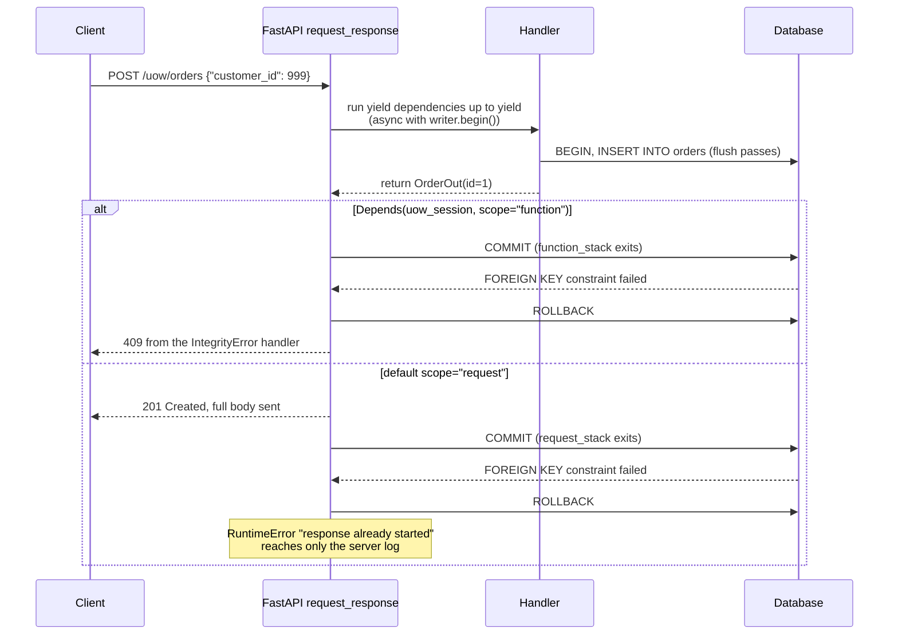

# Transaction Boundaries in FastAPI: Request-Scoped Unit-of-Work Dependencies vs Explicit Service-Layer Transactions and Read Replicas

> [!summary] Claim
> In FastAPI 0.162.0 a `yield` dependency that commits after `yield` commits after the response has already been sent, so a commit-time failure becomes a `201` for a row that does not exist; put the COMMIT where the response can still change (the service layer, or `Depends(..., scope="function")`), give read-only requests an AUTOCOMMIT replica engine that never sends `BEGIN` or `COMMIT`, and route reads that must see the caller's own write to the primary with a causal token.

Part of [Database Access and Transactions for APIs](README.md) in [API Engineering](../README.md).

## TL;DR

- Mechanism: FastAPI wraps every request in two `AsyncExitStack`s; a `yield` dependency on the default `"request"` scope exits after `await response(scope, receive, send)`, one on `scope="function"` exits before it, and a service method that runs `async with session.begin()` commits before the handler even returns.
- Contract rule: the code that decides the status code must run after the COMMIT, so the use case (service layer) owns the transaction and the request owns only the session; commit-as-you-go (`session.commit()` twice in one request) gives up atomicity, as the lab's durable audit row with no order shows.
- Trap: with the request-scoped Unit-of-Work dependency, the lab's orphan order gets `201 Created` with `{"id": 1}` while the database holds 0 orders, and the only trace is a server-side `RuntimeError: Caught handled exception, but response already started.`; and on SQLite, closing a session after a failed COMMIT without an explicit rollback returns a connection to the pool that is still inside a transaction.
- Portability: the exit timing is a FastAPI version property (after the response before 0.106.0, before it from 0.106.0, after it again from 0.118.0, selectable with `scope` from 0.121.0); the lab passed 18 of 18 on CPython 3.14.6 with SQLAlchemy 2.1.8 and SQLite 3.53.1, and a PostgreSQL 18.7 probe measured a read through the Unit-of-Work dependency at p50 384 to 408 us against 210 to 225 us on an AUTOCOMMIT engine.
- When not to use a request-scoped Unit of Work: anything that streams, calls another service, publishes an event, or must map commit failures to a status code; use it only for small CRUD handlers, and then with `scope="function"`.

## Mental model



The client sends a create whose foreign key is deferred, so the `INSERT` and the flush succeed and only the COMMIT can fail.
FastAPI enters both exit stacks before the handler runs, so the dependency's `async with writer.begin()` is open around the handler, and the handler returns a fully built `OrderOut` with `id=1`.
On the `scope="function"` branch the inner stack closes first, the COMMIT fails while no byte of the response exists, the context manager rolls back, and Starlette's `wrap_app_handling_exceptions`, which FastAPI's `request_response` wraps around both stacks, turns the `IntegrityError` into the registered `409`.
On the default branch FastAPI sends the `201` first and closes the outer stack afterwards, so the same failure arrives when the response is already on the wire; Starlette can only raise, the server logs it, and the client keeps a success for a row that was rolled back.

## How it works

### Three places to put the transaction boundary

SQLAlchemy's documentation names two framing styles.
"Commit as you go" means calling `Session.commit()` whenever a unit of work is done, relying on autobegin to open the next transaction, and in 2.0 style these methods "affect the **outermost** transaction in all cases" (SQLAlchemy 2.1.8 `doc/build/orm/session_transaction.rst`, Commit as you go).
"Begin once" means `sessionmaker.begin()`, which "will both procure a new object with which to execute SQL statements ... and then return a context manager that will maintain a begin/commit/rollback context for that object" (same file, Begin Once).
Applied to an API, those become three architectures, and the lab implements all three against one schema:

| Placement | Where COMMIT runs | Who learns about a commit failure | Lab route |
|---|---|---|---|
| Request-scoped Unit-of-Work dependency | dependency teardown, after `yield` | the server log (default scope) or the exception handlers (`scope="function"`) | `/uow/orders` |
| Service-layer transaction | `async with session.begin()` inside the use case | the handler, which maps it to a status code | `/svc/orders` |
| Commit as you go | every `session.commit()` call in the handler | the handler, after earlier commits are already durable | `/cayg/orders` |

The SQLAlchemy FAQ gives the rule that decides between them: "Keep the lifecycle of the session (and usually the transaction) **separate and external**" from the functions and objects that access and manipulate database data, and for web applications "create a `Session` at the start of a web request, call the `Session.commit()` method at the end of web requests that do POST, PUT, or DELETE, and then close the session at the end of web request" (SQLAlchemy 2.1.8 `doc/build/orm/session_basics.rst`, When do I construct a Session, when do I commit it, and when do I close it?).
"At the end of the request" is the ambiguous part, because in an ASGI framework the end of the request is after the response.

### FastAPI 0.162.0: two exit stacks per request

FastAPI replaces Starlette's `request_response` with a copy that opens two nested stacks: `async with AsyncExitStack() as request_stack`, stored as `scope["fastapi_inner_astack"]`, then `async with AsyncExitStack() as function_stack`, stored as `scope["fastapi_function_astack"]`, then `response = await f(request)` inside the inner stack and `await response(scope, receive, send)` after the inner stack closes but before the outer one does (fastapi 0.162.0 fastapi/routing.py, request_response).
`f` is the route handler built by `get_request_handler`, which solves dependencies, calls the endpoint, and serializes the return value, so serialization of the response model happens inside the function stack (fastapi 0.162.0 fastapi/routing.py, get_request_handler).
`solve_dependencies` decides the stack per dependency: a generator dependency goes on `request_astack` unless `sub_dependant.scope == "function"`, and `_solve_generator` wraps it with `asynccontextmanager` and calls `stack.enter_async_context(cm)` (fastapi 0.162.0 fastapi/dependencies/utils.py, solve_dependencies and _solve_generator).
When no scope is given, `_get_computed_scope` returns `"request"` for any generator or async generator callable (fastapi 0.162.0 fastapi/dependencies/models.py, _get_computed_scope), which matches the documentation: "If not specified and the dependency has `yield`, it will have a `scope` of `"request"` by default" (FastAPI docs, Dependencies with yield, Early exit and `scope`).
A request-scoped dependency may not depend on a function-scoped one; `get_dependant` raises `DependencyScopeError` with `it cannot depend on dependencies with scope "function"` (fastapi 0.162.0 fastapi/dependencies/utils.py, get_dependant), because "any dependency needs to be able to run its exit code before the sub-dependencies" (FastAPI docs, `scope` for sub-dependencies).
Dependency results are cached per request by default (`use_cache=True`), so every parameter that declares the same session dependency receives the same `AsyncSession` object, and `use_cache=False` creates a second session with its own connection and transaction (fastapi 0.162.0 fastapi/param_functions.py, Depends); the lab's `/shared` route returns `{"first_is_second": true, "first_is_third": false}`.

The timing has changed three times, and the advanced guide summarizes it (FastAPI docs, Advanced Dependencies, Dependencies with yield, HTTPException, except and Background Tasks):

- before 0.106.0 the exit code ran after the response and after background tasks, so a background task could reuse a yielded session;
- 0.106.0 (2023-12-25) moved it before the response "to not hold resources while waiting for the response to travel through the network";
- 0.110.0 stopped re-raising an exception that a dependency swallowed with `except` without `raise`;
- 0.118.0 (2025-09-29) moved it back after the response so that a `StreamingResponse` can still use the session;
- 0.121.0 (2025-11-03) added `Depends(scope="function")` to opt back into exit before the response, with `"request"` remaining the default.

The 0.118.0 change broke real code that committed in teardown.
Apache Airflow pinned `fastapi<0.118.0` the next day to unbreak its CI, explaining that cleanup "now runs after the response starts streaming", so duplicate-entity errors from implicit commits surface too late and produce "Caught handled exception, but response already started." (apache/airflow PR 56239, merged 2025-09-30).
FastAPI discussion 14151 ("[0.118.0] Use case for early closing in yield dependencies (session commit before response)", opened 2025-10-01) describes the other symptom: a client that immediately reads the record it just created can get a `404`, because the commit happens "sometime after responding"; the maintainer answered with PR 14262 and shipped `scope="function"` in 0.121.0.

### What the client sees when a teardown COMMIT fails

The lab's orphan order (`customer_id=999`, deferred foreign key) produces this SQLite trace on the request-scoped route, and the client receives `201` with `{"id": 1, ...}` while `SELECT count(*) FROM orders` returns 0:

```text
primary:BEGIN
primary:INSERT
primary:COMMIT      <- fails: FOREIGN KEY constraint failed (after the 201 was sent)
primary:ROLLBACK
```

The exception travels out of the outer exit stack into `wrap_app_handling_exceptions`, which finds the registered `IntegrityError` handler but sees `response_started` and raises `RuntimeError("Caught handled exception, but response already started.") from exc` (starlette 1.10.0 starlette/_exception_handler.py, wrap_app_handling_exceptions); without a registered handler it re-raises the `IntegrityError` itself.
`ServerErrorMiddleware` sends a `500` only `if not response_started` and re-raises either way (starlette 1.10.0 starlette/middleware/errors.py, ServerErrorMiddleware.__call__).
What the server does next differs: Uvicorn logs `Exception in ASGI application` and, because the response started, calls `self.transport.close()` (uvicorn 0.54.0 uvicorn/protocols/http/h11_impl.py, RequestResponseCycle.run_asgi), so the client has a complete `201` and a closed keep-alive connection; Hypercorn logs `Error in ASGI Framework` and then ends the stream normally (hypercorn 0.18.0 src/hypercorn/asyncio/task_group.py, _handle, and src/hypercorn/protocol/http_stream.py, HTTPStream.app_send).
In tests, `httpx.ASGITransport(raise_app_exceptions=True)` (the default) re-raises the app exception from `client.post`, and `raise_app_exceptions=False` returns the response that was sent (httpx 0.28.1 httpx/_transports/asgi.py, ASGITransport.handle_async_request); the lab uses both to pin the two views.

Commit-time failures are not exotic.
SQLite checks deferred foreign keys only "until the transaction tries to COMMIT", and "COMMIT will fail as long as foreign key constraints remain in violation" (SQLite `foreignkeys.html` Section 4.2); a PostgreSQL 18.7 probe here saw the same orphan insert fail at COMMIT with SQLSTATE `23503`.
A network failure during COMMIT is worse, because the client of the database cannot know whether it committed; that case belongs to [[Idempotent-Request-Identification-and-Request-ID-Correlation-AIP-155]] and [[Transactional-Outbox-Pattern-Solving-Dual-Writes-Between-DB-and-Events]].

### The service-layer transaction

`OrderService.place_order` runs the whole use case inside `async with session.begin()`, builds the response model inside the block, and converts the `IntegrityError` that the COMMIT raises into a domain exception that the handler maps to `409` before any response exists.
The context manager is SQLAlchemy's `TransactionalContext.__exit__`: on a clean exit it calls `self.commit()`, and if that raises it calls `self.rollback()` when `_rollback_can_be_called()` before re-raising; on an exception it rolls back (sqlalchemy 2.1.8 lib/sqlalchemy/engine/util.py, TransactionalContext.__exit__).
`async_sessionmaker.begin()` returns `_AsyncSessionContextManager`, whose `__aexit__` runs the transaction exit and then `AsyncSession.__aexit__` inside `_run_to_completion` (sqlalchemy 2.1.8 lib/sqlalchemy/ext/asyncio/session.py, _AsyncSessionContextManager.__aexit__), which shields the cleanup so a cancelled request still finishes it: "a cancellation received while waiting is re-raised once ``coro`` has completed" (sqlalchemy 2.1.8 lib/sqlalchemy/ext/asyncio/base.py, _run_to_completion); see [[Cancellation-Semantics-CancelledError-Swallowing-and-Shielded-Cleanup]].
The service's own `async with session.begin()` is not shielded the same way: `AsyncSessionTransaction.__aexit__` awaits `greenlet_spawn(self._sync_transaction().__exit__, ...)` directly (sqlalchemy 2.1.8 lib/sqlalchemy/ext/asyncio/session.py, AsyncSessionTransaction.__aexit__), so only the session close in the dependency (`AsyncSession.__aexit__`, which calls `_run_to_completion(self.close())`) is guaranteed to finish under cancellation.
Opening the transaction costs nothing until SQL runs: the lab's `/uow/health` handler sees `session.in_transaction()` as `true` while the event log records zero pool checkouts, because a `SessionTransaction` acquires a connection only in `_connection_for_bind` (sqlalchemy 2.1.8 lib/sqlalchemy/orm/session.py, SessionTransaction._connection_for_bind).

Two composition rules follow from `Session.begin`.
When the session already has a transaction, `begin()` raises `InvalidRequestError("A transaction is already begun on this Session.")` (sqlalchemy 2.1.8 lib/sqlalchemy/orm/session.py, Session.begin), and any query autobegins one, so a handler that reads first and then calls a service that does `async with session.begin()` fails; the lab proves both the read-then-begin case and the service-inside-an-outer-unit-of-work case.
The fix is a convention, not a library feature: `begin()` belongs to the outermost use case only, inner helpers take the session and never commit, and a helper that needs partial rollback uses `begin_nested()` (a `SAVEPOINT`, see [[Dry-Run-and-Validate-Only-Requests-AIP-163]]).

### Commit as you go inside a request

The `/cayg/orders` handler adds an `AuditEntry`, calls `session.commit()`, adds the `Order`, and calls `session.commit()` again.
With the orphan order the event log shows two `COMMIT`s, the second fails, the client gets `409`, and the database holds 1 audit row and 0 orders.
The partial write is the defining property of the style: each `commit()` ends a transaction and the next statement autobegins a fresh one, so no rollback can reach back past an earlier commit.

### A failed COMMIT, then `close()` without `rollback()`

The lab found a sharper hazard in the commit-as-you-go path.
When a root transaction's commit raises, `RootTransaction._do_commit` deactivates it but keeps it as `connection._transaction`, with the comment "only remove as the connection's current transaction if commit succeeded.  otherwise it stays on so that a rollback needs to occur" (sqlalchemy 2.1.8 lib/sqlalchemy/engine/base.py, RootTransaction._do_commit).
If the session is then closed instead of rolled back, `SessionTransaction.close` skips `transaction.close()` because the transaction is no longer active and calls `connection.close()` (sqlalchemy 2.1.8 lib/sqlalchemy/orm/session.py, SessionTransaction.close).
`Connection.close` sees a truthy `self._transaction`, calls its `close()`, which issues no rollback because `is_active` is false and only detaches it from the connection, sets `skip_reset = True`, and returns the DBAPI connection with `_close_special(transaction_reset=True)` (sqlalchemy 2.1.8 lib/sqlalchemy/engine/base.py, Connection.close and RootTransaction._close_impl).
The pool then skips its own rollback (with `echo_pool="debug"` it logs `Connection ... reset, transaction already reset`) (sqlalchemy 2.1.8 lib/sqlalchemy/pool/base.py, _ConnectionFairy._reset).
On PostgreSQL that is harmless, because a failed COMMIT ends the server transaction; in the probe the orphan COMMIT failed with SQLSTATE `23503`, the session was closed without a rollback, and the next session on the same single pooled connection read normally in a fresh transaction.
On SQLite it is not: "The following COMMIT fails ... The transaction remains open" (SQLite `foreignkeys.html` Section 4.2, example), so the pooled connection still holds the orphan insert, and the next request's `BEGIN` fails with `cannot start a transaction within a transaction`, which the lab reproduces; with an explicit `await session.rollback()` the next session works.
The same `Connection.close` logic is present in 2.0.57 (sqlalchemy 2.0.57 lib/sqlalchemy/engine/base.py, Connection.close), so this is not a 2.1 regression; a search of the SQLAlchemy issue tracker for `"transaction already reset"`, `"cannot start a transaction within a transaction"`, and deferred-key commit failures found no report of it (as of 2026-11), the nearest being issue 13657 (a failed `BEGIN` that leaves `_transaction` set), which the 2.1.8 `skip_reset` comment cites.
The lab's `writer_session` dependency therefore rolls back on any exception before closing, and `async with session.begin()` already does so through `TransactionalContext.__exit__`.

### Read-only requests: what BEGIN and COMMIT cost

The Unit-of-Work dependency wraps reads too, so the lab's `GET /uow/orders/1` makes SQLite execute `BEGIN`, `SELECT`, `COMMIT`, three statements for one row.
SQLAlchemy documents the alternative: a second engine from `eng.execution_options(isolation_level="AUTOCOMMIT")` shares the pool and dialect, and a session on it "continues to have transactional semantics", but "the transaction will be silently absent", so it is "typical ... that a Session with AUTOCOMMIT isolation be used in a read-only fashion" (SQLAlchemy 2.1.8 `doc/build/orm/session_transaction.rst`, Setting Isolation For A Sessionmaker / Engine Wide).
The lab's replica engine is created with `isolation_level="AUTOCOMMIT"`, and SQLite executes exactly one statement, `SELECT`, for `GET /svc/orders/1`.
SQLAlchemy still dispatches its `rollback` event on release, because the event fires before the DBAPI call in `Connection._rollback_impl` (sqlalchemy 2.1.8 lib/sqlalchemy/engine/base.py, Connection._rollback_impl); the documentation says this rollback "still incurs a network round trip under most if not all DBAPI drivers" and offers `create_engine(..., skip_autocommit_rollback=True)` since 2.0.43, which skips DBAPI `rollback()` when the dialect can detect autocommit without a network call (SQLAlchemy 2.1.8 `doc/build/core/connections.rst`, Fully preventing ROLLBACK calls under autocommit; lib/sqlalchemy/engine/default.py, DefaultDialect.do_rollback).
For asyncpg the adapter's `rollback()` and `commit()` do nothing when `self._transaction is None`, and `_start_transaction` returns early when `isolation_level == "autocommit"` (sqlalchemy 2.1.8 lib/sqlalchemy/dialects/postgresql/asyncpg.py, AsyncAdapt_asyncpg_connection), so on that driver the AUTOCOMMIT read is one round trip.

The PostgreSQL probe measured both the transaction count and the latency (see Numbers): 1000 Unit-of-Work reads added 1004 to `pg_stat_database.xact_commit`, 1000 plain-session reads added 1001 to `xact_rollback`, and 1000 AUTOCOMMIT reads added 1008 to `xact_commit`, because each autocommit statement is its own committed transaction; the few extra transactions per run are the probe's connection setup and stats queries.
The p50 latency of the three styles was 384 to 408 us, 308 to 337 us, and 210 to 225 us over loopback; on a network with real round-trip time the difference scales with the two extra round trips, not with these loopback numbers.
The Unit-of-Work read is slower than the plain read, although both send three messages, because of client-side async plumbing rather than the database: a second probe counted 4 `greenlet_spawn` calls and 2 `_run_to_completion` calls per Unit-of-Work request against 2 and 1 for a plain session and 3 and 1 for a plain session that calls `commit()`, and measured p50 343 to 348 us, 274 to 286 us, and 287 to 296 us for the three on `SELECT 1`.
So `COMMIT` instead of `ROLLBACK` costs about 10 us, and the rest of the gap (about 50 us) matches the extra `_run_to_completion` that `_AsyncSessionContextManager.__aexit__` adds around `AsyncSession.__aexit__`, whose task-and-shield round trip the probe measured at 42.6 us for an empty coroutine.

A read-only transaction is still useful when several reads must share one snapshot.
`SET TRANSACTION READ ONLY` disallows `INSERT`, `UPDATE`, `DELETE`, `MERGE`, and `COPY FROM` on non-temporary tables, all DDL, and more, and is "a high-level notion of read-only that does not prevent all writes to disk" (PostgreSQL 18 `SET TRANSACTION`, Description); SQLAlchemy exposes it as `execution_options(postgresql_readonly=True)` (sqlalchemy 2.1.8 lib/sqlalchemy/dialects/postgresql/base.py, Setting READ ONLY / DEFERRABLE).
That docstring says "some DBAPIs such as asyncpg only support "readonly" with SERIALIZABLE isolation", but the probe with asyncpg 0.32.0 saw `transaction_read_only = on` with `transaction_isolation = read committed`, and an `INSERT` failed with `25006` `cannot execute INSERT in a read-only transaction` (`read_only_sql_transaction`, PostgreSQL 18 Appendix A), so the docstring note is stale for this asyncpg release.

### Read replicas: route per request, not per statement

SQLAlchemy's partitioning chapter shows a `RoutingSession(Session)` whose `get_bind` returns the `leader` engine when `self._flushing` or the clause is an `Update` or `Delete`, and a random follower otherwise, and then warns that this "is likely not a practical approach, as it leads to uncoordinated transaction behavior between reading and writing within the same operation", recommending a "reader" or "writer" session chosen up front (SQLAlchemy 2.1.8 `doc/build/orm/persistence_techniques.rst`, Custom Vertical Partitioning).
The reason is mechanical: a session with several binds holds one connection per bind, and `SessionTransaction.commit` commits them by iterating `set(self._connections.values())` (sqlalchemy 2.1.8 lib/sqlalchemy/orm/session.py, SessionTransaction.commit), an unordered loop with no atomicity unless `twophase=True`; the documentation notes SQLAlchemy "has limited support for two-phase transactions across backends" (SQLAlchemy 2.1.8 `doc/build/orm/persistence_techniques.rst`, Partitioning Strategies).
The lab follows the recommendation: `reader_session` and `writer_session` are separate dependencies on separate engines, writes never touch the replica, and a read chooses its session once.

A replica answers with what it has replayed.
A hot standby accepts connections that are "strictly read-only; not even temporary tables may be written" (PostgreSQL 18 Section 26.4.1), and the lab mirrors that with `PRAGMA query_only=ON`, which makes a stray write fail with `attempt to write a readonly database`.
Replay lag is the cost: the lab's `GET /svc/orders/{id}` returns `404` from the replica for an order the same client created a moment earlier, which is the read-your-writes violation GitHub described when "These delayed replicas resulted in users seeing inconsistent data as they interacted with our services" (GitHub, October 21 post-incident analysis, 2018 October 22 11:12 UTC).
Three remedies exist, with different costs:

- `synchronous_commit = remote_apply` makes COMMIT wait until synchronous standbys "have received the commit record of the transaction and applied it, so that it has become visible to queries on the standby(s)", which "will cause much larger commit delays" (PostgreSQL 18 Section 19.5.1), and it only applies when `synchronous_standby_names` is set;
- pin the client to the primary for a fixed time after each write, which is simple and wrong whenever lag exceeds the window;
- hand the client a causal token after the commit and serve its reads from a replica only when the replica has replayed past it.

The lab implements the third: every write transaction bumps a `replication_position` row, the response carries `X-Read-Token`, and a read with that header compares the replica's position and falls back to the primary, answering `X-Served-By: primary` before replication and `X-Served-By: replica` after.
In PostgreSQL the same design uses `pg_current_wal_lsn()` on the primary after COMMIT (PostgreSQL 18 Section 9.28.3, Table 9.97) and `pg_last_wal_replay_lsn()` on the standby, which "Returns the last write-ahead log location that has been replayed during recovery" (PostgreSQL 18 Section 9.28.4, Table 9.98), compared with `pg_wal_lsn_diff`.
Replica reads can also fail in ways a primary read cannot: WAL replay cancels standby queries that conflict with it after `max_standby_streaming_delay`, and `hot_standby_feedback` avoids cleanup conflicts at the price of bloat on the primary (PostgreSQL 18 Section 26.4.2), so a replica read path needs a retry or a primary fallback for these cancellations, which a statement-level conflict reports as `40001` `serialization_failure` with `canceling statement due to conflict with recovery` (PostgreSQL REL_18_STABLE src/backend/tcop/postgres.c, ProcessRecoveryConflictInterrupt).

### Streaming, background tasks, and idle transactions

A request-scoped session exists so that a `StreamingResponse` can keep reading after the handler returns, which is why 0.118.0 restored that timing.
The price is that the connection and any open transaction live as long as the slowest client: an open transaction "prevents vacuuming away recently-dead tuples", and `idle_in_transaction_session_timeout` exists to "ensure that idle sessions do not hold locks for an unreasonable amount of time" (PostgreSQL 18 Section 19.11.1); PostgreSQL 17 added `transaction_timeout` to bound the whole transaction (PostgreSQL 17 release notes).
Stream from an AUTOCOMMIT reader session or materialize the rows first; never stream from the Unit-of-Work session that also holds writes.
Background tasks should "create the resources for background tasks inside the background task itself" and "use internally only data that doesn't depend on the resources of dependencies with yield", so pass IDs, not ORM objects (FastAPI docs, Advanced Dependencies, Background Tasks and Dependencies with yield, Technical Details); see [[BackgroundTasks-vs-Durable-Task-Queues-Celery-and-Dramatiq]].

## Numbers and limits

| Quantity | Value | Source or measurement |
|---|---|---|
| SQLite statements for one write through the Unit-of-Work dependency | 3: `BEGIN`, `INSERT`, `COMMIT` | Lab `test_uow_dependency_commits_in_teardown_on_clean_exit` (sqlite3 trace callback), CPython 3.14.6, SQLite 3.53.1, macOS 27.3 arm64 |
| SQLite statements for one read through the Unit-of-Work dependency | 3: `BEGIN`, `SELECT`, `COMMIT` | Lab `test_uow_read_only_request_still_pays_begin_and_commit`, same environment |
| SQLite statements for one read on the AUTOCOMMIT replica engine | 1: `SELECT` | Lab `test_replica_autocommit_read_executes_only_the_select`, same environment |
| Pool checkouts for a request that opens the Unit of Work but runs no SQL | 0 | Lab `test_unused_uow_session_never_checks_out_a_connection` |
| Status and rows for an orphan create, request-scoped teardown COMMIT | `201`, body `{"id": 1, ...}`, 0 rows | Lab `test_request_scoped_teardown_commit_failure_is_invisible_to_client` |
| Status and rows for the same create, `scope="function"` | `409`, 0 rows | Lab `test_function_scoped_teardown_commit_failure_becomes_409` |
| Rows after commit-as-you-go with a failing second COMMIT | 1 audit row, 0 orders | Lab `test_commit_as_you_go_leaves_first_commit_durable` |
| PostgreSQL transactions per 1000 read-only requests | Unit of Work: +1004 `xact_commit`, +1 `xact_rollback`; plain session: +1001 `xact_rollback`, +4 `xact_commit`; AUTOCOMMIT: +1008 `xact_commit` (raw deltas include the probe's connection setup and stats queries) | One-off probe (`python -I pgprobe.py <port>`, not part of the lab) on a temporary `initdb` cluster, PostgreSQL 18.7 (Homebrew) on 127.0.0.1, asyncpg 0.32.0, SQLAlchemy 2.1.8, CPython 3.14.6, Apple M3 Pro, macOS 27.3 arm64, 2026-11-15; counters read after `pg_stat_clear_snapshot()` with the probe's pools disposed |
| Read latency, `session.get` of one row, p50 / p99 per run | Unit of Work 384 / 1330, 389 / 901, 408 / 1192 us; plain session 308 / 1004, 316 / 879, 337 / 1351 us; AUTOCOMMIT 214 / 415, 225 / 414, 210 / 353 us | Same probe, 3 runs of n=3000 per style after 300 discarded warm-ups, pool size 1, loopback TCP; p99 is noisy between runs |
| Async plumbing per read on `SELECT 1`: `greenlet_spawn` / `_run_to_completion` calls, p50 | Unit of Work 4 / 2, 343 to 348 us; plain session 2 / 1, 274 to 286 us; plain session plus `commit()` 3 / 1, 287 to 296 us; one `_run_to_completion` of an empty coroutine 42.6 us | Second one-off probe (`pgprobe2.py`, counting wrappers patched into `sqlalchemy.ext.asyncio.session`), same machine and versions, 2 runs of n=3000 |
| Messages per read-only request on asyncpg | 3 (`BEGIN`, query, `COMMIT` or `ROLLBACK`) vs 1 on AUTOCOMMIT | Derived from the adapter source (`_start_transaction`, `commit`, `rollback`) and consistent with the transaction counts above; not counted on the wire |
| `skip_autocommit_rollback` | available since SQLAlchemy 2.0.43 | `lib/sqlalchemy/engine/create.py`, create_engine docstring |
| `transaction_timeout` | available since PostgreSQL 17 | PostgreSQL 17 release notes |
| FastAPI exit-timing releases | 0.106.0 (2023-12-25), 0.110.0 (2024-02-24), 0.118.0 (2025-09-29), 0.121.0 (2025-11-03) | FastAPI advanced guide; dates are PyPI upload dates (as of 2026-11) |
| GitHub 2018 incident | 43 s network partition; degraded service for 24 h 11 min; delayed replicas served inconsistent data | GitHub, October 21 post-incident analysis |
| Lab runtime | 18 tests in 1.74 s (one run) | `uv run --frozen pytest <test path> -q`, CPython 3.14.6, macOS 27.3 arm64, 2026-11-15 |

## Portability

| Runtime or component | Version | Behavior and verification |
|---|---|---|
| CPython 3.14 | 3.14.6 (workspace) | Lab: `18 passed in 1.74s` on macOS 27.3 arm64, SQLite 3.53.1 |
| CPython 3.12, 3.13, 3.14.10, 3.15 | 3.12.16, 3.13.18, 3.14.10, 3.15.2 | Not run for this draft: lab runs were limited to one workspace run by the 2026-11-11 instruction; the lab uses no version-specific API beyond `sqlite3` `backup` and `set_trace_callback`, both older than 3.12, and `requires-python = ">=3.12,<3.16"` |
| CPython 3.15t free-threaded | 3.15.2t | Not run; `uv.lock` pins `psycopg-binary` 3.3.8 with `cp315` but no `cp315t` macOS arm64 wheel, while `greenlet` has `cp315t`, so the locked environment would need a build or a reduced dependency set |
| FastAPI | before 0.106.0; 0.106.0 to 0.117.x; 0.118.0 to 0.120.x; 0.121.0 and later (0.162.0 here) | After the response; before the response; after the response; after by default with `scope="function"` to exit before (FastAPI advanced guide); only 0.162.0 was run |
| SQLAlchemy | 2.1.8 (lab), 2.0.57 | Lab ran on 2.1.8 only; `Connection.close` has the same skip-reset logic in the 2.0.57 source (2.1.8 only restructures it in a `try`/`finally`); `skip_autocommit_rollback` needs 2.0.43 or later |
| SQLite vs PostgreSQL after a failed COMMIT | SQLite 3.53.1, PostgreSQL 18.7 | SQLite keeps the transaction open (documented, lab test reproduces the poisoned pool); PostgreSQL ended it and the next session read normally (probe) |
| asyncpg `postgresql_readonly` | asyncpg 0.32.0 | Works at `READ COMMITTED` (probe), contrary to the SQLAlchemy docstring note |
| Uvicorn | 0.54.0 | Source: an exception after `http.response.start` is logged and the transport is closed (`RequestResponseCycle.run_asgi`); not run |
| Hypercorn | 0.18.0 | Source: logged as `Error in ASGI Framework`, then the stream ends normally (`_handle`, `HTTPStream.app_send`); not run |
| Granian | 2.8.7 | Not verified; its ASGI error path is in the Rust extension and was not read |
| HTTP versions | HTTP/1.1, HTTP/2, HTTP/3 | The timing is decided inside the ASGI app before any server framing; the lab ran only in-process through `httpx.ASGITransport`, and no HTTP/2 or HTTP/3 leg was run |

## Worked example

The [implementation](../labs/src/api_labs/f13_database_access_and_transactions_for_apis/transaction_boundaries.py) builds one FastAPI app over a primary SQLite file and an AUTOCOMMIT, `query_only` replica file, with the three transaction placements as separate routes, and a `TxnLog` that records both SQLAlchemy events and the statements SQLite itself executed.
The [test](../labs/tests/f13_database_access_and_transactions_for_apis/test_request_scoped_transaction_patterns_commit_as_you_go_vs_unit_of_work.py) drives it through `httpx.ASGITransport`.

The three dependencies (simplified excerpt of `create_app`):

```python
    # Pattern A: the dependency is the Unit of Work; COMMIT happens in teardown.
    async def uow_session() -> AsyncIterator[AsyncSession]:
        async with writer.begin() as session:
            yield session

    # Pattern B: the dependency only scopes the session; the service owns the transaction.
    async def writer_session() -> AsyncIterator[AsyncSession]:
        async with writer() as session:
            try:
                yield session
            except BaseException:
                # close() alone skips the pool reset after a failed COMMIT; see
                # `close_after_failed_commit`.
                await session.rollback()
                raise

    async def reader_session() -> AsyncIterator[AsyncSession]:
        async with reader() as session:
            yield session
```

The service that owns the transaction (simplified excerpt):

```python
class OrderService:
    """Owns the transaction: one `begin()` per use case, at the outermost call only."""

    async def place_order(self, session: AsyncSession, order: OrderIn) -> tuple[OrderOut, int]:
        try:
            async with session.begin():
                row = Order(**order.model_dump())
                session.add(row)
                await session.flush()
                position = await bump_position(session)
                out = OrderOut.model_validate(row, from_attributes=True)
        except IntegrityError as exc:  # raised by COMMIT: the deferred foreign key
            raise OrderRejected(str(exc.orig)) from exc
        return out, position
```

The read path with the causal token (simplified excerpt of `create_app`):

```python
    @app.get("/svc/orders/{order_id}")
    async def svc_read(
        order_id: int,
        replica_session: Annotated[AsyncSession, Depends(reader_session)],
        primary_session: Annotated[AsyncSession, Depends(writer_session)],
        response: Response,
        x_read_token: Annotated[int | None, Header(ge=0)] = None,
    ) -> OrderOut:
        session = replica_session
        if x_read_token is not None:
            applied = (
                await replica_session.execute(select(ReplicationPosition.position))
            ).scalar_one()
            if applied < x_read_token:  # replica has not replayed the client's write yet
                session = primary_session
        response.headers["X-Served-By"] = "primary" if session is primary_session else "replica"
        return await load_order(session, order_id)
```

The two tests that pin the teardown timing (simplified excerpt of the test module):

```python
@pytest.mark.unit
@pytest.mark.asyncio
async def test_request_scoped_teardown_commit_failure_is_invisible_to_client(lab: Lab) -> None:
    async with lab.client(scope="request") as client:
        response = await client.post("/uow/orders", json=ORPHAN)
    assert response.status_code == 201
    assert response.json()["id"] == 1
    _, engine_sql = lab.log.take()
    assert engine_sql == [
        "primary:BEGIN",
        "primary:INSERT",
        "primary:COMMIT",
        "primary:ROLLBACK",
    ]
    assert await lab.count(Order) == 0


@pytest.mark.unit
@pytest.mark.asyncio
async def test_request_scoped_teardown_failure_surfaces_only_server_side(lab: Lab) -> None:
    async with lab.client(scope="request", raise_app_exceptions=True) as client:
        with pytest.raises(RuntimeError, match="response already started") as info:
            await client.post("/uow/orders", json=ORPHAN)
    assert "FOREIGN KEY constraint failed" in str(info.value.__cause__)
```

Run from `labs/` with CPython 3.14.6 on macOS 27.3 arm64 (Apple M3 Pro), FastAPI 0.162.0, Starlette 1.10.0, SQLAlchemy 2.1.8, aiosqlite 0.22.1, SQLite 3.53.1:

```text
$ uv run --frozen pytest tests/f13_database_access_and_transactions_for_apis/test_request_scoped_transaction_patterns_commit_as_you_go_vs_unit_of_work.py -q
..................                                                       [100%]
18 passed in 1.74s
```

## Pitfalls

> [!warning] Committing in request-scoped teardown
> Trigger: `async with sessions.begin() as session: yield session` declared with plain `Depends(...)` on FastAPI 0.118.0 or later.
> Symptom: a `2xx` for a write that rolled back, `RuntimeError: Caught handled exception, but response already started.` in the server log, and clients that read their own write immediately getting `404`; Apache Airflow pinned `fastapi<0.118.0` for exactly this (apache/airflow PR 56239), and FastAPI discussion 14151 reported the `404` race.
> Fix: commit in the service layer, or declare the dependency with `Depends(uow_session, scope="function")` (FastAPI 0.121.0 and later); the lab shows `201` with 0 rows under the default scope and `409` under `scope="function"`.

> [!warning] Commit as you go splits one request into several transactions
> Trigger: two or more `await session.commit()` calls in one handler, often hidden inside helpers that "save" their own work.
> Symptom: partial state after a failure in a later step; the lab keeps an audit row for an order that was never created.
> Fix: one `session.begin()` at the outermost use case, helpers that never commit, `begin_nested()` for steps that may fail independently.

> [!warning] Closing a session after a failed COMMIT without rolling back
> Trigger: `await session.commit()` raises, the code catches it or lets the dependency close the session, and nobody calls `rollback()`.
> Symptom: on SQLite the pooled connection stays inside the failed transaction and the next request fails with `cannot start a transaction within a transaction`; SQLAlchemy 2.1.8 and 2.0.57 skip the pool reset because `Connection.close` treats the deactivated root transaction as reset.
> Fix: roll back explicitly in the session dependency's `except` branch, or use `async with session.begin()`, whose exit rolls back after a failed commit.

> [!warning] Autobegin before an explicit begin
> Trigger: a handler or dependency runs a query (authorization lookup, existence check), then calls a service that does `async with session.begin()`.
> Symptom: `InvalidRequestError: A transaction is already begun on this Session.` only on the code path that happened to read first.
> Fix: open the transaction before the first statement, or give the pre-check its own reader session.

> [!warning] Reading your own write from a replica
> Trigger: reads routed to a replica by default, with no causal token or primary pinning after writes.
> Symptom: `404` or stale data right after a successful write; GitHub's 2018 incident shows the fleet-wide version, "These delayed replicas resulted in users seeing inconsistent data" (GitHub, October 21 post-incident analysis).
> Fix: return a replication position after COMMIT and serve reads past it from the primary, or use `synchronous_commit = remote_apply` where commit latency allows.

> [!warning] Per-statement routing inside one session
> Trigger: a `get_bind` override that sends `SELECT` to a follower and flushes to the leader within one session.
> Symptom: a use case reads data its own transaction has not written yet on another server, and a multi-bind commit is an unordered loop over connections with no atomicity.
> Fix: choose a reader or writer session per operation, as the SQLAlchemy partitioning chapter recommends.

> [!warning] Swallowing the exception in a yield dependency
> Trigger: `except Exception: await session.rollback()` without `raise` in a session dependency.
> Symptom: since FastAPI 0.110.0 the exception is no longer forwarded, so the client gets a `500` and the original error is lost; the docs still say the server "will not have any logs" (FastAPI docs, Dependencies with yield and except), but on 0.162.0 a probe here showed the server does get an exception, just not the real one: `FastAPIError: Response not awaited...` for a default-scope dependency (fastapi 0.162.0 fastapi/routing.py, request_response) and `UnboundLocalError: cannot access local variable 'response'` for `scope="function"`.
> Fix: always re-raise after cleanup, as the lab's `writer_session` does.

## Security and robustness

- API4:2023 Unrestricted Resource Consumption: a request-scoped transaction that lives through a slow `StreamingResponse` holds a pooled connection and, on PostgreSQL, an open snapshot that blocks vacuum; bound it with `idle_in_transaction_session_timeout` or `transaction_timeout`, stream from an AUTOCOMMIT reader, and size pools as in [[Sizing-Connection-Pools-Across-Workers-Pods-and-PgBouncer-Transaction-Mode]].
- The causal token is client input: a client that sends `X-Read-Token: 999999999` forces every read to the primary, which turns the replica offload into a primary load amplifier; validate it (`Header(ge=0)` in the lab), reject or clamp tokens beyond the primary's current position, and consider signing it so it cannot be forged.
- A raw position or LSN also reveals write volume to clients; an opaque or signed token avoids that disclosure.
- API8:2023 Security Misconfiguration: replica credentials should not be able to write even if routing has a bug; a hot standby enforces that, and for logical replicas or a cache database use a role with `default_transaction_read_only` or no write grants, as the lab does with `PRAGMA query_only=ON`.
- Error bodies must not leak SQL: the lab's `IntegrityError` handler returns `{"detail": "constraint violated"}` instead of the driver message, which would expose table and constraint names.
- A commit-time failure after the response is sent is also an audit-integrity problem: the access log shows `201` for a write that did not happen, so any security-relevant write (a permission grant, a password change) must commit before its status code is chosen.
- Cancellation: a client disconnect cancels the request task; SQLAlchemy's `_run_to_completion` shields the session close, but code after `yield` that awaits other things without shielding can be abandoned, so keep teardown to transaction cleanup only.

## The principal's view

The decision is a codebase-wide rule about who owns a transaction, and the rule that survives growth is: the request owns the session, the use case owns the transaction, and the HTTP layer maps the use case's outcome, including its COMMIT outcome, to a status code.
That costs one more layer than the Unit-of-Work dependency and makes every write path state its boundary explicitly, which is the point: reviewers can see where atomicity starts and ends, and side effects outside the database (events, emails, calls to other services) can be placed after the commit or moved into an outbox in the same transaction.
The request-scoped Unit-of-Work dependency is a reasonable default only for a small CRUD service whose handlers are each one transaction, and then it must be declared with `scope="function"` so FastAPI version changes cannot silently move the COMMIT behind the response, as 0.118.0 did to every team that relied on the 0.106.0 timing.
Reads deserve their own engine: AUTOCOMMIT, read-only at the database, pointed at replicas, with a causal token for read-after-write, which is cheaper per request and keeps the primary's capacity for writes.
The organizational trade-off is that per-request routing and tokens are a contract with clients and caches: mobile clients, CDNs, and other services must carry the token, or product teams must accept documented staleness on some endpoints.
Choose differently when the operation is not one database transaction: a saga or workflow engine for multi-service writes, a long-running operation resource for work that outlives the request, and a CQRS read model when replica lag is not a bounded, measurable quantity.

## Interview questions

> [!question] L5: Where does the COMMIT run in `async def get_db(): async with sessions.begin() as s: yield s` on FastAPI 0.162.0, and why does it matter?
>
> > [!success]- Answer
> > The dependency has no `scope`, so `_get_computed_scope` gives it `"request"` and FastAPI puts it on the outer exit stack.
> > That stack closes after `await response(scope, receive, send)`, so the COMMIT runs after the response has been sent.
> > A commit-time failure then cannot change the status code; the client keeps its `2xx` and the server logs `Caught handled exception, but response already started.`.
> >
> > Follow-up: What changes if you write `Depends(get_db, scope="function")`, and which FastAPI release added it?

> [!question] L5: Predict the output: a handler runs `await session.execute(select(User))` and then calls a service that does `async with session.begin(): ...`.
>
> > [!success]- Answer
> > The `execute` autobegins a transaction on the session.
> > `Session.begin()` then finds `self._transaction` set and raises `InvalidRequestError("A transaction is already begun on this Session.")`.
> > Nothing is written; the request fails with `500` unless that error is mapped.
> >
> > Follow-up: Give two fixes, one that keeps the pre-check in the same transaction and one that does not.

> [!question] L6: Debug this API: `POST /orders` returns `201` with an `id`, but `GET /orders/{id}` returns `404`, and the logs contain `RuntimeError: Caught handled exception, but response already started.`; the team upgraded FastAPI from 0.115 to 0.120 last week.
>
> > [!success]- Answer
> > The session dependency commits after `yield`, and 0.118.0 moved that exit code back to after the response.
> > The COMMIT fails (for example a deferred constraint or a duplicate key) after the `201` is on the wire; Starlette finds the `IntegrityError` handler but cannot use it because the response started, so it raises `RuntimeError` from the original error.
> > The `404` is the rolled-back row; even when the COMMIT succeeds, a fast client can read before it lands.
> > Fix it by committing in the service layer and mapping failures to `409`, or by upgrading to 0.121.0 or later and declaring the dependency with `scope="function"`.
> >
> > Follow-up: How would you write a test that fails on the broken version and passes on the fixed one, without a real server?

> [!question] L6: Your read-heavy endpoints all use the same Unit-of-Work dependency as writes; what does each read cost on PostgreSQL, and how do you remove it?
>
> > [!success]- Answer
> > Each read sends `BEGIN`, the query, and `COMMIT`, three round trips and one committed transaction; the probe measured p50 384 to 408 us against 210 to 225 us for the same read on loopback.
> > Give reads a session from `engine.execution_options(isolation_level="AUTOCOMMIT")`, which sends only the query, and add `skip_autocommit_rollback=True` so release does not call DBAPI `rollback()` on drivers that need a round trip for it.
> > Keep a real read-only transaction (`postgresql_readonly=True`) only where several reads need one snapshot.
> >
> > Follow-up: Why does an AUTOCOMMIT read still increment `pg_stat_database.xact_commit`?

> [!question] L6: Design read-your-writes on top of PostgreSQL streaming replicas for an API with mobile clients.
>
> > [!success]- Answer
> > After the write commits, read `pg_current_wal_lsn()` on the primary and return it as an opaque token.
> > On a read with a token, compare it with `pg_last_wal_replay_lsn()` on the chosen replica (or a cached value) and serve from the primary when the replica is behind.
> > Clamp or reject tokens beyond the primary's position so the header cannot force all traffic to the primary.
> > `synchronous_commit = remote_apply` is the alternative when commit latency allows, and time-based pinning is wrong whenever lag exceeds the window.
> >
> > Follow-up: What happens to tokens across a failover to a new primary?

> [!question] L6: Why does SQLAlchemy's own documentation discourage a `get_bind` that routes `SELECT` to followers and flushes to the leader within one session?
>
> > [!success]- Answer
> > Reads and writes of one operation then run in different transactions on different servers, so a use case can read data that does not include its own uncommitted writes or that lags them.
> > A multi-bind session holds one connection per bind and commits them by iterating `set(self._connections.values())`, with no ordering and no atomicity unless two-phase commit is enabled.
> > Choose a reader or writer session per operation instead.
> >
> > Follow-up: When is per-statement routing acceptable?

> [!question] L7+: A team wants a single rule for transaction boundaries across 40 FastAPI services; what rule do you set, and what do you accept in exchange?
>
> > [!success]- Answer
> > The request owns the session, the outermost use case owns the transaction, helpers never commit, and the HTTP layer maps the use case's outcome after the COMMIT.
> > Reads use an AUTOCOMMIT reader engine pointed at replicas, with a causal token where read-after-write matters.
> > Side effects outside the database go after the commit or into an outbox written in the same transaction.
> > The cost is more explicit code in every write path and a client contract for tokens; the gain is that atomicity is visible in review and no framework upgrade can move a COMMIT behind the response.
> >
> > Follow-up: Which lint or test would you add to enforce "helpers never commit"?

> [!question] L7+: A `StreamingResponse` exports a large table using the request-scoped session; what breaks at scale, and how do you redesign it?
>
> > [!success]- Answer
> > The connection and the open transaction live as long as the slowest client, so pools drain under slow consumers and the open snapshot holds back vacuum on PostgreSQL.
> > If the session also wrote, those writes commit only after the stream ends, and a disconnect mid-stream can turn the end of the request into a rollback.
> > Stream from a separate AUTOCOMMIT reader session (or a server-side cursor on a replica), commit any writes before the stream starts, and bound idle transactions with `idle_in_transaction_session_timeout` or `transaction_timeout`.
> >
> > Follow-up: How do keyset pagination and NDJSON change the resource profile compared to one long cursor?

> [!question] L7+: The lab shows a SQLite pool that hands out a connection still inside a failed transaction; what general lesson does it teach about cleanup contracts, and does it apply to PostgreSQL?
>
> > [!success]- Answer
> > Cleanup code assumed that "the transaction object is gone" means "the database transaction is gone", but after a failed COMMIT SQLAlchemy keeps an inactive transaction attached and `Connection.close` skips the pool reset.
> > SQLite keeps its transaction open after a failed COMMIT, so the next borrower inherits it; PostgreSQL ends the transaction on a failed COMMIT, so the probe saw no harm there.
> > The lesson is to make cleanup unconditional and explicit (`rollback()` on every failure path) instead of relying on a layer's inference about state it does not own.
> >
> > Follow-up: Which other databases or drivers keep a transaction open after a failed COMMIT, and how would you test for it?

## Related

Prerequisites: [[Why-Sharing-an-AsyncSession-Across-Concurrent-Tasks-Corrupts-State]]

Next: [[Transaction-Isolation-Levels-and-Concurrency-Anomalies-in-APIs]]

See also: [[02-Programming-Languages/Python/Python-Backend-Interview-Prep/04-FastAPI]], [[02-Programming-Languages/Python/Python-Backend-Interview-Prep/06-SQL-and-SQLAlchemy]], [[Session-Internals-Identity-Map-Unit-of-Work-Flush-and-Expire-On-Commit]], [[Connection-Pooling-Internals-QueuePool-AsyncAdaptedQueuePool-and-Pre-Ping]], [[Sizing-Connection-Pools-Across-Workers-Pods-and-PgBouncer-Transaction-Mode]], [[Transactional-Outbox-Pattern-Solving-Dual-Writes-Between-DB-and-Events]], [[Dependency-Injection-Engine-DAG-Resolution-and-Use-Cache-Mechanics]], [[BackgroundTasks-vs-Durable-Task-Queues-Celery-and-Dramatiq]], [[Cancellation-Semantics-CancelledError-Swallowing-and-Shielded-Cleanup]], [[Dry-Run-and-Validate-Only-Requests-AIP-163]], [[Idempotent-Request-Identification-and-Request-ID-Correlation-AIP-155]], [[Streaming-Exports-and-NDJSON-for-Unbounded-Collections]]

- Lab: `labs/tests/f13_database_access_and_transactions_for_apis/test_request_scoped_transaction_patterns_commit_as_you_go_vs_unit_of_work.py`

## Further reading

- [FastAPI: Dependencies with yield](https://fastapi.tiangolo.com/tutorial/dependencies/dependencies-with-yield/) - the `scope` parameter and the statement that exit code runs after the response by default.
- [FastAPI: Advanced Dependencies](https://fastapi.tiangolo.com/advanced/advanced-dependencies/) - the version history of yield-dependency exit timing from 0.106.0 to 0.121.0.
- [FastAPI 0.162.0 fastapi/routing.py](https://github.com/fastapi/fastapi/blob/0.162.0/fastapi/routing.py) - `request_response`, where the two exit stacks and the response send are ordered.
- [FastAPI discussion 14151](https://github.com/fastapi/fastapi/discussions/14151) - the user report that led to `scope="function"`.
- [apache/airflow PR 56239](https://github.com/apache/airflow/pull/56239) - a production project pinning FastAPI after teardown commits started failing after the response.
- [SQLAlchemy 2.1.8 Session transactions](https://raw.githubusercontent.com/sqlalchemy/sqlalchemy/rel_2_1_8/doc/build/orm/session_transaction.rst) - commit as you go, begin once, and the AUTOCOMMIT reader recipe.
- [SQLAlchemy 2.1.8 Session basics FAQ](https://raw.githubusercontent.com/sqlalchemy/sqlalchemy/rel_2_1_8/doc/build/orm/session_basics.rst) - the canonical guidance on session and transaction scope.
- [SQLAlchemy 2.1.8 engine/base.py](https://github.com/sqlalchemy/sqlalchemy/blob/rel_2_1_8/lib/sqlalchemy/engine/base.py) - `RootTransaction._do_commit` and `Connection.close`, the failed-commit reset path.
- [SQLAlchemy 2.1.8 core/connections.rst](https://raw.githubusercontent.com/sqlalchemy/sqlalchemy/rel_2_1_8/doc/build/core/connections.rst) - `skip_autocommit_rollback` and why release still calls `rollback()`.
- [SQLite foreign keys](https://www.sqlite.org/foreignkeys.html) - Section 4.2, deferred constraints and a COMMIT that fails but leaves the transaction open.
- [PostgreSQL 18 Hot Standby](https://www.postgresql.org/docs/18/hot-standby.html) - Section 26.4, read-only standby semantics and query conflicts.
- [PostgreSQL 18 WAL configuration](https://www.postgresql.org/docs/18/runtime-config-wal.html) - Section 19.5.1, `synchronous_commit = remote_apply` and its cost.
- [PostgreSQL 18 system administration functions](https://www.postgresql.org/docs/18/functions-admin.html) - `pg_current_wal_lsn` and `pg_last_wal_replay_lsn` for causal tokens.
- [GitHub October 21 post-incident analysis](https://github.blog/news-insights/company-news/oct21-post-incident-analysis/) - replication lag and delayed replicas serving inconsistent data at scale.
