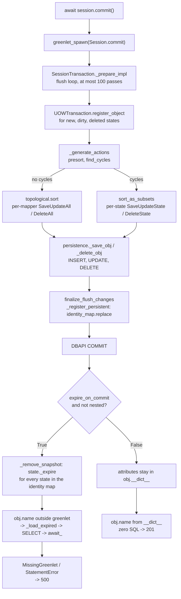

# Inside SQLAlchemy Session and AsyncSession: Identity Map Uniquing, Topological Unit-of-Work Flush, and Why expire_on_commit=False Is Mandatory in Async APIs

> [!summary] Claim
> A `Session` is a weak-valued dictionary keyed by `(class, primary key, token)` plus a change log that a topological sort turns into ordered SQL at flush, and because the default `expire_on_commit=True` deletes every loaded attribute at `COMMIT`, the first attribute read after `await session.commit()` becomes hidden I/O that an `AsyncSession` cannot perform, so async APIs must set `expire_on_commit=False`.

Part of [Database Access and Transactions for APIs](README.md) in [API Engineering](../README.md).

## TL;DR

- Mechanism: the identity map (`_WeakInstanceDict` in 2.1.8) maps the identity key `(Author, (1,), None)` to one `InstanceState`, so `session.get()` and every row of a `select()` resolve to the same Python object, and `flush()` turns the pending, dirty, and deleted sets into `INSERT`, `UPDATE`, and `DELETE` statements ordered by a topological sort of mapper dependencies.
- Contract rule: in an `AsyncSession`, never let an attribute load happen implicitly; set `async_sessionmaker(engine, expire_on_commit=False)`, configure relationships with `lazy="raise"` or eager loaders, and use `await obj.awaitable_attrs.x` or `await session.refresh(obj)` where a reload is intended.
- Trap: with the default `expire_on_commit=True`, `author.id` after `await session.commit()` runs a refresh `SELECT` outside `greenlet_spawn`, which raises `MissingGreenlet` (wrapped in `StatementError` on 2.1.8 with the `aiosqlite` and `psycopg` adapters) and turns a successful `INSERT` into a `500`.
- Portability: the lab passes 17 of 17 tests on CPython 3.12.13, 3.13.18, 3.14.6, 3.14.10, 3.15.2, and 3.14.6 free-threaded with SQLAlchemy 2.1.8, and on 3.14.6 with 2.0.57; on 3.15.0b3 free-threaded with greenlet 3.5.6, `import sqlalchemy` succeeds but `import sqlalchemy.ext.asyncio` segfaults.
- When not to use it: the identity map is not a cache and is not shared across sessions; for bulk loads, analytics, or high-throughput writes use Core `insert()`/`update()` with `executemany` or `RETURNING` instead of the unit of work, and never use one session across concurrent tasks.

## Mental model



`AsyncSession.commit()` is a one-line wrapper that runs the synchronous `Session.commit` inside a greenlet, so every arrow from `B` to `L` executes as ordinary blocking code whose driver calls are switched back to the event loop by `await_`.
The commit first flushes: the unit of work collects every pending, modified, and deleted `InstanceState`, builds dependency edges between per-mapper save and delete actions, and either sorts those actions (no cycle) or, when a mapper depends on itself or two mappers depend on each other, breaks the cycle into per-row actions and sorts those.
After the statements succeed, `finalize_flush_changes` assigns identity keys to new objects and puts them into the identity map, the driver commits, and `_remove_snapshot` decides the object's future: with `expire_on_commit=True` it deletes every loaded attribute from every object's `__dict__`, so the next read on the right-hand branch has to go to the database, and once the greenlet that `commit()` ran in has exited there is no greenlet to perform that read.

## How it works

### Identity keys and the weak-valued map

Every mapped instance carries an `InstanceState` (reachable with `sqlalchemy.inspect(obj)`), and a persistent state has a `key` that is a 3-tuple `(mapped class, primary-key tuple, identity_token)`; the lab asserts `inspect(first).key == (Author, (1,), None)`.
`Session.identity_map` is an `IdentityMap` subclass whose `_dict` maps that key to the `InstanceState`, not to the object; `__getitem__` and `get` dereference `state.obj()`, which is a `weakref.ref` created in `InstanceState.__init__` with `self._cleanup` as its callback `(sqlalchemy 2.1.8 lib/sqlalchemy/orm/identity.py, _WeakInstanceDict.get)` `(sqlalchemy 2.1.8 lib/sqlalchemy/orm/state.py, InstanceState._cleanup)`.
When the last application reference to a clean object disappears, CPython runs `_cleanup`, which calls `_fast_discard` and removes the entry; the lab shows `len(s.identity_map)` dropping from `1` to `0` after `del clean; gc.collect()`.
A modified object is protected from that collection by `InstanceState._modified_event`, which sets `state._strong_obj = inst` when the state belongs to a session; the same method adds the state to `identity_map._modified`, a set that holds the `InstanceState` strongly (the `_cleanup` comment: "that set is strong referencing!") so the next flush can find it, while the object itself stays alive only through `_strong_obj` `(sqlalchemy 2.1.8 lib/sqlalchemy/orm/state.py, InstanceState._modified_event)`.
That is why the lab's dirty object survives `del dirty; gc.collect()` with `len(s.identity_map) == 1` and its `UPDATE` still reaches the database at commit.
The maintainer documentation states the same contract: objects are weakly referenced except pending, deleted, and persistent-with-unflushed-changes objects (https://docs.sqlalchemy.org/en/21/orm/session_state_management.html).
`_WeakInstanceDict.add` refuses a second live state for an occupied key with `InvalidRequestError: Can't attach instance ...; another instance with key ... is already present in this session.`, which the lab triggers by `s.add()`-ing a detached copy of author 1 into a session that already holds author 1.
After `Session.close()` or `expunge_all()`, the old map's `_kill()` replaces `_add_unpresent` with `_killed`, so a load that tries to register into a dead map raises `InvalidRequestError` with code `lkrp` instead of silently writing into a map nobody reads `(sqlalchemy 2.1.8 lib/sqlalchemy/orm/identity.py, _killed)`.

### Uniquing on load: the row loses to the object

Row processing in `_instance`, the per-row closure built by `loading._instance_processor`, builds the identity key from the row's primary-key columns and calls `session_identity_map.get(identitykey)`; if an instance is present it is returned as is, because `currentload = not isnew` is `False` on the first row of a new load, so the full population routine is skipped unless `populate_existing` is set `(sqlalchemy 2.1.8 lib/sqlalchemy/orm/loading.py, _instance_processor)`.
Only the partial-population branch runs for such an object: it fills attributes in `state.unloaded` (expired or deferred ones) and applies eager loaders, and the row's values for attributes already in `__dict__` are discarded.
That gives each session read-your-own-writes and "repeatable read in Python" semantics regardless of the database isolation level.
The lab proves the consequence: after `s.execute(text("UPDATE author SET name = 'grace' WHERE id = 1"))`, a fresh `select(Author)` returns the same object with `name == "ada"`, and only `execution_options(populate_existing=True)` overwrites it with `"grace"`.
A row whose primary-key columns are all `NULL` produces no entity (`is_not_primary_key(identitykey[1])` is true, so `_instance` returns `None`), which is how outer joins yield `None` instead of an empty object.
`Session.get()` goes through `_identity_lookup` -> `loading.get_from_identity`, which returns the mapped object without SQL when the state is present and unexpired, runs `state._load_expired` when it is expired, and returns `None` if that refresh finds the row deleted `(sqlalchemy 2.1.8 lib/sqlalchemy/orm/loading.py, get_from_identity)`.
In the lab the second `s.get(Author, 1)` adds zero `SELECT` statements, while `select()` by the same key always issues one; the ORM never answers a `select()` from the identity map, which is why the maintainers answer "Is the Session a cache?" with "Yeee...no" (https://docs.sqlalchemy.org/en/21/orm/session_basics.html).

### Object states

The five states are computed from three facts about an `InstanceState`: whether it has a `key`, whether it is attached (`session_id`), and whether it was deleted in a flush.
Transient (no key, no session) -> `add()` -> pending (in `session._new`, `insert_order = len(self._new)`) -> flush -> persistent (key, in identity map) -> `delete()` + flush -> deleted (`_remove_newly_deleted` discards it from the map and records it in `transaction._deleted`) -> commit -> detached; `close()`, `expunge()`, or garbage collection of the session detach persistent objects directly `(sqlalchemy 2.1.8 lib/sqlalchemy/orm/session.py, Session._remove_newly_deleted)`.
Rollback runs `SessionTransaction._restore_snapshot`: everything in `transaction._new` or `session._new` is expunged back to transient, primary-key switches are undone, deletions are reverted, and every state in the identity map is expired, so the lab's rolled-back newcomer reports `transient` and the dirty author reloads `"ada"` from the database.

### Change tracking and the flush

Attribute instrumentation records the first previous value of each changed attribute in `state.committed_state` and adds the state to `identity_map._modified`; `Session._is_clean()` is simply "nothing in `_modified`, `_deleted`, or `_new`", so a clean `flush()` is a no-op that does not even begin a transaction `(sqlalchemy 2.1.8 lib/sqlalchemy/orm/session.py, Session._is_clean)`.
`Session._flush` creates a `UOWTransaction`, fires `before_flush`, computes `dirty = set(dirty).difference(deleted)`, registers each pending or dirty state with `flush_context.register_object` (persistent orphans are registered as deletes, pending orphans that were de-associated outside the session are expunged), registers the remaining deletes, and then runs the plan inside a subtransaction from `self._autobegin_t()._begin()` so that any exception rolls back the whole flush `(sqlalchemy 2.1.8 lib/sqlalchemy/orm/session.py, Session._flush)`.
After a failed flush the session refuses further work with `PendingRollbackError` (code `7s2a`): "This Session's transaction has been rolled back due to a previous exception during flush", followed by an instruction to issue `Session.rollback()` first `(sqlalchemy 2.1.8 lib/sqlalchemy/orm/session.py, SessionTransaction._raise_for_prerequisite_state)`.
`Session.commit()` flushes in a loop until the session is clean and raises `FlushError` after 100 consecutive flushes, which only happens when an `after_flush` hook keeps dirtying objects `(sqlalchemy 2.1.8 lib/sqlalchemy/orm/session.py, SessionTransaction._prepare_impl)`.

### The dependency graph and the topological sort

Each mapper contributes a `_SaveUpdateAll` and a `_DeleteAll` post-sort action, and each relationship contributes a dependency processor whose `per_property_dependencies` adds ordering edges; for a plain one-to-many (`Author.books`) the edges are `(parent_saves, after_save)`, `(after_save, child_saves)`, `(after_save, child_deletes)`, `(child_saves, parent_deletes)`, `(child_deletes, parent_deletes)`, `(before_delete, child_saves)`, and `(before_delete, child_deletes)` `(sqlalchemy 2.1.8 lib/sqlalchemy/orm/dependency.py, _OneToManyDP.per_property_dependencies)`.
Read as a schedule: insert parents, copy their new primary keys into the children's foreign keys (`after_save` is the `_ProcessAll` step that syncs `author.id` into `book.author_id`), insert children, and on delete remove children before parents.
`UOWTransaction._generate_actions` first runs the pre-sort actions to a fixed point (a pre-sort action can pull more states into the flush, such as cascaded deletes), then calls `topological.find_cycles` over the action graph `(sqlalchemy 2.1.8 lib/sqlalchemy/orm/unitofwork.py, UOWTransaction._generate_actions)`.
Without cycles, `execute()` sorts the actions by `sort_key` (for example `("SaveUpdateAll", mapper._sort_key)`) for determinism and then runs `topological.sort(self.dependencies, postsort_actions)`; `sort_as_subsets` is Kahn's algorithm in layers, emitting every node whose parents are all already emitted and raising `CircularDependencyError` when no node is ready `(sqlalchemy 2.1.8 lib/sqlalchemy/util/topological.py, sort_as_subsets)`.
With cycles, every action in a cycle is replaced by per-state actions (`_SaveUpdateState`, `_DeleteState`), the edges are rewritten to point at them, and `execute()` walks `sort_as_subsets` layer by layer, calling `execute_aggregate` so rows of one mapper can still be batched when they are in the same layer.
The lab's self-referential `Node` shows both halves: with `leaf` added before `root`, the flush emits two separate `INSERT INTO node` statements, `root` first and `leaf` second, instead of one batched `executemany`.
Within one mapper, `persistence._sort_states` (called from `_connections_for_states`) orders pending rows by `insert_order` (the order of `add()`) and persistent rows by primary key, and `_save_obj` walks `base_mapper._sorted_tables` so joined-table inheritance writes the base table first `(sqlalchemy 2.1.8 lib/sqlalchemy/orm/persistence.py, _sort_states)`.
The lab's `Book` is added before its `Author`, yet the log is `["INSERT author", "INSERT book"]`, and deleting the author with `cascade="all, delete-orphan"` logs `["DELETE book", "DELETE author"]`; SQLite enforces the foreign key (`PRAGMA foreign_keys=ON`), so a wrong order would have raised `IntegrityError`.
A genuine row-level cycle (two rows referencing each other through non-null foreign keys) has no valid insert order, which is what `relationship(post_update=True)` breaks: it inserts one side with `NULL` and fixes it with a second `UPDATE` (`_PostUpdateAll`).
`_emit_update_statements` compares the matched `rowcount` with the number of objects when the dialect reports a reliable rowcount and raises `StaleDataError` ("UPDATE statement on table ... expected to update N row(s); M were matched.") on a mismatch, which is what a concurrently deleted row or a failed `version_id_col` predicate produces `(sqlalchemy 2.1.8 lib/sqlalchemy/orm/persistence.py, _emit_update_statements)`; that is the optimistic-locking hook covered in [[Optimistic-vs-Pessimistic-Locking-Version-ID-Col-and-FOR-UPDATE-SKIP-LOCKED]].

### After the statements: registering identities

`finalize_flush_changes` calls `_remove_newly_deleted` for deleted states and `_register_persistent` for the rest `(sqlalchemy 2.1.8 lib/sqlalchemy/orm/unitofwork.py, UOWTransaction.finalize_flush_changes)`.
`_register_persistent` computes the identity key from the now-populated primary-key attributes, raises `FlushError: Instance ... has a NULL identity key` if the database did not produce one, records primary-key changes in `transaction._key_switches` so rollback can restore them, inserts the state with `identity_map.replace`, clears `committed_state` with `_commit_all_states`, and finally pops the state from `session._new` ("might be the last strong ref") `(sqlalchemy 2.1.8 lib/sqlalchemy/orm/session.py, Session._register_persistent)`.
New rows get their server-generated primary keys and, with the mapper default `eager_defaults="auto"`, their server defaults through `RETURNING` when the dialect supports "insertmanyreturning" `(sqlalchemy 2.1.8 lib/sqlalchemy/orm/mapper.py, Mapper.__init__ eager_defaults)`; the bulk-write side of that is in [[High-Throughput-Bulk-Writes-Upserts-and-RETURNING-in-SQLAlchemy-2-x]].

### Autoflush

`Session._autoflush()` calls `flush()` when `autoflush` is on and the session is not already flushing, and annotates a `StatementError` with "raised as a result of Query-invoked autoflush; consider using a session.no_autoflush block if this flush is occurring prematurely" `(sqlalchemy 2.1.8 lib/sqlalchemy/orm/session.py, Session._autoflush)`.
The documented triggers are `Session.execute()` of ORM-enabled statements, `Query` execution, `Session.merge()`, refresh, and lazy loads (https://docs.sqlalchemy.org/en/21/orm/session_basics.html); in 2.1 `Session.execute` also autoflushes before non-ORM (Core and `text()`) statements, with the source comment "Issue #9809: unconditionally autoflush for Core statements", while 2.0.57 has no such branch (https://github.com/sqlalchemy/sqlalchemy/issues/9809).
The lab's `with s.no_autoflush:` block returns `None` for a pending row and logs no DML, and the next `select()` emits `INSERT author` first and then finds the row.

### Commit, expiry, and the snapshot

`SessionTransaction.commit` runs `_prepare_impl` (the flush loop), commits every DBAPI connection it holds, fires `after_commit`, and then calls `_remove_snapshot` `(sqlalchemy 2.1.8 lib/sqlalchemy/orm/session.py, SessionTransaction.commit)`.
`_remove_snapshot` executes `if not self.nested and self.session.expire_on_commit:` and then `s._expire(s.dict, self.session.identity_map._modified)` for every state in the identity map, followed by `_detach_states` for the transaction's deleted objects; for a nested transaction (`SAVEPOINT`) it instead merges `_new`, `_dirty`, `_deleted`, and `_key_switches` into the parent, so `RELEASE SAVEPOINT` never expires anything (the lab asserts the `"inner"` value is still in `__dict__` after `begin_nested()` exits and expired after the outer commit).
`InstanceState._expire` sets `expired = True`, discards a modified state from `_modified` and clears its `committed_state`, drops `_strong_obj`, adds every loader key to `expired_attributes`, invalidates loaded collections, and deletes every mapped key from `obj.__dict__` `(sqlalchemy 2.1.8 lib/sqlalchemy/orm/state.py, InstanceState._expire)`.
The next attribute access finds the key missing, calls the state's `_load_expired`, which calls `loading._load_scalar_attributes`; that function raises `DetachedInstanceError` ("Instance ... is not bound to a Session; attribute refresh operation cannot proceed", code `bhk3`) when the object has no session, and otherwise issues `SELECT author.id, author.name FROM author WHERE author.id = ?` through `_load_on_ident` `(sqlalchemy 2.1.8 lib/sqlalchemy/orm/loading.py, _load_scalar_attributes)`.
Expiry exists so that after a transaction ends, the next read sees the database as committed by everyone, including triggers, server defaults, and concurrent writers; the documentation says objects are expired "so that all attribute/object access subsequent to a completed transaction will load from the most recent database state" `(sqlalchemy 2.1.8 lib/sqlalchemy/orm/session.py, Session.__init__ expire_on_commit)`.
The cost is linear in the size of the identity map: a measurement on this machine took `7.64 ms` to commit a session holding 10,000 loaded `Author` objects with `expire_on_commit=True` versus `0.06 ms` with `False` (method in Numbers and limits).

### Why the async path cannot reload

`AsyncSession.commit` is `await greenlet_spawn(self.sync_session.commit)`, and every other I/O method is the same shape (`flush`, `execute`, `refresh`, `get`, `delete`) `(sqlalchemy 2.1.8 lib/sqlalchemy/ext/asyncio/session.py, AsyncSession.commit)`.
`greenlet_spawn` runs the synchronous function in a child greenlet flagged `__sqlalchemy_greenlet_provider__`; when the driver adapter needs I/O it calls `await_(coro)`, which switches to the parent greenlet with the coroutine, lets the event loop await it, and switches back with the result `(sqlalchemy 2.1.8 lib/sqlalchemy/util/concurrency.py, await_)`.
`await_` first checks `getattr(current, "__sqlalchemy_greenlet_provider__", False)`; a plain attribute read such as `author.name` in the endpoint body runs on the event-loop greenlet, so the check fails and it raises `MissingGreenlet("greenlet_spawn has not been called; can't call await_() here. Was IO attempted in an unexpected place?")` after closing the coroutine with `_safe_cancel_awaitable`.
On 2.1.8 with `aiosqlite` the first `await_` is at cursor creation (`AsyncAdapt_dbapi_cursor._aenter_cursor`, `lib/sqlalchemy/connectors/asyncio.py`), before an execution context exists, so `Connection._handle_dbapi_exception` takes its "no context" branch and wraps it: the application sees `sqlalchemy.exc.StatementError: (sqlalchemy.exc.MissingGreenlet) ... [SQL: SELECT author.id, author.name FROM author WHERE author.id = ?]` with `err.orig` being the `MissingGreenlet`.
On 2.0.57 the first `await_only` is inside the `aiosqlite` cursor's `execute` (`lib/sqlalchemy/dialects/sqlite/aiosqlite.py`), after the context exists, and `MissingGreenlet: greenlet_spawn has not been called; can't call await_only() here.` propagates unwrapped; the lab test accepts both and asserts the root cause.
On 2.1.8 the same failure also prints `RuntimeWarning: coroutine 'Connection.cursor' was never awaited`, because `aiosqlite.Connection.cursor()` returns a `Result` wrapping a coroutine and only the outer `__aenter__()` coroutine is closed `(aiosqlite 0.22.1 aiosqlite/context.py, Result)`.
The maintainer guidance is direct: "Expiration should generally not be needed as Session.expire_on_commit should normally be set to False when using asyncio" (https://docs.sqlalchemy.org/en/21/orm/extensions/asyncio.html).
`async_sessionmaker.__init__` still defaults `expire_on_commit: bool = True` in both 2.0.57 and 2.1.8, so the safe value has to be written by hand `(sqlalchemy 2.1.8 lib/sqlalchemy/ext/asyncio/session.py, async_sessionmaker.__init__)`.
When a reload is wanted, `await session.refresh(obj)` or `await obj.awaitable_attrs.name` (from the `AsyncAttrs` mixin, which does `greenlet_spawn(getattr, self._instance, name)`) performs it inside a greenlet; the lab reads `"ada"` through `awaitable_attrs` on the same expired object that just raised.
The greenlet machinery itself, including lazy relationship loads and `run_sync`, is the subject of [[Async-SQLAlchemy-Under-the-Hood-Greenlet-Bridge-and-MissingGreenlet]].

## Numbers and limits

Measured rows were re-measured once on 2026-11-15 on an Apple M3 Pro, macOS 27.3 (arm64, Darwin 27.3.0), CPython 3.14.6 (uv), SQLAlchemy 2.1.8, in-memory SQLite with `StaticPool`, using a throwaway script run from `labs/` with `uv run --frozen python <script>` against the lab's `make_sync_engine()` (not part of the lab); per-call times are the minimum of 5 `timeit.repeat` runs.

| Quantity | Value | Source |
|---|---|---|
| Identity key shape | 3-tuple `(class, pk_tuple, identity_token)`, for example `(Author, (1,), None)` | lab `test_identity_map_returns_same_object_and_get_hit_emits_no_sql` |
| `session.get(Author, 1)` identity-map hit | `1257 ns` per call, `0` `SELECT` statements over 5 x 200,000 calls | measured, 2026-11-15 |
| `select(Author).where(Author.id == 1)` then `.one()` | `26392 ns` per call (always one `SELECT`) | measured, 2026-11-15 |
| `session.get()` when the caller kept no reference | `49389 ns` per call, `100,000` `SELECT` statements over 5 x 20,000 calls: the weak map dropped the object between calls, so every call was a miss | measured, 2026-11-15 |
| `commit()` with 10,000 loaded objects, `expire_on_commit=True` | `7.64 ms` (min of 5) | measured, 2026-11-15 |
| `commit()` with 10,000 loaded objects, `expire_on_commit=False` | `0.06 ms` (min of 5) | measured, 2026-11-15 |
| SQL on first attribute read after commit | `1` `SELECT` with expiry, `0` without | lab `test_commit_expiry_decides_whether_next_read_emits_select` |
| Flush passes inside one `commit()` | at most `100`, then `FlushError` | `(sqlalchemy 2.1.8 lib/sqlalchemy/orm/session.py, SessionTransaction._prepare_impl)` |
| Self-referential flush of 2 rows | `2` `INSERT` statements (per-state actions), parent first | lab `test_self_referential_cycle_is_flushed_row_by_row_parent_first` |
| HTTP result of reading after commit in `POST /authors` | `500` with `expire_on_commit=True`, `201` with `False` | lab `test_create_endpoint_status_depends_on_expire_on_commit` |
| Error codes | `xd2s` `MissingGreenlet`, `bhk3` `DetachedInstanceError`, `7s2a` `PendingRollbackError`, `lkrp` dead identity map | `(sqlalchemy 2.1.8 lib/sqlalchemy/exc.py, MissingGreenlet)`, `(sqlalchemy 2.1.8 lib/sqlalchemy/orm/exc.py, DetachedInstanceError)`, `(sqlalchemy 2.1.8 lib/sqlalchemy/orm/session.py, SessionTransaction._raise_for_prerequisite_state)`, `(sqlalchemy 2.1.8 lib/sqlalchemy/orm/identity.py, _killed)` |

The 21x gap between a hit and a `SELECT` is against in-process SQLite; against a networked PostgreSQL the miss adds at least one round trip, so the ratio grows (not measured here).

## Portability

The `3.14.6` workspace leg and the `3.15.0b3t` crash were re-run on 2026-11-15; the other legs are single runs of the commands shown, and no leg listed as not run carries a claim.

| Runtime / component | Version / target | Behavior and verification status |
|---|---|---|
| CPython `3.12` | `3.12.13` (`macos-aarch64`) | Proven by lab (`PYTHONPATH=src uv run --no-project --python 3.12.13 --with "sqlalchemy[asyncio]==2.1.8" --with fastapi==0.162.0 --with starlette==1.10.0 --with pydantic==2.14.3 --with httpx==0.28.1 --with aiosqlite==0.22.1 --with pytest==9.2.0 --with pytest-asyncio==1.4.1.post1 pytest <test> -q`: `17 passed, 2 warnings in 0.57s`); the contract pin `3.12.16` is not installed here and was not run |
| CPython `3.13` | `3.13.18` (`macos-aarch64`) | Proven by lab (same command with `--python 3.13.18`: `17 passed, 2 warnings in 0.49s`) |
| CPython `3.14` | `3.14.6` (workspace venv) and `3.14.10` (Homebrew) | Proven by lab (`uv run --frozen pytest <test> -q` on `3.14.6`, run of 2026-11-15: `17 passed, 2 warnings in 2.85s`; `--no-project` command with `--python /opt/homebrew/bin/python3.14` on `3.14.10`: `17 passed, 1 warning in 0.51s`) |
| CPython `3.15` (default GIL) | `3.15.2` (Homebrew) | Proven by lab (`--python /opt/homebrew/bin/python3.15`: `17 passed, 1 warning in 0.51s`) |
| CPython `3.14t` (free-threaded) | `3.14.6+freethreaded`, `sys._is_gil_enabled()` is `False` | Proven by lab (`--python 3.14t`: `17 passed in 1.57s`); one session per thread or task is still required, because nothing in `Session` takes a lock (https://docs.sqlalchemy.org/en/21/orm/session_basics.html, "Is the Session thread-safe?") |
| CPython `3.15t` (free-threaded) | `3.15.0b3+freethreaded` with greenlet `3.5.6`; the contract pin `3.15.2t` is not installed | Fails: the process exits with `Fatal Python error: Segmentation fault` (exit status `139`) in `sqlalchemy/util/concurrency.py` line 85, `_initialize` (`hasattr(getcurrent(), "gr_context")`), which `sqlalchemy/ext/asyncio/__init__.py` calls at import; the fact-check reproduced it with `uv run --no-project --python 3.15.0b3+freethreaded --with greenlet==3.5.6 --with sqlalchemy==2.1.8 python -X faulthandler -c "import sqlalchemy; import sqlalchemy.ext.asyncio"`, where `import sqlalchemy` succeeds and `import sqlalchemy.ext.asyncio` crashes, and with the minimal `python -c "import greenlet; print(greenlet.getcurrent().gr_context)"`, which crashes on the attribute read; the same one-liner prints `None` on `3.15.2` and `3.14.6t`. Cause, from the maintainers' changelog: greenlet from `3.5.5` builds the binary `3.15` wheels (including `greenlet-3.5.6-cp315-cp315t-macosx_11_0_universal2.whl`) with `3.15.0rc1`, which "is believed compatible with 3.15b4 as well (but not earlier versions)", and `3.5.4` says wheels built for one `3.15` pre-release "may not be compatible with earlier or later versions of 3.15"; `3.15.0b3` is an earlier version, so the crash is a documented beta ABI mismatch and not a SQLAlchemy defect (https://raw.githubusercontent.com/python-greenlet/greenlet/master/CHANGES.rst, entries `3.5.4` and `3.5.5`); the exact faulting instruction inside greenlet was not traced. `3.15.2t` is not installed here, so no claim is made for it beyond the changelog's statement of compatibility with future `3.15` releases |
| SQLAlchemy `2.1.8` vs `2.0.57` | both on CPython `3.14.6` | Both pass the lab (`--with "sqlalchemy[asyncio]==2.0.57"`: `17 passed in 0.51s`). Differences read in source: the post-commit read raises `StatementError` wrapping `MissingGreenlet` on 2.1.8 and bare `MissingGreenlet` on 2.0.57 (lab-observed); the message names `await_()` in 2.1.8 and `await_only()` in 2.0.57, where 2.1.8 keeps `await_only = await_` as an alias with the source comment `# old name. deprecated on 2.2` `(sqlalchemy 2.1.8 lib/sqlalchemy/util/concurrency.py, await_only)`; the identity map class is `_WeakInstanceDict` in 2.1.8 and `WeakInstanceDict` in 2.0.57, and unit-of-work action classes gained a leading underscore (`_SaveUpdateAll`); `Session.flush(objects=...)` is deprecated in 2.1; Core and `text()` statements autoflush only in 2.1 (issue `#9809`) |
| `expire_on_commit` default | `Session`, `sessionmaker`, `async_sessionmaker` in 2.0.57 and 2.1.8 | `True` in every one `(sqlalchemy 2.0.57 lib/sqlalchemy/ext/asyncio/session.py, async_sessionmaker.__init__)` `(sqlalchemy 2.1.8 lib/sqlalchemy/orm/session.py, Session.__init__)` |
| Drivers | `aiosqlite 0.22.1` (lab); `asyncpg 0.32.0`, `psycopg 3.3.8` | Only `aiosqlite` was run (needs no server); `asyncpg` and `psycopg` were read in source, not run. `MissingGreenlet` comes from `await_` before any driver code, so the root cause is driver-independent. Wrapping depends on where the adapter first calls `await_`: `Connection._execute_context` passes `None` as the context when the execution-context constructor fails, and `_handle_dbapi_exception` wraps a non-DBAPI error only when `context is None` (`should_wrap`) `(sqlalchemy 2.1.8 lib/sqlalchemy/engine/base.py, Connection._handle_dbapi_exception)`. `aiosqlite` and `psycopg` both inherit `AsyncAdapt_dbapi_cursor.__init__`, which calls `await_` in `_aenter_cursor` while the constructor runs, so both are expected to raise `StatementError` on 2.1.8 `(sqlalchemy 2.1.8 lib/sqlalchemy/connectors/asyncio.py, AsyncAdapt_dbapi_cursor._aenter_cursor)`. `AsyncAdapt_asyncpg_cursor.__init__` makes no `await_` call, so its first `await_` is in `execute`, after the context exists, and the error is expected to surface as a bare `MissingGreenlet` `(sqlalchemy 2.1.8 lib/sqlalchemy/dialects/postgresql/asyncpg.py, AsyncAdapt_asyncpg_cursor.execute)`; code that catches the error should test `isinstance(err.orig, MissingGreenlet)` as the lab does |
| ASGI servers (`Uvicorn`, `Hypercorn`, `Granian`) and HTTP/1.1, HTTP/2, HTTP/3 | `uvicorn 0.54.0`, `hypercorn 0.18.0`, `granian 2.8.7` | Not run: the lab uses in-process `httpx.ASGITransport`, and the note makes no claim about server-specific behavior. The `500` is produced inside the application, not by the server: `ServerErrorMiddleware` catches the exception, sends the `500` response if no `http.response.start` was sent, then re-raises so the server can log it `(starlette 1.10.0 starlette/middleware/errors.py, ServerErrorMiddleware.__call__)`. The status code is version-independent HTTP semantics (`500 Internal Server Error`, RFC 9110 Section 15.6.1), carried in the `:status` pseudo-header on HTTP/2 (RFC 9113 Section 8.3.2) and HTTP/3 (RFC 9114 Section 4.3.2) and in the status line on HTTP/1.1; how a server frames the re-raised exception in its log is outside this note |
| Container environments and CPython `3.12.16` | Debian Trixie, Alpine musl libc, `3.12.16` | Not run (`3.12.16` is not installed here; `3.12.13` ran instead); no claim is made for them |

## Worked example

The lab [implementation](../labs/src/api_labs/f13_database_access_and_transactions_for_apis/session_internals.py) and [test](../labs/tests/f13_database_access_and_transactions_for_apis/test_session_internals_identity_map_unit_of_work_flush_and_expire_on_commit.py) run every mechanism above against in-memory SQLite with foreign keys enforced and a `before_cursor_execute` statement log, so each claim is checked against the SQL that actually reached the driver.

The statement log and engine factory (excerpt, verbatim lines 70-123 of `session_internals.py`):

```python
@dataclass
class StatementLog:
    """Every statement the engine sends to the DBAPI cursor, in order."""

    entries: list[tuple[str, Any]] = field(default_factory=list[tuple[str, Any]])

    def record(
        self,
        conn: Any,
        cursor: Any,
        statement: str,
        parameters: Any,
        context: Any,
        executemany: bool,
    ) -> None:
        self.entries.append((statement, parameters))

    def clear(self) -> None:
        self.entries.clear()

    def count(self, verb: str) -> int:
        """Number of statements whose first keyword is `verb` (for example `SELECT`)."""
        return sum(1 for sql, _ in self.entries if sql.lstrip().upper().startswith(verb))

    def dml(self) -> list[str]:
        """INSERT/UPDATE/DELETE statements as `"<VERB> <table>"`, in emission order."""
        out: list[str] = []
        for sql, _ in self.entries:
            match = _DML.match(sql)
            if match:
                verb = match.group(1) or match.group(2) or match.group(3)
                out.append(f"{verb.upper()} {match.group(4)}")
        return out

    def parameters_for(self, prefix: str) -> list[Any]:
        """Bound parameters of every statement starting with `prefix`."""
        return [params for sql, params in self.entries if sql.lstrip().startswith(prefix)]


def _enable_sqlite_foreign_keys(dbapi_connection: Any, connection_record: Any) -> None:
    cursor = dbapi_connection.cursor()
    cursor.execute("PRAGMA foreign_keys=ON")
    cursor.close()


def make_sync_engine() -> tuple[Engine, StatementLog]:
    """One shared in-memory SQLite connection, schema created, log cleared."""
    engine = create_engine("sqlite://", poolclass=StaticPool)
    log = StatementLog()
    event.listen(engine, "connect", _enable_sqlite_foreign_keys)
    event.listen(engine, "before_cursor_execute", log.record)
    Base.metadata.create_all(engine)
    log.clear()
    return engine, log
```

The API that fails (excerpt, verbatim lines 156-179 of `session_internals.py`):

```python
async def get_session(request: Request) -> AsyncIterator[AsyncSession]:
    """Request-scoped session from the factory stored on `app.state`."""
    sessions: async_sessionmaker[AsyncSession] = request.app.state.sessions
    async with sessions() as session:
        yield session


def build_app(sessions: async_sessionmaker[AsyncSession]) -> FastAPI:
    """A create endpoint that reads the ORM object after `await session.commit()`."""
    app = FastAPI()
    app.state.sessions = sessions

    @app.post("/authors", status_code=201)
    async def create_author(  # pyright: ignore[reportUnusedFunction]
        body: AuthorIn, session: Annotated[AsyncSession, Depends(get_session)]
    ) -> AuthorOut:
        author = Author(name=body.name)
        session.add(author)
        await session.commit()
        # With expire_on_commit=True this attribute read is a lazy refresh SELECT
        # outside greenlet_spawn, so it raises MissingGreenlet.
        return AuthorOut(id=author.id, name=author.name)

    return app
```

Identity, uniquing, and the weak map (excerpt, verbatim lines 26-89 of the test):

```python
@pytest.mark.unit
def test_identity_map_returns_same_object_and_get_hit_emits_no_sql() -> None:
    engine, log = make_sync_engine()
    with Session(engine) as s:
        s.add(Author(id=1, name="ada"))
        s.commit()
    with Session(engine) as s:
        log.clear()
        first = s.get(Author, 1)
        selects_after_miss = log.count("SELECT")
        second = s.get(Author, 1)
        selects_after_hit = log.count("SELECT")
        via_select = s.scalars(select(Author).where(Author.id == 1)).one()
        assert first is not None
        assert first is second is via_select
        assert inspect(first).key == (Author, (1,), None)
        assert (selects_after_miss, selects_after_hit) == (1, 1)
        assert log.count("SELECT") == 2  # select() always goes to the database


@pytest.mark.unit
def test_reselect_keeps_in_memory_values_until_populate_existing() -> None:
    engine, _ = make_sync_engine()
    with Session(engine) as s:
        s.add(Author(id=1, name="ada"))
        s.commit()
    with Session(engine) as s:
        author = s.get(Author, 1)
        assert author is not None
        assert author.name == "ada"
        s.execute(text("UPDATE author SET name = 'grace' WHERE id = 1"))
        stale = s.scalars(select(Author).where(Author.id == 1)).one()
        assert stale is author
        assert stale.name == "ada"  # the row said 'grace'; the identity map won
        fresh = s.scalars(
            select(Author).where(Author.id == 1).execution_options(populate_existing=True)
        ).one()
        assert fresh is author
        assert author.name == "grace"


@pytest.mark.unit
def test_identity_map_holds_clean_objects_weakly_and_dirty_objects_strongly() -> None:
    engine, _ = make_sync_engine()
    with Session(engine) as s:
        s.add(Author(id=1, name="ada"))
        s.commit()
    with Session(engine) as s:
        clean = s.get(Author, 1)
        assert len(s.identity_map) == 1
        del clean
        gc.collect()
        assert len(s.identity_map) == 0  # clean object collected, entry gone
        dirty = s.get(Author, 1)
        assert dirty is not None
        dirty.name = "changed"
        del dirty
        gc.collect()
        assert len(s.identity_map) == 1  # _strong_obj keeps the pending change alive
        s.commit()
    with Session(engine) as s:
        reloaded = s.get(Author, 1)
        assert reloaded is not None
        assert reloaded.name == "changed"
```

Topological flush order, including the self-referential cycle (excerpt, verbatim lines 92-118 of the test):

```python
@pytest.mark.unit
def test_flush_orders_tables_by_foreign_key_not_by_add_order() -> None:
    engine, log = make_sync_engine()
    with Session(engine) as s:
        author = Author(id=1, name="ada")
        book = Book(id=10, title="notes", author=author)
        s.add(book)  # the child is added first; the author arrives by cascade
        s.flush()
        assert log.dml() == ["INSERT author", "INSERT book"]
        log.clear()
        s.delete(author)  # cascade="all, delete-orphan" deletes the book too
        s.flush()
        assert log.dml() == ["DELETE book", "DELETE author"]


@pytest.mark.unit
def test_self_referential_cycle_is_flushed_row_by_row_parent_first() -> None:
    engine, log = make_sync_engine()
    with Session(engine) as s:
        root = Node(id=1, name="root")
        leaf = Node(id=2, name="leaf", parent=root)
        s.add(leaf)
        s.add(root)
        s.flush()
        inserts = log.parameters_for("INSERT INTO node")
        assert len(inserts) == 2  # per-state actions: no single batched INSERT
        assert [params[1] for params in inserts] == ["root", "leaf"]
```

The async failure and both fixes (excerpt, verbatim lines 238-298 of the test):

```python
@pytest.mark.unit
@pytest.mark.asyncio
async def test_async_default_expiry_turns_attribute_read_into_missing_greenlet() -> None:
    engine, _ = await make_async_engine()
    try:
        sessions = async_sessionmaker(engine)  # expire_on_commit defaults to True
        async with sessions() as s:
            author = Author(id=1, name="ada")
            s.add(author)
            await s.commit()
            with pytest.raises(
                (StatementError, MissingGreenlet), match="greenlet_spawn has not been called"
            ) as err:
                _ = author.name
            # 2.1.8 fails at cursor creation, before an execution context exists, so
            # the engine wraps it in StatementError; 2.0.57 fails in cursor.execute and
            # re-raises MissingGreenlet unwrapped.
            error = err.value
            root = error.orig if isinstance(error, StatementError) else error
            assert isinstance(root, MissingGreenlet)
            assert await author.awaitable_attrs.name == "ada"
    finally:
        await engine.dispose()


@pytest.mark.unit
@pytest.mark.asyncio
async def test_async_expire_on_commit_false_reads_without_sql_even_after_close() -> None:
    engine, log = await make_async_engine()
    try:
        sessions = async_sessionmaker(engine, expire_on_commit=False)
        async with sessions() as s:
            author = Author(id=1, name="ada")
            s.add(author)
            await s.commit()
            log.clear()
            assert author.name == "ada"
            assert log.entries == []
        assert lifecycle_state(author) == "detached"
        assert author.name == "ada"
    finally:
        await engine.dispose()


@pytest.mark.unit
@pytest.mark.asyncio
@pytest.mark.parametrize(("expire_on_commit", "status"), [(True, 500), (False, 201)])
async def test_create_endpoint_status_depends_on_expire_on_commit(
    expire_on_commit: bool, status: int
) -> None:
    engine, _ = await make_async_engine()
    try:
        app = build_app(async_sessionmaker(engine, expire_on_commit=expire_on_commit))
        transport = httpx.ASGITransport(app=app, raise_app_exceptions=False)
        async with httpx.AsyncClient(transport=transport, base_url="http://test") as client:
            response = await client.post("/authors", json={"name": "ada"})
        assert response.status_code == status
        if status == 201:
            assert response.json() == {"id": 1, "name": "ada"}
    finally:
        await engine.dispose()
```

Run from `labs/` on CPython 3.14.6, macOS 27.3 (arm64), SQLAlchemy 2.1.8, with `uv run --frozen pytest tests/f13_database_access_and_transactions_for_apis/test_session_internals_identity_map_unit_of_work_flush_and_expire_on_commit.py -q`; this is the captured output of the fact-check run, with the workspace path shortened to `<labs>` and the uv interpreter path to `<uv-python>`:

```text
.................                                                        [100%]
=============================== warnings summary ===============================
tests/f13_database_access_and_transactions_for_apis/test_session_internals_identity_map_unit_of_work_flush_and_expire_on_commit.py::test_create_endpoint_status_depends_on_expire_on_commit[True-500]
  <labs>/.venv/lib/python3.14/site-packages/pydantic/v1/class_validators.py:8: RuntimeWarning: coroutine 'Connection.cursor' was never awaited
    from pydantic.v1.errors import ConfigError
  Enable tracemalloc to get traceback where the object was allocated.
  See https://docs.pytest.org/en/stable/how-to/capture-warnings.html#resource-warnings for more info.

<uv-python>/lib/python3.14/ast.py:46
  <uv-python>/lib/python3.14/ast.py:46: RuntimeWarning: coroutine 'Connection.cursor' was never awaited
    return compile(source, filename, mode, flags,
  Enable tracemalloc to get traceback where the object was allocated.
  See https://docs.pytest.org/en/stable/how-to/capture-warnings.html#resource-warnings for more info.

-- Docs: https://docs.pytest.org/en/stable/how-to/capture-warnings.html
17 passed, 2 warnings in 2.85s
```

The `RuntimeWarning` is part of the evidence, not noise: it is the unawaited `aiosqlite` cursor coroutine abandoned by `await_` when it raised `MissingGreenlet` (once in the `[True-500]` case and once in `test_async_default_expiry_turns_attribute_read_into_missing_greenlet`), attributed by the garbage collector to whatever line happened to be running when the coroutine was collected, which is why the file names differ between runs.

The exception the `500` hides, captured from a one-off script on the same stack:

```text
<class 'sqlalchemy.exc.StatementError'> <class 'sqlalchemy.exc.MissingGreenlet'>
```

and its innermost frames, in order: `sqlalchemy/connectors/asyncio.py 391 cursor`, `178 __init__`, `187 _aenter_cursor`, `412 _handle_exception`, `sqlalchemy/dialects/sqlite/aiosqlite.py 237 _handle_exception_no_connection`, `sqlalchemy/connectors/asyncio.py 409 _handle_exception_no_connection`, `185 _aenter_cursor`, `sqlalchemy/util/concurrency.py 157 await_`.

## Pitfalls

> [!warning] Reading ORM attributes after `await session.commit()` with the default expiry
> - Trigger: `async_sessionmaker(engine)` (default `expire_on_commit=True`) and an endpoint that does `await session.commit()` and then builds the response from `author.id` or `author.name`.
> - Symptom: the row is committed, but the response is `500` with `sqlalchemy.exc.StatementError: (sqlalchemy.exc.MissingGreenlet) greenlet_spawn has not been called; can't call await_() here.` on 2.1.8 (bare `MissingGreenlet` with `await_only()` on 2.0.57), and a client that retries the `POST` creates a duplicate row.
> - Fix: `async_sessionmaker(engine, expire_on_commit=False)`; if a post-commit reload is wanted, `await session.refresh(obj)`; build the response DTO before commit when values come only from the request.
> - Source: lab `test_create_endpoint_status_depends_on_expire_on_commit`; maintainer guidance in https://docs.sqlalchemy.org/en/21/orm/extensions/asyncio.html.

> [!warning] Returning expired objects from a closed session in sync code
> - Trigger: a repository function that commits and closes the session (`with Session(engine) as s: ...; s.commit()`) and returns the ORM object to a caller that reads it.
> - Symptom: `DetachedInstanceError: Instance <Author ...> is not bound to a Session; attribute refresh operation cannot proceed` (code `bhk3`) at the caller, far from the bug.
> - Fix: `expire_on_commit=False`, or keep the session open for the lifetime of the object, or convert to a DTO inside the session.
> - Source: lab `test_expired_object_after_close_raises_detached_instance_error`; the errors page calls the related "is not bound to a Session" message "likely the most common error message when dealing with the ORM" (https://docs.sqlalchemy.org/en/21/errors.html).

> [!warning] Believing a `select()` refreshes objects already in the session
> - Trigger: a long-lived session, a polling loop, or code that runs `session.execute(text("UPDATE ..."))` or `update(...).execution_options(synchronize_session=False)` and then re-selects the same rows.
> - Symptom: the query hits the database, but the returned objects keep their old values (the lab gets `"ada"` after the row was set to `"grace"`), so authorization or balance checks run on stale data.
> - Fix: `execution_options(populate_existing=True)`, `session.refresh(obj)`, `session.expire(obj)`, or a short session per unit of work.
> - Source: lab `test_reselect_keeps_in_memory_values_until_populate_existing`; `(sqlalchemy 2.1.8 lib/sqlalchemy/orm/loading.py, _instance)`.

> [!warning] An `IntegrityError` that surfaces from a query instead of from `commit()`
> - Trigger: `session.add(obj)` with a constraint violation followed by any `select()`, lazy load, or (on 2.1 only) `session.execute(text(...))`.
> - Symptom: the error comes from the read, with the detail "raised as a result of Query-invoked autoflush", and every later operation raises `PendingRollbackError` (code `7s2a`) until `rollback()`.
> - Fix: call `await session.flush()` explicitly where the error should be handled, wrap reads that must not flush in `with session.no_autoflush:`, and always `rollback()` after a failed flush.
> - Source: `(sqlalchemy 2.1.8 lib/sqlalchemy/orm/session.py, Session._autoflush)`; the 2.1 behavior change is https://github.com/sqlalchemy/sqlalchemy/issues/9809.

> [!warning] Mutually referencing rows with no valid insert order
> - Trigger: two tables with non-null foreign keys to each other, or a row that references a row inserted in the same flush through a cycle the dependency graph cannot linearize.
> - Symptom: `CircularDependencyError: Circular dependency detected.` from `topological.sort_as_subsets`, or a foreign-key violation.
> - Fix: `relationship(..., post_update=True)` on one side so the ORM inserts with `NULL` and issues a second `UPDATE`, or make one key nullable.
> - Source: `(sqlalchemy 2.1.8 lib/sqlalchemy/util/topological.py, sort_as_subsets)`; `(sqlalchemy 2.1.8 lib/sqlalchemy/orm/dependency.py, _OneToManyDP.per_property_dependencies)`.

> [!warning] Free-threaded CPython 3.15 beta with greenlet
> - Trigger: importing `sqlalchemy.ext.asyncio` (or otherwise initializing SQLAlchemy's greenlet shim) with greenlet `3.5.6` on CPython `3.15.0b3+freethreaded`; plain `import sqlalchemy` succeeds.
> - Symptom: `Fatal Python error: Segmentation fault` at import, in `sqlalchemy/util/concurrency.py` line 85 `_initialize`, when it reads `getcurrent().gr_context`, before any application code runs.
> - Fix: stay on `3.14t` (passes the lab) or the default-GIL `3.15.2` or move to a `3.15` release at or after `3.15.0b4` with the matching greenlet wheel.
> - Source: this note's lab run (2026-11-15) and the greenlet changelog (https://raw.githubusercontent.com/python-greenlet/greenlet/master/CHANGES.rst, entries `3.5.4` and `3.5.5`), which says the binary `3.15` wheels are built with `3.15.0rc1` and are not believed compatible with versions earlier than `3.15b4`; free-threaded `3.15` fixes in the same series are https://github.com/python-greenlet/greenlet/pull/511.

No CVE or public postmortem attributable to these Session mechanisms was found; the incidents above are reproduced in the lab, and the upstream issues cited are maintainer records.

## Security and robustness

- API3:2023 Broken Object Property Level Authorization: `session.merge(Author(**request_json))` copies every attribute of the incoming object onto the identity-mapped instance (the lab's `merge` returns the resident object with `name == "from-request"`), so any column the client can name, such as `is_admin` or `owner_id`, is written; validate into an explicit Pydantic input model and assign allowed fields only.
- API1:2023 Broken Object Level Authorization: because uniquing returns the already-loaded object, an ownership check made against a stale in-session copy can pass after another transaction has reassigned the row; re-check authorization on a fresh read (`populate_existing` or a new session) or enforce it in the `WHERE` clause.
- Cross-request data leaks: a module-level `Session` or `AsyncSession` shared by all requests keeps one identity map for every user, so a later request can receive an object loaded, and possibly modified, for an earlier one; the docs require "Session per thread, AsyncSession per task" (https://docs.sqlalchemy.org/en/21/orm/session_basics.html), and the concurrency failure is in [[Why-Sharing-an-AsyncSession-Across-Concurrent-Tasks-Corrupts-State]].
- API4:2023 Unrestricted Resource Consumption: an endpoint that loads an unbounded result set into one session holds every modified object strongly until commit, and with `expire_on_commit=True` the commit cost grows linearly (`7.64 ms` per 10,000 objects measured here); paginate, stream with `yield_per`, or use Core for exports.
- Duplicate writes: a `500` after a committed `INSERT` (the async expiry bug) is indistinguishable from a failed write to the client, so retried `POST` requests duplicate rows unless the endpoint is idempotent; idempotency keys are covered in `16-Resilience-Rate-Limiting-and-Idempotency`.
- Defense in depth: `lazy="raise"` on relationships and `raiseload("*")` in tests turn hidden I/O into immediate errors (see [[Eliminating-N-Plus-1-Queries-Selectinload-Joinedload-Subqueryload-and-Raiseload]]), and a project-wide `async_sessionmaker` factory with `expire_on_commit=False` removes the per-call decision.

## The principal's view

The decision is not "which flag" but where the transaction boundary and the object lifetime live, and the right default for an async API is one `AsyncSession` per request, one explicit `commit()` in the service layer, `expire_on_commit=False`, `lazy="raise"` on every relationship, and responses built from Pydantic models rather than live ORM objects.
The trade-off of `expire_on_commit=False` is staleness after commit: database-side changes made at commit time (triggers, `ON UPDATE` columns without `RETURNING`, concurrent writers) are not visible until an explicit refresh, so code that needs post-commit truth must `await session.refresh(obj)` deliberately; that is a better failure mode than an implicit `SELECT` that cannot run.
The identity map gives a request a consistent object graph and read-your-own-writes for free; it is not a cache, it is not shared, and it should die with the request, which is why request-scoped sessions (see [[Request-Scoped-Transaction-Patterns-Commit-As-You-Go-vs-Unit-of-Work]]) beat long-lived ones.
The unit of work earns its cost when a request mutates a small graph of related objects whose write order matters; for bulk ingestion, reporting, and hot write paths the per-object state tracking and the topological sort are overhead, and Core `insert().values(...)`, `executemany`, or `ON CONFLICT ... RETURNING` are the right tool.
Organizationally, make the safe configuration the only one available: a shared factory module, a lint or test that fails on `async_sessionmaker(` without `expire_on_commit=False`, and a test suite that runs with `raiseload("*")`, so the rule does not depend on every engineer having read this note.
When the domain has heavy cross-request object reuse or needs explicit change tracking without a session object, a data-mapper-free stack (Core plus typed rows, or a query builder) is a legitimate choice; the cost is writing the dependency ordering and the dirty checking yourself.

## Interview questions

> [!question] L5: What does SQLAlchemy's identity map guarantee, and what does it not guarantee?
>
> > [!success]- Answer
> > Within one `Session`, at most one Python object exists per identity key `(class, primary key, identity_token)`, so `session.get(Author, 1) is session.scalars(select(Author).where(Author.id == 1)).one()`.
> > It does not make queries cheaper: `select()` always goes to the database, and only `Session.get()` answers from the map without SQL.
> > It does not span sessions, and it holds clean objects weakly, so dropping your last reference can remove the entry.
> >
> > Follow-up: Why are modified objects not garbage-collected before the flush?

> [!question] L5: Why does `async_sessionmaker` need `expire_on_commit=False` in an API?
>
> > [!success]- Answer
> > The default `True` makes `_remove_snapshot` delete every loaded attribute from every object at commit.
> > The next attribute read must reload with a `SELECT`, and in an `AsyncSession` that read happens outside `greenlet_spawn`, so `await_` raises `MissingGreenlet`.
> > Setting `False` keeps the values in `obj.__dict__`, so building the response after commit costs no SQL.
> >
> > Follow-up: What do you give up by turning expiry off, and how do you get it back where you need it?

> [!question] L6: Predict the output: in one session you load `author = s.get(Author, 1)` (name `ada`), run `s.execute(text("UPDATE author SET name = 'grace' WHERE id = 1"))`, then print `s.scalars(select(Author).where(Author.id == 1)).one().name`: what prints, and how many `SELECT` statements ran?
>
> > [!success]- Answer
> > It prints `ada`.
> > Two `SELECT` statements ran: the original `get` miss and the re-select; the re-select's row is matched to the already-present object by identity key and its column values are discarded because the object is loaded and unexpired.
> > `execution_options(populate_existing=True)` on the second query would print `grace`.
> >
> > Follow-up: Would the answer change if the session had committed between the `UPDATE` and the re-select?

> [!question] L6: Debug this API: `POST /authors` inserts the row, the database shows it committed, but the client gets `500` and the log shows `StatementError: (sqlalchemy.exc.MissingGreenlet) ... [SQL: SELECT author.id, author.name FROM author WHERE author.id = ?]`; what happened?
>
> > [!success]- Answer
> > The handler called `await session.commit()` and then read `author.id` to build the response.
> > The session used the default `expire_on_commit=True`, so commit expired the object and the read triggered a refresh `SELECT` from plain coroutine code, outside `greenlet_spawn`.
> > The quoted SQL is the refresh load, not the `INSERT`, which is the clue; the fix is `expire_on_commit=False` in the factory or an explicit `await session.refresh(author)`.
> > Because the `INSERT` committed, client retries will duplicate rows unless the endpoint is idempotent.
> >
> > Follow-up: Why does 2.0.57 report a bare `MissingGreenlet` while 2.1.8 wraps it in `StatementError`?

> [!question] L6: You add a `Book` whose `author` is a new `Author`, adding the book first; why does the flush still insert the author first, and how does the ORM know?
>
> > [!success]- Answer
> > The one-to-many dependency processor adds edges `(parent_saves, after_save)` and `(after_save, child_saves)`, so the topological sort places `_SaveUpdateAll(Author)` and the key-sync step before `_SaveUpdateAll(Book)`.
> > Add order only matters within one mapper, where `_sort_states` orders pending rows by `insert_order`.
> > On delete the edges reverse the order: children before parents.
> >
> > Follow-up: What changes when the relationship is self-referential?

> [!question] L6: Why does a self-referential table produce one `INSERT` per row instead of a batched `executemany`?
>
> > [!success]- Answer
> > The mapper depends on itself, so `find_cycles` reports its save action as part of a cycle.
> > `_generate_actions` replaces the per-mapper action with per-state `_SaveUpdateState` actions and rewrites the edges so each child row depends on its parent row.
> > `sort_as_subsets` then emits rows layer by layer, parent before child, and rows in different layers cannot share one statement.
> >
> > Follow-up: When do you need `post_update=True`?

> [!question] L7+: A team proposes a process-wide `AsyncSession` "to reuse the identity map as a cache"; give your review.
>
> > [!success]- Answer
> > Reject it: the session is a single transaction's state, not a cache, and the docs require one `AsyncSession` per task.
> > Sharing it serves objects loaded for one user to another (an API1 and API3 risk), serializes all requests on one connection, and lets one request's failed flush put everyone into `PendingRollbackError`.
> > The map never refreshes rows that are already present, so the "cache" is stale by construction, and dirty objects accumulate strong references.
> > If caching is the goal, cache serialized DTOs with explicit TTLs and invalidation outside the ORM.
> >
> > Follow-up: How would you prove in CI that no code path shares a session across tasks?

> [!question] L7+: How would you make the async ORM configuration safe by default across 40 services?
>
> > [!success]- Answer
> > Ship one internal factory that returns `async_sessionmaker(engine, expire_on_commit=False)` and a request-scoped dependency, and forbid direct `async_sessionmaker(` calls with a lint rule.
> > Default relationships to `lazy="raise"` and run the test suite with `raiseload("*")` so hidden I/O fails in CI, not in production.
> > Return Pydantic response models built inside the request, so no ORM object leaves the session's lifetime.
> > Document the staleness trade-off and require explicit `refresh()` where post-commit database truth matters.
> >
> > Follow-up: Which metrics would show that the rule is being bypassed in production?

> [!question] L7+: When is the unit of work the wrong tool, and what replaces it?
>
> > [!success]- Answer
> > When a request writes thousands of independent rows, when write order does not depend on object relationships, or when per-object tracking cost dominates, as in ingestion and exports.
> > Core `insert()` with `executemany` (`insertmanyvalues`), `ON CONFLICT DO UPDATE ... RETURNING`, and server-side `UPDATE ... WHERE` replace it, at the cost of doing ordering and dirty checking yourself.
> > The identity map is then bypassed too, so any ORM objects already in a session must be expired or refreshed afterwards.
> >
> > Follow-up: How does `synchronize_session` interact with objects already in the identity map after a bulk `UPDATE`?

## Related

Prerequisites: [[SQLAlchemy-2-x-Architecture-Core-vs-ORM-Engine-and-Unified-Select]]

Next: [[Async-SQLAlchemy-Under-the-Hood-Greenlet-Bridge-and-MissingGreenlet]]

See also: [[02-Programming-Languages/Python/Python-Backend-Interview-Prep/04-FastAPI]], [[02-Programming-Languages/Python/Python-Backend-Interview-Prep/06-SQL-and-SQLAlchemy]], [[Why-Sharing-an-AsyncSession-Across-Concurrent-Tasks-Corrupts-State]], [[Request-Scoped-Transaction-Patterns-Commit-As-You-Go-vs-Unit-of-Work]], [[Optimistic-vs-Pessimistic-Locking-Version-ID-Col-and-FOR-UPDATE-SKIP-LOCKED]], [[Eliminating-N-Plus-1-Queries-Selectinload-Joinedload-Subqueryload-and-Raiseload]], [[High-Throughput-Bulk-Writes-Upserts-and-RETURNING-in-SQLAlchemy-2-x]], [[Transaction-Isolation-Levels-and-Concurrency-Anomalies-in-APIs]]

- Lab: `labs/tests/f13_database_access_and_transactions_for_apis/test_session_internals_identity_map_unit_of_work_flush_and_expire_on_commit.py`

## Further reading

- https://docs.sqlalchemy.org/en/21/orm/session_state_management.html - the maintainers' definition of the five object states, weak referencing, expiry, and `populate_existing`.
- https://docs.sqlalchemy.org/en/21/orm/session_basics.html - flushing, autoflush triggers, committing, and the "Session per thread, AsyncSession per task" rule.
- https://docs.sqlalchemy.org/en/21/orm/extensions/asyncio.html - "Preventing Implicit IO when Using AsyncSession", the source of the `expire_on_commit=False` guidance and `AsyncAttrs`.
- https://raw.githubusercontent.com/sqlalchemy/sqlalchemy/rel_2_1_8/lib/sqlalchemy/orm/identity.py - the identity map at the pinned release; its siblings `unitofwork.py`, `dependency.py`, `persistence.py`, `state.py`, and `session.py` in the same directory hold the rest of the mechanism.
- https://raw.githubusercontent.com/sqlalchemy/sqlalchemy/rel_2_0_57/lib/sqlalchemy/util/_concurrency_py3k.py - the 2.0-series `await_only` and its `MissingGreenlet` message, for comparing with 2.1.
- https://github.com/sqlalchemy/sqlalchemy/issues/9809 - the 2.1 change that makes every statement execution autoflush.
- https://martinfowler.com/eaaCatalog/identityMap.html - Fowler's Identity Map pattern, which SQLAlchemy implements per session.
- https://martinfowler.com/eaaCatalog/unitOfWork.html - Fowler's Unit of Work pattern, the design the flush realizes.
- https://raw.githubusercontent.com/python-greenlet/greenlet/master/CHANGES.rst - the greenlet maintainers' per-release notes, including which `3.15` pre-releases the binary wheels support.
- https://www.rfc-editor.org/rfc/rfc9110.html#name-500-internal-server-error - the status code the failed `POST` returns, independent of HTTP version.
