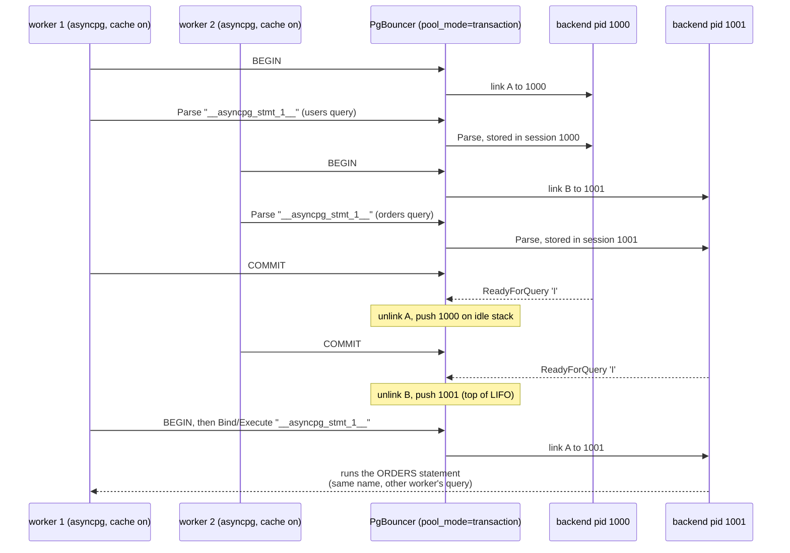

# Connection Pool Sizing Math Across Replicas and PgBouncer Transaction Pooling: Why Prepared Statements Break Under Transaction Multiplexing

> [!summary] Claim
> Every Python worker process owns a private pool, so the database sees `(replicas + surge) x workers x engines x (pool_size + max_overflow)` connections at peak and that product, not the per-process pool, must fit inside `max_connections - superuser_reserved_connections - reserved_connections`; once PgBouncer transaction pooling multiplexes those clients onto fewer backends, any protocol-level named prepared statement becomes a pointer into a session the client no longer owns, which surfaces as SQLSTATE `26000` (does not exist), `42P05` (already exists), or a silently wrong statement, unless the driver sends unnamed statements or PgBouncer `max_prepared_statements` rewrites the names.

Part of [Database Access and Transactions for APIs](README.md) in [API Engineering](../README.md).

## TL;DR

- Mechanism: a SQLAlchemy `QueuePool` caps one process at `pool_size + max_overflow` (default `5 + 10 = 15`) (sqlalchemy 2.1.8 lib/sqlalchemy/pool/impl.py, QueuePool.__init__), pools are never shared across processes, and PgBouncer in `pool_mode = transaction` unlinks a backend from a client as soon as the backend sends `ReadyForQuery` with status `'I'` (pgbouncer 1.26.1 src/server.c, handle_server_work).
- Contract rule: size the fleet so the peak product, counted with the rollout surge (`maxSurge` default `25%`, rounded up), fits the slots an ordinary role may take; behind PgBouncer, size `default_pool_size x pools x instances` against PostgreSQL and the app pools against `max_client_conn` instead.
- Trap: a named prepared statement lives until the end of the backend session (PostgreSQL protocol-flow, Extended Query), asyncpg names statements from one process-global counter (`__asyncpg_stmt_1__`, `__asyncpg_stmt_2__`, ...) and psycopg from a per-connection counter starting at `_pg3_0`, so the next transaction on a different backend fails or, when two processes picked the same name, runs another query.
- Portability: PgBouncer 1.21.0 added protocol-level prepared statement tracking, 1.22.0 added `DEALLOCATE ALL` and `DISCARD ALL` support, and 1.24.0 turned it on by default with `max_prepared_statements = 200`; SQL-level `PREPARE` and `EXECUTE` are never supported in transaction mode (PgBouncer changelog and config docs, as of 2026-11).
- When not to use it: do not put transaction pooling in front of code that needs session state (`SET` without `LOCAL`, `LISTEN`, session advisory locks, `WITH HOLD` cursors, temp tables that survive commit); give that code a session-mode pool or a direct connection.

## Mental model



Each worker numbers its statements from its own process-global counter, so both workers produce `__asyncpg_stmt_1__` for different queries.
PgBouncer links a client to a backend only for the span between `BEGIN` and the `ReadyForQuery 'I'` that follows `COMMIT`, then pushes the backend on an idle stack that is reused last-in first-out unless `server_round_robin` is set (PgBouncer FAQ).
Worker 1's second transaction is therefore served by the backend worker 2 just used; its cached statement name now refers to worker 2's query on that backend, and had the names differed the backend would answer `prepared statement "__asyncpg_stmt_1__" does not exist`.
The lab reproduces all three outcomes deterministically: `26000`, `42P05`, and the silent wrong statement.

## How it works

### 1. The per-process ceiling: what `QueuePool` actually counts

`QueuePool` keeps at most `pool_size` idle connections in a queue and counts everything beyond that in `_overflow`, which starts at `0 - pool_size` (sqlalchemy 2.1.8 lib/sqlalchemy/pool/impl.py, QueuePool.__init__).
`_do_get` waits on the queue only when `_overflow >= _max_overflow`; otherwise it calls `_inc_overflow` and opens a new DBAPI connection (sqlalchemy 2.1.8 lib/sqlalchemy/pool/impl.py, QueuePool._do_get).
So the simultaneous ceiling is `pool_size + max_overflow`, and the docstring says so: "the total number of simultaneous connections the pool will allow is pool_size + `max_overflow`" (same file, QueuePool.__init__ docstring).
Two settings remove the ceiling entirely: `pool_size=0` sets `_max_overflow = -1`, and `max_overflow=-1` means no overflow limit, so neither may appear in a budgeted fleet.
When the ceiling is reached and `timeout` (default `30.0` seconds, `pool_timeout` on `create_engine`) expires, the pool raises `sqlalchemy.exc.TimeoutError` with `"QueuePool limit of size %d overflow %d reached, connection timed out, timeout %0.2f"` and error code `3o7r` (same function).
Overflow connections are closed when returned if the queue is full (`QueuePool._do_return_conn`), so a burst opens and closes real backends: overflow is a latency buffer that churns PostgreSQL forks, not free capacity.
`AsyncAdaptedQueuePool` is the same class with an asyncio queue and "otherwise identical" arguments, and it is the default for `create_async_engine` (same file, AsyncAdaptedQueuePool docstring).
`NullPool._do_get` simply calls `_create_connection` and `_do_return_conn` closes the record, so every checkout is a new DBAPI connection (same file, NullPool).

The lab proves the ceiling against the real pool: with `pool_size=2, max_overflow=1` the third checkout succeeds, the fourth raises `QueuePool limit of size 2 overflow 1 reached`, and the `connect` event fired exactly three times.

### 2. Pools never cross a process boundary

SQLAlchemy's guidance is that pooled connections must not be shared with a forked child, because the TCP socket is a file descriptor that two interpreters would then drive concurrently, and recommends `engine.dispose(close=False)` in the child initializer (SQLAlchemy 2.1 docs, Using Connection Pools with Multiprocessing or os.fork()).
Gunicorn forks workers after loading the app only when `preload_app` is on (gunicorn 26.2.0 gunicorn/config.py, PreloadApp, default `False`); its `workers` default is `WEB_CONCURRENCY` or `1`, with the documented guidance `2-4 x $(NUM_CORES)` (same file, Workers).
Uvicorn reads `WEB_CONCURRENCY` too when `workers` is not given (uvicorn 0.54.0 uvicorn/config.py, Config.__init__).
Whatever the server, the database counts one pool per process per engine, which gives the budget formula:

```text
peak_backends = sum over tiers of
                (replicas + surge(replicas, maxSurge))      # pods during a rollout
              x workers_per_pod                             # processes per pod
              x engines_per_process                         # writer + reader engines count twice
              x (pool_size + max_overflow)                  # QueuePool ceiling
              + other_clients                               # migrations, cron, psql, replication tools

usable_slots  = max_connections - superuser_reserved_connections - reserved_connections
invariant     : peak_backends <= usable_slots
```

`maxSurge` may be an absolute number or a percentage, the absolute number "is calculated from the percentage by rounding up", and the default is `25%` (Kubernetes Deployment docs, Max Surge).
Kubernetes also "doesn't count terminating Pods" in the surge bound, so total consumption can exceed `replicas + maxSurge` "until the terminationGracePeriodSeconds of the terminating Pods expires" (same page); a pod that is draining but still holds its pool is invisible to the bound and visible to PostgreSQL.
Size `replicas` at the autoscaler's maximum, not today's count, because a scale-out happens exactly when the database is busiest.

### 3. What PostgreSQL does at the limit

PostgreSQL uses a process-per-connection model: the postmaster spawns a new backend for every connection request (PostgreSQL 18 docs, How Connections Are Established).
`max_connections` defaults to "typically 100", can only be set at server start, and sizes shared memory directly (PostgreSQL 18 docs, runtime-config-connection).
`superuser_reserved_connections` defaults to 3 and `reserved_connections` (for roles with privileges of `pg_use_reserved_connections`) defaults to 0 (same page).
The refusal happens inside the already forked backend: `InitProcess` fails with `FATAL: sorry, too many clients already` when no `PGPROC` slot is free (PostgreSQL REL_18_7 src/backend/storage/lmgr/proc.c, InitProcess), and `InitPostgres` fails with `remaining connection slots are reserved for roles with the SUPERUSER attribute` or `... with privileges of the "pg_use_reserved_connections" role` when the free slots are within the reserves (PostgreSQL REL_18_7 src/backend/utils/init/postinit.c, InitPostgres).
All of these are SQLSTATE `53300` `too_many_connections` (PostgreSQL 18 docs, Appendix A).
Every refused attempt still costs a fork, and the reserved-slot refusals are raised only after `PerformAuthentication` has completed (same file, InitPostgres), so a fleet whose pools retry immediately turns an overload into a connection storm.

### 4. How small the pool should be: concurrency, not users

The number of connections that are busy on average is Little's law, `L = lambda x W`: at 2000 transactions per second holding a connection for 5 ms each, 10 connections are busy (lab, `littles_law_connections`).
`W` is the time the connection is checked out, which in an async API includes every `await` inside the transaction, so calling an HTTP service while a session holds a transaction multiplies `W` by the remote latency.
The PostgreSQL wiki's long-standing rule of thumb for throughput is that active connections should be "somewhere near ((core_count * 2) + effective_spindle_count)", with the caveat that nobody had analysed it for SSDs (PostgreSQL wiki, Number Of Database Connections, last edited 2014-03-14); treat it as a starting point to measure from, not a law.
HikariCP's sizing essay makes the same argument for small pools and gives the deadlock-free bound when one unit of work can hold several connections at once: `pool size = Tn x (Cm - 1) + 1` (HikariCP wiki, About Pool Sizing).
In a FastAPI service, `Cm = 2` appears when a request dependency holds one `Session` and a second dependency (an audit logger, an outbox writer on its own engine connection) checks out another; with `pool_size + max_overflow` concurrent requests all holding their first connection, none can get its second, and every request waits out `pool_timeout`.
The lab shows the real pool starving at `pool_size=1, max_overflow=0` and succeeding at the Hikari bound of 2.
Sync endpoints in FastAPI run in AnyIO's worker threads, whose default limiter is `CapacityLimiter(40)` (anyio 4.16.0 anyio/_backends/_asyncio.py, current_default_thread_limiter), so a sync-SQLAlchemy process can have 40 threads contending for 15 connections; async endpoints have no such cap and can queue thousands of tasks on the pool, which is why `pool_timeout` must be shorter than the request deadline (see [[Timeout-Taxonomy-Connect-Read-Write-Pool-and-Deadline-Propagation]]).

### 5. PgBouncer pooling modes and the release point

PgBouncer offers three modes (PgBouncer features and config docs, `pool_mode`):

- `session` (the default): the backend is assigned for the whole client connection and returned when the client disconnects.
- `transaction`: the backend is assigned only during a transaction and returned "after transaction finishes".
- `statement`: returned after each query; multi-statement transactions are disallowed.

The release point is a byte on the wire.
The backend ends every query cycle with `ReadyForQuery`, `Byte1('Z')`, `Int32(5)`, and a status byte that is `'I'` when idle, `'T'` in a transaction block, and `'E'` in a failed transaction block (PostgreSQL 18 docs, Message Formats, ReadyForQuery).
PgBouncer parses that byte and sets `ready = true` only for `'I'`; in statement mode a `'T'` or `'E'` disconnects the server with `"transaction blocks not allowed in statement pooling mode"` (pgbouncer 1.26.1 src/server.c, handle_server_work).
On the next flush, when the mode is not `POOL_SESSION`, no outstanding requests remain, and the client is not mid-`COPY`, it calls `release_server` (pgbouncer 1.26.1 src/server.c, server_proto).
Consequences that follow directly from that rule:

- An autocommit statement outside `BEGIN` releases the backend after its `Sync`, so a driver that sends `Parse` + `Sync` and then `Bind` + `Execute` + `Sync` may run the two halves on different backends.
- A transaction left open (`idle in transaction`) pins a backend indefinitely, which is why `idle_transaction_timeout` and `transaction_timeout` exist (PgBouncer config docs, both default `0.0`, disabled).
- `server_reset_query` (default `DISCARD ALL`) is not run in transaction mode, because "clients must not use any session-based features"; `server_reset_query_always` exists only to turn "non-deterministic breakage to deterministic breakage" (PgBouncer config docs).

The features table lists what transaction mode never supports: `SET`/`RESET`, `LISTEN`, `WITH HOLD` cursors, SQL-level `PREPARE`/`DEALLOCATE`, `PRESERVE`/`DELETE ROWS` temp tables, `LOAD`, and session-level advisory locks; protocol-level prepared plans are supported only with `max_prepared_statements` non-zero (PgBouncer features).
The startup parameters `client_encoding`, `DateStyle`, `IntervalStyle`, `Timezone`, `standard_conforming_strings`, and `application_name` are tracked per client and restored (same page), and since 1.26.0 PgBouncer tracks every parameter PostgreSQL reports by default, notably `search_path` on PostgreSQL 18 and above and `default_transaction_read_only` on 14 and above (PgBouncer changelog, 1.26.0).
A parameter that is not reported, such as `statement_timeout`, still leaks to the next client that lands on the backend; the lab's `test_set_outside_a_transaction_leaks_to_the_next_client` models exactly that.
`SET LOCAL` is the safe form: its effect lasts "only till the end of the current transaction, whether committed or not" (PostgreSQL 18 docs, SET).

### 6. The math behind PgBouncer

PgBouncer moves the multiplication from PostgreSQL to the bouncer:

- Server side: each `(database, user)` pair is one pool of at most `default_pool_size` (default `20`) backends, plus `reserve_pool_size` (default `0`) used after a client has waited `reserve_pool_timeout` (default `5.0` seconds); `max_db_connections` and `max_user_connections` (default `0`, unlimited) cap across pools (PgBouncer config docs).
- Client side: `max_client_conn` (default `100`) bounds client connections per PgBouncer process, and the file descriptor bound is `max_client_conn + (max pool_size * total databases * total users)` (same docs).
- Instances: several PgBouncer processes behind one port (`so_reuseport`) or one per pod as a sidecar each have their own pools, so PostgreSQL sees `instances x pools x (default_pool_size + reserve_pool_size)`, capped on each instance by `max_db_connections`, which counts per database regardless of user (lab, `BouncerTopology`, which assumes all pools share one database).
- Waiting: a client not given a server within `query_wait_timeout` (default `120.0` seconds) is disconnected (PgBouncer config docs).

The app pools still matter: they now count against `max_client_conn` on each bouncer, and their `pool_timeout` decides whether the queue forms in Python (visible as `TimeoutError` with a stack) or inside PgBouncer (visible only as `cl_waiting` in `SHOW POOLS` and latency).
A sidecar bouncer per pod does not reduce PostgreSQL connections at all unless its `default_pool_size` is smaller than the pod's total app pool; a central bouncer tier is where multiplexing pays off.

### 7. Prepared statements on the wire

In the extended query protocol, `Parse` carries a destination statement name, the query, and parameter type OIDs; "an empty string selects the unnamed prepared statement" (PostgreSQL 18 docs, Message Formats, Parse):

```text
Parse (F), PostgreSQL 18 Message Formats
'P' | Int32 length incl. self | String name\0 | String query\0 | Int16 nparams | Int32 oid x nparams
```

The lifetimes are what PgBouncer breaks: "a named prepared-statement object lasts till the end of the current session, unless explicitly destroyed", while "an unnamed prepared statement lasts only until the next Parse statement specifying the unnamed statement as destination", and named statements "must be explicitly closed before they can be redefined" (PostgreSQL 18 docs, protocol-flow, Extended Query).
So the namespace is per backend session: a `Parse` of an existing name fails with `42P05` `duplicate_prepared_statement`, and a `Bind` of a missing name fails with `26000` `invalid_sql_statement_name` (PostgreSQL 18 docs, Appendix A).
The unnamed statement is immune because it is re-sent in the same message batch that executes it.
Disabling named statements has a price: by default PostgreSQL plans the first five executions of a prepared statement with custom plans and only then considers a generic plan (PostgreSQL 18 docs, PREPARE, `plan_cache_mode`), so unnamed statements pay parse and plan on every execution.

### 8. asyncpg: one counter per process, named whenever the cache is on

asyncpg's `connect` defaults are `statement_cache_size=100`, `max_cached_statement_lifetime=300`, and `max_cacheable_statement_size=1024 * 15` (asyncpg 0.32.0 asyncpg/connection.py, connect).
Names come from `Connection._get_unique_id`, which increments a module-level `global _uid` and returns `'__asyncpg_{}_{:x}__'.format(prefix, _uid)` (same file), so names are unique within a process and identical sequences repeat in every process; the lab calls the real method on two unrelated objects and observes consecutive numbers.
`_get_statement` names a statement when the cache is used or when `named` is truthy, and otherwise sends `''`; for an anonymous statement with the cache disabled it calls `statement.mark_unprepared()` so the next `bind_execute` re-sends `Parse`, with the comment "We always do this when stmt_cache_size is set to 0 assuming people are running PgBouncer which is mishandling implicit transactions" (asyncpg 0.32.0 asyncpg/connection.py, Connection._get_statement).
`Connection.prepare()` passes `name=None`, and `_prepare` turns `None` into `self._stmt_cache_enabled` (same file, Connection._prepare), so in 0.32.0 even an explicit `prepare()` is unnamed when `statement_cache_size=0`.
That is new in asyncpg 0.31.0 (2025-11-24), whose release notes say "Make `prepare()` not use named statements by default when cache is disabled (#1245)"; through 0.30.0 `_prepare` passed `named=True if name is None else name`, so `prepare()` always produced a named statement (asyncpg 0.30.0 asyncpg/connection.py, Connection._prepare).
When the server reports `DuplicatePreparedStatementError` or `InvalidSQLStatementNameError`, asyncpg appends a hint that pgbouncer in transaction or statement mode "does not support prepared statements properly" and recommends `statement_cache_size` 0 (asyncpg 0.32.0 asyncpg/exceptions/_base.py); the FAQ says the same and quotes both error texts (asyncpg FAQ).

### 9. SQLAlchemy's asyncpg dialect adds a second cache

The dialect "makes use of `asyncpg.connection.prepare()` for all statements" and keeps its own LRU of prepared statement objects per DBAPI connection, default 100, set by the `prepared_statement_cache_size` DBAPI argument (sqlalchemy 2.1.8 lib/sqlalchemy/dialects/postgresql/asyncpg.py, module docstring and AsyncAdapt_asyncpg_connection.__init__).
Its default `prepared_statement_name_func` is `_default_name_func`, which returns `None` (same file), so the name is decided by asyncpg's own `statement_cache_size`: setting only SQLAlchemy's `prepared_statement_cache_size=0` still sends named `__asyncpg_stmt_N__` statements on asyncpg 0.32.0, because asyncpg's cache is still on.
The working configuration therefore sets both, the asyncpg one being the one that changes the wire; this block is a configuration sketch, not lab code, and the lab pins the defaults it depends on:

```python
engine = create_async_engine(
    "postgresql+asyncpg://app@pgbouncer:6432/app",
    poolclass=NullPool,
    connect_args={"statement_cache_size": 0, "prepared_statement_cache_size": 0},
)
```

The dialect docs offer a second escape, `prepared_statement_name_func=lambda: f"__asyncpg_{uuid4()}__"`, which makes collisions improbable but still leaves statements on backends the client will not see again, and they pair it with a warning to use `NullPool` and `DISCARD` (SQLAlchemy 2.1 docs, Prepared Statement Name with PGBouncer); note that PgBouncer runs `server_reset_query` only in session mode unless `server_reset_query_always` is set, so in transaction mode that `DISCARD` does not happen by default.
The history explains the layering: SQLAlchemy issue 6467 (2021-05) reported `DuplicatePreparedStatementError: prepared statement "__asyncpg_stmt_a__"` behind PgBouncer, and asyncpg issue 837 (2021-10) reported that disabling both caches was not enough at the time because the dialect always called `prepare()`; asyncpg 0.31.0 closed that gap (asyncpg v0.31.0 release notes, #1245), so on asyncpg 0.30.0 and older the configuration above still sends named statements and needs a unique `prepared_statement_name_func` or PgBouncer `max_prepared_statements` instead.
`pool_pre_ping` was another leak: SQLAlchemy issue 10226 (2023-08) reported that `do_ping` used prepared statements against a transaction-mode PgBouncer, and 2.1.8 now wraps the ping in an explicit transaction with the comment "create a transaction explicitly to support pgbouncer transaction mode.   See #10226" (sqlalchemy 2.1.8 lib/sqlalchemy/dialects/postgresql/asyncpg.py, AsyncAdapt_asyncpg_connection._async_ping).
`NullPool` alone does not fix the naming problem: asyncpg's counter is process-global, so a fresh connection in worker 1 never reuses a name, but worker 2 still produces the same sequence and can collide on a shared backend with `42P05`, and statements left on backends accumulate because transaction mode never runs `server_reset_query`.
`NullPool` behind a bouncer is still a deliberate choice: the bouncer is the pool, client connections to it are cheap, and every new asyncpg connection starts with an empty statement cache; the cost is a TCP and auth handshake to PgBouncer per checkout, which PgBouncer's FAQ suggests minimising by running the bouncer on the web host when connections are short-lived.

### 10. psycopg 3: per-connection names and a delayed failure

psycopg prepares a query only after it has been executed `prepare_threshold` times on a connection (default `5`), keeps at most `prepared_max` (default `100`) and deallocates the least recently used (psycopg 3.3.8 psycopg/_preparing.py, PrepareManager; psycopg docs, Prepared statements).
Names are `f"_pg3_{self._prepared_idx}"` with the counter starting at 0 per connection (same file, PrepareManager.get), so every connection's first prepared statement is `_pg3_0` and two clients collide on a shared backend with `42P05`.
Because the first five executions go unnamed, the failure appears only on the sixth execution of a query: tests and light traffic pass, and production fails after warm-up; the lab asserts the first five succeed and the sixth raises.
psycopg drops its whole cache after a successful `ROLLBACK`, `DROP`, `ALTER`, `DISCARD ALL`, or `DEALLOCATE ALL` (same file, PrepareManager._should_discard), which makes the failure even more timing-dependent.
`prepare_threshold=None` disables preparation; since psycopg 3.2 prepared statements are supported through PgBouncer when PgBouncer is 1.22 or newer, `max_prepared_statements > 0`, and the client libpq is from PostgreSQL 17 or newer, or with `prepared_max=None` when libpq 17 is not available (psycopg 3.3.9 docs, Using prepared statements with PgBouncer).

### 11. PgBouncer `max_prepared_statements`: name rewriting

With a non-zero `max_prepared_statements`, PgBouncer inspects protocol-level `Parse`, gives each unique query string an internal name `PGBOUNCER_{unique_id}` shared by all clients, rewrites the client's name to the internal one, and "transparently prepares the statement before executing it" when the linked backend does not have it yet (PgBouncer config docs, `max_prepared_statements`).
The value is the size of an LRU cache of prepared statements per server connection; the default is `200` since 1.24.0 (PgBouncer changelog 1.24.0; config docs `Default: 200`), and 1.21.0's release note suggested 100 and reported synthetic throughput gains "anywhere from 15% to 250%" (PgBouncer changelog 1.21.0, a vendor benchmark not reproduced here).
SQL-level `PREPARE`, `EXECUTE`, and `DEALLOCATE` are forwarded untouched, except `DEALLOCATE ALL` and `DISCARD ALL`, which clear the client's tracked statements (config docs; supported since 1.22.0 per the changelog).
Sharing names has one documented downside: if a query string's argument or result types change, PostgreSQL raises `cached plan must not change result type`, typically after a migration adds or retypes a column, and the documented remedy is `RECONNECT` on the admin console (config docs).
The lab's `Bouncer` implements the same rewriting: after the cross-link scenario that produced `26000` without it, the same client sequence succeeds, a third client preparing an already-seen query reuses the backend's copy so the run costs one `Parse` per (backend, query) pair, and `max_prepared_statements=1` with two hot queries re-parses on every execution.
Since 1.26.0 PgBouncer reports `pgbouncer.version`, `pgbouncer.pool_mode`, and `pgbouncer.max_prepared_statements` as `ParameterStatus` on login, so drivers can detect the proxy (PgBouncer changelog 1.26.0); neither asyncpg 0.32.0 nor psycopg 3.3.8 (including `psycopg_binary`) contains any of these parameter names, so neither driver adapts to them on its own and detection is left to application code (grep of the installed packages, as of 2026-11).

## Numbers and limits

| Quantity | Value | Source |
| --- | --- | --- |
| `QueuePool` `pool_size`, `max_overflow`, `timeout` defaults | `5`, `10`, `30.0` s, ceiling 15 per engine | sqlalchemy 2.1.8 pool/impl.py, QueuePool.__init__; lab `test_pinned_library_defaults` |
| asyncpg statement cache | `100` statements, `300` s lifetime, statements up to 15360 bytes | asyncpg 0.32.0 connection.py, connect; lab |
| SQLAlchemy asyncpg dialect statement cache | `100` per DBAPI connection | sqlalchemy 2.1.8 dialects/postgresql/asyncpg.py; lab |
| psycopg `prepare_threshold`, `prepared_max` | `5`, `100` | psycopg 3.3.8 _preparing.py; lab |
| PostgreSQL `max_connections` | typically `100`, server start only | PostgreSQL 18 docs (as of 2026-11, current is 18.7) |
| `superuser_reserved_connections`, `reserved_connections` | `3`, `0` | PostgreSQL 18 docs |
| Slots usable by app roles at defaults | `97` | arithmetic; lab `test_default_engine_on_a_small_fleet_overruns_default_max_connections` |
| `work_mem` per sort or hash operation | `4MB` default, several per query, per session | PostgreSQL 18 docs, runtime-config-resource |
| Kubernetes `maxSurge` default | `25%`, rounded up | Kubernetes Deployment docs (as of 2026-11) |
| PgBouncer `default_pool_size`, `max_client_conn` | `20`, `100` | PgBouncer config docs (1.26.1, as of 2026-11) |
| PgBouncer `reserve_pool_size`, `reserve_pool_timeout` | `0`, `5.0` s | PgBouncer config docs |
| PgBouncer `query_wait_timeout` | `120.0` s | PgBouncer config docs |
| PgBouncer `server_lifetime`, `server_idle_timeout` | `3600.0` s, `600.0` s | PgBouncer config docs |
| PgBouncer `max_prepared_statements` | `200` (since 1.24.0; 1.21 to 1.23 shipped `0`) | PgBouncer changelog 1.24.0 |
| PgBouncer prepared statement memory example | 1000 clients, 200 queries of 5 kB, `pkt_buf` 4096: about 17 MB | PgBouncer config docs worked example |
| PgBouncer memory per connection | "2 kB per connection by default" | PgBouncer features |
| AnyIO default worker threads | `40` | anyio 4.16.0 _backends/_asyncio.py |
| Rule-of-thumb active connections | `(core_count * 2) + effective_spindle_count` | PostgreSQL wiki (2014), HikariCP wiki |
| Deadlock-free pool for `Tn` threads holding `Cm` | `Tn x (Cm - 1) + 1`; `3, 4 -> 10`, `8, 3 -> 17` | HikariCP wiki; lab `test_hikari_deadlock_free_formula` |
| Default fleet: 4 replicas, 4 workers, default pools | `(4 + 1) x 4 x 15 = 300` demanded vs `97` usable | lab |
| Steady 80 vs surging 100 (4 replicas, 2 workers, `5 + 5`) | fits at steady state, fails during the rollout | lab `test_rollout_surge_is_what_breaks_a_budget_that_fits_at_steady_state` |
| Lab run | 26 passed in 2.03 s (wall time of one run, not a benchmark) | `uv run --frozen pytest ...` from `labs/`, CPython 3.14.6, macOS 27.3 arm64 (`uname -r` 27.3.0), rerun by the verifier 2026-11-15 |

## Portability

| Dimension | Behavior | Evidence |
| --- | --- | --- |
| CPython 3.14.6 | 26 lab tests pass | lab, `uv run --frozen pytest`, workspace `.venv`, macOS 27.3 arm64 |
| CPython 3.12, 3.13, 3.15, 3.15t | not run: lab checks were paused on 2026-11-11 and the lab was run once, on the workspace interpreter | not proven by a run; recorded in `report.md` |
| SQLAlchemy 2.1.8 | ceiling, `TimeoutError` text, `NullPool` reconnects, asyncpg dialect defaults as stated | lab; sqlalchemy 2.1.8 source |
| SQLAlchemy 2.0.57 | same asyncpg dialect behavior: `_async_ping` wraps the ping in a transaction for #10226, `_default_name_func` returns `None`, cache default `100`; not run on the `sqlalchemy20` group | sqlalchemy rel_2_0_57 lib/sqlalchemy/dialects/postgresql/asyncpg.py, AsyncAdapt_asyncpg_connection (source read, not executed) |
| asyncpg 0.32.0 | process-global `_uid` naming; `prepare()` unnamed when `statement_cache_size=0` | lab `test_real_asyncpg_statement_names_come_from_one_process_global_counter`; asyncpg 0.32.0 connection.py |
| asyncpg 0.30.0 and older | `prepare()` always named, so `statement_cache_size=0` does not unname SQLAlchemy's statements | asyncpg 0.30.0 asyncpg/connection.py, Connection._prepare; asyncpg v0.31.0 release notes (#1245) |
| psycopg 3.3.8 | `_pg3_<n>` per connection, threshold 5; PgBouncer support needs psycopg 3.2+, PgBouncer 1.22+, libpq 17+ | psycopg 3.3.8 _preparing.py; psycopg docs |
| PgBouncer < 1.21 | no protocol-level prepared statement support in transaction mode | PgBouncer changelog 1.21.0 |
| PgBouncer 1.21 to 1.23 | supported only with `max_prepared_statements` set (default `0`); `DEALLOCATE ALL`/`DISCARD ALL` from 1.22 | PgBouncer changelog |
| PgBouncer 1.24+ | enabled by default at `200` | PgBouncer changelog 1.24.0 |
| PgBouncer 1.26+ | tracks `search_path` (PostgreSQL 18+) and `default_transaction_read_only` (14+); announces `pgbouncer.pool_mode` | PgBouncer changelog 1.26.0 |
| PostgreSQL 16+ | `reserved_connections` and `pg_use_reserved_connections` exist; before 16 only `superuser_reserved_connections` | PostgreSQL 16 release notes ("Allow the server to reserve backend slots for roles with pg_use_reserved_connections membership"); PostgreSQL 18 docs |
| Uvicorn, Gunicorn | one pool per worker process; both default worker count from `WEB_CONCURRENCY` | uvicorn 0.54.0 config.py; gunicorn 26.2.0 config.py |
| Hypercorn 0.18.0 | `workers` child processes (default `1`) started with the `spawn` context, so one pool per worker process; `workers=0` serves from the main process | hypercorn 0.18.0 hypercorn/run.py, run; hypercorn/config.py, Config.workers |
| Granian 2.8.7 | worker processes (`MPServer`) on GIL builds, so one pool per worker; worker threads in one process (`MTServer`) on free-threaded builds, where a module-level engine is shared by all workers of the process | granian 2.8.7 granian/server/__init__.py, `Server = MPServer if BUILD_GIL else MTServer`; see [[Multi-Process-Worker-Topologies-Gunicorn-Uvicorn-Workers-vs-Kubernetes-Replicas]] |
| HTTP/1.1, HTTP/2, HTTP/3 | not applicable: the budget depends on concurrent transactions per process, not on the client protocol | reasoning from section 4 |

## Worked example

The [implementation](../labs/src/api_labs/f13_database_access_and_transactions_for_apis/pool_sizing.py) has three parts: budget arithmetic, a deterministic PgBouncer model with asyncpg-like and psycopg-like drivers, and probes of a real SQLAlchemy `QueuePool` and `NullPool` on in-memory SQLite.
The [test](../labs/tests/f13_database_access_and_transactions_for_apis/test_sizing_connection_pools_across_workers_pods_and_pgbouncer_transaction_mode.py) has 26 cases: 9 on the arithmetic, 5 on real SQLAlchemy, asyncpg, and psycopg objects, and 12 on the transaction-pooling model.
The model is a model: it reproduces PgBouncer's release rule and name rewriting from the cited source and docs, not PgBouncer itself, and no PostgreSQL or PgBouncer server was run.

The budget, as a tier of identical processes:

```python
@dataclass(frozen=True)
class AppTier:
    """One deployment that talks to the database: pods x processes x engines."""

    name: str
    replicas: int
    workers_per_pod: int
    pool_size: int = 5
    max_overflow: int = 10
    max_surge: int | str = "25%"
    engines_per_process: int = 1

    def processes_at_peak(self) -> int:
        pods = self.replicas + surge_pods(self.replicas, self.max_surge)
        return pods * self.workers_per_pod

    def peak_connections(self) -> int:
        ceiling = per_process_ceiling(self.pool_size, self.max_overflow)
        if ceiling is None:
            raise ValueError(f"{self.name}: unbounded pool has no connection ceiling")
        return self.processes_at_peak() * self.engines_per_process * ceiling
```

The release rule, which is the whole of transaction pooling:

```python
    def _after_message(self, client: str) -> None:
        link = self._links[client]
        server = link.server
        if server is None:
            return
        if self.mode is PoolMode.TRANSACTION and server.status() == "I":
            link.server = None
            self._idle.append(server)
```

The asyncpg-like driver: a cache hit sends only `Execute` for a name prepared on whatever backend served the earlier transaction:

```python
    def fetch(self, query: str) -> str:
        if self.statement_cache_size == 0:
            return self.bouncer.parse_bind_execute_unnamed(self.client, query)
        name = self._cache.get(query)
        if name is None:
            name = self.process.next_name()
            self.bouncer.parse(self.client, name, query)
            self._cache[query] = name
            if len(self._cache) > self.statement_cache_size:
                self._cache.popitem(last=False)
        else:
            self._cache.move_to_end(query)
        return self.bouncer.execute(self.client, name)
```

The failure, as a simplified excerpt of two tests (the helper `_cross_link` runs overlapping transactions so the clients hold backends 1000 and 1001, then commits both):

```python
# simplified excerpt
process = DriverProcess()                     # one worker, two connections
a = AsyncpgLikeConnection(bouncer, "a", process, statement_cache_size=100)
b = AsyncpgLikeConnection(bouncer, "b", process, statement_cache_size=100)
_cross_link(bouncer, a, b)
a.transaction(USERS)  # PgError 26000: prepared statement "__asyncpg_stmt_1__" does not exist

a = AsyncpgLikeConnection(bouncer, "a", DriverProcess(), statement_cache_size=100)
b = AsyncpgLikeConnection(bouncer, "b", DriverProcess(), statement_cache_size=100)
a.transaction(USERS)
b.transaction(ORDERS)  # PgError 42P05: prepared statement "__asyncpg_stmt_1__" already exists
```

Run from `labs/`, captured once by the verifier on 2026-11-15, CPython 3.14.6, macOS 27.3 arm64:

```text
$ uv run --frozen pytest tests/f13_database_access_and_transactions_for_apis/test_sizing_connection_pools_across_workers_pods_and_pgbouncer_transaction_mode.py -q
..........................                                               [100%]
26 passed in 2.03s
```

## Pitfalls

> [!warning] Counting one pod instead of the fleet
> Trigger: `pool_size=20` chosen so "one pod can serve its peak", then the Deployment scales to 10 replicas with 4 Uvicorn workers each.
> Symptom: new connections fail with `FATAL: sorry, too many clients already` (`53300`) during deploys and autoscaling, while steady state looks fine.
> Fix: budget `(replicas_max + surge) x workers x engines x (pool_size + max_overflow)` against `max_connections - 3 - reserved_connections`, add other clients explicitly, and alert when `count(*)` in `pg_stat_activity` passes 80 percent of usable slots.

> [!warning] `max_overflow` treated as free capacity
> Trigger: `pool_size=5, max_overflow=50` "to absorb bursts".
> Symptom: under a burst every process opens 55 backends, each a fork, and closes the overflow ones when returned, so PostgreSQL CPU goes into connection setup at the worst moment.
> Fix: keep overflow small or zero, size `pool_size` to Little's law plus margin, and let `pool_timeout` shed load quickly.

> [!warning] asyncpg cache left on behind a transaction-mode PgBouncer older than 1.21 or with `max_prepared_statements = 0`
> Trigger: moving an existing SQLAlchemy plus asyncpg app behind PgBouncer.
> Symptom: intermittent `DuplicatePreparedStatementError` or `InvalidSQLStatementNameError` naming `__asyncpg_stmt_<hex>__`, with the asyncpg hint about pgbouncer, as reported in SQLAlchemy issue 6467.
> Fix: PgBouncer 1.21+ with `max_prepared_statements > 0`, or `connect_args={"statement_cache_size": 0, "prepared_statement_cache_size": 0}` on asyncpg 0.31.0+ (older asyncpg also needs a unique `prepared_statement_name_func`); setting only SQLAlchemy's knob does not unname the statements.

> [!warning] psycopg breaks only after warm-up
> Trigger: psycopg 3 with default `prepare_threshold=5` behind transaction pooling without prepared statement support.
> Symptom: `prepared statement "_pg3_0" already exists` appears only on hot queries and only after deploys have warmed up; integration tests that run each query once never see it.
> Fix: `prepare_threshold=None`, or meet psycopg's three conditions (psycopg 3.2+, PgBouncer 1.22+ with `max_prepared_statements > 0`, libpq 17+).

> [!warning] Shared prepared statements after a migration
> Trigger: PgBouncer `max_prepared_statements` on, then a migration adds or retypes a column used by `SELECT *` style queries.
> Symptom: `ERROR: cached plan must not change result type` across many clients.
> Fix: avoid `SELECT *` in prepared queries, and run `RECONNECT` on the PgBouncer admin console after such migrations, as PgBouncer documents; see [[Zero-Downtime-Schema-Migrations-Expand-Contract-and-Lock-Timeouts]].

> [!warning] Session state through a transaction pooler
> Trigger: `SET search_path`, `SET statement_timeout`, `SET ROLE`, `LISTEN`, or `pg_advisory_lock` outside a transaction through `pool_mode = transaction`.
> Symptom: another client inherits the setting, or a lock is held by a backend no client controls; PgBouncer 1.26.0's changelog records exactly this for `search_path` and `default_transaction_read_only` before it began tracking them.
> Fix: `SET LOCAL` or `set_config(..., true)` inside the transaction, `pg_advisory_xact_lock`, and a separate session-mode pool for `LISTEN` consumers.

> [!warning] Nested checkouts on one pool
> Trigger: a request dependency holds a session and a second dependency or background write checks out another connection from the same engine.
> Symptom: under load all requests wait `pool_timeout` and fail with `QueuePool limit ... reached`, while the database is idle.
> Fix: one connection per unit of work, or size by `Tn x (Cm - 1) + 1`, or give the second use its own small engine as a bulkhead (see [[Bulkhead-Isolation-and-Per-Dependency-Resource-Partitioning]]).

> [!warning] PgBouncer single-thread hangs are fleet outages
> Trigger: running PgBouncer before 1.26.0 (CVE-2026-6668, integer overflow in packet buffer growth) or before 1.26.1 (CVE-2026-107348 and CVE-2026-107349, both able to hang or spin it), per the PgBouncer changelog.
> Symptom: because "PgBouncer is single-threaded", one malicious client stops service for every app process behind that instance.
> Fix: patch, keep `max_packet_size` at its default, run several instances with `so_reuseport`, and treat the bouncer tier as part of the database's availability budget.

## Security and robustness

- Connection exhaustion is OWASP API4:2023 Unrestricted Resource Consumption: the risk list includes missing limits on execution timeouts and on the maximum number of processes, and every PostgreSQL connection is a process; an unauthenticated endpoint that opens a transaction per request is a database denial-of-service lever.
- Bound every queue: `pool_timeout` below the request deadline, PgBouncer `query_wait_timeout` below the client's, `idle_transaction_timeout` and PostgreSQL `idle_in_transaction_session_timeout` so a stuck handler cannot pin a backend.
- Keep `superuser_reserved_connections` and use `reserved_connections` for the operator role, so that when the app exhausts slots an operator can still connect and terminate sessions.
- Tenant isolation through session state is unsafe under transaction pooling: a row-level security tenant id set with `SET` survives into another tenant's transaction on the same backend; use `SET LOCAL` or `set_config('app.tenant', $1, true)` inside the transaction and test it with two clients and one backend, as the lab does.
- The silent-wrong-statement outcome is a confidentiality risk, not only an availability one: two workers that reuse a name for different queries can execute a statement the client did not send.
  The protocol and source say how often that goes unnoticed: `Execute` "doesn't cause ReadyForQuery or RowDescription to be issued" (PostgreSQL 18 docs, protocol-flow, Extended Query), so the client decodes `DataRow` messages with the row description it cached when it prepared its own query.
  The server rejects a `Bind` whose parameter count differs from the named statement's (`bind message supplies %d parameters, but prepared statement "%s" requires %d`, SQLSTATE `08P01`) and a binary parameter its receive function does not fully consume (`incorrect binary data format in bind parameter %d`, SQLSTATE `22P03`) (PostgreSQL REL_18_7 src/backend/tcop/postgres.c, exec_bind_message), and rejects more than one result format code that does not match the column count (`bind message has %d result formats but query has %d columns`, REL_18_7 src/backend/tcop/pquery.c, PortalSetResultFormat).
  asyncpg raises `ProtocolError` when a `DataRow` has a different column count than the cached description (asyncpg 0.32.0 asyncpg/protocol/prepared_stmt.pyx, `_decode_row`).
  A collision therefore fails loudly only when parameter count, column count, or binary widths differ; two queries with the same parameter and column shape pass every one of these checks, and the client decodes the other query's rows with its own codecs.
  This was derived from source, not observed against a running server, which the verifier did not run; the lab models the same-shape case only.
- PgBouncer is an authentication and protocol parser in front of the database: the 2026 CVEs above include a SCRAM nonce crash (CVE-2026-19888) and a second-`StartupMessage` impersonation (CVE-2026-107350) per its changelog, so it needs the same patch cadence as PostgreSQL.

## The principal's view

The decision is where connection multiplexing lives, and it is organizational before it is technical.
Direct pools are simplest and keep every PostgreSQL feature, but the budget is a fleet-wide invariant that no single team owns: the API team picks `pool_size`, platform owns `maxSurge` and autoscaler limits, data owns `max_connections`, and a change to any one silently breaks the product.
A central PgBouncer tier in transaction mode turns that invariant into one number owned by the database team (`default_pool_size x pools x instances`), lets app teams scale replicas freely, and costs every team the session-feature contract, which must be enforced in review and tests, not remembered.
Choose session pooling or direct connections for workloads that need session state (`LISTEN` consumers, long reports with `WITH HOLD` cursors, migrations), and transaction pooling for the request path.
Prefer PgBouncer 1.24+ with `max_prepared_statements` over disabling prepared statements when the hot path is plan-heavy, because the rewrite shares plans across clients; prefer disabling them when queries are cheap to plan or DDL is frequent, because the shared-name cache adds a migration hazard.
Consider a different design when the fleet is very wide and bursty, such as serverless functions: there a managed proxy or an HTTP data API in front of the database removes the per-process pool entirely, at the cost of a network hop and vendor coupling.
And re-examine whether the database should be shared at all: a budget that only fits with heroic pooling often signals that several services should not be writing to one primary.

## Interview questions

> [!question] L5: Four pods each run four Uvicorn workers with SQLAlchemy's default pool; how many PostgreSQL connections can they open, and does it fit a default server?
>
> > [!success]- Answer
> > Each process can hold `pool_size + max_overflow = 5 + 10 = 15` connections.
> > At steady state that is `4 x 4 x 15 = 240`; during a rollout with the default `25%` surge, one extra pod gives `5 x 4 x 15 = 300`.
> > A default server has `100 - 3 = 97` slots for ordinary roles, so it does not fit by a factor of three.
> >
> > Follow-up: What is the largest uniform `pool_size` with `max_overflow=0` that fits if 7 slots go to other clients?

> [!question] L5: What exactly happens when a SQLAlchemy `QueuePool` is exhausted?
>
> > [!success]- Answer
> > `_do_get` blocks on the queue for `pool_timeout` seconds once `_overflow` has reached `max_overflow`.
> > If no connection comes back it raises `sqlalchemy.exc.TimeoutError` with `QueuePool limit of size N overflow M reached, connection timed out, timeout T`.
> > No database error is involved; the database may be idle while requests time out.
> >
> > Follow-up: Why can a request that already holds a connection make this happen even at low traffic?

> [!question] L6: Predict the output: in the lab, clients `a` and `b` share one `DriverProcess`, run overlapping transactions on backends 1000 and 1001, commit `a` then `b`, and then `a` runs `USERS` again; what happens, and what changes if they use separate processes?
>
> > [!success]- Answer
> > The idle stack is LIFO, so `a` lands on 1001, which holds only `__asyncpg_stmt_2__`.
> > The cached `__asyncpg_stmt_1__` is missing there, so it raises `26000` `prepared statement "__asyncpg_stmt_1__" does not exist`.
> > With separate processes both clients named their first statement `__asyncpg_stmt_1__`, so `a` executes `b`'s `ORDERS` statement and the model returns `[ORDERS]` with no error.
> >
> > Follow-up: Which PgBouncer setting makes both variants return `[USERS]`, and how many `Parse` messages does it cost?

> [!question] L6: Debug this API: after moving a FastAPI service to a transaction-mode PgBouncer, about one request in a thousand fails with `asyncpg.exceptions.DuplicatePreparedStatementError: prepared statement "__asyncpg_stmt_1a__" already exists`; the team already set `prepared_statement_cache_size=0` in the URL; why does it still happen?
>
> > [!success]- Answer
> > That parameter only disables SQLAlchemy's own cache of prepared statement objects.
> > The dialect still calls `asyncpg` `prepare()`, and in asyncpg 0.32.0 `prepare()` names the statement whenever asyncpg's own `statement_cache_size` is above 0, which defaults to 100.
> > Names come from a per-process counter, so two workers produce the same name and collide when their transactions land on the same backend.
> > Fix with `connect_args={"statement_cache_size": 0}` (enough on asyncpg 0.31.0+, where `prepare()` then sends unnamed statements) or by enabling `max_prepared_statements` on PgBouncer 1.21+, and confirm with `SHOW SERVERS` and `pg_prepared_statements` on a backend.
> >
> > Follow-up: Why is the error rate low rather than near 100 percent?

> [!question] L6: Why does psycopg 3 fail behind PgBouncer only after a deploy has been running for a while?
>
> > [!success]- Answer
> > psycopg sends a query unnamed until it has been seen `prepare_threshold` times, 5 by default.
> > Only the sixth execution prepares it as `_pg3_0`, and every connection's counter starts at 0.
> > So hot queries collide with `42P05` once traffic warms up, while tests that run each query once pass.
> >
> > Follow-up: Which three conditions make psycopg prepared statements safe through PgBouncer?

> [!question] L6: A multi-tenant API sets `SET app.tenant_id = '42'` at the start of each request for row-level security, behind a transaction-mode PgBouncer; what can go wrong and how do you fix it?
>
> > [!success]- Answer
> > If the `SET` runs outside the transaction it changes the backend session, which is released after its `ReadyForQuery 'I'` and may serve another tenant next.
> > The next tenant's queries can then run with tenant 42's id unless they set their own first.
> > Use `SET LOCAL` or `set_config('app.tenant_id', $1, true)` inside the same transaction as the queries, and test with two clients and a single backend.
> >
> > Follow-up: Does PgBouncer 1.26's parameter tracking protect custom `app.*` settings?

> [!question] L7+: Where should PgBouncer run: as a sidecar in every API pod, or as a central tier?
>
> > [!success]- Answer
> > A sidecar removes TCP and auth setup latency for short-lived app connections, but each sidecar has its own pools, so PostgreSQL still sees `pods x default_pool_size`.
> > A central tier is where multiplexing reduces backends, at the cost of a network hop, a new failure domain, and a single-threaded process per instance.
> > Many fleets run both: a sidecar in session mode for connection reuse and a central transaction-mode tier sized against `max_connections`.
> >
> > Follow-up: How do cancellation requests work when several central PgBouncer instances sit behind one load balancer?

> [!question] L7+: Would you enable PgBouncer `max_prepared_statements` or disable prepared statements in the drivers?
>
> > [!success]- Answer
> > Rewriting keeps plan reuse and even shares one prepared statement per backend across all clients.
> > It costs PgBouncer CPU and memory, needs PgBouncer 1.21+ (on by default from 1.24), and adds the `cached plan must not change result type` hazard after DDL.
> > Disabling is simpler and version-independent but parses and plans every execution.
> > Measure plan time with `pg_stat_statements` before choosing; plan-heavy joins favour rewriting, cheap point queries favour disabling.
> >
> > Follow-up: How would you roll out the change without a flag day across services?

> [!question] L7+: Your autoscaler can take the API from 6 to 30 replicas; how do you make the connection budget a property the system enforces rather than a spreadsheet?
>
> > [!success]- Answer
> > Compute the budget from the autoscaler maximum plus surge and fail CI when `(max_replicas + surge) x workers x engines x ceiling` exceeds the usable slots.
> > Put a transaction pooler in front so the database bound is set by the pooler's pool sizes, not by replica count.
> > Alert on `pg_stat_activity` against usable slots and on pool wait time, and keep reserved slots for operators.
> >
> > Follow-up: What breaks first if a misconfigured service bypasses the pooler and connects directly?

## Related

Prerequisites: [[Connection-Pooling-Internals-QueuePool-AsyncAdaptedQueuePool-and-Pre-Ping]]

Next: [[Why-Sharing-an-AsyncSession-Across-Concurrent-Tasks-Corrupts-State]]

See also: [[02-Programming-Languages/Python/Python-Backend-Interview-Prep/06-SQL-and-SQLAlchemy]], [[Async-PostgreSQL-Drivers-Compared-Asyncpg-vs-Psycopg-3]], [[Request-Scoped-Transaction-Patterns-Commit-As-You-Go-vs-Unit-of-Work]], [[Zero-Downtime-Schema-Migrations-Expand-Contract-and-Lock-Timeouts]], [[Multi-Process-Worker-Topologies-Gunicorn-Uvicorn-Workers-vs-Kubernetes-Replicas]], [[Capacity-Planning-with-Littles-Law-and-the-Universal-Scalability-Law]], [[Bulkhead-Isolation-and-Per-Dependency-Resource-Partitioning]], [[Timeout-Taxonomy-Connect-Read-Write-Pool-and-Deadline-Propagation]], [[Graceful-Shutdown-SIGTERM-Drain-Windows-and-Kubernetes-PreStop-Hooks]]

- Lab: `labs/tests/f13_database_access_and_transactions_for_apis/test_sizing_connection_pools_across_workers_pods_and_pgbouncer_transaction_mode.py`

## Further reading

- [PostgreSQL 18, Connections and Authentication](https://www.postgresql.org/docs/current/runtime-config-connection.html): `max_connections` and both reserved-slot settings.
- [PostgreSQL 18, Extended Query protocol flow](https://www.postgresql.org/docs/current/protocol-flow.html): the lifetimes of named and unnamed statements that transaction pooling violates.
- [PostgreSQL 18, Message Formats](https://www.postgresql.org/docs/current/protocol-message-formats.html): `Parse` layout and the `ReadyForQuery` status byte PgBouncer keys on.
- [PostgreSQL REL_18_7 postinit.c](https://raw.githubusercontent.com/postgres/postgres/REL_18_7/src/backend/utils/init/postinit.c): where reserved-slot refusals are raised.
- [PgBouncer configuration](https://www.pgbouncer.org/config.html): pool sizing settings and the full `max_prepared_statements` design.
- [PgBouncer features](https://www.pgbouncer.org/features.html): the session-feature compatibility table for each pooling mode.
- [PgBouncer changelog](https://www.pgbouncer.org/changelog.html): when prepared statement support, its default, and parameter tracking arrived, and the 2026 CVEs.
- [PgBouncer 1.26.1 src/server.c](https://raw.githubusercontent.com/pgbouncer/pgbouncer/pgbouncer_1_26_1/src/server.c): the release-on-idle logic itself.
- [asyncpg FAQ](https://magicstack.github.io/asyncpg/current/faq.html): the maintainers' account of the pgbouncer errors and options.
- [psycopg 3, Prepared statements](https://www.psycopg.org/psycopg3/docs/advanced/prepare.html): threshold, LRU, and the PgBouncer conditions.
- [SQLAlchemy 2.1, PostgreSQL asyncpg dialect](https://docs.sqlalchemy.org/en/21/dialects/postgresql.html): the dialect's statement cache and the PgBouncer name-function recipe.
- [SQLAlchemy 2.1, Connection Pooling](https://docs.sqlalchemy.org/en/21/core/pooling.html): pool classes and the fork-safety rules.
- [HikariCP, About Pool Sizing](https://raw.githubusercontent.com/wiki/brettwooldridge/HikariCP/About-Pool-Sizing.md): the small-pool argument and the deadlock-free formula.
- [Kubernetes Deployments](https://kubernetes.io/docs/concepts/workloads/controllers/deployment/): `maxSurge` rounding and terminating pods outside the bound.
