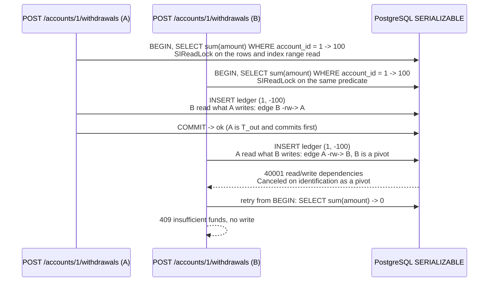

# Isolation Levels in Practice: Read Committed, Repeatable Read, and Serializable Anomalies (Lost Updates, Non-Repeatable Reads, and Write Skew)

> [!summary] Claim
> In PostgreSQL an API handler that reads, decides, and then writes is only correct under `SERIALIZABLE`: the default `READ COMMITTED` re-snapshots every statement and commits lost updates and write skew, `REPEATABLE READ` (snapshot isolation) turns lost updates into SQLSTATE `40001` but still commits write skew, and `SERIALIZABLE` (SSI) aborts one side of the overdraft, which the API must absorb by re-running the whole transaction.

Part of [Database Access and Transactions for APIs](README.md) in [API Engineering](../README.md).

## TL;DR

- Mechanism: PostgreSQL is MVCC; `READ COMMITTED` takes a snapshot per statement and re-checks a concurrently updated row against the newest version (EvalPlanQual), `REPEATABLE READ` takes one snapshot at the first statement and fails a write to a row changed since then with `40001` ("could not serialize access due to concurrent update"), and `SERIALIZABLE` adds non-blocking `SIReadLock` tracking that cancels the pivot of a `T_in -rw-> pivot -rw-> T_out` structure with `40001` ("... due to read/write dependencies among transactions").
- Contract rule: a handler that checks an invariant across rows (`SELECT sum(amount)` then `INSERT`) needs `SERIALIZABLE` on every participating transaction, or a conflict materialized on one row (`UPDATE ... SET balance = balance - :a WHERE balance >= :a`), plus a retry loop that re-runs the reads and the decision, never just the failed statement.
- Trap: `REPEATABLE READ` sounds strong enough, but on real PostgreSQL 18.7 two concurrent `REPEATABLE READ` withdrawals of `900` from accounts holding `500 + 500` both committed, leaving `-400` and `-400`; and one `REPEATABLE READ` participant silently switches SSI off for its `SERIALIZABLE` peer.
- Portability: the lab passes 28 of 28 on the workspace CPython 3.14.6 (rerun in verification), and the drafter's matrix also passed it on 3.12.13, 3.13.18, 3.14.10, 3.15.2, and 3.14.6 free-threaded; level names do not port across engines (MySQL InnoDB `REPEATABLE READ` allows lost updates, Oracle `SERIALIZABLE` is snapshot isolation, SQLite is serializable by allowing one writer and returns `SQLITE_BUSY_SNAPSHOT`).
- When not to use it: do not make `SERIALIZABLE` the fix for single-row read-modify-write that one atomic `UPDATE` expresses, for read replicas (not available on hot standby), or for long scans over badly clustered tables, where predicate locks promote to relation level and abort unrelated transactions.

## Mental model



Both requests read the ledger before either writes, which is exactly the window that `READ COMMITTED` and `REPEATABLE READ` leave open: each transaction's check is true in its own snapshot, the two inserts touch different rows, so no row lock or first-updater rule ever sees a conflict, and the account ends at `-100`.
Under `SERIALIZABLE`, each read leaves a non-blocking `SIReadLock`, each write that lands inside another transaction's read set records a read-write antidependency edge, and two edges in opposite directions make a cycle whose apparent serial order is impossible.
PostgreSQL waits until one member commits (`A`, which becomes `T_out`), then cancels the remaining pivot (`B`) with SQLSTATE `40001`, at its write or at its commit depending on when the structure becomes visible.
On 18.7, in the diagram's order (`A` commits before `B` inserts), `B` failed at its `INSERT` with `Reason code: Canceled on identification as a pivot, during write.`; when both inserted before `A` committed, `B` failed at `COMMIT` with `... during commit attempt.` (measured).
The API's retry loop starts `B` over from `BEGIN`, so the balance check re-reads the ledger, sees `0`, and returns `409` instead of a second `201`.

## How it works

### Phenomena, anomalies, and why the ANSI table is not enough

ANSI SQL-92 defined isolation by three forbidden phenomena: dirty read (P1), fuzzy or non-repeatable read (P2), and phantom (P3) (Berenson et al., MSR-TR-95-51, Section 2.2).
Berenson, Bernstein, Gray, Melton, O'Neil, and O'Neil showed in 1995 that the English text admits a strict reading (A1, A2, A3: an anomaly actually happened) and a broad reading (P1, P2, P3: something anomalous might happen) (Section 2.2), and that only the broad reading forbids histories such as H1, `r1[x=50]w1[x=10]r2[x=10]r2[y=50]c2 r1[y=50]w1[y=90]c1`, where a reader sees a transfer half done (Section 3; Remark 4 concludes "The correct interpretations are the Broad ones").
They added P0 dirty write, `w1[x]...w2[x]...(c1 or a1)`, which every real level forbids because without it "the system can't undo updates by restoring before images" (Section 3, Remark 3).
They defined the API-relevant anomalies in Section 4: P4 lost update, `r1[x]...w2[x]...w1[x]...c1`, with history H4 `r1[x=100] r2[x=100] w2[x=120] c2 w1[x=130] c1` that keeps only `T1`'s `+30` (Section 4.1); A5A read skew, `r1[x]...w2[x]...w2[y]...c2...r1[y]...(c1 or a1)`; and A5B write skew, `r1[x]...r2[y]...w1[y]...w2[x]...(c1 and c2 occur)`, illustrated by a bank whose "account balances are allowed to go negative as long as the sum of commonly held balances remains non-negative" (Section 4.2).
Section 4.2 also defines Snapshot Isolation: reads come from the snapshot at the transaction's Start-Timestamp, and a transaction commits only if no transaction that committed inside its interval wrote data it also wrote ("First-committer-wins"), which prevents P4.
Remark 9 states `REPEATABLE READ >><< Snapshot Isolation` (the paper prints guillemets; written here in ASCII): locking `REPEATABLE READ` forbids write skew but allows phantoms, snapshot isolation does the opposite, so neither is stronger.
Adya's graph formalism, as tabulated by Kleppmann's Hermitage test suite, renames the same anomalies: P4 lost update, G-single (read skew), and G2-item (write skew on disjoint read) (https://github.com/ept/hermitage).

### What PostgreSQL implements

PostgreSQL accepts all four standard names but implements three levels: "PostgreSQL's Read Uncommitted mode behaves like Read Committed" (PostgreSQL 18 Section 13.2).
Its Table 13.1 marks dirty reads "Allowed, but not in PG" for `READ UNCOMMITTED` and phantoms "Allowed, but not in PG" for `REPEATABLE READ`, and adds a fourth column, serialization anomaly, defined as "The result of successfully committing a group of transactions is inconsistent with all possible orderings of running those transactions one at a time", which only `SERIALIZABLE` excludes.
`BEGIN ISOLATION LEVEL READ UNCOMMITTED` on PostgreSQL 18.7 still reports `read uncommitted` from `SHOW transaction_isolation` (measured), so introspection tells you what was requested, not what runs.
The level must be set before the first query: after `SELECT 1`, `SET TRANSACTION ISOLATION LEVEL SERIALIZABLE` fails with SQLSTATE `25001` and "SET TRANSACTION ISOLATION LEVEL must be called before any query" (measured on 18.7; the rule is in the `SET TRANSACTION` reference page).
The SQL standard default is `SERIALIZABLE`, while "In PostgreSQL the default is ordinarily `READ COMMITTED`" (`SET TRANSACTION`, Compatibility), and a fresh 18.7 cluster reports `read committed`.

### Read Committed: a new snapshot per statement, EvalPlanQual on write

"A `SELECT` query sees a snapshot of the database as of the instant the query begins to run", so "two successive `SELECT` commands can see different data" inside one transaction (Section 13.2.1); that is the non-repeatable read and the phantom, both measured on 18.7: after a concurrent autocommit `UPDATE` and an `INSERT` of two matching rows, a `READ COMMITTED` reader saw `balance 100 -> 0` and `count(*) WHERE id >= 2` go `1 -> 3`, while a `REPEATABLE READ` reader saw `100 -> 100` and `1 -> 1`.
Writes start the same way, but a target row that a concurrent transaction has updated makes the writer wait for that transaction; if it rolls back the writer proceeds, and if it commits the writer re-evaluates its `WHERE` clause against the updated version and applies its operation to that version (Section 13.2.1).
The executor names this re-check "EvalPlanQual (READ COMMITTED Update Checking)": for `UPDATE`, `DELETE`, and `MERGE` "it is not cool to modify or delete a tuple that's been modified by an open or concurrently-committed transaction", so "If we are running in SERIALIZABLE isolation level then we just raise an error" while "In READ COMMITTED isolation level, we must work a lot harder" (PostgreSQL REL_18_STABLE src/backend/executor/README, EvalPlanQual); the manual's own example is `UPDATE website SET hits = hits + 1` racing `DELETE FROM website WHERE hits = 10`, where the delete affects nothing because the row that was `9` never matched the delete's snapshot and the row that was `10` is `11` when re-checked.
On 18.7 that schedule returned `DELETE 0` and left rows `(1, 10), (2, 11)` (measured).
The consequence for APIs is a sharp line between two spellings of the same intent:
- `UPDATE acct SET balance = balance + 20` (computed by the database) waits, re-reads the committed `110`, and writes `130`: no update is lost (measured, `final=130`).
- `SELECT balance` in Python, then `UPDATE acct SET balance = :new` with `:new = 100 + 20` (computed by the application) overwrites the committed `110` with `120`: the lost update P4 (measured, `final=120`).
- A guarded write, `UPDATE acct SET balance = balance - 100 WHERE id = 1 AND balance >= 100`, blocked behind a concurrent withdrawal and then returned `UPDATE 0` after re-checking `0 >= 100` (measured), which is the cheapest correct overdraft guard on a single row.
The manual's verdict is that this behavior "makes Read Committed mode unsuitable for commands that involve complex search conditions" (Section 13.2.1), and Section 13.4 adds that business rules are "very difficult to enforce" under it because "even a single statement may not restrict itself to the statement's snapshot if a write conflict occurs".

### Repeatable Read: snapshot isolation with first-updater-wins

A `REPEATABLE READ` transaction "sees a snapshot as of the start of the first non-transaction-control statement in the transaction", and the level "is implemented using a technique known in academic database literature ... as Snapshot Isolation" (Section 13.2.2).
The snapshot is frozen by the first `SELECT`, `INSERT`, `UPDATE`, `DELETE`, or `MERGE`, so a lock taken before that statement (the manual's example is "A `SHARE` mode (or higher) lock", for instance from `LOCK TABLE`) is in force before the snapshot exists (Section 13.4.2).
On write, PostgreSQL does not wait for commit time as Berenson's first-committer-wins does: the second updater blocks on the row lock and then fails if, and only if, the first updater commits.
Measured on 18.7: with the first updater committing, the blocked `UPDATE acct SET balance = balance + 20` failed with `40001` "could not serialize access due to concurrent update"; with the first updater rolling back, the same statement proceeded and the row ended at `120`.
That message is the manual's own, followed by the instruction to "abort the current transaction and retry the whole transaction from the beginning" (Section 13.2.2).
Lost updates are therefore impossible: the application-computed write from the previous section raised `40001` under both `REPEATABLE READ` and `SERIALIZABLE` and left `110` (measured).
Write skew is not prevented, because two transactions that update different rows never meet at a row lock: the PostgreSQL wiki's overdraft example (accounts `500` and `500`, two withdrawals of `900` from different accounts) committed both under `REPEATABLE READ` on 18.7 and left `-400` and `-400` (measured).
Read-only transactions are not safe either: the manual warns that a read-only `REPEATABLE READ` transaction "may see a control record updated to show that a batch has been completed but not see one of the detail records which is logically part of the batch" (Section 13.2.2).
The wiki's "Deposit Report" schedule reproduced it on 18.7: the report counted `3` receipts in closed batch `1`, and the batch ended with `4` (measured).
Jepsen's PostgreSQL 12.3 analysis makes the naming point explicitly: PostgreSQL's "repeatable read" is snapshot isolation and allows G2-item, which formalizations of repeatable read prohibit (https://jepsen.io/analyses/postgresql-12.3).
Before PostgreSQL 9.1, `SERIALIZABLE` meant exactly this snapshot isolation, and the manual says to request `REPEATABLE READ` to keep that legacy behavior (Section 13.2.2).

### Serializable: SSI, SIRead locks, and the dangerous structure

`SERIALIZABLE` is "just Repeatable Read transactions which add nonblocking monitoring for dangerous patterns of read/write conflicts" (Section 13.4).
Every read by a serializable transaction leaves a predicate lock, visible in `pg_locks` with mode `SIReadLock`; these "do not cause any blocking and therefore can not play any part in causing a deadlock" (Section 13.2.3).
When a write lands on data covered by another concurrent serializable transaction's `SIReadLock`, or a read skips a version written by a concurrent serializable transaction, the engine records a read-write antidependency `reader -rw-> writer`.
The theory is Theorem 1 of Fekete et al. as restated by Ports and Grittner: "Every cycle in the serialization history graph contains a sequence of edges T1 -rw-> T2 -rw-> T3 where each edge is a rw-antidependency. Furthermore, T3 must be the first transaction in the cycle to commit" (Ports and Grittner, PVLDB 5(12) 2012, Section 3.2), with Corollary 2 adding that the two edges join concurrent transactions, and the note after it that "T1 and T3 may refer to the same transaction, for cycles of length 2", which is the two-transaction write skew.
Cahill's SSI checks for that "dangerous structure" instead of testing the whole graph for cycles: "If any transaction has both an incoming rw-antidependency and an outgoing one, SSI aborts one of the transactions involved", which guarantees serializability but admits false positives because not every dangerous structure is part of a cycle (Section 3.3).
PostgreSQL's implementation only acts once `T3` (`T_out` here) has committed first, and read-only transactions can often prove at start that they need no predicate locks (Section 13.2.3).
The PostgreSQL wiki states the operational rule: "We wait for a successful COMMIT of one of the transactions before we roll anything back", so the first committer wins and an immediate retry of the victim can succeed (https://wiki.postgresql.org/wiki/SSI).
All of these were measured on 18.7:
- Overdraft (two `UPDATE`s on different accounts after reading the sum): `a` committed, `b` failed at `COMMIT` with `40001`, message "could not serialize access due to read/write dependencies among transactions", `DETAIL: Reason code: Canceled on identification as a pivot, during commit attempt.`, and `HINT: The transaction might succeed if retried.`
- Ledger inserts (the lab's shape, `SELECT sum(amount) ... WHERE account_id = 1` then `INSERT`): same failure, and `pg_locks` showed `SIReadLock` rows of locktype `page` on the index `ledger_account_id_idx` and `tuple` on `ledger` for each transaction.
- Deposit Report: the read-only report committed, and the receipt insert `T1` failed at commit as the pivot (`T3 -rw-> T1 -rw-> T2`, with `T2` committed first), so batch `1` stayed at `3` receipts, matching the report.
- Check-then-insert of a primary key (`SELECT count(*) ... WHERE code = 'X'` returned `0` in both transactions, then both `INSERT`): the second `INSERT` blocked on the first, then failed with `40001` and "Canceled on identification as a pivot, during write." rather than `23505`; under `READ COMMITTED` the same schedule produced `23505` `duplicate key value violates unique constraint "invite_pkey"`.
- Mixed levels: with one side `SERIALIZABLE` and the other `REPEATABLE READ`, in either order, both overdraft withdrawals committed and left `-400` and `-400`, because conflicts are tracked only among serializable transactions; the manual's guarantee is stated for "any set of successfully committed concurrent Serializable transactions" (Section 13.2.3), and Section 13.4.1 suggests `default_transaction_isolation = serializable` and trigger checks so that no other level is used "inadvertently or to subvert integrity checks".
`SERIALIZABLE READ ONLY DEFERRABLE` "may block when first acquiring its snapshot, after which it is able to run without the normal overhead of a `SERIALIZABLE` transaction and without any risk of contributing to or being canceled by a serialization failure", which is the right mode for reports (PostgreSQL 18 `SET TRANSACTION` reference page).
The guarantee does not extend to replicas: "The Serializable transaction isolation level is not yet available in hot standby" (PostgreSQL 18 Section 26.4.5), and the attempt fails with `0A000` "cannot use serializable mode in a hot standby" and the hint "You can use REPEATABLE READ instead." (PostgreSQL REL_18_STABLE src/backend/commands/variable.c, check_transaction_isolation); and Section 13.4.1 warns that the protection "does not yet extend to hot standby mode ... or logical replicas", recommending `REPEATABLE READ` plus explicit locking on the primary for those deployments.
SSI itself had a correctness bug from its 2011 introduction until 2020: Jepsen's analysis published 2020-06-12 found G2-item under `SERIALIZABLE` on PostgreSQL 12.3 (six cases in a two-minute run), caused by attributing a tuple's creation to the updating transaction's XID, confirmed in 9.5.22, 10.13, 11.8, 12.3, and 13, with the fix "presently scheduled for August 13th" in the next minor releases (https://jepsen.io/analyses/postgresql-12.3).
The cost of SSI over plain snapshot isolation, as measured by its authors on PostgreSQL 9.1-era hardware: 10-20% CPU overhead on the SIBENCH microbenchmark, a 5% slowdown on in-memory DBT-2++, a serialization failure rate under 0.25% on disk-bound DBT-2++, and on RUBiS 422 req/s with 0.03% failures for SSI versus 435 req/s with 0.004% for snapshot isolation and 208 req/s with 0.76% for strict two-phase locking (Ports and Grittner, Sections 8.1 to 8.3).

### Predicate lock granularity and false positives

SSI is conservative: a lock covers a tuple, a page, or a whole relation, and coarse locks report conflicts that a row-precise checker would not.
`max_pred_locks_per_page` (default `2`) promotes tuple locks to a page lock, and `max_pred_locks_per_relation` (default `-2`, meaning `max_pred_locks_per_transaction` `64` divided by `2`, so `32`) promotes page locks to a relation lock (PostgreSQL 18 Section 19.12).
A sequential scan "will always necessitate a relation-level predicate lock" (Section 13.2.3), so the planner choice decides the abort rate.
Measured on 18.7 with a `ledger` table of 10,000 rows over 55 heap pages, an index on `account_id`, and two serializable transactions that each read one account and insert one row for that account:
- Rows inserted as `g % 100` (each account's 100 rows spread over every heap page): an index scan for account `1` took `1` page lock and `1` relation lock, and the transaction for unrelated account `99` failed with `40001`.
- Rows inserted ordered by account (clustered): the same read took `3` page locks, and accounts `1` and `99` both committed.
- Clustered, but adjacent accounts `1` and `2`: `40001`, because both reads locked the same B-tree leaf page (`pg_locks` showed index page `1` for both; account `99` locked index page `10`), so each insert lands on a page the other transaction locked.
The manual lists the remedies: declare transactions `READ ONLY`, keep them short, avoid idle-in-transaction connections, use a connection pool to bound concurrency, raise the `max_pred_locks_*` settings, and steer plans away from sequential scans (Section 13.2.3).
The lab's model tracks rows and key prefixes exactly, so it reproduces none of these false positives; that difference is deliberate and is the reason the numbers above come from a real server.

### Other engines use the same names for different guarantees

- MySQL InnoDB defaults to `REPEATABLE READ`, where plain `SELECT`s read "the snapshot established by the first read", but the snapshot "applies to SELECT statements within a transaction, not necessarily to DML statements": an `UPDATE` can affect rows committed after the snapshot that a `SELECT COUNT` in the same transaction could not see (MySQL 8.4 Sections 17.7.2.1 and 17.7.2.3).
  Hermitage classifies InnoDB `REPEATABLE READ` as "monotonic atomic view": it prevents G0, G1a, G1b, G1c, and OTV, prevents PMP and G-single only for read-only transactions, and does not prevent P4, G2-item, or G2, so lost update (P4) is possible, unlike PostgreSQL's `REPEATABLE READ`.
- InnoDB `SERIALIZABLE` "implicitly converts all plain `SELECT` statements to `SELECT ... FOR SHARE` if `autocommit` is disabled", so it is lock-based and blocks where PostgreSQL aborts; `READ COMMITTED` uses a "semi-consistent" read for `UPDATE`, returning the latest committed version to decide whether the row matches (MySQL 8.4 Section 17.7.2.1).
- Hermitage classifies Oracle's `SERIALIZABLE` as snapshot isolation and SQL Server's `SNAPSHOT` as snapshot isolation, while SQL Server's locking `REPEATABLE READ` prevents P4 and G2-item (https://github.com/ept/hermitage, results for the versions tested there).
- SQLite: "all transactions in SQLite show 'serializable' isolation", achieved with one writer at a time; in WAL mode readers see a snapshot, and a read transaction that tries to write after another connection committed fails with `SQLITE_BUSY_SNAPSHOT` because "If X were allowed to write, it would fork the history of the database file" (https://www.sqlite.org/isolation.html).
  `SQLITE_BUSY_SNAPSHOT` is extended code `517` (https://www.sqlite.org/rescode.html); the lab's real-SQLite test gets it in the overdraft schedule, and in a one-off probe it returned in `0.0 ms` despite a `2.0 s` busy timeout, because waiting cannot make a stale snapshot current.

### The driver and SQLAlchemy layer

`create_engine(url, isolation_level="SERIALIZABLE")` applies a level to every pooled connection on connect, and `Connection.execution_options(isolation_level=...)` applies one to a single checkout.
`DefaultDialect._assert_and_set_isolation_level` normalizes the value with `level.replace("_", " ").upper()` and raises `ArgumentError("Invalid value ... for isolation_level. Valid isolation levels for ... are ...")` for names the dialect does not list `(sqlalchemy 2.1.8 lib/sqlalchemy/engine/default.py, DefaultDialect._assert_and_set_isolation_level)`.
`DefaultDialect._set_connection_characteristics` refuses a change inside a transaction with `InvalidRequestError` ("This connection has already initialized a SQLAlchemy Transaction() object via begin() or autobegin; isolation_level may not be altered unless rollback() or commit() is called first.") and appends `_reset_characteristics` to the pool record's `finalize_callback`, so the level is reverted when the connection is returned `(sqlalchemy 2.1.8 lib/sqlalchemy/engine/default.py, DefaultDialect._set_connection_characteristics)`; the lab asserts all three behaviors on SQLite.
How the level reaches PostgreSQL depends on the driver:
- The generic PostgreSQL dialect runs `SET SESSION CHARACTERISTICS AS TRANSACTION ISOLATION LEVEL {level}` followed by `COMMIT` `(sqlalchemy 2.1.8 lib/sqlalchemy/dialects/postgresql/base.py, PGDialect.set_isolation_level)`.
- `postgresql+psycopg` sets `connection.autocommit` and `connection.isolation_level` on the psycopg connection `(sqlalchemy 2.1.8 lib/sqlalchemy/dialects/postgresql/psycopg.py, PGDialect_psycopg.set_isolation_level)`.
- `postgresql+asyncpg` maps the name through `_isolation_lookup` (`AUTOCOMMIT`, `READ COMMITTED`, `REPEATABLE READ`, `SERIALIZABLE`; no `READ UNCOMMITTED`) and passes it as `isolation=` to `asyncpg`'s `connection.transaction(...)` at the next `BEGIN` `(sqlalchemy 2.1.8 lib/sqlalchemy/dialects/postgresql/asyncpg.py, AsyncAdapt_asyncpg_connection._start_transaction)`, which appends `ISOLATION LEVEL SERIALIZABLE` and friends to the `BEGIN` text `(asyncpg 0.32.0 asyncpg/transaction.py, Transaction.start)`.
The ORM takes the same option per session through `Session.connection(execution_options={"isolation_level": ...})`, and PostgreSQL's `READ ONLY` and `DEFERRABLE` modes are the `postgresql_readonly` and `postgresql_deferrable` execution options (`sqlalchemy 2.1.8 lib/sqlalchemy/dialects/postgresql/base.py`, module documentation).
The `40001` arrives differently per driver (measured on 18.7 through SQLAlchemy 2.1.8):
- `asyncpg`: `sqlalchemy.exc.DBAPIError` whose `.orig` is `sqlalchemy.dialects.postgresql.asyncpg.AsyncAdapt_asyncpg_dbapi.Error` with `.sqlstate == .pgcode == "40001"` and `__cause__` `asyncpg.exceptions.SerializationError`, because `_asyncpg_error_translate` has no entry for it and it falls through to `PostgresError -> Error`.
- `psycopg`: `sqlalchemy.exc.OperationalError` whose `.orig` is `psycopg.errors.SerializationFailure` with `.sqlstate == "40001"` and `.pgcode` absent (`psycopg 3.3.8 psycopg/errors.py, SerializationFailure`).
The portable test is therefore `getattr(err.orig, "sqlstate", None) in {"40001", "40P01"}`, not an exception class.

### Retrying in an API

The manual is explicit: "It is important to retry the complete transaction, including all logic that decides which SQL to issue and/or which values to use. Therefore, PostgreSQL does not offer an automatic retry facility" (Section 13.5).
It names `40001` (`serialization_failure`) as always safe to retry, `40P01` (`deadlock_detected`) as advisable, and `23505` and `23P01` as sometimes retryable but possibly persistent; it also warns that "multiple retries may be needed" under high contention (Section 13.5).
For an endpoint this means the retry loop wraps a fresh transaction (and, with SQLAlchemy, a fresh `Session` or a `rollback()` first, see [[Request-Scoped-Transaction-Patterns-Commit-As-You-Go-vs-Unit-of-Work]]), re-runs every read, and keeps side effects that cannot be rolled back (emails, outbound HTTP, message publishes) out of the loop or behind a transactional outbox ([[Transactional-Outbox-Pattern-Solving-Dual-Writes-Between-DB-and-Events]]).
Contention costs real attempts: 20 concurrent ledger withdrawals of `10` from a balance of `100` on 18.7 (`SELECT sum(amount)`, a 1 ms sleep, then `INSERT`; one asyncpg pool connection each, loopback, immediate retry without backoff, single run) produced 20 successes and a final balance of `-100` under `READ COMMITTED` and under `REPEATABLE READ`, and 10 successes, 10 `insufficient funds` rejections, a final balance of `0`, 149 total attempts, and one request needing 10 attempts under `SERIALIZABLE` (31 ms wall time).
When the attempt budget runs out, the lab answers `503` with `Retry-After: 1`: RFC 9110 defines `503` as a temporary inability "which will likely be alleviated after some delay" with an optional `Retry-After` (RFC 9110 Section 15.6.4, Section 10.2.3), whereas `409` means "a conflict with the current state of the target resource" the user might resolve (RFC 9110 Section 15.5.10), which the lab reserves for the business outcome "insufficient funds".
A `POST` is not idempotent (RFC 9110 Section 9.2.2 lists only `PUT`, `DELETE`, and the safe methods as idempotent), so a client that retries after a `503` must send an idempotency key if the first attempt could have committed; the server-side loop never has that problem, because a `40001` means the transaction rolled back.

## Numbers and limits

Measured rows were re-run once during verification on 2026-11-15 on an Apple M3 Pro, macOS 27.3 (`uname -r` `27.3.0`), against a throwaway PostgreSQL 18.7 (Homebrew) cluster on `127.0.0.1` with default settings (`initdb`, TCP only), driven by `asyncpg 0.32.0` and SQLAlchemy 2.1.8 on CPython 3.14.6 (a probe script, not part of the lab, deleted after the run).

| Quantity | Value | Source |
|---|---|---|
| PostgreSQL default level | `read committed` (`SHOW transaction_isolation` on a fresh cluster) | measured 2026-11-15; `SET TRANSACTION` Compatibility |
| SQL standard default level | `SERIALIZABLE` | PostgreSQL 18 `SET TRANSACTION`, Compatibility |
| Distinct levels implemented by PostgreSQL | 3 (`READ UNCOMMITTED` behaves as `READ COMMITTED`) | PostgreSQL 18 Section 13.2 |
| Serialization failure SQLSTATE | `40001`, with message "concurrent update" (row conflict) or "read/write dependencies among transactions" (SSI) | PostgreSQL 18 Section 13.5; measured |
| Other retry candidates | `40P01` deadlock, `23505` unique, `23P01` exclusion | PostgreSQL 18 Section 13.5 |
| Changing the level after the first query | SQLSTATE `25001`, "SET TRANSACTION ISOLATION LEVEL must be called before any query" | measured 2026-11-15 |
| `max_pred_locks_per_transaction` | `64` (server start only) | PostgreSQL 18 Section 19.12; `SHOW` on 18.7 |
| `max_pred_locks_per_relation` | `-2`, so `64 / 2 = 32` pages or tuples before a relation lock | PostgreSQL 18 Section 19.12; `SHOW` on 18.7 |
| `max_pred_locks_per_page` | `2` tuples before a page lock | PostgreSQL 18 Section 19.12; `SHOW` on 18.7 |
| `SIReadLock`s for one indexed read of 100 rows over 55 pages | spread rows: 1 page + 1 relation lock; clustered rows: 3 page locks | measured 2026-11-15 |
| Disjoint-account false positive | spread rows: `40001`; clustered, accounts `1` and `99`: none; clustered, accounts `1` and `2`: `40001` | measured 2026-11-15 |
| 20 concurrent withdrawals of `10` from `100`, `READ COMMITTED` | 20 committed, final balance `-100`, 20 attempts, 7 ms | measured 2026-11-15, one run |
| Same, `REPEATABLE READ` | 20 committed, final balance `-100`, 20 attempts, 7 ms | measured 2026-11-15, one run |
| Same, `SERIALIZABLE` with whole-transaction retry | 10 committed, 10 rejected, final `0`, 149 attempts, max 10 for one request, 31 ms | measured 2026-11-15, one run |
| SQLite stale-snapshot write | extended code `517` `SQLITE_BUSY_SNAPSHOT`, returned in `0.0 ms` with a `2.0 s` busy timeout | sqlite.org rescode; one-off probe on SQLite 3.53.1; the lab asserts under 1 s |
| SSI cost versus snapshot isolation (PostgreSQL 9.1, 2012 hardware) | SIBENCH CPU overhead 10-20%; DBT-2++ in-memory 5% slower; RUBiS 422 vs 435 req/s, failures 0.03% vs 0.004% (S2PL: 208 req/s, 0.76%) | Ports and Grittner, PVLDB 2012, Sections 8.1-8.3 |
| Single-packet attack alignment (HTTP/2) | 20-30 requests per packet; for a 20-request batch, median spread 1 ms (sd 0.3 ms) versus 4 ms (sd 3 ms) for HTTP/1.1 last-byte sync | Kettle, PortSwigger Research, 2023-08-09 |
| ACIDRain audit | 12 eCommerce applications, 22 vulnerabilities, over 2M websites | Warszawski and Bailis, SIGMOD 2017 |
| Lab runtime | 28 tests in 1.29 s (workspace CPython 3.14.6, one run) | measured 2026-11-15 |

The contention numbers are a single run on loopback (the drafter's earlier run gave 144 attempts and 27 ms, so treat the attempt count as varying run to run) with a 1 ms `asyncio.sleep` between the read and the write; they show the shape (retries grow with the number of overlapping transactions on one hot predicate), not a benchmark.

## Portability

| Runtime / component | Version / target | Behavior and verification status |
|---|---|---|
| CPython `3.12` | `3.12.13` (`macos-aarch64`) | Drafter's lab run, not re-run in verification (lab matrix paused 2026-11-11): `PYTHONPATH=src uv run --no-project --python 3.12.13 --with "sqlalchemy==2.1.8" --with fastapi==0.162.0 --with starlette==1.10.0 --with pydantic==2.14.3 --with httpx==0.28.1 --with pytest==9.2.0 --with pytest-asyncio==1.4.1.post1 pytest <test> -q`: `28 passed in 1.15s`, SQLite 3.53.1; the contract pin `3.12.16` is not installed here and was not run |
| CPython `3.13` | `3.13.18` (Homebrew) | Drafter's lab run, not re-run in verification (same command: `28 passed in 1.20s`, SQLite 3.54.1) |
| CPython `3.14` | `3.14.6` (workspace venv) and `3.14.10` (Homebrew) | Proven by lab (`uv run --frozen pytest <test> -q` on 3.14.6, re-run in verification: `28 passed in 1.29s`); `--no-project` on 3.14.10: `28 passed in 1.32s` (drafter's run, not re-run) |
| CPython `3.15` (default GIL) | `3.15.2` (Homebrew) | Drafter's lab run, not re-run in verification (`28 passed in 1.29s`, SQLite 3.54.1) |
| CPython `3.14t` (free-threaded) | `3.14.6`, `sys._is_gil_enabled()` is `False` | Drafter's lab run, not re-run in verification (`28 passed in 1.16s`); the model is single-threaded by design, so this proves import and behavior, not thread safety |
| CPython `3.15t` (free-threaded) | `3.15.0b3`; the contract pin `3.15.2t` is not installed | Fails: 27 tests pass, then `test_sqlalchemy_validates_and_scopes_isolation_level` dies with `Fatal Python error: Segmentation fault` in `sqlalchemy/sql/_cache_key_cy` (`BaseHasCacheKey._gen_cache_key`) with greenlet not installed (drafter's run on a beta interpreter, not re-run in verification); no other 3.15 free-threaded build is installed here, so this row makes no claim about `3.15.2t` or about SQLAlchemy's pure-Python fallback |
| SQLAlchemy `2.1.8` vs `2.0.57` | lab on 2.1.8 | Only 2.1.8 was run; the 2.0.57 leg was not run, so no claim is made for it |
| PostgreSQL | `18.7` | Every PostgreSQL behavior in this note was measured on 18.7 and re-measured once in verification; Section numbers are from the 18 manual; the 12.3 SSI bug is cited from Jepsen, not reproduced |
| MySQL InnoDB, Oracle, SQL Server | per vendor docs and Hermitage | Not run; InnoDB behavior cites MySQL 8.4 Sections 17.7.2.1 and 17.7.2.3, Oracle and SQL Server cite Hermitage's tables for the versions it tested |
| SQLite | `3.53.1` (uv CPython builds), `3.54.1` (Homebrew CPython) | `SQLITE_BUSY_SNAPSHOT` (`517`) proven by lab on both |
| Drivers | `asyncpg 0.32.0`, `psycopg 3.3.8` | `40001` wrapping measured on 18.7 through SQLAlchemy 2.1.8 (see How it works); neither driver runs inside the lab |
| ASGI servers (`Uvicorn`, `Hypercorn`, `Granian`) | `0.54.0`, `0.18.0`, `2.8.7` | Not run: the lab uses `httpx.ASGITransport`; isolation is decided inside the database transaction, so the server only frames the `201`, `409`, or `503` (design inference, not a measurement) |
| HTTP/1.1, HTTP/2, HTTP/3 | - | Not run; the anomaly needs two overlapping transactions, which any version can produce, but HTTP/2 multiplexing lets an attacker land 20-30 requests in one packet with a 1 ms median spread (Kettle 2023), so the race window is easier to hit over HTTP/2 |
| Container environments | Debian Trixie, Alpine musl libc | Not run; no claim is made for them |

## Worked example

The lab [implementation](../labs/src/api_labs/f13_database_access_and_transactions_for_apis/isolation_anomalies.py) is a deterministic multiversion store that follows PostgreSQL's rules for the three levels, a FastAPI endpoint `POST /accounts/{account_id}/withdrawals` on top of it, and the [test](../labs/tests/f13_database_access_and_transactions_for_apis/test_transaction_isolation_levels_and_concurrency_anomalies_in_apis.py) drives exact interleavings, two concurrent HTTP requests through an `asyncio.Barrier`, and two real engines (SQLite in WAL mode and SQLAlchemy's isolation API).
Every schedule in the model was first run against PostgreSQL 18.7 (How it works), and the tests assert the same outcomes and error texts; the model omits PostgreSQL's page and relation lock promotion and its read-only optimizations.

The write path: read the row in the statement snapshot, wait on an in-flight writer, then EvalPlanQual under `READ COMMITTED` or first-updater-wins otherwise (excerpt, verbatim lines 170-194 of `isolation_anomalies.py`):

```python
    def _update(self, key: str, compute: Callable[[int], int], where: Callable[[int], bool]) -> int:
        snapshot = self._statement("write")
        versions = self.store.rows[key]
        newest = versions[-1]
        target = self._visible(key, snapshot)
        if target is None or not where(target.value):
            self._note_read(key, snapshot, "write")
            return 0  # not a target row in this statement's snapshot: no wait, no lock
        if newest.xid != self.xid and self.store.txns[newest.xid].status is Status.ACTIVE:
            self.pending_snapshot = snapshot
            raise LockWait(key, newest.xid)
        self._note_read(key, snapshot, "write")
        if target is not newest:
            if self.level is not Level.READ_COMMITTED:
                self.abort_with(CONCURRENT_UPDATE)
            target = newest  # EvalPlanQual: re-check WHERE against the updated version
            if not where(target.value):
                return 0
        new = Version(compute(target.value), self.xid)
        if newest.xid == self.xid:
            versions[-1] = new
        else:
            versions.append(new)
        self._note_write(key, "write")
        return 1
```

SSI: cancel the pivot of `T_in -rw-> pivot -rw-> T_out` once `T_out` has committed, or doom an active pivot so it fails at its next statement or commit (excerpt, verbatim lines 274-314 of `isolation_anomalies.py`):

```python
    def check_dangerous(self, txn: Txn, phase: str) -> None:
        """Abort `txn` (or doom an active pivot) if it closes T_in -rw-> pivot -rw-> T_out."""
        for pivot in [self.txns[x] for x in sorted(self._pivots_around(txn))]:
            for out_xid in sorted(pivot.out_conflicts):
                t_out = self.txns[out_xid]
                if t_out.commit_seq is None:
                    continue  # SSI only acts once T_out has committed first
                for in_xid in sorted(pivot.in_conflicts):
                    t_in = self.txns[in_xid]
                    if not self._out_committed_first(t_out.commit_seq, pivot, t_in):
                        continue
                    if pivot is txn:
                        txn.abort_with(
                            RW_DEPENDENCIES,
                            f"Canceled on identification as a pivot, during {phase}.",
                        )
                    if pivot.status is Status.ACTIVE:
                        pivot.doomed = True  # fails at its next statement or commit
                    elif txn is t_in:
                        txn.abort_with(
                            RW_DEPENDENCIES,
                            f"Canceled on conflict out to pivot {pivot.xid}, during {phase}.",
                        )

    def _pivots_around(self, txn: Txn) -> set[int]:
        candidates = {txn.xid} | txn.out_conflicts | txn.in_conflicts
        return {
            x
            for x in candidates
            if self.txns[x].status is not Status.ABORTED
            and self.txns[x].in_conflicts
            and self.txns[x].out_conflicts
        }

    @staticmethod
    def _out_committed_first(out_seq: int, pivot: Txn, t_in: Txn) -> bool:
        if pivot.status is Status.ABORTED or t_in.status is Status.ABORTED:
            return False
        pivot_later = pivot.commit_seq is None or pivot.commit_seq > out_seq
        in_later = t_in.commit_seq is None or t_in.commit_seq >= out_seq  # T_in may be T_out
        return pivot_later and in_later
```

The endpoint's transaction body and its retry loop, which re-runs the read and the decision on every attempt (excerpt, verbatim lines 360-396 of `isolation_anomalies.py`):

```python
async def _check_then_insert(bank: Bank, txn: Txn, account_id: int, amount: int, n: int) -> int:
    balance = sum(txn.scan(ledger_prefix(account_id)).values())
    await _pause(bank, n)
    if balance < amount:
        raise InsufficientFunds
    txn.insert(ledger_prefix(account_id), -amount)
    return balance - amount


async def _guarded_update(bank: Bank, txn: Txn, account_id: int, amount: int, n: int) -> int:
    key = account_key(account_id)
    txn.read(key)  # e.g. load the account for validation; fixes the RR snapshot here
    await _pause(bank, n)
    if txn.update_where(key, -amount, lambda balance: balance >= amount) == 0:
        raise InsufficientFunds
    after = txn.read(key)
    if after is None:
        raise LookupError(key)
    return after


async def withdraw(bank: Bank, account_id: int, amount: int, strategy: Strategy) -> tuple[int, int]:
    """Run the whole transaction, decision logic included, retrying only on SQLSTATE 40001."""
    body = _check_then_insert if strategy is Strategy.CHECK_THEN_INSERT else _guarded_update
    for attempt in range(1, bank.max_attempts + 1):
        txn = bank.store.begin(bank.level)
        try:
            balance = await body(bank, txn, account_id, amount, attempt)
            txn.commit()
        except SerializationFailure:
            bank.serialization_failures += 1
            continue  # already rolled back; re-read everything on the next attempt
        except BaseException:
            txn.rollback()
            raise
        return balance, attempt
    raise RetriesExhausted(bank.max_attempts)
```

The overdraft schedule from the mental model, and the assertion that `SERIALIZABLE` cancels the pivot exactly as PostgreSQL 18.7 did (excerpt, verbatim lines 170-206 of the test):

```python
def overdraft_schedule(level: Level) -> tuple[Store, list[str]]:
    """Two withdrawals each check sum(ledger) >= 100, then each inserts -100 (ACIDRain Fig. 1)."""
    store = Store()
    store.seed({"ledger:1:000000": 100})
    a, b = store.begin(level), store.begin(level)
    log: list[str] = []
    for name, txn in (("a", a), ("b", b)):
        log.append(f"{name} sees {sum(txn.scan('ledger:1:').values())}")
    a.insert("ledger:1:", -100)
    b.insert("ledger:1:", -100)
    for name, txn in (("a", a), ("b", b)):
        try:
            txn.commit()
            log.append(f"{name} committed")
        except SerializationFailure as exc:
            log.append(f"{name} {exc.sqlstate}: {exc.detail}")
    return store, log


@pytest.mark.unit
@pytest.mark.parametrize("level", [RC, RR])
def test_write_skew_overdraft_commits_below_serializable(level: Level) -> None:
    store, log = overdraft_schedule(level)
    assert log == ["a sees 100", "b sees 100", "a committed", "b committed"]
    assert balance_of(store) == -100


@pytest.mark.unit
def test_serializable_cancels_the_pivot_at_commit() -> None:
    store, log = overdraft_schedule(SER)
    assert log == [
        "a sees 100",
        "b sees 100",
        "a committed",
        "b 40001: Canceled on identification as a pivot, during commit attempt.",
    ]
    assert balance_of(store) == 0
```

Two concurrent HTTP requests, both forced to read before either writes on their first attempt (excerpt, verbatim lines 268-313 of the test):

```python
async def two_concurrent_withdrawals(
    bank: Bank, strategy: str = "check-then-insert"
) -> list[httpx.Response]:
    barrier = asyncio.Barrier(2)

    async def interleave(attempt: int) -> None:
        if attempt == 1:  # both requests read before either writes; retries run alone
            await barrier.wait()

    bank.interleave = interleave
    transport = httpx.ASGITransport(app=build_app(bank))
    async with httpx.AsyncClient(transport=transport, base_url="http://test") as client:
        url = f"/accounts/1/withdrawals?strategy={strategy}"
        responses = await asyncio.gather(
            client.post(url, json={"amount": 100}), client.post(url, json={"amount": 100})
        )
    return sorted(responses, key=lambda r: r.status_code)


@pytest.mark.unit
@pytest.mark.asyncio
@pytest.mark.parametrize("level", [RC, RR])
async def test_api_check_then_insert_overdraws_below_serializable(level: Level) -> None:
    store = Store()
    store.seed({"ledger:1:000000": 100})
    bank = Bank(store, level)
    responses = await two_concurrent_withdrawals(bank)
    assert [r.status_code for r in responses] == [201, 201]
    assert [r.json() for r in responses] == [{"balance": 0, "attempts": 1}] * 2
    assert balance_of(store) == -100
    assert bank.serialization_failures == 0


@pytest.mark.unit
@pytest.mark.asyncio
async def test_api_serializable_retry_turns_overdraft_into_409() -> None:
    store = Store()
    store.seed({"ledger:1:000000": 100})
    bank = Bank(store, SER)
    ok, rejected = await two_concurrent_withdrawals(bank)
    assert ok.status_code == 201
    assert ok.json() == {"balance": 0, "attempts": 1}
    assert rejected.status_code == 409
    assert rejected.json() == {"detail": "insufficient funds"}
    assert bank.serialization_failures == 1  # the loser re-ran its read and saw 0
    assert balance_of(store) == 0
```

Run from `labs/` on CPython 3.14.6, macOS 27.3 (arm64), SQLAlchemy 2.1.8, SQLite 3.53.1, with `uv run --frozen pytest tests/f13_database_access_and_transactions_for_apis/test_transaction_isolation_levels_and_concurrency_anomalies_in_apis.py -q`:

```text
............................                                             [100%]
28 passed in 1.29s
```

The 28 cases cover: non-repeatable reads and phantoms per level (5), the application-computed lost update under `READ COMMITTED` (1), first-updater-wins `40001` under `REPEATABLE READ` and `SERIALIZABLE` (2), the in-database increment that waits and re-evaluates (1), the `REPEATABLE READ` waiter that fails only if the blocker commits (2), the manual's `website` EvalPlanQual example (1), write skew committing under `READ COMMITTED` and `REPEATABLE READ` (2), the pivot cancellation (1), no false positive for serial execution (1), mixed levels disabling SSI (2), the read-only Deposit Report anomaly (2), the API under each level and strategy (6), real SQLite `SQLITE_BUSY_SNAPSHOT` (1), and SQLAlchemy's isolation-level validation, mid-transaction refusal, and reset on pool return (1).

## Pitfalls

> [!warning] Check-then-act in the default isolation level
> - Trigger: an endpoint that runs `SELECT balance` (or `SELECT sum(...)`, or `SELECT count(*)` for a quota, a coupon, or stock) and then writes based on the result, under PostgreSQL's default `READ COMMITTED`.
> - Symptom: concurrent requests each pass the check and each write, so balances go negative, gift cards are spent twice, and stock goes below zero; nothing errors.
> - Fix: express the invariant in one guarded statement (`UPDATE ... SET balance = balance - :a WHERE id = :id AND balance >= :a` and check `rowcount`), lock the row the decision depends on (`SELECT ... FOR UPDATE`, see [[Optimistic-vs-Pessimistic-Locking-Version-ID-Col-and-FOR-UPDATE-SKIP-LOCKED]]), or run the whole flow under `SERIALIZABLE` with a retry loop.
> - Source: the Flexcoin exchange lost all its stored bitcoins on 2014-03-02 to thousands of simultaneous transfer requests that moved coins "until the sending account was overdrawn, before balances were updated" and then shut down, as quoted in Warszawski and Bailis, "ACIDRain", SIGMOD 2017, Section 1; the same paper found 22 such vulnerabilities in 12 eCommerce applications, including unlimited gift-card spending in Magento, OpenCart, and Oscar.

> [!warning] Treating `REPEATABLE READ` as serializable
> - Trigger: moving an overdraft-prone flow from `READ COMMITTED` to `REPEATABLE READ` because it "prevents anomalies", when the invariant spans rows (a ledger sum, an on-call roster, a set of bookings).
> - Symptom: lost updates now raise `40001`, so tests that hammer one row pass, but write skew still commits (`-400` and `-400` on 18.7), and read-only reports can see closed batches without their last rows.
> - Fix: use `SERIALIZABLE` for multi-row invariants, or materialize the conflict on one row that every participant updates; on MySQL InnoDB, remember that `REPEATABLE READ` does not even prevent lost updates.
> - Source: PostgreSQL 18 Section 13.2.2; Berenson et al. Remark 9; Hermitage's InnoDB row; Jepsen's PostgreSQL 12.3 analysis on the naming.

> [!warning] Retrying the statement, or retrying inside a dead session
> - Trigger: a `tenacity` or `stamina` decorator around a single `session.execute()`, or a retry loop that reuses a `Session` whose transaction failed.
> - Symptom: the retried statement runs with stale values computed before the conflict, or SQLAlchemy raises `PendingRollbackError` on every attempt.
> - Fix: retry the whole unit of work, decision logic included, in a new transaction (new `Session` or `rollback()` first), only on `sqlstate` `40001` (and `40P01`), with a bounded attempt count and jitter, and keep non-transactional side effects out of the loop.
> - Source: PostgreSQL 18 Section 13.5 ("retry the complete transaction, including all logic that decides which SQL to issue"); the lab's `withdraw` loop.

> [!warning] One weaker participant silently disables SSI
> - Trigger: most code paths run `SERIALIZABLE`, but a batch job, an admin endpoint, or a second service connects with the default level or `REPEATABLE READ` and writes the same tables.
> - Symptom: the serializable side never gets `40001`, and the invariant breaks exactly when the weaker writer is involved (both overdraft withdrawals committed on 18.7 with one side at `REPEATABLE READ`).
> - Fix: set `default_transaction_isolation = serializable` per database or role (`ALTER DATABASE ... SET`), and assert `current_setting('transaction_isolation')` in a trigger on invariant-bearing tables, as Section 13.4.1 suggests.
> - Source: PostgreSQL 18 Section 13.4.1; lab `test_one_non_serializable_participant_disables_ssi`.

> [!warning] False-positive storms from coarse predicate locks
> - Trigger: `SERIALIZABLE` reads that use sequential scans, or index scans over rows scattered across more than `32` pages, or hot keys that share B-tree leaf pages.
> - Symptom: transactions on unrelated accounts abort each other with `40001`, retries multiply, and p99 latency climbs under load even though no business conflict exists.
> - Fix: index the predicate columns, cluster or partition hot data, keep serializable transactions short and `READ ONLY` where possible, raise `max_pred_locks_per_transaction` / `max_pred_locks_per_relation`, and monitor the `40001` rate per endpoint.
> - Source: PostgreSQL 18 Sections 13.2.3 and 19.12; the 18.7 measurements in "Predicate lock granularity and false positives".

> [!warning] `SERIALIZABLE` on a read replica
> - Trigger: routing read-heavy serializable transactions to a hot standby, or relying on serializable reads from a logical replica.
> - Symptom: setting the level on the standby fails with "cannot use serializable mode in a hot standby" (`0A000`), and reads from a logical replica carry no serializability guarantee relative to the primary.
> - Fix: run serializable work on the primary, use `REPEATABLE READ` plus explicit locking where replicas are involved, or use `SERIALIZABLE READ ONLY DEFERRABLE` on the primary for consistent reports.
> - Source: PostgreSQL 18 Sections 26.4.5 and 13.4.1; PostgreSQL REL_18_STABLE src/backend/commands/variable.c, check_transaction_isolation.

> [!warning] Running an unpatched SSI
> - Trigger: relying on `SERIALIZABLE` on a PostgreSQL release that predates the August 2020 minor releases.
> - Symptom: rare G2-item anomalies under `SERIALIZABLE` involving freshly inserted rows (six in a two-minute Jepsen run).
> - Fix: stay on supported minor releases; isolation is part of the database's correctness surface, not just its performance surface.
> - Source: https://jepsen.io/analyses/postgresql-12.3.

## Security and robustness

- Threat model: ACIDRain defines an attack as "an exploit allowing an attacker to elicit undesirable application behavior by issuing concurrent requests to trigger non-serializable access to database-managed state", needing only the public API (Warszawski and Bailis, Section 2); it separates level-based anomalies (the database runs below serializable) from scope-based anomalies (the application spreads one logical operation over several transactions), and 17 of its 22 vulnerabilities were scope-based and survive even `SERIALIZABLE`.
- Attack amplification: PortSwigger's single-packet attack aligns 20-30 HTTP/2 requests within about 1 ms at the server regardless of network jitter, and lists "Withdrawing or transferring cash in excess of your account balance" as a limit-overrun target (Kettle, 2023), so "the window is only a few milliseconds" is not a defense.
- OWASP API6:2023 Unrestricted Access to Sensitive Business Flows covers the automation that drives these races (buying all stock, scripted registrations); rate limits and bot detection reduce the request rate but do not close a race that two requests can win, so the database invariant must hold on its own.
- Make the transaction scope the business operation: one request -> one transaction for the whole check-and-act, never a read in one transaction and a write in another, and never an autocommit `SELECT` followed by a separate `UPDATE`.
- Defense in depth: back each invariant with a constraint the database enforces regardless of isolation where one exists (`CHECK (balance >= 0)` on a materialized balance, `UNIQUE` on redemption codes, `EXCLUDE` for overlapping bookings), so a missed level degrades into a constraint error instead of corrupted money.
- Error hygiene: map `40001` after exhausted retries to `503` with `Retry-After`, never echo the `DETAIL` text (it names transaction ids and internal structure) to clients, and log the endpoint, attempt count, and SQLSTATE so a retry storm is visible.
- Idempotency: a `POST` that commits but whose response is lost will be retried by clients; pair isolation with idempotency keys so the second request returns the first result instead of a second withdrawal.

## The principal's view

The decision is which invariants the database must protect and at what granularity, and the default should be explicit rather than inherited: either every write path to a table runs `SERIALIZABLE` with a shared retry wrapper, or every cross-row invariant is materialized into a single-row guarded `UPDATE` or a constraint and the service runs `READ COMMITTED`.
`SERIALIZABLE` buys the strongest property with the least reasoning per endpoint (a transaction shown correct when run alone stays correct in any mix of serializable transactions, or fails to commit, Section 13.2.3), and its costs are operational: a retry loop that must be idempotent and side-effect free, a `40001` rate that grows with contention and with plan quality, no serializable reads on hot standbys, and a requirement that no other level ever writes those tables.
Materialized conflicts (`UPDATE ... WHERE balance >= :a`, `SELECT ... FOR UPDATE` on a parent row) are cheaper and fail by blocking rather than aborting, but every new invariant needs a new design review, and a missed one fails silently.
Organizationally, the failure mode is drift: one service, migration script, or admin tool that writes with the default level breaks the guarantee for everyone, so enforce the level in the database (`ALTER ROLE ... SET default_transaction_isolation`), test concurrency with forced interleavings like this lab's barrier, and alert on the `40001` rate per endpoint.
Choose a different tool when the invariant spans services or databases: no isolation level crosses a network boundary, so cross-service invariants need sagas, reservations, or a single owning service, and a distributed SQL database that offers serializable by default changes the cost curve but not the retry contract.

## Interview questions

> [!question] L5: What does PostgreSQL's `READ COMMITTED` guarantee, and why does `SELECT balance` followed by `UPDATE acct SET balance = :new` lose updates?
>
> > [!success]- Answer
> > Each statement sees a snapshot of data committed before that statement started, and no dirty reads or dirty writes occur.
> > The `SELECT` and the `UPDATE` are separate statements, so a concurrent transaction can commit between them.
> > When the `UPDATE` finds the row changed, it waits and then applies its operation to the newest version, but the operation is "set to the value I computed from the old version", so the other transaction's change is overwritten.
> > Writing `SET balance = balance + :delta` instead lets the re-evaluation compute from the newest value, so nothing is lost.
> >
> > Follow-up: Why does the same application-computed write raise `40001` under `REPEATABLE READ`?

> [!question] L5: Name the anomaly each level of PostgreSQL still allows.
>
> > [!success]- Answer
> > `READ COMMITTED`: non-repeatable reads, phantoms, lost updates for application-computed writes, read skew, and write skew.
> > `REPEATABLE READ` (snapshot isolation): write skew and the read-only anomaly; lost updates become `40001`.
> > `SERIALIZABLE` (SSI): none among committed serializable transactions, at the cost of `40001` aborts.
> > `READ UNCOMMITTED` behaves as `READ COMMITTED`.
> >
> > Follow-up: Which of these does MySQL InnoDB's default `REPEATABLE READ` allow that PostgreSQL's does not?

> [!question] L6: Predict the output: table `website` has rows `(1, 9)` and `(2, 10)`; session A runs `BEGIN; UPDATE website SET hits = hits + 1;`, session B runs `DELETE FROM website WHERE hits = 10;` under `READ COMMITTED`, then A commits; what does B report, and what rows remain?
>
> > [!success]- Answer
> > B reports `DELETE 0`, and the rows are `(1, 10)` and `(2, 11)`.
> > Row 1 was `9` in B's statement snapshot, so it was never a target, even though it is `10` afterwards.
> > Row 2 was `10` in the snapshot, so B waited for A, then re-evaluated `hits = 10` against the committed `11` and skipped it.
> > Measured on PostgreSQL 18.7; it is the manual's own example in Section 13.2.1.
> >
> > Follow-up: What would B get under `REPEATABLE READ`?

> [!question] L6: Debug this API: the team moved `POST /accounts/{id}/withdrawals` to `REPEATABLE READ` after an overdraft incident, load tests that hammer one account pass, yet production still shows negative balances; the handler sums ledger rows and inserts a new ledger row.
>
> > [!success]- Answer
> > The flow is write skew, not lost update: each request reads the sum and inserts a different row, so no two transactions write the same row and snapshot isolation's first-updater-wins never fires.
> > The load test probably serialized on something else (one connection, or a per-account lock in the test harness) or the race window was not hit.
> > Fix by running the flow at `SERIALIZABLE` with a whole-transaction retry on `40001`, or by materializing the conflict: keep a balance row and use `UPDATE accounts SET balance = balance - :a WHERE id = :id AND balance >= :a`, or `SELECT ... FOR UPDATE` on the account row before summing.
> > Prove it with a test that forces both requests to read before either writes, as the lab's barrier does.
> >
> > Follow-up: After switching to `SERIALIZABLE`, a nightly reconciliation job still produces overdrafts; what do you check first?

> [!question] L6: Two `SERIALIZABLE` transactions withdraw from different accounts and one fails with `40001` "Canceled on identification as a pivot"; is that a bug?
>
> > [!success]- Answer
> > No, it is a false positive that SSI is allowed to produce, because predicate locks can cover a page or a whole relation.
> > A sequential scan always takes a relation lock, more than 2 locked tuples on a page promote to a page lock, and more than 32 locked pages (default `64 / 2`) promote to a relation lock.
> > On 18.7, scattered rows produced a relation lock and a failure for unrelated accounts, while clustered rows took 3 page locks and both committed, except for adjacent keys sharing an index leaf page.
> > Reduce it with indexes, clustering, short `READ ONLY` transactions, and larger `max_pred_locks_*`; always keep the retry loop.
> >
> > Follow-up: How would you measure the false-positive rate in production?

> [!question] L6: Your service uses SQLAlchemy with `asyncpg` in one deployment and `psycopg` in another; how do you detect a serialization failure portably?
>
> > [!success]- Answer
> > With `asyncpg`, SQLAlchemy raises `DBAPIError` wrapping its adapter `Error`, whose `sqlstate` and `pgcode` are `"40001"`, with the original `asyncpg.exceptions.SerializationError` as `__cause__`.
> > With `psycopg`, it raises `OperationalError` wrapping `psycopg.errors.SerializationFailure`, whose `sqlstate` is `"40001"`.
> > Catch `DBAPIError` and test `getattr(err.orig, "sqlstate", None)` against `{"40001", "40P01"}`; then roll back and re-run the whole unit of work in a fresh transaction.
> >
> > Follow-up: Why must the retry wrapper sit outside the request-scoped session dependency rather than inside the repository call?

> [!question] L7+: What default isolation strategy would you set for 40 services sharing one PostgreSQL cluster, and how would you enforce it?
>
> > [!success]- Answer
> > Classify invariants: single-row ones become guarded atomic statements or constraints and can run at `READ COMMITTED`; multi-row ones (ledgers, quotas, rosters, bookings) need `SERIALIZABLE` or a materialized conflict row.
> > For tables with multi-row invariants, set `default_transaction_isolation` for the owning roles and check the level in a trigger, because one weaker writer disables SSI.
> > Ship one retry wrapper that retries the whole transaction on `40001` and `40P01` with bounded jittered attempts, exposes attempt metrics, and maps exhaustion to `503` with `Retry-After`.
> > Keep serializable transactions short and indexed, put reports on `SERIALIZABLE READ ONLY DEFERRABLE`, and never route serializable work to hot standbys.
> >
> > Follow-up: Which dashboard would tell you the strategy is failing before a customer does?

> [!question] L7+: When would you choose explicit locking over `SERIALIZABLE`, and what do you lose?
>
> > [!success]- Answer
> > Choose locking when replicas or hot standbys must serve the reads, when other systems write the tables at weaker levels, or when contention is high enough that abort-and-retry wastes more work than waiting.
> > `SELECT ... FOR UPDATE` on the row that represents the invariant (the account, the doctor's shift, the room) serializes exactly the conflicting requests, and its failures are waits and deadlocks rather than `40001`.
> > You lose the composability of SSI: every invariant needs its own locking protocol, lock ordering must be designed to avoid deadlocks, and a forgotten lock fails silently.
> > Under `REPEATABLE READ`, locks must be taken before the snapshot-freezing first query, or the transaction can act on stale data.
> >
> > Follow-up: How does `FOR UPDATE SKIP LOCKED` change the semantics for a job queue?

> [!question] L7+: Explain the read-only anomaly and why a report can be wrong under `REPEATABLE READ` even though it writes nothing.
>
> > [!success]- Answer
> > In the Deposit Report schedule, `T1` reads the current batch number and inserts a receipt, `T2` closes the batch and commits, and `T3` reports on the closed batch and misses `T1`'s receipt.
> > The dependencies form a cycle `T1 -> T2 -> T3 -> T1`: `T2` must follow `T1` (it overwrote what `T1` read), and `T1` must follow `T3` (`T3` did not see `T1`'s insert).
> > Without `T3` the history is serializable; the read-only transaction alone makes it non-serializable.
> > Under `SERIALIZABLE`, PostgreSQL cancels `T1` as the pivot at commit (measured on 18.7), or `SERIALIZABLE READ ONLY DEFERRABLE` waits for a safe snapshot.
> >
> > Follow-up: Why can a `DEFERRABLE` read-only transaction never be canceled?

## Related

Prerequisites: [[Request-Scoped-Transaction-Patterns-Commit-As-You-Go-vs-Unit-of-Work]]

Next: [[Optimistic-vs-Pessimistic-Locking-Version-ID-Col-and-FOR-UPDATE-SKIP-LOCKED]]

See also: [[02-Programming-Languages/Python/Python-Backend-Interview-Prep/06-SQL-and-SQLAlchemy]], [[02-Programming-Languages/Python/Python-Backend-Interview-Prep/17-Concurrency-in-Web-Services-and-Coding]], [[Preventing-and-Recovering-from-Database-Deadlocks-in-API-Transactions]], [[Transactional-Outbox-Pattern-Solving-Dual-Writes-Between-DB-and-Events]], [[Async-PostgreSQL-Drivers-Compared-Asyncpg-vs-Psycopg-3]], [[Session-Internals-Identity-Map-Unit-of-Work-Flush-and-Expire-On-Commit]], [[Sizing-Connection-Pools-Across-Workers-Pods-and-PgBouncer-Transaction-Mode]], [[Why-Sharing-an-AsyncSession-Across-Concurrent-Tasks-Corrupts-State]]

- Lab: `labs/tests/f13_database_access_and_transactions_for_apis/test_transaction_isolation_levels_and_concurrency_anomalies_in_apis.py`

## Further reading

- https://www.postgresql.org/docs/18/transaction-iso.html - PostgreSQL 18 Section 13.2, the definitive description of the three levels, the EvalPlanQual rule, and the serializable performance advice.
- https://www.postgresql.org/docs/18/applevel-consistency.html - Section 13.4, when to use serializable versus explicit locks, and the replica caveat.
- https://www.postgresql.org/docs/18/mvcc-serialization-failure-handling.html - Section 13.5, which SQLSTATEs to retry and why retries must cover the whole transaction.
- https://wiki.postgresql.org/wiki/SSI - runnable schedules (overdraft, Deposit Report, Rollover) with the exact errors and reason codes.
- https://www.microsoft.com/en-us/research/wp-content/uploads/2016/02/tr-95-51.pdf - Berenson et al., "A Critique of ANSI SQL Isolation Levels" (SIGMOD 1995), the source of P0, P4, read skew, write skew, and Snapshot Isolation.
- https://arxiv.org/abs/1208.4179 - Ports and Grittner, "Serializable Snapshot Isolation in PostgreSQL" (PVLDB 5(12), 2012), the design and evaluation of PostgreSQL's SSI.
- http://www.bailis.org/papers/acidrain-sigmod2017.pdf - Warszawski and Bailis, "ACIDRain" (SIGMOD 2017), isolation anomalies as an API attack surface, with the Flexcoin incident.
- https://jepsen.io/analyses/postgresql-12.3 - an SSI correctness bug found by testing, and the argument that PostgreSQL's repeatable read is snapshot isolation.
- https://github.com/ept/hermitage - Kleppmann's per-engine test of which anomalies each named level actually prevents.
- https://dev.mysql.com/doc/refman/8.4/en/innodb-consistent-read.html - why InnoDB's `REPEATABLE READ` DML acts on rows its snapshot cannot see.
- https://www.sqlite.org/isolation.html - serializable by single writer, WAL snapshots, and `SQLITE_BUSY_SNAPSHOT`.
- https://portswigger.net/research/smashing-the-state-machine - Kettle's single-packet attack, which makes millisecond race windows reliably exploitable over HTTP/2.
